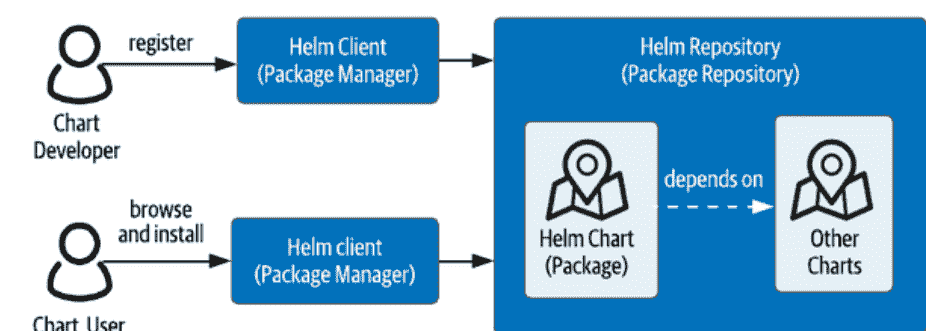
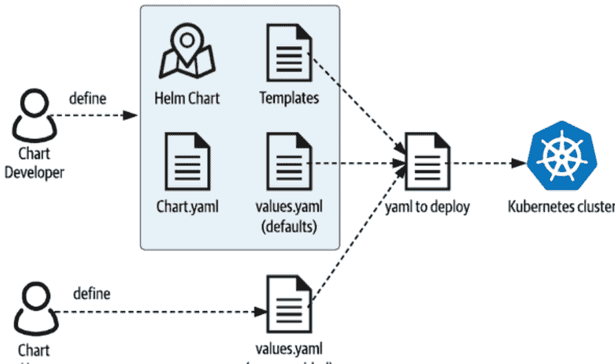
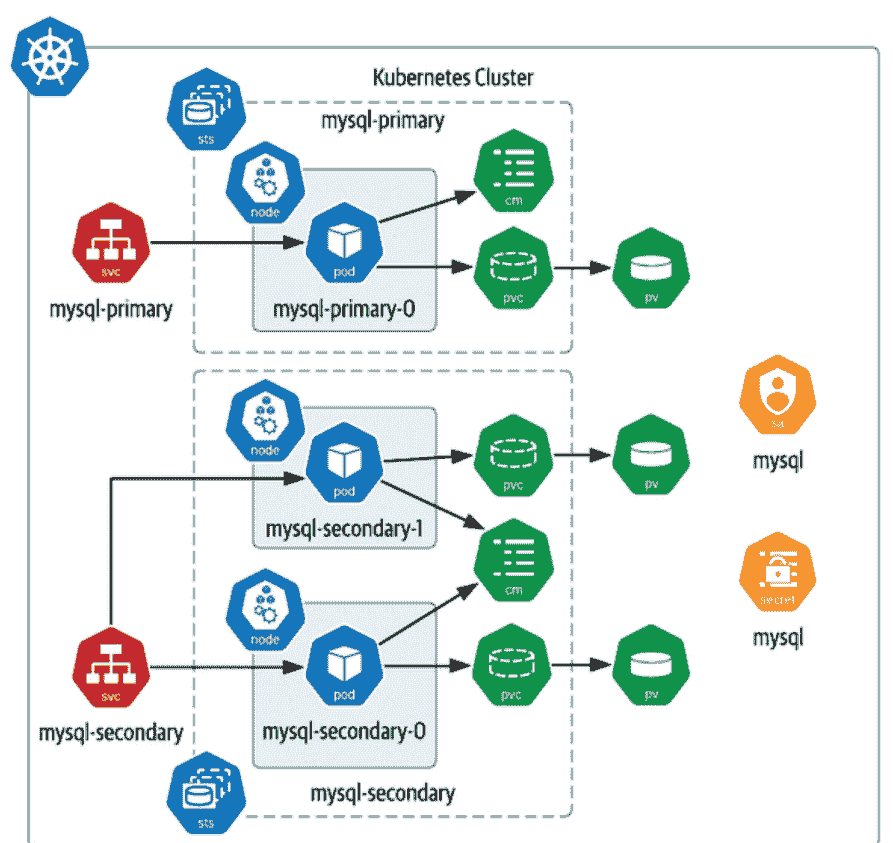
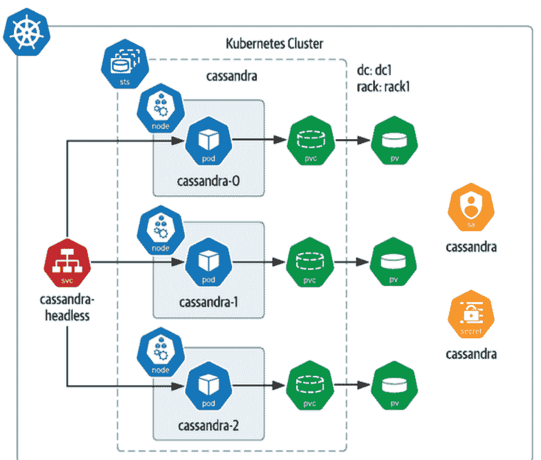

## 第 4 章. 使用 Helm 在 Kubernetes 上自动化数据库部署

### 早期发布读者的说明

使用 Early Release 电子书，你可以在官方发布这些标题之前很久就利用这些技术——作者在写作时提供的原始未编辑内容。

这将是最终书籍的第 4 章。请注意，本书的代码示例可在 https://github.com/data-on-k8s-book 获取。

如果你对如何改进本书的内容和/或示例有任何评论，或者如果你注意到本章中缺少材料，请联系编辑 jleonard@oreilly.com。

在上一章中，你学习了如何通过手工方式在 Kubernetes 上部署单节点和多节点数据库，一次创建一个元素。我们故意选择“困难的方式”，以帮助最大化你对如何利用 Kubernetes 原语来设置数据库所需的计算、网络和存储资源的理解。当然，这并不代表在 Kubernetes 上运行数据库的生产体验，原因有几个。

首先，团队通常不会手工部署数据库，一次一个 yaml 文件。那会相当乏味。即使将配置合并到单个文件中，对于更复杂的部署也可能变得相当复杂。考虑第 3 章中 Cassandra 作为多节点数据库所需的配置量增加，与单节点 MySQL 部署相比。本章中，我们将介绍有助于标准化数据库和其他应用程序部署的工具，减少你需要编写的配置代码量。

其次，虽然部署数据库很棒，但如何让它随时间保持运行呢？你需要我们的数据基础设施长期保持可靠和高效，而数据基础设施以需要大量维护而闻名。换句话说，运行系统的任务通常分为“第 1 天”——将应用程序部署到生产环境的欢乐日子，以及“第 2 天”——代表第一天之后每一天，你需要在保持高可用性的同时操作和演进你的应用程序。我们将在接下来的两章中开始解决数据基础设施操作，并在本书的其余部分贯穿这一主题。

### 使用 Helm charts 部署应用程序

首先，让我们看一个帮助你管理配置复杂性的工具：Helm。Helm 是 Kubernetes 的包管理器，是开源的并且是 CNCF 成熟项目。包管理器的概念在多种编程语言中很常见，例如 Python 的 pip、JavaScript 的 Node Package Manager（NPM）以及 Ruby 的 Gems 功能。还有针对特定操作系统的包管理器，例如 Linux 的 Apt 或 MacOS 的 Homebrew。如图 4-1 所示，包管理系统的基本要素是包、存储包的注册表，以及帮助用户在其本地系统上定位、安装和更新包的包管理器应用程序（或“客户端”）。



图 4-1. Helm，Kubernetes 的包管理器

Helm 将包管理概念扩展到 Kubernetes，并有一些有趣的差异。如果你使用过上面列出的包管理器之一，你会熟悉包由二进制文件（可执行代码）以及描述二进制文件的元数据组成，例如其功能、API 和安装说明。在 Helm 中，包称为 charts。然而，与直接包含二进制文件不同，charts 提供了如何使用前几章中介绍的 Kubernetes 计算、网络和存储资源，一步一步构建 Kubernetes 应用程序的描述。二进制文件是容器镜像，被引用在 charts 内的计算工作负载定义中，这些镜像位于公共或私有容器注册表中。

Helm 允许 charts 引用其他 charts 作为依赖项，这提供了一种通过创建 charts 组合来组合应用程序的绝佳方式。例如，你可以通过定义一个引用你希望重用的 MySQL 部署的 chart 的 Wordpress 部署 chart，来定义一个应用程序，例如上一章中的 Wordpress / MySQL 示例。或者，你甚至可以找到一个 Helm chart 定义了包含数据库的整个 Wordpress 应用程序。

### KUBERNETES 环境先决条件

本章中的示例假设你有权访问具有以下几个特征的 Kubernetes 集群：

- 集群应至少有 3 个工作节点，以便演示 Kubernetes 提供的机制，让你请求 Pod 在集群中分布。你可以在桌面上使用名为 Kind 的开源发行版创建一个简单集群。参见 Kind 快速入门指南，了解安装 Kind 并创建多节点集群的说明。此示例的代码还包含一个配置文件，你可能觉得有用，可以创建一个简单的三节点 Kind 集群（源代码）。
- 你还需要一个支持动态配置的 StorageClass。你可能希望按照 StorageClasses 类部分中的说明安装一个简单的 StorageClass 和配置程序，以公开本地存储（源代码）。

### 使用 Helm 部署 MySQL

为了让事情更具体一些，让我们使用 Helm 部署你在第 3 章中使用的数据库。首先，你需要使用 Helm 网站上的文档在你的系统上安装 Helm。接下来，添加 Bitnami Helm 仓库：

```
helm repo add bitnami https://charts.bitnami.com/bitnami
```

Bitnami Helm 仓库包含各种 Helm charts，可帮助你部署基础设施，例如数据库、分析引擎和日志管理系统，以及包括电子商务、客户关系管理（CRM）和你猜对了：Wordpress 在内的应用程序。你可以在 GitHub 上的 Bitnami Charts 仓库中找到 charts 的源代码。此仓库的 README 提供了在各种 Kubernetes 发行版中使用 charts 的有帮助说明。

现在，让我们使用 bitnami 仓库提供的 Helm chart 部署 MySQL。在 Helm 的术语中，每个部署都称为 release。使用此 chart 可以创建的最简单的 release 看起来像这样：

```
### don’t execute me yet!
helm install mysql bitnami/mysql
```

如果你执行此命令，它将使用默认设置，使用 Bitnami MySQL Helm chart 创建一个名为 `mysql` 的 release。结果你将拥有一个单节点 MySQL。由于你已在第 3 章中手动部署了单节点 MySQL，让我们这次做点更有趣的事情并创建一个 MySQL 集群。为此，你将创建一个 `values.yaml` 文件，其内容如下（或重用源代码中提供的 [sample]( )）：

```
architecture: replication
secondary:
  replicaCount: 2
```

此 `values.yaml` 文件中的设置让 Helm 知道你希望使用 Bitnami MySQL Helm chart 中的选项，以复制架构部署 MySQL，其中有一个主节点和两个从节点。


### MYSQL HELM CHART 配置选项

如果你查看随 Bitnami MySQL Helm chart 提供的默认 values.yaml 文件，你会看到除了这里展示的简单选项之外，还有相当多的可用选项。可配置的值包括以下内容：

- 要拉取的镜像及其位置
- 将用于生成 PersistentVolumes 的 Kubernetes StorageClass
- 用户和管理员账户的安全凭证
- 主库和从库副本的 MySQL 配置设置
- 要创建的从库副本数量
- 存活探针、就绪探针的详细信息
- 亲和性和反亲和性设置
- 使用 Pod 干扰预算管理数据库的高可用性

其中许多概念你已经熟悉了，而像亲和性和 Pod 干扰预算之类的内容将在本章后面介绍。

创建 values.yaml 文件后，你可以使用以下命令启动集群：

```
helm install mysql bitnami/mysql -f values.yaml
```

运行该命令后，你会从 Helm 看到安装状态，以及 chart 下 NOTES 中提供的说明：

```
NAME: mysql
LAST DEPLOYED: Thu Oct 21 20:39:19 2021
NAMESPACE: default
STATUS: deployed
REVISION: 1
TEST SUITE: None
NOTES:
...
```

我们在这里省略了说明，因为内容有点长。它们描述了在 MySQL 初始化时监控状态的建议命令、客户端和管理员如何连接数据库、如何升级数据库等。

### 使用命名空间帮助隔离资源

从上面的输出中你会注意到，Helm release 已安装在默认的 Kubernetes 命名空间中。如果你想将 Helm release 安装到自己的命名空间中以便更有效地处理其资源，你可以运行类似以下命令：

```
helm install mysql bitnami/mysql --namespace mysql --create-namespace
```

这会创建一个名为 mysql 的命名空间，并在其中安装 mysql release。

要获取你创建的 Helm release 的信息，请使用 helm list 命令，其输出如下所示（为可读性而格式化）：

```
NAME NAMESPACE REVISION UPDATED
mysql default 1 2021-10-21 20:39:19
```

```
STATUS CHART APP VERSION
deployed mysql-8.8.8 8.0.26
```

如果你没有在自己的命名空间中安装 release，查看 Helm 为你创建的计算资源仍然很简单，因为它们都已用 release 名称进行了标记：

```
NAME READY STATUS RESTARTS AGE
pod/mysql-primary-0 1/1 Running 0 3h40m
pod/mysql-secondary-0 1/1 Running 0 3h40m
pod/mysql-secondary-1 1/1 Running 0 3h38m
```

```
NAME                 TYPE        CLUSTER-IP      EXTERNAL-IP   PORT(S)    AGE
service/mysql-primary        ClusterIP   10.96.107.156   <none>        3306/TCP   3h40m
service/mysql-primary-headless   ClusterIP   None            <none>        3306/TCP   3h40m
service/mysql-secondary      ClusterIP   10.96.250.52    <none>        3306/TCP   3h40m
service/mysql-secondary-headless   ClusterIP   None            <none>        3306/TCP   3h40m
```

```
NAME                              READY   AGE
statefulset.apps/mysql-primary        1/1     3h40m
statefulset.apps/mysql-secondary      2/2     3h40m
```

正如你所见，Helm 创建了两个 StatefulSets，一个用于主副本，一个用于从副本。mysql-primary StatefulSet 管理着一个包含主副本的 MySQL Pod，而 mysql-secondary StatefulSet 管理着两个包含从副本的 MySQL Pod。尝试使用 kubectl describe pod 命令确定每个 MySQL 副本运行在哪个 Kubernetes 工作节点上。

从上面的输出中，你还会注意到为每个 StatefulSet 创建了两个服务，一个是无头服务，另一个具有专用的 IP 地址。由于 kubectl get all 仅告诉你有关计算资源和服务的信息，你可能还想知道存储资源的情况。要检查这些资源，请运行 kubectl get pv 命令。假设你已安装了一个支持动态供给的 StorageClass，你应该会看到绑定到名为 data-mysql-primary-0、data-mysql-secondary-0 和 data-mysql-secondary-1 的 PersistentVolumeClaims 的 PersistentVolumes。

除了我们上面讨论的资源之外，安装 chart 还导致创建了一些额外的资源，我们将在下面进行探讨。

### 命名空间和 Kubernetes 资源作用域

如果你选择在命名空间中安装 Helm release，你需要在大多数 `kubectl get` 命令中指定命名空间才能看到创建的资源。例外情况是 `kubectl get pv`，因为 PersistentVolumes 是 Kubernetes 资源之一，它不是命名空间的，即它可以被任何命名空间中的 Pod 使用。要了解集群中哪些 Kubernetes 资源是命名空间的，哪些不是，请运行命令 `kubectl api-resources`。

### Helm 的工作原理

你是否想过在执行 `helm install` 命令并提供 values 文件时会发生什么？为了了解发生了什么，让我们看看 Helm chart 的内容，如图 4-2 所示。在讨论这些内容时，查看你刚刚安装的 MySQL Helm chart 的源代码也会很有帮助。



*Figure 4-2. Customizing a Helm release using a values.yaml file*

查看 Helm chart 的内容，你会注意到以下内容：

- 一个 [README](README) 文件，解释如何使用 chart。这些说明与 chart 一起提供在注册表中。
- 一个 [Chart.yaml](Chart.yaml) 文件，包含有关 chart 的元数据，例如其名称、发布者、版本、关键字以及对其他 chart 的任何依赖。这些属性在搜索 Helm 注册表以查找 chart 时很有用。
- 一个 [values.yaml](values.yaml) 文件，列出了 chart 支持的可配置值及其默认值。这些文件通常包含大量注释来解释可用选项。对于 Bitnami MySQL Helm chart，可用选项很多，正如我们上面所指出的。
- 一个 [templates](templates) 目录，包含定义 chart 的 [Go templates](Go templates)。模板包括一个 [Notes.txt](Notes.txt) 文件，用于在执行 `helm install` 命令后生成你在上面看到的输出，以及一个或多个 `yaml` 文件，用于描述 Kubernetes 资源的模式。这些 yaml 文件可能组织在子目录中，例如定义 MySQL 主副本 StatefulSet 的 [template](template)。最后，还有一个 `_helpers.tpl` 文件，描述如何使用模板。某些模板可能根据所选的配置值被多次使用或根本不使用。

当你执行 `helm install` 命令时，Helm 客户端会通过检查源仓库来确保它拥有你命名的 chart 的最新副本。然后它会系统地应用模板来生成 yaml 配置代码，同时用你提供的任何值覆盖 chart 的 `values.yaml` 文件中的默认值。然后它使用 `kubectl` 命令将此配置应用到你当前配置的 Kubernetes 集群。

如果你想在应用之前查看 Helm chart 将产生的配置，可以使用一个方便的 `template` 命令。它支持与 `install` 命令相同的语法：

```
helm template mysql bitnami/mysql -f values.yaml
```

运行此命令会产生相当多的输出，因此你可能希望将其通过管道传输到文件（在命令末尾添加 “> values-template.yaml”）以便更长时间地查看。或者，你也可以查看我们在源代码仓库中保存的副本。

你会注意到创建了几种不同类型的资源，如图 4-3 所示。许多所示资源已在上面讨论过，包括用于管理主副本和从副本的 StatefulSets，每个都有自己的服务（chart 还创建了图中未显示的无头服务）。每个 Pod 都有自己的 PersistentVolumeClaim，它映射到唯一的 Persistent Volume。

图 4-3 还包括我们之前未讨论过的资源类型。首先注意，每个 StatefulSet 都有一个关联的 ConfigMap，用于向其 Pod 提供一组通用的配置设置。接下来，注意有一个名为 mysql 的 Secret，它存储访问数据库节点公开的各种接口所需的密码。最后，还有一个 ServiceAccount 资源，它应用于此 Helm release 创建的每个 Pod。




图 4-3. 使用 Bitnami Helm Chart 部署 MySQL

让我们关注一下此部署的一些有趣方面，包括 Labels、ServiceAccounts、Secrets 和 ConfigMaps 的使用。

### Labels

如果查看 helm template 的输出，你会注意到资源具有一组共同的标签：

```
labels:
  app.kubernetes.io/name: mysql
  helm.sh/chart: mysql-8.8.8
```

```
app.kubernetes.io/instance: mysql
app.kubernetes.io/managed-by: Helm
```

这些标签有助于将资源识别为 mysql 应用的一部分，并表明它们由 Helm 使用特定 chart 版本进行管理。标签对于选择资源很有用，这在为其他资源定义配置时经常很有用。

### ServiceAccounts

Kubernetes 集群为了访问控制目的，会区分人类用户和应用程序。ServiceAccount 是 Kubernetes 资源，表示一个应用程序及其被允许访问的内容。例如，ServiceAccount 可能会被授予访问 Kubernetes API 的某些部分的权限，或访问包含特权信息（如登录凭据）的一个或多个 secret 的权限。后一种功能在你的 Helm 安装 MySQL 中用于在 pod 之间共享凭据。

在 Kubernetes 中创建的每个 pod 都会分配一个 ServiceAccount。如果未指定，则使用默认 ServiceAccount。安装 MySQL Helm chart 会创建一个名为 mysql 的 ServiceAccount。你可以在生成的模板中看到此资源的规范：

```
apiVersion: v1
kind: ServiceAccount
metadata:
  name: mysql
  namespace: default
  labels: ...
  annotations:
secrets:
  - name: mysql
```

如你所见，此 ServiceAccount 可以访问一个名为 mysql 的 secret，我们稍后会讨论，但并未使用 ServiceAccount 的其他功能：

- ServiceAccount 还可以具有一种额外的 secret 类型，称为 `imagePullSecret`。这些 secret 在应用程序需要使用私有仓库中的镜像时使用。
- 默认情况下 ServiceAccount 没有任何访问 Kubernetes API 的权限。要添加此权限，你需要创建一个 RoleBinding。

有关更多详细信息，请参阅 Kubernetes 文档中关于 [managing ServiceAccounts](https://) 和为 [role-based access](https://) 配置它们的说明。

### Secrets

正如你在第 2 章中学到的，Secret 提供对你需要保密的信息的安全访问。你的 `mysql` Helm release 包含一个名为 `mysql` 的 Secret，其中包含 MySQL 实例本身的登录凭据：

```
apiVersion: v1
kind: Secret
metadata:
  name: mysql
  namespace: default
  labels: ...
type: Opaque
data:
  mysql-root-password: "VzhyNEhIcmdTTQ=="
  mysql-password: "R2ZtNkFHNDhpOQ=="
  mysql-replication-password: "bDBiTWVzVmVORA=="
```

这三种不同的密码代表不同类型的访问：`mysql-root-password` 提供对 MySQL 节点的管理访问，而 `mysql-replication-password` 用于节点之间进行数据复制通信。`mysql-password` 由客户端应用程序用于访问数据库以写入和读取数据。

### ConfigMaps

Bitnami MySQL Helm chart 创建 Kubernetes ConfigMap 资源来表示用于运行 MySQL 主节点和辅助副本节点 pod 的配置设置。ConfigMaps 以键值对的形式存储配置数据。例如，Helm chart 为主副本创建的 ConfigMap 看起来像这样：

```
apiVersion: v1
kind: ConfigMap
metadata:
  name: mysql-primary
  namespace: default
  labels: ...
data:
  my.cnf: |-
    
    [mysqld]
    default_authentication_plugin=mysql_native_password
    ...
```

在这种情况下，键是名称 my.cnf，表示文件名，值是多行配置设置，表示配置文件的内容（我们在此做了简化）。接下来，查看主副本的 StatefulSet 定义。注意 ConfigMap 的内容如何根据 StatefulSet 的 pod 规范挂载为每个模板中的只读文件（同样，我们省略了一些细节以聚焦关键区域）：

```
apiVersion: apps/v1
kind: StatefulSet
metadata:
  name: mysql-primary
  namespace: default
  labels: ...
spec:
  replicas: 1
  selector:
    matchLabels: ...
  serviceName: mysql-primary
  template:
    metadata:
      annotations: ...
      labels: ...
```

```
spec:
  ...
  serviceAccountName: mysql
  containers:
    - name: mysql
      image: docker.io/bitnami/mysql:8.0.26-debian-10-r60
      volumeMounts:
        - name: data
          mountPath: /bitnami/mysql
        - name: config
          mountPath: /opt/bitnami/mysql/conf/my.cnf
          subPath: my.cnf
  volumes:
    - name: config
      configMap:
        name: mysql-primary
```

将 ConfigMap 作为卷挂载到容器中会在挂载目录中创建一个只读文件，其名称根据键命名，内容为值。对于我们的示例，将 ConfigMap 挂载到 pod 的 mysql 容器中会创建文件 /opt/bitnami/mysql/conf/my.cnf。

这只是 ConfigMaps 在 Kubernetes 应用程序中使用的几种方式之一：

- 如 Kubernetes 文档所述，你可以选择以更细粒度的键值对形式存储配置数据，这也使得在应用程序中访问单个值变得更容易
- 你也可以将单个键值对作为环境变量引用传递给容器
- 最后，应用程序可以通过 Kubernetes API 访问 ConfigMap 内容

### MORE CONFIGURATION OPTIONS

现在你有一个运行中的 MySQL 集群的 Helm release，你可以让应用程序指向它，例如 Wordpress。为什么不试试看能否将第 3 章中的 Wordpress 部署适配到你在此创建的 MySQL 集群。

为了进一步学习，你还可以将你的最终配置与 Bitnami Wordpress Helm Chart 生成的配置进行比较，该 Chart 使用 MariaDB 而不是 MySQL，但其他方面非常相似。

### Updating Helm Charts

如果你在生产环境中运行 Helm release，很可能需要随着时间的推移对其进行维护。有几个原因可能需要更新 Helm release：

- 有新版本的 chart 可用
- 应用程序使用的镜像有新版本可用
- 你想更改所选的选项

要检查 chart 的新版本，请执行 helm repo update 命令。运行此命令而不带选项会查找你为 helm 客户端配置的所有 chart 仓库的更新：

```
helm repo update
Hang tight while we grab the latest from your chart
repositories...
...Successfully got an update from the "bitnami" chart repository
Update Complete. *Happy Helming!*
```

接下来，你需要对配置的值进行任何期望的更新。如果升级到新版本的 chart，请务必检查可配置值的发行说明和文档。最好在应用之前测试升级。--dry-run 选项允许你这样做，产生的输出与 helm template 命令类似：

```
helm upgrade mysql bitnami/mysql -f values.yaml --
```

dry-run

### USING AN OVERLAY CONFIGURATION FILE

升级时可用的一个有用选项是指定一个新配置文件，其中包含你希望覆盖的值，并同时应用新旧配置，像这样：

```
helm upgrade mysql bitnami/mysql -f
values.yaml -f new-values.yaml
```

请注意，配置文件按它们在命令行中出现的顺序应用，因此如果你采用这种方法，请确保你的覆盖值文件出现在原始值文件之后。

一旦应用了升级，Helm 就会开始工作，只更新受配置更改影响的 release 中的资源。如果你指定了 StatefulSet 的 pod 模板更改，pod 将根据为 StatefulSet 指定的更新策略重新启动，正如我们在 Managing the lifecycle of a StatefulSet 中讨论的那样。

### Uninstalling Helm charts

当你完成使用 Helm release 时，可以按名称卸载它，如下所示：

```
helm uninstall mysql
```

请注意，Helm 不会删除为此 Helm chart 创建的任何 PersistentVolumeClaims 或 PersistentVolumes，这遵循第 3 章中讨论的 StatefulSets 的行为。


### 其他部署工具：Kustomize 和 Skaffold

除了 Helm 之外，Kubernetes 生态系统中还有其他工具可以帮助你管理应用程序的配置和部署，例如 Kustomize 和 Skaffold。

Kustomize 是 Kubernetes 的配置管理工具。与包管理器不同，Kustomize 不提供注册表；其重点是帮助你管理不同环境的 Kubernetes 配置 yaml 文件。Kustomize 使用基于模板的方法，其中你创建称为 overlays 的配置代码片段，旨在覆盖基础 yaml 文件的各个部分。这些 overlays 通常用于不同的环境，例如开发、测试和生产，或用于隔离特定于不同 Kubernetes 提供商的配置，其效果类似于 Helm 的 `values.yaml` 文件。要覆盖的部分由选择器标识，例如 Kubernetes 标签或注释。你提供一个 `kustomization.yaml` 文件来描述模板与其选择器的映射关系。当你想要自定义的 yaml 文件结构良好并使用标签或注释时，Kustomize 工作效果最佳。

Skaffold 是一个在开发环境中自动化应用程序部署的工具。你可以从命令行以命令式方式执行 Skaffold，或作为守护进程运行以监视代码更改来构建工件，例如容器镜像。当它检测到相关更改时，守护进程会根据你在 `skaffold.yaml` 文件中定义的 workflow 自动执行操作。workflow 可以包括构建和标记镜像、更新 Helm charts 或常规 Kubernetes 配置文件，以及使用 kubectl、helm 或 Kustomize 部署应用程序等操作。

### 使用 Helm 部署 Apache Cassandra

现在让我们转换思路，看看如何使用 Helm 部署 Apache Cassandra。在本节中，你将使用 Bitnami 提供的另一个 chart，因此无需添加另一个仓库。你可以在 GitHub 上找到此 chart 的实现。Helm 提供了快速查看此 chart 元数据的便捷方式：

```
helm show chart bitnami/cassandra
```

在查看元数据后，你还想了解可配置的值。你可以查看 GitHub 仓库中的 values.yaml 文件，或使用 show 命令的另一个选项：

```
helm show values bitnami/cassandra
```

此 chart 的选项列表比 MySQL chart 的列表短，因为 Cassandra 没有主从副本的概念。然而，你肯定会看到类似的用于镜像、存储类、安全、存活探针和就绪探针等的选项。还有一些特定于 Cassandra 的配置选项，例如与 JVM 设置和种子节点相关的选项（在第 3 章中讨论过）。

此 chart 的一个有趣功能是可以从 Cassandra 节点导出指标。如果将 metrics.enabled=true 设置为 true，chart 将在每个 Cassandra pod 中注入一个 sidecar 容器，该容器公开一个端口，可由 Prometheus 抓取。metrics 下的其他值配置导出的指标、收集频率等。虽然我们在此不会使用此功能，但指标报告是我们将在第 6 章中介绍的管理数据基础设施的关键部分。

对于简单的三节点 Cassandra 配置，你可以将副本数设置为三，并让其他配置值保持默认值。然而，由于你只覆盖了单个配置值，这是一个利用 Helm 在命令行上设置值的支持的好时机，而不是提供 values.yaml 文件：

```
helm install cassandra bitnami/cassandra --set replicaCount=3
```

如上所述，你可以使用 helm template 命令在安装前检查配置，或查看我们在 GitHub 上保存的文件。然而，由于你已经创建了 release，你也可以使用此命令：

```
helm get manifest cassandra
```

浏览 yaml 中的资源，你会看到已建立了类似的基础设施，如图 4-4 所示：



图 4-4. 使用 Bitnami Helm Chart 部署 Apache Cassandra

配置包括：

- 一个引用 Secret 的 ServiceAccount，其中包含 `cassandra` 管理员账户的密码。
- 一个单一的 StatefulSet，使用 headless Service 来引用其 Pods。Pods 在可用的 Kubernetes worker 节点上均匀分布，我们将在稍后在亲和性和反亲和性部分讨论这一点。该 Service 公开了 Cassandra 用于节点间通信的端口（7000，7001 用于通过 TLS 的安全通信）、通过 JMX 进行管理（7199）以及通过 CQL 进行客户端访问（9042）。

此配置代表了一个非常简单的 Cassandra 拓扑，所有三个节点都在单个数据中心和机架中。此简单拓扑反映了此 chart 的一个限制——它不提供创建由多个数据中心和机架组成的 Cassandra 集群的能力。要创建更复杂的部署，你必须安装多个 Helm releases，使用相同的 `clusterName`（在此情况下你使用默认名称 `cassandra`），但每个部署使用不同的数据中心和机架。你还需要获取第一个数据中心中几个节点的 IP 地址，以便在为其他机架配置 releases 时用作 `additionalSeeds`。

### 亲和性和反亲和性

如 图 4-4 所示，Cassandra 节点在集群中的 worker 节点上均匀分布。要在你自己的 Cassandra release 中验证这一点，你可以运行类似以下命令：

```
kubectl describe pods | grep "^Name:" -A 3
Name:            cassandra-0
Namespace:       default
Priority:        0
Node:            kind-worker/172.20.0.7
--
Name:            cassandra-1
Namespace:       default
Priority:        0
Node:            kind-worker2/172.20.0.6
--
Name:            cassandra-2
Namespace:       default
Priority:        0
Node:            kind-worker3/172.20.0.5
```

正如你在此输出中看到的，每个 Cassandra 节点都在不同的 worker 节点上运行。如果你的 Kubernetes 集群至少有 3 个 worker 节点并且没有其他工作负载，你可能会观察到类似的行为。虽然在集群中 worker 节点负载均衡的情况下，这种均匀分配可能是自然发生的，但在生产环境中可能并非如此。然而，为了促进数据的最大可用性，我们希望尽量尊重 Cassandra 架构的意图，即在不同机器上运行节点以促进高可用性。

为了帮助保证这种隔离，Bitnami Helm chart 使用了 Kubernetes 的亲和性功能，特别是反亲和性。如果你检查 cassandra StatefulSet 生成的配置，你会看到以下内容：

```
apiVersion: apps/v1
kind: StatefulSet
metadata:
  name: cassandra
  namespace: default
  labels: ...
spec:
  ...
  template:
    metadata:
      labels: ...
    spec:
      ...
      affinity:
        podAffinity:

        podAntiAffinity:
          preferredDuringSchedulingIgnoredDuringExecution:
            - podAffinityTerm:
                labelSelector:
                  matchLabels:
                    app.kubernetes.io/name: cassandra
                    app.kubernetes.io/instance: cassandra
                namespaces:
                  - "default"
                topologyKey: kubernetes.io/hostname
                weight: 1
        nodeAffinity:
```

如图所示，pod 模板规范列出了三种可能的亲和性类型，只有 podAntiAffinity 被定义。这些概念是什么意思？

#### Pod 亲和性

Pod 亲和性是指 Pod 被调度到另一个特定 Pod 正在运行的节点上的偏好。例如，pod 亲和性可用于将 Web 服务器与其缓存同地放置。

#### Pod 反亲和性

Pod 反亲和性与 Pod 亲和性相反；即 Pod 不被调度到另一个已识别 Pod 正在运行的节点上的偏好。这是本示例中使用的约束，我们将在稍后讨论。

#### 节点亲和性

节点亲和性是指 Pod 在具有特定特征的节点上运行的偏好。

每种亲和性类型都可以表示为硬约束或软约束，称为 `requiredDuringSchedulingIgnoredDuringExecution` 和 `preferredDuringSchedulingIgnoredDuringExecution`。第一个约束指定在 Pod 被调度到节点之前必须满足的规则，而第二个约束指定调度程序将尝试满足的偏好，但在必要时为调度 Pod 可能会放宽。名称中的 `IgnoredDuringExecution` 引用意味着约束仅在 Pods 首次调度时适用。未来将添加新的 `RequiredDuringExecution` 选项，称为 `requiredDuringSchedulingRequiredDuringExecution` 和 `requiredDuringSchedulingIgnoredDuringExecution`。这些将要求 Kubernetes 驱逐不再满足条件的 pod（即将其移动到另一个节点），例如其标签发生变化时。

查看上面的示例，Cassandra StatefulSet 的 Pod 模板规范使用应用于每个 Cassandra pod 的标签指定了一个反亲和性规则。其净效果是 Kubernetes 将尝试在可用的 worker 节点上分散 Pods。


### 更多 Kubernetes 调度约束

Kubernetes 支持额外的机制，为其调度器提供关于 Pod 放置的提示。其中最简单的是 NodeSelectors，它与节点亲和性非常相似，但语法表达能力较弱，可以使用 AND 逻辑匹配一个或多个标签。由于您可能拥有也可能不拥有在集群中的工作节点上附加标签所需的权限，因此 pod 亲和性通常是更好的选择。污点和容忍度是另一种机制，可用于配置工作节点以排斥特定 Pod 被调度到这些节点上。

总体而言，您需要小心理解您从各种工作负载对 Kubernetes 调度器施加的所有约束，以免过度限制其放置 Pod 的能力。有关调度约束的更多信息，请参阅 Kubernetes 文档。

以上就是查看 Bitnami Helm chart for Cassandra 的要点。为了清理，卸载 Cassandra release：

```
helm uninstall cassandra
```

如果您不再想使用 Bitnami Helm charts，您也可以从 Helm 客户端中删除该仓库：

```
helm repo remove bitnami
```

### Helm 的局限性

虽然 Helm 是将复杂应用程序部署到 Kubernetes 集群的强大工具，但在管理这些应用程序的运维方面存在一些局限性。为了更好地了解所涉及的挑战，我们采访了一位构建了 Helm chart 组合来管理复杂数据库部署的从业者。此讨论开始介绍 Kubernetes 自定义资源定义

(CRD) 和 operator 模式等概念，我们将在第 5 章中深入介绍。

### 将 Helm 推向极限

与 John Sanda，软件工程师，DataStax 合作

K8ssandra 是基于多个开源组件构建的 Apache Cassandra® 在 Kubernetes 上的发行版，包括 Cassandra operator（cass-operator），以及用于管理反熵修复（Reaper）和备份（Medusa）的运维工具。K8ssandra 还包括用于指标收集和报告的 Prometheus-Grafana 堆栈。

从一开始，我们就使用 Helm 来帮助管理这些组件的安装和配置。Helm 使我们能够快速启动项目并吸引 Cassandra 社区中不一定拥有太多 Kubernetes 专业知识和经验的开发者。其中许多人发现像 Helm 这样的包管理工具和安装程序很容易理解。

随着项目的增长，我们开始遇到 Helm 的一些局限性。虽然让 K8ssandra 集群的安装正常工作相当直接，但在升级和管理集群时我们遇到了更多问题。

#### 编写复杂逻辑

Helm 对控制流有良好的支持，包括循环和 if 语句。然而，当你开始深入多层时，代码更难阅读和推理，缩进也会成为问题。特别是，我们发现对 Helm chart 的更改进行同行评审变得相当困难。

#### 重用和可扩展性

Helm 变量仅限于声明它们的模板的作用域，这意味着我们必须在多个模板中重新创建相同的变量。这阻止了我们保持代码 DRY，我们发现这是缺陷的来源。

同样，Helm 有一个庞大的 helper 模板函数库，但该库并不涵盖每种用例，也没有接口来定义自己的函数。您可以定义自己的自定义模板，这允许大量重用，但它们不能替代函数。

#### 项目结构和继承

我们在尝试实现伞形 chart 设计模式时也遇到了困难，这是 Helm 的最佳实践。我们能够创建顶层的 K8ssandra Helm chart，并为 Cassandra 和 Prometheus 创建子 chart，但在尝试创建额外的子 chart 时遇到了变量作用域问题。我们的意图是在顶层 chart 中定义身份验证设置并将其推送到子 chart，但此功能不被 Helm 继承模型支持。

#### 自定义资源管理

Helm 可以创建 Kubernetes 自定义资源，但它不会管理它们。这是 Helm 3 的 Helm 开发者做出的有意设计选择。因为自定义资源的定义是集群范围的，如果多个 Helm 安装尝试使用不同版本的 CRD，则会变得混乱。这给我们管理 Helm 中 Cassandra 数据中心等资源的更新带来了一些困难。我们实施的变通方法是在升级时由 Helm 执行的预升级钩子中实现自定义 Kubernetes 作业。到了某个时候，编写这些作业开始感觉像我们在编写 operator。

#### 多集群部署

虽然我们在许多情况下能够解决这些 Helm 挑战，但我们路线图上的下一个主要功能是实现跨多个 Kubernetes

集群的 Cassandra 集群。我们意识到，即使不考虑网络配置的复杂性，这也将超出我们使用 Helm 有效实现的能力。

最终，我们意识到我们试图让 Helm 做太多事情。很容易陷入一种情况，即你学会了使用锤子，一切看起来都像钉子，但你真正需要的是螺丝刀。然而，我们不认为 Helm 和 operator 是相互排斥的。这些是互补的方法，我们需要根据各自的优势使用它们。我们继续使用 Helm 执行基本安装操作，包括安装 operator 和设置 Cassandra 及其他组件使用的管理员服务帐户；这些是像 Helm 这样的包管理器最擅长的操作。

注意：本节改编自文章 [We Pushed Helm to the Limit, then Built a Kubernetes Operator]( )。

### 总结

在本章中，您了解了像 Helm 这样的包管理工具如何帮助您管理在 Kubernetes 上部署应用程序，包括您的数据库基础设施。在此过程中，您还了解了如何使用一些额外的 Kubernetes 资源，如 ServiceAccounts、Secrets 和 ConfigMaps。现在是时候完善我们关于在 Kubernetes 上运行数据库的讨论了。在下一章中，我们将更深入地探讨使用 operator 模式在 Kubernetes 上管理数据库运维。
