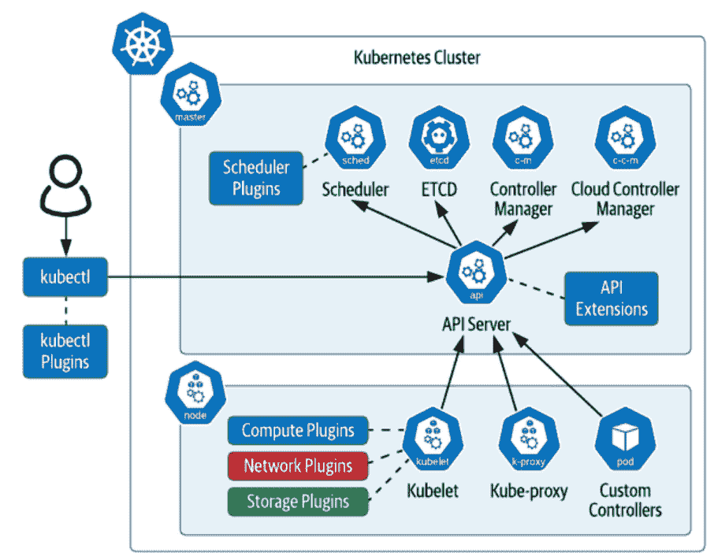
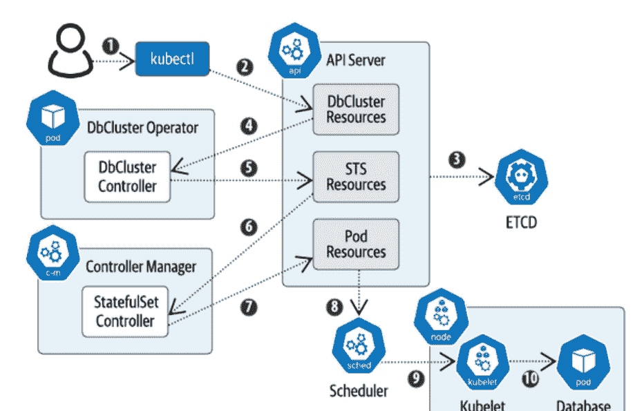
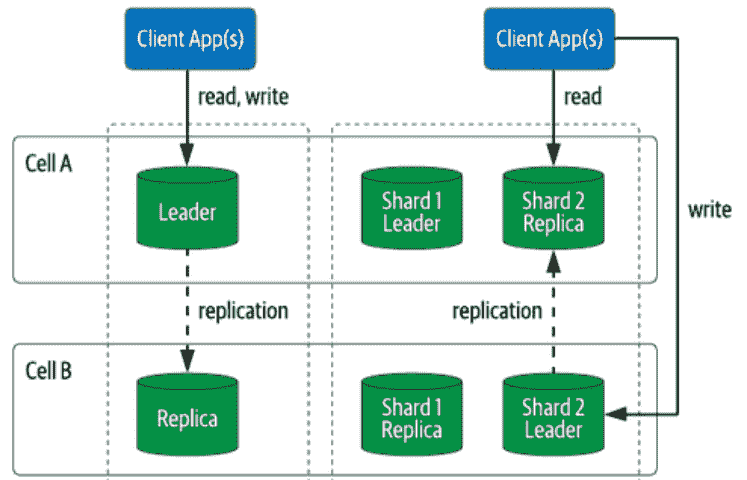
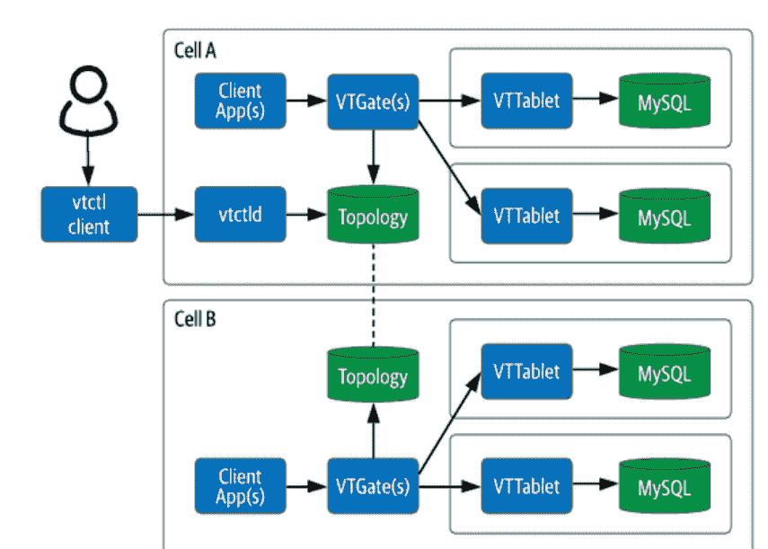
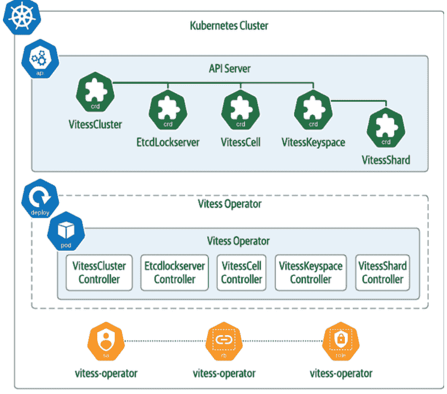

## 第 5 章. 使用 Operator 在 Kubernetes 上自动化数据库管理

### 早期发布读者的说明

使用 Early Release 电子书，您可以在这些书籍的正式发布之前很久就利用这些技术——作者在撰写时的原始和未编辑内容。

这将是最终书籍的第 5 章。请注意，本书的代码示例可在 https://github.com/data-on-k8s-book 获取。

如果您对如何改进本书的内容和/或示例有任何意见，或者如果您注意到本章中缺少材料，请联系编辑 jleonard@oreilly.com。

在本章中，我们将继续探讨在 Kubernetes 上运行数据库，但将重点从安装转移到运维。仅仅知道数据库应用程序的元素如何映射到 Kubernetes 为初始部署提供的原语是不够的。您还需要知道如何随着时间的推移维护该基础设施，以支持您的业务关键型应用程序。在本章中，我们将了解 Kubernetes 的运维方法，以便您可以有效地保持数据库运行。

数据库和其他数据基础设施的运维包括常见的“第二天”任务列表，例如：

- 扩展容量上下，包括在调整大小的集群之间重新分配工作负载
- 监控数据库健康并替换失败（或即将失败）的实例
- 执行例行维护任务，例如 Apache Cassandra 中的修复操作
- 更新和修补软件
- 维护可能随时间推移而过期的安全访问密钥和其他凭据
- 执行备份，并在灾难恢复场景中使用备份恢复数据

虽然执行这些任务的细节可能因技术而异，但共同的关注点是我们如何使用自动化来减少人工操作员的工作量并使我们能够以更大规模运营基础设施。我们如何将人类操作员围绕这些任务积累的知识纳入其中？虽然传统的云运维使用在云基础设施外部运行的脚本工具，但更云原生的做法是让此数据库控制逻辑直接在您的 Kubernetes 集群内运行。我们将在本章中探讨的问题是：Kubernetes 友好的方式来表示这种控制逻辑是什么？

### 扩展 Kubernetes 控制平面

好消息是，Kubernetes 的设计者对这个问题一点也不感到惊讶。事实上，Kubernetes 控制平面和 API 被设计为可扩展的。Kelsey Hightower 等人将 Kubernetes 称为“构建平台的平台”。

Kubernetes 提供了多个扩展点，主要与控制平面相关。图 5-1 包括 Kubernetes 核心组件以及它们支持的扩展点的指示。




图 5-1. Kubernetes 控制平面和扩展点

### 扩展 Kubernetes 客户端

让我们回顾控制平面的关键元素及其扩展点，首先从位于 Kubernetes 集群外部的那些开始。

### Kubectl

kubectl 命令行工具是许多用户与 Kubernetes 交互的主要接口。你可以通过下载插件并将其放在系统 PATH 中使其可用，或使用 Krew 来扩展 kubectl，Krew 是 kubectl 插件的包管理器，维护着插件列表。插件执行诸如跨多个资源甚至多个集群的批量操作，或评估集群状态并提供安全或成本建议等任务。更具体地针对本章的重点，有多个插件可用于管理操作符和自定义资源。

### 扩展 Kubernetes 主节点组件

以下控制平面组件运行在 Kubernetes 主节点上：

#### *API Server*

*API Server* 是 Kubernetes 集群外部和内部客户端的主要接口。它通过 HTTP API 暴露 REST-ful 接口。API Server 执行协调角色，将客户端请求路由到其他组件以实现命令式和声明式指令。API Server 支持两种类型的扩展：自定义资源和 API 聚合。自定义资源允许你添加新的资源类型，并且可通过 kubectl 在无需进一步扩展的情况下进行管理。API 聚合允许你通过额外的 REST 端点扩展 Kubernetes API，API Server 将其委托给作为插件提供的单独 API 服务器。自定义资源是更常用的扩展机制，并在本书的其余部分中将成为主要关注点。

#### *Scheduler*

*Scheduler* 根据每个工作节点上的负载以及亲和性规则、污点和容忍度等因子，决定 Pod 分配到工作节点。Scheduler 可以通过插件进行扩展，这些插件可在其决策过程的多个点覆盖默认行为。例如，*调度插件* 可以过滤掉特定类型 Pod 的节点，或通过分配分数来设定节点的相对优先级。*绑定插件* 可以自定义为运行已调度 Pod 准备节点的逻辑，例如挂载 Pod 所需的网络卷。像 Apache Spark 这样依赖运行大量短生命周期任务的数据基础设施可能会从这种对调度决策进行更精细控制的能力中受益，正如我们在第 8 章中将讨论的那样。

#### *etcd*

Etcd 是一个分布式键值存储，由 API Server 用于持久化集群配置和状态信息。随着资源的添加、删除和更新，API Server 会相应地更新 etcd 中的元数据，以便如果 API Server 崩溃或需要重启时，可以轻松恢复其状态。作为一个强一致且支持高可用的数据存储，etcd 经常被运行在 Kubernetes 上的其他数据基础设施使用，正如我们在本书中将经常看到的那样。

### Controller Manager 和 Cloud Controller Manager

Controller Manager 和 Cloud Controller Manager 包含多个称为控制器的控制循环。这些管理器将多个逻辑上独立的控制器编译成单个可执行文件，以简化 Kubernetes 管理自身的能力。Controller Manager 包括管理内置资源类型（如 Pods 和 StatefulSets）等的控制器。Cloud Controller Manager 包括因 Kubernetes 提供商而异的控制器，以实现对平台特定资源（如负载均衡器或虚拟机）的管理。

### 扩展 Kubernetes 工作节点组件

Kubernetes 控制平面中也有一些元素运行在工作节点上：

#### Kubelet

Kubelet 管理由 Scheduler 分配到节点的 Pod，包括 Pod 内运行的容器。Kubelet 在需要时重启容器，提供容器日志访问等。

#### 计算、网络和存储插件

Kubelet 可以通过插件进行扩展，以利用其运行的底层环境提供的独特计算、网络和存储功能。计算插件包括容器运行时，以及 [device plugins](device plugins)，它们公开专用硬件能力，如 GPU 或 FPGA。[Network plugins](Network plugins)，包括符合容器网络接口（CNI）的插件，可以提供超出 Kubernetes 内置网络的功能，例如带宽管理或网络策略管理。我们之前在第 2 章中讨论过存储插件，包括符合容器存储接口（CSI）的插件。

#### *Kube-proxy*

kube-proxy 维护工作节点上运行的 Pod 的网络路由，以便它们可以与 Kubernetes 集群内运行的其他 Pod，或集群外部运行的客户端和服务进行通信。Kube-proxy 是 Kubernetes 服务实现的一部分，提供工作节点上虚拟 IP 到单个 Pod 的映射。

#### *Container runtime*

容器运行时（未在 [Figure 5-1](Figure 5-1) 中显示）用于在工作节点的操作系统上执行容器。Linux 的容器运行时包括 [containerd](containerd)、[CRI-O](CRI-O) 和 [Docker](Docker)。

#### *Custom controllers and operators*

这些控制器负责使用自定义资源管理安装在 Kubernetes 集群上的应用程序。请注意，虽然这些控制器是控制平面的扩展，但它们运行在工作节点上而不是 Kubernetes 主节点上。

### 操作符模式

有了这一背景，我们准备好研究扩展 Kubernetes 最常见的模式之一：操作符模式。操作符模式将自定义资源与操作这些资源的控制器结合起来。

让我们更详细地研究这些概念中的每一个，以便了解它们如何应用于数据基础设施，然后你就可以深入研究 MySQL 的示例操作符。

### 控制器

控制器的概念源于电子和电气工程领域，在该领域中，控制器是在连续循环中操作的设备。在循环的每次迭代中，设备接收输入信号，将其与设定点值进行比较，并生成输出信号，旨在产生环境中的变化，该变化可在未来的输入中检测到。一个简单的例子是恒温器，当空间温度过高或过低时，它会打开空调或加热器。

Kubernetes 控制器实现了类似的控制循环，包括以下步骤：

- 1. 读取资源当前状态
- 2. 更改资源状态
- 3. 更新资源状态
- 4. 重复

这些步骤既体现在运行在 Controller Manager 和 Cloud Controller Manager 中的 Kubernetes 内置控制器中，也体现在提供以在 Kubernetes 之上运行应用程序的自定义控制器中。让我们看看这些步骤对于管理数据基础设施的控制器可能涉及的一些示例。

#### 读取资源当前状态

控制器跟踪一种或多种资源类型的状态，包括内置资源，如 Pods、PersistentVolumes 和 Services，以及下面将讨论的自定义资源。控制器是异步驱动的，即由 API Server 通知驱动。API Server 向控制器发送 *watch events*，以通知它们其已注册兴趣的资源类型的状态变化，例如资源的创建或删除，或资源上发生的事件。

对于数据基础设施，这些变化可能包括集群请求的副本数量变化，或包含数据库副本的 Pod 已死亡的通知。由于大型集群中可能发生许多此类更新，控制器经常使用缓存。

#### *Making changes to the state of resources*

这是控制器核心业务逻辑的部分——将资源状态与其期望状态进行比较并执行操作以将状态更改为期望状态。在 Kubernetes API 中，当前状态记录在资源的 .status 字段中，而期望状态则以 .spec 字段表示。更改可能包括调用 Kubernetes API 以修改其他资源、对所管理应用程序的管理员操作，甚至 Kubernetes 集群外部的交互。

例如，考虑管理具有多个副本的分布式数据库的控制器。当数据库控制器收到期望副本数量增加的通知时，控制器可以扩展其用于管理副本的底层 Deployment 或 StatefulSet。稍后，当收到创建 Pod 以托管新副本的通知时，控制器可以启动对一个或多个副本的操作，以便在这些副本之间重新平衡工作负载。

#### *Updating the status of resources*

在控制循环的最后一步，控制器使用 API 服务器更新资源的 .status 字段，这反过来又在 etcd 中更新该状态。你已在前几章中使用 kubectl get 和 kubectl describe 命令查看过 Pod 和 Persistent Volumes 等资源的状态。例如，Pod 的状态包括


其整体状态（Pending、Running、Succeeded、Failed 等）、各种条件最近被注意到的时间（PodScheduled、ContainersReady、Initialized、Ready），以及其每个容器的状态（Waiting、Running、Terminated）。自定义资源也可以定义自己的状态字段。例如，表示集群的自定义资源可能具有反映集群整体可用性和当前拓扑的状态值。

### Events

控制器还可以通过 Kubernetes API 为人工操作员生成 *Events*。这些与上面描述的 Kubernetes API 用于通知控制器更改的 watcher 事件不同，后者未向其他客户端公开。如果你曾经错误配置了 Pod 规范并观察到 CrashLoopBackOff 状态，你可能已经遇到过 Events。使用 kubectl describe pod 命令，你可以观察到诸如容器启动、失败、回退期以及容器重启等事件。事件在 API 服务器中会在一小时后过期，但常见的 Kubernetes 监控工具提供了跟踪它们的功能。控制器也可以为自定义资源创建事件。

### WRITING A CUSTOM CONTROLLER

虽然你可能永远不需要编写自己的控制器，但了解其中涉及的概念很有帮助。Michael Hausenblas 和 Stefan Schimanski 所著的书籍 Programming Kubernetes 是那些有兴趣深入了解的人的绝佳资源。

controller-runtime 项目提供了一组通用库来帮助编写控制器的过程，包括向 API Server 注册通知、缓存资源状态、实现协调循环等。Controller-runtime 库是用 Go 编程语言实现的，因此大多数控制器是用 Go 实现的也就不足为奇了。

Go 最早于 2007 年在 Google 开发，并在许多云原生应用中使用，包括 Borg，即 Kubernetes 的前身，当然还有 Kubernetes 本身。Go 是一种强类型、编译型语言（与 Java 和 JavaScript 等解释型语言相反），非常注重可用性和开发人员生产力（是对 C/C++ 更陡峭学习曲线的回应）。

### Custom Resources

正如我们上面讨论的那样，控制器可以操作内置的 Kubernetes 资源以及 [custom resources](custom resources)。我们上面简要提到了这个概念，但让我们借此机会定义什么是自定义资源以及它们如何扩展 Kubernetes API。

从根本上说，自定义资源是 Kubernetes 识别为其 API 一部分的一段配置数据。虽然自定义资源类似于 ConfigMap，但它具有与内置资源相似的结构：metadata、specification 和 status。特定自定义资源类型的具体属性在 *Custom Resource Definition*，即 CRD 中定义。CRD 本身就是一个 Kubernetes 资源，用于描述自定义资源。

在本书中，我们一直在讨论 Kubernetes 如何使你能够超越管理虚拟机和容器来管理虚拟数据中心。自定义资源提供了使这一切成为现实的灵活性。除了 Kubernetes 即开即用的资源之外，你可以创建额外的抽象来为自己的目的扩展 Kubernetes。这是快速发展的生态系统中的一个关键组成部分。

让我们看看你能从命令行学到关于自定义资源的什么。使用 kubectl api-resources 命令获取集群中定义的所有资源的列表：

```
$ kubectl api-resources
NAME                 SHORTNAMES   APIVERSION   NAMESPACED   KIND
bindings                          v1           true         Binding
componentstatuses   cs            v1           false        ComponentStatus
configmaps          cm            v1           true         ConfigMap
...
```

在查看输出时，你会看到前几章中介绍的许多资源类型，以及它们的简写名称：StorageClass（sc）、PersistentVolumes（pv）、Pods（po）、StatefulSets（sts）等。API 版本提供了每个资源类型来源的一些线索。例如，版本为 v1 的资源是核心 Kubernetes 资源。其他版本如 apps/v1、networking.k8s.io/v1 或 storage.k8s.io/v1 表示由各个 Kubernetes 特定兴趣小组（SIGs）定义的资源。

根据你使用的 Kubernetes 集群的配置，你可能已经定义了一些自定义资源。如果存在，它们将出现在 kubectl api-resources 命令的输出中。它们会因其 API 版本而脱颖而出，该版本通常包含 k8s.io 之外的路径。

由于 CRD 本身就是一个 Kubernetes 资源，你也可以使用 kubectl get crd 命令列出 Kubernetes 集群中安装的自定义资源。例如，在安装下面部分中引用的 Vitess operator 之后，你会看到几个 CRD：

```
$ kubectl get crd
NAME                                    CREATED AT
etcdlockservers.planetscale.com        2021-11-21T22:06:04Z
vitessbackups.planetscale.com          2021-11-21T22:06:04Z
vitessbackupstorages.planetscale.com   2021-11-21T22:06:04Z
vitesscells.planetscale.com            2021-11-21T22:06:04Z
vitessclusters.planetscale.com         2021-11-21T22:06:04Z
vitesskeyspaces.planetscale.com        2021-11-21T22:06:04Z
vitessshards.planetscale.com           2021-11-21T22:06:04Z
```

我们将在后面介绍这些自定义资源的使用，但现在让我们专注于特定 CRD 的机制，看看它如何扩展 Kubernetes。你可以使用 kubectl describe crd 或 kubectl get crd 命令查看 CRD 的定义。例如，要获取 vitesskeyspace 自定义资源的 yaml 格式描述，你可以运行：

```
$ kubectl get crd vitesskeyspaces.planetscale.com -o yaml
...
```

查看此 CRD 的原始 yaml 配置，你会看到类似这样的内容：

```
apiVersion: apiextensions.k8s.io/v1beta1
kind: CustomResourceDefinition
metadata:
  annotations:
    controller-gen.kubebuilder.io/version: v0.3.0
    creationTimestamp: null
```

```
name: vitesskeyspaces.planetscale.com
spec:
  group: planetscale.com
  names:
    kind: VitessKeyspace
    listKind: VitessKeyspaceList
    plural: vitesskeyspaces
    shortNames:
      - vtk
    singular: vitesskeyspace
  scope: Namespaced
  subresources:
    status: {}
  validation:
    openAPIV3Schema:
      properties:
        ...
```

从定义的一部分中，你可以看到自定义资源名称或 Kind 和 shortName 的声明。scope 指定为 Namespaced 意味着此类自定义资源被限制在单个命名空间中。

定义中最长的一部分是 validation 部分，我们在这里省略了它，因为它相当庞大。Kubernetes 支持在自定义资源类型内定义属性，以及使用 OpenAPI v3 schema 定义这些类型的合法值，该 schema 用于记录 RESTful API，进而使用 JSON schema 来描述用于验证 JSON 对象的规则。验证规则可确保在创建或更新自定义资源时，对象的定义有效并且可以被 Kubernetes 控制平面理解。验证规则用于生成你在应用程序中定义这些自定义资源实例时使用的文档。

一旦 CRD 已安装在你的 Kubernetes 集群中，你就可以使用 kubectl 创建和交互资源。例如，命令 kubectl get vitesskeyspaces 将返回 Vitess keyspaces 的列表。你通过向 kubectl apply 命令提供符合规范的 yaml 定义来创建 Vitess keyspace 的实例。

### Operators

现在你已经了解了自定义控制器和自定义资源，让我们把这些线索联系起来。*operator* 是自定义资源和自定义控制器的组合，用于维护这些资源的状态并在 Kubernetes 中管理应用程序（或 *operand*）。

正如我们在本书其余部分的示例中看到的那样，这个简单的定义可以涵盖相当广泛的实现。推荐的模式是为每个自定义资源提供一个自定义控制器，但除此之外细节可能有所不同。简单的 operator 可能由单个资源和控制器组成，而更复杂的 operator 可能具有多个资源和控制器。这些多个控制器可能在同一进程空间中运行，也可能拆分为单独的 pod。

### CONTROLLERS VS. OPERATORS

> 虽然从技术上讲 operators 和 controllers 在 Kubernetes 中是不同的概念，但这两个术语经常被互换使用。人们通常将部署的控制器或控制器集合称为“operator”，你会在本书和社区中看到这种用法。

为了剖析这种模式并了解 operator 的不同元素以及 Kubernetes 控制平面如何协同工作，让我们考虑一个假设的 operator，DbCluster operator 的交互，如图 5-2 所示。




图 5-2. Kubernetes 控制器与操作符之间的交互

在管理员在集群中安装 DbCluster Operator 和 db-cluster 自定义资源之后，用户就可以使用 kubectl 创建 db-cluster 资源实例（1），该资源会被注册到 API Server（2），后者又将状态存储在 etcd（3）中以确保高可用性（出于简洁考虑，此序列中省略了与 etcd 的其他交互）。

DbCluster 控制器（操作符的一部分）被通知到新的 db-cluster 资源（4），并使用 API Server 创建额外的 Kubernetes 资源（5），其中可能包括 StatefulSets、Services、PersistentVolumes、PersistentVolumeClaims 等，正如我们在之前 Kubernetes 上部署数据库的示例中所看到的。

聚焦于 StatefulSet 路径，Kubernetes Controller Manager 内部运行的 StatefulSet Controller 被通知到新的 StatefulSet（6）并创建新的 Pod 资源（7）。API Server 请求调度器将每个 Pod 分配到一个工作节点（8），并与所选工作节点上的 Kubelet 通信（9）以启动每个所需的 Pod（10）。

正如你所见，创建 db-cluster 资源会触发一系列交互，各类控制器被通知到 Kubernetes 资源的变更并发起变更以使集群状态与期望状态保持一致。从用户角度看，交互序列看起来很复杂，但设计体现了强大的封装：每个控制器的职责边界清晰且独立于其他控制器。这种关注点分离正是 Kubernetes 控制平面如此可扩展的原因。

### 使用 Vitess Operator 在 Kubernetes 中管理 MySQL

现在你已经了解了操作符、自定义控制器和自定义资源的工作原理，是时候通过我们一直用作主要关系型数据库示例的数据库的操作符来获得一些实践经验了：MySQL。

之前章节中的 MySQL 示例仅限于单个主副本和几个从副本的简单部署。虽然这对于许多云应用来说可能提供足够的存储，但管理更大规模的集群会变得相当复杂，无论它运行在裸机服务器上还是作为 Kubernetes 中的容器化应用。

### Vitess 概述

Vitess 是一个始于 2010 年 YouTube 的开源项目。在该公司被 Google 收购之前，YouTube 运行在 MySQL 上，随着规模扩大，他们达到了每天发生故障的程度。Vitess 被创建为一个层，用于抽象应用对数据库的访问，通过使多个实例看起来像一个单一数据库，并使用分片方法在实例之间路由应用请求。Vitess 具有一定的复杂性，因此在我们探索在 Kubernetes 上部署 Vitess 之前，让我们花时间探索其架构。我们将从图 5-3 所示的高层概念开始：cells、keyspaces、shards、leaders 和 replicas。



图 5-3. Vitess 集群拓扑 - cells、keyspaces 和 shards

在高层，Vitess 集群由多个 MySQL 实例组成，这些实例可能分布在多个数据中心或 cells 中。每个 MySQL 实例承担 leader 或 replica 的角色，并且可能专用于数据库的一个特定切片，即 shard。让我们考虑这些概念对 Vitess 中读写数据的含义。

#### Cell

Vitess 典型的生产部署分布在多个故障域中以提供高可用性。Vitess 将每个故障域称为一个 cell。推荐的拓扑是每个数据中心或云提供商区域一个 cell。虽然写入和复制涉及跨 cell 边界的通信，但 Vitess 的读取被限制在本地 cell 以优化性能。

#### Keyspace

Vitess *keyspace* 是一个由一个或多个表组成的逻辑数据库。集群中的每个 keyspace 可以是 *sharded* 或 *unsharded*。未分片的 keyspace 有一个主 cell，其中一个指定为 *leader* 的 MySQL 实例会驻留，而其他 cell 将包含 *replicas*。如图 5-3 左侧所示的未分片 keyspace 中，来自客户端应用的写入被路由到 leader 并在后台复制到 replica 节点。读取可以从 leader 或 replica 节点提供。

#### Shard

Vitess 的真正威力来自于它通过将 keyspace 的内容分散到多个复制的 MySQL 数据库（称为 *shards*）来扩展，同时向客户端应用提供单一数据库的抽象。图 5-3 右侧的客户端并不了解数据是如何分片的。在写入时，Vitess 确定涉及哪些 shards，并将数据路由到适当的 leader 实例。在读取时，Vitess 从本地 cell 中的 leader 或 replica 节点收集数据。

keyspace 的分片规则在 *VSchema* 中指定，VSchema 是一个包含用于每个表的分片键（在 Vitess 中称为 KeyspaceID）的对象。为了提供对数据如何分片的最大灵活性，Vitess 允许你指定用于计算 KeyspaceID 的表的哪些列，以及用于计算的算法（或 *VIndex*）。表还可以具有辅助 VIndexes 以支持跨多个 KeyspaceID 的更高效查询。

为了了解 Vitess 如何管理 shards 以及如何将查询路由到各个 MySQL 实例，你需要了解图 5-4 所示的 Vitess 集群组件，包括 VTGate、VTTablet 和 Topology Service。



图 5-4. 包含 VTGate、VTTablets、Topology Service 的 Vitess 架构

让我们逐一介绍这些组件，了解它们的作用以及它们如何交互。

#### VTGate

Vitess 网关或 VTGate 是一个代理服务器，提供客户端应用使用的 SQL 二进制端点，使 Vitess 集群看起来像一个单一数据库。Vitess 客户端通常连接到同一 cell（数据中心）中运行的 VTGate。VTGate 解析每个传入的读写查询，并利用其对 VSchema 和集群拓扑的了解来创建查询执行计划。VTGate 为每个 shard 执行查询，组装结果集并返回给客户端。VTGate 可以检测并限制会影响内存或 CPU 利用率的查询，提供高可靠性和帮助确保一致的性能。虽然 VTGate 实例确实会缓存集群元数据，但它们是无状态的，因此你可以通过在每个 cell 中运行多个 VTGate 实例来提高集群的可靠性和可扩展性。

#### VTTablet

Vitess tablet 或 VTTablet 是一个代理，在与单个 MySQL 数据库相同的计算实例上运行，管理对其的访问并监控其健康状况。每个 VTTablet 在集群中承担特定角色，例如某个 shard 的 leader 或其 replica 之一。有两种类型的 replica，一种可以被提升以替换 leader，另一种不能。后者通常用于为读取密集型用例（如分析）提供额外的容量。VTTablet 暴露一个 gRPC 接口，VTGate 使用它来发送查询和控制命令，VTTablet 然后将其转换为 MySQL 实例上的 SQL 命令。VTTables 维护到 MySQL 节点的长期连接池，从而提高吞吐量、降低延迟并减少内存压力。

#### Topology Service

Vitess 需要一个强一致的数据存储来维护少量描述集群拓扑的元数据，包括 keyspaces 及其 VSchemas 的定义、每个 shard 存在哪些 VTTables，以及哪个 VTTablet 是 leader。Vitess 使用一个名为 topology service 的可插拔接口，项目提供了三种实现：etcd（默认）、ZooKeeper 和 Consul。VTGates 和 VTTables 在后台与 Topology Service 交互以保持对拓扑的感知，并且在查询路径上不与 Topology Service 交互以避免性能影响。对于多 cell 部署，Vitess 结合了 cell-local Topology Services，以及在多个 cells 中具有实例的全局 Topology Service，后者维护整个集群的知识。这种设计提供了集群范围内拓扑信息的高可用性。

#### Vtcld 和 Vtclclient

Vitess 控制守护进程 vtctld 及其客户端 vtctlclient 提供了用于配置和管理 Vitess 集群的控制平面。（There is


also a command-line version called vtctl that combines the client and server as a single executable, but it is not frequently used in cloud deployments for security reasons.) Vtctld is deployed one or more of the cells in the cluster, while vtctlclient is deployed on the client machine of the user administering the cluster. Vtctld uses a declarative approach similar to Kubernetes to perform its work: it updates the cluster metadata in the Topology Service, and the VTGates and VTTablets pick up changes and respond accordingly.

Now that you understand the Vitess architecture and basic concepts, let’s discuss how they are mapped into a Kubernetes environment. This is an important consideration for any application, but especially for a complex piece of data infrastructure like Vitess.

### PlanetScale Vitess Operator

Over time, Vitess has evolved in a couple of key aspects: first, it can now run additional MySQL-compatible database engines such as Percona and MariaDB. Second, and more important for our investigations, PlanetScale has packaged Vitess as a containerized application that can be deployed to Kubernetes.

### EVOLVING OPTIONS FOR RUNNING VITESS IN KUBERNETES

> The state of the art for running Vitess in Kubernetes has evolved over time. While Vitess once included a Helm chart, this was deprecated in the 7.0 release in mid 2020. The Vitess project also hosted an operator which was deprecated around the same time. Both of these options were retired in favor of the PlanetScale operator we examine in this section.

Let’s see how easy it is to deploy a multi-node MySQL cluster using the PlanetScale Vitess Operator. Since the Vitess project has adopted the PlanetScale operator as it’s officially supported operator, you can reference the getting started guide in the Vitess project documentation. We’ll walk through a portion of this guide here in order to get an understanding of the operator’s contents and how it works.

### EXAMPLES REQUIRE KUBERNETES CLUSTERS WITH MORE RESOURCES

The examples in previous chapters have not required a large amount of compute resources, and we encouraged you to run them on local distributions such as Kind or K3s. Starting with this chapter, the examples become more complex and may require more resources than you have available on your desktop or laptop. For these cases we will provide references to documentation or scripts for creating Kubernetes clusters with sufficient resources.

### Installing the Vitess Operator

You can find the source code used in this section at Vitess Operator Example. The files are copied for convenience from their original source in the Vitess GitHub repo. First, install the operator using the provided configuration file:

```
kubectl apply -f operator.yaml
  customresourcedefinition.apiextensions.k8s.io/
  etcdlockservers.planetscale.com created
  ...
```

As you’ll see in the output of the kubectl apply command, this configuration creates several CRDs, as well as a deployment managing a single instance of the operator. Figure 5-5 shows many of the elements you’ve just installed, in order to highlight a few interesting details will not be obvious at first glance:

- The operator contains a controller corresponding to each CRD. If you’re interested in seeing what this looks like in the operator source code in Go, compare the controller implementations with the custom resource specifications that are used to generate the CRD configurations introduced in Custom Resources. See more about building operators below.
- The figure depicts a hierarchy of CRDs representing their relationships and intended usage, as described in the operator’s API reference. To use the Vitess operator, you define a VitessCluster resource which contains the definitions of VitessCells and VitessKeyspaces.
- VitessKeyspaces, in turn, contain definitions of VitessShards. While you can view the status of each VitessCell, VitessKeyspace, and VitessShard independently, you must update them in the context of the parent VitessCluster resource.
- Currently the Vitess operator only supports etcd as the Topology Service implementation. The EtcdLockserver CRD is used to configure these etcd clusters.



Figure 5-5. Vitess Operator and Custom Resource Definitions

### Roles and RoleBindings

As shown toward the bottom of Figure 5-4, installing the operator caused the creation of a ServiceAccount, along with two new resources we have not discussed previously: a Role and a RoleBinding. These additional resources allow the ServiceAccount to access specific resources on the Kubernetes API. First, let’s examine the configuration of the vitess-operator Role:

```
apiVersion: rbac.authorization.k8s.io/v1
kind: Role
metadata:
  name: vitess-operator
rules:
- apiGroups:
  - ""
  resources:
  - pods
  - services
  - endpoints
  - persistentvolumeclaims
  - events
  - configmaps
  - secrets
  verbs:
  - '*'
```

This first portion of the Role definition identifies resources that are part of the core Kubernetes distribution, which may be designated by passing the empty string as the apiGroup instead of k8s.io. The verbs correspond to operations the Kubernetes API provides on resources, including get, list, watch, create, update, patch, and delete. This Role is given access to all operations using the wildcard *. The Role is also given access to other resources, including partial access to Deployments and StatefulSets, and full access to resources in the apiGroup planetscale.com.

The RoleBinding associates the ServiceAccount with the Role:

```
apiVersion: rbac.authorization.k8s.io/v1
kind: RoleBinding
metadata:
  name: vitess-operator
roleRef:
```

```
apiGroup: rbac.authorization.k8s.io
kind: Role
name: vitess-operator
subjects:
- kind: ServiceAccount
  name: vitess-operator
```

### LEAST PRIVILEGE FOR OPERATORS

As a creator or consumer of operators, exercise care in which permissions are granted to operators, and be conscious of the implications for what an operator is allowed to do.

### PriorityClasses

There is another detail not depicted in Figure 5-4: installing the operator created two PriorityClass resources. PriorityClasses provide input to the Kubernetes scheduler to indicate the relative priority of Pods. The priority is an integer value, where higher values indicate higher priority. Whenever a Pod resource is created and is ready to be assigned to a worker node, the Scheduler takes the Pod’s priority into account as part of its decisions. When multiple Pods are awaiting scheduling, higher priority Pods are assigned before lower priority Pods. When a cluster’s nodes are running low on compute resources, lower priority Pods may be stopped or evicted in order to make room for higher priority Pods, a process known as preemption.

A PriorityClass is a convenient way to set a priority value referenced by multiple Pods or other workload resources such as Deployments and StatefulSets. The Vitess operator creates two PriorityClasses: vitess-operator-control-plane defines a higher priority used for the operator and vttld Deployments, while the vitess class is used for the data plane components such as the VTGate and VTTablet Deployments.

### KUBERNETES SCHEDULING COMPLEXITY

Kubernetes provides multiple constraints that influence Pod scheduling, including prioritization and preemption, affinity and anti-affinity, and scheduler extensions. The interaction of these constraints may not be predictable, especially in large clusters shared across multiple teams. As resources in a cluster become scarce, pods can be preempted or fail to be scheduled in ways you don’t expect. It’s a best practice to maintain awareness of the various scheduling needs and constraints across the workloads in your cluster to avoid surprises.

### Creating a Vitess Cluster

Now let’s create a VitessCluster and put the operator to work. The code sample contains a configuration file defining a very simple cluster named example, with a VitessCell zone1, keyspace commerce, and single shard, which the operator gives the name x-x:

```
kubectl apply -f 101_initial_cluster.yaml
    vitesscluster.planetscale.com/example created
secret/example-cluster-config created
```

The output of the command indicates a couple of items that are created directly, but there is more going on behind the scenes, as the operator detects the creation of the VitessCluster and begins provisioning other resources, as summarized in Figure 5-6.


### Kubernetes 集群

VitessCluster
example

EtcdLockserver
etcd

VitessCell
zone1

VitessKeyspace
commerce

VitessShard
x-x

example-zone1-vtctld

example-zone1-vtctld-*

example-zone1-vtgate

example-zone1-vtgate

example-zone1-vttablet

example-vttablet-zone1
(primary)

example-vttablet-zone1
(replica)

example-zone1-vtctld

example-etcd

x3

example-cluster-config

Figure 5-6. Resources managed by the VitessCluster example

通过将配置脚本与图 5-6 进行比较，你可以对这个简单的 VitessCluster 做几个观察。首先，顶层配置允许你指定集群的名称以及将用于各个组件的容器镜像：

```
apiVersion: planetscale.com/v2
kind: VitessCluster
metadata:
  name: example
spec:
  images:
    vtctld: vitess/lite:v12.0.0
    ...
```

接下来，VitessCluster 配置提供了 VitessCell zone1 的定义。提供的 gateway 值指定为该 cell 分配一个 VTGate 实例，并具有特定的计算资源限制。

```
cells:
- name: zone1
  gateway:
    authentication:
      static:
        secret:
          name: example-cluster-config
          key: users.json
    replicas: 1
    resources:
      ...
```

Vitess Operator 使用此信息创建一个以 example-zone1-vtgate 为前缀的 VTGate Deployment，包含一个副本，以及提供访问的 Service。VTGate 实例的访问凭据在 example-cluster-config Secret 中提供。此 Secret 用于保护其他配置值，如下文所述。

VitessCluster 配置的下一部分指定创建一个单个 vtctld 实例（又名“仪表板”），并有权控制 zone1。Vitess Operator 使用此信息创建一个 Deployment 来管理仪表板并使用指定的资源限制，以及一个 Service 来提供对 VTGate 的访问。

```
vitessDashboard:
  cells:
  - zone1
  extraFlags:
    security_policy: read-only
  replicas: 1
  resources:
    ...
```

VitessCluster 还定义了 commerce keyspace，其中包含一个单独的 shard（本质上是一个未分片的 keyspace）。该单个 shard 在 cell zone1 中有一个由两个 VTTablet 组成的池，每个 VTTablet 将分配 10GB 的存储空间。

```
keyspaces:
- name: commerce
  turndownPolicy: Immediate
  partitionings:
  - equal:
      parts: 1
      shardTemplate:
        databaseInitScriptSecret:
          name: example-cluster-config
          key: init_db.sql
        replication:
          enforceSemiSync: false
      tabletPools:
      - cell: zone1
        type: replica
        replicas: 2
        vttablet:
          ...
        mysqld:
          ...
        dataVolumeClaimTemplate:
          accessModes: ["ReadWriteOnce"]
          resources:
            requests:
              storage: 10Gi
```

如图 5-6 所示，Vitess operator 为每个 VTTablet 管理一个 Pod 并创建一个 Service 来管理跨 tablets 的访问。operator 不使用 StatefulSet，因为 VTTablets 具有不同的角色，其中一个为主，另一个为副本。每个 VTTablet Pod 包含多个容器，包括配置并控制 mysql 容器的 vttablet sidecar。vttablet sidecar 使用包含在 example-cluster-config Secret 中的脚本初始化 mysql 实例。

虽然此配置没有具体包含有关 etcd 的细节，但 Vitess Operator 使用其默认设置创建一个 3 节点 etcd 集群，以作为 VitessCluster 的 Topology Service。由于 StatefulSets 的不足，operator 会单独管理每个 pod 和 PersistentVolumeClaim。这指出了未来改进的可能性，因为 Kubernetes 和 operator 不断成熟；也许 Kubernetes API 服务器有一天可以在 Vitess 架构中担任 Topology Service 的角色。

### VISUALIZING LARGER KUBERNETES APPLICATIONS

虽然使用 kubectl get 和 kubectl describe 命令来探索在安装 operator 并创建集群时创建的所有资源是一项很好的练习，但你可能会发现使用 Lens 等工具更容易，该工具提供了一个友好的图形界面，允许你更快地点击浏览资源。

此时，你已经在 Kubernetes 中为 VitessCluster 提供了所有基础设施。下一步是创建数据库模式并配置你的应用程序以使用 VTGate Service 访问集群。你可以按照博客文章 Vitess Operator for Kubernetes 中的步骤进行操作，该文章还描述了在 Kubernetes 上管理 Vitess 安装的其他用例，包括模式迁移、备份和恢复。

备份/恢复功能利用了你在安装期间可能注意到的 VitessBackupStorage 和 VitessBackup CRDs。VitessBackupStorage 资源表示可以存储备份的位置。在你配置 VitessCluster 的备份部分并指向备份位置后，operator 会创建 VitessBackup 资源作为其执行每次备份的记录。

Resharding 是另一个有趣的用例，当集群不平衡且一个或多个分片比其他分片更快地耗尽容量时，你可能需要执行此操作。你需要使用 *vtctlclient* 修改模式，然后使用额外的 VitessShards 更新 VitessCluster 资源，以便 operator  provision 所需的基础设施。这突出了职责划分：Vitess operator 管理 Kubernetes 资源，而 Vitess 控制守护进程 vtctld 提供更具体的应用程序行为。

### WHAT WE LEARNED BUILDING THE VITESS OPERATOR

With Deepthi Sigireddi, Software Engineer, PlanetScale

Vitess 可以简单地描述为 MySQL 的扩展基础设施。Vitess 于 2010 年在 YouTube 诞生，当时团队每天都在与 MySQL 的中断作斗争。一些人聚在一起，决定与其每天灭火，不如从头开始解决问题。最初，Vitess 非常定制化以适应 YouTube 的环境。应用程序被分割成组以运行在不同的数据库上，中间有一层用于将查询路由到正确的后端数据库。随着时间的推移，内部架构变得更复杂，但从应用程序的角度来看更简单。Vitess 最初使用自定义分片，要求应用程序知道查询哪个数据库。现在应用程序不需要知道是否有 10 个 MySQL 数据库或 100 个，或 1000 个。就应用程序层而言，它看起来像一个单一数据库。

向 Kubernetes 的转变始于 YouTube 被 Google 收购。采用 Google 基础设施的指令包括将 Vitess 适配到 Borg 上运行，Borg 是 Kubernetes 的前身。在 Borg 上，应用程序必须能够随时被重启，但这不是 MySQL 支持的功能。如果 Borg 不希望某个机器上运行 Vitess 组件，该组件将被重新调度到另一台机器上运行。团队为这种类型的自动化构建了容忍度作为 Vitess 的功能，这就是 Vitess 变得云原生方式的由来。所有这些现在听起来很熟悉，因为这就是 Kubernetes 的运作方式。当我们决定让 Vitess 在 Kubernetes 上运行时，YouTube 的团队能够在无需太多更改的情况下完成工作。

在 Vitess 于 2018 年 1 月捐赠给 CNCF 之前，已经有一个名为 Metacontroller 的项目，它早于 Operator SDK。这被用来让 Vitess 在 Kubernetes 上运行，与 Google 的基础设施无关。似乎很直观你会想要使用 operator 运行 Vitess，因为已经有一个社区贡献的 Helm chart，我们看到了社区向 operator 发展的趋势。

Vitess 社区成员曾有过早期尝试编写 Kubernetes operator 的努力，但独自承担这一相当复杂的任务进展不大。其他 Vitess 用户如 HubSpot 已构建了自己的私有自定义 operator，因为它们非常特定于自己的部署。PlanetScale 开始为 Vitess 构建 Kubernetes operator 以作为云服务运行，一旦成熟，我们将其中 90% 的代码作为开源 Vitess operator 发布。

为了为应用程序编写 operator，你需要非常了解 Kubernetes 和该应用程序。Kubernetes 发展迅速，每 4 个月发布一次新版本。许多我们在最初构建 operator 时处于 alpha 阶段的功能现在已成为 Kubernetes 的一部分。与此同时，MySQL 仍在不断发展并添加新的查询构造。最近在 MySQL 8.0 中，添加了很多新语法，我们必须跟上这些变化。

要在 Kubernetes 上运行服务，你必须了解重要的生命周期事件以及它们如何破坏可用性。Vitess 通过多种方法实现自动故障检测和故障转移。如果你的主 MySQL 节点运行在宕机的持久卷上，Kubernetes 将在 20 或 30 秒的停机时间内重启它。这相当快，但可能超过某些应用程序的容忍度。我们正在构建 Vitess 的能力，使其能够比 Kubernetes 热重启更快地检测并故障转移。Vitess 将检测到主节点已宕机，并在 5 或 10 秒内故障转移到已跟上主节点的副本。此功能以前可通过构建在 Vitess 之上的第三方解决方案获得，但通过直接集成到 Vitess 中，可靠性将大大提高。


另一个关注的重点是加快启动和关闭速度。网络限制，例如 TCP/IP 超时，限制了检测故障的速度，但 MySQL 的启动和关闭尚未达到该下限。我们在 PlanetScale 构建的第一个 operator 启动一个集群需要 10 到 20 分钟。这部分是由于 Operator SDK 的效率低下，部分原因是我们编写了一个带有巨大 reconcile 循环的单一控制器。我们重写了 operator，使其使用更新版本的 Operator SDK，并为每个资源提供单独的控制器。这使我们的启动和关闭时间快了 20 倍，这对于提供云服务来说是一个硬性要求。客户端期望这些操作花费 10 或 15 秒，而不是两三分钟。我们必须更聪明地实现这一点。

我们还需要 Kubernetes 提供更多原语，以便继续成熟数据库 operator。虽然 Kubernetes 提供了 Deployments、ReplicaSets 和 StatefulSets，但它尚未支持 MySQL 所需的主从概念。想象一下，如果你可以配置 Kubernetes 来指定一个主节点，并指定在主节点重启时执行的操作。Vitess 中包含的大量错误处理代码实际上就不需要了。虽然 Kubernetes 有一个 leader election 模块，但对于已经具有主从概念的 operator 来说，没有明确的方法来利用它。这导致了更多重复代码。

应用程序开发者希望对数据的存储位置有更多控制，并轻松地摄取或加载数据。每个在 Kubernetes 上提供数据库解决方案的组织都应考虑将其作为服务提供，以便开发者更容易使用。开发者不应该担心数据本地性。今天，如果开发者在 AWS 上运行应用程序，而某个特定数据服务在那里不可用，他们必须考虑使用另一个云或自行构建该功能。不管你在哪里运行它，都应该很容易为应用程序创建和填充数据源。

基础设施配置变得越来越容易，并且这一趋势持续下去就太好了。尽管如此，还有很多工作要做。我们这些靠为开源工作而获得报酬的人非常幸运，因为有很多开发者没有为他们的开源贡献获得报酬。希望雇主会继续看到在开源软件上工作的好处，我们可以继续作为一个社区成长。

### 一个不断增长的 Operator 生态系统

operator 模式在 Kubernetes 社区中变得非常流行，导致了 Operator Framework 的开发，这是一个用于创建和分发 operator 的生态系统。在本节中，我们将研究 Operator Framework 和相关的开源项目。

### 选择 Operators

虽然我们在本章中以 Vitess 作为示例数据库 operator 为重点，但 operator 显然与你数据栈的各个元素都相关。在云原生数据的各个方面，我们看到越来越多的成熟的开源 operator 可用于你的部署，我们将在后续章节中研究如何在 Kubernetes 上运行不同类型的数据基础设施时查看更多 operator。

在选择 operator 时，你应该考虑多个方面——它的功能是什么？它自动化了多少？它的支持程度如何？它是专有的还是开源的？Operator Framework 提供了一个很好的资源，你在寻找 operator 时应将其作为首选：Operator Hub。Operator Hub 是一个组织良好的各种 operator 列表，涵盖了云原生软件的各个方面。它依赖维护者提交他们的 operator 以供列出，这意味着许多现有 operator 可能未被列出。

Operator Framework 还包含 Operator Lifecycle Manager，这是一个用于在你的集群中安装和管理其他 operator 的 operator。你可以策划自己的 operator 自定义目录以允许在你的环境中使用，或使用他人提供的目录。例如，Operator Hub 本身可以被视为一个目录。

Operator Hub 提供的策划的一部分是根据 Operator Capability Model 对每个 operator 的能力进行评级。该能力模型中的级别在表 5-1 中进行了总结，使用了 Operator Framework 网站上的文本，并添加了我们自己的评论，以突出数据库 operator 的注意事项。示例并非规定性，但表明每个级别预期的能力类型。

表 5-1. Operator 能力级别

| 能力级别 | 特征 | 数据库 Operator 示例 | 工具 |
|---|---|---|---|
| Level 1 - Basic Install | Kubernetes 和工作负载的安装和配置 | operator 使用自定义资源为数据库集群提供集中的配置点。operator 通过创建 Deployment、ServiceAccounts、RoleBindings、PersistentVolumeClaims 和 Secrets 等资源来部署数据库，并帮助初始化数据库模式。 | Helm, Ansible, Go |
| Level 2 - Seamless Upgrades | 管理工作负载和 operator 的升级 | operator 可以在不丢失数据（或希望，不停机）的情况下将现有数据库更新到更新版本。operator 可以被其更新版本替换。 |  |
| Level 3 - Full Lifecycle | 能够创建备份并从备份恢复，能够故障转移或替换集群应用程序的部分，能够扩展应用程序 | operator 提供了在多个数据节点之间创建一致备份的方法，并能够使用这些备份来恢复或替换失败的数据库节点。operator 可以响应配置更改以添加或删除数据库节点，甚至可能是数据中心。 | Ansible, Go |
| Level 4 - Deep Insights | 提供包括警报、监控、事件或计量的功能 | operator 监控数据库软件的指标和日志输出，并使用这些信息来实现健康和就绪检查。operator 将指标和警报推送到其他基础设施。 |  |
| Level 5 - Auto-pilot | 提供包括自动扩展、自动修复、自动调优的功能 | operator 根据性能要求自动上下扩展集群中的数据库节点数量。operator 还可能动态调整 PV 大小或更改用于各种数据库节点的存储类。operator 自动执行数据库维护，例如重建索引以改善缓慢的响应时间。operator 检测异常工作负载模式并采取行动，例如重新分片以平衡工作负载。 |  |

这些级别对于评估数据库和为 operator 开发者提供目标都很有用。它们还对 Helm-based operator 能完成什么提供了有见地的看法，将其限制在 Level 2。对于完整的生命周期管理和自动化，需要更直接地参与 Kubernetes 控制平面。对于 Level 5 operator，目标是完全免维护的部署。

让我们快速看看一些流行的开源数据库的可用 operator：

### Cass-operator for Apache Cassandra

在 2021 年，Cassandra 社区中开发了自己的 operator 的几家公司聚集在一起支持 cass-operator。Cass-operator 受到了社区 operator 的最佳功能和 DataStax 运行 Astra 的经验的启发，Astra 是一个基于 Cassandra 的 DBaaS。该 operator 已捐赠给 K8ssandra 项目，在那里它是部署 Cassandra 到 Kubernetes 的更大生态系统的一部分。我们将在第 7 章更深入地研究 K8ssandra 和 cass-operator。

### PostgreSQL Operators

鉴于 PostgreSQL 是 MySQL 之后第二受欢迎的开源数据库，可用的 PostgreSQL operator 有几个。其中两个最受欢迎的 operator 是 Zalando Postgres Operator，以及来自 CrunchyData 的 PGO（也代表 Postgres Operator）。阅读博客 Comparing Kubernetes operators for PostgreSQL 以便对这些和其他 operator 进行有帮助的比较。


### MongoDB Kubernetes Operator

MongoDB 是最受欢迎的文档数据库，因其易用性而深受开发者喜爱。MongoDB Community Operator 提供了创建和管理 MongoDB 副本集、扩缩容以及升级的基础支持。该 Operator 可在 GitHub 上获取，但尚未列入 Operator Hub，可能是因为 MongoDB 还为其企业版提供了一个单独的 Operator。

### Redis Operator

Redis 是一种内存键值存储，具有广泛的用例。应用程序开发者通常在需要超低延迟时，将 Redis 作为其他数据基础设施的补充使用。它在缓存、计数和共享数据结构等方面表现出色。Redis Operator 涵盖了基础的安装和升级，同时也管理更复杂的运维操作，例如集群故障转移和恢复。

正如你所见，针对许多流行的开源数据库都提供了 Operator，尽管不幸的是，一些厂商倾向于将 Kubernetes Operator 主要视为付费企业版的功能差异化手段。

### Building Operators

Kubernetes 社区普遍认为，只要可能，就应尽可能对分布式数据基础设施使用 Operator，但关于究竟谁应该构建 Operator 存在各种观点。如果你恰好不从事数据基础设施厂商的工作，这可能是一个棘手的问题。文章《When to Use, and When to Avoid, the Operator Pattern》提供了一些值得考虑的优秀问题，我们在此进行总结：

- 部署的规模如何？如果你只部署数据库应用的单个实例，构建和维护 Operator 可能并不具有成本效益。
- 你是否具备数据库方面的专业知识？最好的 Operator 通常由在生产环境中大规模运行数据库的公司构建，包括提供 DBaaS 解决方案的厂商。
- 你是否需要更高级别的应用感知和自动化，还是使用 Helm chart 和标准 Kubernetes 资源进行部署就已足够？
- 你是否试图让 Operator 管理 Kubernetes 之外的外部资源？请考虑采用更接近被管理资源的解决方案，并提供可从 Kubernetes 应用访问的 API。
- 你是否考虑过安全影响？由于 Operator 是 Kubernetes 控制平面的扩展，你需要仔细管理 Operator 可以访问的资源。

如果你决定编写一个 Operator，可用的工具和资源有很多：

### OperatorSDK

Operator Framework 包含 Operator SDK，这是一套用于构建、测试和打包 Operator 的软件开发工具包。Operator SDK 使用模板自动生成新的 Operator 项目，并提供 API 和抽象来简化构建 Operator 的常见方面，尤其是与 Kubernetes API 的交互。SDK 支持使用 Go、Ansible 或 Helm 创建 Operator。

### Kubebuilder

Kubebuilder 是由 Kubernetes API Machinery SIG 管理的用于构建 Operator 的工具包。与 Operator SDK 类似，Kubebuilder 提供了项目生成、测试以及发布控制器和 Operator 的工具。Kubebuilder 和 OperatorSDK 都基于 The Kubernetes controller-runtime 构建，这是一套用于构建控制器的 Go 库。博客文章 Kubebuilder vs Operator SDK 对这两个工具包之间的差异进行了简明总结。

### Kudo

Kubernetes Universal Declarative Operator，简称 Kudo，采用声明式方法。Kudo 是一个 Operator，允许你使用 yaml 文件以声明方式创建 Operator。对于一些开发者而言，这种方法很有吸引力，因为它消除了编写 Go 的需求。博客文章 How to deploy your first app with Kudo operator on K8S 对使用 Kudo 提供了有用的入门介绍，并讨论了声明式方法的一些优缺点。

最后，O’Reilly 出版的书籍 Kubernetes Operators 和 Programming Kubernetes 是了解 Operator 生态系统以及深入学习如何用 Go 编写 Operator 和控制器的重要资源。

### CAN ONE OPERATOR RULE THEM ALL?

与 Umair Mufti，产品经理，PortWorx 合作

用于数据库的 Kubernetes Operator 数量一直在持续增长。数据库开发者希望自己的数据库能够在 Kubernetes 上运行，因此他们正在努力开发 Operator 以便他人更易使用。这一举措很棒，但问题是每个人都在以自己的方式构建 Operator，并以不同的实现解决相似的问题。因此，针对有状态工作负载的 Operator 之间缺乏统一性。

我们必须面对的问题是，我们期望终端用户有多专业。由于云原生、微服务架构的流行，应用开发者现在期望多语言持久化：能够在关系型数据库旁边运行图数据库或键值存储。这就要求集群管理员在保持单一平台运维简化的同时提供不同类型的数据库。

没有 Kubernetes 管理员愿意在集群上维护 10 个或 15 个不同的 Operator。Kubernetes 的意义在于部署应用时的运维简便性、在第二天进行监控，以及使生命周期管理更简单。一旦你承担了管理 Operator 生命周期带来的维护开销，你就已经偏离轨道了。将这种开销乘以 10 或 15 倍，你就完全违背了 Kubernetes 想要提供的内容。摆脱这种状况的唯一办法是减少 Operator 的数量。是否可以有一个 Operator 管理我们所有的数据库或有状态工作负载？让我们来探讨。

Operator 模式仅仅是在 Kubernetes 中运行有状态工作负载的设计模式，就像 Model View Controller 框架是面向用户应用的模式一样。Angular、Vue 和 React 等各种 Web 框架都使用 MVC 模式，但它们以不同的方式实现该模式，你的代码会根据所使用的实现而有所不同。这正是今天使用 Operator 的开发者熟悉的体验。每个 Operator 都以独特的方式解决了在 Kubernetes 中运行有状态工作负载的问题，并且需要专门的知识才能精通每个 Operator。讽刺的是，如果你运行 Cassandra、Redis 或 Postgres，所要解决的许多问题其实非常相似：集群成员关系、故障检测、备份和恢复等。

我们是否真的能构建“一个 Operator 统治它们全部”？也许并不一定。我们可能需要的不是字面意义上的单一 Operator，而是一组 Operator 应该遵循的高层接口，以便它们能够协同多种数据服务类型。这将使管理员能够基于除厂商或项目之外的其他因素选择 Operator。如果你能使用一个 Operator 来管理你的 Cassandra、ElasticSearch 和 Kafka 集群呢？这正是我们需要减少运维团队负担并充分实现在 Kubernetes 上管理有状态工作负载的益处的方法。

我们需要在 Operator 模式之上构建另一层抽象。作为社区，我们可以开发一套通用的自定义资源，每个控制器可以以自己的方式管理它们。例如，我们可以定义一个“拓扑感知的 StatefulSet”作为新的 CRD，或定义一个集群成员关系 CRD 来描述节点如何加入集群。不是让 ElasticSearch 开发者和 Cassandra 开发者分别创建服务器组或拓扑的独立定义，我们可以共同约定分布式数据库具有拓扑的概念，约定一个 CRD，然后控制器可以根据需要实现指定的行为。

理想的最终状态是一个拥有多种实现但遵循共同标准的世界。Kubernetes 本身就有一个规范，每个 Kubernetes 发行版必须提供某些 API 才能被视为有效发行版。用户可以以同样的方式选择 Operator，知道他们可以期望一个基线标准，同时应用其他标准。


Kubernetes 仍显示出它诞生于无状态世界的痕迹，但我对 Kubernetes 上有状态工作负载的未来感到兴奋。我们正处于非常“跨越鸿沟”的时刻，并且有状态工作负载的拐点才刚刚到来。随着更先进的 Operator 的出现，我们将不再在各自为政中工作，反复解决相同的问题。然后我们就可以利用集体的才华和技能来解决更大、更高层次的问题。

### Summary

在本章中，你了解了扩展 Kubernetes 控制平面的几种方式，尤其是 Operator 和自定义资源。Operator 模式提供了关键突破，使我们能够通过自动化简化 Kubernetes 中的数据库操作。虽然你绝对应该使用 Operator 在 Kubernetes 中运行分布式数据库，但在开始编写自己的 Operator 之前请仔细思考。如果构建 Operator 对你来说是正确的选择，有大量资源和框架可以帮助你。Kubernetes 本身在使编写 Operator 变得更容易方面肯定还有改进的空间，正如你从本章采访的专家那里学到的那样。

虽然我们在过去几章中主要关注在 Kubernetes 上运行数据库，让我们看看如何将迄今为止学到的知识应用到另一种类型的数据基础设施：流式传输和消息传递。
