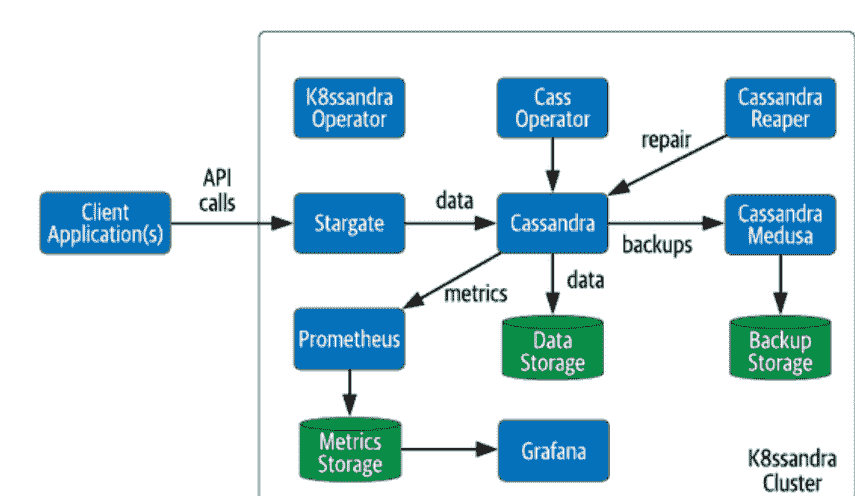
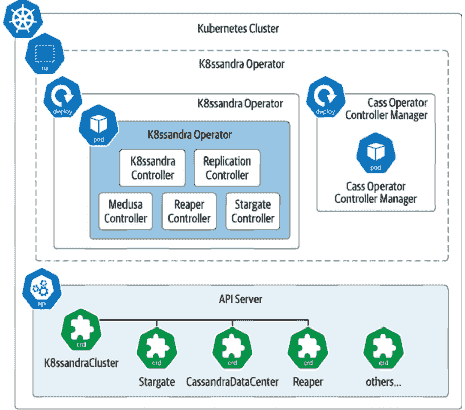
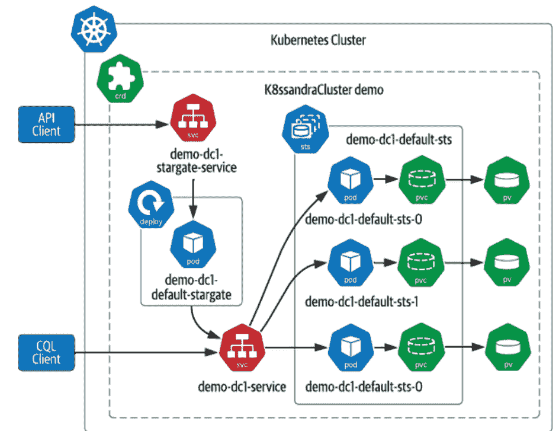
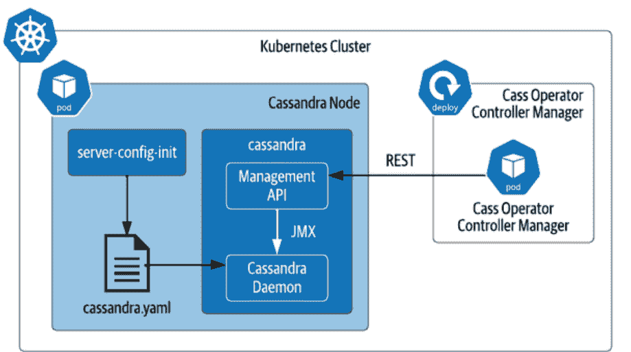
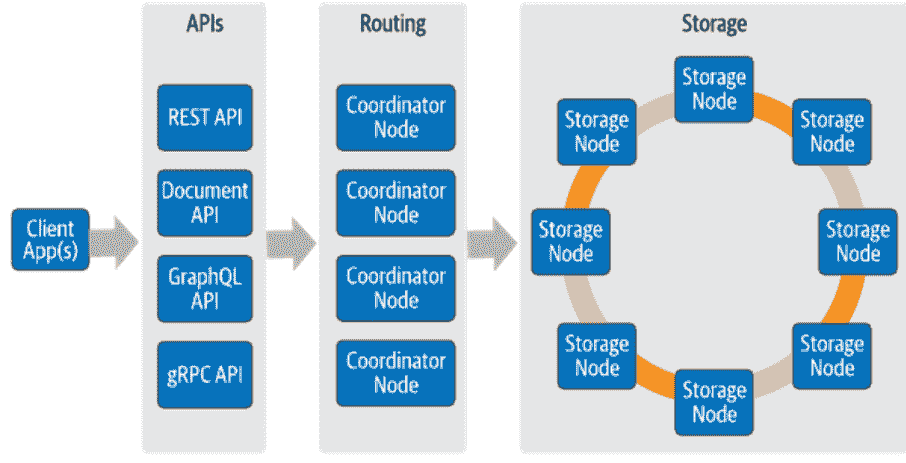
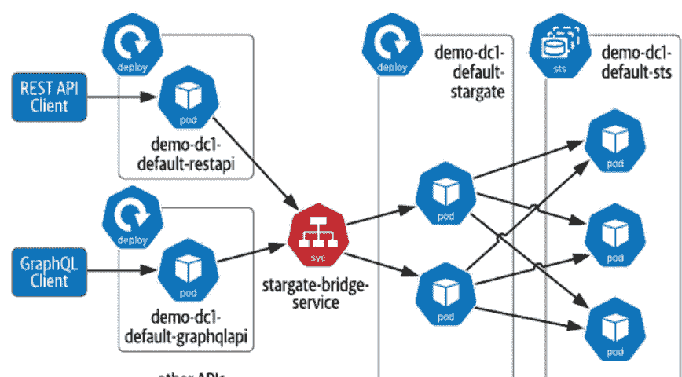
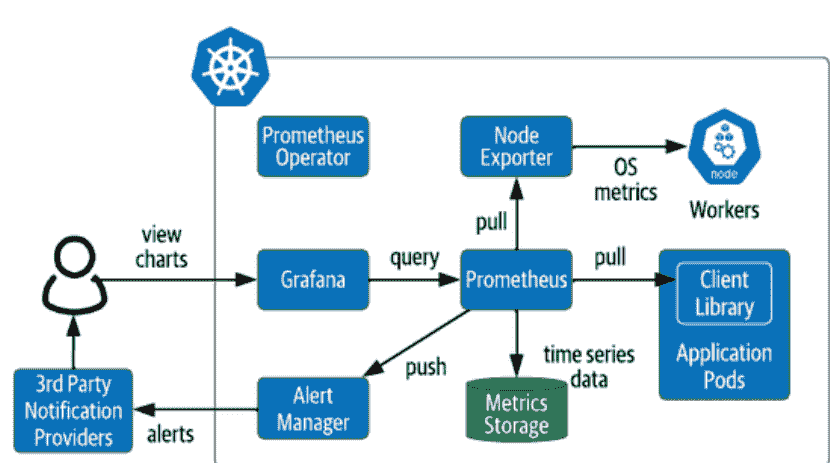
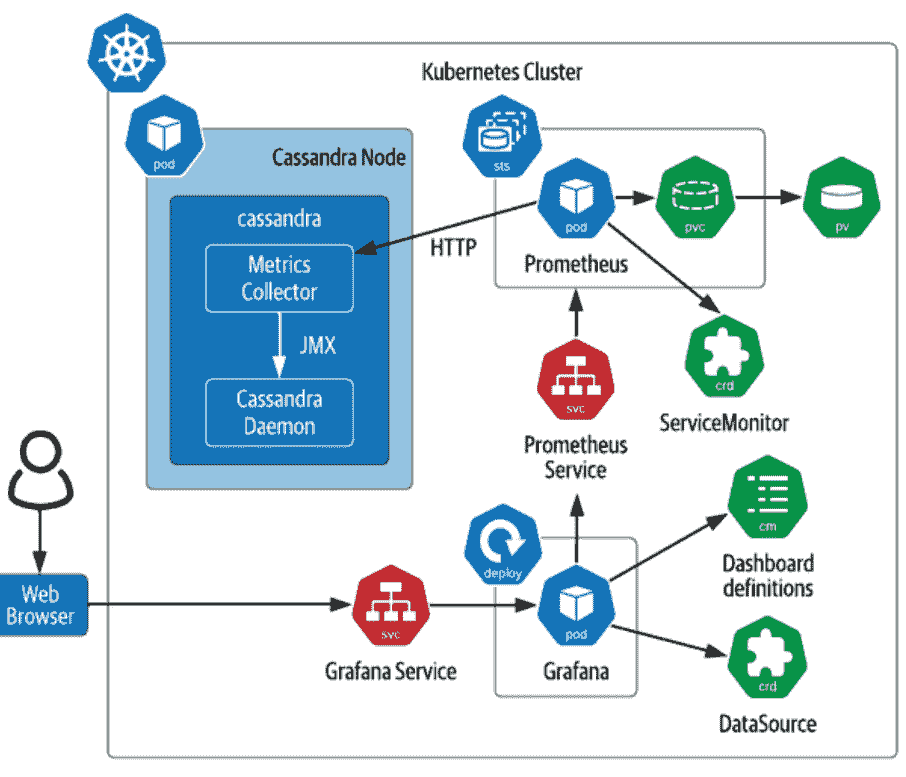
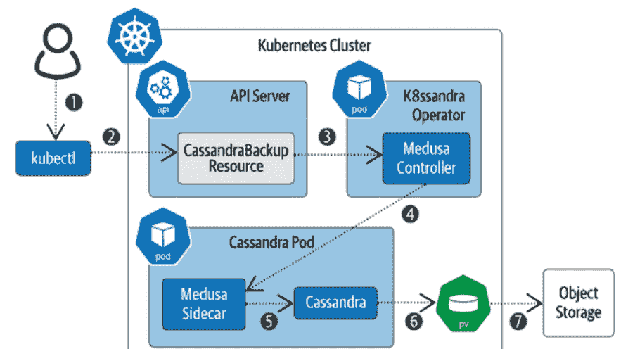
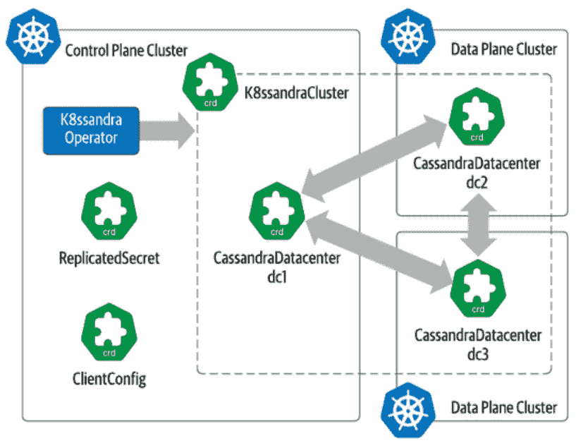

## Chapter 6. Integrating Data Infrastructure in a Kubernetes Stack

### A NOTE FOR EARLY RELEASE READERS

With Early Release ebooks, you get books in their earliest form—the author’s raw and unedited content as they write—so you can take advantage of these technologies long before the official release of these titles.

This will be the 6th chapter of the final book. Please note that this book’s code examples are available at https://github.com/data-on-k8s-book.

In this book we are pointing toward a future of modern, cloud native applications that run on Kubernetes. We’ve noted that historically, data has been one of the hardest parts of making this a reality. In previous chapters, we’ve introduced the primitives Kubernetes provides for managing compute, network, and storage resources, and considered how databases can be deployed on Kubernetes using these resources. We’ve also examined the automation of infrastructure using controllers and the operator pattern.

Now it’s time to expand our focus to consider how data infrastructure fits in your overall application architecture in Kubernetes. In this chapter we’ll explore how to assemble the building blocks discussed in previous chapters into integrated data infrastructure stacks that are easy to deploy and tailor to the unique needs of each application. These stacks represent a step toward the vision of the virtual data center we introduced in Chapter 1. To learn the considerations involved in building and using these larger assemblies, let’s

take an in-depth look at K8ssandra, an open-source project that provides an integrated data stack based on Apache Cassandra.

### K8ssandra: Production-ready Cassandra on Kubernetes

To set the context, let’s consider some of the practical challenges of moving application workloads into Kubernetes. As organizations have begun to migrate existing applications to Kubernetes and create new cloud native applications in Kubernetes, modernizing the data tier is a step that is often deferred. Whatever the causes of these delays - a belief that Kubernetes is not ready for stateful workloads, a lack of development resources, or other factors - the result has been mismatched architectures in which applications are running in Kubernetes with databases and other data infrastructure running externally. This leads to a division of focus for developers and SREs that can limit productivity. It’s also common to see distinct toolsets for monitoring applications and database infrastructure, which increases cloud computing costs.

This adoption challenge became evident in the Cassandra community. Despite the growing collaboration and consensus around building a single Cassandra operator discussed in Chapter 5, developers were still confronted with some key questions about how the database and operator would fit in the larger application context:

- How can we have an integrated view of the health of our entire stack, including both applications and data?
- How can we tailor the automation of installation, upgrades, and other operational tasks in a Kubernetes-native way that fits the way we manage our data centers?

To help address these questions, John Sanda and a team of engineers at DataStax launched an open-source project called K8ssandra with the goal of providing a production-ready deployment of Cassandra that embodies

best practices for running Cassandra in Kubernetes. K8ssandra provides custom resources that help manage tasks including cluster deployment, upgrades, scaling up and down, data backup and restore, and more. You can read more about the motivations for the project in the article [Why K8ssandra?](Why K8ssandra?)

### K8ssandra Architecture

K8ssandra is deployed in units known as clusters, which is similar terminology to that used by Kubernetes and Cassandra. A K8ssandra cluster includes a Cassandra cluster along with additional components depicted in Figure 6-1 to provide a full data management ecosystem. Let’s consider these in roughly clockwise order starting from the top center.

- *Cass Operator* is a Kubernetes operator first introduced in Chapter 5. manages the lifecycle of Cassandra nodes on Kubernetes, including provisioning new nodes and storage, and scaling up and down.
- *Cassandra Reaper* manages the details of repairing Cassandra nodes in order to maintain high data consistency.
- *Cassandra Medusa* provides backup and restore for data stored in Cassandra
- *Prometheus and Grafana* are used for the collection and visualization of metrics
- *Stargate* is a data gateway that provides API access to client applications as an alternative to CQL.
- *K8ssandra Operator* orchestrates all of the other components, including multi-cluster support for managing Cassandra clusters that span multiple Kubernetes clusters.



Figure 6-1. K8ssandra Architecture

In the following sections, we’ll take a look at each component of the K8ssandra project to understand the role that it plays within the architecture and its relationship to other components.

### Installing the K8ssandra Operator

Let’s dive in with some hands-on experience of installing K8ssandra. To get a basic installation of K8ssandra running that fully demonstrates the power of the operator, you’ll need a Kubernetes cluster with several worker nodes. To make the deployment simpler, the K8ssandra team has provided scripts to automate the process of creating Kubernetes clusters and then deploying the operator to these clusters. These scripts use Kind clusters for simplicity, so you’ll want to make sure you have this installed before starting. Instructions are also available for installing on various clouds on the K8ssandra website.

#### K8SSANDRA 2.0 RELEASE STATUS

This chapter focuses on the K8ssandra 2.0 release, including the K8ssandra Operator. At the time of writing, K8ssandra 2.0 is still in Beta status. The instructions we provide here are based on an installation guide in the K8ssandra Operator repository. As K8ssandra 2.0 moves toward a full general availability (GA) release, the instructions on the Getting Started section of the K8ssandra website will be updated to reference the new version.

First, start by cloning the K8ssandra operator repository from GitHub:

```
git clone https://github.com/k8ssandra/k8ssandra-operator.git
```

Next, you’ll want to use the provided Makefile to create a Kubernetes cluster and deploy the K8ssandra Operator into it. (This assumes you have make installed)

```
cd k8ssandra-operator
make single-up
```

If you examine the Makefile, you’ll notice the operator is installed using Kustomize, which we discussed in Chapter 4. The target you just executed creates a Kind cluster with four worker nodes and changes your current context to point to that cluster, as you can see by running the following:

```
% kubectl config current-context
kind-k8ssandra-0
% kubectl get nodes
NAME                          STATUS   ROLES                       AGE
VERSION
k8ssandra-0-control-plane     Ready    control-plane,master        6m45s
v1.22.4
k8ssandra-0-worker            Ready    <none>                      6m13s
v1.22.4
k8ssandra-0-worker2           Ready    <none>                      6m13s
v1.22.4
k8ssandra-0-worker3           Ready    <none>                      6m13s
v1.22.4
k8ssandra-0-worker4           Ready    <none>                      6m13s
v1.22.4
```


现在按如下方式检查已创建的 CRD 列表：

```
% kubectl get crd
NAME                                                       CREATED AT
cassandrabackups.medusa.k8ssandra.io                       2022-02-05T17:31:35Z
cassandradatacenters.cassandra.datastax.com                2022-02-05T17:31:35Z
cassandrarestores.medusa.k8ssandra.io                      2022-02-05T17:31:35Z
cassandratasks.control.k8ssandra.io                        2022-02-05T17:31:36Z
certificaterequests.cert-manager.io                        2022-02-05T17:31:16Z
certificates.cert-manager.io                               2022-02-05T17:31:16Z
challenges.acme.cert-manager.io                            2022-02-05T17:31:16Z
clientconfigs.config.k8ssandra.io                          2022-02-05T17:31:36Z
clusterissuers.cert-manager.io                             2022-02-05T17:31:17Z
issuers.cert-manager.io                                    2022-02-05T17:31:17Z
k8ssandraclusters.k8ssandra.io                             2022-02-05T17:31:36Z
orders.acme.cert-manager.io                                2022-02-05T17:31:17Z
reapers.reaper.k8ssandra.io                                2022-02-05T17:31:36Z
replicatedsecrets.replication.k8ssandra.io                 2022-02-05T17:31:36Z
stargates.stargate.k8ssandra.io                            2022-02-05T17:31:36Z
```

如你所见，有多个与 Cert Manager 和 K8ssandra 相关的 CRD。还有 Cass Operator 使用的 cassandradatacenter CRD。K8ssandra 和 Cass Operator 的 CRD 都是命名空间化的，你可以使用 kubectl api-resources 命令进行验证，这意味着根据这些定义创建的资源会被分配到特定的命名空间。该命令还会显示每种资源类型的可接受缩写，例如 k8ssandracluster 的 k8c。

接下来，你可以检查已在 Kind 集群中安装的内容。如果你使用 `kubectl get ns` 列出命名空间，你会注意到两个新的命名空间：`cert-manager` 和 `k8ssandra-operator`。正如你可能猜到的那样，K8ssandra 使用的与 Pulsar 相同的 Cert Manager 项目，如第 8 章所述。让我们检查 `k8ssandra-operator` 命名空间的内容，其摘要连同相关的 K8ssandra CRD 一并显示在图 6-2 中。如果你检查工作负载，你会注意到创建了两个 Deployment，一个用于 K8ssandra Operator，一个用于 Cass Operator。



图 6-2. K8ssandra Operator 架构

如果你检查 K8ssandra Operator 的源代码，你会看到它实际上包含多个控制器，而 Cass Operator 仅由一个控制器组成。这种打包方式反映了 Cass Operator 是一个独立项目，可以在不采用整个 K8ssandra 框架的情况下单独使用这一事实。表 7-1 描述了这些各种控制器与其交互的关键资源之间的映射。

表 6-1. 映射 K8ssandra CRD

### Controllers

| Operator | Controller | Key Custom Resources |
|---|---|---|
| K8ssandra Operator | K8ssandra Controller | K8ssandraCluster, CassandraDataCenter |
| Medusa Controller | CassandraBackup, CassandraRestore |  |
| Reaper Controller | Reaper |  |
| Replication Controller | ClientConfig, ReplicatedSecret |  |
| Stargate Controller | Stargate |  |

我们将在下面的各节中更详细地介绍每个 K8ssandra 和 Cass Operator CRD。

### Creating a K8ssandraCluster

一旦你安装了 K8ssandra Operator，下一步就是创建 K8ssandraCluster。本节使用的源代码可在 Vitess Operator Example 中获得，基于 K8ssandra Operator GitHub 仓库中提供的示例。首先，查看 k8ssandra-cluster.yaml 文件：

```
apiVersion: k8ssandra.io/v1alpha1
kind: K8ssandraCluster
metadata:
  name: demo
spec:
  cassandra:
    cluster: demo
    serverVersion: "4.0.1"
    datacenters:
      - metadata:
          name: dc1
        size: 3
        storageConfig:
          cassandraDataVolumeClaimSpec:
            storageClassName: standard
            accessModes:
              - ReadWriteOnce
            resources:
              requests:
                storage: 1Gi
        config:
          jvmOptions:
            heapSize: 512M
    stargate:
      size: 1
      heapSize: 256M
```

此代码指定了一个 K8ssandraCluster 资源，由单个数据中心 dc1 组成，运行三个 Cassandra 4.0.1 节点，其中每个 Cassandra 节点的 Pod 规范请求 1GB 的存储，使用引用 standard StorageClass 的 PersistentVolumeClaim。此配置还包括一个 Stargate 节点，以提供对 Cassandra 集群的 API 访问。这是一个最小配置，大多数其他组件接受图表默认值。使用以下命令在 k8ssandra-operator 命名空间中创建 demo K8ssandraCluster：

```
% kubectl apply -f k8ssandra-cluster.yaml -n k8ssandra-operator
k8ssandracluster.k8ssandra.io/demo created
```

命令完成后，你可以使用诸如 kubectl get k8ssandraclusters（或简写 kubectl get k8c）之类的命令检查 K8ssandraCluster 的安装情况。图 6-3 描述了当你创建 demo K8ssandraCluster 时，操作器代表你构建的一些关键计算、网络和存储资源。



图 6-3. 一个简单的 K8ssandraCluster

以下是一些需要注意的关键事项：

- 已创建单个 StatefulSet 来表示 Cassandra 数据中心 dc1，其中包含你指定的三个 Pod 副本。正如你将在《使用 Cass Operator 在 Kubernetes 中管理 Cassandra》中了解到的那样，K8ssandra 实际上使用 CassandraDatacenter CRD 通过 Cass Operator 管理此 StatefulSet。
- 虽然图示显示单个 Service demo-dc1-service 以单个端点形式公开对 Cassandra 集群的访问，但这是一个简化。你实际上会发现有多个 Service 配置为提供给各种客户端的访问。
- 有一个 Deployment 管理单个 Stargate Pod，以及提供对 Stargate 提供的各种 API 服务的客户端端点的 Service。这又是另一个简化，我们将在 Stargate 部分更详细地探讨此配置部分。
- 与我们在前几章中展示的基础设施示例类似，K8ssandra Operator 还创建了额外的支持性安全资源，如 ServiceAccounts、Roles 和 RoleBindings。

一旦你创建了 K8ssandraCluster，你就可以将客户端应用程序指向 Cassandra 接口和 Stargate API，并执行集群维护操作。你可以通过删除其资源来移除 K8ssandraCluster，但你现在还不想这样做，因为我们还有很多内容要探索！我们将在更详细地检查每个 K8ssandra 组件时描述其中一些交互。在此过程中，我们将确保指出 K8ssandra 及相关项目的贡献者在如何使用 Kubernetes 资源以及如何将早于 Kubernetes 的数据基础设施适应到 Kubernetes 的做法方面所做出的一些有趣的设计选择。

### STACKGRES: AN INTEGRATED KUBERNETES STACK FOR POSTGRES

K8ssandra 项目并不是在 Kubernetes 上运行的集成数据栈的唯一实例。另一个例子可以在 StackGres 中找到，这是一个由 OnGres 管理的项目。StackGres 使用 Patroni 来支持集群化、高可用的 Postgres 部署并添加自动备份功能。StackGres 支持与 Prometheus 和 Grafana 的集成以进行指标聚合和可视化，以及可选的 Envoy 代理以在协议级别获得更精细的指标。StackGres 由开源组件组成，其社区版使用 AGPLv3 许可证。

### Managing Cassandra in Kubernetes with Cass Operator

Cass Operator 是“DataStax Kubernetes Operator for Apache Cassandra”的简称。Cass Operator 是一个开源项目，可在 GitHub 上获得，已被纳入 K8ssandra


project in 2021, replacing its previous home under the DataStax GitHub organization.

Cass Operator 是 K8ssandra 的关键组成部分，因为 Cassandra 集群是所有其他基础设施元素和工具所添加的基础数据基础设施。然而，Cass Operator 是在 K8ssandra 之前开发的，并且将继续作为一个可单独部署的项目存在。这很有帮助，因为并非 Cass Operator 的所有功能都通过 K8ssandra 暴露出来，尤其是更高级的 Cassandra 配置选项。Cass Operator 在 Operator Hub 中被列为其独立项目，可以通过 Kustomize 安装。

Cass Operator 将 Cassandra 的拓扑概念，包括集群、数据中心、机架和节点映射到 Kubernetes 资源上。关键构造是 CassandraDataCenter CRD，它表示 Cassandra 集群拓扑中的一个数据中心。 （如果您需要复习 Cassandra 拓扑，请参考第 3 章。）

当您在上一节中创建 K8ssandraCluster 资源时，K8ssandra Operator 创建了一个 CassandraDatacenter 资源，其外观可能如下所示：

```
apiVersion: cassandra.datastax.com/v1beta1
kind: CassandraDatacenter
metadata:
  name: dc1
spec:
  clusterName: demo
  serverType: cassandra
  serverVersion: 4.0.1
  size: 3
  racks:
  - name: default
```

由于您在 K8ssandraCluster 定义中未指定机架，K8ssandra 将其解释为一个名为 default 的单个机架。通过创建 CassandraDatacenter，K8ssandra Operator 将此数据中心中 Cassandra 节点的操作委托给 Cass Operator。

### CASS OPERATOR AND MULTIPLE DATACENTERS

您可能想知道为什么 Cass Operator 没有定义表示 Cassandra 集群的 CRD。从 Cass Operator 的角度来看，Cassandra 集群的概念基本上只是一段元数据——CassandraDataCenter 的 `clusterName`——而不是一个实际的资源。这反映了这样一种惯例，即在生产系统中使用的 Cassandra 集群通常部署在多个物理数据中心，这超出了单个 Kubernetes 集群的范围。

虽然您当然可以创建多个 CassandraDatacenters 并使用相同的 `clusterName` 将它们链接在一起，但它们必须位于同一个 Kubernetes 集群中，以便 Cass Operator 能够管理它们。还建议使用单独的命名空间安装 Cass Operator 的专用实例来管理每个集群。您将在多集群拓扑中看到 K8ssandra 如何支持创建跨多个物理数据中心（和 Kubernetes 集群）的 Cassandra 集群的能力。

当 Cass Operator 被 API Server 通知 CassandraDatacenter 资源创建时，它会创建用于实现数据中心的资源，包括用于管理每个机架中节点的 StatefulSet，以及各种 Services 和安全相关资源。StatefulSet 将并行启动请求数量的 Pods。这带来了一个情况，即 Cass Operator 提供了在 Cassandra 和 Kubernetes 的操作方式之间进行适配的逻辑。

如果您以前使用过 Cassandra，您可能知道将节点添加到集群的最佳做法是一次添加一个，以简化节点加入集群的过程。此过程称为 *bootstrapping*，包括协商节点将负责的数据的步骤，并且可能包括从其他节点向新节点流式传输数据。然而，由于 StatefulSet 不了解这些限制，如何一次添加一个节点到新集群或现有集群呢？

答案在于 Cass Operator 传递给 StatefulSet 的 Pod 规范的组成，然后用于创建每个 Cassandra 节点，如图 6-4 所示。



图 6-4. Cass Operator 与 Cassandra Pods 的交互

Cass Operator 在其管理的每个 Cassandra Pod 中部署 Cassandra 的自定义镜像。Pod 规范至少包括两个容器：一个名为 server-config-init 的 init 容器和一个名为 cassandra 的 Cassandra 容器。

作为 init 容器，server-config-init 在 cassandra 容器之前启动。它负责根据 CassandraDataCenter 的所选配置选项生成 cassandra.yaml 配置文件。您可以使用 CassandraDataCenter 资源的 config 部分指定额外的配置值，如文档所述。

### ADDITIONAL SIDECAR CONTAINERS IN CASSANDRA PODS

正如您将在下面的章节中了解到的，当在 K8ssandraCluster 中部署时，Cassandra pod 可能具有额外的 sidecar 容器，这取决于您启用了哪些额外的 K8ssandra 组件。目前，我们专注于最基本的安装。

`cassandra` 容器实际上包含两个独立的进程：运行 Cassandra 实例的守护进程和一个 Management API。这在某种程度上违背了每个容器运行单个进程的传统最佳实践，但此例外有一个很好的理由。

Cassandra 的管理界面通过 Java Management Extensions（JMX）公开。虽然这对于 Cassandra 项目刚开始时这样一个基于 Java 的应用程序来说是一个合理的设计选择，但由于其复杂性和安全问题，JMX 已逐渐不受欢迎。虽然 Cassandra 的替代管理界面已有一些进展，但工作尚未完成，因此 Cass Operator 的开发人员决定集成另一个开源项目，即 Apache Cassandra 的 Management API。

Management API 项目提供了一个 RESTful API，将基于 HTTP 的调用转换为对 Cassandra 旧版 JMX 接口的调用。通过在 Cassandra 容器内运行 Management API，我们避免了将 JMX 端口暴露在 Cassandra 容器之外。这是云原生架构中经常使用的模式，用于将自定义协议适配为基于 HTTP 的接口，而在 ingress 控制器中对路由和安全性的支持要好得多。

Cass Operator 发现并连接到每个 Cassandra Pod 上的 Management API，以便执行与 Kubernetes 无关的管理操作。在添加新节点时，这涉及使用 Management API 验证节点是否成功启动并运行并相应地更新 CassandraDatacenter 的状态的简单操作。此序列在文档中有更详细的描述。

### CUSTOMIZING THE CASSANDRA IMAGE USED BY CASS OPERATOR

Management API 项目为 3.x 和 4.x 系列的最新 Cassandra 版本提供了镜像，可在 Docker Hub 上获取。虽然可以覆盖 Cass Operator 使用的 Cassandra 镜像以使用您自己的镜像，但 Cass Operator 要求 Management API 在每个 Cassandra Pod 上可用。如果您需要构建包含 Management API 的自己的自定义镜像，您可以使用 GitHub 仓库中的 Dockerfiles 和支持脚本作为起点。

除了上面描述的 Cassandra 集群的启动和扩展之外，Cass Operator 还提供了用于部署和管理 Cassandra 集群的多个功能：

- **Topology management** - Cass Operator 使用 Kubernetes affinity 原则来管理 Cassandra 节点（Pods）在 Kubernetes 工作节点上的放置，以最大化您的数据可用性。
- **Scaling down** - 就像节点一次添加一个以扩展一样，Cass Operator 管理一次删除一个节点以缩减规模。
- **Replacing nodes** - 如果 Cassandra 节点因崩溃或其运行的工作节点宕机而丢失，Cass Operator 依赖 StatefulSet 替换节点并将新节点绑定到适当的 PersistentVolumeClaim。
- **Upgrading images** - Cass Operator 还利用 StatefulSet 的功能来执行 Cassandra Pods 使用的镜像的滚动升级
- **Managing seed nodes** - Cass Operator 创建 Kubernetes Services 以根据 Cassandra 的推荐惯例公开每个数据中心中的种子节点，即每个机架一个种子节点，每个数据中心至少三个。


### 使用 Stargate API 提升开发者生产力

本书迄今为止的重点主要在于 Kubernetes 中数据基础设施（如数据库）的部署，而非该基础设施在云原生应用中的使用方式。K8ssandra 中 Stargate 的使用为我们提供了进行该讨论的良好机会。

在许多组织中，关于应用程序直接访问数据库与抽象数据库交互细节的利弊，存在持续的讨论。这种争论在大型组织中尤其频繁，在这些组织中，应用程序开发团队与管理包括数据基础设施在内的平台的团队之间存在职责划分。然而，在采用 DevOps 和微服务架构等现代实践的组织中也可以观察到这种情况，其中每个微服务后面可能都有不同的数据存储。

提供对直接数据库访问的抽象这一想法多年来以多种形式出现。即使在单体客户端-服务器应用程序的时代，使用存储过程或将数据访问和复杂查询逻辑隔离在对象关系映射工具（如 Hibernate）之后，或使用数据访问对象（DAOs）等模式也很常见。

更近些年，随着软件行业向面向服务架构（SOA）和微服务发展，出现了类似的抽象数据访问模式。如《Data Services for the Masses》一文中所述，许多团队发现自己在架构中创建了一层专门用于数据访问的微服务，为特定数据类型或实体提供创建、读取、更新和删除（CRUD）操作。这些服务抽象了与特定数据库后端交互的细节，如果执行和维护良好，可以帮助提高开发者生产力，并在需要时促进迁移到不同的数据库。

Stargate 项目诞生于这样一个认识：许多团队都在构建非常相似的抽象层以通过 API 提供数据访问。Stargate 项目的目标是提供一个开源的 *数据网关* - 一套用于数据访问的通用 API，帮助消除团队开发和维护自己的自定义 API 层的需要。虽然 Stargate 的初始实现基于 Cassandra，但该项目的目标是支持多个数据库后端，甚至其他类型的数据基础设施，如缓存和流处理。

以 Cassandra 作为后端数据存储，Stargate 架构可以描述为具有三层，如图 6-5 所示。*存储层* 由传统的 Cassandra 集群组成，目前可以是 Cassandra 3.11、Cassandra 4.0 或 DataStax Enterprise 6.8。*路由层*（或 *协调层*）由参与集群的一组 Cassandra 节点组成，但仅执行查询路由，不进行数据存储。*API 层* 是最外层，由在底层 Cassandra 集群之上实现各种 API 的服务组成。可用 API 包括 REST API、提供通过 HTTP 访问 JSON 文档的 Document API、GraphQL API 和 gRPC API。



图 6-5. 使用 Cassandra 的 Stargate 概念架构

这种架构的一个关键优势在于，它认识到管理计算和存储资源使用方面的关注点分离，并提供了根据客户端应用程序的需求独立扩展这种使用的能力：

- 存储节点的数量可以按需增减，以提供应用程序所需的存储容量。
- 协调节点和 API 实例的数量可以按需增减，以匹配应用程序的读写负载并优化吞吐量。
- 未被应用程序使用的 API 可以缩放到零（禁用）以减少资源消耗。

K8ssandra 通过 Stargate CRD 支持在底层 Cassandra 集群之上部署 Stargate。Cass Operator 部署的 CassandraDataCenter 充当存储层，而 Stargate CRD 指定路由层和 API 层的配置。示例配置如图 6-6 所示。



图 6-6. Kubernetes 上的 Stargate 部署

安装包括一个用于管理协调节点的 Deployment，以及一个用于提供对 Bridge API 访问的 Service，Bridge API 是在协调节点上公开的私有 gRPC 接口，可用于创建新的 API 实现。有关 Bridge API 的更多详细信息，请参阅 Stargate v2 Design。安装中还为启用的每个 API 提供了一个 Deployment，以及一个用于向客户端应用程序提供访问的 Service。

正如你所见，Stargate 项目提供了一个有前景的框架，用于通过可随底层数据库一起扩展的开发者友好型 API 扩展你的数据基础设施。

### 使用 Prometheus 和 Grafana 的统一监控基础设施

现在我们已经考虑了使应用程序开发人员生活更轻松的基础设施的添加，让我们来看一下将数据基础设施集成到 Kubernetes 堆栈中的一些更侧重于运维的方面。我们从监控开始。

可观测性是部署在 Kubernetes 上的任何应用程序的关键属性，因为它会影响你对其可用性、性能和成本的认知。你的目标应该是对应用程序及其所依赖的基础设施有一个集成的视图。可观测性通常被描述为由三种类型的数据组成：指标、日志和追踪。Kubernetes 本身提供了日志记录以及将事件与资源关联的能力，你已经在上面了解到 Cass Operator 如何促进从 Cassandra 节点收集日志。

在本节中，我们将重点介绍 K8ssandra 如何集成 Prometheus/Grafana 堆栈以提供指标。Prometheus 是一个流行的开源监控平台。它支持多种从应用程序和服务收集数据的接口，并将它们存储在可使用 Prometheus 查询语言（PromQL）高效查询的时间序列数据库中。它还包括一个 AlertManager，可根据指标阈值生成警报和其他通知。

虽然 K8ssandra 1.X 系列之前的版本将 Prometheus 堆栈作为 K8ssandra 的一部分包含在内，但 K8ssandra 2.X 提供了与现有 Prometheus 安装集成的能力。

安装 Prometheus Operator 的一种简单方法是使用 [kube-prometheus](kube-prometheus)，这是 Prometheus Operator 项目提供的一个存储库。Kube-prometheus 旨在作为 Kubernetes 控制平面和应用程序的综合监控堆栈。你可以克隆此存储库并使用其中包含的清单库（yaml 文件）来安装如图 6-7 所示的集成组件堆栈，包括以下内容：

- Prometheus Operator，它管理其他组件
- Prometheus 以高可用配置运行，通过 StatefulSet 管理。Prometheus 使用带后备持久卷的时间序列数据库存储数据。
- Prometheus 使用 [Node Exporter](Node Exporter) 从 Kubernetes 工作节点提取操作系统指标
- Prometheus 通过 HTTP 从嵌入 Prometheus 客户端库的应用程序提取指标。虽然图中未显示，但该堆栈还包括 [Prometheus Adapter for Kubernetes Metrics APIs](Prometheus Adapter for Kubernetes Metrics APIs)，它将 Prometheus 收集的指标公开给 Kubernetes 控制平面，以便可用于自动扩展应用程序。
- Prometheus Alert Manager 可以配置为根据特定指标的阈值生成警报，通过电子邮件或 PagerDuty 等第三方工具交付。kube-prometheus 堆栈附带了 Kubernetes 集群的内置警报，也可以添加特定于应用程序的警报。
- Grafana 被部署以提供用于向人工操作员显示指标的图表。Grafana 使用 PromQL 从 Prometheus 访问指标，此接口也可用给其他客户端。




图 6-7. Kube-Prometheus Stack 的组件

通过几个快速步骤即可将 K8ssandra 与 Prometheus 连接起来。K8ssandra 文档中的说明会引导你使用 kube-prometheus 安装 Prometheus Operator，如果你尚未安装的话。由于 kube-prometheus 会在自己的命名空间中安装 Prometheus Operator，因此你需要确保该 Operator 拥有管理其他命名空间中资源所需的权限。

要将 K8ssandra 与 Prometheus 集成，只需在 K8ssandraCluster 资源上设置属性，以在 Cassandra 和 Stargate 节点上启用监控。例如，你可以执行以下操作来为集群中所有数据中心的节点启用监控：

```
apiVersion: k8ssandra.io/v1alpha1
kind: K8ssandraCluster
metadata:
  name: demo
spec:
  cassandra:
    datacenters:
      ...
    telemetry:
      prometheus:
        enabled: true
  stargate:
    telemetry:
      prometheus:
        enabled: true
```

也可以根据[文档](documentation)所述，选择性地为单个数据中心启用监控。

让我们看看集成是如何工作的。首先，让我们考虑 Cassandra 节点如何暴露指标。如上文 Cass Operator 部分所述，Cassandra 通过 JMX 暴露管理功能，其中包括指标报告。[Apache Cassandra 的指标收集器](Metrics Collector for Apache Cassandra)（MCAC）是一个开源项目，它通过 HTTP 暴露指标，以便 Prometheus 或其他使用 Prometheus 协议的后端可以访问。K8ssandra 和 Cass Operator 使用的 Cassandra Docker 镜像中包含了 MCAC 以及 Management API 作为在 Cassandra 容器中运行的额外进程。此配置显示在图 6-8 的左侧。



图 6-8. 使用 Kube-Prometheus Stack 监控 Cassandra

图 6-8 的右侧显示了 Prometheus 和 Grafana 如何配置为消费并暴露 Cassandra 指标。K8ssandra Operator 会为启用了监控的每个 CassandraDatacenter 创建 ServiceMonitor 资源。ServiceMonitor 是由 Prometheus Operator 定义的 CRD，其中包含有关如何从一组 Pod 收集指标的配置详细信息，包括以下内容：

- 引用用于标识 Pod 的标签名称的 `selector`
- 连接信息，例如用于从每个 Pod 收集指标的 `scheme`（协议）、`port` 和 `path`
- 拉取指标的 `interval`
- 可选的 `metricRelabelings`，即指示任何期望的指标重命名，或甚至指示应丢弃且不由 Prometheus 摄取的指标的指令。

K8ssandra 为 Cassandra 和 Stargate 节点创建单独的 ServiceMonitor 实例，因为暴露的指标略有不同。要观察部署在集群中的 ServiceMonitor，可以执行类似 `kubectl get servicemonitors -n monitoring` 的命令。

Prometheus 通过作为 Kubernetes 服务公开的 PromQL 端点向 Grafana 和其他工具提供对指标的访问。kube-prometheus 安装会配置一个 Grafana 实例，使用 Grafana DataSource CRD 的实例连接到 Prometheus。Grafana 接受使用 yaml 文件定义的仪表板，你可以将其作为 ConfigMap 提供。有关加载显示 Cassandra 和 Stargate 指标的仪表板定义的指导，请参阅 K8ssandra [文档](documentation)。你可能还希望创建仪表板，将应用程序指标与 K8ssandra 提供的<|message|> 数据层指标一起显示，以便获得应用程序性能的集成视图。

正如你所见，kube-prometheus 为 Kubernetes 集群提供了一个全面且可扩展的监控栈，就像 K8ssandra 为数据管理提供栈一样。K8ssandra 与 kube-prometheus 的集成是你可以组装 Kubernetes 资源集成栈以形成更强大的应用程序的绝佳示例。

### 使用 Cassandra-Reaper 执行修复

作为 NoSQL 数据库，Cassandra 默认强调高性能（尤其是写入）和高可用性。如果你熟悉 CAP 定理，你会理解这意味着有时 Cassandra 会暂时牺牲节点间数据的 consistency 以提供这种大规模的高性能和高可用性，这种方法称为 *最终一致性*。Cassandra 确实提供了通过指定复制策略和每个查询所需的一致性级别的选项来根据需要调整一致性程度的能力。用户和管理员应了解这些选项及其行为，以便有效地使用 Cassandra。

Cassandra 具有多种内置的“反熵”机制，例如 hinted handoff 和 repair，有助于随着时间的推移在节点之间保持数据一致性。Repair 是一种后台进程，节点通过它将自己拥有的部分数据与也负责该数据的其他节点的最新内容进行比较。虽然这些检查可以通过使用校验和来 somewhat 优化，但 repair 仍然是一个性能密集型过程，最好在集群负载较低或非高峰时段执行。结合可用的多种选项，包括完整和增量修复，执行修复传统上需要为每个集群进行一些定制。它也一直是一个手动过程，遗憾的是经常被一些 Cassandra 集群管理员忽视。

#### 关于 CASSANDRA 中修复的更多细节

有关修复的更深入介绍，请参阅 Cassandra: The Definitive Guide，其中在第 6 章和第 12 章分别描述了修复概念和可用选项。

Cassandra Reaper 的创建是为了消除在 Cassandra 集群上执行修复的难度，并优化修复性能，以最大限度地减少在繁忙集群上运行修复的影响。Reaper 由 Spotify 创建，并由 The Last Pickle 增强，后者目前在 GitHub 上管理该项目。Reaper 暴露了一个 RESTful API，用于为一个或多个 Cassandra 集群配置修复计划，并提供命令行工具和 Web 界面，指导管理员创建计划。

K8ssandra 提供了将 Cassandra Reaper 实例作为 K8ssandraCluster 的一部分合并的选项。K8ssandra Operator 包含一个 Reaper Controller，负责通过其关联的 Reaper CRD 管理本地 Cassandra

Reaper 管理器进程。默认情况下，在 K8ssandraCluster 中启用 Reaper 会导致在安装中表示的每个 Kubernetes 集群中安装一个 Reaper 实例，但你也可以使用单个 Reaper 实例在多个数据中心甚至多个 Cassandra 集群之间管理修复，前提是它们可以通过网络访问。

#### 成为 Kubernetes 原生的重要性如何？

K8ssandra 对 Reaper 的使用是构建更复杂的数据基础设施栈时涉及的权衡的一个例子。例如，Reaper Manager 的更 Kubernetes 原生设计可能涉及将每个修复任务分解为 Kubernetes CronJob，可以与关联的 CassandraDatacenter 一起调度，从而更多地利用 Kubernetes 内置资源。虽然这可能是 Reaper 未来发展的有效方向，但 K8ssandra 项目目前选择将 Reaper 集成作为一个能很好完成任务的工作基础设施，同时为未来更 Kubernetes 原生的方法留下空间。

我们在第 5 章中看到了这种“封装 vs. 重写”类型决策的另一个例子，其中 Vitess Operator 按原样重用 Vitess 控制守护进程 vctld 及其 vctlclient。在这两个示例中，项目开发人员都做出了务实的选择，进行初始部署以“足够”地将现有基础设施移植到 Kubernetes 运行，同时为未来更 Kubernetes 原生的方法留下空间。在第 7 章中，我们将研究从头开始在新基础设施项目上采用 Kubernetes 原生方法的情况。

### 使用 Cassandra Medusa 备份和恢复数据

管理备份是维护任何存储数据的系统的<|message|> 高可用性和灾难恢复计划的重要组成部分。Cassandra


支持完整备份和差异备份，通过为其用于数据持久化的 SSTable 文件创建硬链接。Cassandra 本身不负责将 SSTable 文件复制到备份存储中。相反，这留给用户。同样，从备份恢复涉及将 SSTable 文件复制到要重新加载数据的 Cassandra 节点，然后 Cassandra 可以指向本地文件以恢复其内容。

Cassandra 的备份和恢复操作传统上是在单个节点上使用 nodetool 执行的，nodetool 是一种利用 Cassandra JMX 接口的命令行工具。Cassandra Medusa 是由 Spotify 和 The Last Pickle 创建的开源命令行工具，它执行 nodetool 命令来执行备份，包括跨多个节点同步备份。Medusa 支持 Amazon S3、Google Cloud Storage (GCS)、Azure Storage 以及 S3 兼容的存储如 MinIO、Ceph Object Gateway，并可通过 Apache Libcloud 项目扩展以支持其他存储提供商。

Medusa 可以恢复单个节点以支持快速替换宕机节点，或在灾难恢复场景中恢复整个集群。恢复到集群可以是恢复到原始集群或恢复到新集群。Medusa 能够将数据恢复到与原始集群大小或拓扑不同的集群，这传统上手动处理起来具有挑战性。

K8ssandra 已集成 Medusa，以便为在 Kubernetes 上运行的 Cassandra 集群提供备份和恢复功能。要在 K8ssandraCluster 中配置 Medusa 的使用，您需要配置 medusa 属性：

```
apiVersion: k8ssandra.io/v1alpha1
kind: K8ssandraCluster
metadata:
  name: demo
spec:
  cassandra:
    ...
  medusa:
    storageProperties:
      storageProvider: google_storage
```

```
storageSecretRef:
    name: medusa-bucket-key
bucketName: k8ssandra-medusa
prefix: test
...
```

此处显示的选项包括存储提供商、用于备份的存储桶、用于组织备份文件目录名称的可选前缀，以及包含存储桶登录凭据的 Kubernetes Secret 的名称。有关 Secret 内容的详细信息，请参阅文档。其他可用选项包括在存储桶连接上启用 SSL，以及设置旧备份的清除策略，例如最大年龄或备份数量。

### 创建备份

一旦 K8ssandraCluster 启动，您就可以使用 CassandraBackup CRD 创建备份。例如，您可以使用如下命令启动对 CassandraDatacenter dc1 的备份：

```
cat <<EOF | kubectl apply -f -n k8ssandra-operator -
apiVersion: medusa.k8ssandra.io/v1alpha1
kind: CassandraBackup
metadata:
    name: medusa-backup1
spec:
    cassandraDatacenter: dc1
    name: medusa-backup1
EOF
```

处理此资源步骤如 图 6-9 所示。(1) 当您应用资源定义时，(2) kubectl 将资源注册到 API Server，(3) API Server 通知作为 K8ssandra Operator 一部分运行的 Medusa Controller。(4) Medusa Controller 联系 K8ssandra 因为您选择在 K8ssandraCluster 上启用 Medusa 而注入到 Cassandra Pod 中的 sidecar 容器。(5) Medusa sidecar 容器使用 nodetool 命令通过 JMX 对 Cassandra 节点执行备份（JMX 接口仅在 Pod 内部暴露）。(6) Cassandra 执行备份，在标记当前快照的 PersistentVolume 上标记 SSTable 文件。(7) Medusa sidecar 将快照文件从 PV 复制到存储桶。步骤 4-7 对 CassandraDatacenter 中的每个 Cassandra Pod 重复。



图 6-9. 使用 Medusa 执行 Datacenter 备份

您可以通过检查资源的状态来监控备份进度：

```
kubectl get cassandrabakup/medusa-backup1 -n k8ssandra-operator
-o yaml
kind: CassandraBackup
metadata:
  name: medusa-backup1
spec:
  backupType: differential
  cassandraDatacenter: dc1
  name: medusa-backup1
status:
  ...
  ...
  finishTime: "2022-02-26T09:21:38Z"
  finished:
  - demo-dc1-default-sts-0
  - demo-dc1-default-sts-1
```

```
- demo-dc1-default-sts-2
  startTime: "2022-02-26T09:21:35Z"
```

当 finishTime 属性被填充时，您就知道备份已完成。已备份的 Pod 列在 finished 属性下。

### 从备份恢复

从备份恢复数据的过程类似。要从备份数据中恢复整个 datacenter，您可以创建如下 CassandraRestore 资源：

```
cat <<EOF | kubectl apply -f -n k8ssandra-operator -
apiVersion: medusa.k8ssandra.io/v1alpha1
kind: CassandraRestore
metadata:
  name: restore-backup1
spec:
  cassandraDatacenter:
    name: dc1
    clusterName: demo
  backup: medusa-backup1
  inPlace: true
  shutdown: true
EOF
```

当 Medusa Controller 被通知新资源时，它会定位 CassandraDatacenter 并更新管理 Cassandra Pod 的 StatefulSet 中的 Pod spec 模板。更新包括添加一个名为 medusa-restore 的新 init 容器，并设置 medusa-restore 将用于定位要恢复的数据文件的环境变量。对 Pod spec 模板的更新会导致 StatefulSet 控制器对 StatefulSet 中的 Cassandra Pod 执行滚动更新。随着每个 Pod 重启，medusa-restore 将文件从对象存储复制到节点的 PersistentVolume，然后 Cassandra 容器按常启动。您可以通过检查 CassandraRestore 资源的状态来监控恢复进度。

### 数据恢复的通用语言？

值得注意的是，本章讨论的 K8ssandra Operator 支持的备份和恢复操作方式与第 5 章讨论的 Vitess Operator 之间存在相似性和差异。

在 K8ssandra 中，CassandraBackup 和 CassandraRestore 资源的功能类似于 Kubernetes Jobs —— 它们代表您希望执行的任务以及任务的结果。相比之下，VitessBackup 资源代表 Vitess Operator 基于 VitessCluster 资源配置执行备份的记录。Vitess 中没有等同于 CassandraRestore 操作符的资源。

尽管 K8ssandra 和 Vitess 在管理备份的方法上存在显著差异，但它们都将每个备份任务表示为资源。也许这种共同点可以成为开发备份和恢复操作的通用资源定义起点，有助于实现第 5 章中介绍的愿景。

类似于 Cassandra Reaper 的行为，可以配置单个 Medusa 实例来管理跨多个 datacenter 或 Cassandra 集群的备份和恢复操作。有关使用 Medusa 执行备份和恢复操作的更多详细信息，请参阅 K8ssandra 文档。

### 在 Kubernetes 中部署多集群应用

像 Cassandra 这样的分布式数据库的主要卖点之一是其能够支持跨多个数据中心的部署。许多用户利用这一点来在地理分布的数据中心之间实现高可用性，为应用程序及其用户提供更低延迟的读写。

然而，Kubernetes 本身最初并非设计用于支持跨多个 Kubernetes 集群的应用。这传统上意味着创建此类多区域应用会给开发团队带来大量工作。这项工作主要分为两种形式：创建连接 Kubernetes 集群的网络基础设施，以及协调这些集群中资源之间的交互。

让我们检查这些要求以及对 Cassandra 这类应用的影响：

### 多集群网络要求

从网络角度来看，关键是数据中心之间具有安全、可靠的网络连接。如果您使用单一云提供商部署应用，这可能相对简单，可以使用主要云厂商提供的虚拟私有云 VPC 功能实现。

如果您使用多个云，则需要第三方解决方案。大多数情况下，Cassandra 需要其节点之间可路由的 IP，并且不依赖名称解析，但设置域名解析 DNS 也有帮助，以简化管理 Cassandra seed 节点的过程。

博客《在 Kubernetes 中部署多数据中心 Cassandra 集群》描述了在 Google Cloud Platform GCP 上使用 CloudDNS 服务的一个示例配置，而《使用 K8ssandra 和 Kubefed 在 EKS 上实现多区域 Cassandra》描述了在 Amazon Elastic Kubernetes Service EKS 上的类似配置。

### 多集群资源协调要求

管理跨多个 Kubernetes 集群的应用意味着每个集群中存在不同的资源，而 Kubernetes 控制平面并不知晓这些资源与其他集群中资源的关联。为了管理包括部署、升级、扩缩容和拆除在内的应用生命周期，您需要在多个数据中心之间协调资源。

Kubernetes Cluster Federation 项目（简称 KubeFed）提供了一种方法，为管理跨集群的资源提供一组 API，可用于构建多集群应用。这种


includes mechanisms that represent Kubernetes clusters themselves as resources. While KubeFed is still in beta, the K8ssandra Operator uses a similar design approach for managing resources across clusters.

In order to achieve a multi-cluster Kubernetes deployment of Cassandra, you’ll need to establish networking between datacenters according to your specific situation. Given that foundation, the K8ssandra Operator provides the facilities to manage the lifecycle of resources across the Kubernetes clusters. For a simple example of deploying a multi-region K8ssandraCluster, use the instructions found in the K8ssandra documentation, again using the Makefile:

```
make multi-up
```

This builds two Kind clusters, deploys the K8ssandra Operator in each of them, and creates a multi-cluster K8ssandraCluster. One advantage of using Kind for a simple demonstration is that Docker provides the networking between clusters. We’ll walk through some of the key steps in this process in order to describe how the K8ssandra Operator accomplishes this work.

The K8ssandra Operator supports two modes of installation - control plane (the default) and data plane. For a multi-cluster deployment, one Kubernetes cluster must be designated as the control plane cluster, and the others as data plane clusters. The control plane cluster can optionally include a CassandraDatacenter, as in the configuration shown in Figure 6-10.



Figure 6-10. K8ssandra Multi-cluster Architecture

When installed in control plane mode, the K8ssandra Operator uses two additional CRDs to manage multi-cluster deployments: ReplicatedSecret and ClientConfig. You can see evidence of the ClientConfig in the K8ssandraCluster configuration that was used, which looks something like the following:

```
apiVersion: k8ssandra.io/v1alpha1
kind: K8ssandraCluster
metadata:
  name: demo
spec:
  cassandra:
    serverVersion: "4.0.1"
    ...
    networking:
      hostNetwork: true
  datacenters:
  - metadata:
      name: dc1
    size: 3
    stargate:
```

```
size: 1
- metadata:
    name: dc2
    k8sContext: kind-k8ssandra-1
    size: 3
    stargate:
      size: 1
```

This configuration specifies a K8ssandraCluster demo consisting of two CassandraDatacenters, dc1 and dc2. Each datacenter has its own configuration so that you can select a different number of Cassandra and Stargate nodes, or different resource allocations for the Pods. In the demo configuration, dc1 is running in the control plane cluster kind-k8ssandra-0, and dc2 is running in the data plane cluster kind-k8ssandra-1.

Notice the line in the configuration that says k8sContext: kind-k8ssandra-1. This is a reference to a ClientConfig resource that was created by the make command. A ClientConfig is a resource that represents the information needed to connect to the API server of another cluster, similar to the way kubectl stores information about different clusters on your local machine. The ClientConfig resource references a Secret that is used to store access credentials securely. The K8ssandra Operator repo includes a convenience script that can be used to create ClientConfig resources for Kubernetes clusters.

When you create a K8ssandraCluster in the control plane cluster, it uses the ClientConfigs to connect to each remote Kubernetes cluster in order to create the specified resources. For the configuration shown above, this includes CassandraDatacenter and Stargate resources, but can also include other resources such as Medusa, Prometheus ServiceMonitor.

The ReplicatedSecret is another resource involved in sharing access credentials. The control plane K8ssandra Operator uses this resource to keep track of Secrets that it creates in each remote cluster. These secrets are used by the various K8ssandra components in order to communicate securely with each other, for example the default Cassandra administrator

credentials. The K8ssandra Operator creates and manages ReplicatedSecret resources itself, you don’t need to interact with them.

The K8ssandraCluster, ClientConfig, and ReplicatedSecret resources only exist in the control plane cluster, and when the K8ssandra Operator is deployed in data plane mode, it does not even run the controllers associated with those resource types.

### MORE DETAIL ON THE K8SSANDRA OPERATOR

This is a quick summary of a complex design for a multi-cluster operator. For more details on the approach, see the K8ssandra Operator architecture overview and John Sanda’s presentation at the Data on Kubernetes community meetup.

### KUBERNETES CLUSTER FEDERATION

With Irfan Ur Rehman, Senior Engineer, Turbonomic (an IBM company)

KubeFed is a project for building multi-cluster applications, managed by the [Kubernetes Multi Cluster SIG]( ). The project was initially called Federation, but was renamed to Kubernetes Cluster Federation (or KubeFed for short), in order to disambiguate it from usage of the term federation in other projects outside of Kubernetes.

KubeFed defines federation as joining a set of clusters into a pool, which then provides a unified API to the user to distribute applications into those clusters. To use Kubefed, you create federated resources in a base cluster. A federated resource contains templates for Kubernetes built-in or custom resources. KubeFed acts as a resource reconciler, using the templates you provide to push resources to the member clusters.

You might want the templates to be applied in slightly different ways in each member cluster, so KubeFed supports concepts called placements and overrides. A placement is a definition of where applications and their resources are deployed. For example, you could use a placement to push resources in cluster one, but not cluster two, or to indicate you want more replicas in one cluster than another cluster. Overrides allow you to provide different values for resource attributes for a specific cluster.

KubeFed also provides resources to support higher order things you might want to do. The ReplicaScheduler is a resource that manages Deployments and ReplicaSets. This allows you to deploy your application by specifying the total number of replicas desired across clusters, without worrying about which clusters they go to. You can do something similar for StatefulSets.

Cluster federation, placements, and overrides are three key concepts defined by Kubefed, along with others defined on the [concepts page]( ).

These terms have gained wide popularity and are used across other projects as well. For example, ArgoCD is a GitOps toolset for Kubernetes which employs similar concepts such as placement rules and overrides.

There are other multi-cluster projects in the Kubernetes ecosystem which have similar goals but differ in implementation and scope:

- [KArmada](KArmada) Is a project sponsored by Huawei which is similar to KubeFed but takes a different API approach. KArmada reuses existing Kubernetes resources but extends them with additional attributes in order to provide the appearance of a single Kubernetes cluster.
- [Crossplane](Crossplane) is a CNCF incubating project which aims to provide a single API surface for you to distribute resources and consume services from multiple clouds. Crossplane uses the same declarative approach as Kubernetes but goes beyond just Kubernetes resources, allowing you to incorporate offerings from the major cloud providers such as database as a service (DBaaS) or network as a service (NaaS).
- [Open Cluster Management](Open Cluster Management) is a project sponsored by Redhat which provides an ecosystem of components for working across multiple Kubernetes clusters.

Each of these projects take a similar approach at a high level but have their own opinionated APIs and nuances which might be more suitable to different users.

KubeFed and these similar projects are primarily concerned with resource replication. In order to have multi-cluster applications, you also need networking solutions, which can get a little more complex. One approach is to create cross cluster network overlays using open source projects like [Submariner](Submariner) or [Cilium](Cilium).

Even with the network in place, you still have the problem of discovering applications and resources across clusters and connecting


them securely. The [Multi-Cluster API](https://) 是 Kubernetes Multi-cluster SIG 中用于提供此发现的提案。它基于一种称为 endpoint slices 的概念，该概念允许一个集群发现另一个集群中的服务。已提供 [alpha implementation](https://)。

尽管 KubeFed 仍处于 Beta 状态，但它已相当成熟，一些组织已在生产环境中使用它。跨集群协调资源的核心功能是可正常工作的。KubeFed 路线图中的主要项目是通用可用性发布，这应会推动进一步采用。

采用可能是一个先有鸡还是先有蛋的问题，因为组织通常更喜欢支持成熟的项目。在其历史上，Kubefed 获得了 RedHat/IBM、华为、D2IQ 等的支持，而大型组织的支持对于推动更广泛社区的采用至关重要。

提出单一标准具有挑战性。主要云提供商缺乏激励措施来为这些工作做出贡献，而更倾向于支持以其自身平台为中心的工具，因此这取决于我们开源社区在该领域进行投资。

正如你所见，Kubernetes 联邦以及跨 Kubernetes 集群边界管理资源方面存在很大的增长潜力。例如，作为主要超能力是在多个数据中心运行的数据库，Cassandra 似乎非常适合像 KubeFed 这样的多集群解决方案。

K8ssandra Operator 和 KubeFed 采用了类似的架构方法，其中自定义“federated”资源提供模板，用于在其他集群中定义资源。这种共同点表明这些项目以及基于类似设计原则的其他项目之间未来可能存在协作。也许在未来，K8ssandra 的 ClientConfig 和 ReplicatedSecret 等 CRD 可以被 Kubefed 提供的等效功能所取代。

### Summary

在本章中，你了解了数据基础设施如何与其他基础设施组合，以在 Kubernetes 上构建可重用的堆栈。以 K8ssandra 项目为例，你了解了包括将数据基础设施与 API 网关和监控解决方案集成以提供更完善的解决方案在内的各个方面。

你还了解了将现有技术适配到 Kubernetes 并创建多集群数据基础设施部署所带来的一些机遇和挑战。在下一章中，我们将探讨如何设计新的云原生数据基础设施，充分利用 Kubernetes 提供的一切，而无需进行适配，以及这将开启哪些新的可能性。
