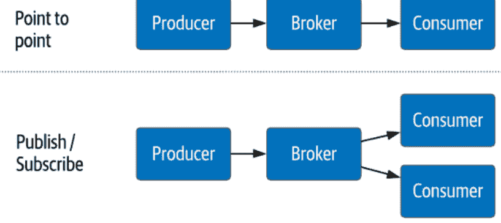
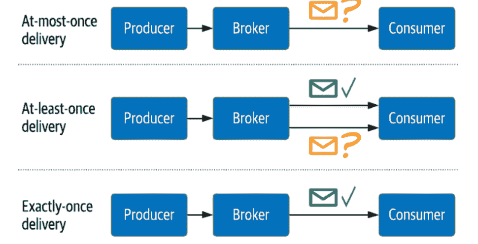
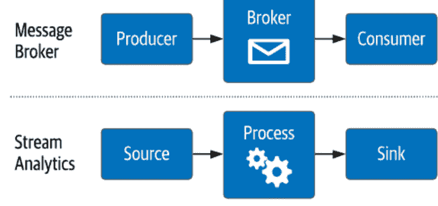
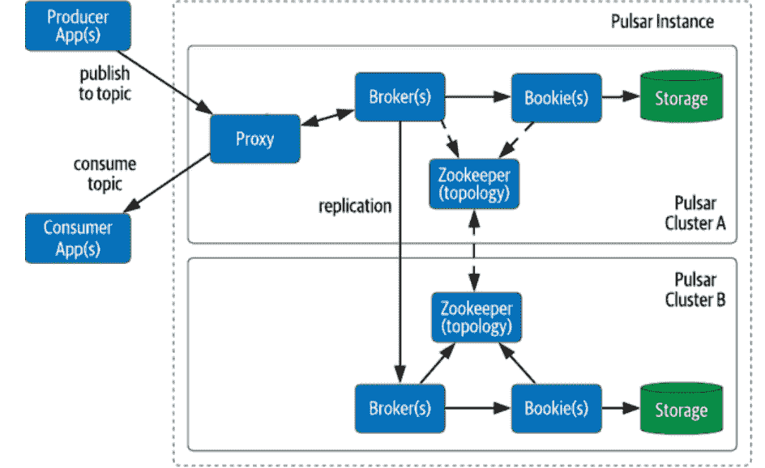
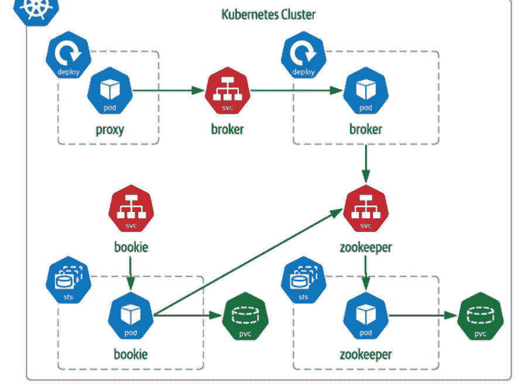
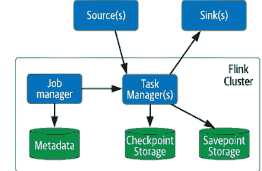
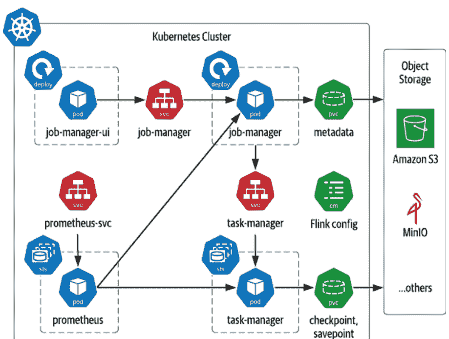
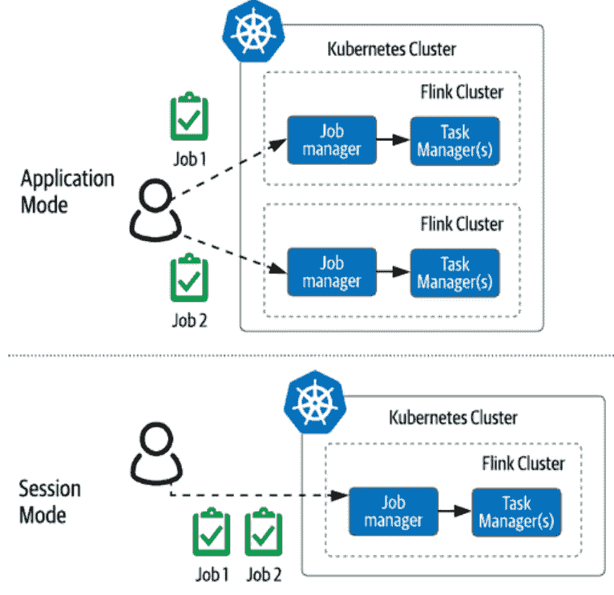

## Chapter 7. Streaming Data on Kubernetes

### A NOTE FOR EARLY RELEASE READERS

对于早期发布读者的一点说明

使用 Early Release 电子书，你可以在这些标题正式发布之前很久就利用这些技术——作者在撰写时的原始未编辑内容，以便你能尽早利用这些技术。

这将是最终书籍的第 8 章。请注意，本书的代码示例可在 https://github.com/data-on-k8s-book 获取。

如果你对如何改进本书的内容和/或示例有任何意见，或者如果你注意到本章中缺少材料，请联系编辑 jleonard@oreilly.com。

当询问应用程序开发人员关于数据基础设施时，持久性是首先想到的——存储运行应用程序的状态。因此，我们到目前为止的重点一直放在数据库和存储上，现在是时候扩展并考虑云原生数据堆栈的其他方面，在本章中，我们将花一些时间研究流式技术。如果您管理数据管道，流式处理可能是您的起点，其他数据基础设施部分次之。无论您的起点如何，数据移动都是整体数据堆栈中至关重要的一部分。让我们以它在 Kubernetes 和云原生部署中的契合方式来处理这个主题。

### Introduction to Streaming

在第 1 章中，我们将流式处理定义为将数据从一个点移动到另一个点，并在某些情况下，在传输过程中处理数据的功能。流式处理的历史几乎与持久性一样悠久。随着数据在各种孤立存储中积聚，很明显，可靠地移动数据与可靠地存储数据一样重要。在那些日子里，它被称为消息传递，数据以更慢但更审慎的方式传输，类似于邮政邮件。消息传递基础设施将数据放在可以异步、按顺序读取并具有交付保证的位置。

现代应用程序需求将被称为消息传递的东西演变为今天的流式处理定义。通常这意味着管理需要更即时处理的大量数据，我们称之为“近实时”。在 Kubernetes 中部署的分布式应用程序中，排序和交付保证变得至关重要，在许多情况下，它们是实现所需规模的关键推动因素。增加基础设施复杂性如何帮助扩展？通过提供一种有序的方式来管理从数据创建到可使用和存储位置的流程。围绕流式处理存在大量软件和术语，可能会让初次使用者感到困惑。与任何复杂主题一样，将其分解为各个部分有助于我们建立理解。选择适合您用例的流式系统时，有三个方面需要评估：

- Types of delivery
- Delivery guarantees
- Feature scope for streaming

让我们更仔细地看看这些领域中的每一个。

### Types of Delivery

要在应用程序中使用流式处理，您需要了解从众多流式系统列表中可用的交付方法。您需要了解应用程序需求，以便有效地规划数据从生产者到消费者的流程。例如，

“我的消费者需要独占访问吗？” 答案将决定哪个系统符合要求。图 8-1 显示了流式系统中两种最常见的选择：点对点和发布/订阅。



Figure 7-1. Delivery Types

#### Point to point

在此数据流中，生产者创建的数据通过代理传递，然后以一对一的关系传递给单个消费者。这主要用作将生产者与消费者直接连接解耦的一种方式。它作为弹性功能非常出色，因为消费者可以在不丢失数据的情况下被移除和添加。同时，代理维护顺序和最后读取的消息，消费者可以使用偏移量寻址。

#### Publish / Subscribe (pub/sub)

在此交付方法中，代理充当单个生产者和一个或多个消费者之间一对多关系的分发中心。消费者订阅主题，并在生产者创建任何新消息时接收通知——这是响应式或事件驱动架构的关键组件。

### Delivery Guarantees

与交付类型结合，代理在生产者到消费者之间按消息类型维护交付保证，称为 *contract*。典型的交付类型如图 8-2 所示：at-most-once、at-least-once 和 exactly once。该图显示了生产者发送消息的时间与消费者接收消息的期望之间的重要关系。



Figure 7-2. Delivery Guarantees

#### At-most-once

最低保证允许生产者创建的数据被消费者跳过。例如，这可能用于消费者只需要对最新信息做出反应时。如果消费者离线一段时间，重新上线后正确的操作是继续处理最新数据并忽略之前交付的任何内容。需要了解的关键缺点是，数据丢失是设计使然。

#### At-least-once

此保证是 at-most-once 的另一面。生产者创建的数据保证会被消费者接收。增加的方面


允许在第一次之后无限次重新传递。例如，这可能与消费者端被视为幂等的唯一键（如时间戳或 ID 号）一起使用，多次处理不会产生影响。消费者将始终看到生产者传递的数据，但可能会看到多次。你的应用程序需要考虑到这种可能性。

### Exactly-once

这三种保证中最严格的一种，这意味着生产者创建的数据只会被传递一次给生产者。示例：精确的交易，例如资金流动，减法或加法必须只被传递和处理一次以避免问题。这种保证对代理的维护提出了更大的负担，因此你需要调整分配给代理的资源以及预期的吞吐量。

你应该在为每种类型的消息选择传递保证时谨慎行事。传递保证是需要仔细评估的，因为如果不完全理解，它们可能会对消费者产生意外的下游影响。诸如“我的应用程序能否处理重复消息？”这样的问题需要一个明确的答案。“也许”是不够的。

### Feature Scope

有许多流式技术可用，其中一些已经存在了相当多年。表面上看，这些技术可能看起来相似，但由于新需求的出现，它们各自解决不同的问题。大多数都是开源项目，因此每个项目都找到了志同道合的社区加入并推进项目。类似于许多不同的持久化数据存储都归于“数据库”这一大类之下，功能组合和差异在数据流式传输这一标题下可能存在显著差异。

功能范围可能是评估使用哪种流式技术时最重要的选择标准。然而，你也应该挑战自己将 Kubernetes 的适用性作为标准，并考虑更复杂的功能是否值得额外的资源成本。幸运的是，第一次决策错误的代价相对较低。由于其短暂的特性，流式数据系统往往是最容易迁移的。流式技术在你的功能堆栈中深入得越深，迁移就越困难。流式功能范围可以分为图 8-3 中所示的两个大类。



Figure 7-3. Streaming Types

### Message broker

最简单的流式技术形式，它促进数据从一个点到另一个点的移动，并采用上述列出的一种或多种传递方法和保证。很容易低估这种功能看似简单的外观，但它是现代云原生应用的支柱。就像说 FedEx 只是一家包裹递送公司，但如果它哪怕停一天，世界经济会发生什么？示例 OSS 消息代理包括 Apache Kafka、Apache Pulsar、RabbitMQ 和 Apache ActiveMQ。

### Stream analytics

在某些情况下，分析数据的最佳或唯一时机是在数据移动时。等待数据持久化后再开始分析可能为时已晚，而洞察的价值几乎毫无用处。考虑欺诈检测。阻止欺诈活动的唯一机会是在它发生时，等待第二天运行报告是行不通的。示例 OSS 流分析系统包括 Apache Spark、Apache Flink、Apache Storm、Apache Kafka Streams 和 Apache Pulsar。

### The Role of Streaming in Kubernetes

现在我们已经介绍了基本术语，流式传输如何融入在 Kubernetes 上运行的云原生应用中？数据库应用遵循创建、读取、更新和删除（CRUD）的模式。对于开发者而言，数据库提供数据的单一位置。添加流式传输意味着数据在不同位置之间存在某种运动。数据如果用于创建新数据，可能是短暂的。一些数据在传输中可能会被转换，一些最终会被持久化。流式传输假设分布式架构，而扩展流式系统的方式是管理其计算、网络和存储的资源分配。这正好落入云原生架构的甜蜜点。在 Kubernetes 中流驱动应用的情况下，你正在管理数据在随时间变化的环境中的可靠流动。需要时分配所需资源。

### STREAMING AND DATA ENGINEERING

数据工程是一个相对较新的学科，因此我们希望在此定义它，因为这是一个快速增长的领域。这对于数据流式传输实践尤其适用。数据工程师关注在复杂环境中数据的高效移动。两 T 在此很重要：传输和转换。数据科学家的角色是从数据中推导出意义和洞察。相比之下，数据工程师构建的是从各个位置收集数据、组织数据，并在大多数情况下持久化到类似数据湖的管道的系统。数据工程师与应用开发者和数据科学家合作，以确保在数据日益分布的性质下满足应用需求。

你速度和敏捷性的最关键方面是你的工具协同工作的程度。当开发者构思新应用时，这个想法变成生产部署需要多快？为一个应用部署和管理单独的基础设施（流式传输、持久化、微服务）是负担沉重且容易出错的。当问及为何要在云原生堆栈中添加流式传输时，你应该考虑在技术债务方面不整合整个堆栈的成本。

### CLOUD NATIVE STREAMING IS GAME-CHANGING BUT REMEMBER THE FUNDAMENTALS

与 Jesse Anderson，Big Data Institute 管理董事 合作

是什么让流式传输非常适合 Kubernetes？如果你思考系统中哪个组件最动态，那很可能是流式传输。你的数据库在一天中上下扩展的需求不会那么大。24 小时周期内的典型需求曲线将需要更多的流式传输扩展，尤其是处理。如果你在从虚拟机迁移到 Kubernetes，你会想把确切的环境复制到 Pod 中然后忘记它。通过这样做，你错过了云原生对流式工作负载的主要价值。根据我的经验，为预期负载预先配置的团队通常会因过度配置而浪费超过 50% 的资源。管理成本的最佳方式是在需要时添加资源，并在完成时释放它们。成功的真正衡量标准是最终用户完全不知道基础设施的进出。他们获得流畅的体验和一致的服务水平。另一方面，由于成本而人为限制流式容量可能会降低响应时间并降低服务水平。在最坏的情况下，实时处理窗口会落后且无法追赶。

在 Kubernetes 中部署流式工作负载的挑战在于匹配系统架构以平衡配置和服务水平。如果技术不是为动态工作负载匹配而设计的概念，那么强迫它完成未设计的功能可能需要大量努力。Kafka 是一个高度可扩展的分布式系统，但缩减规模的想法并不是初始设计的一部分。Kafka 集群旨在维持声明的操作状态。如果部署了十个代理，其中一个丢失，Kafka 会尝试返回到十个代理的状态。虽然这对于弹性至关重要，但实现弹性需要不同的方法。Pulsar 是流式系统的一个例子，它从第一天起就以云原生思维设计来处理动态工作负载。Flink 也是在相同考虑下设计的流处理系统。组合使用时，部署将在不同时间和不同量级消耗计算和存储。这更接近 Kubernetes 架构。

存储一直是 Kubernetes 项目快速变化的领域，但在你的流式部署中你应该避免对其做出假设。当你流式传输的数据需要被持久化时，它会去哪里？一个很好的弹性问题是“如果我不小心删除了我的 Kubernetes 集群会怎样？”我曾与在 Kubernetes 上部署流式传输的团队合作，他们无意中使用了临时存储。你必须确保从迁移到 Kubernetes 的最早阶段就考虑存储的持久性。流式传输需要更高水平的运营卓越。拥有五个九或更好的正常运行时间不是可选的。与批处理系统不同，停机不是高影响的，如果失败，你只需重新运行作业即可。对于流式传输，如果你宕机，你可能已经丢失数据。由于丢失 StatefulSet 而导致的运营中断可能是一件大事。

最后要考虑的是你的灾难恢复计划。不要假设云原生部署消除了可能毁灭性的故障。你可以缓解其中许多，但根据我的经验，某种程度的故障是不可避免的，这就是规划如此重要的原因。至少，要为基础设施可能发生的各种故障做好准备，例如 Pod、StatefulSet 或整个 Kubernetes 集群的丢失。最常见且影响最大的故障是由于人为错误，例如误以为在 QA 环境中工作而故意删除数据，或配置错误。每个人都会遇到这种情况，我们只需要为此做好计划。

对于数据工程师和站点可靠性工程师（SRE）而言，你在 Kubernetes 中对流式传输的规划和实施可能会极大地影响你的组织。云原生数据应该允许更大的敏捷性和速度


在尽可能榨取所有效率的同时。作为本书的读者，你已经开始以不同的方式思考你的基础设施。借鉴 Jesse Anderson 的建议，在你开始 Kubernetes 上的流式数据之旅时，你应该关注的两个领域。

### 资源分配

你是否同时为峰值和低谷做了规划？正如你在第 1 章中所回忆的那样，弹性是云原生数据中最具挑战性的方面之一。扩展是大型系统中的常见解决方案，但缩减可能会导致数据丢失，尤其是在流式系统中。流量需要在资源退役前被重定向，并且它们本地管理的任何数据都需要由系统其他部分来承担。弹性所涉及的风险使其无法被广泛使用，其结果是大量未使用的容量。坚定地认为资源绝不应闲置，并构建使用所需资源且不多余的流式系统。

### 灾难恢复规划

高效移动数据是一个重要问题，但同样重要的是如何管理不可避免的故障。如果不了解你的数据流和持久性要求，就不能仅依赖 Kubernetes 来处理恢复。灾难恢复不仅仅是备份数据。Pods 如何调度才能使物理服务器故障的影响降低？你能从地理冗余中受益吗？你是否清楚数据持久化的位置并理解这些存储系统的持久性？最后，你是否有明确的计划在故障后恢复系统？在所有情况下，写下流程是第一步，但测试这些流程才是成功与失败的区别。

我们已经介绍了 Kubernetes 上流式数据的“是什么”和“为什么”，现在是时候开始关注“怎么做”，特别是在云原生部署方面。我们将快速概述如何在 Kubernetes 上安装这些技术，并强调一些有助于你规划的重要细节。由于你已经在前几章中学习了我们将需要的许多 Kubernetes 资源，我们将加快节奏。让我们开始第一个云原生流式技术。

### 使用 Apache Pulsar™ 在 Kubernetes 上进行流式处理

Apache Pulsar™ 是一个值得关注的云原生流式应用令人兴奋的项目。流式软件大多是在 Kubernetes 和云原生架构之前时代构建的。Pulsar 最初由 Yahoo! 开发，该公司对大规模云原生工作负载并不陌生。捐赠给 Apache 软件基金会后，它于 2018 年被接受为顶级项目。还有 Apache Kafka 或 RabbitMQ 等其他项目可能适合你的应用需求，但它们需要更多的规划和编写良好的 operator 才能达到 Pulsar 的效率水平。就我们之前介绍的流式定义而言，Pulsar 支持以下特性

- 交付类型：点对点和发布/订阅
- 交付保证：至少一次、至多一次、恰好一次
- 流式功能范围：消息代理、分析（通过函数）

那么是什么让 Pulsar 非常适合 Kubernetes？

我们使用 Kubernetes 创建虚拟数据中心以高效使用计算、网络和存储。Pulsar 从一开始就设计为计算和存储资源类型分离并通过网络链接，类似于微服务架构。这些资源甚至可以跨多个 Kubernetes 集群或物理数据中心，如图 6- 所示。

4. 部署选项为操作员提供了根据用例和工作负载安装和扩展运行的 Pulsar 集群的灵活性。它也是以多租户为目标设计的，在大型部署中带来很大的效率差异。不是为每个应用程序安装单独的 Pulsar 实例，许多应用程序（租户）可以使用一个 Pulsar 实例，并设置防护栏以防止资源争用。最后，内置的存储分层为数据老化时的存储持久性创建了自动替代方案，并且可以使用更低成本的存储。

Pulsar 最高级别的抽象是一个实例，由一个或多个集群组成。我们将本地逻辑管理域称为集群，并在 Kubernetes 集群中部署并将我们的注意力集中于此。集群可以共享元数据和配置，允许生产者和消费者无论位置如何都看到一个单一系统。每个集群由多个协同工作的部分组成，主要消耗计算或存储，我们将对其进行说明。



图 7-4. Apache Pulsar™ 架构

#### Broker（计算）

生产者和消费者通过 broker 传递消息，broker 是无状态的集群组件。这意味着它纯粹是计算扩展单元，可以根据租户数量和连接数动态分配。Broker 维护用于客户端通信的 HTTP 端点，这在 Kubernetes 部署中为网络流量提供了一些选项。当使用多个集群时，broker 支持实例中集群之间的复制。Broker 从称为 bookies 的后端存储服务读取和写入持久化数据。Broker 可以在消息持久性不是用例要求时以内存<|message|> 配置运行，从而避免需要存储组件。

#### Apache Bookkeeper™（存储）

Bookkeeper 项目为管理分布式预写日志提供基础设施。在 Pulsar 中，单个实例称为 *bookies*，并使用 Bookkeeper 作为持久性启用时的持久消息存储。存储单元称为账本，每个主题可以有一个或多个账本。创建多个 bookie 实例以提供负载均衡和故障保护。它们还提供存储分层功能，允许操作员根据用例提供快速和长期存储选项的混合。当 broker 与 bookies 交互时，它们读取和写入主题账本，后者是一个仅追加的数据结构。Bookies 为账本提供单一引用，但在主接口背后管理复制和负载均衡。在 Kubernetes 环境中，了解数据存储位置对于保持弹性至关重要。

#### Apache Zookeeper™（计算）

Zookeeper 是一个独立项目，用于许多分布式系统的协调、领导者选举和元数据管理。Pulsar 使用 Zookeeper 进行服务协调，与 Kubernetes 集群中使用 Etcd 的方式类似，存储租户、主题等重要元数据，以及集群配置状态，以便 broker 保持无状态。Bookies 使用 Zookeeper 进行账本元数据和多个存储节点之间的协调。

#### Proxy（网络）

Proxy 是 Kubernetes 等动态环境的解决方案。不是将每个 broker 暴露给 HTTP 流量，proxy 作为网关并为 Pulsar 集群创建入口路由。随着 broker 的添加和移除，proxy 使用服务发现保持到集群的连接畅通。当在 Kubernetes 中使用 Pulsar 时，proxy 服务 IP 应该是你的应用程序访问运行 Pulsar 集群的唯一入口。

#### Functions（计算）

与 broker 的消息传递功能分开，且未包含在图 8-4 中。Pulsar Functions 独立运行并消耗自己的计算资源。添加到 Pulsar 集群的组件是 worker，它按需接受函数运行时。Pulsar Functions 与消息 broker 协同工作。部署后，它们从主题中获取数据，用用户代码对其进行修改，并将其返回到另一个主题。操作员可以将 Functions 部署为较大集群的一部分，或作为独立部署以实现更精细的资源管理。

### 准备你的环境

在进行首次安装时，你需要做出一些选择。查看官方文档以获取有关在 Kubernetes 中安装 Pulsar 的最完整和最新信息。本书将更深入地探讨你做出自信选择的原因以及它们与不同云原生应用用例的关系。

首先，创建 Pulsar Helm chart 仓库的本地克隆目录：

```
git clone https://github.com/apache/pulsar-helm-chart
```


This subproject of Pulsar is well documented with several helpful examples to follow. When using Helm to deploy Pulsar you will need a `values.yaml` file that contains all of the options to customize your deployment. You can include as many parameters as you want to change. The Pulsar Helm chart has a complete set of defaults for a typical cluster that might work for you, but you will have nuance that requires specific values with even the best defaults in your environment. The `examples` directory has various deployment scenarios. If you choose the default installation as described in the TBD file, you’ll have a set of resources like that shown in Figure 8-5. As you can see, the installation wraps the proxy and brokers in Deployments and presents a unified service endpoint for applications.



Figure 7-5. A Simple Pulsar Installation on Kubernetes

Affinity is a mechanism built into Kubernetes to create rules for which pods can and cannot be co-located on the same physical node (See more in-depth discussion in chapter 4). Pulsar, being a distributed system, has deployment requirements for maximum resilience. An example is brokers. When multiple brokers are deployed, each pod should run on a different physical node in case of failure. If all broker pods were grouped on the same node and the node went down, the Pulsar cluster would be unavailable. Kubernetes would still recover the runtime state and restart the pods. However, there would be downtime as they came back online. The easiest thing is to not allow pods of the same type to group together onto the same nodes. When enabled, anti-affinity will keep this from happening. If you are running on a single node system such as a desktop, disabling it will allow your cluster to start without blocking based on affinity.

```
affinity:
  anti_affinity: true
```

Fine-grained control over Pulsar component replica counts lets you tailor your deployment based on the use case. Each replica pod consumes resources and should be considered in the application’s lifecycle. For example, starting with a low number of brokers and bookkeeper pods can manage some level of traffic. Still, more replicas can be added and configuration updated via Helm as traffic increases.

```
zookeeper:
  replicaCount: 1
bookkeeper:
  replicaCount: 1
broker:
  replicaCount: 1
proxy:
  replicaCount: 1
```

### Securing Communications by Default with Cert-manager

An unfortunate reality we face is on what gets left to complete at the end of product development: security or documentation. Unfortunately, Kubernetes doesn’t have much in the way of building documentation, but when it comes to security, there has been some great progress on starting earlier without compromise!

As you can see, installing Pulsar has created a lot of infrastructure, with a lot of communication between the elements. High traffic volume is a typical situation. When we build out virtual data centers in Kubernetes, it will create a lot of internode and external network traffic. All traffic should be encrypted with Transport Layer Security (TLS) and Secure Socket Layer (SSL) using x.509 certificates. The most important part of this system is the Certificate Authority (CA). In a Public Key Infrastructure (PKI) arrangement acts as a trusted third party that digitally signs certificates used to create a chain of trust between two entities. Going through the procedure to have a certificate issued by CA historically has been a manual and arduous process, which unfortunately has led to a lack of secure communications in cloud-based applications.

Cert-manager is a tool that uses the Automated Certificate Management Environment (ACME) protocol to add certificate management seamlessly to your Kubernetes infrastructure. We should always use TLS to secure the data moving from one service to another for our streaming application. The cert-manager project is arguably one of the most critical pieces of your Kubernetes infrastructure that you will eventually forget about. That’s the hallmark of a project that fits the moniker of “it just works.”

### WHAT IS ACME?

When working with x.509 certificates, you’ll frequently see references to the Automated Certificate Management Environment (ACME). ACME allows for automated deployment of certificates between user infrastructure and certificate authorities. It was designed by the Internet Security Research Group when they were building their free certificate authority, Let’s Encrypt. It would be putting it lightly to say this fantastic free service has been a game-changer for cloud native infrastructure.

Adding TLS to your Pulsar deployment has been made incredibly easy with just a few configuration steps. Before installing Pulsar, you’ll need to set up the Cert-manager service inside the target Kubernetes cluster. First, add the Cert-manager repo to your local Helm installation.

```
helm repo add jetstack https://charts.jetstack.io
```

The installation process takes a few parameters, which you should make sure to use. First is declaring a separate namespace to keep the Cert-manager neatly organized in your virtual datacenter. The second is installing the Custom Resource Description(CRD) assets. This combination allows you to create services that automate your certificate management.

```
helm install \
    cert-manager jetstack/cert-manager \
    --namespace cert-manager \
    --create-namespace \
    --set installCRDs=true
```

After the Cert-manager is installed, you’ll then need to configure the certificate issuer that will be called when new certificates are needed. There are many different options based on the environment you are operating in, and these are covered quite extensively in the documentation. One of the custom resources created when installing cert-manager is Issuer. The most basic Issuer is the selfsigned-issuer that can create a certificate with a user-supplied private key. You can create a basic Issuer by applying the following yaml configuration.

```
apiVersion: cert-manager.io/v1
kind: Issuer
metadata:
  name: selfsigned-issuer
  namespace: cert-manager
spec:
  selfSigned: {}
---
apiVersion: cert-manager.io/v1
kind: ClusterIssuer
metadata:
  name: selfsigned-cluster-issuer
spec:
  selfSigned: {}
```

When installing Pulsar with Helm, you can secure inter-service communication with a few lines of yaml configuration. You can pick which services are secured by setting the TLS enabled to true or false for each service in the yaml that defines your Pulsar cluster. The examples provided by the project are quite large so for brevity, we’ll look at some key highlighted areas.

```
tls:
  # settings for generating certs for proxy
  proxy:
    enabled: true
    cert_name: tls-proxy
  # settings for generating certs for broker
  broker:
    enabled: true
    cert_name: tls-broker
  # settings for generating certs for bookies
  bookie:
    enabled: false
    cert_name: tls-bookie
  # settings for generating certs for zookeeper
  zookeeper:
    enabled: false
    cert_name: tls-zookeeper
```

Or you can secure the entire cluster with just one command.

```
tls:
  enabled: true
```

Later in your configuration file, you can use self signing certificates to create TLS connections between components.

```
### issue selfsigning certs
certs:
  internal_issuer:
    enabled: true
    type: selfsigning
```

If you have been involved in securing infrastructure communication any time in the past, you know the toil in working through all the steps and applying TLS. Inside a Kubernetes virtual data center, you no longer have an excuse to leave network communication unencrypted. With a few lines of configuration, everything is secured and maintained.

### CERT-MANAGER: MAKING SECURITY EASY SO YOU’LL USE IT

With Josh van Leeuwen, Software Engineer, Jetstack

Cert-manager is a project born of necessity as our cloud native world grows. Previously, you might have a bunch of virtual machines or bare metal running somewhere, running in a ringed fence. You could get away with sticking an SSL certificate in the front gateway and moving on. All of that has changed now with the thousands or even hundreds of thousands of machines that need to be secured in our cloud native systems. With all of these small containers running microservices continually coming and going, automation is the only way to manage the volume of changes. There is no way a human can do that alone. Of course, this opens a new challenge of reliable automation—one which Kubernetes has taken head-on.

Soon after the ACME protocol was created, custom resources and CRDs became a feature in Kubernetes. Cert-manager is a project that joins those two concepts, providing a declarative way to represent what an X.509 certificate should look like inside a Kubernetes deployment. ACME happened at just the right time for the Kubernetes ingress use case, and the first use case for Cert-manager was for ACME SSL certificates. However, it quickly became apparent that this would not be the only secure networking problem that needed solving in Kubernetes. Those growing numbers of machines all need to talk to each other, and they all need some kind of security in place, which is generally done with Transport Level Security (TLS). TLS certificates require the concept of an issuer, and Cert-manager was expanded to allow for different types of issuers to automate the complete lifecycle further of those certificates.

Because it emerged so early in the Kubernetes project, Cert-manager has become the de-facto X.509 provider and certificate manager. With this comes a responsibility to make securing communications in Kubernetes easy. Security is only as good as it is easy. If security is


难以实现，那么它实际上就毫无用处。很多人不喜欢 GNU Privacy Guard(GPG)，原因就在于此；并不是因为它在安全性上必然存在缺陷，而是因为它难以使用。Cert-manager 应该继续在云原生应用中得到广泛采用。它通过默认安全、几乎无需干预或对 RSA 或 TLS 的工作原理了解甚少的方式，让一切变得安全。这是一个易于使用且默认就能解决人们问题的项目。

Cert-manager 对终端用户来说之所以容易使用，其中一个原因是它拥有一个定义良好的 API，可以以简单的方式描述应用需求。它是一种抽象更复杂问题的手段，例如证书签名或颁发者意味着什么？这些 API 提供了护栏，以尽可能确保你做正确的事情。仍然有一些需要规划和深思熟虑的事情，例如不要重复使用私钥密码，这虽然被允许但不被鼓励。

护栏和标准化是 Kubernetes 其他部分需要变得更普遍的话题。Kubernetes 的声明式特性和可扩展性是强大的工具，但强大的力量伴随着巨大的责任。组织内部的不同人员可以在 Kubernetes 集群中创建扩展点。通过一条命令，你就可以在不知情的情况下将端点暴露到互联网上。安全专业人员无法获得这些扩展的单一视图。也没有护栏来防止意外行为。如果没有适当的护栏，就很容易严重自毁。随着 Kubernetes 的成熟，我们需要更多避免不幸事故的方法。

Cert-manager 项目处于极佳的状态，其形式是厂商中立且成熟的。如果你 grep 项目的变更日志中的“feature”一词，你会看到在每个后续版本中出现次数都在减少。这意味着我们拥有一个有用且稳定的核心 API，这对于一个核心安全项目来说是极佳的位置。项目中发生的 bulk 更改主要集中在利用这个稳定的核心 API 来添加新的颁发者。这种稳定性确保项目能够跟上最新需求，而不会出现破坏性的变更。

至于未来，Cert-manager 项目将继续与 Kubernetes 社区合作，继续“默认安全”的道路，让安全变得如此简单以至于被普遍使用。仍然有一些挑战需要克服，例如密钥如何存储以及如何管理信任链，而 Kubernetes 的势头几乎可以保证这些问题很快会被解决。如果这些是有趣的问题，我敦促你以安全专业人员可以影响 Kubernetes 未来发展的众多方式之一参与其中。

Cert-manager 应该是你在新 Kubernetes 集群中安装的第一件事。项目成熟度和简洁性的结合，使得安全成为添加到项目中的容易的第一件事，而不是最后的事。这不仅对 Pulsar 而言，对你在 Kubernetes 中部署的每个需要网络通信的服务都是如此。

### 使用 Helm 部署 Apache Pulsar™

现在我们已经介绍了如何设计 Pulsar 集群以最大化资源，你可以使用 Helm 将部署执行到 Kubernetes。首先，添加 Pulsar Helm 仓库。

```
helm repo add apache https://pulsar.apache.org/charts
```

Helm 安装 Pulsar 的一个特殊要求是准备 Kubernetes。在你之前克隆的 git 仓库中，有一个脚本会运行所有准备工作，例如创建目标命名空间。更复杂的设置是带有相关密钥和令牌的角色。这些对于 Pulsar 集群内部的服务间通信非常重要。从文档中你可以使用此示例调用准备脚本。

```
./scripts/pulsar/prepare_helm_release.sh -n <k8s-namespace> -k <helm-release-name>
```

一旦 Kubernetes 集群已为 Pulsar 做好准备，最终的安装就可以运行。此时，你应该有一个 yaml 配置文件，其中包含我们前面描述的 Pulsar 用例所需的设置。helm install 命令将采用该配置文件并指示 Kubernetes 满足你指定的期望状态。在创建新集群时，使用 initialize=true 来在 Zookeeper 中创建基础元数据配置。

```
helm install \
  --values <config yaml file> \
  --set initialize=true \
  --namespace <namespace from prepare script> \
  <pulsar cluster name> apache/pulsar
```

在典型的生产部署中，你应该预计设置时间需要 10 分钟或更长时间。有很多依赖需要逐步完成，因为 Zookeeper、Bookies、Broker 和最后的 Proxies 被依次启动并上线。

### 使用 Apache Flink™ 进行流分析

现在，让我们来看一下在云原生部署中迅速流行起来的一种不同类型的流式项目：Apache Flink™。Flink 是一个主要设计用于以惊人规模专注于流分析的系统。正如我们在本章开头讨论的那样，流式系统有许多不同的类型，这是一个完美的例子。Flink 具有与其他系统几乎很少重叠的能力，事实上，广泛可见 Pulsar 和 Flink 一起部署以在云原生应用中互补各自的优势。

作为一个流式系统，Flink 中提供以下内容：
- 交付类型：逐一
- 交付保证：恰好一次
- 流式功能范围：分析

Flink 架构的两个主要组件如图 8-6 所示：Job Manager 和 Task Manager。



Figure 7-6. Apache Flink Architecture

#### JobManager

这是任何运行的 Flink 应用代码的控制平面。它们消耗 CPU 资源但仅用于维护作业控制，在 JobManager 上不进行实际处理。在高可用性(HA)模式下，该模式独用于在 Kubernetes 上运行的 Flink。在 HA 模式下，将会配置多个备用 JobManager，但它们保持空闲，直到主节点不再可用。

#### TaskManager

在运行的 Flink 作业上完成工作的地方。JobManger 使用 TaskManagers 来满足应用中所需的任务链。链是操作顺序。在某些情况下，这些操作可以并行运行，而有些需要串行运行。TaskManger 只运行一个离散任务并将其传递下去。资源管理可以通过集群中 TaskManagers 的数量和每个 TaskManager 的执行槽来控制。当前指导建议你为每个 TaskManager 或槽分配一个 CPU。

Flink 项目设计用于管理有状态计算，这应该让你立即想到存储需求。Flink 中的每个事务都保证强一致且没有单点故障。这些是在你尝试构建 Flink 设计用于完成的高度可扩展系统时具备的功能。有两种不同类型的流式：有界和无界。

#### 无界流式

这些流式系统在数据到达时对新数据做出反应。没有你可以停止并分析收集数据的终点。每个接收到的数据都是独立的。这种用例可以是对值进行告警或在精确性至关重要时进行计数。响应式处理可以非常节省资源。

#### 有界流式

这在其他系统中也称为批处理，但在 Flink 中是特定情况。有界窗口可以按时间或特定值标记。在时间窗口的情况下，它们也可以向前滑动，从而能够对值进行滚动更新。应根据要处理的数据窗口大小考虑资源。边界大小的限制主要受内存约束。

Flink 的基础原则之一是对运维的强烈关注。在云原生应用所需的规模下，易于使用和部署可能是使用与否的区别。这包括对在 Kubernetes 中运行工作负载的核心支持以及与云原生应用的功能对等。内置的保存点支持使更新更容易，通过在系统更新前后暂停和恢复作业。它们也可以用于在处理 pod 在作业中途失败时快速恢复。与 Kubernetes 的更紧密集成允许 Flink 在失败时自我修复，通过恢复 pod 并使用保存点重启作业。通过对 Prometheus 指标输出的支持，整个应用的可见性得以实现。


Flink 的基本工作单元称为作业。作业是 Java 或 Scala 程序，定义了数据的读取、分析和输出方式。作业被链接在一起形成一个编译成 jar 文件的 Flink 应用。Flink 项目提供了一个 Docker 镜像，可将应用代码封装为可部署的形式。秉承对运维的承诺，使用 docker 镜像使得在 Kubernetes 上的编排变得轻松。利用 Kubernetes 与流式应用的优势现在可以通过允许团队使用持续部署来进一步增强。

综合起来，我们为数据团队提供了一种参与整体云原生技术栈的方式，同时为运维人员提供管理整个部署所需的一切。构建微服务的应用程序开发人员可以与构建来自应用程序生成的数据流分析的开发人员共享 CI/CD 流水线。随着栈中任何部分的变更发生，它们可以被完全集成测试并作为一个整体单元部署。团队可以更快地移动并更有信心地知道不会出现可能在生产环境中出现的脱节需求。这种结果是采用云原生方法论于整个技术栈的坚实论据，以便了解这是如何完成的。

### 在 Kubernetes 上部署 Apache Flink™

将 Flink 集群部署到正在运行的 Kubernetes 集群中时，有几件事需要考虑。Flink 项目选择提供他们所称的“Kubernetes 原生”方式，该方式以编程方式安装所需的 Flink 组件，而无需 kubectl 或 Helm。这些选择未来可能会发生变化。Flink 生态系统中已经存在一些侧项目，它们为 Kubernetes 运维人员期望的更典型的体验带来了运维程序和 Helm 图表。目前，我们将讨论项目官方认可的方法。



图 7-7. 在 Kubernetes 上部署 Flink

运行中的 Flink 集群有两个主要组件我们将在 Pod 中部署：Job Manager 和 Task Manager。这些是基本单元，但部署模式是针对你的用例的关键考虑因素。它们决定了计算和网络资源的利用方式。另一个需要注意的是如何在 Kubernetes 上部署。如前所述，没有官方的项目运维程序或 Helm 图表。Flink 发行版包含命令行工具，可根据应用程序的模式将部署到正在运行的 Kubernetes 集群中。图 8-8 显示了在 Kubernetes 中部署 Flink 集群可用的模式：Application Mode 和 Session Mode。Flink 还支持第三种模式称为 Per-Job 模式，但这不适用于 Kubernetes 部署，这就只剩下 Application Mode 和 Session Mode。



图 7-8. Apache Flink™ 模式

选择 Application Mode 或 Session Mode 取决于你在 Kubernetes 集群内部的资源管理，因此让我们同时查看两者以做出明智的决定。

Application Mode 将每个 Flink 应用程序隔离到其自己的集群中。需要提醒的是，一个 Flink 应用程序 jar 可以由多个链接在一起的作业组成。集群的启动成本可以通过单个应用程序初始化和作业图来最小化。一旦部署，资源将被用于客户端流量和应用程序中作业的执行。网络流量更高效，因为只有一个 JobManager，并且客户端流量可以复用。

要在 Application Mode 中启动，你使用 flink 命令行并将目标指定为 kubernetes-application。你需要可通过 kubectl 访问的正在运行的 Kubernetes 集群的名称。要运行的应用程序包含在 docker 镜像中，并在命令行中提供 jar 文件的路径。启动后，Flink 集群将被创建，应用程序代码将被初始化，然后将准备好进行客户端连接。

```
$ ./bin/flink run-application \
  --target kubernetes-application \
  -Dkubernetes.cluster-id=<kubernetes cluster name> \
  -Dkubernetes.container.image=<custom docker image name> \
  local:///opt/flink/usrlib/my-flink-job.jar
```

Session Mode 通过创建可以按需接受任意数量应用程序的单个 Flink 集群来改变资源管理。与运行并消耗资源的多个独立集群相比，你可能会发现拥有一个可以根据提交的新应用程序增长和缩小的单个集群更高效。对运维人员来说的缺点是，你现在有一个单一集群，如果它失败，将会连带多个应用程序。Kubernetes 将重启宕机的 Pod，但你将有恢复时间需要管理，因为资源将被重新分配。要在 Session Mode 中启动，使用 kubernetes-session shell 文件并给出正在运行的 Kubernetes 集群的名称。默认情况下，命令将执行并从集群分离。要重新附加或保持与运行中集群的交互模式，使用 execution.attached=true 开关。

```
$ ./bin/kubernetes-session.sh \
  -Dkubernetes.cluster-id=<kubernetes cluster name> \
  -Dexecution.attached=true
```

这只是对一个庞大主题的快速浏览，但希望能激发你进一步探索。向你的应用程序添加 Flink 不仅仅是选择一个执行流处理的平台。在云原生应用程序中，我们应该整体思考我们试图在 Kubernetes 中部署的整个应用程序栈。Flink 使用容器作为封装，这使其能够与其他开发工作流协同工作。

### 总结

在本章中，我们从以持久性为导向的数据基础设施分支进入了流式处理的世界。我们定义了流式处理是什么，如何导航所有术语，以及它如何融入 Kubernetes。从那里，我们深入研究了 Apache Pulsar 并学习了如何根据你的环境和应用程序需求将其部署到你的 Kubernetes 集群中。作为部署流式处理的一部分，我们对默认的安全通信进行了侧面考察，使用 Cert-manager 来了解其工作原理以及如何创建自管理的加密通信。最后，我们研究了 Apache Flink 在 Kubernetes 上的部署，它主要用于大规模流式分析。

正如你在本章中看到的 Pulsar 和 Cert-manager 的情况一样，运行 Kubernetes 上的云原生数据基础设施通常涉及作为集成栈的一部分组合多个组件。我们将在下一章及以后讨论更多此类示例。
