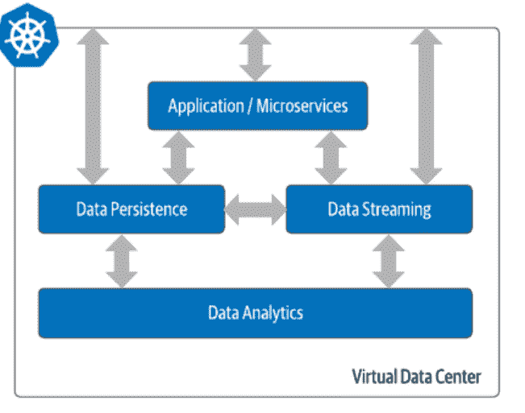
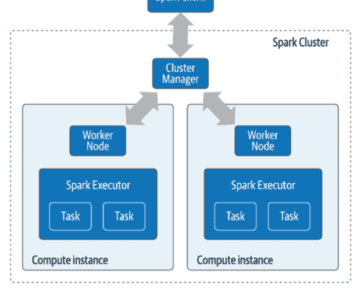
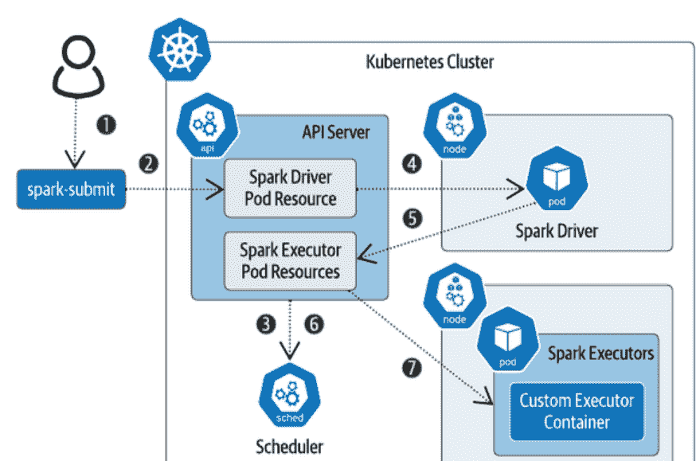
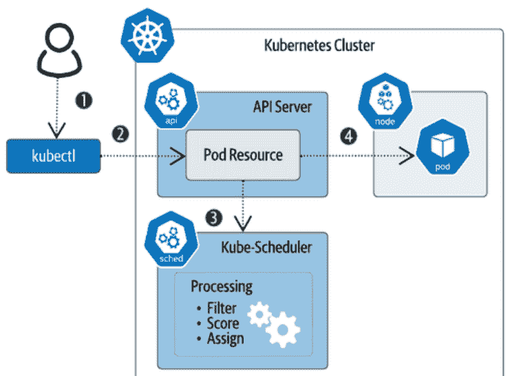
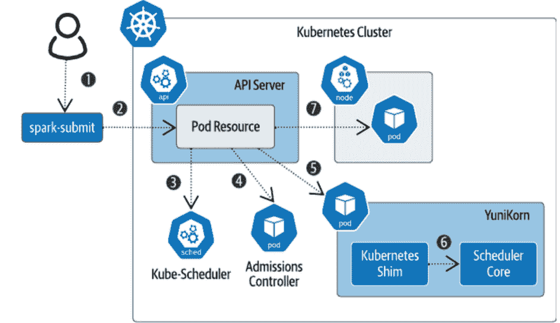
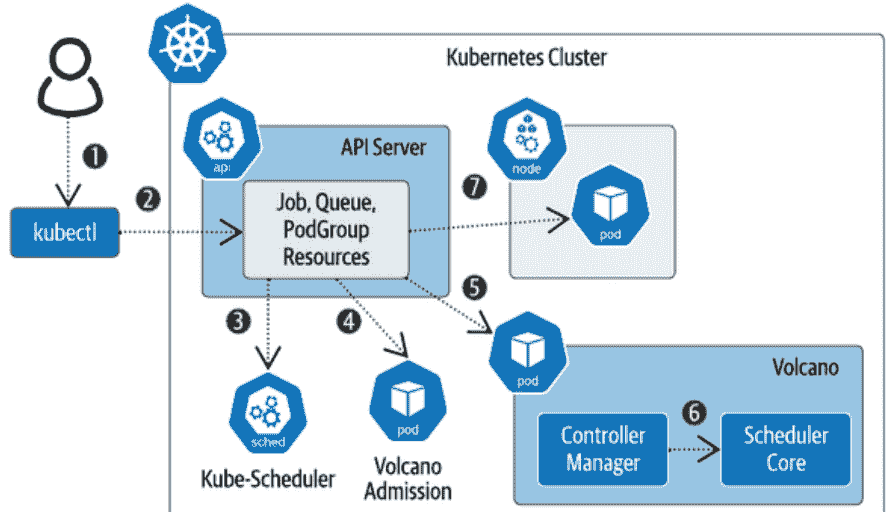

## 第 8 章. Kubernetes 上的数据分析

> “技术进步就是我们有能力变得更懒惰。”
> —Dr. Lurian Chirica

### 早期发布读者须知

使用 Early Release 电子书，你可以在这些技术正式发布之前很久就获得书籍的早期形式——作者在写作时的原始和未编辑内容——从而利用这些技术。

这将是最终书籍的第 9 章。请注意，本书的代码示例可在 https://github.com/data-on-k8s-book 获取。

如果你对如何改进本书的内容和/或示例有任何评论，或者如果你注意到本章中缺少材料，请联系编辑 jleonard@oreilly.com。

在 2000 年代初期，Google 以一个公开宣布的目标吸引了互联网：“组织世界的信息并使其普遍可访问且有用。”这是一个雄心勃勃的目标，可以说是将计算机科学的比特从中抽离出来。鉴于数据创建速度的不断增加，Google 需要发明（并重新发明）管理从未有人考虑过的数据量的方式。一个完全围绕分析数据而诞生的全新社区、文化和行业，被称为分析，或最终被标记为“大数据”。今天，分析已成为几乎每个应用程序栈的正式成员，而不仅仅是“Google”问题。现在这是每个人的问题，不再能是一种仅限于一小群知道如何


make it work. Organizations need reliable and fast ways to deploy applications, including analytics, and because you are reading this book, you already know the answer. We need to do more with less.

The laziness Dr. Chirica was talking about is a tongue-in-cheek way of describing an ideal future. Instead of having a hundred-person team working night and day to analyze a petabyte of data, what if you could reduce that to one person and a few minutes? The cloud native way of running data infrastructure is a path we should all work towards the goal of that kind of glorious laziness.

We’ve already looked at several aspects of moving stateful workloads onto Kubernetes, including storage, databases, and streaming, and now it’s time to look at analytics to complete the picture. As a bit of a preview, Figure 9-1 shows how Data Analytics fits as the final part of our roadmap of managing the complete data stack using Kubernetes. There are no more external network requirements bridging to resources in or out of the Kubernetes cluster, just a single, virtual data center that serves our bespoke needs for cloud native applications.



Figure 8-1. The Cloud Native Virtual Datacenter

### Introduction to Analytics

Analytic workloads and the accompanying infrastructure operations are much different from other workloads. Analytics isn’t just another containerized system to orchestrate. The typical stateful applications like databases we have examined in previous chapters have many similar characteristics but tend to stay static or predictably slow-growing once deployed. There is one aspect of analytic workloads that strikes fear in many administrators: volume. While persistent data stores like databases can consume gigabytes to terabytes of storage, analytic volumes can easily soar into petabytes, creating an entirely new class of problems to solve. They don’t call it “Big Data” for nothing.

The Oxford Dictionary defines analytics as “the systematic computational analysis of data or statistics.” Wikipedia adds “It is used for the discovery, interpretation, and communication of meaningful patterns in data.” Combine those definitions with large volumes of data and what sort of outcome should we expect for cloud native applications? Below is a breakdown of the different types of analytics workflows and methodologies.

### Batch Analytics

In computer science terms, a batch is a series of instructions that are applied to data with little or no user interaction. The idea of running batch jobs is as old as general-purpose computing. In distributed systems such as Apache Hadoop or Apache Spark, each individual job consists of a program that can operate on smaller bits of data in parallel and in stages or pipelines. The smaller results are combined into a single, final result at the end of a job. An example of this is MapReduce discussed later in the book. In most cases, statistical analysis is done, such as count, average, and percentile measurement. Batch analytics is the focus of this chapter.

### Stream Analytics

As Discussed previously in Chapter 8, stream analytics is about what is happening, whereas batch analytics is about what happened. Many of the same APIs and developer methodologies are used in both stream analytics and batch analytics. This can be confusing and lead people to believe that they are the same thing when in fact they have very different use cases and implementations. A good example is fraud detection. The time frames for detecting and stopping fraud can be measured in milliseconds to seconds which fits the stream analytics use case. Batch analytics would be used to find fraud patterns over larger time periods.

### Artificial Intelligence / Machine Learning (AI/ML)

While artificial intelligence and machine learning can be considered a subset of batch analytics, it is such specialized fields that they deserve a special call-out. AI and ML are often mentioned together; however, they have two different output goals. Artificial Intelligence attempts to emulate human cognition in decision making. Machine Learning uses algorithms to derive meaning from pools of data, sometimes in ways that aren’t readily obvious. Both approaches require the application of computing resources across volumes of data. This topic will be discussed in Chapter 10.

### Deploying Analytic Workloads in Kubernetes

The original focus of Kubernetes was on scaling and orchestrating stateless applications. As you’re learning in this book, Kubernetes is evolving to support stateful applications. The promise of moving more and more workloads into virtual datacenters has been highly motivating, and the world of analytics can take advantage of the progress made in stateless and stateful workloads. However, Kubernetes has some unique challenges in managing analytic workloads and many are still a work in progress. What more is required to complete the data picture and make analytic workloads on par with other parts of the stack like microservices and databases? Here are a few of the key considerations we’ll examine in this chapter:

### Orderly Execution

An essential aspect of analytic workloads is the order of operations required to analyze large volumes of data. This involves far more than just making sure Pods are started with the proper storage and networking resources. It also includes a mapping of the application with the orderly execution run in each Pod. The Kubernetes component primarily responsible for this task is `kube-scheduler` (See chapter 5), but the controllers for Jobs and CronJobs are involved as well. This is a particular area of attention for the Kubernetes communities focusing on analytics, which we will further cover in the chapter.

### Storage Management

Analytic workloads use ephemeral and persistent storage in different jobs that process data. The real trouble comes when it comes to how to identify and select the right storage per job. Many analytic workloads require ephemeral storage for short periods and more efficient (cheaper) persistent storage for long terms. As you learned in Chapter 2, Kubernetes storage has greatly increased maturity. Analytics projects that run on Kubernetes need to take advantage of the work that’s already been done with stateful workloads and continue to partner with the Kubernetes community for future enhancements in areas like storage classes and different access patterns.

### Efficient use of resources

There is an old saying that “everything counts in large amounts,” and nothing makes that more evident than analytics. A job may require 1000 pods for 10 minutes, but what if it needs 10000? A challenging problem for the Kubernetes control plane. Another job might require terabytes of swap disk space that is only needed for the duration of a job. In a cloud native world, jobs should be able to quickly allocate the resources they need and release the resources when finished. Making these operations as efficient as possible saves time and more importantly, money. The fast and bursty nature of analytics has created some challenges for the Kubernetes API server and scheduler to keep up with all the Jobs that need to be run. Several of those challenges are already being addressed as discussed later in the chapter and some are still a work in progress.

Those are the challenges but none of which are show-stoppers and getting in the way of our dream of a complete cloud native stack deployed as a single virtual data center in Kubernetes.

### ANALYTICS ON KUBERNETES IS THE NEXT FRONTIER

With Holden Karau, Open Source Engineer, Apache Spark PMC

Running analytic workloads has been the boss-level challenge for infrastructure engineers since it was first a thing. There is the challenge of massive volumes of needed resources, which in many cases are the most significant part of your infrastructure. Then, coordination is required to use all those resources efficiently, and this is where frameworks like Spark come into play. Projects like Yarn from Hadoop and then Mesos were developed to help with the container management game. Today infrastructure engineers everywhere are very happy with migrating the best aspects of those systems to Kubernetes.

Running multiple Spark tenants in Kubernetes provides better isolation between your workloads which is really important if you don’t trust each workload to the same degree. Historically, the support for Python dependencies inside Spark jobs has been poor, but deploying on Kubernetes makes it possible to use leading edge Python libraries for machine learning and GPU usage. SREs can spend more time optimizing resources rather than chasing down obscure errors typical with large distributed systems.

We are still in the early days of learning how to run our analytic workloads in Kubernetes most effectively. The difficulty curve starts getting much steeper as data volumes increase. Once you start going over the tens or hundreds of terabytes, you will find yourself on the leading edge of Spark operations in Kubernetes. This is probably not a big surprise because that tends to be how infrastructure engineering works. The upper limit scale problems with Kubernetes are rooted in the early use cases it was designed. The dynamic and elastic nature of Kubernetes works well for the use cases for which it was first designed, but it gets overwhelmed at the levels required to run Spark applications. This is not impossible to solve, and there are a few critical areas the Spark and Kubernetes communities are working to improve.


Kubernetes SREs love the idea of elastic workloads, but in Spark, that’s been much more painful than it needs to be. Regular execution of a Spark job can cause a rapid increase in Pods while the job is processing, and then those resources are released when the job is complete. Scaling up is, unfortunately, much easier than scaling down. Spark can now make use of externalized resource allocation that opens the possibility for better solutions. Open source projects such as Apache YuniKorn and Volcano are already working on resource allocation solutions inside of Kubernetes, which the execution allocator and shuffle service can leverage to align more closely to the way Kubernetes works. Taken together, these efforts provide a significant path forward for more efficient resource usage in a dynamic Spark environment.

Resource-intensive applications like Spark can benefit from having more insight from the underlying systems to balance jobs as they are run. Today, Kubernetes and Spark do not share as much information as they need for the best outcomes, and you should adjust your expectations accordingly. A specific example is the way Kubernetes approaches storage quota enforcement, which can work against Spark in some cases. Ephemeral storage is a key part of Spark execution, but Kubernetes provides no system-level APIs that Spark could use to check the utilization against the storage quota, which can cause job failures. Previous applications that have been deployed on Kubernetes haven’t needed this level of insight. Spark creates a compelling case for significant changes to expose additional system level APIs in Kubernetes, which will make it possible to build much more reliable analytic workloads.

If you are interested in solving these problems, these solutions will happen in open source projects. You can get involved today and help us move forward. Apache Spark has room for improvement and so does Kubernetes, but the future direction is clear. Kubernetes is where cloud native analytics will happen, and Spark will continue to evolve. There will be a lot of interesting work in this area for the next several years at least, and it’s a pretty exciting community to be a part of.

Engineers can be their own worst enemies. Often when we go to solve one problem, it creates a few more that need to be solved. We can count this as progress, however, when it comes to managing data. Every step up we take, despite the challenges, allows for new solutions that were never available before. It’s staggering to think of how much is possible with just a small number of people where not too long ago, it took massive teams to accomplish anything close to the analytics required today. See the quote about laziness at the beginning of the chapter. There is still work to be done and next, we will look at what tools are available for analyzing data in Kubernetes.

### Introduction to Apache Spark™

Google changed the world of data analytics with the MapReduce algorithm simply by describing it to the world in an academic paper. Not long after the MapReduce paper got engineers talking, an open source implementation was created, the now-famous Apache Hadoop™. A massive ecosystem was built up around Hadoop with tooling and complementary projects such as Hadoop Distributed File System (HDFS). Growing pains from this fast-moving project opened the door for the next generation of tools that built on the lessons learned with Hadoop. One project that grew in popularity as an alternative to Hadoop was Apache Spark™. Spark addressed reliability and processing efficiency problems by introducing the Resilient Distributed Dataset (RDD) API and Directed Acyclic Graphs (DAG).

The RDD was a significant improvement over the forced linear processing patterns of MapReduce. This involved a lot of reading from disk, processing, and then writing back to disk only to be redone over and over. This put a burden on developers to reason through how data was processed. RDDs shifted the responsibility away from developers as an API that created a unified view of all data while abstracting the actual processing details. Those processing details were created in a workflow to perform each task expressed in a DAG. The DAG is nothing more than an optimized path that describes data and operations to be completed in an orderly
fashion until the final result is produced. RDDs were eventually replaced with the DataSet and DataFrame APIs, which further enhanced developer productivity over large volumes of data.

Spark’s operational complexity is greatly reduced compared to Hadoop, which notoriously tipped the scale with the infrastructure required even for basic jobs. Spark is an excellent example of one of the benefits of being a next-generation implementation with great hindsight. Much effort was put into simplifying Spark’s architecture, leveraging distributed systems concepts. The result is the three familiar components you should be familiar with in a Spark Cluster shown in Figure 9-2.



Figure 8-2. Components of a Spark Cluster

Let’s review the responsibilities of each of these components:

#### Cluster Manager

The Cluster Manager is the central hub for activity in the Spark cluster where new jobs are submitted for processing. The Cluster Manager also acquires the resources needed to complete the task submitted. Different
versions of the Cluster Manager are primarily based on how resources are managed. (Standalone, YARN, Mesos, and Kubernetes) The Cluster Manager is critical for deploying your Spark application using Kubernetes.

#### Worker Node

When Spark jobs run, they are broken into manageable pieces by the Cluster Manager and handed to the Worker Nodes to perform the processing. They serve as the local manager for hardware resources as a single point of contact. Worker Nodes invoke and manage Spark Executors.

#### Spark Executor

Each application sent to a Worker Node will get its own Spark Executor. Each Executor is a stand-alone JVM process that operates independently and communicates back with the Worker Node. The tasks for the application are broken into threads that consume the compute resources allocated.

### Deploying Apache Spark™ in Kubernetes

As of Apache Spark version 2.3, Kubernetes is one of the supported modes in the Cluster Manager. It would be easy to understate what that has meant for Spark as a cloud native analytics tool. Starting with Spark 3.1, Kubernetes mode is considered production-ready, continually adding steady improvements. When the Spark project looked at what it takes to run a clustered analytics system inside a cluster orchestration platform, there were a lot of overlaps that became obvious. Kubernetes already had the mechanisms in place for the lifecycle management of containers and the dynamic provisioning and de-provisioning of compute elements, so Spark lets Kubernetes take care of this work. The redundant parts were removed, and Spark is closer to how Kubernetes works as a result. The spark-submit command-line tool was extended to interface with Kubernetes
clusters using the Kubernetes API, maintaining a familiar toolchain for developers and data engineers. These unique aspects of a Spark deployment in Kubernetes are shown in Figure 9-3.



Figure 8-3. Spark on Kubernetes

Let’s highlight a few of the differences:

#### Spark Driver

The dedicated Cluster Manager of a standalone Spark cluster is replaced with native Kubernetes cluster management and the Spark Driver for Spark-specific management. The Spark Driver Pod is created when the Kubernetes API server receives a job from the spark-submit tool. It invokes the Spark Executor Pods to satisfy the job requirements. It is also responsible for cleaning up Executor Pods after the job, making it a crucial part of elastic workloads.

#### Spark Executor

Like a stand-alone Spark cluster, Executors are where the work gets done and where the most compute resources are consumed. Invoked from the Spark Driver, they take job instructions passed by spark-submit with details such as CPU and memory limits, storage information, and security credentials. The containers used in Executor Pods are pre-created by the user.

#### Custom Executor Container

Before a job is sent for processing using `spark-submit`, users must build a custom container image tailored to meet the application requirements. The Spark distribution download contains a Dockerfile that can be customized and used in conjunction with the `docker-image-tool.sh` script to build and upload the container required when submitting a Spark job in Kubernetes. The custom container has everything it needs to work within a Kubernetes environment like a Spark Executor based on the Spark distribution version required.

The workflow for preparing and running Spark jobs when using Kubernetes and defaults can be relatively simple only requiring a couple of steps. This is especially true if you are already familiar with and running Spark in production. You will need a running Kubernetes cluster and a download of Apache Spark in a local file path along with your Spark application source code.

#### Build your custom container

An executor container encapsulates your application and the runtime needed to act as an Executor Pod. The build script takes an argument for the source code repository and a tag assignment for the output image when pushed to your Docker registry.

```
$ ./bin/d
```


```
docker-image-tool.sh -r <repo> -t <tag> build
```

输出将是一个包含你的应用程序代码的 jar 文件的 Docker 镜像。然后你需要将此镜像推送到你的 Docker 镜像仓库。

```
$ ./bin/docker-image-tool.sh -r <repo> -t <tag> push
```

### DOCKER IMAGE TAGS

请注意你的标签名称是否正确标注并进行了版本控制。在生产环境中重复使用相同的标签名称可能会产生一些意想不到的后果，正如我们中一些人从经验中得知的那样。

### 提交并运行你的应用程序

一旦 Docker 镜像推送到仓库，你就可以使用 spark-submit 来启动在 Kubernetes 中运行 Spark 应用程序的过程。这与用于其他模式的 spark-submit 相同，因此使用了许多相同的参数。这对应于图 9-3 中的步骤 1。

```
$ ./bin/spark-submit \
  --master k8s://https://<k8s-apiserver-host>:<k8s-apiserver-port> \
  --deploy-mode cluster \
  --name <application-name> \
  --class <fully-qualified-class-name> \
  --conf spark.executor.instances=<instance-number> \
  --conf spark.kubernetes.container.image=<spark-image> \
  local:///path/to/application.jar
```

这里发生了相当多的事情，但最重要的是 --master 参数。要指示这是用于 Kubernetes，参数中的 URL 必须以 k8s:// 开头，并指向默认 Kubernetes 集群中在你的本地 .kubeconfig 文件中指定的 API 服务器。The

<spark-image> 是你在步骤 1 中创建的 Docker 镜像，而应用程序路径指的是存储在镜像内部的你的应用程序。

接下来是步骤 2，spark-submit 与 Kubernetes 集群交互以调度 Spark Driver Pod（步骤 3 和 4）。Spark Driver 解析作业参数并与 Kubernetes 调度器协同工作，以设置 Spark Executor pod（步骤 5、6 和 7）来运行包含在客户容器镜像中的应用程序代码。应用程序将运行到完成，最终使用的 Pod 将被终止，资源将被返还给 Kubernetes 集群，这一过程称为垃圾回收。

这只是 Spark 原生与 Kubernetes 协同工作的概述。请参阅官方文档以深入了解。定制参数以最好地满足你的特定需求的方式有很多。

### 在 Kubernetes 中运行 Spark 时的安全考虑

应该明确指出，使用 Spark 在 Kubernetes 中时默认情况下未启用安全。第一道防线是身份验证。生产环境中的 Spark 应用程序应使用 Spark 内置的身份验证，以确保访问你的应用程序的用户和进程是你所期望的。

在为你的应用程序创建容器时，Spark 文档强烈建议将 USER 指令更改为无特权的 UID 和 GID，以减轻权限提升攻击的风险。这也可以通过在作为 spark-submit 参数提供的 Pod 模板文件中使用 SecurityContext 来实现。

存储访问也应对 Spark Driver 和 Spark Executor 进行限制。具体来说，你应该限制正在运行的应用程序可以访问的路径，以消除在出现漏洞时意外访问的可能性。这些可以在 Pod 安全策略中设置，Spark 文档也推荐这样做。

为了实现 Spark 应用程序的最佳安全性，使用 Kubernetes 提供的<|message|>




图 8-5. 典型的 Kubernetes 调度

典型的调度流程始于你创建 deployment.yaml 文件描述所需资源（1），包括需要哪些 Pod 资源以及数量。当 YAML 文件通过 kubectl apply -f <deployment.yaml> 提交（2）到 kubernetes 集群 API 服务器时，Pod 资源会使用提供的参数创建并准备分配给 Node。Node 拥有所需的资源池，而 kube-scheduler 的工作就是在 Node 和 Pod 之间充当媒人。调度器在创建新的 Pod 资源时（3）执行状态匹配，并检查 Pod 是否已分配 Node。如果没有，它会进行必要的计算以找到可用的 Node。调度器检查 Pod 的要求，使用内部规则集对可用 Node 进行评分并选择一个 Node 来运行 Pod（3）。这就是 Kubernetes 中容器编排的实际工作所在。

然而，我们在分析工作负载方面存在一个问题：默认的 Kubernetes 调度器并非为批处理工作负载而设计。其设计过于基础，无法满足分析所需的运行方式。正如 Holden Karau 在之前的侧边栏中所提到的，Kubernetes 是为无状态工作负载的需求而构建的。这些是长期运行的进程，可能随时间扩展或收缩，但往往保持相对静态。Spark 等分析应用程序则不同，需要调度可能成千上万个短寿命作业。

值得庆幸的是，Kubernetes 的开发人员预见到了未来调度需求的扩展，并使用户能够在配置中指定其调度器，从而绕过图 9-5 中显示的默认调度方法。

管理整个应用栈的强烈愿望，使用统一的控制平面，一直是创新的驱动力。正如我们在《在 Kubernetes 中部署 Apache Spark™》中所示，Spark 正在更接近 Kubernetes。在本节中，我们将看看一些团队如何通过构建更合适的调度器，让 Kubernetes 更接近 Spark。两个开源项目在这一努力中处于领先地位：Volcano 和 Apache YuniKorn™。这些调度器共享相似的指导原则，使其更适合批处理工作负载。

### 多租户资源管理

默认的 Kubernetes Scheduler 会按请求分配 Pod，直到没有更多可用资源匹配 Pod 要求为止。YuniKorn 和 Volcano.sh 都提供多种资源模式，以更好地匹配你的应用需求，尤其是在多租户环境中。资源管理的公平性可防止一个分析作业耗尽其他作业所需的资源。随着这些作业的调度，整个资源池会被考虑，以根据优先级和吞吐量平衡利用率。

Gang 调度增加了另一层智能。如果提交的作业需要一定数量的资源，如果每个 Pod 都无法启动，就没有意义启动该作业。默认调度器会启动 Pod 直到集群资源耗尽，可能导致作业因等待更多 Pod 上线而被搁置。Gang 调度采用全有或全无的方法，只有在完整作业所需的所有资源都可用时，作业才会启动。

### 作业队列管理

更智能的队列管理也能带来更好的资源管理。如果一个作业需要的资源很少，并且可以在运行较大作业的同时运行，调度器可以将其安排进去，从而提高 Kubernetes 集群的整体吞吐量。在某些情况下，用户需要控制哪些作业具有优先级，以及哪些作业可以在提交时抢占或暂停其他正在运行的作业。队列可以在作业提交后重新排序或重新设定优先级。可观察性工具提供队列洞察，有助于确定集群整体健康状况和资源使用情况。

如果你正在考虑分析工作负载的生产部署，你应该避免使用默认调度器 `kube-scheduler`。它并非为你在此情况下的需求而设计。从更好的调度器开始，可以让你为 Kubernetes 体验做好未来准备。让我们检查一下每个调度器的亮点。

### Apache YuniKorn™

YuniKorn 项目由 Cloudera 的工程师在处理 Spark 中的分析工作负载时因操作上的挫败感而构建。在利用开源作为社区解决问题精神下，YuniKorn 被捐赠给 Apache 软件基金会，并在 2020 年被接受为孵化项目。其名称直接来自它支持的两个系统，Yarn 和 Kubernetes。（Y uni-fied K. YuniKorn. Get it?）它从 Spark 集群管理角度解决了分析工作负载特定的资源管理和用户控制需求。YuniKorn 还为 TensorFlow 和 Flink 作业添加了同等程度的资源控制支持。毫无疑问，这源于在 Spark 中发现的相同操作挫败感。

YuniKorn 使用 Helm 在 Kubernetes 中安装。YuniKorn 的目标是将你的 Kubernetes 集群转变为对批处理作业资源需求友好的地方。其转变的关键部分是替换默认的 kube-scheduler。为了演示如何操作，让我们使用图 9-6 来逐步了解组件。



图 8-6. YuniKorn 架构

YuniKorn 旨在作为即插即用的调度器替代方案，对现有 Spark 工作流的更改最小，因此我们从这里开始。当新的资源请求（1）通过 spark-submit（2）发送到 Kubernetes API 服务器时，默认的 kube-scheduler（3）通常用于匹配 Pod 和 Node。当 YuniKorn 部署在你的集群中时，会创建一个 admissions-controller Pod。admissions-controller 的工作是监听新的资源请求并进行小幅更改，在资源请求中添加 schedulerName: yunikorn。如果你需要更精细的控制，可以禁用 admissions-controller 并通过手动向 SparkApplication YAML 中添加以下行，按作业启用 YuniKorn。

```
spec:
schedulerName: yunikorn
```

所有调度需求现在都将由 YuniKorn Scheduler（5）处理。YuniKorn 构建为可与多个编排引擎一起运行，并提供了一个称为 Kubernetes Shim 的 API 翻译层，以管理 Kubernetes 与 YuniKorn Core（6）之间的通信。YuniKorn Core 通过添加适用于批处理工作负载（如 Spark）的选项，扩展了默认 `kube-scheduler` 可用的基本过滤和评分算法。这些选项范围从简单的基于资源的队列到更高级的层次队列管理，允许队列和资源池映射到组织结构。层次化池化对于在大型企业中跨多个部门拥有庞大分析足迹的人来说很有帮助，并且在单 Kubernetes 集群中运行多租户环境时至关重要。

YuniKorn Core 使用 `queues.yaml` 文件进行配置，该文件包含有关 YuniKorn 将如何将 Pod 调度到 Node 的所有详细信息，包括：

- **Partitions** - 一个或多个命名配置部分，用于不同的应用需求。
- **Queues** - 在层次结构中对资源进行精细控制，以在多租户环境中提供资源保证。
- **Node Sort Policy** - 如何根据可用资源选择 Node。选项为 FairnessPolicy 和 BinPackingPolicy。
- **Placement Rules** - 基于用户或组成员资格的 Pod 放置描述和过滤器。
- **Limits** - 对分区或队列的精细资源限制的定义

新作业由 YuniKorn Core 处理，通过匹配详细信息并分配正确的队列。此时调度器可以决定将 Pod 分配给 Node，然后将其上线（7）。

YuniKorn 还附带一个基于 Web 的可观察性工具，称为 Scheduler UI，可提供作业和队列状态的洞察。它可用于监控调度器健康状况并提供更好的洞察以排查任何作业问题。


### Volcano

Volcano 是为在 Kubernetes 中运行高性能计算（HPC）工作负载而开发的通用调度器。Volcano 支持多种工作负载，包括 Spark、Flink、PyTorch TensorFlow，以及用于基因测序的 KubeGene 等专用系统。工程师在华为、腾讯和百度等公司构建了 Volcano，名列众多贡献者之列。捐赠给云原生计算基金会后，它于 2020 年被接受为沙箱项目。

Volcano 使用 Helm 安装并为 Jobs 和 Queues 创建 CRD，使其配置成为 Kubernetes 集群的核心部分，而与之相比，YuniKorn 更像是一种旁路。这反映了 Volcano 的通用性质。安装后，Volcano Scheduler 可供任何需要高级调度和排队的进程使用。让我们使用图 9-7 来了解其工作原理。



图 8-7. Volcano 架构

要将 Volcano 与你的批处理作业一起使用，你需要在 Job YAML 文件中显式添加调度器配置（1）。如果你使用 Volcano 运行 Spark，Volcano 项目建议使用 Kubernetes 的 Spark Operator 并在 SparkApplication YAML 中添加一个字段：

```
spec:
batchScheduler: "volcano"
```

然后你可以使用 `kubectl apply -f` 像往常一样提交你的 Job（2）。如果未指定 Volcano Scheduler，Kubernetes 将使用默认的 `kube-scheduler` 将 Pod 与节点匹配（3）。

Volcano 的 Helm 安装会安装 Job、Queue 和 PodGroup 的 CRD，并创建一个名为 Volcano Admission 的新 Pod。Volcano Admission（4）附加到 API 服务器并验证 Volcano 特定的 CRD 条目以及请求 Volcano 调度器的 Jobs。

- **Job** - 具有用于高性能计算的扩展配置的 Volcano 特定作业。
- **Queue** - 作为先进先出（FIFO）资源组的 PodGroup 集合。配置决定了队列在不同情况下的行为。
- **PodGroup** - 与其用途相关的 Pod 集合。示例包括用于 Spark 和 TensorFlow 的组，每个组具有不同的属性。

当被选为作业的调度器时（5），Volcano Scheduler 将获取 CRD 并开始工作（6）。标记为使用 Volcano 作为调度器的传入作业将与 PodGroup 和 Queue 匹配。基于此分配，为每个 Pod 做出最终的节点放置（7）。

Volcano Scheduler 核心的集群特定配置存储在名为 `volcano-scheduler-configmap` 的 ConfigMap 中。此配置文件包含两个主要部分：`actions` 和 `plugins`。Actions 是每个作业节点选择步骤的有序列表：enqueue、allocate、preempt、reclaim 和 backfill。每个步骤都是可选的，可以重新排序以匹配需要执行的工作类型。

Plugins 是用于将 Pod 与节点匹配的算法。每个都有不同的用例和目的，可以组合成一个整体：

- **Gang** - 此插件查找队列中优先级更高的任务，并在需要时执行抢占和驱逐以释放资源供其使用。
- **Binpack** - 一种经典算法，通过以最有效的方式混合不同大小的资源请求来找到使用所有可用资源的最佳匹配。
- **Conformance** - 在驱逐决策中忽略命名空间 `kube-system` 中的任何任务。
- **Dominant Resource Fairness (DRF)** - 一种算法，用于解决跨多种资源类型的公平性问题，以确保所有作业具有相同的吞吐量。
- **Proportion** - 一种多租户算法，用于为运行作业分配集群分配的专用部分。
- **Task-topology** - 使用亲和性将网络密集型作业物理上放置得更近，以实现更高效的网络使用。
- **NodeOrder** - 在选择之前根据多个用户定义维度对每个可用节点进行评分。
- **Predicates** - 在节点中查找某些谓词以进行选择。目前仅支持 GPUSharing 谓词。
- **Priority** - 根据用户提供的 `priorityClassName`、`createTime` 和 `id` 配置选择任务优先级。
- **Service Level Agreement (SLA)** - 使用参数 `JobWaitingTime` 允许单个作业根据其所需时间控制优先级。
- **Time Division Multiplexing (TDM)** - 当节点同时用于 Kubernetes 和 Yarn 时，TDM 将安排在此安排中共享资源的 Pod。
- **Numa-aware** - 为 Pod 提供 CPU 资源拓扑感知的调度。

在 Kubernetes 安装之外，Volcano 还附带一个名为 `vcctl` 的命令行工具。可以通过仅使用 kubectl 来管理 Volcano。然而，`vcctl` 为更熟悉作业控制系统的操作员提供了一个接口。

正如你从 YuniKorn 和 Volcano 提供的功能列表中看到的那样，有选择是一件美好的事情。无论你选择哪个项目，使用其中一个替代调度器在 Kubernetes 中运行分析工作负载的体验都会更好。

### Kubernetes 的分析引擎

Spark 无疑是一个强大的工具，解决了分析中的许多用例。仅有一个选择在该工具不再按你所需工作时可能会很受限制。当 Google 开发 MapReduce 时，真正的需要在于数据转换，例如从数据池中创建其中事物的计数。这仍然是一个相关的问题，鉴于我们创建的数据量，并且在过去一段时间里一直如此。甚至在 MapReduce 之前，大规模并行处理（MPP）是数据分析的流行方法。这些“超级计算机”由成排的单独计算机组成，为物理和气象学等领域的科研人员呈现为单个处理网格，以运行在单台计算机上需要花费太长时间的巨大计算。

在处理分析中的机器学习和 AI 任务时也会出现类似的计算需求：大量数据需要由许多进程进行分析。TensorFlow 等库需要超出数据转换的分析工具。有了 Kubernetes，数据科学家和工程师现在可以快速创建虚拟数据中心，使用商品计算、网络和存储，与过去的一些超级计算机相媲美。这种技术组合为基于自助服务使用模式构建基于 ML 和 AI 的应用程序的开发人员带来了完全全新且令人兴奋的未来，而无需等待在非常昂贵的超级计算机上的时间（是的，这曾经是一回事）。

### 云原生世界中开发者分析的演进

*与 Dean Wampler 合作，IBM Research 加速发现产品工程总监*

人们一直猜测流式和批处理分析最终会融合为每个项目或产品的单一通用方法。我认为随着 Kubernetes 的出现，这一愿景变得不那么理想，因为开发者会确定他们需要什么才能成功，这一切都关乎为工作选择最佳工具。事实上，可能会有更多可用于分析数据的选择，适用于 Kubernetes 内外不同的用例。开发人员和数据工程师需要各种工具来克服限制和权衡。

假设你已经接受了可以用流处理做一切的想法。这在实践中到底意味着什么，又有哪些局限性？假设我想确切知道我在每个商店按小时分桶的每个 SKU 卖出了多少件商品。对该计算的挑战在于不确定何时为每个小时分桶交付所有数据。你不能正好在整点开始作业，因为可能仍有数据在传输。最坏的情况下，由于网络分区或其他中断，部分数据可能会显著延迟。现在开发人员需要构建临时结果的复杂性，这些结果可能尽可能快地计算，然后在延迟数据到达时集成更正。随着数据工具的多样性增加，他们可以更好地解决问题。对于此示例，也许他们会使用 Apache Flink 为仪表板提供关于正在发生的事情的某种百分比准确性。稍后捕获的数据将在隔夜的 Apache Spark 作业中用于进行最终核算并产生每小时分桶的规范结果。你可以争辩说，这基于使用最简单、正确的工具来完成每项工作，并通过 Kubernetes 进行组合，这是一个更合理的复杂程度。


在更大规模的数据场景下，组织仍然喜欢使用 Spark 来执行大型分析任务。然而，出现了一个日益增长的趋势，数据科学家和数据工程师开始认识到，将数据存储在数据库中而不是数据湖是合理的，这取决于为工作选择合适的工具。一些团队会使用像 Cassandra 这样的系统，因为他们不想处理 HDFS 和 Parquet 文件的复杂性，并且想要索引和查询带来的好处。他们接受了扫描表相比文件会带来性能损失。 这些是在便利性或可靠性方面做出权衡决策的经验丰富的团队，有时甚至为了更低的性能。Kubernetes 可以通过降低尝试新事物的前期成本来鼓励更广泛的替代方案选择。对于云原生分析来说仍然是早期阶段，但在这个领域的领导者通过更灵活的基础数据基础设施使其发挥作用。

新一代分析工具正在扩展可供选择的范围。尽管占据主导地位，Apache Spark 仍然非常依赖 Java 虚拟机（JVM），而这一特性正成为权衡考虑因素。一些数据工程团队不再想处理 JVM，他们只想运行 Python，有时还使用基于 C 的库内核来实现高性能。这为像 Ray 和 Dask 这样的项目创造了机会，它们可以直接服务于想要优先使用 Python 的团队。开发人员倾向于使用能够让他们更快前进且权衡更少的工具。然而，虽然 JVM 在某些情况下可能是负担，但 Spark 拥有巨大的 mindshare 和多年的持续改进。延续选择这一主题，很容易看出 Kubernetes 如何帮助创建一个地方，在同一个应用程序中同时使用 Spark 和 Ray。云原生分析可以消除一站式工具的零和博弈。

人们谈论的分析融合很可能会发生在接口层面，为开发人员提供单一接口，可访问底层适当的工具。云原生世界的服务正确组合。批处理离线分析使用数据仓库，并辅以在线数据库。流式分析为批处理作业使用的相同数据提供实时更新。所有这些都作为部署在 Kubernetes 中的服务提供。最重要的因素是它提供的便捷访问。公民数据科学家可以使用 Excel 探索数据。可视化工具可以以低代码或无代码的方式连接到任何底层服务。Python 越来越成为数据工程师和科学家构建管道的首选语言。SQL 在流式和批处理分析中的支持一直普遍受欢迎，利用了几十年来一直是标准的语言。Kubernetes 必须通过支持某些数据处理系统在单个进程内所需的细粒度并发，同时利用 Pod 边界来处理大块资源来实现这一点。这是一种权衡的平衡。获胜者将是开发人员和数据科学家，他们不再需要担心做出错误的工具选择，从而可以花更多时间编写创造价值的代码。

通过正确的 API 访问以及构建在 Kubernetes 上的正确基础设施的能力，是数据科学和 Python 社区一直在努力实现的强大组合。两个新项目已经开始崭露头角：Dask 和 Ray。正如 Dean 所指出的，Python 是数据科学的首选语言。Ray 和 Dask 都为大规模并行处理提供了原生的 Python 接口，无论是在 Kubernetes 内部还是外部。

### Dask

Dask 是一种基于 Python 的集群工具，用于大规模处理，它抽象掉了复杂的设置步骤。它可以用于任何可以用 Python 程序表达的内容，但在数据科学领域找到了真正的用武之地，因为有无数可用的库。Scikit-Learn、NumPy、TensorFlow、Pandas 都是成熟的数据科学库，可以在笔记本电脑上使用，然后借助 Dask 扩展到由大量计算机组成的集群。

Dask 与 Kubernetes 集成良好，为操作员和开发人员提供了他们对 Python 习惯的便捷用户体验。Dask 存储原语 Array、DataFrame 和 Bag 映射到许多云原生存储选择。例如，您可以将 DataFrame 映射到存储在 PersistentVolume 中的文件或 S3 等对象存储桶中。您的存储规模仅受底层资源和预算的限制。当 Python 代码处理您的数据时，Dask 会无缝地在多个工作节点之间管理分块。

部署选项包括我们现在从第 4 章熟悉的手动 Helm 安装，您可以在此示例中看到：

```
$ helm repo add dask https://helm.dask.org/
$ helm repo update
$ helm install my-dask dask/dask
```

或者作为替代方案，您可以使用 Jupyter Notebook 实例在 Kubernetes 中安装 Dask 集群，以便在集群内部工作。

```
$ helm install my-dask dask/daskhub
```

一旦您的 Dask 集群在 Kubernetes 内部运行，您就可以作为客户端连接并使用 HelmCluster 对象在计算节点上运行 Python 代码。使用安装时指定的名称进行连接。

```
from dask_kubernetes import HelmCluster
from dask.distributed import Client

### Connect to the name of the helm installation
cluster = HelmCluster(release_name="my-dask")

### specify the number of workers(pods) explicitly
cluster.scale(10)

### or dynamically scale based on current workload
cluster.adapt(minimum=1, maximum=100)

### Your Python code here
```

如果这还不够简单，您可以完全跳过 Helm 安装，让 Dask 为您完成这部分工作。KubeCluster 对象接受一个参数来指定 Pod 配置，要么使用 make_pod_spec 方法，要么指定 YAML 配置文件。它将连接到可通过 kubectl 访问的默认 Kubernetes 集群，并在运行的 Python 程序的一部分中在您的 Kubernetes 集群内部调用集群创建。

```
from dask.distributed import Client
from dask_kubernetes import KubeCluster, make_pod_spec

pod_spec = make_pod_spec(image='daskdev/dask:latest',
                        memory_limit='4G', memory_request='4G',
                        cpu_limit=1, cpu_request=1)

cluster = KubeCluster(pod_spec)

### specify the number of workers(pods) explicitly
cluster.scale(10)

### or dynamically scale based on current workload
cluster.adapt(minimum=1, maximum=100)

### Connect Dask to the cluster
client = Client(cluster)

### Your Python code here
```

开发者访问 Kubernetes 集群进行并行计算不可能再更容易了，这也是像 Dask 这样新工具的吸引力所在。

### Ray

与 Dask 中任意 Python 代码的显著不同之处在于，Ray 通过作为并行任务管理器并包含分布式计算框架来采用不同的方法进行 Python 集群。对于最终用户，Ray 提供了低级 C++ 库来运行专为数据科学中典型的计算密集型工作负载而定制的分布式代码。基础是 Ray Core，它使用任务的概念来分发工作负载。当开发人员使用 Ray 编写 Python 代码时，每个任务都表示为远程函数，如 Ray 文档中的此示例所示：

```
### By adding the `@ray.remote` decorator, a regular Python function
### becomes a Ray remote function.

@ray.remote
def my_function():
    return 1
```

在这个基本示例中，您可以看到 Ray 用于分发工作的不同方法。开发人员必须明确指定使用 Ray Core 分发的工作，而集群管理器负责计算管理。

Ray 在 Kubernetes 中的部署旨在利用动态工作负载中的计算和网络资源管理。Ray Operator 包含自定义控制器和 CRD，用于部署将代码附加到 Ray 集群所需的一切。提供了 Helm 图表以便轻松安装。然而，由于图表在公共存储库中不可用，您必须先将整个 Ray 分发下载到本地文件系统。可以修改一个广泛的配置 YAML 文件，但要让简单的 Ray 集群运行，默认值就足够了，如文档中的此示例所示：

```
$ cd ray/deploy/charts
$ helm -n ray install example-cluster --create-namespace ./ray
```

这会导致安装两种类型的 Pod。Head Node 处理集群中运行任务的通信和编排，而 Worker Node 则在其中执行任务代码。在 Kubernetes 集群内部运行 Ray 集群时，有两种方法可以运行 Ray 作业。一种是使用 Ray 客户端进行交互式运行，另一种是通过 kubectl 提交 Job。

Ray 客户端嵌入到 python 程序文件中，并初始化与 Ray 集群的连接。这需要通过 Ingress 或本地端口转发将 head 服务 IP 暴露出来。除了远程函数代码外，初始化程序将建立到外部化 Ray 集群主机 IP 和端口的连接。

```
import ray
ray.init("ray://<host>:<port>")
@ray.remote
def my_function():
    return 1
```


另一个选项是在 Kubernetes 集群内部运行你的代码，并将其附加到内部服务和端口。你使用 `kubectl` 提交作业以运行并传递一个 Job 描述 YAML 文件，该文件概述了要使用的 python 程序和 Pod 资源信息。以下是来自 Ray 文档的一个示例 Job 文件：

```
apiVersion: batch/v1
kind: Job
metadata:
  name: ray-test-job
spec:
  template:
    spec:
      restartPolicy: Never
      containers:
        - name: ray
          image: rayproject/ray:latest
          imagePullPolicy: Always
          command: [ "/bin/bash", "-c", "--" ]
          args:
            - "wget <URL>/job_example.py && python job_example.py"
          resources:
            requests:
              cpu: 100m
              memory: 512Mi
```

然后可以使用 `kubectl` 将此文件提交到集群

```
$ kubectl -n ray create -f job-example.yaml
```

在提交的 Python 文件内部，我们可以使用 Ray 服务头的 DNS 名称，并让 Kubernetes 确保网络路径被路由。

```
ray.init("ray://example-cluster-ray-head:10001")
```

对于运行 Ray 程序的外部和内部两种模式，Head Node 都利用 Kubernetes 调度器来管理 Worker Node Pod 生命周期以完成提交的作业。Ray 为开发人员提供了一个简单的编程 API，使其能够在无需学习 Kubernetes 管理的情况下利用大规模集群计算。SRE 可以创建和管理 Kubernetes 集群，这些集群可以被数据科学家轻松使用他们喜欢的 Python 编程语言。

### Summary

这结束了对云原生应用栈中数据组件的巡览。添加分析功能完善了整体数据图景，使你能够在更大数据量中发现洞察，从而补充应用的其他部分。

分析处于云原生数据创新的前沿，因此就此而言，“大数据”并不是你应该假设能以与其它数据基础设施相同的方式融入 Kubernetes 的东西。在部署像 Apache Spark 这样的工具时，有很多特殊考虑。并非每个问题都已解决，但知识是可用的，可以帮助你自信地部署。诸如 Apache YuniKorn 和 Volcano.sh 等项目已经在开源领域引领潮流，为 Kubernetes 提供更好的分析工作负载基础。新的分析引擎如 Dask 和 Ray 正在涌现，可能更适合你的用例，并且可以与其他工具组合使用。

分析工作负载可能不在你最初为 Kubernetes 部署的计划中，但为了构建专为运行你的应用而设计的虚拟数据中心的完整图景，它们是不可或缺的。为了以公用事业规模使用计算、网络和存储，Kubernetes 是未来。
