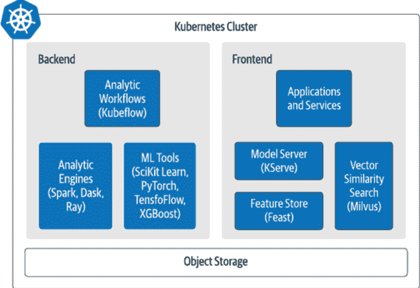
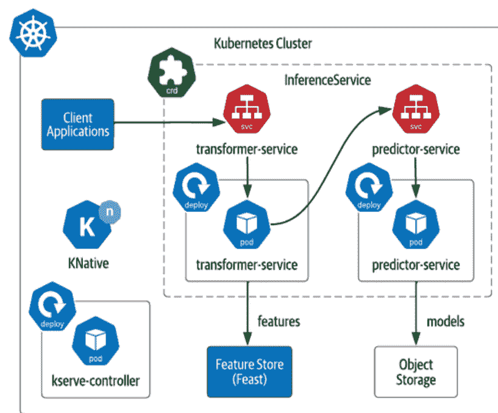
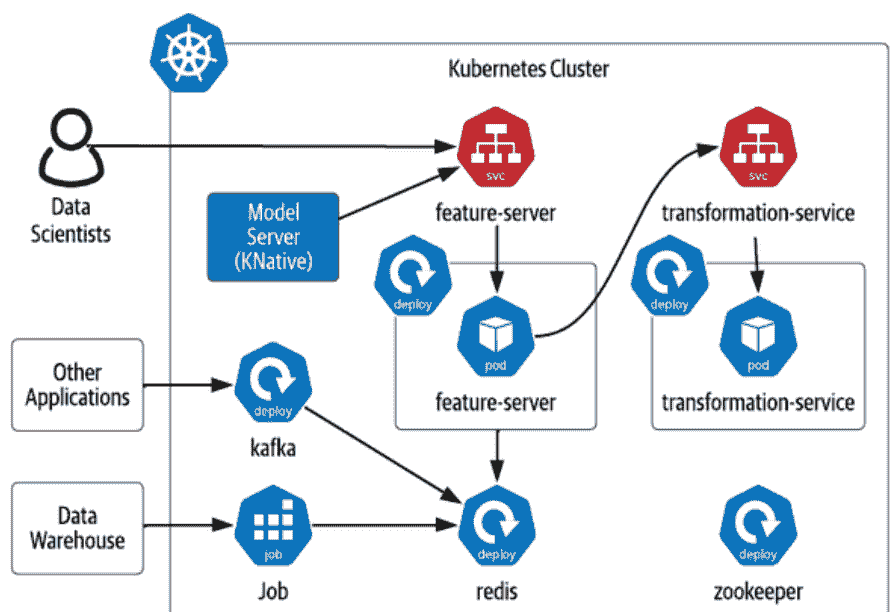
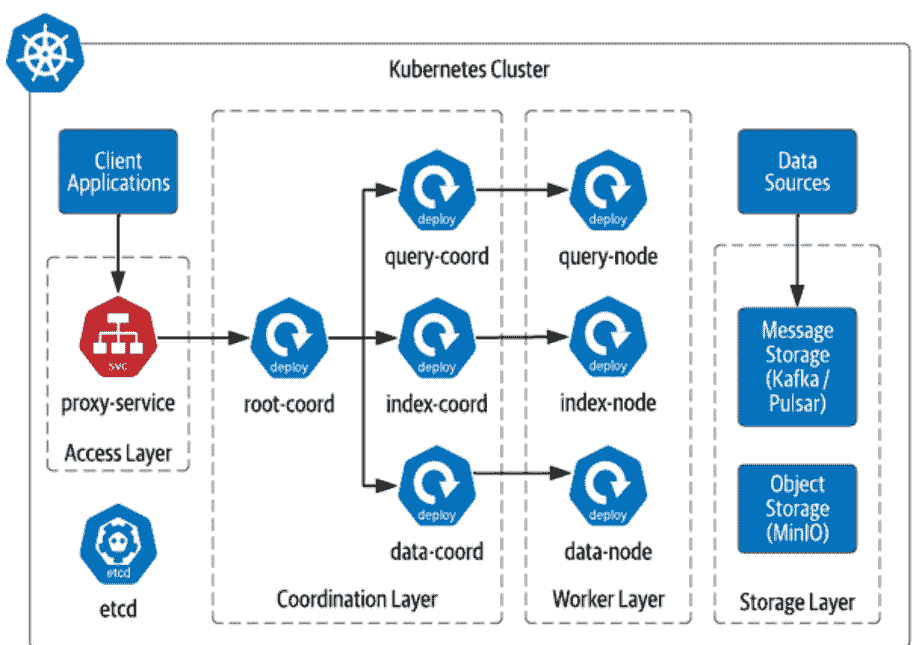
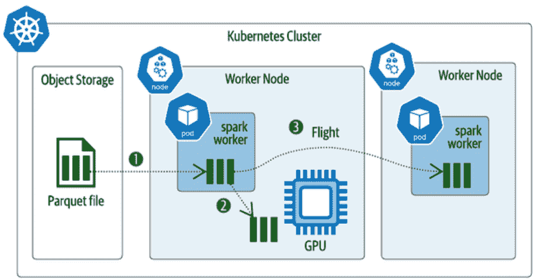
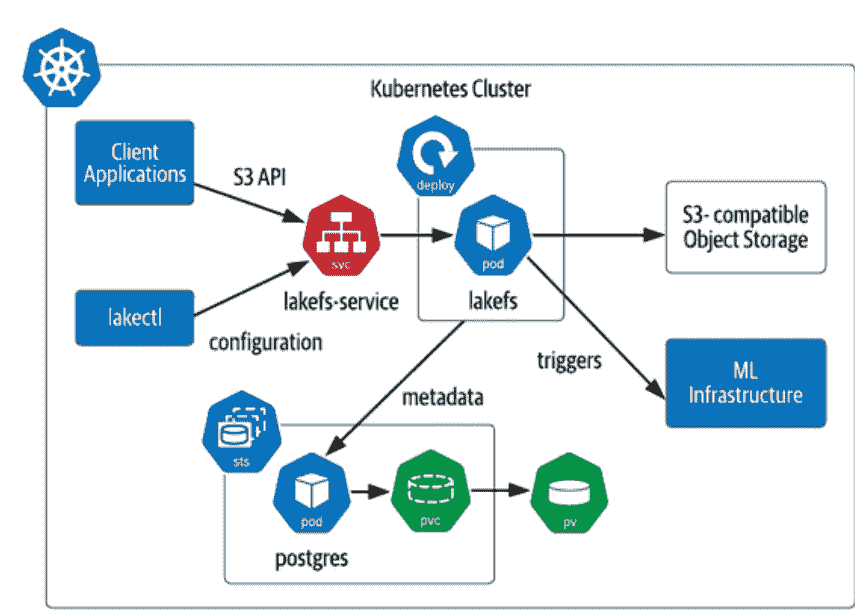

## Chapter 9. Machine Learning and Other Emerging Use Cases for Data on Kubernetes

### A NOTE FOR EARLY RELEASE READERS

使用 Early Release 电子书，你可以在这些书籍正式发布之前就获得书籍的最早形式——作者在撰写时的原始未编辑内容——从而让你能够在这些技术正式发布之前就利用它们。

这将是最终书籍的第 10 章。请注意，本书的代码示例可在 https://github.com/data-on-k8s-book 获取。

如果你对如何改进本书的内容和/或示例有任何评论，或者如果你注意到本章中缺少材料，请联系编辑 jleonard@oreilly.com。

在之前的章节中，我们以 Kubernetes 为重点介绍了传统数据基础设施，包括数据库、流平台和分析引擎。现在是时候向前迈进，探索那些开始将云原生作为目标的项目和社区，尤其是与人工智能和机器学习相关的内容。

每当多个箭头开始指向同一方向时，就值得关注。数据基础设施中的方向箭头都指向 Kubernetes 的总体宏观趋势的汇聚，并得到几个相互关联趋势的支持：

- 用于管理计算密集型 AI/ML 工作负载的通用栈正在出现，包括利用 GPU 等特定硬件的工作负载。
- 通用的数据格式有助于促进数据在计算、网络和存储资源之间的高效移动
- 对象存储正成为数据基础设施的通用持久层。

在本章中，我们将研究体现这些趋势的技术、它们所实现的使用案例，以及它们如何帮助你进一步管理计算、网络和存储这些宝贵资源。

### The Cloud Native AI/ML Stack

如第 9 章《Analytics》所述，Kubernetes 上的分析、人工智能和机器学习（AI/ML）是一个值得更详细研究的主题。如果你不熟悉数据领域中的这一专业，这是一个令人兴奋的领域，它增强了我们以规模化方式产生实时、数据驱动决策的能力。虽然许多核心算法已经存在数十年，但这项工作的性质在过去几年中发生了快速变化。数据科学作为一个职业传统上被 relegated 到后台，在那里从历史数据中提取洞察以寻找意义并预测未来。数据科学家很少直接参与最终用户应用，他们的工作与面向用户的应用脱节。

随着数据工程师角色的出现，这种情况开始发生变化。数据工程师构建处理引擎和管道以将数据科学产品化，并在学科之间打破壁垒。数据基础设施中新兴领域的典型情况是，最大的、最有声量的组织设定了数据工程的节奏，他们的工具和方法已成为主流。

应用中数据的实时性不能仅依赖数据库和流平台。数据科学家构建的产品必须更接近最终用户，以最大化其在应用中的有效性。许多组织已认识到这既是一个问题也是一个机会：我们如何使数据科学成为应用部署的近实时组件之一？忠于本性，面对挑战时，社区已挺身而出构建新项目并创建新学科。因此，Kubernetes 上出现了一个新的数据基础设施类别，与传统的持久性、流式和分析类别并存。这个新栈由支持 AI 和 ML 特定数据实时服务的工具组成。

### AI/ML Definitions

如果你是 AI/ML 领域的新手，很容易被术语淹没。在我们查看解决 AI 栈中不同问题的几个云原生技术之前，让我们花点时间了解理解这一专业领域至关重要的一组新术语和概念。如果你熟悉 AI/ML，可以安全地跳到下一节。

首先，让我们简要概述 AI/ML 中使用的一些常见术语。这些术语经常出现在项目和功能的描述中，你需要理解它们才能选择合适的工具并有效应用它们。

#### Algorithm

机器学习的基本计算构建块是算法。算法以代码形式表达为分析数据的一组指令。常见算法包括线性回归、决策树、K-means 和随机森林。数据科学家花费时间使用算法从数据中获得洞察。当程序和参数正确时，最终的可重复形式会输出到模型中。

#### Model

机器学习旨在构建模仿人类学习方式的系统，以便它们能够基于提供的数据回答问题，而无需显式编程。示例问题包括识别两个对象是否相似、特定事件发生的可能性，或在多个候选者中选择最佳选项。这些问题的解答系统在数学模型中描述，简称为模型。模型充当函数机器，其中描述问题的输入数据进入，代表答案的新数据输出。

#### Feature

特征是与特定用例相关的更广泛数据集的部分。特征既用于训练模型，也用于在生产中向模型提供输入。例如，如果你想预测天气，你可能会从一个更大的数据集中选择时间、位置和温度，而忽略其他数据如空气质量。特征选择是确定将使用哪些数据的过程，这可能是一个迭代过程。当你听到特征这个词时，可以很容易地将其翻译为只是数据。

#### Training

模型由算法加上应用于特定领域的特征数据组成。为了训练模型，训练数据会通过算法以帮助细化输出以匹配预期答案。此训练数据包含将在生产中使用相同的特征，关键区别在于预期答案是已知的。训练是机器学习中最耗资源的阶段。

#### Flow

Flow 是 workflow 的简写。ML 工作流描述了构建可用模型所需的步骤。流程通常包括

数据收集、预处理和清洗、模型训练、验证以及性能测试。这些通常是完全自动化的流程。

### 向量

向量的经典数学定义是一个表示方向和大小的量。机器学习模型是使用数值数据运算的数学公式。由于并非所有源数据都以数字表示，将输入数据规范化为向量表示是机器学习中使用通用算法的关键。图像和文本是可以在流程的预处理步骤中进行向量编码的数据示例。

### 预测

预测是使用创建的模型根据输入数据产生可能答案的步骤。例如，我们可能会使用天气模型询问给定位置、日期和时间的预期温度。被回答的问题形式为：“会发生什么？”

### 推理

推理模型通过反转输入数据与输出数据之间的关系来寻找原因。给定一个答案，哪些特征促成了该答案的得出？另一个天气示例：基于降雨量，最相关的温度和气压是多少？被回答的问题是：“这是如何发生的？”

### 漂移

模型是使用来自某一时间点的数据快照进行训练的。漂移是指由于条件随时间发生变化或基于原始训练数据不再相关，导致模型失去准确性的情况。当模型发生漂移时，解决方案是使用更新的训练数据来完善模型。

### 偏差

模型的表现好坏取决于所使用的算法以及训练方式。偏差可能在多个环节引入：在算法本身、包含用户偏见或测量错误的样本数据，或数据排除中。在任何情况下，机器学习的目的是尽可能准确，而偏差是一种准确性度量。检测数据中的偏差是一个复杂的问题，更容易通过良好的数据治理和流程严谨性在早期解决。

这些是一些关键概念，有助于你理解本节的其余内容。如需更完整的介绍，可考虑《[使用 Python 进行机器学习入门](Introduction to Machine Learning with Python)》（O’Reilly）或你喜爱的学习平台上提供的众多优质在线课程之一。

### 定义 AI/ML 堆栈

基于这些定义，我们可以描述云原生 AI 堆栈的要素以及此类堆栈可以发挥的作用。新兴的学科和社区在实现上存在细微差异，因为各个团队都在创新以解决自身特定的需求。通过观察在生产环境中大规模使用 AI/ML 的组织以及 Kubernetes 采用的趋势，我们可以识别出一些常见模式。图 10-1 显示了当前在生产中架构中常见的一些典型要素。在不做规定性的情况下，我们将以此为例说明堆栈中工具的类型以及它们如何组合起来为 AI/ML 的实时组件服务。

图 9-1. 云原生 AI/ML 堆栈的常见要素

云原生 AI/ML 堆栈的目标应是将 AI/ML 产生的洞察尽可能接近你的用户，这意味着缩短后端分析流程与前端生产系统中使用其输出之间的距离。数据探索使用 Scikit-Learn、PyTorch、Tensorflow、XGBoost 等库提供的算法进行。Python 是与机器学习库一起使用最常见的语言。我们在第 9 章中讨论的系统包括 Apache Spark、Dask 和 Ray，用于扩展使用 Python 库构建模型所需处理的规模。Kubeflow 和类似工具允许数据工程师为模型生成创建 ML 工作流。流程将模型文件输出到对象存储，为后端流程与前端生产使用之间提供桥梁。

模型是用来使用的，而这正是实时模型服务工具如 KServe、Seldon 和 BentoML 的作用。这些工具代表应用程序使用来自对象存储的现有模型并由 Feast 等特征存储提供的特征执行预测。特征存储执行特征数据的全生命周期管理，将新特征数据存储在 Cassandra 等在线数据库中，并将训练和服务特征提供给模型。

向量相似性搜索引擎是实时服务堆栈中面向应用程序的新但熟悉的补充。虽然传统的搜索引擎如 [Apache Solr](Apache Solr) 提供了用于文本搜索包括模糊匹配的便捷 API，但向量相似性搜索是一种更强大的算法，有助于回答“与我当前拥有的东西相似的是什么？”这个问题，使用数据中的关系而不是仅使用搜索查询中的术语。

向量相似性支持多种格式，包括文本、视频、音频，以及任何可以分析为向量的内容。有许多开源工具实现了向量相似性搜索，包括 [Milvus](Milvus)、[Weaviate](Weaviate)、[Qdrant](Qdrant)、[Vald](Vald) 和 [Vearch](Vearch)。

让我们更详细地研究一些支持应用程序前端 ML 使用的工具，并了解它们如何在 Kubernetes 中部署：KServe、Feast 和 Milvus。

### 使用 KServe 进行实时模型服务

AI/ML 中实时访问分析产品的“最后一公里”问题是 Kubernetes 非常适合解决的问题。考虑现代 Web 应用程序的架构：似乎只是提供网页的 HTTP 服务器背后往往有更多复杂性。现实是应用程序逻辑和数据基础设施结合在一起隐藏了复杂性。就像监听请求并提供网页的 HTTP 服务器一样，模型服务器隐藏了加载和执行模型的复杂性。它专注于数据科学完成后开发者的体验。

KServe 是一个 Kubernetes 原生的模型服务器，使在生产环境中为应用程序提供预测能力变得简单。让我们从项目创始人之一那里了解更多关于 KServe 的起源和功能。

### 使用 KSERVE 运营化机器学习模型

*与 Prosus 的数据科学架构师 Theofilos Papapanagiotou 合作*

Google 以其对机器学习社区的贡献而闻名，其中包括 TensorFlow 等项目。基于他们内部运行 TensorFlow 的方式，Google 还创建了 KubeFlow，这是一个开源项目，帮助数据科学家和工程师在生产中使用 TensorFlow。KubeFlow 包含多个子项目，用于部署机器学习工作流的不同方面。其中一个用于模型外部化的子项目称为 KubeFlow Serving 或 KF Serving。最初它仅为 TensorFlow 构建，但新贡献者加入并添加了对 PyTorch、SciKit Learn 和 XGBoost 等其他模型的支持。2021 年 KF Serving 从 KubeFlow 独立出来并更名为 KServe。

KServe 的核心功能是为在 Kubernetes 中部署之前构建的机器学习模型提供 API 端点。部署每个模型涉及多个步骤。KServe 处理从对象存储获取模型、将其加载到内存中，并确定模型是否需要使用 CPU 或 GPU。当需要 GPU 时，KServe 管理将模型从 CPU 内存复制到 GPU 内存的行为。此行为可以用几行 YAML 指定，从而消除了在生产环境中使用机器学习时的大量繁琐工作。对于 SRE 来说，还有与 KNative 事件的额外集成来管理扩容，以及指标和日志等可观测性功能。这些是 HTTP API 的预期行为，也是将机器学习模型投入生产的重要方面。

KServe 有许多贡献者，他们都受同一使命驱动：使机器学习能够被尽可能多的人使用。数据是组织的重要知识产权，数据科学家负责构建能够高效利用数据的模型。对组织来说真正的宝藏是

能够将这些模型应用于数据以做出可用于产品的预测，进而为客户创造附加价值的能力。KServe 强调实时使用数据，而不是将其推送到可能被遗忘的数据湖。出于这个原因，KServe 不提供通用数据存储，它只是一个模型托管系统。它作为云原生应用程序中的微服务运行，接受包含特征列表的推理请求。返回的数据是基于输入的预测，并且必须快速、高效且安全地完成。

Bloomberg 是 KServe 的顶级贡献者之一，其用例是 KServe 如何增加价值的绝佳示例。Bloomberg News 是一个实时新闻推送，其对用户的时间价值递减，因此其提供的文章必须及时且相关。Bloomberg 使用大量自然语言处理（NLP）模型对来自各种来源的 incoming 新闻文章进行评分。每篇文章都被标记、分类，并通过他们称之为 Terminal 的服务提供给用户。这种处理不是可以稍后完成的后台问题，推理必须动态更新。幸运的是，KServe 允许模型即时更新。这种问题在许多移动应用程序和 SaaS 产品中很常见，而集成简便性是关键。

除了仅仅提供模型之外，KServe 还帮助管理机器学习模型生命周期。其中一个名为 explainer 的功能可提供有关每个预测的进一步信息，例如为什么做出批准或拒绝贷款申请的决定。KServe 可以提供特征重要性并突出模型中导致贷款决策结果的特征，例如收入水平或信用历史。了解的不仅仅是二元的是否决定，有助于建立对应用程序的信任。对于机器学习运营（MLOps），您可以使用特征重要性通过将 KServe 与其他服务集成来检测模型漂移，将结果与训练数据进行比较，以查看生产模型是否出现偏差。您甚至可以加入偏见检测功能 [AI Fairness](https://)，它现在是 Linux Foundation 的孵化项目。这些功能有助于 KServe 减少 MLOps 所涉及的工作量。

机器学习影响着我们生活的方方面面，从食品配送到娱乐。在 Kubernetes 环境中动态提供模型是机器学习和人工智能在越来越多的应用程序中集成的关键一步，而 KServe 将在实现这一目标中发挥重要作用。

图 10-2 显示了 KServe 在 Kubernetes 上的部署。控制平面由 KServe 控制器组成，它管理名为 InferenceServices 的自定义资源。每个 InferenceService 实例包含两个微服务，即 Transformer Service 和 Predictor Service，每个服务都由一个 Deployment 和一个 Service 组成。KNative 框架用于请求处理，将其视为无服务器微服务，在未使用时可缩减至零以实现最大效率。

图 9-2. 在 Kubernetes 中部署 KServe

- Transformer Service 为客户端应用程序的预测请求提供端点。Transformer Service 实现了一个三阶段过程：预处理、预测和后处理：
- 预处理：Transformer Service 将传入数据转换为模型可用的形式。例如，您可能有一个模型来预测图片中是否有热狗。Transformer Service 会在将其传递给推理服务之前将传入图片转换为向量。在预处理期间，Transformer Service 还会从特征存储（如 Feast）加载特征数据。
- 预测：Transformer Service 将预测工作委托给 Predictor Service，后者负责从对象存储加载模型并使用提供的特征数据执行它。
- 后处理：Transformer Service 接收预测结果并执行任何必要的后处理以准备对客户端应用程序的响应。

如果您熟悉传统的 Web 服务，您可以看到模型服务所创造的有益类比。KServe 不是提供 HTML 页面，而是涵盖了为 AI/ML 工作负载提供服务的现代应用程序需求。作为 Kubernetes 原生项目，它可无缝集成到您的云原生数据中心和应用程序堆栈中。

### 使用 Feast 进行全生命周期特征管理

生命周期管理是任何数据架构中的常见主题，涵盖数据随时间如何添加、更新和删除。特征存储通过管理从发现到在生产系统中使用时机器学习模型所用特征的生命周期，发挥了有用的协调作用，从而消除了不同团队参与时可能出现的版本控制和协调问题。Feast 是如何诞生的？

### 使用 Feast 连接机器学习模型与数据

*与 Willem Pinear，Tecton 首席工程师 合作*

Feast 项目诞生于 GoJek 机器学习平台团队的经验。在构建核心 ML 工具后，我们意识到我们的数据科学家在将模型投入生产方面遇到困难。我们需要不同类型的工具来使数据科学家能够自助。我们对传统数据基础设施部署所应用的运营严谨性也同样需要应用于 ML 基础设施。这些认识导致了我们现在所知的 Feast 项目和其他 MLOps 工具的创建。在观察到其他团队出现的工具，尤其是 Uber 团队在 Michaelangelo 方面所做的工作后，特征存储的概念成为我们的首要任务。

为了帮助理解特征存储的作用，请考虑问题空间。Gojek 拥有数亿用户，使用各种服务，如网约车、食品配送或数字支付。每项服务都包含某种 ML 元素，需要许多步骤才能从后台数据科学团队进入生产。我们使用 Flink 等工具来帮助进行模型创建所需的大规模 SQL 批处理转换和流处理，并使用 Redis 和 Cassandra 等系统来提供数据，但仍存在将 ML 模型操作化的剩余问题。所需要的是一个在这些数据系统之上统一离线和在线访问的框架，因此特征存储的概念应运而生。特征存储是组织内部机器学习模型与数据之间的桥梁。

特征存储作为一层，为模型提供一致的方式访问数据。在生产 ML 模型中存在两个阶段：训练和在线阶段。无论数据来自流、请求数据还是数据仓库，您的模型在每个阶段的不同环境中都不能有数据的不同副本。在训练阶段，特征存储管理计算模型导出数据时的数据处理规模要求，类似于其他大数据工具如 Spark。在在线阶段，特征存储为模型提供低延迟实时访问，在某些情况下，还实时派生特征，也称为按需特征。Feast 确保两个阶段的数据一致性，并满足在线和离线要求。传统数据库系统只能提供这些功能的一个子集。例如，Cassandra 支持许多在线功能，但不支持离线可扩展性或专门功能，如时间点正确性。

Feast 最初是用于存储计算特征的地方，但随着我们深入研究问题，我们还需要以一致的方式在生产中为模型提供这些特征，作为我们工作流程的集成部分。随着 Feast 项目的增长，Google 成为关键合作伙伴，几个月内，我们就有了项目的第一个可用部分。Google 的 KubeFlow 团队建议我们开源该项目以使其可供更大社区使用。在管理层的支持下，我们非常迅速地发布了最小可行产品。事实上发布得如此之快，以至于我们在发布 Feast 时没有包含很多帮助新用户入门的东西，比如文档！

尽管状态极简，但很明显 Feast 满足了 ML 社区中巨大的需求，随着社区迅速形成，围绕该项目的社区迅速形成。遇到类似 ML 流程问题的团队开始意识到他们需要一个助手或数据平台来运营 ML。

在项目早期，在 Kubernetes 中部署 Feast 包括一个庞大的组件堆栈。今天，Feast 已演变为更轻量级；许多额外组件已被剔除，使其更高效、更易于管理。在 Kubernetes 上构建 ML 平台的最佳方法是使处理组件尽可能无状态并将状态外部存储。注册表甚至不必在 Kubernetes 中，因为它可以只是一个对象存储中的文件。Feast 通常与 Redis 或 Cassandra 一起部署在 Kubernetes 内部，并外部连接到数据

warehouses like BigQuery and Redshift. Providing external access to Feast is an important aspect. This is typically done using an Ingress to access the API server directly. In other cases KServe is used as an intermediate serving layer to provide a scalable solution when a highly used ML model is used by external services.

The future for Feast is to be more cloud native and fully integrated with Kubernetes. There are quite a few challenges to be solved in deploying ML in Kubernetes, with the biggest being operational maturity. It still takes quite a bit of work for engineers to install many of the components and the day two maintenance is more demanding than it should be. More community involvement will help grow the maturity of machine learning as an emerging part of the Kubernetes data stack.

As Willem noted, the deployment of Feast on Kubernetes is at a basic state of maturity. As no operator or custom resources are defined, you install Feast using a Helm chart. Figure 10-3 shows a sample installation using the example documented on the Feast website, which consists of the Feature Server and other supporting services.

Figure 9-3. Deploying Feast in Kubernetes

Let’s examine these components and how they interact. Data Scientists identify features from existing data sources in a process called feature engineering and create features using an interface exposed by the Feature Server. The user can either provide feature data at the time of creating the feature or can connect to various backend services so that the data can be updated continuously. Feast can consume data published to Kafka topics, or through Kubernetes jobs which pull data from an external source such as a data warehouse. The feature data is stored in an online database such as Redis or Cassandra so that it can be easily served to production applications. Zookeeper is used to coordinate metadata and service discovery. The Helm chart also supports the ability to deploy Grafana for visualization of metrics. The reuse of common building blocks like Redis, Zookeeper, and Grafana is a pattern we’ve seen used in several other examples in this book.

When model serving tools like KServe are asked to make predictions, they use the features stored in Feast as a record of truth. Any updated training by data scientists is done using the same feature store, eliminating the need for multiple sources of data. The Transformation Service provides an optional capability to generate new features on demand by performing transformations on existing feature data.

KServe and Feast are often used together to create a complete realtime model serving stack. Feast performs the dynamic part of feature management, working with online and offline data storage as new features arrive through streaming and data warehouses. KServe handles the dynamic provisioning for the model serving using the serverless capabilities of KNative. This means that when not in use, KServe can scale to zero and react when new requests arrive, saving valuable resources in your Kubernetes based AI/ML stack by only using what you need.

### Vector Similarity Search with Milvus

Now that we’ve looked at tools that enable you to use ML models and features in production systems, let’s switch gears and look at a different type of AI/ML tool - vector similarity search (VSS). As discussed earlier in the chapter, a vector is a number object representing direction and magnitude. VSS is an application of vector mathematics in machine learning. The K-nearest neighbor (KNN) algorithm is a way to find how “close” two things are next to each other. There are many variations of this algorithm but they all rely on expressing data as a vector. The data to be searched is vectorized using a CPU intensive KNN type algorithm; typically this is more of a backend process. VSS servers can then index the vector data for less CPU-intensive searching and provide a query mechanism that allows end users to provide a vector and find things that are close to it.

Milvus is one of many servers designed around the emerging field of VSS. Let’s learn how Milvus came to exist and why it’s a great fit for Kubernetes.

### A NEW ERA OF SEARCH FOR KUBERNETES APPLICATIONS

with Xiaofan Luan Director of Engineering Zilliz , Milvus Maintainer

There is a growing community around the newly emerging field of VSS, most notably in the use of libraries such as Facebook AI Similarity Search (FAISS) and Hierarchical Navigable Small World (HNSW). These libraries are used to take the output of computationally expensive Machine Learning algorithms and create end-user applications. Algorithms like Convoluted Neural Networks (CNN) can take data including images and generate vectors that are simply a list of numbers. The real value of the analysis comes from what you do with that list of numbers.

Structured data searching has been a standard feature of traditional RDBMSs in which all the values in columns are indexed for fast lookup. Projects like Apache Lucene built on this, making text search a new kind of competency for unstructured data. Users can provide all or part of the text they are searching for and get back multiple results with varying values of confidence. Lucene is the engine for higher-level systems such as Apache Solr and ElasticSearch. Combined they create a data server that is used in almost every kind of application now.

Milvus was designed to fulfill a similar purpose as Solr and ElasticSearch. However, instead of working with only text, Milvus exposes a general purpose VSS capability. It provides a top-level operational server for users that want more than just a library and need a system that can handle important details like durability, failure, and recovery. Milvus is a system that can be deployed and managed in Kubernetes to manage storage and helper features like computation disaggregation. Most importantly, it provides the Milvus API interface for application developers to use VSS in their code to do things that aren’t possible with previous databases.

To give an example of how this works, imagine a library containing photos of meals. Using an image analysis tool such as YOLO, the objects in the images are separated into main dishes such as a sandwich and various side dishes like french fries. The next step is to process each object using ResNet to extract its dimensions. The output of ResNet is a 256-dimensional vector for each item, which is then loaded into Milvus and assigned a unique ID. Milvus indexes the different objects so they can be accessed via its search interface. User-facing applications can provide a picture of a hamburger and fries and ask for similar meals based on the indexed images and the similarities.

Let’s compare this example to the experience of using a text search engine like ElasticSearch. You would need a text description of each meal and index that using Lucene in order to then be able to search for the words “French Fries”. Similar to how ElasticSearch makes searching text easier, Milvus does the same thing to enable searching of vectorized video, audio, and even natural language text.

Milvus 1.0 was deployed as a single node for storing, indexing, and serving data. This worked for anyone needing a simple package but it wasn’t cloud native or Kubernetes friendly. For the 2.0 release, we decided that Milvus needed to change into a distributed architecture and become more cloud native, separating the compute elements from storage. Our goal was to make Milvus scale horizontally by independent function with an additional benefit of disaster recovery. There are four layers deployed in a Milvus cluster. The access layer, coordinator service, worker node, and storage nodes. Breaking up Milvus into something similar to micro-services reduces the reliance on state to only the storage nodes. The access layer, coordinator service, and worker nodes are stateless, making the system much easier to scale up and down and eliminating single points of failure. One of the essential features for the Milvus operator in the 2.0 release was the change to object storage and away from StatefulSets. With these updates, Kubernetes is now the preferred way to deploy Milvus.

Milvus 现在已成为 [LF AI & Data Foundation](LF AI & Data Foundation) 治理下的毕业项目。该基金会中的项目都致力于数据云原生未来的愿景，以及 AI 和 ML 成为每个应用核心部分的兴起。Milvus 在 2.0 之后的重点是性能。基于 AI/ML 的应用需要快速响应，而搜索是依赖速度的操作。代码改进是获得性能的更传统方式，但在 AI/ML 世界中，硬件也发挥着重要作用。利用 GPU 或 FPGA 的定制应用将再次帮助开发人员通过简单的 API 利用 AI/ML 性能的进步。总体而言，我们希望为构建云原生应用的人们提供一条轻松的路径，让他们以良好的体验从领先边缘走向主流。

正如 Xiaofan 提到的，Milvus 支持独立和集群部署，使用上面描述的四层。两种模型都通过 Helm 在 Kubernetes 中得到支持，集群部署如图 10-4 所示。

图 9-4. 在 Kubernetes 中部署 Milvus

访问层包含代理服务，该服务使用 Kubernetes 负载均衡器将请求从客户端应用路由。协调层中的服务处理传入的搜索和索引查询，将其路由到工作层中的核心服务器组件，这些组件处理查询并管理数据存储和索引。数据节点通过对象存储中的文件管理持久化。消息存储使用 Apache Pulsar 或 Apache Kafka 来存储传入数据的流，然后将该流传递给数据节点。

正如你所见，Milvus 被设计为 Kubernetes 原生，具有水平可扩展的架构，使其能够很好地扩展到包括数十亿甚至数万亿向量在内的海量数据集。

### 使用 Apache Arrow 实现高效数据移动

现在我们已经探索了可以帮助你更高效管理计算资源的 AI/ML Kubernetes 堆栈，你可能会想知道对网络资源可以做什么？我们在第 1 章中讨论的“分布式计算的谬误”包括两个重要观点：认为带宽是无限的以及传输成本为零的谬误。即使计算和存储资源看起来更有限，也很容易忘记你如何轻易耗尽带宽。你在 Kubernetes 中部署数据基础设施的深入程度越大，就越有可能发现这一点。Apache Hadoop 的早期采用者经常分享，随着集群的增长，他们的网络交换机需要被当时能买到的最好的设备所取代。只要想想对 10 TB 数据进行排序需要什么。1 PB 呢？你明白了。

Apache Arrow 是一个解决带宽利用率问题的项目，它提供了一种更高效的格式。这在计算机科学的历史上其实并非未知的方法。IBM 引入 EBCDIC 字符编码是为了为当时的首选传输方式——打孔卡——创造效率。Arrow 从根本上攻击效率问题，以避免无休止地升级以添加更多资源，证明了控制问题的解决方案永远不是“增加更多算力”。让我们听听一些专家的意见，了解这是如何运作的。

### 使用 Apache Arrow 实现高效数据移动

与 Josh Patterson，Voltron 首席执行官，以及 Keith Kraus，Voltron 产品副总裁

随着 Spark、Kudu 和 Cassandra 等大数据技术使得在系统之间移动更大量的数据成为可能，很明显，序列化和反序列化数据的计算和性能成本变得过高。Wes McKinney 和 Jacques Nadeau 以及其他人通过一个名为 Apache Arrow 的项目提出了解决这一问题的方案。Arrow 提供了一种标准方式来表示数据的布局，以便系统可以更少麻烦地共享该数据。

Arrow 使用内存中的列式格式；即以表格格式排列的行和列数据。在传统的数据库中，每个记录都表示为具有多个列的行。Arrow 将这种排列方式颠倒过来：数据按顺序排列的列组织。这种方法在搜索和处理大量数据时提供了显著优势，尤其因为它与现代 CPU 架构的对齐方式。

Arrow Flight 是一个子项目，旨在将我们在处理中看到的相同效率带到网络通信。高度连接的分布式系统会迅速消耗网络资源，任何效率提升在高负载下都会产生巨大差异。Flight 是一个远程过程调用 RPC 层，通过消除序列化成本，大幅减少数据服务之间通信的资源利用率。Arrow Flight 使用 gRPC 实现网络效率，使其能够使用多个通道并行发送数据。在你的整个 Kubernetes 原生分析堆栈中使用 Arrow 可减少资源使用，从而降低成本。

Arrow 不仅为网络利用提供了好处，它对 AI/ML 工作负载的更高效计算处理也大有前景。Arrow 为数据分析和表格数据提供了快速访问模式

Kubernetes 应用可以利用这一点。Arrow 是数据分析领域最早鼓励用户仔细考虑内存和处理硬件使用情况的项目之一，而这一时机恰好与深度学习的兴起相吻合。由 Arrow 驱动的 Kubernetes 原生分析工作负载将有助于保持成本低廉，同时允许更高的处理量。

我们是如何走到这一步的？大约在 2018 年，随着 GPU 加速堆栈的定义，也变得清晰，Kubernetes 正在成为行业标准，最终将取代 Hadoop Yarn 成为大数据处理的主要资源管理工具。Kubernetes 社区正在更快速地开发关键功能，例如对远程直接内存访问 RDMA 协议的支持以及对包含 GPU 的节点的拓扑感知。Kubernetes 还支持更快的集群操作 SLA。随着现代 GPU 提供 50 倍更快的处理时间，分析数十 TB 数据的工作可能只需 5 分钟，而使用 Yarn 调度和配置机器来执行该工作可能需要 10 分钟。Kubernetes 中的自动扩展能力提供了与这些周期性工作负载相匹配的适当反应时间。Yunikorn 和 Volcano 等新的高级调度程序现在使这些操作变得更快、更高效。

找到利用新硬件技术的方法是我们必须跟上不断增长的数据量的斗争中的关键部分。用于大数据处理的 GPU 趋势已经在增加，采用 Arrow 只会使这一过程更容易。事实上，对社区的影响已经达到临界点。随着 GPU 采用 Arrow 格式的势头，数据工具开始为兼容性而采用 Arrow，有助于巩固 Arrow 作为数据互操作性标准。Arrow 可能不仅仅是一个语言无关的连接器，而是一个硬件连接器。我们已经相信，在不久的将来，越来越多的系统将成为 Arrow 原生。

数据和分析生态系统将继续推动 Kubernetes 和 Arrow 的未来。像 Dask 和 Ray 这样的框架使用 Python 作为其底层计算库，Arrow 被用作在工作节点之间通过线路发送的 Pandas 数据帧中的格式。高效地通过线路传输表格数据是一项巨大的好处，而 Arrow 提供了一个易于实现、完全可互换、开放且广泛采用的标准。它允许未来的工具开发者专注于他们正在构建的特殊事物，而不必过多关注互连的优化。

Arrow 社区已成为吸引大型和创新项目的重力中心。数据和分析社区每十年左右重建一次新基础设施的模式。这次革命的定义不是从头开始，而是完善我们所拥有的东西，偏向于优化原语。Arrow 提供了一个模块化构建块，可以被使用、优化、扩展并与多个其他系统组合。未来十年的数据基础设施的基础工作可以建立在从过去十年错误中吸取的经验教训之上。然后我们可以专注于诸如改进 Parquet、使用 SIMD 向量化或构建可以紧密快速压缩的存储等问题。Arrow 可以成为这些解决方案的重要组成部分，因为它触及了许多系统。尽管其对我们如何表示数据的关注是简单的，但这里的微小改进可能对我们的云原生未来产生巨大的连锁反应。

使用 Apache Arrow 启用的项目使你能够高效地共享数据，减少计算、网络和存储方面的资源使用。使用 Apache Arrow 与 Apache Spark 的示例如图所示 10-5。

### Figure 9-5. Moving Data with Apache Arrow

包含 Arrow 格式数据的 Parquet 数据文件持久化到对象存储后，可以轻松加载而无需反序列化步骤（1）。然后数据可以由 Spark 应用程序进行分析（2），包括在有条件的情况下直接加载到 GPU 进行处理。在使用 Arrow Flight（3）在工作节点之间传递数据时，相同的效率水平得以保持。Arrow 记录批次在发送时不会进行任何中间内存复制或序列化，并且接收方可以在不进行内存复制或反序列化的情况下重建 Arrow 记录。远程进程之间的高效关系消除了两件事：发送数据的处理开销以及消除浪费带宽的高效 Arrow 记录格式。

在 Spark 应用程序常见的规模下，对网络延迟和带宽的影响会迅速累积。网络传输的节省确实能让您的数据保持流动，即使数据量达到 TB 和 PB 级别。代尔夫特理工大学进行的研究显示，使用 Arrow Flight 移动大量数据可实现 20 到 30 倍的效率提升。

### Versioned Object Storage with LakeFS

对象存储正成为云原生数据持久化的标准。它降低了服务的复杂性，但也指向了关于数据可变性的不同思考方式。不是打开文件并提供随机访问，文件存储是预先计算的，写入一次，多次读取。不是更新数据文件，而是写入一个新文件，但如何区分哪些数据文件是当前的？出于这个原因，对象存储在磁盘空间管理方面存在问题。由于没有管理整个文件系统的概念，每个文件都是虚拟无限资源中的一个对象。

对象存储 API 相当基础，花哨的功能很少，但数据团队对其用例需要的不只是基础功能。LakeFS 和 Nessie 是两个试图使对象存储更适合 Kubernetes 上新兴工作负载的项目。让我们来看看 LakeFS 如何扩展对象存储的功能以用于云原生应用程序。

### DATA INTEGRITY TO LET YOU SLEEP AT NIGHT

Adi Polak, VP of Developer Experience, Treeverse

在作为全职工程师构建大数据基础设施的工作中，我多次需要在生产环境的对象存储中手动更改数据。当使用 Parquet 等复杂数据格式时，此任务变得更加具有挑战性。有一次我需要删除一些数据文件以解决生产问题。不幸的是，我意外删除了错误的数据。这意味着在办公室待了 20 小时，与一个非常不高兴的 DevOps 团队一起尝试从备份中恢复数据，因为当然，这是客户数据。至少在这种情况下我们意识到了问题。更令人担忧的是那些影响数据产品而我们甚至不知道的静默故障。

这些问题今天经常发生，因为我们的系统太脆弱了。我们倾向于行动，但我们是人类，因此有犯错的倾向。结果是，好数据会发生坏事。

LakeFS 如何帮助像上面描述的那种情况？最简单的描述是，LakeFS 为对象存储启用了类似 Git 的功能。它允许工程师执行分支、提交、合并和还原等熟悉的操作。这为数据的使用方式创造了新的选择并增强了工作流程。

例如，使用 LakeFS 的典型用例是持续集成/持续部署（CI/CD）流程。数据工程师经常需要在数据的不同版本上重现数据管道的一部分，这需要分支。在 Kubernetes 上运行，这意味着可能有多个容器在不同版本的数据上运行相同的代码。在对象存储上分支数据为实验创建了一个隔离的环境。如果分支中出现错误，您可以简单地还原。这提供了以低成本进行实验的能力，而不会损害原始数据，这建立了信任并使团队能够更安全地快速移动。

另一个例子是尝试新的应用程序以查看它如何融入更大的数据流。数据上的 Git 语义可以在通常难以测试的复杂场景中产生巨大差异。Holden Karau 在第 9 章中谈到了测试大数据应用程序的困难。几乎不可能在开发或 staging 环境中模仿生产流程，因为生产数据的种类和数量各不相同。有了 LakeFS，您可以使用分支在多个数据版本上进行测试，复制生产中看到的种类和数量，并对正在构建的内容建立信心。

为了与您的环境集成，LakeFS 通过无状态服务公开了一个 S3 兼容的 API 端点。然而，它实际上并不作为存储。LakeFS 从您的应用程序中分叉数据命令。数据命令的一个分支按预期发送到后备对象存储。第二个分支是一小块元数据，用于启用版本控制，该元数据由支持 LakeFS 服务器的中央数据库存储。只要用户应用程序使用 LakeFS API 端点，所有 Git 功能都可用。如果用户在任何时候想要停止使用 LakeFS，后备数据存储保持不变，可以通过更改应用程序使用的端点地址直接使用。这使用户可以轻松尝试 LakeFS，然后采用或放弃，而无需移动现有数据。LakeFS 的设计使其能够与数据基础设施的其他部分无缝集成，例如 Iceberg、Hudi 或 Delta Lake，提供分支、提交、回滚和合并的附加功能。

LakeFS 通过提供版本化对象存储的能力来解决跨多个系统的 ACID 事务缺失问题。一致性级别保证从源应用程序直通。然而，当在隔离分支上对多表操作执行时，跨所有表的合并函数是原子的，实现了跨表一致性。

我们正处于 Kubernetes 上数据工作负载的一个有趣的交汇点。许多从事分布式数据工作负载多年的开发人员以 Hadoop 生态系统为思维模式。现在我们实际上引入了一种不同类型的开发人员：使用 Kubernetes 的应用程序开发人员。由于这些开发人员并不总是了解基础设施以及大数据世界中传统的工作方式，因此存在更多摩擦和错误的可能性。

Kubernetes 现在被用来编排处理数据并将其转化为可销售产品的系统。如果数据未受保护，您的业务将面临风险。组织需要能够可靠地审计、保存和交付数据，即使 SLA 较低。LakeFS 非常适合 Kubernetes 部署，因为它假设分布式系统和分布式数据的复杂性会导致围绕数据的许多错误。这一假设得到了这样的保证：任何错误都可以轻松修复且从不致命，从而让您的 DevOps 团队获得美好的睡眠。

由于其无状态设计和声明式部署，使用 LakeFS 在 Kubernetes 中非常合适。Helm 部署包括配置 LakeFS 服务，然后该服务充当与其他服务之间通信的网关。

Figure 9-6. Deploying LakeFS in Kubernetes

进入服务器的通信模拟 AWS S3 对象存储，使其能够与支持 S3 API 的任何数据存储进行交互。传入通信绑定为 ClusterIP，以在 Deployment 管理的一个或多个无状态 LakeFS 服务器 Pod 之间提供 HTTP 流量。

LakeFS 使用 PostgreSQL 来管理元数据，因此用户可以提供正在运行系统的端点，如图 10-6 所示，或者 LakeFS 可以在其专用的 LakeFS pod 内运行嵌入式 PostgreSQL 服务器。PostgreSQL 在作为集群部署时充当无状态 LakeFS 服务器的状态管理。

最重要的连接是到将存储实际数据的对象存储端点。当用户将数据持久化到 LakeFS 时，实际数据文件将传递到后端对象存储，而版本控制元数据存储在 PostgreSQL 中。

额外的出站连接用于与其他机器学习基础设施提供编排。Webhook 允许在操作上触发警报，在发生提交等操作时通知下游系统

issued. 这些触发器是自动化 ML 工作流和其他应用的关键要素。

### Summary

如你所见，Kubernetes 中处理数据的新颖且令人兴奋的方式的管道将延续到未来。新的项目正根据弹性、可扩展性和自愈的云原生原则来应对高级数据工作负载的挑战。

这些工具为你提供了管理计算、网络和存储这些关键资源的能力。你可以更好地管理像 AI/ML 这样计算密集型的工作负载，使用 KServe 进行交付，使用 Feast 进行模型管理，以及使用 Milvus 来运营新的搜索方法。网络资源受体积和速度的简单规律支配，而在我们能够产生的数据量面前，每一点帮助都很重要。Apache Arrow 通过在应用程序之间创建统一的参考框架来减少这种数据量。围绕对象存储进行统一还能提供进一步的效率，而像 LakeFS 这样的工具使对象存储更容易以符合应用程序数据存储需求的方式使用。

到目前为止，我们已经从成熟的存储领域一直考察到用于管理 AI/ML 工件（如模型和特征）的前沿项目来研究 Kubernetes 上的数据基础设施。现在是时候将你迄今为止获得的所有知识整合起来，并制定计划付诸实践了。

## About the Authors

**Jeff Carpenter** 在 DataStax 的开发者关系部门工作，他利用自己在系统架构、微服务和 Apache Cassandra 方面的背景，帮助开发者和运维工程师构建可扩展、可靠且安全的分布式系统。Jeff 在国防和酒店行业从事过大规模系统的工作，并是《Cassandra: The Definitive Guide》的合著者。

**Patrick McFadin** 在 DataStax 担任开发者关系工作，并是 Apache Cassandra 项目的贡献者。他曾担任 Apache Cassandra 的首席布道者，并在 DataStax 担任顾问，在那里他很高兴地构建了一些生产环境中最大的部署。在加入 DataStax 之前，他曾担任首席架构师、工程负责人以及数据库 DBA/开发者。

