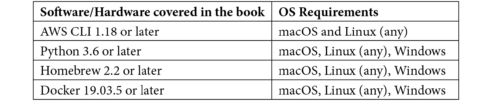

# 献词

献给我的母亲 Susanna 和父亲 Andranik，感谢你们为我所做的一切。献给我的妻子 Natalia，感谢你做我挚爱的缪斯。

\- Karen Tovmasyan


[Packt.com](http://Packt.com)

订阅我们的在线数字图书馆，即可完全访问超过 7,000 本书籍和视频，以及行业领先的工具，帮助您规划个人发展并提升职业生涯。更多信息请访问我们的网站。

# 为什么要订阅？

*   通过来自 4,000 多位行业专业人士的实用电子书和视频，减少学习时间，增加编码时间
*   利用专为您打造的技能计划改善学习
*   每月免费获取一本电子书或一个视频
*   完全可搜索，轻松访问重要信息
*   复制粘贴、打印和书签内容

您知道吗？Packt 为每本出版的书籍提供电子书版本，可获取 PDF 和 ePub 文件。您可以在 [packt.com](http://packt.com) 升级到电子书版本，作为纸质书客户，您有权享受电子书副本的折扣。如需更多详情，请联系 customercare@packtpub.com。

在 [www.packt.com](http://www.packt.com)，您还可以阅读免费技术文章合集，注册各类免费新闻通讯，并获得 Packt 书籍和电子书的独家折扣和优惠。

# 贡献者

# 关于作者

**Karen Tovmasyan** 在大学读书时就开始了他的职业生涯。他的第一份工作——在俄罗斯雷诺的一家工厂——接纳了他，他在第一年从事 IT 支持工作，后来加入 TechProjects 团队并管理他的第一批服务器，这是他的第一个大型迁移项目。几年后，他加入一家 SaaS 公司担任 DevOps 工程师，并于 2016 年移居荷兰。他持有三项 AWS 认证，是俄语 AWS 社区的活跃成员，帮助成员拥抱云采用并充分利用 AWS。他在会议上发表公开演讲，并在 Medium 和 Telegram 上的两个个人博客撰写内容。

我要感谢我的家人、朋友、读者，以及所有日复一日坚持学习和提升自己的人们。

# 关于审阅者

**Anton Tokarev** 目前在一家名为 Softeq 的公司工作，使用 AWS 服务。近 10 年前，他作为网络工程师开始了 IT 职业生涯。他喜欢用 Python 和 Go 编写代码。他拥有初创公司、大公司、产品开发公司和外包公司的经验。

**Aleksandr Patrushev** 在 IT 领域工作了 12 年以上，担任系统工程师和公开演讲者，他职业生涯的每一步都与前一步形成对比：从 x86 系统工程师到 IBM 的 IBM Power Systems 系统工程师，到 Vmware 的 VMware 系统工程师，再到 AWS 的 AWS 解决方案架构师。每一次他都跳出舒适区，奔向新的理念和技术。目前，他是一名 AWS 解决方案架构师，帮助各种规模的公司（从初创公司到大型企业）完成适应云技术以满足业务需求的激动人心的过程。他喜欢为复杂的项目和挑战寻找最高效的解决方案。本书评论中表达的观点仅代表他个人。

我想感谢本书作者 Karen Tovmasyan，他决定花费时间创作这本有趣的书，将帮助人们理解如何用简单的语言和示例实施 IaC 方法。

# Packt 正在寻找像您这样的作者

如果您有兴趣成为 Packt 的作者，请访问 [authors.packtpub.com](http://authors.packtpub.com) 立即申请。我们已与数千名开发人员和技术专业人士合作，就像您一样，帮助他们与全球技术社区分享见解。您可以提交一般申请，申请我们正在招募作者的特定热门主题，或提交您自己的想法。

# 前言

AWS CloudFormation 于 2011 年发布，是对 `infrastructure as code`（基础设施即代码）这一管理现代应用程序、系统和服务器的新兴方法的首次回应。

在本书中，您将学习如何以最高效的方式在 AWS 上使用 CloudFormation 应用 `Infrastructure-as-Code`（基础设施即代码）。

读完本书后，您将了解 CloudFormation 的所有内部原理、实际使用方法、相关最佳实践，以及使用模板宏和自定义资源扩展其功能的各种方式。

您还将了解其无服务器应用程序的替代方案——无服务器应用程序模型，以及其可能的未来继任者——云开发工具包。

# 适读人群

本书适合日常使用 AWS 的工程师。虽然您将在书中找到对大多数示例和代码块的广泛而深入的解释，但我希望您具备基本的编程知识（最好是 Python）、通用 IT 知识，尤其是 AWS 知识，以及对 RESTful API、JSON 和 YAML 的理解。

# 本书内容

*   **第 1 章**，*CloudFormation 复习*，提醒您什么是 CloudFormation 以及它是如何工作的。
*   **第 2 章**，*高级模板开发*，涵盖模板的每一个组成部分——CloudFormation 的核心组件。
*   **第 3 章**，*堆栈的验证、检查和部署*，教导您关于堆栈操作的最佳实践，从验证到在生产环境中运行堆栈。
*   **第 4 章**，*持续集成和部署*，涵盖持续交付的另一个概念及其如何与 CloudFormation 结合应用。
*   **第 5 章**，*使用 StackSets 部署到多个区域和账户*，解释如何在多区域和多账户环境中管理堆栈。


# 章节概览

- *第 6 章*, *使用 `cfn-init` 对 EC2 实例进行配置管理*，介绍如何使用 CloudFormation 在 EC2 实例上安装软件并应用配置管理。
- *第 7 章*, *使用自定义资源创建 AWS 之外的资源*，介绍如何创建 CloudFormation 之外的资源。
- *第 8 章*, *使用模板宏动态渲染模板*，涵盖宏——CloudFormation 的高级概念——及其用例。
- *第 9 章*, *使用 AWS CDK 生成 CloudFormation 模板*，介绍云开发工具包——一个支持多种语言的框架，用于生成 CloudFormation 模板和操作堆栈。
- *第 10 章*, *使用 AWS SAM 部署无服务器应用程序*，教你如何使用无服务器应用程序模型——CloudFormation 的简化实现——为无服务器应用程序预配资源。
- *第 11 章*, *后续展望？*，让你抢先一睹基础设施即代码未来的发展。

# 如何充分利用本书

为了编写和测试本书中的代码，你需要一台安装了 `WSL`（Windows Subsystem for Linux，适用于 Linux 的 Windows 子系统）的 Linux、macOS 或 Windows 机器。你需要 `AWS CLI`、`Python`，当然还需要一个 AWS 账户。你可以使用任何你喜欢的 IDE 或代码编辑器。为了编写本书的代码，我使用了 JetBrains PyCharm 和 Visual Studio Code，因为它们有很好的 CloudFormation 插件。

对于 CDK 和 SAM，你还需要 `Docker`、`Homebrew` 和 `Node package manager`（`npm`）。

所有代码示例都是在 macOS 上编写的，但它们可以轻松地在 Linux 系统或 `WSL` 上运行。



> **如果你使用的是本书的数字版，我们建议你自己手动输入代码，或通过 GitHub 仓库获取代码（链接见下一节）。这样做有助于避免复制/粘贴代码可能导致的任何潜在错误。**

> *请记住，在 AWS 上使用 CloudFormation 是免费的，但你需要为其创建的资源付费。在本书中，我尽量使用最少量的资源（例如 `t2.micro` 实例），但请始终关注你的 AWS 账户，练习完成后别忘了删除堆栈和其他资源。*

# 下载示例代码文件

你可以从 [www.packt.com](http://packt.com) 的账户中下载本书的示例代码文件。如果你是在别处购买的本书，可以访问 [www.packtpub.com/support](https://www.packtpub.com/support) 并注册，以便将文件直接发送到你的邮箱。

你可以按照以下步骤下载代码文件：

1.  在 [www.packt.com](http://packt.com) 登录或注册。
2.  选择 **支持** 选项卡。
3.  点击 **代码下载**。
4.  在 **搜索** 框中输入书名，然后按照屏幕上的说明操作。

文件下载完成后，请确保使用最新版本的以下工具解压或提取文件夹：

- `WinRAR`/`7-Zip` (Windows)
- `Zipeg`/`iZip`/`UnRarX` (Mac)
- `7-Zip`/`PeaZip` (Linux)

本书的代码包也托管在 GitHub 上：[`github.com/PacktPublishing/Mastering-AWS-CloudFormation`](https://github.com/PacktPublishing/Mastering-AWS-CloudFormation)。如果代码有更新，将在现有的 GitHub 仓库中更新。

我们还有来自丰富图书和视频目录的其他代码包，可在 [`github.com/PacktPublishing/`](https://github.com/PacktPublishing/) 获取。去看看吧！

# 代码实战

本书的代码实战视频可在 [`bit.ly/2YhpSx0`](https://bit.ly/2YhpSx0) 查看。

# 下载彩色图片

我们还提供了一个 PDF 文件，其中包含本书中使用的屏幕截图/图表的彩色图片。你可以在此下载：[`static.packt-cdn.com/downloads/9781789130935_ColorImages.pdf`](https://static.packt-cdn.com/downloads/9781789130935_ColorImages.pdf)。

# 约定用法

本书中使用了许多文本约定。

**文本中的代码**：表示文本中的代码词、数据库表名、文件夹名、文件名、文件扩展名、路径名、虚拟 URL、用户输入和 Twitter 句柄。例如："我们还指定了 `AWS::AccountId` 伪参数，因为在下一节中，我们将在同一个账户的多个区域部署 StackSet，因此不需要在模板中暴露 AWS 账户 ID。"

代码块如下所示：

```python
import boto3

def check_if_key_exists():
    client = boto3.client('ec2')
    try:
        resp = client.describe_key_pairs(KeyNames=["mykey"])
    except Exception:
        return False
    if len(resp['KeyPairs']) == 0:
        return False
    return True
```

任何命令行输入或输出均按如下方式编写：

```bash
aws cloudformation deploy \
    --stack-name tag \
    --template-file tag.yaml \
    --capabilities CAPABILITY_IAM
```

**粗体**：表示新术语、重要单词或屏幕上出现的单词。例如，菜单或对话框中的单词会在文本中以这种形式出现。例如："一旦创建了两个堆栈实例，我们将在 **堆栈实例** 部分看到它们的 **状态** 为 **CURRENT**。"

> **提示或重要说明**
>
> 以这种形式出现。

# 联系我们

我们始终欢迎读者的反馈。

**一般反馈**：如果你对本书的任何方面有疑问，请在邮件主题中注明书名，发送邮件至 customercare@packtpub.com。

**勘误**：虽然我们已尽一切努力确保内容的准确性，但错误难免会发生。如果你在本书中发现了错误，我们将不胜感激如果你能向我们报告。请访问 [www.packtpub.com/support/errata](https://www.packtpub.com/support/errata)，选择你的书籍，点击勘误提交表单链接，并填写详细信息。

**盗版**：如果你在互联网上以任何形式发现我们作品的非法副本，我们将不胜感激如果你能提供给我们位置地址或网站名称。请通过 copyright@packt.com 联系我们，并附上相关材料的链接。

**如果你有兴趣成为作者**：如果你在某个主题上有专长，并有兴趣撰写或为书籍做贡献，请访问 [authors.packtpub.com](http://authors.packtpub.com/)。

# 评论

请留下评论。当你阅读并使用过本书后，为什么不在购买网站上留下评论呢？潜在读者可以看到并利用你的公正观点做出购买决定，我们 Packt 可以了解你对我们产品的看法，我们的作者也能看到你对他们书籍的反馈。谢谢！

有关 Packt 的更多信息，请访问 [packt.com](http://packt.com)。
