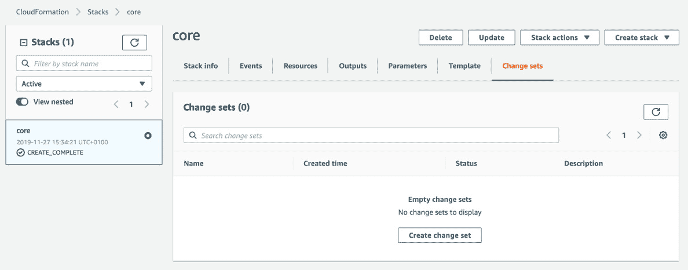
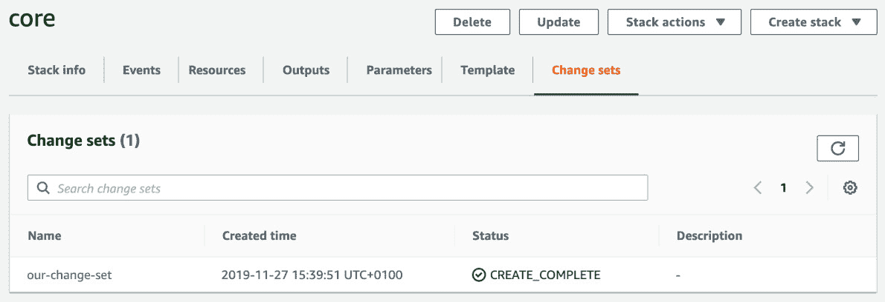
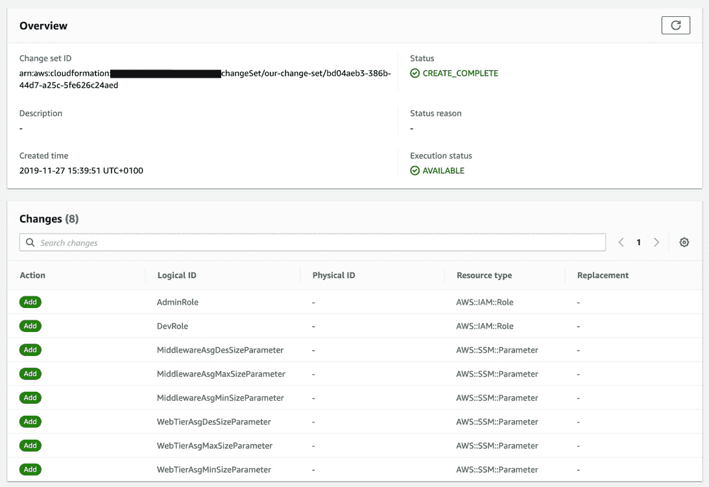
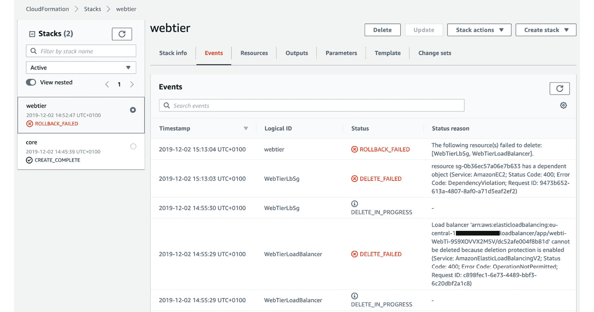
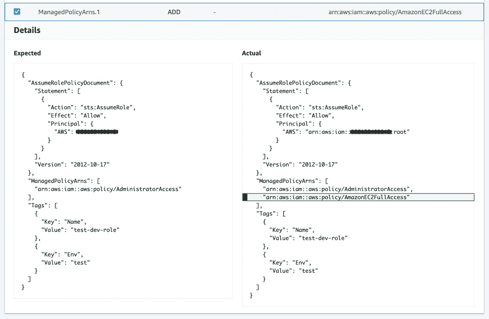
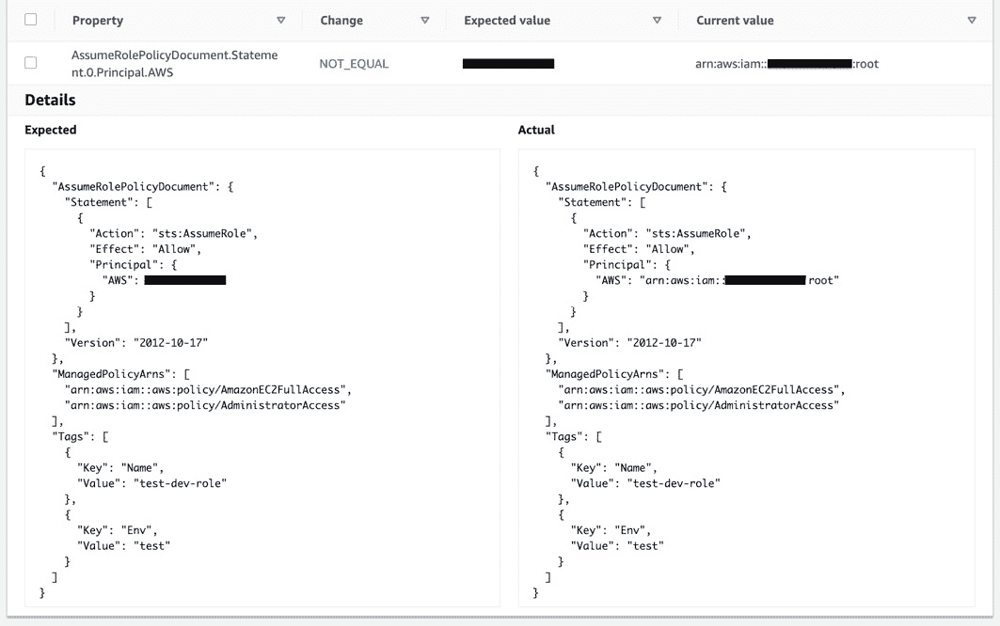

## 第 3 章：栈的验证、Lint 检查与部署

到目前为止，我们还没有部署栈。虽然我们已经学习了模板的特性，但如果不预置资源，这些知识就没有价值。

本章介绍在预置资源前需要执行的检查、部署栈的各种方式以及执行的步骤。

本章将涵盖以下主题：

*   验证模板
*   使用 Linter 检查模板最佳实践
*   预置栈
*   处理错误
*   处理偏差

### 技术要求

本章使用的代码可以在本书的 GitHub 仓库中找到：<https://github.com/PacktPublishing/Mastering-AWS-CloudFormation/tree/master/Chapter3>。

查看以下视频以了解代码实战：

<https://bit.ly/2Wbjkh1>

### 验证模板

每当我们执行 `aws cloudformation create-stack`（或 `update-stack`）时，CloudFormation 会首先验证模板，检查它是否为有效的 JSON 或 YAML 文件（语法检查），以及是否存在任何关键问题，例如循环依赖。

虽然模板验证是栈部署前的必要步骤，但即使验证成功，仍有许多因素会导致栈部署失败：

*   缺少必需的资源属性
*   资源属性名称中的语法错误和拼写错误
*   不存在的资源属性值

我们可以继续列举，但让我们从理论转向实践。

运行模板验证的命令非常简单：

```
$ aws cloudformation validate-template --template-body file://path_to_your_template
```

例如，如果我们要验证核心模板，需要运行以下命令：

```
$ aws cloudformation validate-template --template-body file://core.yaml
```

如果模板中有错误，我们将看到以下输出（在此示例中，我将 `PublicSubnet1` 资源类型更改为 `AWS::EC2::DoesNotExist`）：

```
An error occurred (ValidationError) when calling the ValidateTemplate operation: Template format error: Unrecognized resource types: [AWS::EC2::DoesNotExist]
```

如果我们在内部函数中模拟拼写错误，将会得到另一个错误（在此示例中，我将内部函数 `Fn::Select` 更改为 `Fn::NoSelect`）：

```
An error occurred (ValidationError) when calling the ValidateTemplate operation: Template format error: YAML not well-formed. (line 31, column 18)
```

但是，如果模板有效，我们将看到模板的参数、描述以及 IAM 权限及其原因，其中显示了需要该权限的资源：

```
{
    "Parameters": [
        {
            "ParameterKey": "VpcCidr",
            "NoEcho": false
        },
        {
            "ParameterKey": "Environment",
            "NoEcho": false
        }
    ],
    "Description": "Core template. Contains network and iam roles",
    "Capabilities": [
        "CAPABILITY_IAM"
    ],
    "CapabilitiesReason": "The following resource(s) require capabilities: [AWS::IAM::Role]"
}
```

验证器总是会在栈部署前运行，但为了节省时间并尽早发现所有错误，你应该始终考虑在部署栈之前运行验证，并将其作为 CI/CD 流水线中的一个步骤（我们将在下一章介绍）。

让我们转到一个名为 `cfn-lint` 的有趣工具。

### 使用 Linter 检查模板最佳实践

让我们再次描述一下 Linter。维基百科对 Linter 的定义如下：

> *\"Lint 或 Linter 是一种分析源代码以标记编程错误、Bug、风格错误和可疑结构的工具。\"*

CloudFormation 的 Linter，称为 `cfn-lint`，是一个命令行工具，它检查模板并将声明的资源与大量编写的规则进行比较。

与模板验证器不同，`cfn-lint` 可以检测棘手的问题，例如缺少资源属性或内部函数中的参数。

CloudFormation 的 Linter 是一个外部工具，可以使用 `pip` 安装：

```
$ pip install cfn-lint
```

它会自动出现在 `$PATH` 中，所以我们可以立即运行它：

```
$ cfn-lint core.yaml
```

如果模板满足所有规则要求，输出将为空（命令的*返回代码*将为 `0`）。但是，如果有错误，Linter 会立即通知我们。

在此示例中，我注释掉了 `VpcId` 属性，并移除了 `Fn::Cidr` 函数中的掩码位。`PublicSubnet2` 资源如下所示：

```
  PublicSubnet2:
    Type: "AWS::EC2::Subnet"
    Properties:
      # Missing argument for mask bits!!!
      CidrBlock: !Select [ 1, !Cidr [ !Ref VpcCidr, 12 ] ]
      #VpcId: !Ref Vpc   # Missing property!
      MapPublicIpOnLaunch: True
      AvailabilityZone: !Select
        - 1
        - Fn::GetAZs: !Ref "AWS::Region"
      Tags:
        - Key: 'Name'
          Value: !Join ['-', [ !Ref 'Environment', 'public-subnet02' ]]
        - Key: 'Env'
          Value: !Ref 'Environment'
```

运行 Linter 的输出如下：

```
$ cfn-lint core_broken.yaml
E0002 Unknown exception while processing rule E1024: list index out of range
core.yaml:1:1
E3003 Property VpcId missing at Resources/PublicSubnet2/Properties
core.yaml:45:5
```

*返回代码*将为 `1` 或 `2`（这些是 Linux 系统中错误的常见返回代码）。

> **重要提示**


你可能已经注意到，`cfn-lint` 会显示其发现错误的行号。然而，当你摆弄内部函数的参数时，你会看到错误出现在第一行，这并非总是如此。

此外，该错误并非 linter 指出的实际错误，而是一个 Python 异常。

Linter 不仅根据内置规则检查模板，还支持调整和自定义。

### 针对特定区域进行 Lint 检查

运行 `cfn-lint` 时，它会根据默认区域（即 `us-east-1`）检查模板。要针对其他区域进行检查，可以手动指定：

```bash
$ cfn-lint core.yaml --regions 'eu-west-1'
```

```bash
### 或...
$ cfn-lint core.yaml --regions 'eu-west-1','us-east1'
```

```bash
### 甚至...
$ cfn-lint core.yaml --regions 'ALL_REGIONS'
```

在最后一个示例中，你将得到更有趣的结果：

```text
E3001 Invalid or unsupported Type AWS::SSM::Parameter for resource MiddlewareAsgMaxSizeParameter in us-gov-west-1
core.yaml:393:5

E3001 Invalid or unsupported Type AWS::SSM::Parameter for resource MiddlewareAsgMaxSizeParameter in us-gov-east-1
core.yaml:393:5

E3001 Invalid or unsupported Type AWS::SSM::Parameter for resource MiddlewareAsgMaxSizeParameter in eu-north-1
core.yaml:393:5

E3001 Invalid or unsupported Type AWS::SSM::Parameter for resource MiddlewareAsgMaxSizeParameter in ap-east-1
core.yaml:393:5
```

此错误触发的原因是上述区域不支持该资源类型。如果你计划将模板部署到各个区域，明智的做法是将所有或部分区域纳入检查，以确保你想要预配的服务和资源确实受 CloudFormation 支持。

另一种包含待检查区域的方法是在模板的元数据中添加它们：

```yaml
### core.yaml
Metadata:
  cfn-lint:
    regions:
      - us-east-1
      - eu-west-1
      - eu-central-1
```

随后，运行检查时 `cfn-lint` 会自动选取这些区域。

### 重要提示

请注意，模板的元数据值始终会被命令行参数覆盖。

### 忽略特定规则

如果你在 CI/CD 流水线中包含 `cfn-lint`，当 linter 返回码非 `0` 时将步骤标记为失败，你会遇到麻烦。如果 `cfn-lint` 发出警告（不一定是问题），你可能希望在其不适用于你的堆栈时忽略它。

你可以通过提供 `--ignore-checks` 参数来忽略特定规则：

```bash
cfn-lint core.yaml --ignore-checks 'W2001'
```

或者也可以在元数据中包含它们：

```yaml
Metadata:
  cfn-lint:
    regions:
      - us-east-1
      - eu-west-1
      - eu-central-1
    ignore-checks:
      - W2001
```

虽然不建议忽略 linter 规则，但仅针对特定规则（如不存在的服务）在针对所有区域进行 lint 检查时使用是可以接受的。

### 创建自定义规则

`cfn-lint` 拥有丰富的检查和规则库。然而，你的组织可能有自己的模板要求（例如必要的 `Tags`），这些要求并非开箱即用。

`cfn-lint` 支持创建自定义规则。自定义规则必须用与 `cfn-lint` 相同的语言编写（例如 Python），并在 linter 运行时追加。

在添加自定义规则之前，让我们先开发一个！我们的场景是：确保 RDS 资源（如 DB 实例和 DB 集群）具有 `DeletionPolicy`，且该 `DeletionPolicy` **不** 设置为 `Delete`。

部分工作已完成：`cfn-lint` 拥有内置模板解析器，我们只需匹配特定资源并检查其是否具有所需属性。

Linter 规则的流程如下：

1.  规则检查模板中是否存在类型为 `AWS::RDS::DBInstance` 或 `AWS::RDS::DBCluster` 的资源。
2.  规则检查该资源是否具有 `DeletionPolicy`。
3.  规则检查 `DeletionPolicy` 是 `Retain` 还是 `Snapshot`。
4.  如果未设置 `DeletionPolicy` 或其设置为 `Delete`，规则返回 `Warning`。

我们将创建一个名为 `custom_rules` 的目录，并在其中创建一个名为 `rdsdeletionpolicy.py` 的 Python 文件。

### 重要提示

为了让 `cfn-lint` 正确处理自定义规则，必须确保类名与规则文件名完全相同。

- 可行：`myrule.py` - `class MyRule(CloudFormationLintRule)`
- 不可行：`my_rule.py` - `class MyRule(CloudFormationLintRule)`

首先，我们需要确定一个规则编号。`cfn-lint` 有一系列类别规则。我们可以使用 `W9001` 类别（`W` 代表警告，`9XXX` 保留给用户规则）。

每个自定义规则都是一个继承自 `CloudFormationLintRule` 类的 Python 类。由于该类对象属于 `cfnlint` Python 模块，我们需要使用 `pip` 安装它，并且为了不弄乱系统库，我们将创建一个 Python 虚拟环境 `Virtualenv`：

```bash
$ pip install virtualenv
$ virtualenv venv
$ source venv/bin/activate
(venv)$ pip install cfnlint
```

我们从导入所需模块和创建规则类骨架开始：

```python
### rdsdeletionpolicy.py
from cfnlint.rules import CloudFormationLintRule
from cfnlint.rules import RuleMatch

class RdsDeletionPolicy(CloudFormationLintRule):
    """This rule is used to verify if resources AWS::RDS::DBInstance
    and AWS::RDS::DBCluster have a deletion policy set to Snapshot or Retain"""

    id = 'W9001'
    shortdesc = 'Check RDS deletion policy'
    description = 'This rule checks DeletionPolicy on RDS resources to be Snapshot or Retain'

    def match(self, cfn):
        matches = []
        # Your Rule code goes here
        return matches
```

我们初始化了一个名为 `matches` 的空数组。该数组将包含符合我们规则的资源。

现在我们需要解析模板，获取仅想要评估的 RDS 资源，并检查它们是否有 `DeletionPolicy`。我们需要将代码添加到 `match` 函数中：

```python
### rdsdeletionpolicy.py (partial)
    def match(self, cfn):
        matches = []
        resources = cfn.get_resources(["AWS::RDS::DBInstance", "AWS::RDS::DBCluster"])
        for resource_name, resource in resources.items():
            deletion_policy = resource.get("DeletionPolicy")
            path = ['Resources', resource_name]
            if not deletion_policy:
                message = f"Resource {resource_name} does not have Deletion Policy!"
                matches.append(RuleMatch(path, message))
            elif deletion_policy not in ["Snapshot", "Retain"]:
                message = f"Resource {resource_name} does not have Deletion Policy set to Snapshot or Retain!"
                matches.append(RuleMatch(path, message))
        return matches
```

现在让我们看看我们的规则是什么样子的：

```python
### rdsdeletionpolicy.py
from cfnlint import CloudFormationLintRule
from cfnlint import RuleMatch

class RdsDeletionPolicy(CloudFormationLintRule):
    # ...

    def match(self, cfn):
        matches = []
        resources = cfn.get_resources(["AWS::RDS::DBInstance", "AWS::RDS::DBCluster"])
        for resource_name, resource in resources.items():
            deletion_policy = resource.get("DeletionPolicy")
            path = ['Resources', resource_name]
            if not deletion_policy:
                message = f"Resource {resource_name} does not have Deletion Policy!"
                matches.append(RuleMatch(path, message))
            elif deletion_policy not in ["Snapshot", "Retain"]:
                message = f"Resource {resource_name} does not have Deletion Policy set to Snapshot or Retain!"
```


```python
matches.append(RuleMatch(path, message))

return matches
```

正如你所见，我们正在执行前面（在 linter 规则工作流中）解释过的操作。我们获取所有数据库资源，并检查它们每一个是否都有合适的 `Deletion Policy`。

现在我们可以检查这个 linter 规则了！这是一个示例，展示了我们如何检查模板是否符合我们自己的规则：

```bash
(venv)$ deactivate

$ cfn-lint database_failing.yaml -a custom_rules
```

```text
W9001 资源 TestDatabase 没有 Deletion Policy！

database_failing.yaml:42:3

W9001 资源 ProdDatabase 的 Deletion Policy 未设置为 Snapshot 或 Retain！

database_failing.yaml:65:3
```

`cfn-lint` 和模板验证是堆栈部署过程的重要组成部分。我们将在下一章讨论持续交付时回到它们。但在那之前，让我们看看如何预配置我们的资源。

### 预配置我们的堆栈

在第一章中，我们用一个简单的命令创建了堆栈：

```bash
$ aws cloudformation create-stack --stack-name ... --template-body file://...
```

该命令调用 CloudFormation API `CreateStack`。CloudFormation 的 API 在请求体中接收模板和参数，并开始创建堆栈。

当我们想要更新堆栈时（例如，更改现有资源或添加新资源），我们调用另一个 API `UpdateStack`：

```bash
$ aws cloudformation update-stack --stack-name ... --template-body file://...
```

在这两种情况下，AWS CLI 都会调用 `ListStacks` API 方法，以检查堆栈是否存在。

如果在创建操作期间堆栈已存在，你将收到一个错误：

```text
An error occurred (AlreadyExistsException) when calling the CreateStack operation: Stack [...] already exists
```

如果你尝试更新一个不存在的堆栈，你将收到另一个错误：

```text
An error occurred (ValidationError) when calling the UpdateStack operation: Stack [foo] does not exist
```

请注意这是一个 `ValidationError`。正如你可能记得的，在资源开始预配置之前，CloudFormation 总是会验证模板，以检查模板是否可用。

很久以前，当 CloudFormation 仅支持 YAML 格式的模板时，`CreateStack` 和 `UpdateStack` API 方法是预配置和更新资源的唯一途径。使用这些方法存在（且仍然存在）几个问题。首先，当我们希望使 CI/CD 流水线通用且可复用时，很难将 `create-stack` 和 `update-stack` 子命令集成到 CI/CD 流水线中，因为我们不知道是在预配置新堆栈还是更新现有堆栈。我们不得不通过执行 `list-stacks` 子命令来检查堆栈是否存在，然后决定运行哪个操作，这算是一种变通方法。另一种变通方法是先手动创建堆栈，然后只在 CI/CD 流水线中使用 `update-stack`，但那样我们就会失去开发人员的自主权。

其次，当我们以这种方式更新堆栈时，可能会有大量更改，很难预测将应用哪些更改，或者这些更改是否会销毁重要资源。我们不得不进行小幅甚至粒度极细的更改，或者在代码审查上花费大量时间，从而降低开发速度。

为了解决这个问题，CloudFormation 开发团队引入了一个称为 `Change Sets`（更改集）的功能。

### 使用更改集部署堆栈

更改集（顾名思义）是在部署期间将应用于堆栈的一组更改。

我们可以创建、审查、执行，甚至删除更改集，具体取决于将要应用的更改是否符合预期。

在本例中，我们将部署核心模板的一部分，为该堆栈创建一个更改集（包含额外资源），然后审查并执行它：

```bash
$ aws cloudformation create-stack \
    --stack-name core \
    --template-body file://core_partial.yaml \
    --parameters-file file://testing.json
```

堆栈创建完成后，我们可以检查 **Change Sets** 选项卡并验证它是空的：



Figure 3.1 – CloudFormation 控制台

让我们创建一个更改集：

```bash
$ aws cloudformation create-change-set \
    --stack-name core \
    --change-set-name our-change-set \
    --template-body file://core_full.yaml \
    --parameters file://testing.json \
    --capabilities CAPABILITY_IAM
```

我们将收到以下输出（你的会有所不同）：

```json
{
    "Id": "arn:aws:cloudformation:REGION:ACCT_ID:changeSet/our-change-set/bd04aeb3-386b-44d7-a25c-5fe626c24aed",
    "StackId": "arn:aws:cloudformation:REGION:ACCT_ID:stack/core/00697420-1123-11ea-9d40-02433c861a1c"
}
```

我们可以在 AWS 控制台或 AWS CLI 中审查此更改集。

通过 AWS CLI，它看起来如下（同样，你的可能不同，因为 AWS 账户和/或 AWS 区域不同）：

```bash
$ aws cloudformation describe-change-set \
    --change-set-name arn:aws:cloudformation:REGION:ACCT_ID:changeSet/our-change-set/bd04aeb3-386b-44d7-a25c-5fe626c24aed
```

输出会很长，因为有很多更改，所以我只包含其中一部分：

```json
{
    "Changes": [
        {
            "Type": "Resource",
            "ResourceChange": {
                "Action": "Add",
                "LogicalResourceId": "AdminRole",
                "ResourceType": "AWS::IAM::Role",
                "Scope": [],
                "Details": []
            }
        },
        {
            "Type": "Resource",
            "ResourceChange": {
                "Action": "Add",
                "LogicalResourceId": "DevRole",
                "ResourceType": "AWS::IAM::Role",
                "Scope": [],
                "Details": []
            }
        }
        # The rest of the output...
    ]
}
```

在下半部分，我们有更改集的元数据，但目前我们关注的是这部分：

```json
{
    "Type": "Resource",
    "ResourceChange": {
        "Action": "Add",
        "LogicalResourceId": "AdminRole",
        "ResourceType": "AWS::IAM::Role",
        "Scope": [],
        "Details": []
    }
}
```

因为我们添加了一个新资源，所以此更改集中的 `Action` 设置为 `Add`。如果我们从模板中移除资源，将看到 `Remove`，如果模板中的资源已更改，我们将看到 `Modify`。

让我们在 AWS 控制台中检查此更改集：



Figure 3.2 – CloudFormation 控制台 – Change Sets 选项卡

当我们点击 **our-change-set** 时，将看到其内部详情：



Figure 3.3 – CloudFormation 控制台 – our-change-set 审查

总而言之，结果是一样的，但更便于人工审查。

审查完更改后，我们可以部署此更改集：

```bash
$ aws cloudformation execute-change-set --change-set-name our-change-set --stack-name core
```

最后但同样重要的是，另一个有用的子命令 `deploy` 使用方式如下：

```bash
$ aws cloudformation deploy --stack-name foo --template-file bar
```

`deploy` 与 `create-stack` 或 `update-stack` 的区别在于，此命令是幂等的。如果你在新堆栈上运行 `deploy`，CloudFormation 将创建它。如果堆栈已存在，CloudFormation 将更新它。

主要区别如下：

- `deploy` 使用更改集运行堆栈预配置。
- `deploy` 使用 `--template-file` 参数代替 `--template-body`。


*   `deploy` 不支持参数文件。相反，你必须在 `--parameter-overrides` 参数中指定参数。
*   `deploy` 不会仅在响应中返回 `stackId`，而是会等待直到堆栈创建完成或失败（当我们在 CI/CD 流水线中包含 CloudFormation 命令时，这非常方便）。

要使用 `deploy` 预配置核心堆栈，我们需要运行以下命令：

```bash
$ aws cloudformation deploy \
    --stack-name core \
    --template-file core_full.yaml \
    --capabilities CAPABILITY_IAM \
    --parameter-overrides \
    VpcCidr="10.1.0.0/16" \
    Environment="test"
```

由于 `deploy` 子命令是预配置堆栈和资源最简单、最可靠的方式，我们将在后续章节中继续使用它。

### 处理错误

CloudFormation 堆栈部署响应错误的默认且唯一行为是回滚到之前的状态。

虽然这是管理生产基础设施的正确方式，但它可能会引入各种问题。例如，如果你创建带有终止保护的资源，而这些资源的创建失败了，CloudFormation 将无法进行清理。

例如，我们创建 WebTier 堆栈，将 `LoadBalancer` 的 `DeletionProtection` 设置为 `True`。

这是我们的负载均衡器资源的样子：

```yaml
### webtier_failing.yaml
  WebTierLoadBalancer:
    Type: "AWS::ElasticLoadBalancingV2::LoadBalancer"
    Properties:
      Type: application
      LoadBalancerAttributes:
        - Key: "deletion_protection.enabled"
          Value: True
      # the rest of properties...
```

同时，我们有一个 `WebInstance` 安全组，它有一个错误。它将无法创建，从而触发回滚：

```yaml
### webtier_failing.yaml
  WebInstanceSg:
    Type: "AWS::EC2::SecurityGroup"
    DependsOn: WebTierLoadBalancer
    Properties:
      GroupDescription: WebTier Instance SG
      SecurityGroupIngress:
        - IpProtocol: notexist # will fail
          SourceSecurityGroupId: !Ref WebTierLbSg
          FromPort: 80
          ToPort: 80
      # the rest of the properties...
```

我们在 `aws cloudformation deploy` 命令的输出中将看到堆栈创建失败。但在控制台中，我们将看到一个非常令人不快的错误消息：



**图 3.4 – 错误消息**

CloudFormation 必须删除堆栈，但同时该资源受到终止保护。如果我们在控制台中点击 **删除** 按钮，将看到相同的错误。

我们现在陷入僵局。我们既无法再次更新堆栈，也无法删除堆栈！要摆脱这种情况，我们只需手动移除负载均衡器的终止保护，然后再次删除堆栈。另一种选择是保留这些资源，但当初始堆栈创建失败时，我们不太可能想要这样做。

### 处理偏移

我们在第一章 *CloudFormation 复习* 中介绍了偏移。**偏移** 是指未由 CloudFormation 应用的 CloudFormation 资源更改。虽然大多数偏移是由在 AWS 控制台或 API 中进行的更改创建的，但即使我们使用 CloudFormation 预配置资源，也会出现一些偏移。

让我们看看 `core` 堆栈中的示例。首先，我们需要部署堆栈：

```bash
$ aws cloudformation deploy \
    --template-file core_full.yaml \
    --stack-name core \
    --parameter-overrides \
    VpcCidr=10.1.0.0/16 \
    Environment=test \
    --capabilities CAPABILITY_IAM
```

当堆栈创建完成后，让我们从 `awscli` 运行偏移检测：

```bash
$ aws cloudformation detect-stack-resource-drift \
    --stack-name core \
    --logical-resource-id DevRole
```

在冗长的输出中，我们将看到一个有趣的变化：

```json
{
  "StackResourceDrift": {
    "StackId": "arn:aws:cloudformation:REGION:ACCT_ID:stack/core/32861920-16a7-11ea-bd3e-064a8d32fc9e",
    "LogicalResourceId": "DevRole",
    "PhysicalResourceId": "core-DevRole-G5L6EMSFH153",
    "ResourceType": "AWS::IAM::Role",
    "ExpectedProperties": "...",
    "ActualProperties": "...",
    "PropertyDifferences": [
      {
        "PropertyPath": "/AssumeRolePolicyDocument/Statement/0/Principal/AWS",
        "ExpectedValue": "ACCT_ID",
        "ActualValue": "arn:aws:iam::ACCT_ID:root",
        "DifferenceType": "NOT_EQUAL"
      }
    ],
    "StackResourceDriftStatus": "MODIFIED",
    "Timestamp": "..."
  }
}
```

那么，发生了什么？当我们将 IAM 角色 `DevRole` 的 `Principal` 设置为 `!Ref "AWS::AccountId"` 的值时。但当堆栈创建时，CloudFormation（或 IAM）会将其重写为根用户的完整路径（这本质上与存储 AWS 账户 ID 相同）。

虽然这不会引入许多问题，但我们希望保持堆栈偏移状态整洁。因此，在这种情况下，我们能做的就是设置正确的 `Principal` 值，以免它被重写。

另一种情况是存在非托管更改。让我们向我们的 IAM 角色添加一个额外的策略：

```bash
$ aws iam attach-role-policy \
    --role-name core-DevRole-G5L6EMSFH153 \
    --policy-arn \
    arn:aws:iam::aws:policy/AmazonEC2FullAccess
```

为了便于理解，从控制台运行偏移检测：



**图 3.5 – CloudFormation 控制台**

我们可以手动删除该策略。但如果由于某种原因我们无法这样做（假设我们无法访问 API），那么我们可以通过在模板中添加此策略并再次执行部署来进行此更改：

```yaml
### core_drift.yaml
  DevRole:
    Type: "AWS::IAM::Role"
    Properties:
      # some properties...
      ManagedPolicyArns:
        - !If [ ProdEnv, "arn:aws:iam::aws:policy/ReadOnlyAccess", "arn:aws:iam::aws:policy/AdministratorAccess"]
        - "arn:aws:iam::aws:policy/AmazonEC2FullAccess"
```

我们再次更新堆栈：

```bash
$ aws cloudformation deploy \
    --template-file core_drift.yaml \
    --stack-name core \
    --parameter-overrides \
    VpcCidr=10.1.0.0/16 \
    Environment=test \
    --capabilities CAPABILITY_IAM
```

我们可以看到此偏移已消失：



**图 3.6 – 偏移已消失**

如果这是一个不需要的更改，我们只需从模板中的角色中删除该策略，它就会在 IAM 中被移除。

我们通过将策略添加到 CloudFormation 模板中解决了此偏移。

### 重要提示

在撰写本文时，AWS CloudFormation 团队发布了一项名为 `Resource Import` 的新功能，它允许你将现有资源添加到堆栈中。

这是一项期待已久的功能，它帮助我们以最少的问题迁移到基础设施即代码实践，但目前还无法将偏移导入 CloudFormation 堆栈。但请敬请期待！

偏移管理是一项复杂的任务。作为 AWS 工程师，我们希望 CloudFormation 开发人员会添加更多功能，但我们的工作是确保基础设施中的所有更改仅通过 CloudFormation 进行。

### 总结

在本章中，我们介绍了预配置堆栈的各种方法。


我们已经学习了如何确保堆栈不会部署失败，以及如何按预期配置资源。我们还编写了第一条（绝非最后一条）`cfn-lint` 规则，使基础设施代码更可靠、开发流程更高效。

我们了解了更改集以及它们如何改进堆栈部署方式。现在我们知道如何处理错误，以及如何手动导入更改。

在下一章中，我们将复用所学知识，利用 `CodeCommit`、`CodeBuild` 和 `CodePipeline` 等 AWS 开发服务，为 CloudFormation 引入自动化。

### 问题

1. `cfn-lint` 中哪个类别保留给自定义规则？
2. 模板检查与验证有何区别？
3. 运行 `aws cloudformation deploy ...` 会发生什么？
4. 能否有两个同名的不同更改集？
5. `cfn-lint` 中自定义规则命名有何要求？
6. 如果非托管更改是期望的，如何将检测到的偏移应用到堆栈？

### 延伸阅读

*   [CloudFormation 检查工具](https://github.com/aws-cloudformation/cfn-python-lint)
*   [导入堆栈资源](https://docs.aws.amazon.com/AWSCloudFormation/latest/UserGuide/resource-import.html)
*   [处理偏移](https://docs.aws.amazon.com/AWSCloudFormation/latest/UserGuide/using-cfn-stack-drift.html)
