## 第 4 章：持续集成与部署

我们知道如何构建模板、验证模板并部署它们。现在该引入 DevOps 的另一个核心模块——**持续交付 (CD)**。CD 用于在真实场景下测试应用并无缝部署，最终用户刷新页面即可看到变更，实现零停机、无“维护中”提示。

在**基础设施即代码 (IaC)** 中，基础设施与资源被视为计算机应用。虽然无法对模板做单元测试，但仍有多种方式运行完善的持续交付流水线。

本章将学习如何将模板纳入应用、如何测试堆栈、如何在持续交付实践中应用 **AWS CloudFormation**。读完本章，你将能结合 CloudFormation 构建 CI/CD 流水线。

内容包括：

*   在应用中引入模板
*   对堆栈运行冒烟测试
*   CloudFormation 堆栈发布管理最佳实践
*   结合 CloudFormation 与 CodePipeline 创建 CI/CD 流水线

### 技术要求

本章代码位于书籍的 GitHub 仓库：<https://github.com/PacktPublishing/Mastering-AWS-CloudFormation/tree/master/Chapter4>

观看以下视频查看代码实战：<https://bit.ly/2yWmAox>

### 在应用中引入模板

回顾前几章，我们为不同层级编写了多个模板：`core`（网络与安全）、`web`（前端）、`middleware`（后端）、`database` 层。

目前模板未纳入版本控制，但要实施持续交付，必须确定合适的存储方式。这取决于工作流组织：若有独立的运维或 `cloud` 团队负责基础设施，建议将所有模板放在单一仓库；开发人员仅提供基础设施变更或新版应用。

流程如下：

1. 开发人员发布新版应用。
2. 开发人员将新版本及/或变更提供给运维团队。
3. 运维团队修改参数和/或模板。
4. 运维团队将变更部署到堆栈。

这看似合理，但实际中可能耗时数小时甚至数天才能上线！DevOps 强调开发与运维协作，因此应打通流程，让双方共同承担基础设施责任。

所以，将模板**放入应用仓库**更明智。把模板视为应用配置：我们清楚应用运行所需资源，为何不直接包含？

包含应用及配置文件的仓库结构如下：

```
my_app/
|----.git/
|----config
|    |----test
|    |    |----config.ini
|    |----prod
|         |----config.ini
|----src/
|    |---- # your source code here
|----tests/
|    |---- # your tests here
|----cloudformation/
         |----template.yaml
```

这要求开发人员学习 AWS CloudFormation，但投入绝对值得。

某些资源不适用此法。例如 `Core` 堆栈不属于任何应用，必须单独放在一个仓库。

本章将覆盖两种场景。但在构建首个流水线前，需明确流水线步骤，以及如何判断基础设施是否按预期部署运行。

### 对堆栈运行冒烟测试

如何知道部署后应用是否健康？

除监控、日志、告警外，还有**冒烟测试** 法。

冒烟测试在应用发布期间或之后执行，用于判断当前版本是否正常，或存在需立即回滚的缺陷/故障。

CloudFormation 内置回滚功能：若至少一项变更无法应用或资源创建失败，将回滚到上一个**健康** 状态。从 AWS 视角看，通常是 AWS 服务报告资源创建失败，错误信息来自 AWS API。但某些资源设计上不会上报创建失败。

### EC2 自动伸缩组的冒烟测试

例如，我们用 CloudFormation 创建 **自动伸缩组 (ASG)** 与 **弹性负载均衡 (ELB)**。ASG 根据启动配置或启动模板运行一个或多个实例。启动配置可在 `EC2` 实例创建时运行命令（如安装 Web 服务器），并设置 ELB 健康检查失败时替换实例。

下面是示例模板（部分资源省略，使用了 `default VPC`）。完整模板见源码：

`broken_asg.yaml` (partial)

```yaml
AWSTemplateFormatVersion: "2010-09-09"

Parameters:
  # ...

Resources:
  Lc:
    Type: AWS::AutoScaling::LaunchConfiguration
    Properties:
      ImageId: !Ref AmiId
      InstanceType: t2.micro
      UserData: # can you find a mistake in this UserData?
        Fn::Base64: |
          #!/bin/bash
          yum -y install yolo
```


### 测试 CloudFormation 栈

### 部署一个损坏的 ASG 模板

```bash
systemctl start yolo
```

```yaml
SecurityGroups:
  - !Ref Sg

Asg:
  Type: AWS::AutoScaling::AutoScalingGroup
  Properties:
    # ...
    LaunchConfigurationName: !Ref Lc
    # ...
```

### 其余资源……

```yaml
Outputs:
  Dns:
    Value: !GetAtt Elb.DNSName
```

当我们部署此模板时，CloudFormation 将报告栈的创建已完成：

```bash
aws cloudformation deploy \
  --template-file broken_asg.yaml \
  --stack-name broken \
  --parameter-overrides VpcId=vpc-12345678 \
  SubnetIds=subnet-123,subnet-456,subnet-789,subnet-012,subnet-345,subnet-678
```

```
Waiting for changeset to be created..
Waiting for stack create/update to complete
Successfully created/updated stack - broken
```

然而，如果我们尝试通过 CloudFormation 输出中 ELB 的 URL 进行访问，将会看到以下内容：

```bash
aws cloudformation describe-stacks --stack-name broken | jq .[][][].Outputs[].OutputValue
```

```
"broken-Elb-157OHF7S5UYIC-1875871321.us-east-1.elb.amazonaws.com"
```

```bash
curl broken-Elb-157OHF7S5UYIC-1875871321.us-east-1.elb.amazonaws.com
```

```
<html>
<head><title>503 Service Temporarily Unavailable</title></head>
<body bgcolor="white">
<center><h1>503 Service Temporarily Unavailable</h1></center>
</body>
</html>
```

为什么会发生这种情况？如果栈已创建，意味着基础设施已就位，一切*应该*都正常。然而，如果我们打开 EC2 控制台，可以看到实例正在一个接一个地被终止：

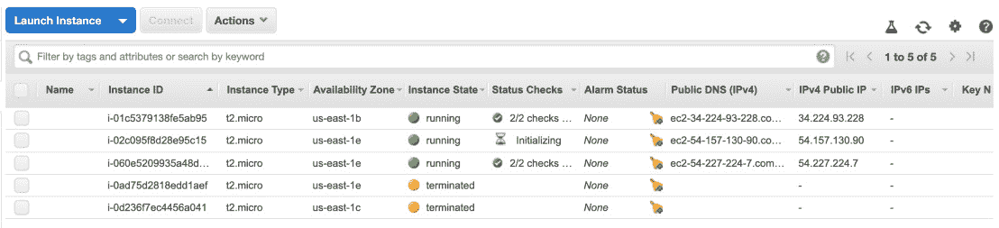

图 4.1 – AWS EC2 控制台

之所以发生这种情况，是因为启动配置的*用户数据*出现故障（正如您可能注意到的，我没有安装任何 Web 服务器软件）。ASG 也已创建，实例正在启动和终止，但 CloudFormation 并不知情；它从 EC2 和 ASG 接收到了 API 响应。

有一种使用 ASG 解决此问题的简单方法（我们将在第 6 章 *使用 cfn-init 进行 EC2 实例的配置管理* 中探讨），但目前，请记住这类问题可能会发生，且 CloudFormation 无法开箱即用地处理它们。

测试模板的另一个问题是，CloudFormation 不像常见编程语言那样具备任何单元测试能力。测试它们的唯一方法是根据模板预置栈，并针对栈及其资源运行测试。

检查应用程序栈有几种方法，但最简单的是向健康检查端点发起 HTTP 请求（在我们的例子中是 `/`）。

我们的测试套件将是一个小型 Python 脚本，它将执行以下操作：

1.  解析参数（栈名称）。
2.  向 CloudFormation API 发起请求以获取栈输出（ELB DNS 名称）。
3.  向该 DNS 名称发起 HTTP 请求。
4.  如果脚本未收到 `200 OK` HTTP 响应，它将打印 `Stack deployment failed!` 并以代码 `1` 退出。

我们的测试脚本如下所示：

### asg_test.py

```python
### imports ...

try:
    stack = sys.argv[1]
except IndexError:
    print("Please provide a stack name")
    sys.exit(1)

cfn_client = boto3.client('cloudformation')

try:
    stack = cfn_client.describe_stacks(StackName=stack)
except botocore.exceptions.ClientError:
    print("This stack does not exist or region is incorrect")
    sys.exit(1)

elb_dns = stack['Stacks'][0]['Outputs'][0]['OutputValue']

for _ in range(0, 2):
    resp = requests.get(f"http://{elb_dns}")
    if resp.status_code == 200:
        print("Test succeeded")
        sys.exit(0)
    sleep(5)

print(f"Result of test: {resp.content}")
print(f"HTTP Response code: {resp.status_code}")
print("Test did not succeed")
sys.exit(1)
```

如果我们再次针对我们的栈运行它，将得到以下结果：

```bash
python asg_test.py broken
```

```
Result of test: b'<html>\r\n<head><title>503 Service Temporarily Unavailable</title></head>\r\n<body bgcolor="white">\r\n<center><h1>503 Service Temporarily Unavailable</h1></center>\r\n</body>\r\n</html>\r\n'
HTTP Response code: 503
Test did not succeed
```

现在，我们必须弄清楚模板哪里出了问题。一旦找到问题（在本例中，在于启动配置的*用户数据*），我们就可以修复它，重新部署栈，并再次测试我们的资源：

### working_asg.yaml

```yaml
### Parameters section...
Resources:
  Lc:
    Type: AWS::AutoScaling::LaunchConfiguration
    Properties:
      ImageId: !Ref AmiId
      InstanceType: t2.micro
      UserData:
        Fn::Base64: |
          #!/bin/bash
          amazon-linux-extras install -y epel
          yum -y install nginx
          systemctl start nginx
      SecurityGroups:
        - !Ref Sg

### the rest of the template...
```

一旦部署了可工作的模板，我们可以再次运行脚本：

```bash
python asg_test.py broken
```

```
Test succeeded
```

虽然这只是该案例的一个示例，但我们知道不能将此测试套件用于其他栈和资源。根据我们要构建的内容，我们必须为部署的每个应用程序或基础设施创建新的测试用例。

对于 VPC 网络、`IAM` 角色和 DynamoDB 表等服务，CloudFormation 可以确保资源配置正确。但我们如何知道它们是否在执行预期的功能？

### 对 VPC 资源进行冒烟测试

让我们再次查看我们的*核心*模板。我们知道它包含*私有*和*公有*子网。假设我们要检查本应为私有的子网是否与私有路由表（即通过 NAT 网关路由流量的路由表）关联。

要执行此测试，我们需要执行以下操作：

1.  首先，为子网资源追加一个额外的标签。

   对公有子网使用以下标签：
   ```yaml
   - Key: 'Private'
     Value: 'False'
   ```

   对私有子网使用以下标签：
   ```yaml
   - Key: 'Private'
     Value: 'True'
   ```

2.  我们的脚本将收集栈的资源，而非其输出。筛选资源类型为 `AWS::EC2::Subnet` 且 `Private` 标签值为 `True` 的资源。

3.  获取私有路由表的 ID，然后检查私有子网是否与私有路由表 ID 关联。

4.  以下步骤将为我们提供 VPC 子网的测试套件：

5.  首先，解析参数并验证栈是否存在：

   ### core_subnets.py

   ```python
   # imports...

   matches = []

   try:
       stack = sys.argv[1]
   except IndexError:
       print("Please provide a stack name")
       sys.exit(1)

   cfn_client = boto3.client('cloudformation')

   try:
       resources = cfn_client.describe_stack_resources(StackName=stack)
   except botocore.exceptions.ClientError:
       print("This stack does not exist or region is incorrect")
       sys.exit(1)
   ```

6.  然后，获取私有路由表的 ID 和栈中的所有子网：

   ### core_subnets.py (continued)

   ```python
   subnets_in_stack = []

   for resource in resources['StackResources']:
       if resource['LogicalResourceId'] == "PrivateRouteTable":
           private_route_table = resource['PhysicalResourceId']
       if resource['ResourceType'] == "AWS::EC2::Subnet":
           subnets_in_stack.append(resource['PhysicalResourceId'])
   ```

7.  最后，使用 EC2 API 获取子网的关联信息，匹配其标签，并检查它们是否具有必要的路由表关联：

   ### core_subnets.py (continued)

   ```python
   ec2_client = boto3.client('ec2')

   subnets_to_check = []

   for subnet in subnets_in_stack:
       resp = ec2_client.describe_subnets(SubnetIds=[subnet])
       for tag in resp['Subnets'][0]['Tags']:
           if tag['Key'] == "Private" and tag['Value'] == "True":
   ```


```python
subnets_to_check.append(subnet)

route_table = ec2_client.describe_route_tables(RouteTableIds=[private_route_table])

private_subnets = []

for assoc in route_table['RouteTables'][0]['Associations']:
    private_subnets.append(assoc['SubnetId'])

for subnet in subnets_to_check:
    if subnet not in private_subnets:
        matches.append(subnet)

if matches:
    print("One or more private subnets are not associated with proper route table!")
    print(f"Non-compliant subnets: {matches}")
    sys.exit(1)

print("All subnets are compliant!")
exit(0)
```

### 8. 让我们部署堆栈并尝试此测试用例

```bash
$ aws cloudformation deploy --stack-name core --template-file core_non_compliant.yaml --capabilities CAPABILITY_IAM
Waiting for changeset to be created..
Waiting for stack create/update to complete
Successfully created/updated stack - core
$ python core_subnets.py core
One or more private subnets are not associated with proper route table!
Non-compliant subnets: ['subnet-0b087c910c675cd5d', 'subnet-037acf2fce30c38fd', 'subnet-041e96329b5d1449a']
```

我们收到了一个错误，这意味着我们的核心堆栈包含不合规的子网！让我们现在部署一个具有正确关联的堆栈，并再次尝试此测试：

```bash
$ aws cloudformation deploy --stack-name core --template-file core_compliant.yaml --capabilities CAPABILITY_IAM
Waiting for changeset to be created..
Waiting for stack create/update to complete
Successfully created/updated stack - core
$ python core_subnets.py core
All subnets are compliant!
```

同样，这只是一个特定案例的示例。根据您如何组织 CloudFormation 模板，您将弄清楚如何进行适当的测试。

### 重要提示

我们真的需要在堆栈操作期间执行这些操作吗？试着想一想如何避免在堆栈部署后进行这些测试。归根结底，我们是要确保资源具有适当的属性和/或关联。考虑一下如何通过使用 `cfn-lint` 找到解决方案。

我们现在知道如何对模板执行测试，那么让我们继续下一个主题。

### CloudFormation 堆栈发布管理的最佳实践

在构建我们的第一个持续交付流水线之前，我想重点关注这个重要主题。在本节中，我们将介绍 CloudFormation 堆栈发布管理的最佳实践。

最终，我们希望像对待计算机程序一样对待我们的基础设施，所以让我们利用软件开发的经验！

### 始终使用版本控制系统

您的基础设施现在就是代码。因此，您需要对其进行版本控制。`版本控制系统` (`VCS`) 有几个好处，包括代码协作、变更历史、源代码集中存储、与构建系统集成等。

为了保持基础设施整洁、维护良好并让变更清晰可观，请始终将 CloudFormation 模板保存在 `VCS` 中。

### 确保依赖项可以轻松检索

在本章和上一章中，我们为模板开发了几个脚本，包括自定义 linter 规则和冒烟测试。

这些脚本有外部依赖（在我们的例子中是 `pip` 包），所以您要确保它们可以轻松安装和解析。

### 保持代码库整洁

请确保妥善组织您的 CloudFormation 仓库。将冒烟测试存放在 `tests` 文件夹中，参数存放在它们该在的位置，自定义 linter 规则存放在合适的目录中（例如 `custom_rules`）。如果您使用 `monorepo` 模式存储模板，请为每个组或项目创建一个子目录，以便于维护。

### 选择合适的分支模型

在大多数软件项目中，`master` 分支被视为生产分支。明智地选择分支模型非常重要，这样您才能将源代码与 `CI/CD` 系统集成。

您可以将工作流拆分为 `dev/test/master` 分支，以便 `CI/CD` 系统在特定分支上运行特定阶段。您不需要将每次提交都部署到生产堆栈，因此对于 `dev` 分支，您可能只会进行验证和 lint 检查。

如果您使用项目管理工具，例如 `Jira`，请确保将问题键添加到提交消息中：

```bash
git commit -m "PROJ-1234 add extra subnets for databases"
```

编写清晰的注释并包含项目或问题键将帮助您保持代码库整洁，并使开发过程透明化。

### 始终执行代码审查

不要允许直接推送到 `master`，而是使用拉取请求来控制即将进行的更改。即使 linter 没有报错且所有测试都通过，仍可能出现错误配置进入生产堆栈的情况。即使 CloudFormation 能够回滚，通过审查每次更改来防止这种情况发生始终是明智的。

### 拥有完整的测试覆盖率

重要的是，您始终在将更改部署到堆栈之前执行 lint 检查和模板验证。您无法对 CloudFormation 模板执行单元测试，但您仍需确保到达 CloudFormation 的错误尽可能少。专注于为 `cfn-lint` 开发自定义规则，以便您可以为组织实施最佳实践。

### 不要忘记使用 CloudFormation IAM 角色

正如您所记得的，当我们部署堆栈时，我们使用自己的 IAM 权限。这意味着我们在 AWS 上至少必须拥有管理员访问策略，这是不安全的。此外，既然我们预期会有更多人协作基础设施，我们需要使用 CloudFormation IAM 角色，这样我们就不必为每个模板开发人员提供对 AWS 的管理员访问权限。

### 始终执行冒烟测试

如果我们管理关键基础设施，我们需要确保每次更改都不会导致故障或错误配置。在单独的环境（甚至单独的 AWS 账户）中部署一个包含最新更改的临时堆栈，并针对我们的堆栈运行冒烟测试，结合适当的 lint 检查和验证，是防止错误的最佳实践。

### 使用正确的 CI/CD 工具

堆栈操作（验证、lint 检查和部署）是基本命令。但是，我们需要确保 `CI/CD` 系统能够执行它们。我们需要明智地选择功能和成本。此外，我们需要考虑安全性，因为我们正在提供对 AWS 账户的访问权限。如果我们有严格的安全要求，我们可能希望在 AWS 环境中配置 `CI/CD` 系统（例如 `GitLab` 或 `Jenkins`），或使用 AWS 托管服务，例如 `CodeBuild` 或 `CodePipeline`。

### 保持良好势头

实践和方法论在不断发展，工具也是如此。我们想要重新审视持续交付的方式，看看是否有改进的余地。长话短说，总是有的。

话虽如此，让我们继续本章的最后一节，为 CloudFormation 构建我们自己的持续交付流水线！

### 使用 CloudFormation 和 CodePipeline 创建 CI/CD 流水线

在开始创建流水线之前，让我们回顾一下什么是 `CI/CD` 流水线。任何 `CI/CD` 流水线（就软件开发而言）都由阶段组成。

这些阶段通常如下（我们稍后将实践所有这些步骤）：

1.  **预构建**：从源代码管理中拉取代码并安装依赖项。
2.  **构建**：运行构建并检索构件。
3.  **测试**：针对构建运行测试套件。
4.  **打包**：将构建构件存储在构件存储中。
5.  **部署**：在环境中部署新版本。

如果这些步骤中的任何一个失败，构建系统将触发错误。


### CloudFormation CI/CD 流水线

那么，我们如何在 CloudFormation 上应用相同的步骤呢？通常，这取决于 **持续集成 (CI)** 系统。在我们的案例中，这些阶段将执行以下操作：

*   **预构建**：将代码（例如模板）存储在 `AWS CodeCommit` 中，并使用 `AWS CodeBuild` 作为构建系统。我们还将从 `CodeCommit` 拉取代码并安装必要的依赖包，包括以下内容：
    *   `cfn-lint`
    *   `awscli`
    *   `boto3` 和 `botocore`（`AWS SDK for Python`）

*   **构建**：此阶段将被跳过。为什么？因为 CloudFormation 模板不像任何软件源代码。例如，我们不需要编译它们。相反，我们可以运行验证检查：
    ```
    aws cloudformation validate-template --template-body ...
    ```
    在此阶段，这已经足够。我们不在测试阶段运行验证检查的原因是，验证是一个简单的语法检查，在 CloudFormation 的上下文中类似于代码编译。

*   **测试**：在此步骤中，我们将对我们的模板运行 `cfn-lint`。如果 linter 检查未失败，我们将把新模板部署到测试环境，运行冒烟测试，然后终止它。

*   **打包**：在此步骤中，我们希望将构件（在我们的案例中是一个模板文件）存储在构件存储中。由于作为一项服务，`AWS CloudFormation` 从 `S3`（一个特定的存储桶）使用模板，`S3` 将充当我们的构件存储。
    测试阶段完成后，我们将把更改后的（或新的）模板上传到 `S3` 存储桶。

*   **部署**：在此步骤中，我们将仅使用在 `S3` 上打包并存储的模板运行生产部署。

### 场景 – 核心堆栈

我们决定将核心堆栈作为我们 `AWS` 环境的一个独立实体存储。对于核心堆栈，我们的流程将如下所示：

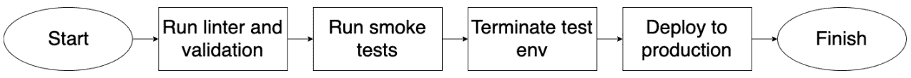

**图 4.2 – 核心 CI/CD 流水线工作流**

如果这些步骤中的任何一个失败，`CI/CD` 系统将触发错误并取消构建。

为了执行此任务，我们将使用 `CodeCommit`（`SCM`）、`CodeBuild`（构建系统）和 `CodePipeline`（实际的 `CI/CD`“连接器”系统）。

我们将不得不配置文件。第一个将是 `buildspec.yaml`——包含指令和构建阶段的构建规范文件（这类似于 `Jenkins` 中的 `Jenkinsfile`）。第二个将是 `CloudFormation`，它包含我们流水线的所有构建模块：源代码仓库、构建项目和流水线。

让我们从 `buildspec.yml` 开始。在我们的案例中，它将如下所示：

**buildspec.yml**

```yaml
version: 0.2

phases:
  install:
    runtime-versions:
      python: 3.8
    commands:
      - pip install awscli cfn-lint
  build:
    commands:
      - aws cloudformation validate-template --template-body file://core.yaml
      - cfn-lint core.yaml
  post_build:
    commands:
      - aws cloudformation deploy --template-file core.yaml --stack-name core-tmp --capabilities CAPABILITY_NAMED_IAM --role-arn $CFN_ROLE
      - python tests/core_subnets.py core-tmp
    finally:
      - aws cloudformation delete-stack --stack-name core-tmp --role-arn $CFN_ROLE

artifacts:
  files:
    - core.yaml
```

我们将在仓库中包含此文件，否则 `CodeBuild` 将不知道要执行哪些操作。

`CodeBuild` 的说明在构建规范中指定。构建规范由几个阶段组成：`install`、`build` 和 `post_build`。

在 `install` 阶段，我们安装必要的依赖项，例如 `cfn-lint` 和 `awscli`。在 `build` 阶段，我们运行验证和 lint 检查。在 `post_build` 阶段，我们运行临时堆栈的部署，运行冒烟测试，并删除堆栈。如果所有步骤都成功完成，核心模板及其参数将被上传到 `S3`（这在 `artifacts` 部分中定义，但 `S3` 的实际路径在 `CodePipeline` 中管理）。

如果 `post_build` 步骤失败（假设临时堆栈部署失败或测试未成功），我们将立即停止并清理临时堆栈。

我们将执行以下操作以获得一个工作的 `CI/CD` 流水线：

1.  我们将首先查看我们的 `CI/CD` 模板。此模板包含以下资源：
    *   一个仓库（`CodeCommit`）
    *   一个构建项目（`CodeBuild`）
    *   构件存储（一个 `S3` 存储桶）
    *   一个流水线（`CodePipeline`）
    *   `IAM` 角色（用于 `CodeBuild`、`CodePipeline`，当然还有 `CloudFormation`）

2.  让我们专注于模板的重要部分。以下代码块声明了 `CodeCommit` 仓库和 `S3` 存储桶（将充当 `CodePipeline` 的构件存储）：

**cicd.yaml (SCM 仓库和构件存储)**

```yaml
  Repository:
    Type: AWS::CodeCommit::Repository
    Properties:
      RepositoryName: core
  TemplateBucket:
    Type: AWS::S3::Bucket
```

我们不需要在这里配置太多内容，因为创建 `S3` 存储桶和 `CodeCommit` 仓库是一项简单的任务。然而，`CodeBuild` 稍微复杂一些。

3.  在 `CodeBuild` 声明中，我们需要显式声明构建作业的来源将是 `CodePipeline`。这指示 `CodeBuild` 接受来自 `CodePipeline` 的 API 调用以运行构建作业：

**cicd.yaml (构建项目)**

```yaml
  Build:
    Type: AWS::CodeBuild::Project
    Properties:
      Artifacts:
        Type: CODEPIPELINE
      ServiceRole: !GetAtt BuildRole.Arn
      Name: Core
      Source:
        Type: CODEPIPELINE
      Environment:
        Type: LINUX_CONTAINER
        ComputeType: BUILD_GENERAL1_SMALL
        Image: aws/codebuild/amazonlinux2-x86_64-standard:2.0
```

> **重要提示**
>
> 对于 `Source` 和 `Artifacts`，我们将类型设置为 `CodePipeline`。这是因为输入和输出由 `CodePipeline` 提供并传递给 `CodePipeline`，后者将充当仲裁者和管理器。我们不在模板本身中指定任何构建步骤。这是因为 `CodeBuild` 的构建步骤在 `buildspec.yml` 中声明。

4.  现在，让我们调查一下我们的流水线资源中有什么。流水线由三个主要阶段组成。第一个是 `Clone`。在此阶段，从 `CodeCommit` 拉取源代码并存储在 `S3` 上。`S3` 对象键（例如代码路径）也作为输出构件存储：

**cicd.yaml (流水线)**

```yaml
### ...
        - Name: Clone
          Actions:
            - ActionTypeId:
                Category: Source
                Owner: AWS
                Provider: CodeCommit
                Version: "1"
              Name: Clone
              OutputArtifacts:
                - Name: CloneOutput
              Configuration:
                BranchName: master
                RepositoryName: !GetAtt Repository.Name
              RunOrder: 1
```

5.  第二个阶段是 `Build`。此阶段将从 `S3` 获取代码（来自上一阶段的输出构件）并运行 `CodeBuild` 项目。如果构建作业成功，模板也将作为输出构件存储在 `S3` 上：

**cicd.yaml (流水线)**

```yaml
        - Name: Build
          Actions:
            - Name: Build
              InputArtifacts:
                - Name: CloneOutput
              ActionTypeId:
                Category: Build
                Owner: AWS
                Version: "1"
                Provider: CodeBuild
              OutputArtifacts:
                - Name: BuildOutput
              Configuration:
                ProjectName: !Ref Build
              RunOrder: 1
```


### 6. 最后阶段是 `Deploy`

在此阶段，`CodePipeline` 将使用构建步骤输出的模板运行堆栈创建（或更新）：

`cicd.yaml`（流水线）

```yaml
- Name: Deploy
  Actions:
    - Name: Deploy
      InputArtifacts:
        - Name: BuildOutput
      ActionTypeId:
        Category: Deploy
        Owner: AWS
        Version: "1"
        Provider: CloudFormation
      OutputArtifacts:
        - Name: DeployOutput
      Configuration:
        ActionMode: CREATE_UPDATE
        RoleArn: !GetAtt CfnRole.Arn
        Capabilities: CAPABILITY_NAMED_IAM
        StackName: Core
        TemplatePath: BuildOutput::core.yaml
```

所有这些阶段均自动发生；`CodePipeline` 监听代码库，每当有更改时即启动。

### 7. 现在，让我们部署 CI/CD 堆栈并做一些实验：

```bash
aws cloudformation deploy \
  --stack-name cicd \
  --template-file cicd.yaml \
  --capabilities CAPABILITY_IAM
```

堆栈部署完成后，我们可以逐个添加文件。让我们先看看我们的流水线：

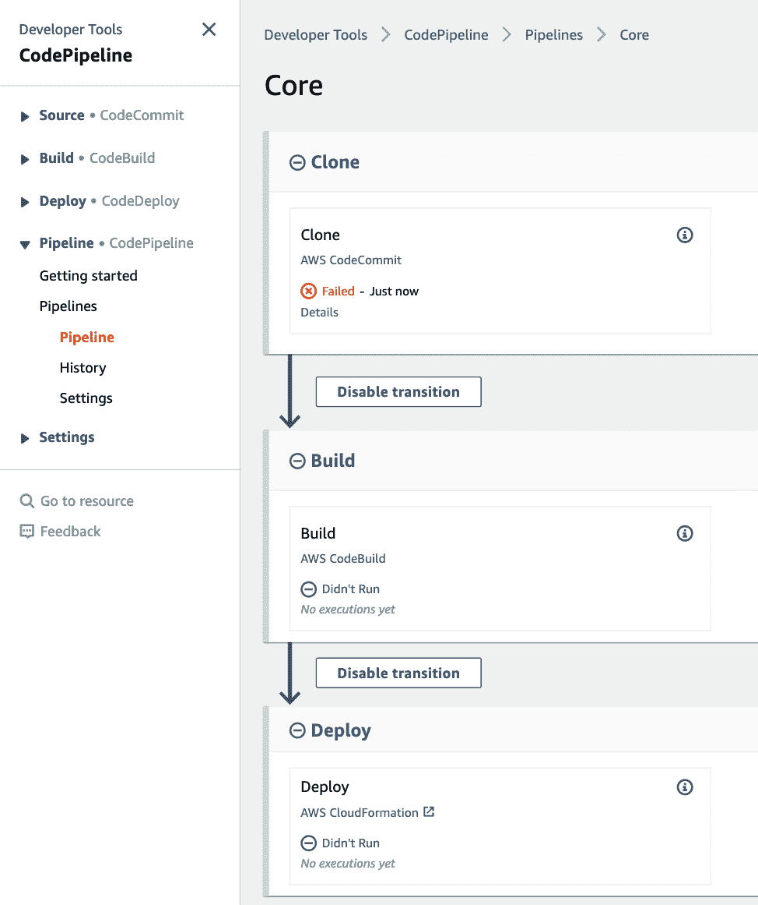

图 4.3 – AWS CodePipeline 控制台

我们已经可以看到它失败了。这是因为 `CodePipeline` 在创建后立即运行，但我们的代码库是空的，没有任何内容可拉取。

### 8. 现在，让我们将必要的文件添加到代码库中。为方便起见，我们将手动操作，但在生产环境中，这将通过 `git` 命令完成。

我们需要前往 `Source` | `Repositories` | `Code`。我们看到的是关于如何克隆代码库的说明。我们暂时忽略它们，然后点击 `Add file` | `Upload file`：

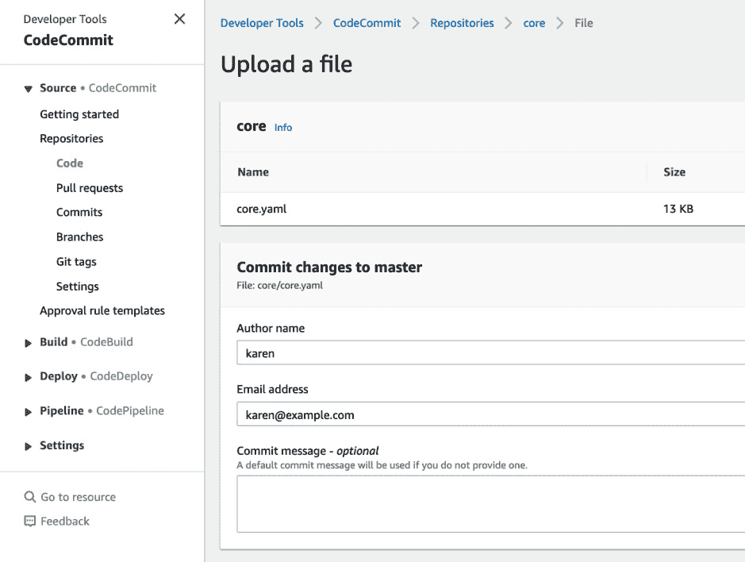

图 4.4 – AWS CodeCommit 控制台

### 9. 我们将对流水线所需的其他文件执行相同操作。最后，我们的代码库将如下所示：

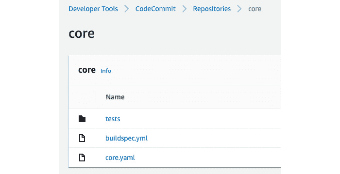

图 4.5 – AWS CodeCommit 控制台

### 10. 让我们回到 `CodePipeline`：

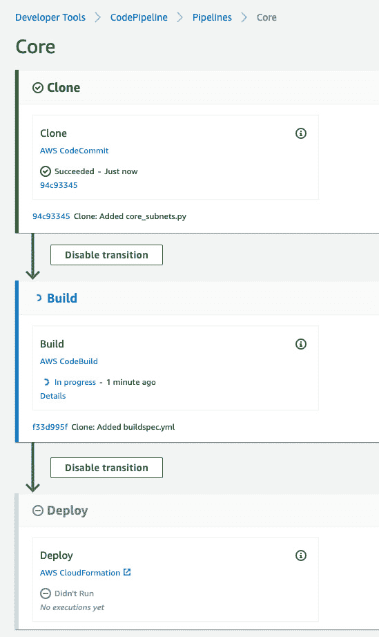

图 4.6 – AWS CodePipeline 控制台

我们已经可以看到一些活动了！但不幸的是，这些构建将会失败，因为代码库尚不完整。同时，我们可以查看构建项目日志：

```
[Container] 2019/12/19 15:03:19 Running command cfn-lint core.yaml
[Container] 2019/12/19 15:03:20 Phase complete: BUILD State: SUCCEEDED
[Container] 2019/12/19 15:03:20 Phase context status code:  Message:  
[Container] 2019/12/19 15:03:21 Entering phase POST_BUILD
[Container] 2019/12/19 15:03:21 Running command aws cloudformation deploy --template-file core.yaml --stack-name core-tmp --capabilities CAPABILITY_NAMED_IAM --role-arn $CFN_ROLE
Waiting for changeset to be created..
Waiting for stack create/update to complete
```

构建系统正忙于创建堆栈。然而，随后它将会失败，因为测试套件是在 `buildspec.yml` 之后上传的。我们将看到如下错误：

```
[Container] 2019/12/19 15:06:18 Running command python tests/core_subnets.py core-tmp
python: can't open file 'tests/core_subnets.py': [Errno 2] No such file or directory
[Container] 2019/12/19 15:06:18 Command did not exit successfully python tests/core_subnets.py core-tmp exit status 2
[Container] 2019/12/19 15:06:18 Running command aws cloudformation delete-stack --stack-name core-tmp --role-arn $CFN_ROLE
[Container] 2019/12/19 15:06:19 Phase complete: POST_BUILD State: FAILED
[Container] 2019/12/19 15:06:19 Phase context status code: COMMAND_EXECUTION_ERROR Message: Error while executing command: python tests/core_subnets.py core-tmp. Reason: exit status 2
```

下一个错误如下（一旦我们添加了测试套件，流水线再次运行，错误会有所不同）：

```
[Container] 2019/12/19 15:06:57 Running command aws cloudformation deploy --template-file core.yaml --stack-name core-tmp --capabilities CAPABILITY_NAMED_IAM --role-arn $CFN_ROLE
An error occurred (ValidationError) when calling the CreateChangeSet operation: Stack:arn:aws:cloudformation:REGIOS:ACCT_ID:stack/core-tmp/b2960880-2270-11ea-90be-06bc90058f1a is in DELETE_IN_PROGRESS state and can not be updated.
```

这是因为前一步骤开始删除模板，而新步骤尝试部署同一个模板。流水线现在看起来非常糟糕：

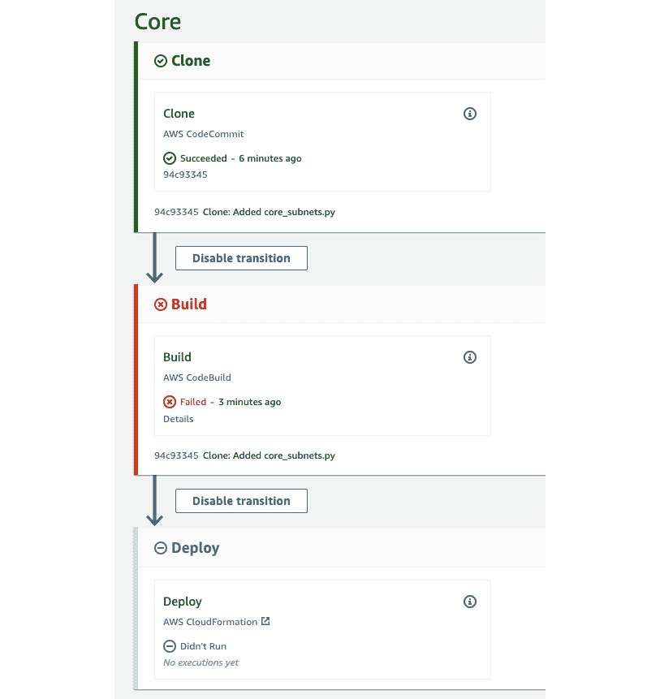

图 4.7 – AWS CodePipeline 控制台

### 11. 然而，无需担心！让我们通过在 `Build` 阶段点击 `Retry` 来再次运行整个流水线。片刻之后，我们可以看到流水线已成功：

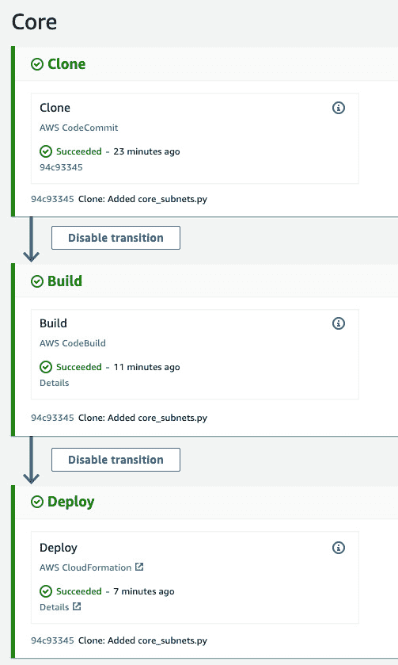

图 4.8 – AWS CodePipeline 控制台

### 12. 我们也可以看到我们的 `Core` 堆栈：

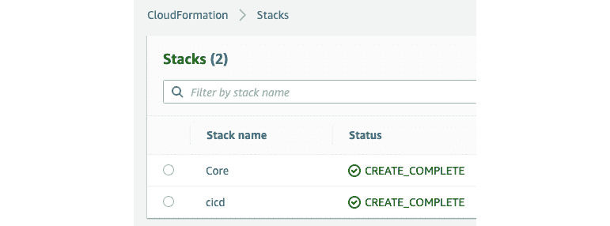

图 4.9 – AWS CloudFormation 控制台

大功告成！我们现在拥有了一个功能齐全、具有测试覆盖率的持续交付流水线！

### 总结

在本章中，我们学习了如何针对 `CloudFormation` 堆栈执行测试，以及使用 `CloudFormation` 进行持续交付的最佳实践。

我们还使用 AWS 开发服务（如 `CodeCommit`、`CodeBuild` 和 `CodePipeline`）创建了我们的第一个流水线。

虽然这个流水线能正常工作并完成其预期功能，但总有改进的空间。问问自己可以在流水线中添加什么或更改什么，以使其更高效。

我们应该将临时堆栈的创建从 `CodeBuild` 移至 `CodePipeline` 作为一个额外阶段，以便节省一些费用，因为在 `CodeBuild` 中，您需要为构建执行时间付费。简单来说，当 `CodeBuild` 等待临时堆栈创建完成时，构建作业正在计费。

另一点是，通过使用相同的临时堆栈名称（`core-tmp`），我们无法同时运行多个构建。如果另一个构建在 `core-tmp` 正被前一个构建删除时运行，我们将收到错误。

正如*CloudFormation 堆栈发布管理的最佳实践*一节所述，总有改进的空间。

在下一章中，我们将介绍另一个重要主题：`StackSets`。我们将学习如何在不同区域甚至不同账户中部署相同的堆栈！

### 问题

1.  什么是 `buildspec.yml`？

2.  什么是 `CloudFormation` 制品？它们存储在哪里？

3.  如何通知 `CloudFormation` 关于 `ASGs` 未正确预配的实例？

4.  `CloudFormation` API 如何提供堆栈中预配资源的列表？

5.  `CodePipeline` 的构建块是什么？使用了哪些 AWS 服务？

### 延伸阅读

*   使用 CodePipeline 进行持续交付：<https://docs.aws.amazon.com/AWSCloudFormation/latest/UserGuide/continuous-delivery-codepipeline.html>
*   使用 AWS CloudFormation 进行基础设施持续交付：<https://www.slideshare.net/AmazonWebServices/infrastructure-continuous-delivery-using-aws-cloudformation-73808130>

第 5 章

## 使用 StackSets 部署到多个区域和账户


在本章中，我们将学习 StackSets——CloudFormation 的一部分，它允许我们将堆栈部署到不同的区域和账户。在管理遍布全球的大型企业级基础设施时，StackSets 非常有用，无论你是要在全球范围内托管软件即服务平台，还是在 AWS 云中运行分布式系统。

在本章中，我们将了解 StackSets 以及如何将它们部署到多个区域和账户。在本章结束时，我们将学会如何使用标签防止多个 StackSet 部署失败。

在深入探讨之前，让我们思考一下，如果我们需要在不同的账户或区域中预置基础设施，该如何执行堆栈操作。

本章将涵盖以下主题：

*   传统的多区域和多账户基础设施管理方式
*   介绍 StackSets
*   部署到多个区域
*   StackSets 的最佳实践
*   部署到多个账户
*   使用标签防止多个 StackSet 部署失败

### 技术要求

本章使用的代码可以在本书的 GitHub 存储库中找到：[`github.com/PacktPublishing/Mastering-AWS-CloudFormation/tree/master/Chapter5`](https://github.com/PacktPublishing/Mastering-AWS-CloudFormation/tree/master/Chapter5)

请查看以下视频以查看代码实战演示：

[`bit.ly/3aTXgN4`](https://bit.ly/3aTXgN4)

### 传统的多区域和多账户基础设施管理方式

直到现在，我们的堆栈部署主要集中在单个 AWS 账户和区域内预置资源。但如果我们需要在多个区域中预置相同的堆栈怎么办？假设我们需要在爱尔兰、北弗吉尼亚和法兰克福预置相同的堆栈？

通常，默认区域（例如我们要连接的 API 端点）是从环境变量或本地配置文件中选择的。当你通过 `awscli` 调用任何命令时，它将连接到该特定默认区域。

我们也可以手动将区域指定为参数。因此，如果我们想在不同的区域预置相同的堆栈，我们必须重复相同的命令并更改参数值：

```
aws cloudformation deploy --region eu-west-1 --template-file foo.yaml
aws cloudformation deploy --region us-east-1 --template-file foo.yaml
aws cloudformation deploy --region eu-central-1 --template-file foo.yaml
```

但这带来了额外的复杂性。如果其中一个部署失败怎么办？如果一个堆栈预置超过 30 分钟，那么整个操作将耗时数小时！

我们可能还需要将相同的堆栈部署到多个账户。我们将不得不在 `awscli` 的本地配置文件中存储多个凭证和配置文件，并逐个指定配置文件！

```
aws cloudformation deploy --profile dev
aws cloudformation deploy --profile test
aws cloudformation deploy --profile prod
```

同样，我们面临着与区域部署相同的问题。

AWS 有一个称为*嵌套堆栈*的功能。我们不会在本书中介绍它们，因为这是一个遗留功能，且维护嵌套堆栈需要付出大量努力，但我认为了解这个概念对你是有好处的。

嵌套堆栈是 CloudFormation 的一项功能，允许模板开发者在 CloudFormation 模板中将 CloudFormation 堆栈指定为资源。最初的想法是为 AWS 对每个堆栈资源数量的限制提供一种变通方法，但现在嵌套堆栈也可用于这种特定情况。欲了解更多信息，您可以阅读 AWS 博客 [at https://aws.amazon.com/blogs/infrastructure-and-automation/multiple-account-multiple-region-aws-cloudformation/](https://aws.amazon.com/blogs/infrastructure-and-automation/multiple-account-multiple-region-aws-cloudformation/)。

最终，CloudFormation 开发团队引入了一个称为 *StackSets* 的功能，它解决了所有这些问题。让我们深入了解它。

### 介绍 StackSets

CloudFormation 堆栈部署的结果始终是一组资源，归组在单个堆栈中。如下图所示，StackSets 可以部署到目标区域甚至账户（无论是在您的 AWS 组织中还是单独的账户）：

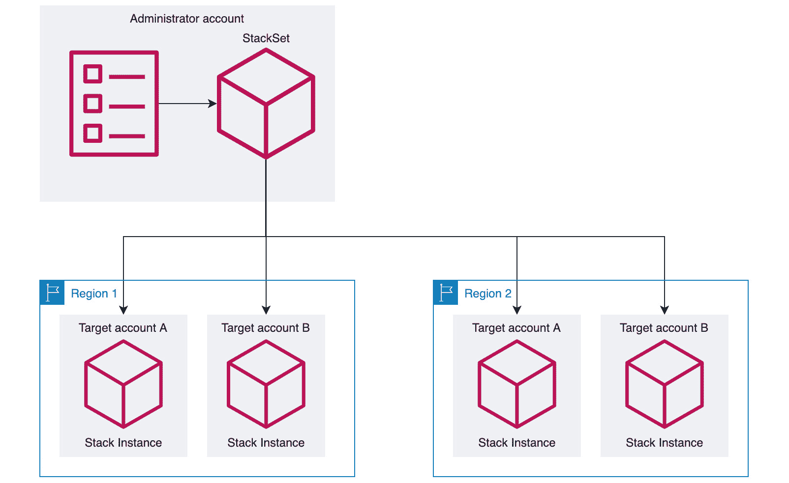

Figure 5.1 – StackSet architecture

正如您在前面的图片中所见，每个 StackSet 由一个或多个堆栈组成，这些堆栈从同一模板预置而来。这些堆栈被称为堆栈实例，并分布在各种账户和区域中。这是我们需要了解的第一个概念。

另一个概念是管理员账户和目标账户。管理员账户是管理 StackSets 的账户。每当我们想要创建或更新 StackSets 时，都需要使用管理员账户。该账户必须被授予在其他账户中创建堆栈的权限（这由 IAM 处理）。在其中创建堆栈的账户是目标账户。

如果您想使用 StackSets 将堆栈预置到不同的区域，但在单个账户中，那么您的管理员账户和目标账户将是同一个。

如果其中一个堆栈实例的创建失败，则不会影响其他堆栈实例。

让我们看一个简单的例子：您部署了一个包含资源的堆栈，这些资源来自的服务目前在 AWS 的某些区域中不受支持。在这些区域中，堆栈创建显然会失败。根据设计，CloudFormation 将开始回滚更改。我们可能会认为所有其他堆栈实例也会回滚，但事实并非如此。只有受影响的堆栈实例会被恢复，而其他实例将毫无问题地部署。这种行为由故障容忍度维持，我们将在下一节中介绍。

### 重要提示

如果我们删除 StackSet，则*所有*堆栈实例都应被删除。为了保留某些堆栈实例，我们需要使用*保留*选项将它们*从* StackSet 中删除。这将从 StackSet 中移除堆栈实例，但堆栈本身将保留。

这听起来很复杂，并增加了意外删除的可能性。为了防止这种情况发生，AWS 不允许您直接删除 StackSet。首先，您必须删除堆栈实例，当 StackSet 为*空*时，才能将其删除。

关于 StackSets 还有一件事要知道，即所谓的 StackSet 操作选项。

虽然 StackSet 操作术语相当简单（操作包括 `create`、`update` 和 `delete`），但选项可能比较棘手。

StackSets 部署开箱即支持滚动更新。要配置部署行为，我们可以设置 `maximum concurrent accounts`（最大并发账户数）、`failure tolerance`（故障容忍度）和 `retain stacks`（保留堆栈）选项：

*   `Maximum concurrent accounts` 定义每个账户的并行部署数量。也就是说，如果我们在一个 StackSet 中部署五个堆栈实例，则可以定义并发部署的数量或百分比。如果我们将此值设置为 2（数字）或 40（百分比），则部署将同时在两个账户中进行。增加此数值将提高堆栈预置的速度，但如果模板中存在可能导致失败的错误，它将影响更多的目标区域和账户。

*   `Failure tolerance` 是一个定义我们如何处理每次部署失败的选项。这仅按区域生效，并定义我们可以忽略多少堆栈部署失败。

*   `Retain stacks` 仅在我们发起从 StackSet 中删除堆栈实例时使用。我们无法在 StackSet 不为空时删除它。如果我们想从 StackSet 中移除堆栈实例，但希望在目标账户或区域中保留它，则需要勾选此框。


在开始之前要学习的最后一件事是我们需要授予管理员账户和目标账户的权限。

### 权限

`StackSet` 中的堆栈实例只能使用 `CloudFormation` 服务角色进行部署。同时，管理员账户必须拥有允许创建堆栈实例的角色。在继续之前，让我们为我们的账户配置这些权限。

**重要提示**

`StackSet` 管理角色必须具有特定名称：管理员账户为 `AWSCloudFormationStackSetAdministrationRole`，目标账户为 `AWSCloudFormationStackSetExecutionRole`。这不是一个字符串限制，而是推荐做法，并在 `CloudFormation` 文档 `https://docs.aws.amazon.com/AWSCloudFormation/latest/UserGuide/stacksets-prereqs.html` 中有定义。

要在我们的账户中部署这些角色（该账户将同时充当管理员和目标账户），我们将使用以下内容：

`CloudFormation:StackSetPermissions.yaml`（管理员账户）

```yaml
StackSetAdministratorRole:
  Type: AWS::IAM::Role
  Properties:
    RoleName: "AWSCloudFormationStackSetAdministrationRole"
    AssumeRolePolicyDocument:
      # ...
    Policies:
      - PolicyName: StackSetAdministratorPolicy
        PolicyDocument:
          Version: 2012-10-17
          Statement:
            Effect: Allow
            Action: "sts:AssumeRole"
            Resource:
              - "arn:aws:iam::*:role/AWSCloudFormationStackSetExecutionRole"
```

管理员角色仅允许一个操作，即在目标账户中担任角色：

`StackSetPermissions.yaml`（目标账户）

```yaml
StackSetExecutionRole:
  Type: AWS::IAM::Role
  Properties:
    RoleName: AWSCloudFormationStackSetExecutionRole
    AssumeRolePolicyDocument:
      Version: 2012-10-17
      Statement:
        Effect: Allow
        Action: "sts:AssumeRole"
        Principal:
          AWS: !Sub "arn:aws:iam::${AWS::AccountId}:root"
    ManagedPolicyArns:
      - "arn:aws:iam::aws:policy/AdministratorAccess"
```

目标账户中的角色将执行所有工作，因此必须拥有足够的权限，所以我们授予目标账户的执行角色管理员访问权限。

我们还指定了 `AWS::AccountId` 伪参数，因为在下一节中，我们将在多个区域但同一个账户中部署 `StackSet`，因此不需要在模板中暴露 AWS 账户 ID。我们只需使用此模板部署堆栈：

```bash
aws cloudformation deploy \
  --stack-name StackSet-Permissions \
  --template-file StackSetPermissions.yaml \
  --capabilities CAPABILITY_NAMED_IAM
```

堆栈创建完成后，一切就绪。我们已准备好 IAM 角色，以允许创建和预配 `StackSets`。现在让我们将核心堆栈部署到多个区域！

### 部署到多个区域

我们现在将开始为单个账户但在多个区域创建 `StackSet`。我们将从 AWS 控制台开始。

### 使用 AWS 控制台

让我们首先在单个账户（例如我们的主账户）中使用核心模板部署 `StackSet`。我们将从 AWS 控制台开始：

1. 登录控制台后，我们将转到 **CloudFormation - StackSets** 并点击 **创建 StackSet**。我们将选择 **模板已准备就绪**，上传我们的 `core.yaml` 文件（您将在 GitHub 存储库中找到它），然后点击 **下一步**。模板将自动上传到 `S3`：

   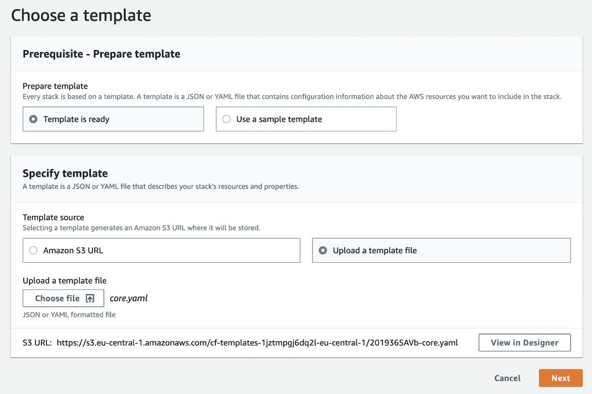

   图 5.2 – CloudFormation StackSet 控制台

2. 现在我们需要提供 `StackSet` 名称和参数，然后点击 **下一步**：

   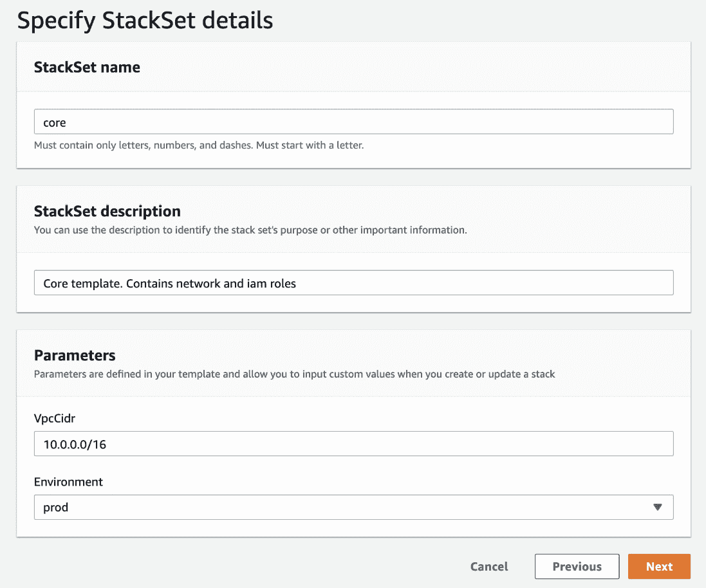

   图 5.3 – CloudFormation StackSet 控制台

   **重要提示**

   我们为 `StackSet` 插入参数值，这些参数将被堆栈实例继承。在 `StackSet` 创建期间，目前无法为每个堆栈实例添加唯一参数，因为根据设计，所有堆栈实例都应相同。或者，我们可以开始时为 `StackSet` 创建一个堆栈实例，然后在添加堆栈实例时使用 `--parameter-overrides`。

3. 在此示例中，我们不提供任何标签，但必须指定 `StackSet` 的管理员角色。我们将保持执行角色不变并点击 **下一步**：

   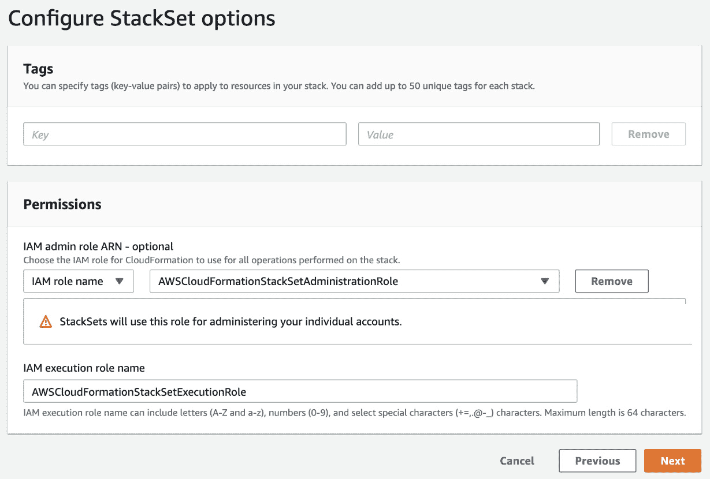

   图 5.4 – CloudFormation StackSet 控制台

4. 现在我们需要输入 AWS 账户、区域和部署选项的值。由于我们仅在主账户中创建 `StackSet`，我们将选择 **在账户中部署堆栈** 并添加账户 ID：

   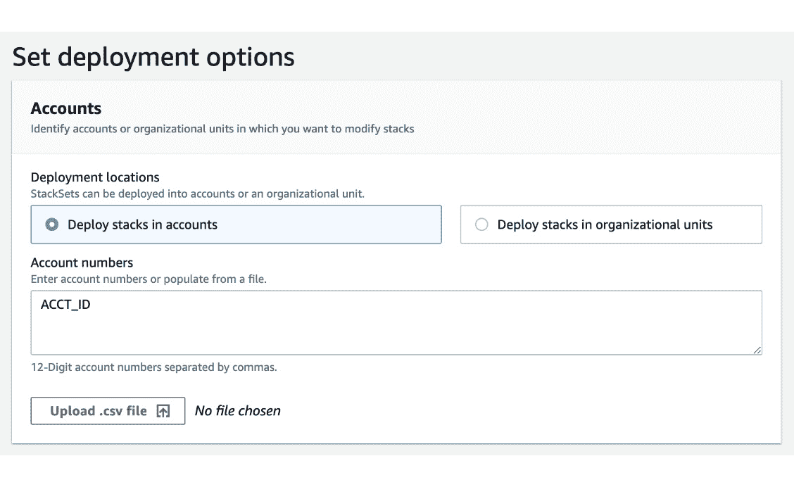

   图 5.5 – CloudFormation StackSet 控制台

5. 接下来，我们需要指定将部署堆栈的区域。我们将选择 **北弗吉尼亚** (`us-east-1`) 和 **爱尔兰** (`eu-west-1`)：

   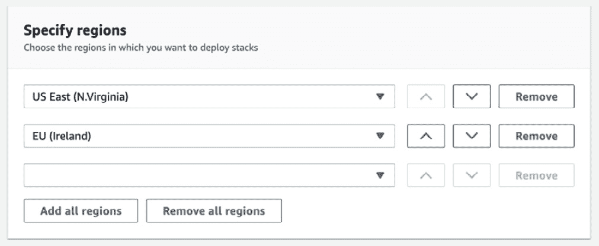

   图 5.6 – CloudFormation StackSet 控制台

   如果我们愿意，可以更改区域的顺序，因为 `CloudFormation` 将按此处指定的顺序部署堆栈实例。如果我们将爱尔兰作为 *测试* 区域，北弗吉尼亚作为 *生产* 区域，明智的做法是先部署到测试环境，再部署到生产环境。但对于此示例，我们将保持原样。

   现在让我们看看部署选项。

6. 我们将 **最大并发账户数** 设置为 **1**（因为我们只部署到我们的账户），将 **失败容忍度** 设置为 **0**——如果其中一个堆栈实例预配失败，我们不希望继续。然后最后点击一次 **下一步**：

   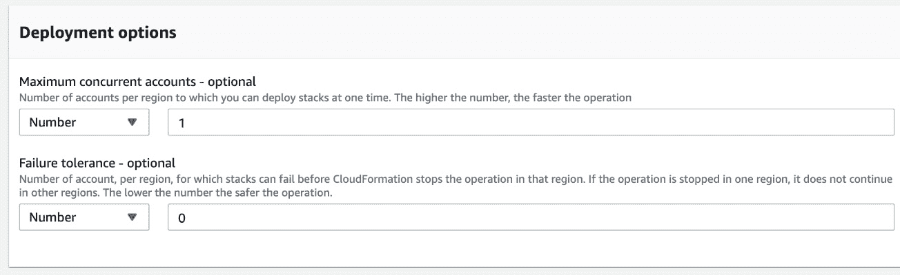

   图 5.7 – CloudFormation StackSet 控制台

7. 我们需要查看摘要并勾选 **我确认 AWS CloudFormation 可能会创建 IAM 资源**（这类似于在 `awscli` 中设置 `CAPABILITY_IAM`）。如果有想要更改的内容，可以在 **摘要** 中点击任何步骤的 **编辑**。如果一切就绪，我们只需点击 **提交**。现在我们可以查看我们的 `StackSet`：

   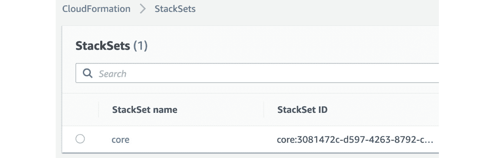

   图 5.8 – CloudFormation StackSet 控制台

   在 `StackSet` 信息中，我们将看到 `StackSet` 的摘要和其他属性。我们感兴趣的是 *堆栈实例*：

   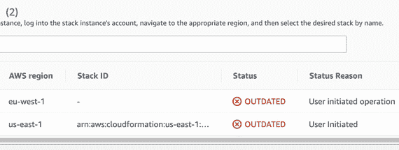

   图 5.9 – CloudFormation StackSet 控制台

8. 我们可以看到只有一个堆栈正在预配。这是因为我们将 **最大并发账户数** 设置为 **1**，直到北弗吉尼亚的堆栈实例预配完成，爱尔兰的部署才会开始。我们无法从此菜单查看 `CloudFormation` 事件，因此必须切换到北弗吉尼亚区域并在那里查看，如下截图所示：

   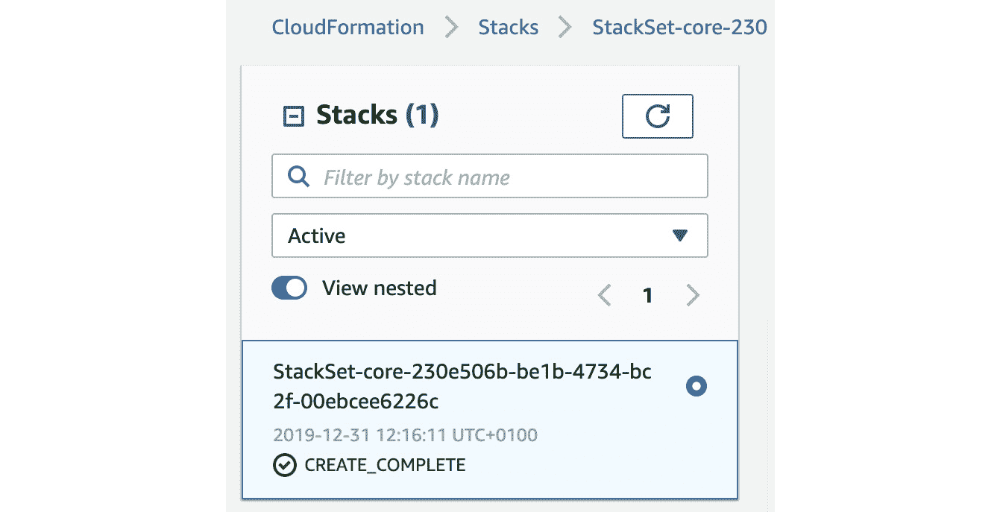

   图 5.10 – CloudFormation 控制台

9. 我们可以看到此堆栈实例已创建。一旦两个堆栈实例都创建完成，我们将在 **堆栈实例** 部分看到它们的 **状态** 为 **CURRENT**：

   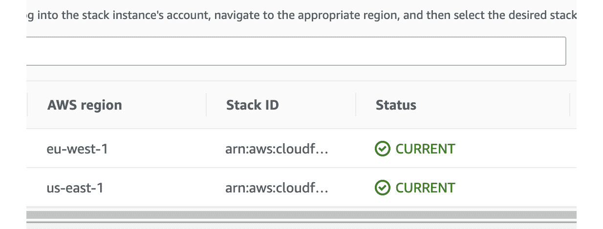

   图 5.11 – CloudFormation StackSet 控制台

现在，让我们使用 `awscli` 做同样的事情。要清理资源，我们需要从 `StackSet` 中删除堆栈实例，然后删除 `StackSet` 本身。

### 使用 AWS CLI


### 使用 `awscli` 创建 StackSets

使用 `awscli` 创建 StackSets 会引入一些差异。其中之一是 `StackSet` 的创建和堆栈实例的创建是不同且独立的操作。这意味着我们可以轻松地为每个堆栈实例使用特定参数，当我们想要在单个 `StackSet` 中对堆栈实例进行细微更改时，这非常有用。

通过执行以下步骤，我们将能够实现多区域部署：

### 1. 创建 StackSet

我们首先创建一个 `StackSet`：

```
aws cloudformation create-stack-set \
    --stack-set-name core \
    --template-body file://core.yaml \
    --capabilities CAPABILITY_NAMED_IAM
```

我们将在响应中看到 `StackSetId`。如果我们转到 AWS 控制台，将看到活动的 `StackSet`，但没有堆栈实例；不过，参数将已设置（为默认值，除非我们另有指定）。

### 2. 创建第一个堆栈实例

现在我们创建第一个堆栈实例。我们仍将使用我们的账户，选择爱尔兰作为区域，并覆盖 `VpcCidr` 和 `Environment` 的参数：

```
aws cloudformation create-stack-instances \
    --stack-set-name core \
    --accounts ACCT_ID \
    --regions eu-west-1 \
    --parameter-overrides \
    ParameterKey=VpcCidr,ParameterValue=10.1.0.0/16 \
    ParameterKey=Environment,ParameterValue=test
```

**响应**

```
{
    "OperationId": "7643d973-1358-475d-b148-5e096f9a44b9"
}
```

### 3. 查看堆栈实例

`awscli` 将返回 `OperationId`，我们可以在 AWS 控制台中查看我们的堆栈实例，或使用命令行界面：

```
aws cloudformation list-stack-instances --profile personal --stack-set-name core
```

```
{
    "Summaries": [
        {
            "StackSetId": "core:ec0e8256-dcc9-4dd0-b074-aee9721ed949",
            "Region": "eu-west-1",
            "Account": "ACCT_ID",
            "StackId": "arn:aws:cloudformation:eu-west-1:ACCT_ID:stack/StackSet-core-f8b4d34b-abaf-4e97-b004-9309ea693803/124e9400-2bc6-11ea-8c11-0abd335268a4",
            "Status": "OUTDATED",
            "StatusReason": "User Initiated",
            "DriftStatus": "NOT_CHECKED"
        }
    ]
}
```

### 4. 创建生产堆栈实例

我们不必等待此堆栈实例创建完成。让我们创建生产堆栈实例：

```
aws cloudformation create-stack-instances \
    --stack-set-name core \
    --accounts ACCT_ID \
    --regions us-east-1 \
    --parameter-overrides \
    ParameterKey=VpcCidr,ParameterValue=10.0.0.0/16 \
    ParameterKey=Environment,ParameterValue=prod
```

瞧！使用 `awscli`，我们成功绕过了 `StackSets` 继承参数的问题！现在让我们看看 `StackSets` 在多账户环境中是如何工作的。

### `StackSets` 的最佳实践

在开始之前，我们需要了解一些关于 `StackSets` 的最佳实践。这至关重要，因为我们不想搞出一个混乱的“大杂烩”而不是一个井然有序的基础设施，我们希望堆栈操作具有高效性和透明度。最重要的最佳实践如下：

*   **开发通用模板**：默认情况下，`StackSet` 在所有区域和账户中部署相同的模板和参数集。为了使此过程尽可能自动化，我们必须专注于模板的可重用性。不要硬编码区域和可用区；相反，应在每个账户和区域中使用 AWS SSM 参数存储来简化 `StackSet` 的部署。不要为 IAM 角色、用户、组、策略、S3 存储桶等全局资源设置名称，以避免命名冲突。

    着眼长远，从小处着手。如果你被要求为一个将服务于数十个账户和区域的应用程序创建 `StackSet`，明智的做法是仅从其中几个开始。积累一些实践经验，改进你的模板，然后继续扩展。

*   **不要忘记部署性能**：在 `StackSet` 上执行滚动更新将花费大量时间。如果你适当设置最大并发操作数，可以加快此过程。

*   **不要忘记验证和检查**：即使 `StackSet` 在失败时会停止操作并回滚，我们也不想拖慢速度。使用检查和验证进行预检将为我们节省大量时间。

请务必在 AWS 文档中查找 `StackSets` 的最佳实践（你将在*延伸阅读*部分找到链接）。同时，让我们继续了解如何部署到多个账户。

### 部署到多个账户

现在让我们开始处理多账户场景。在本节中，我在 AWS Organizations 中创建了两个额外账户：测试和生产。

### 重要提示

由于本书不涉及**多账户策略**（**MAS**），我们将不在本书中介绍子账户和组织单元的创建。如果你需要了解这些内容，可以从 AWS Organizations 开始了解（[`aws.amazon.com/organizations/`](https://aws.amazon.com/organizations/)）。如果你不使用多账户策略且不打算使用，则可以跳过此部分。

由于我们将在多个账户中工作，我们需要调整 `StackSet` 权限模板。我们将其分为两个模板——一个用于管理员角色，一个用于执行角色。我们不需要在主账户（或用 AWS 的术语来说，即付费账户）中创建执行角色，因为不会在其中创建堆栈实例。

我们的 `StackSet` 管理员角色保持不变，但 `StackSet` 执行角色会略有不同：

**`StackSetExecution.yaml`**

```yaml
AWSTemplateFormatVersion: "2010-09-09"

Description: StackSet IAM roles

Parameters:
  AdministratorAccountId:
    Type: String
    AllowedPattern: "(\\d+)$"

Resources:
  StackSetExecutionRole:
    Type: AWS::IAM::Role
    Properties:
      # ...
      Principal:
        AWS:
          Fn::Join:
            - ""
            - - "arn:aws:iam::"
              - !Ref AdministratorAccountId
              - ":root"
      # ...
```

在这里，我们添加了一个 `AdministratorAccountId` 参数，我们将手动输入该参数。此参数将用于为执行角色设置适当的 `Principal`。

要在所有子账户中部署此堆栈，我们将在 `~/.aws/credentials` 中不同的配置文件下添加 API 密钥和密钥，并使用这些配置文件来预配执行角色：

```
aws cloudformation deploy \
    --stack-name Admin-Role \
    --template-file StackSetAdmin.yaml \
    --capabilities CAPABILITY_NAMED_IAM
```

```
aws cloudformation deploy \
    --stack-name Exec-Role \
    --profile test \
    --template-file StackSetExec.yaml \
    --parameter-overrides \
    AdministratorAccountId=ACCT_ID \
    --capabilities CAPABILITY_NAMED_IAM
```

```
aws cloudformation deploy \
    --stack-name Exec-Role \
    --profile prod \
    --template-file StackSetExec.yaml \
    --parameter-overrides \
    AdministratorAccountId=ACCT_ID \
    --capabilities CAPABILITY_NAMED_IAM
```


完成后，我们可以开始创建包含多个账户的 `StackSet`。我们也修改了核心模板：现在它将只有一个 `VpcCidr`，默认为 `10.0.0.0/16`，因为我们不期望生产环境和测试环境相互交互，并且移除了 `Environment` 参数，因为我们在 AWS 账户层面分离了测试和生产环境。这将减少我们在跨不同账户部署 `StackSet` 时所需的步骤。

按照前面的步骤，我们将部署多账户基础设施：

1.  再次，我们首先创建一个 `StackSet`：

    ```
    aws cloudformation create-stack-set \
        --stack-set-name core \
        --template-body file://core.yaml \
        --capabilities CAPABILITY_NAMED_IAM
    ```

2.  然后我们创建堆栈实例，但这次我们会稍微更改参数。首先，我们将指定两个子账户（测试和生产），并将最大并发操作设置为 100%，以便并行部署到两个账户：

    ```
    aws cloudformation create-stack-instances \
        --stack-set-name core \
        --accounts ACCT_ID_PROD ACCT_ID_TEST \
        --regions REGION \
        --operation-preferences \
        MaxConcurrentPercentage=100
    ```

我们需要记住的一点是，并发部署的数量是按每个账户每个区域定义的。这意味着如果我们使用两个账户和三个区域，那么第一批将在一个账户中完成，然后是另一个，最后在第三个。

让我们继续下一个主题。

### 使用 TAG 防止多个 StackSet 部署失败

当我们想要部署 `StackSet`，其中一个 `StackSet` 中的堆栈实例依赖于另一个 `StackSet` 中的堆栈实例时，我们需要确保这些部署不会失败。

虽然在实现 `StackSet` 操作时有一个容错选项，但我们需要在实际操作之前捕获并处理所有可能的异常。

`StackSet` 具有一个名为目标账户门控的可选功能。**目标账户门控**（**TAG**）是在 `StackSet` 操作之前在目标账户上执行的 Lambda 函数，它检查目标账户是否*准备好*执行此操作——例如，所需资源是否存在，或者是否没有其他正在进行的 `StackSet` 操作。

TAG 必须由我们开发，但其结果非常简单：如果所有检查都通过，则应返回 `SUCCESS`；如果有一项或多项检查未通过，则返回 `FAIL`。

在本章中，我们将开发一个 TAG 函数来检查以下内容：

*   核心堆栈是否存在
*   核心堆栈的必要导出输出是否也存在
*   EC2 上是否存在 SSH 密钥

我们需要这个是因为我们将在核心 `StackSet` 之上部署 `WebTier StackSet`。正如我们从 *第 2 章* *高级模板开发* 中记得的那样，`WebTier` 资源是在子网中创建的，而子网是核心堆栈的一部分。

由于我们的 TAG 将调用 CloudFormation 和 EC2 的 API，它必须拥有一个 IAM 角色，允许对这些服务进行 `Get*` 和 `Describe*` 调用。

我们将在单账户环境中部署我们的 TAG 函数（以便那些尚未使用多账户策略和 AWS Organizations 的读者也能使用）。

> **重要提示**
>
> TAG 函数的名称必须类似于 `AWSCloudFormationStackSetAccountGate`。虽然可以覆盖 `StackSet` 管理员和执行角色的默认名称，但目前还无法为 TAG 设置自定义名称。如果 TAG 函数名称不同，或者无法调用此函数，`StackSet` 将忽略 TAG 的检查。

我们的 TAG 将有一个处理程序（这是 Lambda 的 **"main"** 函数）和三个函数：

`check_if_key_exists`、`check_if_core_stack_exists`、`check_if_exports_exist`。

我们的脚本应如下所示。

下面的函数连接到 EC2 服务并检查 SSH 密钥 **"mykey"** 是否存在：

`tag.py`

```python
import boto3

def check_if_key_exists():
    client = boto3.client('ec2')
    try:
        resp = client.describe_key_pairs(KeyNames=["mykey"])
    except Exception:
        return False
    if len(resp['KeyPairs']) == 0:
        return False
    return True
```

此函数连接到 CloudFormation 服务并请求核心堆栈的信息：

`tag.py`

```python
def check_if_core_stack_exists():
    client = boto3.client('cloudformation')
    try:
        resp = client.describe_stacks(StackName="core")
    except Exception:
        return False
    if len(resp['Stacks']) == 0:
        return False
    return True
```

此函数也连接到 CloudFormation 服务，但运行不同的 API 调用以获取导出的输出：

`tag.py`

```python
def check_if_exports_exist():
    to_check = [
        "WebTierSubnet1Id",
        "WebTierSubnet2Id",
        "WebTierSubnet3Id",
        "VpcId",
        "WebTierMaxSizeParameter",
        "WebTierMinSizeParameter",
        "WebTierDesSizeParameter"
    ]
    exports = []
    client = boto3.client('cloudformation')
    try:
        resp = client.list_exports()
    except Exception:
        return False
    for export in resp['Exports']:
        exports.append(export['Name'])
    if not all(exp in exports for exp in to_check):
        return False
    return True
```

最后，Lambda 处理程序，将调用上述所有函数 `tag.py`：

```python
def lambda_handler(event, context):
    status = "SUCCEEDED"
    if not (check_if_key_exists() and check_if_core_stack_exists() and check_if_exports_exist()):
        status = "FAILED"
    return {
        'Status': status
    }
```

正如我们在 `lambda_handler` 函数中看到的，如果这些函数中的任何一个返回 `False`，则 TAG 结果为 `FAILED`。

让我们将 TAG 打包到 CloudFormation 模板中：

`tag.yaml`

```yaml
AWSTemplateFormatVersion: "2010-09-09"
Resources:
  AccountGateFunctionRole:
    Type: 'AWS::IAM::Role'
    Properties:
      # ...
  AccountGateFunction:
    Type: 'AWS::Lambda::Function'
    Properties:
      FunctionName: 'AWSCloudFormationStackSetsAccountGate'
      Code:
        ZipFile: |
          # source code of our function...
      Handler: lambda_function.lambda_handler
      MemorySize: 128
      Runtime: python3.7
      Timeout: 30
      Role: !GetAtt AccountGateFunctionRole.Arn
```

现在我们只需要部署这个 TAG：

```
aws cloudformation deploy \
    --stack-name tag \
    --template-file tag.yaml \
    --capabilities CAPABILITY_IAM
```

请注意，TAG 函数必须部署在将创建堆栈实例的**每个**账户**和**区域中。一旦 TAG 堆栈部署完成，我们就可以为 `WebTier` 创建一个 `StackSet`（就像我们之前为核心 `StackSet` 所做的那样）。

```
aws cloudformation create-stack-set \
    --stack-set-name webtier \
    --template-body file://webtier.yaml

aws cloudformation create-stack-instances \
    --stack-set-name webtier \
    --accounts ACCT_ID \
    --regions eu-central-1
```

我们将看到的显然是一个错误：


Figure 5.12 – CloudFormation StackSet console

这是因为核心堆栈不存在。

正如我们在这里看到的，TAG 检查并没有显示足够的信息（尝试找出到底是哪个检查失败了。它首先查找的是 TAG 函数日志。），但它可以帮助我们在 `StackSet` 操作启动之前防止失败，从而保护我们免受意外停机的影响。


我们还必须记住，`TAG` 仅在创建和更新操作期间执行，*而不*用于删除 `stack instances`。

### 总结

在本章中，我们了解了 `StackSets`、它们的用例、如何部署它们以及如何处理故障。

`StackSets` 是一项很有前景的功能，尽管它们引入了一些复杂性，并且不易与持续交付系统集成。尽管如此，当你想要在多个区域甚至多个账户中预置相同的堆栈时，它们非常实用。

当你被要求将相同的环境和资源部署给客户时，请考虑使用 `StackSets`——例如，如果你提供 B2B SaaS 平台，或希望自动化开发、测试、预发布和生产环境的部署。如果你需要在各个国家和大洲都有接入点，`StackSets` 对于跨多个区域复制应用程序也很有用。

在下一章中，我们将使用 `cfn-init`（CloudFormation 的辅助脚本）在 `EC2` 资源上安装软件。敬请期待！

### 问题

1. `administrator` 和 `execution roles` 能否使用自定义名称？

2. 如果在单个账户中创建 `StackSet`，能否同时在多个区域中创建 `stack instances`？

3. `stack instances` 的创建顺序是怎样的？

4. 如果 `StackSet` 中包含 `stack instances`，能否将其删除？

5. `StackSet` 中 `administrator IAM role` 允许的必需操作有哪些？

### 延伸阅读

* `StackSets` 最佳实践：[`docs.aws.amazon.com/AWSCloudFormation/latest/UserGuide/stacksets-bestpractices.html`](https://docs.aws.amazon.com/AWSCloudFormation/latest/UserGuide/stacksets-bestpractices.html)
* `Target account gate`：[`docs.aws.amazon.com/AWSCloudFormation/latest/UserGuide/stacksets-account-gating.html`](https://docs.aws.amazon.com/AWSCloudFormation/latest/UserGuide/stacksets-account-gating.html)
