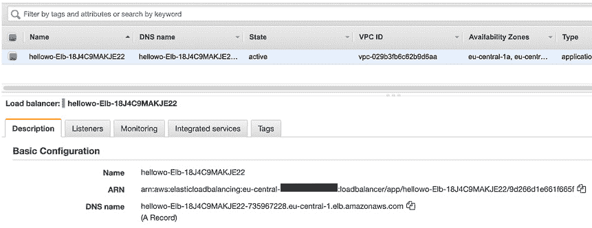

## 第 6 章：使用 cfn-init 管理 EC2 实例的配置

在 AWS 上管理 `EC2` 实例及应用程序配置的方法有很多。其中有 `user-data`，这是一个在 `EC2` 实例启动期间运行的基本 Shell 脚本。你可以使用配置管理系统，如 `Ansible`、`Puppet`、`Chef` 和 `SaltStack` 来管理资源。AWS 提供了一项名为 `OpsWorks` 的服务——托管的 `Chef` 或 `Puppet` 服务器。

我们将学习 `cfn-init`（CloudFormation 自身的配置管理工具）以及如何使用它在 `EC2` 资源上部署应用程序。我们将介绍 `cfn-init` 以及 `AWS::CloudFormation:Init`（CloudFormation 的元数据键），后者实际上声明了 `EC2` 资源的配置项。

在本章中，我们将涵盖以下主题：

* `Introducing cfn-init`（cfn-init 简介）
* `Deploying your application on EC2 during stack creation`（在堆栈创建期间在 EC2 上部署应用程序）
* `Using cfn-signal to inform CloudFormation of resource readiness`（使用 cfn-signal 通知 CloudFormation 资源就绪）

### 技术要求

本章使用的代码可以在本书的 GitHub 存储库中找到：[`github.com/PacktPublishing/Mastering-AWS-CloudFormation/tree/master/Chapter6`](https://github.com/PacktPublishing/Mastering-AWS-CloudFormation/tree/master/Chapter6)

请观看以下视频以查看代码实战演示：

[`bit.ly/2xpOhpk`](https://bit.ly/2xpOhpk)

### Introducing cfn-init（cfn-init 简介）

CloudFormation 是一种声明式工具。这意味着模板中的所有内容都是对 CloudFormation 状态中应有内容的声明。既然你使用资源属性来声明基础设施，也必须将配置存储在其中，无论是 `Lambda` 函数中的源代码，还是 `EC2` 启动模板、启动配置或实例中的 `user-data`。

使用 `user-data` 过程非常简单，但很难在其中声明配置。最终你将编写大量 Shell 代码，这不像配置管理应有的那样可靠。

幸运的是，CloudFormation 有一组所谓的 `helper scripts`（辅助脚本）——这些工具可以从 CloudFormation 的元数据或堆栈获取数据，对其进行处理并对资源执行操作。其中之一称为 `cfn-init`。

> **Important note**（重要提示）
>
> `cfn-init` 工具（以及任何其他辅助脚本）仅作为发行版的一部分包含在 Amazon Linux AMI 中。对于其他 Linux 或 Windows 发行版，你必须先安装它。有关更多信息，请阅读 AWS 关于辅助脚本的文档：[`docs.aws.amazon.com/AWSCloudFormation/latest/UserGuide/cfn-helper-scripts-reference.html`](https://docs.aws.amazon.com/AWSCloudFormation/latest/UserGuide/cfn-helper-scripts-reference.html)。

`EC2` 实例支持引导以进行初始配置和软件安装。这种引导称为 `user-data`，一个简单的 Bash 脚本，在实例启动后立即在 root 用户下运行。

`cfn-init` 实际上是如何应用于 user-data 的？它只是被添加到资源声明中的 user-data 块里。例如，我们可以通过添加命令和参数（如下面的代码所示）来指示 `EC2` 资源运行 `cfn-init`：

```
UserData: !Base64
  'Fn::Join':
    - ''
    - - |
        #!/bin/bash -xe
      - |
        # Install the files and packages from the metadata
      - '/opt/aws/bin/cfn-init -v '
      - '            --stack '
      - !Ref 'AWS::StackName'
      - '            --resource MyInstance '
      - '            --configsets DeploySoftware '
      - '            --region '
      - !Ref 'AWS::Region'
      - |+
```

在前面的代码片段中，我们可以看到 root 用户将运行 `cfn-init` 命令，并向其提供必要的参数，如堆栈名称、要引用的资源、`ConfigSets` 和 `AWS` 区域。

但这些数据是从哪里获取的？查看参数，我们可能会注意到 `cfn-init` 正试图与堆栈对话。

你可能还记得在第 2 章 *Advanced Template Development*（高级模板开发）中，我们研究了堆栈或资源 `metadata`（元数据）。`Metadata` 包含关于资源或整个堆栈的具体细节。元数据有特定的键，我们将要使用的一个键称为 `AWS::CloudFormation::Init`。

此 `AWS::CloudFormation::Init`（为简单起见，我将其称为 `init`）元数据只能包含在 `EC2` 资源中，如实例、启动配置或启动模板。

`Init` 是一个简化的配置管理系统，可对 `EC2` 资源执行以下操作：

* 运行命令
* 将文件写入磁盘（例如，配置文件）
* 创建组
* 创建用户
* 安装软件包
* 启动、启用和停止服务
* 从各种来源下载数据（`GitHub` 或 `S3`）

假设我们要在 `EC2` 实例上安装并运行 Apache Web 服务器。为此，我们的 init 元数据应如下所示：

```
Web server:
  Type: AWS::EC2::Instance
  Metadata:
    AWS::CloudFormation::Init:
      configSets:
      - "Deploy"
      Deploy:
        InstallAndRun:
          packages:
            yum:
              httpd: []
          services:
          # this is a key for init metadata.
          # cfn-init will use init.d or systemd if necessary
            sysvinit:
              httpd:
                enabled: "true"
                ensureRunning: "true"
```

在这里，我们在资源的元数据中声明 `init`，并使用两个 init 键：`packages` 和 `services`。这些键（例如，要执行的操作）在 `ConfigSet` `InstallAndRun` 下声明。现在我们要做的就是将 `cfn-init` 添加到 `UserData` 块中：

```
Webserver:
  Type: AWS::EC2::Instance
  # Metadata block…
  Properties:
  # some properties…
    UserData: !Base64:
      Fn::Join:
        - ""
        - - |
            #!/bin/bash -xe
          - |
```


- `/opt/aws/bin/cfn-init -v`
- `--stack`
- `!Ref "AWS::StackName"`
- `--resource Webserver`
- `--configsets Deploy --region`
- `!Ref "AWS::Region"`
- `|+`

此代码块将使我们的实例与 CloudFormation 的 API 通信，以获取其元数据并运行所有必要的配置。

### 重要提示

您可能已经注意到，我们指定了区域（因为底层操作系统默认不知道它属于哪个区域），但我们没有提供任何 API 密钥/密钥或 IAM 角色 ARN。`cfn-init` 工具不需要 IAM 角色即可与 CloudFormation 的资源元数据通信，因为它通过检查此*物理*资源是否实际上是该 CloudFormation 堆栈的成员，再次对 CloudFormation 进行身份验证。

我们已经介绍了 `cfn-init` 的基础知识，但 CloudFormation 的辅助脚本功能远不止于此。让我们通过一些示例来了解它们。

### 在堆栈创建期间将应用程序部署到 EC2

在本节中，我们将通过使用 `cfn-init` 在 EC2 实例上引导应用程序，获得实践经验。

我们将从一个简单的 Hello, World 示例开始。

### 创建 Hello, World 应用程序

我们将首先实现一个基本的 Hello, World 应用程序，该应用程序将部署在 `AutoScaling` 组中。这将是一个基于 Flask（一种轻量级 Python Web 框架）的应用程序：

1. 让我们开发我们的应用：

   `hello-world-flask.py`

   ```python
   #!/usr/bin/env python3

   from flask import Flask

   app = Flask(__name__)

   @app.route("/")
   def hello():
       return "Hello, World, from AWS!"

   if __name__ == "__main__":
       app.run(host="0.0.0.0", port=80)
   ```

   这没什么复杂的。我们将把这个应用程序存储在 S3 上，并使用 `cfn-init` 来安装 Python 和 Flask，从 S3 拉取代码，创建 SystemD 单元，并启动一个为我们的应用程序提供服务的服务。

2. 让我们开发我们的模板。我们需要一个准备模板（一个 S3 存储桶和网络）来存储 Python 脚本并配置网络：

   `hello-world-prep.yaml`

   ```yaml
   AWSTemplateFormatVersion: "2010-09-09"
   Description: HelloWorld prep template
   Parameters:
     VpcCidr:
       Type: String
       AllowedPattern: '(\d{1,3})\.(\d{1,3})\.(\d{1,3})\.(\d{1,3})/(\d{1,2})'
   Resources:
     SourceBucket: # …
     Vpc: # …
     Igw: # …
     IgwAttachment: # …
     Subnet1: # …
     Subnet2: # …
     PublicRouteTable: # …
     PublicRoute: # …
     PublicRtAssoc1: # …
     PublicRtAssoc2: # …
   Outputs:
     VpcId: #...
     Subnet1Id: #...
     Subnet2Id: #...
   ```

   在这里，我们声明了所需的资源及其属性和必要的导出，这些将在下一个模板中使用。让我们将此模板部署到堆栈：

   ```bash
   aws cloudformation deploy \
       --stack-name hello-world-prep \
       --template-file hello-world-prep.yaml
   ```

   现在我们需要开发应用程序资源模板。我们已经做过几次了，所以在以下步骤中我将只展示重要的部分。

   为了运行我们的应用程序，我们将需要一个弹性负载均衡器、启动配置、AutoScaling 组、一个 IAM 角色和一些安全组：

   1. 我们将从 IAM 角色开始：

      `hello-world-app.yaml`

      ```yaml
      AppRole:
        Type: AWS::IAM::Role
        Properties:
          AssumeRolePolicyDocument:
            Version: "2012-10-17"
            Statement:
              - Effect: Allow
                Action: "sts:AssumeRole"
                Principal:
                  Service: "ec2.amazonaws.com"
          Policies:
            - PolicyName: S3
              PolicyDocument:
                Version: "2012-10-17"
                Statement:
                  - Effect: Allow
                    Action: "s3:*"
                    Resource: "*"
      ```

      我们已经知道 `cfn-init` 可以访问 CloudFormation 以检索元数据，但我们需要实例能够从 S3 拉取我们应用程序的源代码，这就是我们添加此角色的原因。

   2. 我们为启动配置存储两个元数据键。第一个是 `AWS::CloudFormation::Authentication`：

      `hello-world-app.yaml`

      ```yaml
      AWS::CloudFormation::Authentication:
        role:
          type: "S3"
          buckets:
            - !ImportValue S3Bucket
          roleName: !Ref AppRole
      ```

      此代码块声明 `cfn-init` 将使用 IAM 角色针对 S3 进行身份验证。第二个元数据键是 `AWS::CloudFormation::Init`。它包含几个元素：

      `hello-world-app.yaml`

      ```yaml
      AWS::CloudFormation::Init:
        configSets:
          InstallAndRun:
            - "Configure"
        Configure:
          # …
      ```

      在这里，我们声明 ConfigSets，即将由 `cfn-init` 应用的配置块（在本例中只有一个）。`InstallAndRun` 配置集只有一个配置项，称为 `Configure`。

      它包含需要采取的操作，我们将在以下步骤中查看。

   3. 第一个操作将是安装软件包：

      `hello-world-app.yaml`

      ```yaml
      packages:
        yum:
          python3: []
          python3-pip: []
      ```

      在这里，我们声明要安装的软件包。由于我们的应用程序基于 Python 3 并需要安装外部依赖项（Flask），我们安装 `python3` 和 `python3-pip`，因为它们不包含在基础发行版中。

   4. 接下来，我们添加实际的应用程序文件：

      `hello-world-app.yaml`

      ```yaml
      files:
        /opt/helloworld.py:
          owner: root
          group: root
          mode: 755
          source: !Join ["", ["https://", !ImportValue S3Bucket, ".s3.", !Ref "AWS::Region", ".", !Ref "AWS::URLSuffix", "/hello-world-flask.py"]]
          authentification: "role"
        /etc/systemd/system/helloworld.service:
          owner: root
          group: root
          mode: 755
          content: |
            [Unit]
            Description=HelloWorld service
            After=network.target
            [Service]
            Type=simple
            User=root
            ExecStart=/opt/helloworld.py
            Restart=on-abort
            [Install]
            WantedBy=multi-user.target
      ```

      我们将创建两个文件。第一个（`/opt/helloworld.py`）是我们应用程序的源代码，从 S3 检索。在这里，我们提供了名为 `"role"` 的身份验证元素。这将指示 `cfn-init` 代入我们的 IAM 角色，以便从 S3 获取对象。

      第二个是 SystemD 单元，它被添加到 `systemd` 目录中以注册服务。

   5. 最后，我们添加命令部分，包含命令和服务，以便安装 Flask、重新加载 SystemD 并将我们的应用程序作为服务启动：

      ```yaml
      commands:
        installflask:
          # This commands runs installation
          command: "pip3 install flask"
          # This commands runs BEFORE command above
          # and checks if pip3 is present on system
          # if return code is not 0 cfn-init stops
          test: "which pip3"
        reloadsystemd:
          command: "systemctl daemon-reload"

      services:
        sysvinit:
          helloworld:
            enabled: "true"
            ensureRunning: "true"
      ```

   6. 现在我们准备好部署应用程序堆栈了，但在这样做之前，我们需要将源代码上传到 S3：

      ```bash
      $ aws s3 ls
      2020-01-13 16:26:31 hello-world-prep-sourcebucket-16l5b2vvpr5js

      $ aws s3 cp hello-world-flask.py s3://hello-world-prep-sourcebucket-16l5b2vvpr5js
      upload: ./hello-world-flask.py to s3://hello-world-prep-sourcebucket-16l5b2vvpr5js/hello-world-flask.py

      $ aws cloudformation deploy \
          --stack-name helloworld \
          --template-file hello-world-app.yaml \
          --capabilities CAPABILITY_IAM
      ```

      堆栈部署完成后，我们可以向 `Elastic load balancer` (`ELB`) 发送 HTTP 请求：




*图 6.1 – AWS EC2 ELB 控制台*

我们可以通过针对我们的 ELB DNS 名称运行 `curl` 来检查代码：

```
$ curl hellowo-Elb-18J4C9MAKJE22-735967228.eu-central-1.elb.amazonaws.com
Hello, World, from AWS!
```

一切就绪！现在让我们尝试构建比一个小型 Web 应用更大的东西。比如一个 LNMP（Linux、NGINX、MySQL、PHP）栈？

### 创建 LNMP 栈

由于大多数 LNMP 栈都是单节点安装，我们将安装单个 EC2 实例，并在元数据中声明其所有配置。我们将使用 AWS 提供的演示 PHP 应用来检查我们的 LNMP 栈是否正常运行。

通过以下步骤，我们将运行一个带有示例应用的 LNMP 栈：

1.  我们将从声明一个 EC2 实例开始。它看起来像这样：

    **lnmp.yaml**

    ```yaml
    Resources:
      Lnmp:
        Type: AWS::EC2::Instance
        Properties:
          ImageId: !Ref ImageId
          InstanceType: t2.micro
          KeyName: !Ref KeyName
          UserData:
            Fn::Base64:
              Fn::Join:
                - ""
                - - |
                    #!/bin/bash -xe
                  - |
                  - "/opt/aws/bin/cfn-init -v "
                  - " --stack "
                  - !Ref "AWS::StackName"
                  - " --resource Lnmp"
                  - " --configsets Configure --region "
                  - !Ref "AWS::Region"
                  - |+
    ```

    因为这次我们需要执行更多的操作和配置，所以我们将使用多个配置项。配置配置集将包括设置 MySQL、PHP 和 NGINX。因此我们的元数据框架应该如下所示：

    ```yaml
    Metadata:
      AWS::CloudFormation::Init:
        configSets:
          Configure:
            - "Mysql"
            - "DbSetup"
            - "Php"
            - "Nginx"
    ```

2.  让我们从 MySQL 安装和数据库设置开始。我们将安装必要的软件包、运行服务，并创建用户和数据库。设置过程与我们之前做的类似，所以我想指出几个新东西：

    **lnmp.yaml**

    ```yaml
    files:
      #...
      /etc/cfn/cfn-hup.conf:
        content: !Sub |
          [main]
          stack=${AWS::StackId}
          region=${AWS::Region}
        mode: 400
        owner: root
        group: root
      /etc/cfn/hooks.d/cfn-auto-reloader.conf:
        content: !Sub |
          [cfn-auto-reloader-hook]
          triggers=post.update
          path=Resources.Lnmp.Metadata.AWS::CloudFormation::Init
          action=#...
          runas=root
    ```

    让我向你介绍 `cfn-hup`，它是 `cfn-init` 的小助手！`cfn-init` 工具是声明式的，因此每次我们更新元数据时，都需要重新创建资源，这可以通过 Auto Scaling 组和更新策略来实现，但对于有状态系统来说，这样做很麻烦。

    `cfn-hup` 工具拥有自己的配置文件，该文件规定了我们存储信息的栈以及我们应该查看的区域，并且它具有特定的钩子。钩子用于查看资源元数据中的变化（正如我们在前面的模板中指出的那样）并运行特定的操作。操作是一个 bash 命令，因此我们可以实现自动化。在我们的例子中，我们将重新运行 `cfn-init`。`cfn-hup` 进程必须作为服务运行，所以我们绝不能忘记在 `services` 部分包含它！

    另一个需要注意的重要事项是以下代码片段，我们在命令步骤前添加了数字：

    **lnmp.yaml**

    ```yaml
    commands:
      01_set_mysql_root_pw:
        command: #...
      02_create_database:
        command: #…
        test: #...
    ```

    那么为什么要给命令添加编号呢？诀窍在于，`commands` 部分中的命令运行顺序*不是*按声明顺序，而是按*字母*顺序！这就是为什么如果一个命令需要在另一个命令之后运行，我们需要在每个命令步骤的开头添加数字。

    我们还要确保 MySQL 和 `cfn-hup` 都在运行：

    **lnmp.yaml**

    ```yaml
    services:
      sysvinit:
        mariadb:
          enabled: True
          ensureRunning: True
      cfn-hup:
        enabled: True
        ensureRunning: True
        files:
          - "/etc/cfn/cfn-hup.conf"
          - "/etc/cfn/hooks.d/cfn-auto-reloader.conf"
    ```

    我们还将确保 `cfn-hup` *监视* 其自己的文件，并在其中发生变化时重启。

3.  PHP 和 Nginx 的设置将类似，但我们将分别运行它们。我们想要分离这些配置的原因是 Nginx 是我们实际的前端。在启动前端之前，我们希望后端和中间件已投入运行：

    **lnmp.yaml**

    ```yaml
    Php:
      packages:
        yum:
          php: []
          php-mysql: []
          php-fpm: []
      files:
        /var/www/html/index.php:
          content: !Sub |
            # a lot of PHP and HTML here…
          mode: 644
          owner: root
          group: root
      services:
        sysvinit:
          php-fpm:
            enabled: True
            ensureRunning: True
    ```

4.  接下来也是最后一部分是我们的 Web 服务器。我们将向 Nginx 添加配置文件，并确保 Nginx 服务正在运行：

    **lnmp.yaml**

    ```yaml
    Nginx:
      packages:
        yum:
          nginx: []
      files:
        /etc/nginx/nginx.conf:
          content: !Sub |
            # …
        /etc/nginx/conf.d/default.conf:
          content: !Sub |
            # …
      services:
        sysvinit:
          nginx:
            enabled: True
            ensureRunning: True
    ```

5.  完成后，我们可以部署我们的栈：

    ```
    aws cloudformation deploy \
      --stack-name lnmp \
      --template-file lnmp.yaml \
      --parameter-overrides \
      DBName=foo \
      DBUsername=bar \
      DBPassword=foobar123 \
      DBRootPassword=barfoo321
    ```

6.  然后我们向 Web 服务器发送 HTTP 请求：

    ```
    $ aws cloudformation describe-stacks --stack-name lnmp --profile personal | jq .[][].Outputs[].OutputValue
    "http://ec2-18-194-210-115.eu-central-1.compute.amazonaws.com"
    $ curl http://ec2-18-194-210-115.eu-central-1.compute.amazonaws.com
    # super lengthy response…
    ```

就这样！我们已经完全配置了我们的 LNMP 栈，它会监听 CloudFormation 栈元数据中的变化，如果有任何变化将重新运行 `cfn-init`。在结束本章之前，还有一件事我们需要学习。

### 使用 cfn-signal 通知 CloudFormation 资源就绪

CloudFormation 一旦从 AWS API 收到资源已创建的响应，就会报告资源就绪。由此我们可以理解，如果我们创建一个 RDS 实例，CloudFormation 告诉我们它已创建，那么我们就可以立即连接到它。

虽然这适用于 AWS 的大多数托管服务，但对于基于 EC2 运行的服务却不起作用。你看，CloudFormation *不知道* EC2 有一个任务要运行，一旦实例处于 *Running* 状态，它就会报告 *Done*。

对于小型开发环境这可能没问题，但想象一下在 Auto Scaling 组上运行 Web 应用程序。当实例花费时间安装软件包和启动服务时，Auto Scaling 报告实例不健康并将其终止。一个新的启动，时间流逝，然后又被终止。最糟糕的是，CloudFormation 会告诉你你的 Auto Scaling 组已就绪，而你的应用程序仍然处于宕机状态。


### 使用 cfn-init 进行引导

### 使用 cfn-signal 报告 EC2 资源就绪状态

为了报告 EC2 资源就绪状态，有一个名为 `cfn-signal` 的辅助脚本。正如其名称所示，该脚本向 CloudFormation 发送信号消息，报告资源是已创建还是创建失败。

让我们在 LNMP 栈中尝试一下。我们需要添加两个额外的代码块：

1.  我们首先向 EC2 实例添加 `CreationPolicy`：

    ```yaml
    # lnmp-signal.yaml
    Lnmp:
      Type: AWS::EC2::Instance
      CreationPolicy:
        ResourceSignal:
          Count: 1
          Timeout: PT5M
      Properties: #...
      Metadata: #...
    ```

    对于单个实例，`CreationPolicy` 没有太多属性——只有 `Count` 和 `Timeout`。

    `Timeout` 使用 ISO8601 ([`www.iso.org/iso-8601-date-and-time-format.html`](https://www.iso.org/iso-8601-date-and-time-format.html)) 持续时间格式声明，在前面的示例中，这是五分钟。如果 CloudFormation 没有从实例收到任何信号，它将因超时报告失败并回滚。

    但这只是 CloudFormation 中的声明。我们还需要指示实例报告就绪状态。

2.  `cfn-signal` 已预装在机器上，因此我们需要从 `UserData` 中调用它：

    ```yaml
    # lnmp-signal.yaml
    Lnmp:
      Type: AWS::EC2::Instance
      CreationPolicy: #...
      Properties:
        ImageId: !Ref ImageId
        InstanceType: t2.micro
        KeyName: !Ref KeyName
        UserData:
          Fn::Base64:
            Fn::Sub: |
              #!/bin/bash -xe
              /opt/aws/bin/cfn-init -v \
              --stack ${AWS::StackName} \
              --resource Lnmp \
              --configsets Configure \
              --region ${AWS::Region}
              # 发送创建信号
              /opt/aws/bin/cfn-signal -e $? \
              --stack ${AWS::StackName} \
              --resource Lnmp \
              --region ${AWS::Region}
    ```

    在这里，我们向 CloudFormation 提供一个退出代码（`-e` 参数），其值等于 `cfn-init` 的退出代码。如果 `cfn-init` 失败（退出代码不为 0），则 `cfn-signal` 将向 CloudFormation 发送不同的值，CloudFormation 将知道：出错了，我应该回滚。

`cfn-signal` 和 `CreationPolicy` 广泛用于 Auto Scaling 组，因为我们还可以指定 `MinSuccessfulInstancesPercent`，从而执行滚动更新。

请看以下示例：

```yaml
MyAsg:
  Type: AWS::AutoScaling::AutoScalingGroup
  CreationPolicy:
    AutoScalingCreationPolicy:
      MinSuccessfulInstancePercent: 50
```

此声明将指示 Auto Scaling 组仅在至少一半的组成员发送成功信号时确认其就绪状态；否则，Auto Scaling 组将报告创建失败。

### 总结

在本章中，我们学习了如何以更人性化的方式执行初始引导配置。我们了解了 `cfn-init`，这是 CloudFormation 原生的配置管理工具。我们用它部署了一个 Hello World 应用程序，甚至启动了我们自己的 LNMP 栈，并指示它向我们报告其创建状态。

使用 `cfn-init` 允许模板开发者将 CloudFormation 作为一个中心化工具，既用于预置资源和底层配置，也用于部署它们。`cfn-init` 还可以作为栈操作的一部分，用于安装和更新软件。

这是*第 2 部分、大规模预置与部署*的最后一章，我们在这里做了大量工作。我们现在能够使用 CloudFormation 构建生产就绪的基础设施，可以测试和验证我们的栈，可以应用持续交付，并可以使用 StackSets 在多个区域和账户中部署我们的栈。

我们主要利用核心 CloudFormation 功能完成了大量工作，但 CloudFormation 还能通过自定义资源和模板宏等强大工具进行扩展。在接下来的几章中，我们将学习如何使用这些工具。

此外，我们还将深入探讨 CloudFormation 的潜在继任者：无服务器应用程序模型 (SAM) 和 AWS CDK——云开发工具包。

在下一章中，我们将研究自定义资源，这是 CloudFormation 的一项扩展，允许我们声明和创建 AWS *之外* 的资源。我们将了解自定义资源以及如何以及何时使用它们。

敬请期待！

### 问题

1.  如果配置集包含多个配置项，它们按什么顺序执行？
2.  是否可以有多个配置集？
3.  `cfn-init` 是否需要 IAM 策略来访问资源元数据？
4.  是否可以使用 `cfn-init` 创建目录？
5.  什么是 `WaitCondition`？

### 延伸阅读

*   EC2 上的 LAMP 栈：[`docs.aws.amazon.com/AWSCloudFormation/latest/UserGuide/deploying.applications.html#deployment-walkthrough-basic-server`](https://docs.aws.amazon.com/AWSCloudFormation/latest/UserGuide/deploying.applications.html#deployment-walkthrough-basic-server)
*   在 CloudFormation 栈上部署应用程序的最佳实践：[`aws.amazon.com/blogs/devops/best-practices-for-deploying-applications-on-aws-cloudformation-stacks/`](https://aws.amazon.com/blogs/devops/best-practices-for-deploying-applications-on-aws-cloudformation-stacks/)
