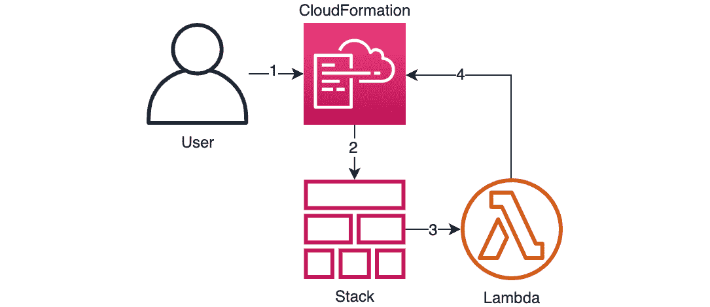
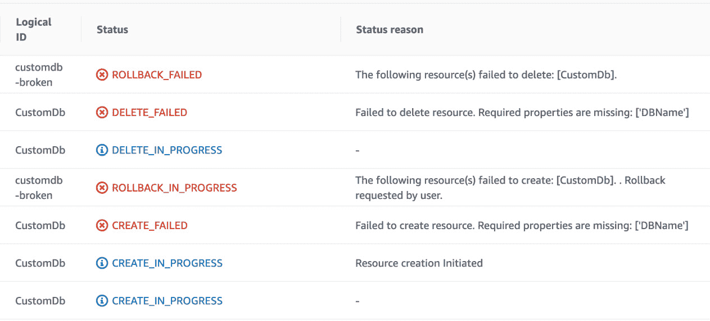
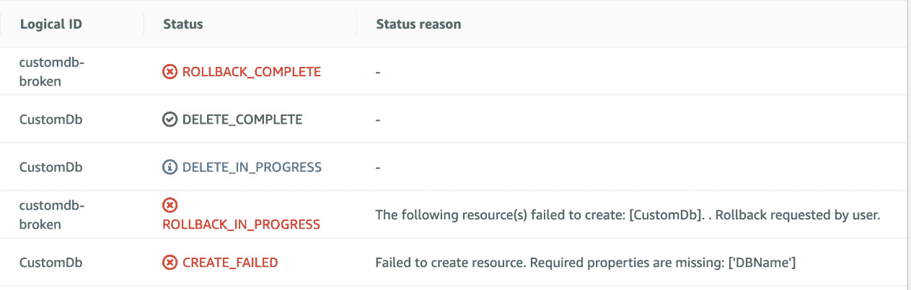

## 第 7 章：使用自定义资源在 AWS 之外创建资源

CloudFormation 通常是第一个开始支持新 AWS 服务的基础设施即代码工具；然而，有时我们需要与不支持 CloudFormation 的服务通信。有时我们甚至需要在 AWS 之外创建资源。

CloudFormation 最近开始支持外部资源提供商。类似于 Terraform 的提供商，您可以开发自己的提供商来管理不同云和管理服务提供商的基础设施。

由于这是一个全新功能（于 2019 年 11 月发布），它需要一段时间才能成熟。

在本章中，我们将使用自定义资源创建外部资源——这是在 AWS 之外创建您自己的资源的简便方法。

我们将了解它们是什么及其用例，并使用 AWS Lambda 编写我们的第一个自定义资源。

在本章中，我们将涵盖以下主题：

*   理解自定义资源
*   底层 Lambda 函数的内部原理
*   编写和管理您自己的自定义资源
*   处理自定义资源的更新、删除和失败

### 技术要求

本章使用的代码可以在本书的 GitHub 存储库中找到：[`github.com/PacktPublishing/Mastering-AWS-CloudFormation/tree/master/Chapter7`](https://github.com/PacktPublishing/Mastering-AWS-CloudFormation/tree/master/Chapter7)

查看以下视频以了解代码实战：

[`bit.ly/3bTWq4q`](https://bit.ly/3bTWq4q)

### 理解自定义资源


### CloudFormation 自定义资源

当我们在 CloudFormation 模板中声明资源时，需要提供 `Type` 属性。该属性声明了将要创建的服务和资源——这意味着 CloudFormation *理解* 去哪里、做什么以及调用哪些 API。`AWS` 是主要命名空间（例如提供商），`AWS` 之后的部分是另一个命名空间，用于声明服务。如果是 `EC2`，则 CloudFormation 将向 EC2 的 API 发送调用。如果是 `RDS`，则向 RDS 的 API 发送调用。最后一部分是我们要创建的实际资源。

**自定义资源** (**CR**) 是不属于 CloudFormation 官方支持范围的资源。这些可以是外部提供商、内部或自托管系统，甚至是尚不支持 CloudFormation 的服务。CR 的创建通常是一个三方契约——模板开发者、CR 提供商和 CloudFormation。模板开发者负责资源声明，CR 提供商需要开发处理程序，而 CloudFormation 充当代理，明确声明双方在资源创建、更新或删除时的通信方式。

CR 可以用长格式 (`AWS::CloudFormation::CustomResource`) 或短格式 (`Custom::MyResourceName`) 声明。尽管如此，在堆栈操作期间，CloudFormation 会将特定负载发送到我们在资源属性中定义的端点。

CR 的声明包含类型和属性，它们将组成负载。例如，假设我们如下代码所示声明一个 CR：

```yaml
Cr:
  Type: Custom::MyResource
  Properties:
    ServiceToken: "..."
    Key1: Value1
    Key2:
      - list_element1
      - list_element2
```

CloudFormation 将生成以下负载：

```json
{
  "RequestType": "Create/Update/Delete",
  "ResponseURL": "http://...",
  "StackId": "...",
  "RequestId": "uniqueId for this request",
  "ResourceType": "Custom::MyResource",
  "LogicalResourceId": "Cr",
  "ResourceProperties": {
    "Key1": "Value1",
    "Key2": [
      "list_element1",
      "list_element2"
    ]
  }
}
```

然后将此负载发送到端点。它包含来自资源声明的字段、堆栈 ID、请求类型（`Create` 资源、`Update` 资源或 `Delete` 资源），以及 Lambda 函数必须向其发送响应对象的 URL。

可以接收此类负载的端点有两种：AWS Lambda 和 SNS。

SNS 主要用于编程由运行在 EC2、ECS 甚至本地的后端处理的预置逻辑。这不是预置或处理 CR 逻辑的最高效方式，因为后端必须订阅 SNS 主题并全天候运行，但 SNS 支持的 CR 增加了预置程序的多样性。

在大多数情况下，AWS 工程师倾向于使用 Lambda，因为其成本效益高、简单且易于管理；但是，我们必须始终记住 Lambda 的限制和能力。

在本章中，我们将重点介绍由 AWS Lambda 支持的 CR 开发。

### 底层 Lambda 函数的内部机制

Lambda 函数是由事件触发的代码。运行后，它接收 `event` 和 `context` 对象，并运行内部代码来处理这些对象。

虽然 `context` 只是 Lambda 函数执行的元数据，可用于自我维护和优雅关闭，但 `event` 对象包含我们要关注的负载。

对于 CR，我们需要解析堆栈信息，运行我们的逻辑，并响应 CloudFormation。响应应包含以下字段：

- `Status`（成功或失败）
- `Physical resource ID`（因为是自定义的，我们需要自己想出资源 ID）
- `Stack ID`（与 CR 请求中的相同）
- `Request ID`（与 CR 请求中的相同）
- `Logical resource ID`（与 CR 请求中的相同）
- `Data`（可能不需要，用于内部函数 `Fn::GetAtt`）
- 处理并运行预置后，CR 函数必须向原始请求中的 `ResponseURL` 发送响应。此响应必须采用 JSON 格式（即使模板是用 YAML 编写的）。

成功执行时，响应如下所示：

```json
{
  "Status": "SUCCESS",
  "RequestId": "...",
  "LogicalResourceId": "...",
  "StackId": "...",
  "PhysicalResourceId": "MyResourceUniqueId1234",
  "Data": {
    "Attr1": "foo",
    "Attr2": "bar"
  }
}
```

失败时，我们不需要提供 `Data`，但需要提供 `Status` 和 `Reason`，因此响应对象会不同：

```json
{
  "Status": "FAILED",
  "Reason": "This failed because of reasons",
  "RequestId": "...",
  "LogicalResourceId": "...",
  "StackId": "...",
  "PhysicalResourceId": "MyResourceUniqueId1234"
}
```

`Reason` 是我们随后在 CloudFormation 控制台的“事件”部分看到的内容，因此明智的做法是提供解释性原因，说明资源创建失败的原因。

让我们快速看一下 Lambda 支持的 CR 流程：



Figure 7.1 – CR flow

上图通过以下步骤解释：

1. 用户运行堆栈操作。此时，CloudFormation 将运行堆栈操作，可以是创建堆栈、更新或删除。
2. 堆栈操作影响自定义资源。CloudFormation 生成包含堆栈和资源元数据的负载。
3. CloudFormation 调用 Lambda 函数，向其提供负载。
4. Lambda 函数运行预置逻辑并将响应返回给 CloudFormation。

另一个我们想了解的是 `cfn-response` 模块。

**cfn-response** 是一个包装器，用于生成响应对象并将其发送回 CloudFormation。该模块已包含必要的属性和方法，使响应 CloudFormation 变得更加容易。

例如，使用 `cfn-response` 的伪代码如下所示：

```python
import cfnresponse

def handler(event, context):
    in = event['ResourceProperties']['foo']
    # do some magic
    out = generate_id(event['ResourceType'])
    cfnresponse.send(event,
                     context,
                     cfnresponse.SUCCESS,
                     "",
                     physicalResourceId=out)
```

在前面的代码中，我们解析事件，运行自定义预置逻辑，并将响应发送给 CloudFormation。

`cfn-response` 已具备必要功能，因此我们只需专注于预置逻辑。

> **重要提示**
>
> 只有当你使用 `ZipFile` 上传 Lambda 代码时，才能导入 `cfn-response`。如果你使用 S3 作为源，则必须自行编写逻辑。`cfn-response` 的源代码可在 AWS 文档中找到，地址为 <https://docs.aws.amazon.com/AWSCloudFormation/latest/UserGuide/cfn-lambda-function-code-cfnresponsemodule.html#w2ab1c20c25c14b9c15>。

光有理论没有实践是没有意义的。让我们动手实践一下！

### 编写和管理你自己的自定义资源

让我们从一个简单的任务开始。假设我们有一个*共享*的 RDS 实例，需要在其中创建数据库。由于 CloudFormation 不原生支持此功能，我们必须开发自己的 CR。

### 使用 CR 在 RDS 中创建数据库

我们将创建一个 CR，连接到 RDS 实例并对其执行 SQL 操作，以通过以下步骤创建数据库、用户、密码和必要的权限：

1. 让我们定义我们的自定义资源：

```yaml
customdb.yaml
CustomDb:
  Type: Custom::DB
  Properties:
```


### 自定义资源属性

- `ServiceToken`：Lambda-backed CR 的 ARN
- `DBName`：数据库名称
- `DBUser`：数据库用户名
- `DBPassword`：数据库用户密码
- `RDSEndpoint`：RDS 实例端点
- `RDSUser`：访问 RDS 数据库的管理员用户
- `RDSPassword`：管理员用户密码

这些字段足以开始。某些属性必须是必需的（RDS 端点、用户、密码、数据库名称等），但我们需要在 Lambda 中开发这部分逻辑。

### 2. 从骨架开始

**customdb.py**

```python
import cfnresponse

def handler(event, context):
    physicalResourceId = ""
    cfnresponse.send(event,
                     context,
                     cfnresponse.SUCCESS,
                     physicalResourceId=physicalResourceId,
                     responseData="")
```

这段代码配置了我们想要设为强制的参数，以便在未提供其中任何一个时让流程失败。

### 3. 创建简单过滤检查，若属性缺失则让 Lambda *fail*

**customdb.py**

```python
def handler(event, context):
    # ...
    input_props = event['ResourceProperties']
    required_props = ["DBName", "RDSEndpoint", "RDSUser", "RDSPassword"]
    missing_props = [prop for prop in required_props if prop not in input_props]
    if missing_props:
        print(f"Required properties are missing:  {missing_props}")
        cfnresponse.send(event,
                         context,
                         cfnresponse.FAILED,
                         physicalResourceId="",
                         responseData="")
        sys.exit(1)
    # ...
```

此阶段完成错误处理。我们在将缺失属性添加到错误消息时检查 `event` 对象的键。`cfn-response` 不支持开箱即用地添加状态原因。相反，它指示程序查看 CloudWatch 日志，因此我们将错误消息发送到 `stdout`。

### 4. 开发预置逻辑

我们的流程将包含以下步骤：

(a) 连接到 RDS 实例  
(b) 创建用户  
(c) 创建数据库  
(d) 授予创建用户对新数据库的权限

但如果用户未提供新数据库的凭证怎么办？我们没有将这些属性设为强制，但 Lambda 无法创建空用户和密码。我们可以强制要求这些属性，但我们将把它们赋值为 `DBName` 的值。我们还需要为其他属性赋值：

**customdb.py**

```python
def handler(event, context):
    # ...
    db_name = input_props['DBName']
    rds_endpoint = input_props['RDSEndpoint']
    rds_user = input_props['RDSUser']
    rds_password = input_props['RDSPassword']
    if not "DBUser" in input_props or len(input_props['DBUser']) == 0:
        db_user = db_name
    else:
        db_user = input_props['DBUser']
    if not "DBPassword" in input_props or len(input_props['DBPassword']) == 0:
        db_password = db_name
    else:
        db_password = input_props['DBPassword']
    # ...
```

这里我们检查属性是否存在且非空，并存储其值。

### 5. 继续开发预置逻辑，创建单独函数以保持 handler 简洁

**customdb.py**

```python
import pymysql

def create_db(dbname, dbuser, dbpassword, rdsendpoint, rdsuser, rdspassword):
    create_db_query = f"CREATE DATABASE {dbname};"
    create_user_query = f"CREATE USER '{dbuser}'@'%' IDENTIFIED BY '{dbpassword}';"
    grant_query = f"GRANT ALL PRIVILEGES ON {dbname}.* TO {dbuser}@'%'; FLUSH PRIVILEGES;"
    try:
        conn = pymysql.connect(host=rdsendpoint,
                               user=rdsuser,
                               password=rdspassword)
        cursor = conn.cursor()
        cursor.execute(create_db_query)
        cursor.execute(create_user_query)
        # ...
    except Exception as err:
        return err
    return None
```

此函数（`create_db()`）连接到数据库，运行查询，若创建因故失败则返回错误消息。

### 6. 在 handler 中调用该函数

**customdb.py**

```python
def handler(event, context):
    # ...
    err = create_db(db_name, db_user, db_password, rds_endpoint, rds_user, rds_password)
    if err:
        print(err)
        send(event, context, FAILED, physicalResourceId="", responseData={})
        sys.exit(1)
    # ...
```

一切看起来不错，对吧？

然而，我们的 Lambda 存在潜在问题。我们引入了 `PyMySQL`，一个纯 Python MySQL 客户端（该客户端不需要安装外部 MySQL 库，因此是 Lambda 的完美模块），它是外部包，必须使用 `pip` 安装。如果安装外部依赖，我们必须打包源代码并上传到 S3。如果上传到 S3，就无法导入 `cfn-response`（还记得前面的提示吗？）。

### 7. 解决方案：从 CloudFormation 文档复制 `cfn-response` 代码

文档地址：<https://docs.aws.amazon.com/AWSCloudFormation/latest/UserGuide/cfn-lambda-function-code-cfnresponsemodule.html#w2ab1c20c25c14b9c15>

因此代码会稍有不同：

**customdb.py**

```python
import requests
import json
import pymysql

SUCCESS = "SUCCESS"
FAILED = "FAILED"

def create_db(#...):
    # ...

def handler(event, context):
    # ...

### And the "send" function from cfn-response module...
def send(#...):
    # ...
```

### 8. 创建 CR 函数（可能需要自行指定 S3 存储桶名称）

```bash
$ aws s3 mb s3://masteringcloudformation
$ pip3 install -t custom-db/ -r custom-db/requirements.txt
$ cd custom-db && zip -r lambda-cr.zip *
$ aws s3 cp lambda-cr.zip s3://masteringcloudformation
$ cd .. && aws cloudformation deploy \
    --stack-name cr \
    --template-file cr.yaml \
    --capabilities CAPABILITY_IAM
```

### 9. 部署包含 RDS 实例（MySQL）的堆栈

将 `$VPCID` 替换为您账户中 VPC 的 ID：

```bash
$ aws cloudformation deploy --stack-name rds \
    --template-file rds.yaml \
    --parameter-overrides \
    VpcId=$VPCID
```

### 10. 部署 CR 堆栈

```bash
aws cloudformation deploy --stack-name customdb \
    --template-file customdb.yaml
```

### 11. 资源创建完成后，通过连接评估创建的数据库

```bash
$ mysql -u mydbuser -pfoobar1234 -h $RDS_INSTANCE mydb
```

就这样！我们的 CR 函数能够创建新资源；但它远非完美，当我们想从 CloudFormation 状态更新或删除此资源时肯定会失败。

在下一节中，我们将重点介绍如何管理更新和删除，以及如何处理堆栈操作错误。

### 处理 CR 的更新、删除和失败

我们的 CR 可以为我们创建数据库。但试着猜猜如果您尝试从 CloudFormation 删除此资源或堆栈会发生什么。


### 删除资源

我们将通过以下步骤介绍删除操作：

1. 我们将在 Lambda 脚本中创建一个额外的函数并将其命名为 `delete_db`：

   `customdb.py`

   ```python
   def delete_db(dbname, dbuser, rdsendpoint, rdsuser, rdspassword):
       return None
   ```

   我们得到了函数的骨架。它的参数与 `create_db` 类似，除了 `dbpassword`；我们不需要知道用户的密码即可从数据库中删除它。

2. 现在让我们添加实际的删除逻辑。首先，我们需要在数据库上运行的查询：

   `customdb.py`

   ```python
   def delete_db(dbname, dbuser, rdsendpoint, rdsuser, rdspassword):
       delete_db_query = f"DROP DATABASE {dbname}"
       delete_user_query = f"DROP USER '{dbuser}'"
       return None
   ```

3. 接下来，我们需要一个包含数据库连接和查询执行的 `try-except` 块：

   `customdb.py`

   ```python
   def delete_db(dbname, dbuser, rdsendpoint, rdsuser, rdspassword):
       delete_db_query = f"DROP DATABASE {dbname}"
       delete_user_query = f"DROP USER '{dbuser}'"
       try:
           conn = pymysql.connect(host=rdsendpoint,
                                  user=rdsuser,
                                  password=rdspassword)
           cursor = conn.cursor()
           cursor.execute(delete_db_query)
           cursor.execute(delete_user_query)
           cursor.close()
           conn.commit()
           conn.close()
       except Exception as err:
           return err
       return None
   ```

   这里我们连接到同一个 RDS，运行查询，然后关闭连接。如果出现任何问题，我们返回错误。如果没有，我们返回 `None`（一个空的 Python 对象）。

4. 现在我们需要解析传入的事件并获取请求类型。我们将在 `handler` 函数中执行此操作：

   `customdb.py`

   ```python
   import ...

   # ...

   def handler(event, context):
       # ...
       if event['RequestType'] == "Delete":
           err = delete_db(db_name, db_user, rds_endpoint, rds_user, rds_password)
       elif event['RequestType'] == "Create":
           err = create_db(db_name, db_user, db_password, rds_endpoint, rds_user, rds_password)
       # ...
   ```

   我们更改的是堆栈操作期间运行的实际函数。如果 CloudFormation 发送 `Delete` 请求，则我们转到 RDS 实例并删除数据库和用户。如果发送 `Create`，则我们创建一个数据库。

5. 我们需要更新源代码。由于我们已经部署了所有堆栈，让我们手动执行：

   ```bash
   $ cd custom-db/
   $ zip -r lambda-cr.zip *
   $ aws s3 cp lambda-cr.zip s3://masteringcloudformation --profile personal
   $ aws cloudformation list-stack-resources --stack-name cr | jq .StackResourceSummaries[0].PhysicalResourceId
   "cr-CrFunction-EX3NB14PJARD"
   $ aws lambda update-function-code --function-name cr-CrFunction-EX3NB14PJARD --s3-bucket masteringcloudformation --s3-key lambda-cr.zip
   # long output from Lambda...
   ```

6. 现在让我们删除堆栈：

   ```bash
   $ aws cloudformation delete-stack --stack-name customdb
   $ aws cloudformation list-stacks \
       --stack-status-filter DELETE_COMPLETE
   {
       "StackSummaries": [
       # ....
           {
               # ...
               "StackName": "customdb",
               # ...
               "StackStatus": "DELETE_COMPLETE",
               # ...
           },
       # ...
       ]
   }
   ```

7. 现在让我们检查数据库是否真的不存在：

   ```bash
   $ mysql -u rdsuser -pbarfoo12344321 -h $RDSENDPOINT
   mysql > show databases;
   +--------------------+
   | Database           |
   +--------------------+
   | information_schema |
   | innodb             |
   | mysql              |
   | performance_schema |
   | sys                |
   +--------------------+
   5 rows in set (0.02 sec)
   ```

这确认了 `Delete` 操作按预期工作。

让我们添加对更新的支持，以便我们可以在 CR 中更改数据库、用户等。

### 更新资源

我们的资源是不可变的。如果它被更改，则旧资源被删除并创建新资源。CloudFormation 发送 `Update` 请求以创建新资源。完成后，在 `UPDATE_COMPLETE_CLEANUP_IN_PROGRESS` 期间，CloudFormation 将发送一个 `Delete` 请求，其中包含在上一次堆栈操作期间创建的资源的属性：

1. 由于我们已经支持创建和删除操作，我们只需更改过滤条件以在 `handler` 函数中同时支持 `Create` 和 `Update`：

   `customdb.py`

   ```python
   import ...

   # ...

   def handler(event, context):
       # ...
       if event['RequestType'] == "Delete":
           err = delete_db(db_name, db_user, rds_endpoint, rds_user, rds_password)
       elif event['RequestType'] in ["Create", "Update"]:
           err = create_db(db_name, db_user, db_password, rds_endpoint, rds_user, rds_password)
       # ...
   ```

2. 我们将重新打包函数，将其上传到 S3，并更新 Lambda 函数的代码（方式与上一节相同）。由于我们删除了自定义数据库堆栈，我们需要重新创建然后更新它：

   ```bash
   $ aws cloudformation deploy --stack-name customdb \
       --template-file customdb.yaml
   $ aws cloudformation deploy --stack-name customdb \
       --template-file customdb.yaml \
       --parameter-overrides \
       DBName=mynewdb \
       DBUser=mynewuser
   ```

3. 部署完成后，我们可以再次检查数据库：

   ```bash
   $ mysql -u rdsuser -pbarfoo12344321 -h $RDSENDPOINT
   mysql> show databases;
   +--------------------+
   | Database           |
   +--------------------+
   | information_schema |
   | innodb             |
   | mysql              |
   | mynewdb            |
   | performance_schema |
   | sys                |
   +--------------------+
   6 rows in set (0.02 sec)
   ```

一切正常！我们的自定义资源现在完全支持创建、更新和删除！现在我们将教我们的 CR 函数更多技巧。

### 自定义数据库函数的额外功能

我们的 CR 表现符合预期，但总有改进的空间。在本节中，我们将使我们的 CR 在发生故障时更加友好和自解释。

### 自定义状态原因

直到现在，如果我们遇到错误，它会作为一条阅读 Lambda 日志的邀请被返回。这是因为 `cfn-response.send` 有以下行：

```python
responseBody['Reason'] = 'See the details in CloudWatch Log Stream: ' + context.log_stream_name
```

当 `Status` 为 `FAILED` 时，此 `Reason` 字符串会被发送到 CloudFormation 且为强制性的。前面的字符串生成被硬编码在 `cfn-response` 中；然而，由于我们复制了代码，我们可以控制它。

我们将通过以下步骤添加对自定义状态原因的支持：

1. 让我们对 `send()` 函数进行一些更改：

   `customdb.py`


### 自定义资源错误处理和模板宏

### Lambda 函数 `send()` 实现

```python
def send(event, context, responseStatus, responseData, responseReason="", physicalResourceId=None, noEcho=False):
    # ...
    responseBody = {}
    responseBody['Status'] = responseStatus
    responseBody['Reason'] = responseReason
    # ...
```

在这里，我们添加了非强制性的 `responseReason` 参数，并将其用作 `responseBody['Reason']` 的值。这将使我们能够向 CloudFormation 发送自定义消息。

### 必需属性检查

现在我们将让我们的临时逻辑发送这些原因。让我们从必需属性检查开始：

**customdb.py**

```python
### ...
def handler(event, context):
    input_props = event['ResourceProperties']
    required_props = ["DBName", "RDSEndpoint", "RDSUser", "RDSPassword"]
    missing_props = [prop for prop in required_props if prop not in input_props]
    if missing_props:
        reason = f"Required properties are missing: {missing_props}"
        send(event, context, FAILED, responseReason=reason, responseData={})
        sys.exit(1)
### ...
```

### 测试错误处理

让我们通过创建一个缺少属性之一的堆栈来检查此错误处理（*别忘了更新函数代码！*）：

```bash
aws cloudformation deploy \
    --stack-name broken-custom \
    --template-file customdb_missing_property.yaml
```

我们将看到一些非常有趣的行为：



**图 7.2 – CloudFormation 控制台**

这是因为我们的检查适用于任何请求类型。当创建失败时，CloudFormation 仍然认为资源已创建并希望清理它。数据库不存在，因此 CloudFormation 将陷入循环，直到最终放弃并显示 `DELETE_FAILED`。

为了使我们的自定义资源更加健壮，我们需要对 Lambda 函数进行一些更改。

### 在删除不存在的资源时发送成功响应

CloudFormation 坚持认为资源存在。我们知道它不存在。如果我们尝试删除不存在的数据库或用户，我们的脚本肯定会失败，CloudFormation 中的堆栈操作也会失败。

为了使我们的 CR 更加冗余（健壮），我们将使我们的 CR 函数能够正确处理这种情况：

1. 让我们在函数中添加几行代码，用于检查是否缺少某些属性：

**customdb.py**

```python
def handler(event, context):
    # ...
    if missing_props:
        if event['RequestType'] == "Delete":
            send(event, context, SUCCESS, responseData={})
            sys.exit(0)
        reason = f"Required properties are missing: {missing_props}"
        send(event, context, FAILED, responseReason=reason, responseData={})
        sys.exit(1)
    # ...
```

在这里，我们检查 CloudFormation 是否正在执行删除操作。如果是且未提供属性，则意味着这是一次空运行的清理。我们只需向 CloudFormation 报告一切成功即可。

2. 我们将上传新代码并重新运行堆栈创建：

```bash
$ aws cloudformation delete-stack --stack-name broken-custom
$ aws cloudformation deploy \
    --stack-name broken-custom \
    --template-file customdb_missing_property.yaml
```

这次结果将会不同：



**图 7.3 – CloudFormation 控制台**

但还有一件事我们要添加。如果要删除的数据库不再存在（例如，被手动删除了）怎么办？

3. 让我们通过设置以下代码来处理这种情况：

**customdb.py**

```python
def delete_db(dbname, dbuser, rdsendpoint, rdsuser, rdspassword):
    # ...
    db_exists_query = f"SHOW DATABASES LIKE '{dbname}'"
    user_exists_query = f"SELECT user FROM mysql.user where user='{dbuser}'"
    try:
        # ...
        db_exists = cursor.execute(db_exists_query)
        if db_exists:
            cursor.execute(delete_db_query)
        user_exists = cursor.execute(user_exists_query)
        if user_exists:
            cursor.execute(delete_user_query)
    # ...
    except Exception as err:
        return err
    return None
```

我们所做的是检查数据库和用户是否都存在于数据库中。如果不存在，我们跳过删除查询以避免出现 **database doesn't exist** 或 **Operation DROP USER failed for** 错误。

也就是说，我们为 CR 函数添加了自定义状态原因，并使其更具抗错误能力。

### 概要

在本章中，我们了解了自定义资源，这是扩展 CloudFormation 的最通用方式。我们创建了由 AWS Lambda 支持的自定义资源，使其稳定安全，并能够处理更新、删除和错误。

自定义资源广泛用于创建 CloudFormation 尚不支持的 AWS 资源，或创建 AWS 之外的资源，无论是其他云平台还是运行在 EC2 上的您自己的平台和系统。

我们涵盖了自定义资源和预配逻辑，并了解了底层实际发生的情况。为了获得 CR 的真实实战体验，我们开发了自己的 CR，使其具有抗错误能力，并添加了对自定义原因消息的支持。

在下一章中，我们将学习 CloudFormation 的另一种扩展，称为模板宏。敬请期待！

### 问题

1. CR 的可能请求类型有哪些？
2. 如果我们将 Lambda 函数与外部依赖打包在一起，是否可以使用 `cfnresponse`？
3. 哪些 AWS 服务用于 CR 处理？
4. 必须使用哪个 CR 响应对象来指定资源更改失败的原因？
5. Lambda 中的 `event` 和 `context` 是什么？

### 延伸阅读

* Alex DeBrie 关于自定义资源的博客：<https://www.alexdebrie.com/posts/cloudformation-custom-resources/>
* 包含示例自定义资源的 GitHub 仓库：<https://github.com/aws-samples/aws-cfn-custom-resource-examples>

---

## 第 8 章：使用模板宏动态渲染模板