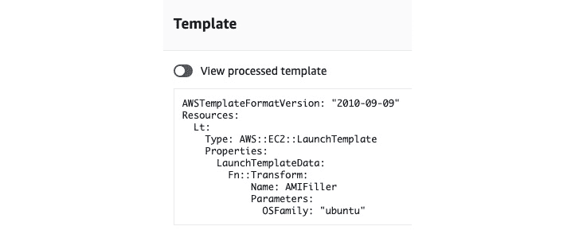
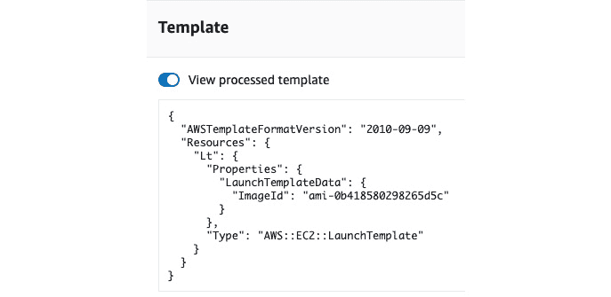
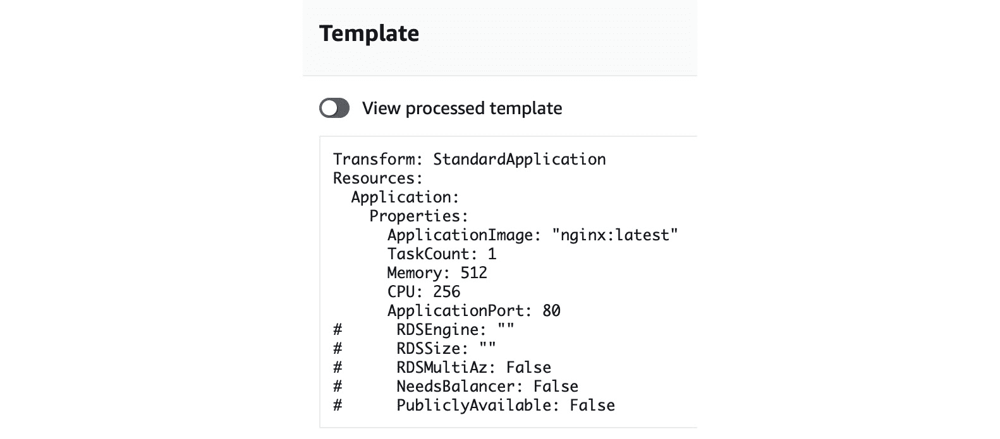
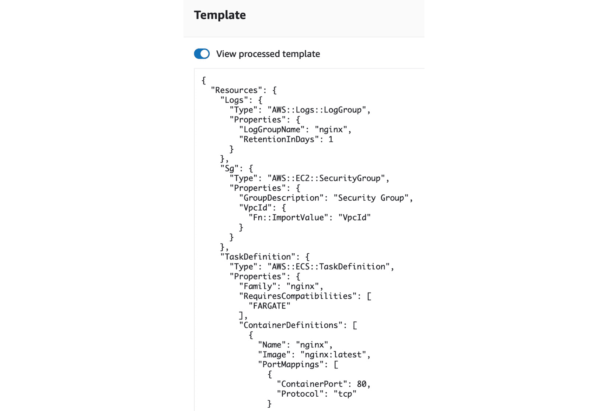

有时当我们使用模板时，希望在堆栈操作期间动态地为资源分配值或快速修改模板。

最知名的模板宏之一是 **SAM** 或 **无服务器应用程序模型**，它是用于无服务器应用程序的简化 CloudFormation 模板（我们将在接下来的几章中介绍 SAM）。另一个知名的宏是 **AWS::Include**，它允许我们用样板代码片段扩展 CloudFormation 模板。

在本章中，我们将了解模板宏及其用例，并开发我们自己的宏。

在本章中，我们将涵盖以下主题：

* 理解模板宏的用例
* 介绍模板宏
* 编写您自己的宏

### 技术要求

本章使用的代码可以在本书的 GitHub 仓库中找到：<https://github.com/PacktPublishing/Mastering-AWS-CloudFormation/tree/master/Chapter8>。

查看以下视频以了解代码实战：

<https://bit.ly/2zBBLnd>

### 理解模板宏的用例

在深入了解宏的内部机制之前，我们需要知道可以用它们解决什么问题。让我们看几个案例和示例。

### 自动填充资源属性值

想象一下，您有一个启动模板，需要在其中定义 AMI ID。对于 Amazon Linux AMI，您可以使用 AWS 的参数存储：

```yaml
Parameters:
  ImageId:
    Type: AWS::SSM::Parameter::Value<AWS::EC2::Image::Id>
    Default: '/aws/service/ami-amazon-linux-latest/amzn2-ami-hvm-x86_64-gp2'

Resources:
  LaunchTemplate:
    Type: "AWS::EC2::LaunchTemplate"
```


### 属性

```yaml
LaunchTemplateData:
  ImageId: !Ref ImageId
```

但如果我们不使用 Amazon Linux，而是使用 Ubuntu 怎么办？我们将不得不手动指定 AMI ID 并使用映射：

```yaml
Mappings:
  RegionMap:
    us-east-1:
      "HVM64": "ami-123"
    us-west-1:
      "HVM64": "ami-456"
    # 以此类推...
```

```yaml
Resources:
  Inst:
    Type: AWS::EC2::Instance
    Properties:
      ImageId: !FindInMap [RegionMap, !Ref "AWS::Region", HVM64]
```

或者我们可以构建一个宏来为我们查找并在模板中使用它。

以下模板展示了如何使用宏填充 AMI ID：

```yaml
Resources:
  LaunchTemplate:
    Type: "AWS::EC2::LaunchTemplate"
    Properties:
      LaunchTemplateData:
        ImageId:
          Fn::Transform:
            Name: FindAmi
            Parameters:
              OSFamily: ubuntu
```

正如前面的示例所示，宏名称在内部函数 `Fn::Transform` 之后提供，随后是其参数。在堆栈操作期间，宏将存储必要的 AMI ID。让我们看另一个例子。

### 添加额外资源

假设我们有一种资源，它对每个堆栈都相同，但必须单独成为每个堆栈的一部分——例如，应用程序的 CloudWatch 规则和警报。我们可以反复复制粘贴相同的资源声明，这被视为代码重复，属于不良实践。

对于这种情况，有一个名为 `AWS::Include` 的 CloudFormation 宏。`AWS::Include` 宏会在 S3 上查找模板，并将当前模板追加一个额外的模板。`AWS::Include` 宏不是*全局*宏，因此必须在 `Resources` 部分声明，如下面的代码所示：

```yaml
Resources:
  # ... 我们的一些资源...
  "Fn::Transform":
    Name: "AWS::Include"
    Parameters:
      Location: "s3://mybucket/my_set_of_resources.yaml"
```

虽然这是一个常用宏，但我们应该避免使用重复资源并妥善组织我们的堆栈。

### 让资源声明对开发者更简单

我们有一套标准的应用程序开发方式。假设每个应用程序都是一个在 Fargate 上运行的 ECS 任务。它可能有也可能没有额外资源，并且将始终与其他应用程序运行在同一个 ECS 集群上。我们可以制作一个包含条件元素的巨大模板，要求开发者提供大量参数，或者我们可以借助宏为他们制作一个简洁易用的模板。

以下示例模板展示了这种*标准*应用程序的样子：

```yaml
Transform: StandardApplication
Resources:
  Application:
    Properties:
      TaskCount: 1
      Memory: 512
      CPU: 256
      RDS: postgresql
      RDSSize: db.t2.micro
      # 以此类推...
```

在转换期间，宏将评估属性并渲染一个新模板，如下所示：

```yaml
Resources:
  EcsTaskDefinition:
    Type: # ...
    Properties:
      Cpu: 256
      Memory: 512
      # ...
  EcsService:
    Type: #...
    Propeties:
      DesiredCount: 1
      # ...
### 以此类推...
```

开发者将始终掌控其应用程序的基础设施和资源，但无需深入钻研 CloudFormation 和 AWS。

这听起来不错，但我们如何实现？让我们看看模板宏到底是什么。

### 介绍模板宏

首先，宏是 CloudFormation 的可选部分。AWS 已经为我们提供了自己的宏（`AWS::Serverless` 和 `AWS::Include`）——它们是 CloudFormation 的一部分，每当我们在模板或资源中使用转换时就会执行。

自定义宏（即我们创建的宏）也是 CloudFormation 的一部分，并作为类型为 `AWS::CloudFormation::Macro` 的资源创建。每个宏本质上都是一个 Lambda 函数，类似于自定义资源，因为它接收来自 CloudFormation 的事件并需要返回响应。

此 Lambda 函数将接收模板的一部分（或完整模板），运行自定义处理，并返回转换后的模板。

来自 CloudFormation 的请求将如下所示：

```json
{
  "region" : "...",
  "accountId" : "...",
  "fragment" : { ... },
  "transformId" : "...",
  "params" : { ... },
  "requestId" : "...",
  "templateParameterValues" : { ... }
}
```

以下是关键代码术语及其说明：

- **fragment**：模板的一部分或完整模板
- **params**：参数列表，如果宏函数通过内部函数 `Fn::Transform` 调用
- **templateParameterValues**：模板参数

`templateParameterValues` 与 `params` 不同，这些值在处理前（模板验证步骤期间）进行求值。

处理后，我们的 Lambda 应返回响应。此响应应包含请求标识符（与原始请求完全相同）、状态和处理后的内容。总之，它将如下所示：

```json
{
  "requestId" : "...",
  "status" : "...",
  "fragment" : { ... }
}
```

在创建我们自己的宏之前，我们需要了解一些可能面临的限制。

### 注意事项

宏为简化 CloudFormation 模板开发带来了诸多好处，但编写时需要牢记许多事项。

主要是，我们需要知道以下事实：

- 宏仅在 AWS Lambda 可用的区域工作
- 处理后的模板必须通过验证检查
- 宏不支持迭代——我们不能在宏中包含宏
- 宏不支持 `Fn::ImportValue`
- 宏在 `StackSets` 中不受支持

> **重要提示**
>
> 有关完整注意事项列表，请阅读 CloudFormation 文档 (https://docs.aws.amazon.com/AWSCloudFormation/latest/UserGuide/template-macros.html)。

这些是我们需要牢记的主要事项。现在，让我们为本章开头提到的几种情况构建宏。

### 编写你自己的宏

在本节中，我们将开发宏来解决本章第一节《理解模板宏的用例》中介绍的情况。这将帮助我们获得一些实践经验，并练习部分和完整模板处理。

让我们从 AMI ID 填充器开始！

### AMI ID 填充器

让我们从一个简单的任务开始，创建一个自动为 EC2 查找 AMI ID 的宏。在本节结束时，我们将拥有一个能自动将正确的 AMI 放入资源属性的宏。

正如你可能记得的，我们的主模板将如下所示：

```yaml
Resources:
  LaunchTemplate:
    Type: "AWS::EC2::LaunchTemplate"
    Properties:
      LaunchTemplateData:
        # 这是 ImageId 字段的替代品：
        Fn::Transform:
          Name: AMIFiller
          Parameters:
            OSFamily: ubuntu
```

这意味着 CloudFormation 将发送带有以下负载的请求：

```json
{
  "region" : "...", # 堆栈所在的区域名称
  "accountId" : "...",  # AWS 账户 ID
  "fragment" : { ... }, # 模板片段
  "transformId" : "...", # 转换的唯一 ID
  "params" : { "OSFamily": "ubuntu" },
  "requestId" : "...", # Lambda 的请求 ID
  "templateParameterValues" : { ... } # 模板参数
}
```

因此我们只需返回包含所需 AMI ID 的字符串。响应体将如下所示：

```json
{
  "requestId" : "...", # 与原始请求相同
  "status" : "...",  # SUCCESS 或 FAILURE
  "fragment" : { "ImageId": "ami-123454321" }
}
```

让我们开始开发一个 Lambda 函数，以便我们的宏能找到合适的 AMI：


### 1. 我们将从一个实际函数开始，该函数将调用 EC2 的 API 以检索 AMI ID

**amifinder.py**

```python
image_names = {
    "amazonlinux2": "amzn2-ami-hvm-2.0.20191217.0-x86_64-gp2",
    "ubuntu": "ubuntu/images/hvm-ssd/ubuntu-bionic-18.04-amd64-server-20200112",
    "rhel": "RHEL-8.0.0_HVM-20190618-x86_64-1-Hourly2-GP2",
    "sles": "suse-sles-15-sp1-v20191112-hvm-ssd-x86_64"
}

def get_image(img_name):
    client = boto3.client("ec2")
    resp = client.describe_images(Filters=[{"Name": "name",
                                            "Values": [img_name]}])
    return resp['Images'][0]['ImageId']
```

由于 AWS 拥有大量 AMI（包括新旧版本），很难用单个词（如 `ubuntu` 或 `rhel`）找到所需的镜像，因此我们将创建一个包含确切 AMI 名称的字典。

然后我们使用一个函数来连接 API 并请求该名称的 AMI ID。

### 2. 现在我们需要处理程序函数

**amifinder.py**

```python
def lambda_handler(event, context):
    response = {}
    response['requestId'] = event['requestId']
    response['fragment'] = {"ImageId": ""}
    response['status'] = "SUCCESS"
    osfamily = event['params']['OSFamily']
    if osfamily not in image_names.keys():
        response['status'] = "FAILURE"
        return response
    image_id = get_image(image_names[osfamily])
    response['fragment']["ImageId"] = image_id
    return response
```

此函数将解析来自 CloudFormation 的事件。如果提供的参数 `OSFamily` 不等于 `ubuntu`、`amazonlinux2`、`rhel` 或 `sles`，它将立即返回带有空主体的 `FAILURE`，向 CloudFormation 发出宏失败的信号；否则，它将调用 `get_image()` 函数并形成适当的响应。

### 3. 现在我们需要创建一个宏堆栈（从而注册宏函数）

```bash
$ aws cloudformation deploy --stack-name amimacro \
    --template-file macro.yaml \
    --capabilities CAPABILITY_IAM
```

### 4. 我们的宏已就位。让我们创建一个模板来测试它。我们的测试模板小而简单；我们只需要检查宏是否执行其功能

**lt.yaml**

```yaml
Resources:
  Lt:
    Type: AWS::EC2::LaunchTemplate
    Properties:
      LaunchTemplateData:
        Fn::Transform:
          Name: AMIFiller
          Parameters:
            OSFamily: "ubuntu"
```

### 5. 我们将从该模板创建一个堆栈

```bash
$ aws cloudformation deploy --stack-name lt --template-file lt.yaml
```

### 6. 过一会儿，我们将看到堆栈已创建。让我们在 CloudFormation 控制台上检查模板



图 8.1 – CloudFormation 控制台 – 未处理的模板

有一个有趣的触发器。让我们点击它看看会发生什么！



图 8.2 – CloudFormation 控制台 – 已处理的模板

实际上发生的是宏运行了一个转换，将我们调用 `Fn::Transform` 的块更改为镜像 ID。这正是我们想要的！

现在，让我们模拟一个错误。我们将把 `OSFamily` 参数从 `ubuntu` 改为宏字典中不存在的内容，然后重新运行堆栈部署：

**lt.yaml**

```yaml
Resources:
  Lt:
    Type: AWS::EC2::LaunchTemplate
    Properties:
      LaunchTemplateData:
        Fn::Transform:
          Name: AMIFiller
          Parameters:
            OSFamily: "yolo"
```

### 7. 现在让我们部署堆栈

```bash
$ aws cloudformation deploy --stack-name lt --template-file lt.yaml
Waiting for changeset to be created..
Failed to create the changeset: Waiter ChangeSetCreateComplete failed: Waiter encountered a terminal failure state Status: FAILED. Reason: Transform ACCT_ID::AMIFiller failed without an error message.
```

> **重要提示**
>
> 注意，堆栈更新在 changeset 执行*之前*就失败了。这是因为 CloudFormation 在宏处理*之前*和*之后*都运行模板验证，由于我们的函数返回了 `FAILED`，CloudFormation 无法继续。

话虽如此，让我们创建一个更强大的模板宏，它将仅从一堆输入数据中渲染整个应用程序模板。

### 从简短声明渲染应用程序模板

在本节中，我们将开发一个宏，通过转换其缩短版本——*标准应用程序*声明，来创建完整的 CloudFormation 堆栈。

> **重要提示**
>
> 别忘了查看存储库以获取宏的完整版本！

因此，我们有以下类型的模板用于我们所谓的标准应用程序：

**app.yaml**

```yaml
Transform: StandardApplication
Resources:
  Application:
    Properties:
      ApplicationImage: ""
      ApplicationPort: 0
      TaskCount: 0
      Memory: 0
      CPU: 0
      RDS: ""
      RDSSize: ""
      RDSMultiAz: False
      NeedsBalancer: False
      PubliclyAvailable: False
```

此应用程序可能具有也可能不具有以下资源：

*   **关系型数据库服务 (RDS)** 实例
*   **弹性负载均衡 (ELB)**
*   **弹性容器服务 (ECS)** 服务

想象一种情况：开发人员主要专注于解决业务案例，不关心底层基础设施，因此我们作为云工程师必须负责它。开发人员的唯一要求是他们必须提供有效的 Docker 镜像。

转换应用于整个模板——这意味着我们需要更严格和更复杂的处理逻辑。通过输入，我们将了解要创建哪些资源以及为它们分配哪些属性。

让我们首先构建宏的骨架：

**standard-app.py**

```python
def render_ecs(input):
    ecs_definition = {}
    return ecs_definition

def render_rds(input):
    rds_definition = {}
    return rds_definition

def render_elb(input):
    elb_definition = {}
    return elb_definition

def lambda_handler(event, context):
    response = {}
    response['requestId'] = event['requestId']
    response['status'] = "SUCCESS"
    response['fragment'] = {}
    return response
```

在这里我们创建了三个额外的函数，每个函数负责处理输入数据（例如属性）并创建必要的资源声明。

这些函数如下：

*   `render_ecs()`
*   `render_rds()`
*   `render_elb()`

但在此之前，我们将在 Lambda 处理程序函数中解析传入的负载。

### 解析属性

在渲染最终模板之前，我们需要根据要创建哪些资源做出决定。我们通过解析输入属性来实现这一点。根据我们的模板，CloudFormation 请求的 `fragment` 将如下所示：

```json
"fragment" : {
  "Resources": {
    "Application": {
      "Properties": {
        "ApplicationImage": "",
        "ApplicationPort": 0,
        "TaskCount": 0,
        "Memory": 0,
        "CPU": 0,
        "RDSEngine": "",
        "RDSSize": "",
        "RDSMultiAz": "",
        "NeedsBalancer": false,
        "PublciclyAvailable": false
      }
    }
  }
}
```


至少有四个属性是强制性的：`image`、`network port`、`count`、`memory` 和 `CPU`；否则，我们无法为 ECS 任务声明任何内容。让我们在 Lambda 处理程序中添加检查：

`standard-app.py`

```python
def lambda_handler(event, context):
    # ...
    required_properties = ["ApplicationImage", "ApplicationPort", "TaskCount", "Memory", "CPU"]
    properties = event['fragment']['Resources']['Application']['Properties']
    for req in required_properties:
        if req not in properties.keys() or not properties[req]:
            response['status'] = "FAILED"
            return response
    # ...
```

如果至少有一个属性未设置或设置为 `null`，Lambda 将响应 `FAILED`。

除了必需属性外，我们还有可选属性。这些属性声明是否需要额外资源（如 RDS 实例或 ELB）及其属性。

`RDSEngine`、`RDSSize` 和 `RDSMultiAz` 属性提供我们将要配置的 RDS 实例的信息。如果未指定 `RDSEngine`，我们假设不需要数据库。对于 `RDSSize`，我们将使用默认值 `db.t2.micro`；对于 `RDSMultiAz`，默认值为 `false`。让我们将其添加到处理程序中：

`standard-app.py`

```python
def lambda_handler(event, context):
    # ...
    rds_props = {}
    rds_props['RDSEngine'] = ""
    rds_props['RDSSize'] = "db.t2.micro"
    rds_props['RDSMultiAz'] = "false"
    for key in rds_props.keys():
        if key in properties.keys() and properties[key]:
            rds_props[key] = properties[key]
    # ...
```

这里我们将默认值设置给 RDS 属性，并将 `RDSEngine` 设为 `null`。如果在 CloudFormation 请求中提供了这些值，我们将覆盖它们。

我们将对 ELB 属性执行相同操作：

`standard-app.py`

```python
def lambda_handler(event, context):
    # ...
    elb_props = {}
    elb_props['NeedBalancer'] = False
    elb_props['PubliclyAvailable'] = False
    for key in elb_props.keys():
        if key in properties.keys() and properties[key]:
            elb_props[key] = properties[key]
    # ...
```

现在我们已整理好所有属性，可以开始开发配置逻辑。

### 从宏声明资源

由于宏必须返回有效的 JSON 模板，这是我们第一次（希望也是最后一次）以 JSON 格式编写模板。

我们将改进 `render_ecs()` 函数，使其返回有效的声明。我们已经知道会接收应用程序镜像、端口、CPU 共享设置、任务数量和内存设置属性。

同时，我们知道需要配置 CloudWatch 日志、ECS 任务定义及其服务，两者均兼容 ECS Fargate。

让我们构建 ECS 任务定义的框架。我们将遵循与 CloudFormation JSON 模板相同的格式（完整版本可在 GitHub 上找到）：

`standard-app.py`

```python
def render_ecs(input):
    # ...
    ecs_task_definition = {
        # ...
        "Family": "",  # placeholder
        # ...
        "Name": "",  # placeholder
        "Image": "",  # placeholder
        # ...
        "ContainerPort": "",  # placeholder
        # ...
        "awslogs-stream-prefix": ""  # placeholder
        # ...
        "Cpu": "",  # placeholder
        "Memory": "",  # placeholder
        # ...
    }
```

我们的 ECS 任务定义现在是一个字典对象。我们需要用输入中的值填充这些占位符：

`standard-app.py`

```python
def render_ecs(input):
    # ...
    application_image = input['ApplicationImage']
    application_name = application_image.strip(":")
    ecs_task_definition_properties = ecs_task_definition['TaskDefinition']['Properties']
    ecs_task_definition_properties['Family'] = application_name
    ecs_task_definition_properties['ContainerDefinitions'][0]['Name'] = application_name
    ecs_task_definition_properties['ContainerDefinitions'][0]['Image'] = application_image
    # and so on...
```

任务定义填入所有值后，我们可以继续配置 ECS 和 CloudWatch 日志。

最终，我们的函数将如下所示：

`standard-app.py`

```python
def render_ecs(input):
    ecs_definition = {}
    ecs_task_definition = { ... }
    # generation of ecs_task_definition...
    ecs_service_definition = { ... }
    # generation of ecs_service_definition...
    ecs_definition['Logs'] = { ... }
    ecs_definition['Sg'] = { ... }
    # generation of the rest...
    ecs_definition.update(ecs_task_definition)
    ecs_definition.update(ecs_service_definition)
    return ecs_definition
```

最后，我们将获得应用程序所需的 CloudFormation 资源集合，例如 ECS 任务定义、服务、CloudWatch 日志、EC2 安全组等。

额外资源（ELB 和 RDS 实例）的生成方式类似，因此我们不再重点介绍，直接跳转到宏的部署。

### 部署标准应用

通过以下步骤，我们将部署宏并进行测试：

1.  由于我们的应用程序需要基础设施（ECS 集群、网络等），我们首先需要配置这些资源（可在代码库中找到）：

    ```bash
    $ aws cloudformation deploy --stack-name core \
        --template-file core.yaml \
        --capabilities CAPABILITY_IAM
    ```

2.  部署完成后，我们可以配置宏。我们的代码太大，无法放入 CloudFormation 模板，因此必须手动上传到 S3：

    ```bash
    $ aws s3 mb s3://masteringcfn  # your bucket name may differ
    $ zip lambda-macro.zip standard-app.py
    $ aws cloudformation deploy --stack-name standard-app-macro \
        --template-file macro.yaml \
        --capabilities CAPABILITY_IAM
    ```

3.  准备就绪。我们可以继续部署应用程序：

    ```bash
    $ aws cloudformation deploy --stack-name app \
        --template-file app.yaml
    ```

4.  让我们查看 CloudFormation 控制台。我们关注模板处理后的样子：



Figure 8.3 – CloudFormation console – unprocessed template

但我们关注的是处理后的模板：



Figure 8.4 – CloudFormation console – processed template

大功告成！我们成功创建了第一个处理整个模板的宏！有了这些知识，我们可以根据需要调整和扩展 CloudFormation 模板。

### 概要

在本章中，我们了解了宏——一种允许我们转换模板的工具。我们学习了 AWS 自带的宏——`AWS::Serverless` 和 `AWS::Include`——以及宏的组成。

为了理解宏处理，我们还开发了自己的宏。现在我们知道如何以及何时使用它们。

宏让 AWS 工程师能够避免模板中的复杂性，将复杂性交由 Lambda 函数解决。宏如何使模板编写和阅读变得简单的最佳示例是 AWS `Serverless Application Model (SAM)`，我们将在 *第 10 章* *使用 AWS SAM 部署无服务器应用程序* 中详细介绍。

在下一章中，我们将学习 AWS **Cloud Development Kit (CDK)**。CDK 引入了一种完全不同的创建和管理 CloudFormation 栈的方式，允许 AWS 工程师以编程方式声明基础设施。

下一章见！

### 问题

1.  当宏处理模板时，以何种格式返回？


### 复习问题

2. 在 CloudFormation 的转换请求中，什么是 `fragment`？

3. 如果宏函数部署在 `us-east-1` 区域，我们能否在 `us-east-2` 中创建一个使用它的堆栈？

4. 如果宏函数返回的状态不是 `SUCCESS` 会发生什么？

5. 能否在单个模板中使用多个宏？

### 进一步阅读

*   Alex DeBrie 关于 CloudFormation 宏的博客：<https://www.alexdebrie.com/posts/cloudformation-macros/>
*   包含宏示例的 GitHub 仓库：<https://github.com/aws-cloudformation/aws-cloudformation-macros>
