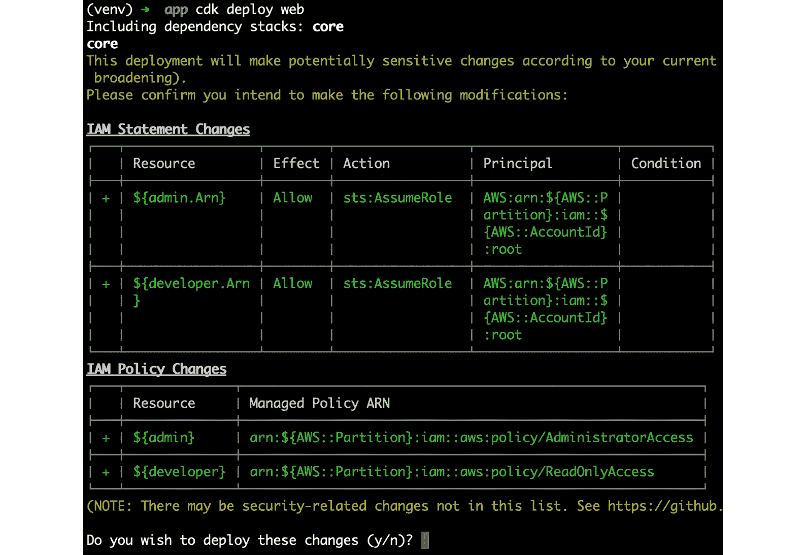
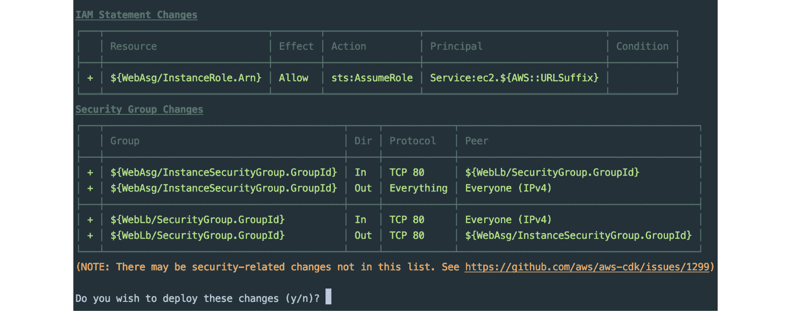
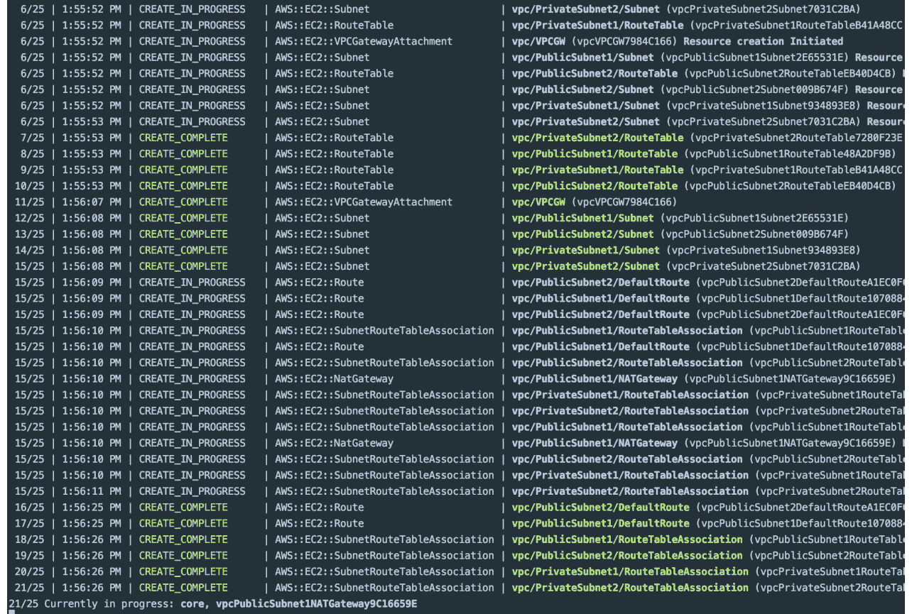
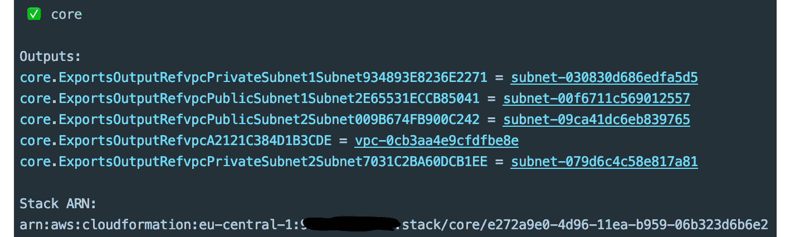

## 第 9 章：使用 AWS CDK 生成 CloudFormation 模板

现在我们将了解 AWS 的最新发展之一——`Cloud Development Kit`，即 `CDK`。
CDK 并非旨在取代 CloudFormation。
相反，它的开发是为了给 CloudFormation 增加额外的功能。

CDK 是一个支持多种编程语言的框架，允许 AWS 工程师真正地将基础设施声明为代码，从而提高 AWS 开发速度。
本章结束时，你将拥有一个由 CDK 生成的运行中基础设施。

本章将涵盖以下主题：

*   介绍 AWS CDK
*   使用 AWS CDK 促进模板开发
*   使用 AWS CDK 和 Python 编写你的第一个模板

### 技术要求

本章使用的代码可以在本书的 GitHub 仓库中找到：<https://github.com/PacktPublishing/Mastering-AWS-CloudFormation> 和 <https://github.com/PacktPublishing/Mastering-AWS-CloudFormation/tree/master/Chapter9/app>。

查看以下视频以了解代码实战：

<https://bit.ly/3aPNXxJ>

### 介绍 AWS CDK

CDK 并非首次尝试使用高级编程语言生成 CloudFormation 模板。
由于编写复杂的 CloudFormation 模板可能是一项包含许多重复操作的长期任务，开发者们有兴趣寻找一种不同的模板生成方式。

其中一种方式是一个名为 `Troposphere` 的 Python 框架，由 Cloudtools 团队开发并于 2013 年发布 (<https://github.com/cloudtools/troposphere>)。
AWS Labs 在 2017 年做出了另一次尝试，当时他们发布了一个名为 `GoFormation` 的类似库，用 Golang 编写 (<https://github.com/awslabs/goformation>)。

最终，AWS 推出了一个框架，它不仅提供了完整的基础设施即代码体验，还支持多种编程语言。
该框架被称为 AWS Cloud Development Kit，即 CDK。

CDK 支持以下编程语言：

*   TypeScript
*   JavaScript
*   Python
*   C#
*   Java

CDK 团队承诺会向此列表添加更多语言，但在此期间，任何愿意将 CDK 集成到其开发工作流中的公司都应使用其最熟悉的语言。

作为一个框架，CDK 有一个术语叫 `constructs`（构造），它代表需要预配置的基础设施构建块。
这些构造可以是以下内容：

*   `CloudFormation 资源`：示例包括 S3 存储桶、DynamoDB 表和 EC2 实例。
*   `Apps`：作为单一目的的资源逻辑分组，并生成一个或多个堆栈。
*   `Stacks`：部署单元，类似于 CloudFormation 堆栈。
*   `Environments`：部署目标；可以是不同的区域和/或账户。
*   `Assets`：与应用程序捆绑的本地文件或 Docker 镜像。可以是 Lambda 函数的处理程序代码或 ECS 任务的 Docker 镜像。

当模板开发者开始使用 CDK 时，他们需要将每个资源定义为变量——例如，S3 存储桶的定义如下所示。

如果你还不理解下面的代码，别担心！我们稍后会介绍：

```python
from aws_cdk import core
import aws_cdk.aws_s3 as s3

class BucketStack(core.Stack):
    def __init__(self, scope: core.Construct, id: str, **kwargs) -> None:
        super().__init__(scope, id, **kwargs)
        bucket = s3.Bucket(self, "myBucket")

app = core.App()
BucketStack(app, "bucket", env=core.Environment(account="X"))
app.synth()
```

在此代码中，堆栈实际上是一个 Python `class`（`BucketStack`），带有必要的构造属性。
我们声明一个 `bucket` 变量，它是 `s3.Bucket` 类型的对象，其中 `s3` 是一个导入的库，即 `aws_cdk.aws_s3`。
堆栈被分配为应用程序 `App` 的成员。
我们还指定了要部署的账户，但我们将在下一节中介绍这一点。

一旦我们构建自己的模板，将获得更深入的 CDK 知识，但首先，让我们看看 CDK 如何让我们的模板开发生活更轻松。

### 使用 AWS CDK 促进模板开发

如果我们已经拥有丰富的 CloudFormation 经验，为什么还要选择 CDK？
虽然 CloudFormation 拥有许多强大的功能和与 AWS 的深度集成，但其声明式的本质可能会给刚开始实践基础设施即代码和 AWS 的人带来负担。

当你需要创建一组示例资源并希望将大多数属性设置为默认值时，CloudFormation 很简单。
但让我们看看 S3 存储桶的完整声明：

```yaml
Type: AWS::S3::Bucket
Properties:
  AccelerateConfiguration: ...
  AccessControl: ...
  AnalyticsConfigurations: [...]
  BucketEncryption: ...
  BucketName: ...
  CorsConfiguration: ...
  InventoryConfigurations: [...]
  LifecycleConfiguration: ...
  LoggingConfiguration: ...
  MetricsConfigurations: [...]
  NotificationConfiguration: [...]
  # And counting!..
```

大多数属性甚至不是字符串或布尔值；它们是需要填充的单独键值部分。
这不是最难的任务，但它需要时间来找到适当的声明部分，并避免弄乱 YAML 或 JSON 格式。
添加属性块甚至额外资源可能更简单。

假设我们想要在一个 VPC 中拥有一个与路由表关联的子网，该路由表有一条通往互联网的路由。

使用 CloudFormation 将包含以下资源：

```yaml
Vpc:
  Type: AWS::EC2::VPC
  Properties: ...
Igw:
  Type: AWS::EC2::InternetGateway
IgwAttach:
  Type: AWS::EC2::VPCGatewayAttachment
  Properties: ...
Subnet:
  Type: AWS::EC2::Subnet
  Properties: ...
RouteTable:
  Type: AWS::EC2::RouteTable
  Properties: ...
PublicRoute:
  Type: AWS::EC2::Route
  Properties: ...
PublicRouteTableAssoc:
  Type: AWS::EC2::SubnetRouteTableAssociation
  Properties: ...
```

同样，这是我们必须进行的最少资源声明数量。

在 CDK 中执行此操作将更简单，因为其编程性质：

```python
CIDR = "10.0.0.0/16"
vpc = ec2.Vpc(self,
              "Vpc",
              cidr=CIDR,
              subnet_configuration=[
                  ec2.SubnetConfiguration(name="Public", subnet_type=ec2.SubnetType.PUBLIC, cidr_mask=24),
                  ec2.SubnetConfiguration(name="Private", subnet_type=ec2.SubnetType.PRIVATE, cidr_mask=24)
              ])
```

因为 CDK 内部有大量抽象，我们不需要显式地逐一定义资源——CDK 会为我们完成这项工作。

另一个有益的特性是我们可以使用编程语言的所有能力，例如迭代和条件判断。

例如，假设我们想要在多个区域部署我们的堆栈。
我们可以通过初始化 `Stack` 类来指示 CDK 创建一个堆栈：

```python
MyStack(app, "StackName", env=core.Environment(account="X",
                                               region="foo"))
```


### 使用 AWS CDK 和 Python 编写您的第一个模板

我们将从安装 CDK 的先决条件开始。尽管我们将使用 Python 编写代码，但仍然需要安装 `nodejs`。完成此操作后，我们可以安装 CDK：

```
$ npm install -g aws-cdk
```

之后，我们需要通过打印 CDK 版本来检查一切是否正确：

```
$ cdk --version
```

安装 CDK 并不意味着我们拥有所有的构建库。

首先，我们需要初始化环境：

```
$ mkdir app && cd app
$ cdk init app --profile personal --language=python
$ source .env/bin/activate
$ pip install -r requirements.txt
```

然后，我们安装 CDK 的核心组件：

```
$ pip install --upgrade aws-cdk.core
```

`cdk init` 命令将创建所有文件，因此我们可以立即开始开发基础设施。

### 准备构建

我们将构建与在*第 2 章 高级模板开发*中构建的相同基础设施。我们的基础设施将包含以下堆栈：

*   核心（网络、安全等）
*   Web 层
*   存储层

我们将从构建核心堆栈开始，因为许多资源将从中继承。

运行 `cdk init` 后，将创建多个文件和目录。

处理生成和部署的主文件称为 `app.py`，内容如下：

```
app.py
from aws_cdk import core
from app.app_stack import AppStack

app = core.App()
AppStack(app, "app")
app.synth()
```

此脚本初始化*构建* `app` 和 `AppStack` 类，最后运行 `synth()` 方法，该方法生成 CloudFormation 模板。

此外，我们还有一个实际包含 `AppStack` 类的文件：

```
app/app_stack.py
from aws_cdk import core

class AppStack(core.Stack):
    def __init__(self, scope: core.Construct, id: str, **kwargs) -> None:
        super().__init__(scope, id, **kwargs)
        # The code that defines your stack goes here
```

这是我们必须在其中声明资源的类。

> **重要提示**
>
> CDK 创建的文件和对象命名可能看起来很奇怪。当我们运行 `cdk init` 时，它将创建一个 `app.py` 文件（此处 `app` 代表 *App*，即 CDK 中的主要构建）和一个目录 `X`，其中 `X` 是运行 `cdk init` 的当前工作目录的名称。在该新目录中，`cdk init` 将创建一个 `X_stack.py` 文件和一个 `XStack()` 类。为了开发方便和透明度，您应该花时间相应地重命名文件和对象。

CDK 创建了一个堆栈类，但此处的命名并非我们所需（此外，我们将需要多个类）。因此，我们将把 `app_stack.py` 重命名为 `core_stack.py`，将 `AppStack` 重命名为 `CoreStack`：

```
app/core_stack.py
from aws_cdk import core

class CoreStack(core.Stack):
    # ...
```

我们还将对 `app.py` 进行一些更改，以便导入正常工作：

```
app.py
from aws_cdk import core
from app.core_stack import CoreStack

app = core.App()
CoreStack(app, "core")
app.synth()
```

我们还在类初始化调用中做了一个更改，将 `"app"` 改为 `"core"`：

```
CoreStack(app, "core")
```

引号中的字符串代表 `Id`，即 CDK 内部堆栈的唯一标识符。部署期间，此 ID 将成为堆栈名称，但我们现在进行此更改是为了让我们更清晰。

我们已完成所有准备工作。现在，让我们开始编写核心模板。

### 渲染核心资源

正如我们所记得的，核心堆栈需要以下资源：

*   1 个 VPC
*   3 个公有子网
*   3 个私有子网
*   1 个互联网网关
*   1 个 NAT 网关
*   1 个公有路由表
*   1 个私有路由表
*   2 个 IAM 角色（供管理员和开发人员使用）

CDK 不会安装所有构建库，因此我们需要安装其中两个：`aws_cdk.aws_iam` 和 `aws_cdk.aws_ec2`：

```
$ pip install aws_cdk.aws_iam aws_cdk.aws_ec2
```

现在我们可以导入它们：

```
app/core_stack.py
from aws_cdk import core
from aws_cdk.core import Fn
import aws_cdk.aws_ec2 as ec2
import aws_cdk.aws_iam as iam
```

通过以下步骤，我们将使用 CDK 声明核心堆栈：

1.  让我们从 IAM 角色开始。我们通过在堆栈类中声明变量来创建它们：

    ```
    app/core_stack.py
    # imports...
    class CoreStack(core.Stack):
        def __init__(self, scope: core.Construct, id: str, **kwargs) -> None:
            super().__init__(scope, id, **kwargs)
            admin_role = iam.Role(self,
                                  "admin",
                                  assumed_by=iam.AccountPrincipal(Fn.ref("AWS::AccountId")))
            dev_role = iam.Role(self,
                                "developer",
                                assumed_by=iam.AccountPrincipal(Fn.ref("AWS::AccountId")))
    ```

    同样，我们需要编写的代码更少，因为 `iam.Role` 对象有一个 `assumed_by` 属性。这将自动转换为 `AssumeRolePolicyDocument`。

2.  为了检查一切是否按预期生成，我们可以运行 `cdk synth`：

    ```
    $ cdk synth
    Resources:
      admin81D8EBF0:
        Type: AWS::IAM::Role
        Properties:
          AssumeRolePolicyDocument:
            Statement:
              - Action: sts:AssumeRole
                Effect: Allow
                Principal:
                  AWS:
                    Fn::Join:
                      - ""
                      - - "arn:"
                        - Ref: AWS::Partition
                        - ":iam::"
                        - Ref: AWS::AccountId
                        - :root
            Version: "2012-10-17"
    # the rest of the output...
    ```

3.  模板看起来有效，因此我们可以继续为角色添加策略：

    ```
    app/core_stack.py
    class CoreStack(core.Stack):
        def __init__(self, scope: core.Construct, id: str, **kwargs) -> None:
            # ...
            admin_role.add_managed_policy(iam.ManagedPolicy.from_aws_managed_policy_name("AdministratorAccess"))
            dev_role.add_managed_policy(iam.ManagedPolicy.from_aws_managed_policy_name("ReadOnlyAccess"))
    ```

    我们只需添加托管策略，因此将使用 `add_managed_policy()` 方法。

4.  现在我们可以开始构建网络。我们需要一个公有子网和若干私有子网：

    ```
    class CoreStack(core.Stack):
        # ...
        # VPC section
        self.vpc = ec2.Vpc(self,
                           "vpc",
    ```


### VPC 配置

```python
cidr="10.0.0.0/16",
enable_dns_hostnames=True,
enable_dns_support=True,
max_azs=3,
nat_gateways=1,
subnet_configuration=[
    ec2.SubnetConfiguration(name="Public", subnet_type=ec2.SubnetType.PUBLIC, cidr_mask=24),
    ec2.SubnetConfiguration(name="Private", subnet_type=ec2.SubnetType.PRIVATE, cidr_mask=24)
])
```

这里有几个参数可以调整。我们将 `max_azs` 设置为 `3`，以确保我们的栈能支持几乎所有区域（大多数区域有三个可用区）。如果该数字高于某区域的 AZ 数量，则栈创建将失败。我们还将 `nat_gateways` 设置为 `1`，这样 VPC 中只会有一个 NAT 网关，仅为了在个人账户中练习使用 CDK 时避免额外费用（最佳实践是每个可用区有一个 NAT 网关）。

每个子网组（public、web、middleware 和 storage）都是一个单独的 `SubnetConfiguration` 对象。通过使用 `PUBLIC` 或 `PRIVATE` 子网类型，我们指示 CDK 为子网配置合适的路由表（通过互联网网关或 NAT 网关）。

这里的主要好处是我们定义了一个单一的 Python `vpc` 对象，但 CDK 会代表我们生成大量资源：互联网网关、NAT 网关、子网、带有路由和关联的路由表、带有关联的网络 ACL —— 几乎是我们之前必须手动声明的每一项核心基础设施！

我们可以继续处理其余层级。

### 渲染 Web 层

Web 层是构建在核心栈之上的栈。我们将生成一个引用另一个我们心中已有的栈的模板。

在 Web 层中，我们期望包含以下内容：

- 应用程序负载均衡器
- 启动配置
- 自动扩缩组
- 一堆安全组

在以下代码中，我们将生成一个使用核心栈部分资源的 Web 层声明：

### 1. 创建新文件

在核心栈所在的同一目录下创建一个新文件：

`app/web_stack.py`

```python
from aws_cdk import core

class WebStack(core.Stack):
    def __init__(self, scope: core.Construct, id: str, vpc: ec2.Vpc, **kwargs) -> None:
        super().__init__(scope, id, **kwargs)
```

我们给类添加了一个额外属性 `vpc`。这是因为我们想从 `Core` 栈继承属性（就像使用 `Exports` 和 `Fn::ImportValue` 一样）。

### 2. 添加资源

`app/web_stack.py`

```python
class WebStack(core.Stack):
    def __init__(self, scope: core.Construct, id: str, vpc: ec2.Vpc, **kwargs) -> None:
        super().__init__(scope, id, **kwargs)
        self.vpc = vpc
        asg = autoscaling.AutoScalingGroup(self,
            "WebAsg",
            instance_type=ec2.InstanceType.of(ec2.InstanceClass.BURSTABLE2, ec2.InstanceSize.MICRO),
            machine_image=ec2.AmazonLinuxImage(),
            vpc=vpc,
            vpc_subnets=ec2.SubnetSelection(subnet_group_name="Private"),
            min_capacity=1,
            max_capacity=1
        )
```

正如我们所见，一些属性并不属于 EC2 自动扩缩组 —— 例如 `instance_type` 和 `machine_image`。这些属性将用于生成启动配置资源。

此外，让我们看看如何为自动扩缩组提供 VPC 和子网。我们所做的是将一个类（`CoreStack`）的资源构造属性（`vpc`）传递给另一个类（`WebStack`）。

### 3. 在 app.py 中添加 WebStack 类

`app.py`

```python
from aws_cdk import core
from app.core_stack import CoreStack
from app.web_stack import WebStack

app = core.App()
core = CoreStack(app, "core")
web = WebStack(app, "web", vpc=core.vpc)
app.synth()
```

### 4. 运行 cdk synth 检查资源属性分配

```bash
$ cdk synth web
Including dependency stacks: core
Successfully synthesized to /Users/ktovmasyan/app/cdk.out
Supply a stack id (core, web) to display its template.
```

### 5. 评估生成的模板

```json
{
  "Resources": {
    # some resources...  
    "WebAsgASGEE4061A2": {
      "Type": "AWS::AutoScaling::AutoScalingGroup",
      "Properties": {
        # some properties...
        "VPCZoneIdentifier": [
          {
            "Fn::ImportValue": "core:ExportsOutputRefvpcPrivateSubnet1Subnet934893E8236 E2271"
          },
          {
            "Fn::ImportValue": "core:ExportsOutputRefvpcPrivateSubnet2Subnet7031C2BA60 DCB1EE"
          }
        ]
      }
    },
    # the rest of the resources
  }
}
```

CDK *理解*了我们要做什么，并在核心栈中创建了导出，然后使用 `Fn::ImportValue`。

> **重要提示**
>
> CDK 的最佳实践是在栈类之间暴露类字段；但是，这仅在同一个应用程序内有效。如果你仍然需要导出值以在不同的 CDK 应用程序之间共享，则需要使用 `aws_cdk.core` 中的 `CfnOutput` 方法。

### 6. 继续向 Web 栈添加资源

我们只需要添加一个应用程序负载均衡器：

`app/web_stack.py`

```python
class WebStack(core.Stack):
    def __init__(self, scope: core.Construct, id: str, vpc: ec2.Vpc, **kwargs) -> None:
        # ...
        alb = elbv2.ApplicationLoadBalancer(self,
            "WebLb",
            vpc=vpc,
            internet_facing=True,
            vpc_subnets=ec2.SubnetSelection(subnet_group_name="Public"))
        listener = alb.add_listener("WebListener",
            port=80)
        listener.add_targets("Target",
            port=80,
            targets=[asg])
```

我们不需要单独创建目标组。当我们使用 `add_targets()` 方法时，CDK 会自动声明一个目标组，并从监听器和自动扩缩组引用它。

### 7. 部署 Web 栈以验证代码可运行



Figure 9.1 – Terminal output

由于核心栈是依赖栈，它将首先部署。我们感兴趣的是构建一个设置，让 CDK 告知我们安全相关的更改，例如 IAM 和安全组规则，如下所示：



Figure 9.2 – Terminal output

另一个值得指出的有趣现象是：当我们将自动扩缩组与应用程序负载均衡器关联时，CDK 会自动添加一条安全组规则，仅允许来自负载均衡器安全组的流量进入流量端口。

让我们也使用用户数据在启动配置上安装一些软件。

### 8. 声明用户数据

我们将 `userdata` 声明为多行字符串变量：


### 渲染存储层

我们的存储层将是一个 RDS 实例，在核心堆栈的 VPC 中创建。

### 1. 在单独的文件中创建新的堆栈类

**文件：** `app/rds_stack.py`

```python
from aws_cdk import core
import aws_cdk.aws_ec2 as ec2
import aws_cdk.aws_rds as rds

class RdsStack(core.Stack):
    def __init__(self, scope: core.Construct, id: str, vpc: ec2.Vpc, webserver_sg: ec2.SecurityGroup, **kwargs) -> None:
        super().__init__(scope, id, **kwargs)
        self.vpc = vpc
        self.webserver_sg = webserver_sg
```

我们向类声明添加了两个额外字段：`vpc`（我们将使用来自核心堆栈的 VPC 构造）和 `webserver_sg`（我们在上一节末尾声明的安全组构造）。

### 2. 创建 RDS 实例并向其安全组添加规则

**文件：** `app/rds_stack.py`

```python
class RdsStack(core.Stack):
    def __init__(self, scope: core.Construct, id: str, vpc: ec2.Vpc, webserver_sg: ec2.SecurityGroup, **kwargs) -> None:
        # 避免在生产环境中硬编码密码！
        # 相反——尝试使用 Secrets Manager 并配合
        # 随机字符串生成。
        pw = core.SecretValue.plain_text("password")
        rds_instance = rds.DatabaseInstance(
            self, "Rds",
            master_username="user",
            master_user_password=pw,
            database_name="db",
            engine=rds.DatabaseInstanceEngine.MYSQL,
            vpc=vpc,
            instance_class=ec2.InstanceType.of(
                ec2.InstanceClass.BURSTABLE2,
                ec2.InstanceSize.MICRO),
            removal_policy=core.RemovalPolicy.DESTROY,
            deletion_protection=False)
        rds_instance.connections.allow_from(
            webserver_sg,
            ec2.Port.tcp(3306))
```

这将创建一组资源——一个数据库子网组、一个带有安全组的 RDS 实例，新规则将添加到该安全组中。因为我们引用了另一个类（Web 层）的字段，CDK 将创建一个包含安全组 ID 的导出。

### 3. 向 `app.py` 添加新类

**文件：** `app.py`

```python
from aws_cdk import core
from app.core_stack import CoreStack
from app.web_stack import WebStack
from app.rds_stack import RdsStack

app = core.App()
core = CoreStack(app, "core")
web = WebStack(app, "web", vpc=core.vpc)
rds = RdsStack(app, "rds", vpc=core.vpc, webserver_sg=web.webserver_sg)
app.synth()
```

我们已将所有三个堆栈添加到应用程序中，因此现在可以开始部署。

### 部署 CDK 应用程序

CDK 应用程序的部署通过 `cdk deploy` 命令完成。该命令将运行 `synth` 以生成 CloudFormation 模板，然后创建并执行更改集。

如果我们有任何与安全相关的资源（如安全组和 IAM 实体），CDK 将请求我们的确认。如果我们想避免这种情况（例如，部署作为 CI/CD 流水线的一部分进行时），可以使用 `--require-approval never` 参数。

我们可以逐个部署堆栈：

```bash
$ cdk deploy core
$ cdk deploy web
$ cdk deploy rds
```

然而，我们的 RDS 堆栈依赖于核心和 Web 堆栈。因此，如果我们只运行该堆栈的部署，CDK 将尝试首先部署所有依赖项：

```bash
$ cdk deploy rds
Including dependency stacks: core, web
### the rest of the output
```

CDK 应用程序的部署具有交互式响应。这意味着我们可以持续观察 CloudFormation 部署的当前状态：



*图 9.3 – 终端输出*

部署结束时，我们将看到堆栈已部署的确认消息。CDK 还将在终端打印堆栈 ARN 和输出：



*图 9.4 – 终端输出*

如果我们需要删除所有堆栈，只需运行 `cdk destroy`。因为我们要删除多个堆栈，我们需要销毁主要依赖项，即核心堆栈：

```bash
$ cdk destroy core
Including depending stacks: web, rds
Are you sure you want to delete: rds, web, core (y/n)?
```

一旦我们选择 `y`，CDK 将按相反顺序销毁所有堆栈。

我们已经介绍了 CDK 应用程序的部署和删除。现在，让我们了解另一个重要主题——测试 CDK 应用程序。

### 测试 CDK 应用程序

直到现在，测试 CloudFormation 的唯一方法要么是创建一个堆栈并针对资源运行一些测试，要么是使用自定义规则通过 `cfn-lint` 进行检查。

在 CDK 中，测试的方式与常见的软件测试相同，但针对堆栈类及其属性。

> **重要提示**
> 在撰写本文时，使用原生 CDK 测试库测试 CDK 代码仅适用于 TypeScript 编写的代码。

由于我们无法在 Python 中使用 CDK 的断言库，我们将使用 `unittest` 编写自己的测试。

### 1. 创建测试框架

**文件：** `tests/test_app.py`

```python
import unittest

class StackCase(unittest.TestCase):
    def test_True(self):
        self.assertTrue(True)

if __name__ == '__main__':
    unittest.main()
```

### 2. 运行测试框架

```bash
$ python tests/test_app.py
.
----------------------------------------------------------------------
Ran 1 test in 0.000s
```


### 测试 CDK 应用程序

### 3. 测试 VPC 公有子网

**文件：** `tests/test_app.py`

```python
import unittest

from app.core_stack import CoreStack

import aws_cdk.aws_ec2 as ec2

import aws_cdk.core as core

class StackCase(unittest.TestCase):

    def test_if_vpc_has_public_subnets(self):
        app = core.App()
        core_construct = CoreStack(app, "core")
        selected_subnets = core_construct.vpc.select_subnets(
            subnet_type=ec2.SubnetType.PUBLIC)
        self.assertTrue(selected_subnets.has_public)
```

我们将测试当使用 `PUBLIC` 子网类型检查选定子网的属性时，`vpc` 构造是否返回 `True`。为此，我们初始化 `app` 对象和核心构造。初始化完成后，我们读取 `vpc` 对象的属性，查看它是否具有公有子网。

### 4. 运行公有子网测试

```bash
$ python tests/test_app.py -v
```

```
test_if_vpc_has_public_subnets (__main__.StackCase) ... ok
-------------------------------------------------------------
Ran 1 test in 0.057s
OK
```

### 5. 测试 VPC 私有子网

**文件：** `tests/test_app.py`

```python
class StackCase(unittest.TestCase):

    # previous tests...

    def test_if_vpc_has_private_subnets(self):
        app = core.App()
        core_construct = CoreStack(app, "core")
        selected_subnets = core_construct.vpc.select_subnets(
            subnet_type=ec2.SubnetType.PRIVATE)
        self.assertFalse(selected_subnets.has_public)
```

### 6. 运行私有子网测试

```bash
$ python tests/test_app.py -v
```

```
test_if_vpc_has_private_subnets (__main__.StackCase) ... ok
test_if_vpc_has_public_subnets (__main__.StackCase) ... ok
--------------------------------------------------------------
Ran 2 tests in 0.088s
OK
```

### 7. 测试开发者角色权限

我们还可以检查我们的开发者角色是否没有 `AdministratorAccess`。这会有点困难，因为我们无法直接从角色类访问托管策略，所以我们必须先生成一个模板，然后解析它。

**文件：** `tests/test_app.py`

```python
class StackCase(unittest.TestCase):

    def test_if_dev_role_is_not_admin(self):
        app = core.App()
        CoreStack(app, "core")
        stack = app.synth()
        core_stack = stack.get_stack_by_name("core").template
        resources = core_stack['Resources']
        for resource in resources.keys():
            if str(resource).startswith("developer"):
                developer_role = resource
        self.assertNotEqual(
            "[{'Fn::Join': ['', ['arn:', {'Ref': 'AWS::Partition'}, ':iam::aws:policy/AdministratorAccess']]}]",
            str(resources[developer_role]['Properties']['ManagedPolicyArns']))
```

我们必须部分匹配 `developer` 资源，因为 CDK 会在其后添加一些编码字符串。一旦我们在模板中定位到该资源，我们就确保其 `ManagedPolicyArns` 属性不等于生成模板中的同一行。

### 8. 运行所有测试

```bash
$ python tests/test_app.py -v
```

```
test_if_dev_role_is_not_admin (__main__.StackCase) ... ok
test_if_vpc_has_private_subnets (__main__.StackCase) ... ok
test_if_vpc_has_public_subnets (__main__.StackCase) ... ok
-------------------------------------------------------------
Ran 3 tests in 0.183s
OK
```

我们现在能够在实际部署之前针对我们的 CDK 代码运行测试。这将使我们的基础设施预置更加安全可靠！

在本节中，我们涵盖了使用 CDK 的所有步骤，从 CDK 项目的初始化到编写多层基础设施声明、部署它，甚至为其编写测试套件！

### 总结

CDK 引入了一种管理 AWS 的新方式，允许我们以完全不同的方式创建模板和运行栈操作。

在本章中，我们了解了 CDK 及其功能。我们创建了包含多个栈的应用程序，并创建了一个测试套件，以确保我们的核心基础设施模板在部署前可正常运行。

CDK 适用于由具有良好软件工程知识的开发人员担任 AWS 工程师角色，并希望将这些知识与 CloudFormation 自动化相结合的情况。

在下一章中，我们将介绍 CloudFormation 的另一个扩展，称为 **SAM**—**无服务器应用程序模型**。SAM 与 CloudFormation 类似，但为开发无服务器应用程序提供了不同的方法。

下一章见！

### 问题

1. CDK 中的构造是什么？
2. 如何在单个应用程序中拥有多个栈？
3. 如何在 CDK 中为 VPC 声明私有和公有子网？
4. CDK 目前支持哪些编程语言？
5. 在 CDK 中是否必须添加 AWS 账户 ID？

### 延伸阅读

* AWS CDK 示例：<https://github.com/aws-samples/aws-cdk-examples>
* 使用 AWS CDK 测试基础设施：<https://aws.amazon.com/blogs/developer/testing-infrastructure-with-the-aws-cloud-development-kit-cdk/>
