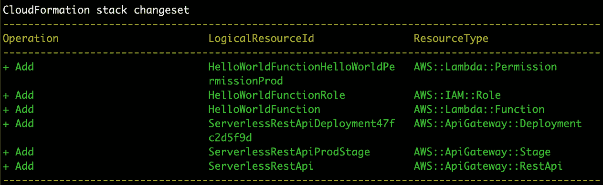
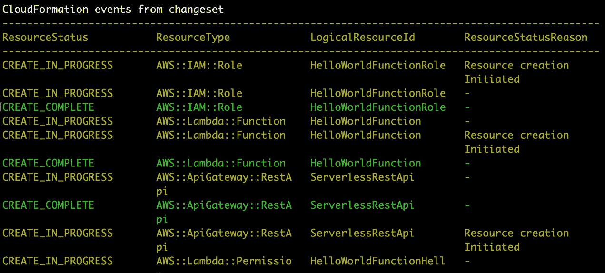
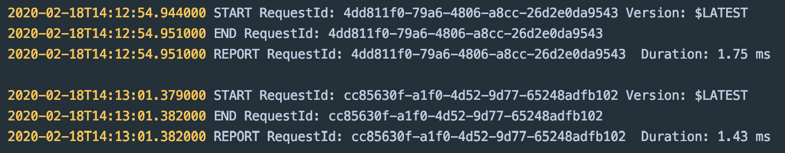
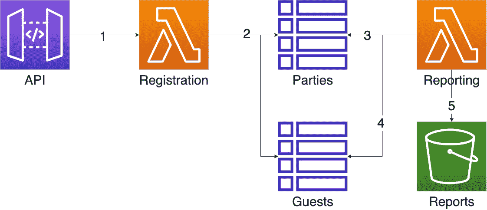
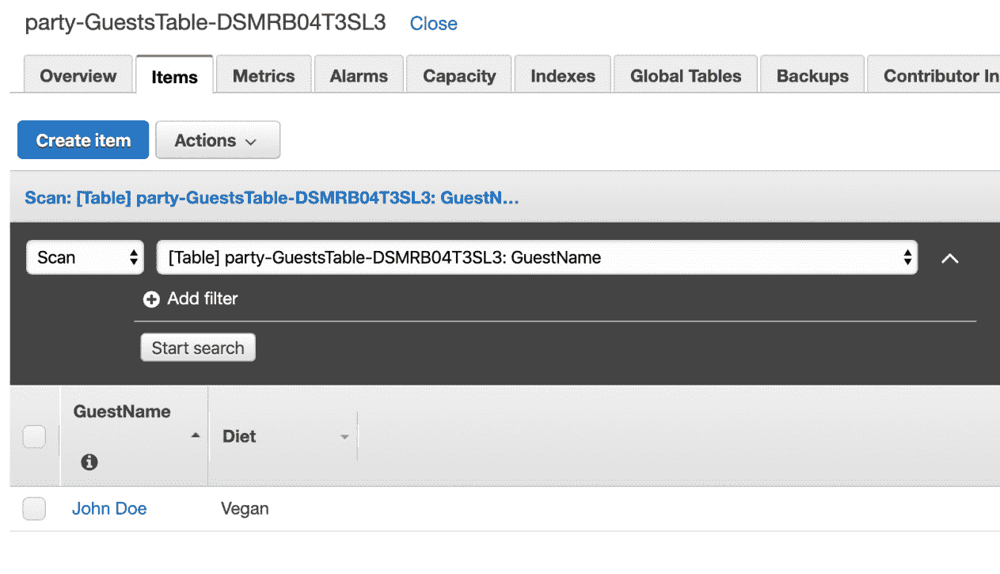
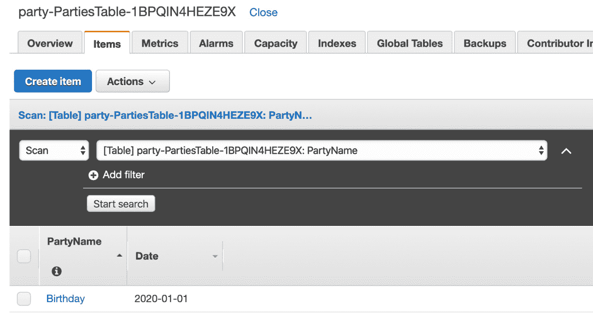

## 第 10 章：使用 AWS SAM 部署无服务器应用程序

CloudFormation 是一个强大的工具。然而，随着新技术和工作方式的出现，**基础设施即代码**（**IaC**）工具出现了新的需求。在 Lambda 发布及其与其他 AWS 服务（包括 S3、SNS、SQS 和 DynamoDB）集成后，发现 CloudFormation 的大多数功能对于无服务器开发来说并非必需。

因此，开发了 **无服务器应用程序模型**（**SAM**）。SAM 引入了一种不同且更简化的方式来开发、构建、测试、部署和运行无服务器应用程序。在本章中，我们将了解 SAM 以及如何使用它来促进无服务器应用程序的开发。

在本章中，我们将涵盖以下主题：

* 介绍 AWS SAM
* 理解 SAM 与 CloudFormation 的区别
* 使用 SAM 编写你的第一个无服务器应用程序

### 技术要求

本章使用的代码可以在本书的 GitHub 存储库中找到：<https://github.com/PacktPublishing/Mastering-AWS-CloudFormation/tree/master/Chapter10>。

查看以下视频以了解代码实战：

<https://bit.ly/2yWn7a1>

### 介绍 AWS SAM

在了解 SAM 之前，让我们快速看看什么是无服务器。*无服务器* 是一种开发、运行和操作应用程序的方式，无需管理其底层基础设施。你可能会想知道关键区别是什么，因为你在 AWS 中不管理*任何*基础设施，你是对的。

你不必在 AWS 中管理任何物理基础设施，但如果你运行 EC2 实例，你需要负责其底层操作系统、安全性、补丁和更新。

然后，你需要考虑 AWS 的托管 **关系数据库服务**（**RDS**），在那里你不必担心底层操作系统，但你仍然需要调整其参数、通过重组查询和表来进行性能调优，并创建数据库索引。


Serverless 并不保证完全不需要运维工作，但基于实例的服务（如 EC2、RDS、EMR 和 MSK）与无服务器服务（如 S3、SNS、SQS、Lambda 和 DynamoDB）之间存在几个关键差异。

对于无服务器服务，以下几点尤为突出：

*   您仅需为存储（美元/GB）和实际的计算操作（请求次数）付费。
*   您不再操作实例，而是操作计算和存储单元。
*   您使用特定实体（例如函数而非完整运行时，或表而非完整数据库）。

这些核心概念使得无服务器计算在许多业务场景下具有成本效益。

推出 SAM 是为了全面支持使用 IaC 作为方法论来开发、打包和部署无服务器应用程序。

SAM 由两部分组成：

*   实际框架（执行所有操作的 CLI）
*   一个模板，其规范与 CloudFormation 类似

与 CDK 类似，SAM 可以开箱即用地执行其所有操作，例如构建、本地测试和将无服务器堆栈预配到 AWS。

由于 SAM 模板的功能受限，因此编写起来更容易。例如，DynamoDB 表定义如下所示：

```yaml
Transform: AWS::Serverless-2016-10-31
Resources:
  DynamoDb:
    Type: AWS::Serverless::SimpleTable
    Properties:
      TableName: myTable
      PrimaryKey:
        Name: id
        Type: string
```

`Transform: AWS::Serverless-2016-10-31` 这一行看起来熟悉吗？

还记得 *第 8 章* *使用模板宏动态渲染模板* 中提到的，AWS 有两个内部宏：`AWS::Serverless` 和 `AWS::Include`。SAM 模板本身只不过是一个宏模板，将在部署期间由 CloudFormation 处理。转换后，上述模板将变为如下所示：

```json
{
  "Resources": {
    "DynamoDb": {
      "Type": "AWS::DynamoDB::Table",
      "Properties": {
        "KeySchema": [
          {
            "KeyType": "HASH",
            "AttributeName": "id"
          }
        ],
        "TableName": "myTable",
        "AttributeDefinitions": [
          {
            "AttributeName": "id",
            "AttributeType": "S"
          }
        ],
        "BillingMode": "PAY_PER_REQUEST"
      }
    }
  }
}
```

SAM 中的 `SimpleTable` 与 CloudFormation 中的 DynamoDB 表是同一回事！

当我们开始构建自己的应用程序时，将更多地介绍 SAM，但现在，让我们对比一下 SAM 和 CloudFormation，以便充分发挥两者的优势。

### 理解 SAM 与 CloudFormation 的区别

首先，SAM 模板旨在用于无服务器应用程序和服务。在撰写本文时，SAM 模板参考支持以下资源类型：

*   `AWS::Serverless::API`：创建 API 网关及相关资源
*   `AWS::Serverless::Application`：创建无服务器应用程序
*   `AWS::Serverless::Function`：创建 Lambda 函数及相关资源
*   `AWS::Serverless::HttpApi`：创建 HTTP API 网关及相关资源
*   `AWS::Serverless::LayerVersion`：创建 Lambda 层
*   `AWS::Serverless::SimpleTable`：创建简化的 DynamoDB 表（仅主键，无排序键）

仍然可以将 CloudFormation 的资源与 SAM 的资源结合使用。例如，如果我们想创建一个带有 `SimpleTable` 的 S3 存储桶，可以通过添加 CloudFormation 资源来实现，如下代码所示：

```yaml
Transform: AWS::Serverless-2016-10-31
Resources:
  DynamoDb:
    Type: AWS::Serverless::SimpleTable
    Properties:
      TableName: myTable
      PrimaryKey:
        Name: id
        Type: string
  Bucket:
    Type: AWS::S3::Bucket
```

我们只需指定 CloudFormation 特有的资源类型即可。

其次，当您想通过 CLI 部署 SAM 应用程序且无需交互式对话时，*必须* 拥有一个存储桶。原因在于 SAM 应用程序由源代码和模板组成。`SAM CLI` 将负责构建应用程序（如果需要编译），并将 Lambda 函数的构建产物上传到 S3。

第三，您*无法*使用 `SAM CLI` 删除 SAM 应用程序。您必须运行 `aws cloudformation delete-stack` 才能进行清理。

最后但同样重要的是，SAM 允许您通过创建本地 API 网关或针对应用程序运行测试事件来在本地运行测试。

话虽如此，让我们开始使用 SAM 构建我们自己的无服务器应用程序。

### 使用 SAM 编写您的第一个无服务器应用程序

在本节中，我们将创建几个无服务器应用程序，以涵盖 SAM 的大多数功能。第一个——Hello, World——将使用 AWS Quick Start 模板创建，以便我们快速获得 SAM 的实践经验。

第二个——Party Planner——将从头开发。您无需担心——实际代码不在本书范围内，重点将放在创建包含多个函数的复杂应用程序上。

在开始开发之前，让我们确保拥有所需的一切。

### 先决条件

为了运行 SAM 命令，我们首先需要安装 SAM 及其依赖项。根据您使用的操作系统，步骤会有所不同。以下步骤适用于 macOS 上的安装。

有关如何在其他操作系统上安装 SAM 的指南，请访问 [`docs.aws.amazon.com/serverless-application-model/latest/developerguide/serverless-sam-cli-install.html`](https://docs.aws.amazon.com/serverless-application-model/latest/developerguide/serverless-sam-cli-install.html)。

以下步骤展示了如何安装 SAM：

1.  确保已安装 Docker 和 Homebrew。
2.  通过发出以下命令安装 SAM CLI：
    ```bash
    $ brew tap aws/tap
    $ brew install aws-sam-cli
    ```
3.  通过运行以下命令检查安装：
    ```bash
    $ sam --version
    ```

如果输出中没有任何错误，您就可以开始了！

我们已经安装好了一切，所以让我们开始构建第一个应用程序。

### 开发 Hello, World 应用程序

如果不是一个传统的 Hello, World 应用程序，什么才是最好的切入点呢？在本节结束时，我们将部署一个标准的 AWS Quick Start 应用程序，以便获得 SAM 的实践经验：

1.  我们将从项目初始化开始：
    `sam init`
2.  SAM 将响应一个对话框。既然是我们的第一个应用程序，就跟着它走吧。这次我们将选择 **1 - AWS Quick Start Templates**：
    Which template source would you like to use?
        1 - AWS Quick Start Templates
        2 - Custom Template Location
    Choice: 1
3.  接下来，我们需要为应用程序选择运行时。让我们选择 `python3.8`：
    Which runtime would you like to use?
        1 - nodejs12.x
        2 - python3.8
        3 - ruby2.5
        4 - go1.x
        5 - java11
        # the rest of the options...
    Runtime: 2
4.  对于应用程序名称，只需输入 `hello-world`：
    Project name [sam-app]: hello-world
5.  SAM 将从 GitHub 克隆模板并要求我们选择一个 Quick Start 模板。我们将选择 `Hello World Example`：
    AWS quick start application templates:
        1 - Hello World Example
        2 - EventBridge Hello World
        3 - EventBridge App from scratch (100+ Event Schemas)
    Template selection: 1
6.  完成所有响应后，SAM 将生成一个应用程序并告知我们后续步骤：
    -----------------------
    Generating application:
    -----------------------
    Name: hello-world
    Runtime: python3.8
    Dependency Manager: pip


### 应用程序模板：hello-world

### 输出目录

`.

### 后续步骤

后续步骤可在 `./hello-world/README.md` 的 README 文件中找到。

### 步骤 7：检查新目录

让我们检查一下新目录：

```
$ tree .
.
├── README.md
├── __init__.py
├── events
│   └── event.json
├── hello_world
│   ├── __init__.py
│   ├── app.py
│   └── requirements.txt
├── template.yaml
└── tests
    ├── __init__.py
    └── unit
        ├── __init__.py
        └── test_handler.py
```

看起来一切都已就绪！我们可以立即部署此应用程序，但首先，让我们检查一下模板中有什么！有几个地方看起来很有趣：

### template.yaml：Globals（全局设置）

```yaml
Globals:
  Function:
    Timeout: 3
```

`Globals` 部分用于当我们需要为多个资源定义相同属性时。假设你正在构建一个由多个函数组成的 Lambda 应用程序。它们都将使用相同的运行时并具有相同的超时时间。为了避免多次重复相同的属性，我们只需将它们存储在 `Globals` 中。

### template.yaml：Resources（资源）

```yaml
Resources:
  HelloWorldFunction:
    Type: AWS::Serverless::Function
    Properties:
      CodeUri: hello_world/
      Handler: app.lambda_handler
      Runtime: python3.8
      Events:
        HelloWorld:
          Type: Api
          Properties:
            Path: /hello
            Method: get
```

从这里我们可以了解到，`function` 定义有一个 `CodeUri` 属性，它指向存放源代码的本地路径。

其次，请看 `Events` 属性。此属性定义将触发函数的事件源。此外，当应用程序部署时，SAM 将 `create`（创建）此资源！在本例中，它将创建一个 API 网关。

### template.yaml：Outputs（输出）

```yaml
Outputs:
  HelloWorldApi:
    Description: "API Gateway endpoint URL for Prod stage for Hello World function"
    Value: !Sub "https://${ServerlessRestApi}.execute-api.${AWS::Region}.amazonaws.com/Prod/hello/"
  HelloWorldFunction:
    Description: "Hello World Lambda Function ARN"
    Value: !GetAtt HelloWorldFunction.Arn
  HelloWorldFunctionIamRole:
    Description: "Implicit IAM Role created for Hello World function"
    Value: !GetAtt HelloWorldFunctionRole.Arn
```

顶部的 API 是作为 `Events` 属性的一部分创建的。然而，IAM 角色在任何地方都未定义，那么我们如何获取其属性呢？

请记住，SAM 是一个宏。此角色（以及许多其他资源）将随在此模板中声明的函数一起创建。

### 步骤 8：构建并运行本地测试

接下来，让我们构建此应用程序并运行本地测试：

```
$ sam build --use-container
Starting Build inside a container
Building resource 'HelloWorldFunction'
Fetching lambci/lambda:build-python3.8 Docker container image....
Mounting /Users/karentovmasyan/hello-world/hello_world as /tmp/samcli/source:ro,delegated inside runtime container
Build Succeeded
Built Artifacts  : .aws-sam/build
Built Template   : .aws-sam/build/template.yaml
Commands you can use next
=========================
[*] Invoke Function: sam local invoke
[*] Deploy: sam deploy --guided
Running PythonPipBuilder:ResolveDependencies
Running PythonPipBuilder:CopySource
```

`build` 命令配合 `--use-container` 参数，将拉取 Docker 镜像并构建源函数，从而安装所有依赖项。构建产物将存储在本地目录中。

### 步骤 9：调用函数

让我们调用它：

```
$ sam local invoke
Invoking app.lambda_handler (python3.8)
Fetching lambci/lambda:python3.8 Docker container image...
Mounting /Users/karentovmasyan/hello-world/.aws-sam/build/HelloWorldFunction as /var/task:ro,delegated inside runtime container
START RequestId: c165be27-ff86-1ed2-f5c7-9158dce5d95b Version: $LATEST
END RequestId: c165be27-ff86-1ed2-f5c7-9158dce5d95b
REPORT RequestId: c165be27-ff86-1ed2-f5c7-9158dce5d95b  Init Duration: 199.95 ms  Duration: 3.57 ms  Billed Duration: 100 ms Memory Size: 128 MB  Max Memory Used: 23 MB
{"statusCode":200,"body":"{\"message\": \"hello world\"}"}
```

我们不需要为本地调用提供许多参数，因为只有一个 Lambda 函数和一个事件。但是，如果我们有多个事件和函数，我们就需要按名称指定它们，如下所示：

```
$ sam local invoke FunctionNameAsInTemplate \
  --event path/to/the/event.json
```

在实际响应之前，我们还会获得 Lambda 执行的持续时间和内存信息。当我们需要估算未来无服务器应用程序的成本时，这非常有用。

还有另一种测试函数执行的方法。让我们通过调用 API 网关来做同样的事情。

### 步骤 10：启动 API

我们将启动 API：

```
$ sam local start-api
```

在输出中，将会有一个我们可以调用的 URL。我们必须使用一个不同的终端窗口，因为当前窗口将显示 API 网关的日志：

```
$ curl localhost:3000/hello
{"message": "hello world"}
```

在 API 网关的日志中，我们将看到与运行本地调用时类似的输出。

我们玩得差不多了——现在让我们在云端运行此应用程序！

### 运行 SAM 应用程序

创建和运行 SAM 应用程序与创建 CloudFormation 堆栈略有不同。

遵循之前的步骤，我们将启动我们的 Hello, World 应用程序：

### 步骤 1：打包应用程序

```
$ aws s3 mb s3://mastering-cfn-sam-bucket
### your bucket name might differ!
$ sam package \
  --s3-bucket mastering-cfn-sam-bucket
```

最后一个命令将打包 Lambda 函数及其依赖项，将它们上传到 S3，然后用一个新值（指向 S3 对象）替换 `CodeUri`：

```yaml
AWSTemplateFormatVersion: '2010-09-09'
Transform: AWS::Serverless-2016-10-31
### ...
Resources:
  HelloWorldFunction:
    Type: AWS::Serverless::Function
    Properties:
      CodeUri: s3://mastering-cfn-sam-bucket/849dd527a4c6568a34af04808b924158
      Handler: app.lambda_handler
      Runtime: python3.8
### the rest of the template...
```

### 步骤 2：部署应用程序

为了在本地存储此模板并将其用于部署，我们需要添加一个额外的参数：

```
sam package \
  --s3-bucket mastering-cfn-sam-bucket \
  --output-template-file template-out.yaml
```

这将把模板存储在工作目录中，并为我们提供创建应用程序堆栈所需的命令：

```
Successfully packaged artifacts and wrote output template to file template-out.yaml.
Execute the following command to deploy the packaged template
sam deploy --template-file /Users/karentovmasyan/MasteringCloudformation/Chapter10/hello-world/template-out.yaml --stack-name <YOUR STACK NAME>
```

让我们使用前面的命令进行部署：

```
$ sam deploy \
  --template-file template-out.yaml \
  --stack-name hello-world
  Deploying with following values
  ===============================
  Stack name           : hello-world
  Region               : None
  Confirm changeset    : False
  Deployment s3 bucket : None
```


### 部署输出与错误处理

**功能**: `null`

**参数覆盖**: `{}`

### 启动部署

```
=====================
```

**错误：为堆栈 `hello-world` 创建更改集失败：参数验证失败：**

**参数 `Capabilities` 类型无效，值：`None`，类型：`<class 'NoneType'>`，有效类型：`<class 'list'>`，`<class 'tuple'>`**

失败的原因是 SAM 将创建一个 IAM 角色，但我们未提供任何功能。

### 修复部署命令

3. 让我们通过命令行参数添加必要的功能来修复此问题：

```
$ sam deploy \
    --template-file template-out.yaml \
    --stack-name hello-world \
    --capabilities CAPABILITY_IAM
```

在输出中，我们将看到类似于 CDK 部署的内容—SAM 将要创建的资源、事件日志和输出：



图 10.1 – 终端输出 (资源)

我们可以通过直接在终端输出中检查事件来跟踪部署过程：



图 10.2 – 终端输出 (事件)

### 验证部署

4. 最后，让我们调用 API 以确保应用程序部署成功：

```
$ curl https://39llxp6wl2.execute-api.eu-central-1.amazonaws.com/Prod/hello/ # your output will be different
```

```
{"message": "hello world"}
```

就这样！我们拥有了一个在 AWS 环境中运行的应用程序，它是使用 AWS SAM 开发和部署的。

但这并不是 SAM 能做的唯一事情！除了构建和部署操作外，它还可以用来检查应用程序日志。

### 使用 SAM 检查日志

SAM 允许您直接从 CLI 获取 CloudWatch 日志。这使得在生产环境中调试或跟踪应用程序变得更容易一些。

要读取日志，我们只需提供以下参数：

```
$ sam logs \
    -n FUNCTION_LOGICAL_NAME \
    --stack-name STACK_NAME \
    --tail
```

因此，在我们的案例中，我们将按如下方式运行命令：

```
$ sam logs \
    -n HelloWorldFunction \
    --stack-name hello-world \
    --tail
```

运行后，我们将从 CloudWatch Logs 获取确切的条目。由于我们的函数代码中没有打印语句，日志不会显示太多内容：



图 10.3 – 终端输出 (SAM 日志)

要清理 `hello-world` 堆栈，我们需要使用 `awscli`：

```
$ aws cloudformation delete-stack \
    --stack-name hello-world
```

我们现在完成了 Hello, World 应用程序的尝试。让我们构建一些更复杂的东西——我们的第二个应用程序。

### 使用 SAM 创建复杂应用程序

我们将创建一个小型派对规划器——一个处理和存储派对及客人信息的应用程序。

让我们看看这个应用程序的设计：



图 10.4 – 无服务器派对规划器

此应用程序中有几个步骤：

1. **API** 网关将发送包含派对和客人信息的负载。
2. **Registration** 函数将在 **Parties** 表中创建一个新条目（如果该派对不存在），并存储客人信息（如姓名和饮食限制）。
3. **Reporting** 函数将检查是否有未来的派对（派对日期不在过去）。
4. **Reporting** 函数（一个计划任务）将获取客人信息并生成规划报告。
5. **Reporting** 函数将此报告存储在 S3 存储桶中。

我们知道我们的应用程序长什么样，以及它应该做什么。现在让我们使用 SAM 来构建它！

我们将首先创建项目结构：

```
$ mkdir registration reporting
$ touch template.yaml
```

接下来，我们需要为模板定义资源。我们将需要以下资源：

* 两个 Lambda 函数（`Registration` 和 `Reporting`）
* 一个 S3 存储桶（`Reports`）
* 两个 DynamoDB 表（`Parties` 和 `Guests`）
* 一个 API 网关

请记住，Lambda 函数使用不同的类型（`AWS::Serverless::Function`）进行定义。我们将使用此类型创建函数，以便我们可以将事件触发器（在我们的例子中是 API 网关）作为此资源的一部分创建。

以下步骤将帮助我们实现本节的目标：

### 1. 声明 Registration 函数

**template.yaml**

```yaml
Resources:
  RegistrationFunction:
    Type: AWS::Serverless::Function
    Properties:
      CodeUri: registration/
      Events:
        register:
          Type: Api
          Properties:
            Path: /register
            Method: post
```

此函数类似于我们作为 Hello, World 应用程序一部分创建的函数。但是，我们需要向它添加一些额外的内容。

SAM 堆栈还将具有 `RegistrationFunctionRole`，这是一个具有 Lambda 函数基本 IAM 策略的 IAM 角色。我们还需要一个允许我们的函数向 DynamoDB 放入项目的策略。

### 2. 创建 DynamoDB 表

**template.yaml**

```yaml
Resources:
  # ...
  PartiesTable:
    Type: AWS::Serverless::SimpleTable
    Properties:
      PrimaryKey:
        Name: PartyName
        Type: String
  GuestsTable:
    Type: AWS::Serverless::SimpleTable
    Properties:
      PrimaryKey:
        Name: GuestName
        Type: String
```

### 3. 添加访问表的策略

**template.yaml**

```yaml
Resources:
  RegistrationFunction:
    Type: AWS::Serverless::Function
    Properties:
      # ...
      Policies:
        Statement:
          - Effect: Allow
            Action:
              - dynamodb:PutItem
              - dynamodb:GetItem
            Resource:
              - !Sub "arn:aws:dynamodb:${AWS::Region}:${AWS::AccountId}:table/${PartiesTable}"
              - !Sub "arn:aws:dynamodb:${AWS::Region}:${AWS::AccountId}:table/${GuestsTable}"
```

由于 `AWS::Serverless::SimpleTable` 不返回 DynamoDB 表的 ARN，我们必须使用 `Fn::Sub` 来生成它。

### 4. 创建报告存储桶

**template.yaml**

```yaml
Resources:
  # ...
  ReportsBucket:
    Type: AWS::S3::Bucket
```

别忘了我们将为此使用 CloudFormation 的类型，因为 S3 不是 SAM 规范的一部分。

最后，我们将声明一个有一些差异的报告函数。

### 5. Reporting 函数的策略

第一个区别是策略，因为我们需要不同的 IAM 权限来让 **Reporting** 函数工作：

**template.yaml**

```yaml
Resources:
  # ...
  ReportingFunction:
    # ...
    Policies:
      Statement:
        - Effect: Allow
          Action:
            - dynamodb:GetItem
            - dynamodb:Scan
          Resource:
            - !Sub "arn:aws:dynamodb:${AWS::Region}:${AWS::AccountId}:table/${PartiesTable}"
            - !Sub "arn:aws:dynamodb:${AWS::Region}:${AWS::AccountId}:table/${GuestsTable}"
        - Effect: Allow
          Action:
            - s3:ListBucket
            - s3:GetBucketAcl
            - s3:PutObject
          Resource:
            - !GetAtt ReportsBucket.Arn
            - !Sub "${ReportsBucket.Arn}/*"
```

### 6. 定时事件触发

接下来，我们需要更改事件，因为此函数是一个计划作业。在 Lambda 中运行计划作业的唯一方法是使用 CloudWatch 计划事件。

我们通过为 `Events` 使用不同的类型来添加计划事件：

**template.yaml**

```yaml
Resources:
  # ...
  ReportingFunction:
```


### SAM 模板片段

```yaml
Type: AWS::Serverless::Function
Properties:
  # ...
  Events:
    scheduled:
      Type: Schedule
      Properties:
        Schedule: "rate(1 day)"
```

这将创建一个具有生成名称的计划事件，并将其映射到 `Reporting` 函数。

应用程序的代码不在本书范围内，但这些函数将使用作为堆栈一部分创建的 DynamoDB 表工作。然而，我们没有在 `Properties` 资源中设置表的名称，因此它们需要在堆栈创建期间生成。

那么，我们如何让应用程序知道连接哪个表？我们可以通过模板中的环境变量来实现！

### 7. 向 `Globals` 部分添加环境变量

**template.yaml**

```yaml
Globals:
  Function:
    Timeout: 30
    Runtime: python3.8
    Handler: app.lambda_handler
    Environment:
      Variables:
        PARTIES_TABLE: !Ref PartiesTable
        GUESTS_TABLE: !Ref GuestsTable
        REPORTS_BUCKET: !Ref ReportsBucket
```

这些属性将被两个 Lambda 函数（`Registration` 和 `Reporting`）继承，因此我们不需要在资源定义中重复这些内容。

还有一件事我们可以做。我们可以创建一个事件，用于测试我们的部署。将来我们也可以用它来测试本地调用。

### 8. 创建一个简单的虚拟事件

**events/event.json**

```json
{
  "PartyName": "Birthday",
  "PartyDate": "2020-01-01",
  "GuestName": "John Doe",
  "GuestDiet": "Vegan"
}
```

一旦我们创建了应用程序堆栈，稍后将使用此事件。

### 9. 构建、打包并部署我们的应用程序

```bash
$ sam build \
    --use-container

$ sam package \
    --s3-bucket mastering-cfn-sam-bucket \
    --output-template-file template-out.yaml

$ sam deploy \
    --template-file template-out.yaml \
    --stack-name party \
    --capabilities CAPABILITY_IAM
```

### 10. 通过运行简单的 curl 来检查我们的函数是否正确执行

```bash
curl -X POST \
    -d @events/event.json \
    -H "Content-Type: application/json" \
    # Your API URL might differ
    https://tzsewdylmj.execute-api.eu-central-1.amazonaws.com/Prod/register
```

我们在响应中什么也得不到，因为我们的函数只返回 `200 OK` HTTP 代码。

要检查结果，我们将转到 DynamoDB 控制台并检查项目：



图 10.5 – DynamoDB 控制台

新派对也被添加到了 `PartiesTable`：



图 10.6 – DynamoDB 控制台

### 11. 最后要测试的是运行第二个函数。这是一个计划任务，所以我们必须手动调用它：

```bash
$ aws lambda invoke \
    # Your function will have a different name!
    --function-name party-ReportingFunction-17431GZNIJXPE \
    --payload '{}' \
    out.txt

{
  "StatusCode": 200,
  "ExecutedVersion": "$LATEST"
}
```

响应显示执行期间没有未处理的异常，这是个好迹象！

让我们检查上传到 S3 的文件：

```bash
$ aws s3 ls \
    # Your bucket name will be different!
    s3://party-reportsbucket-1usezdtprgt9z

2020-02-19 19:58:42       124 Birthday.txt

$ aws s3 cp \
    s3://party-reportsbucket-1usezdtprgt9z/Birthday.txt .

$ cat Birthday.txt
---
Party Planning Report!!!
Prepare for Birthday on 2021-01-01!
Guests list:
- John Doe who is restricted to eat Vegan
---
```

这显示了我们刚刚存储在 DynamoDB 中的数据的确切输出！

我们刚刚成功部署并运行了一个由多个 Lambda 函数组成的无服务器应用程序，使用 SAM 作为一个一体化工具！

### 摘要

在本章中，我们了解了 AWS SAM——一个专为无服务器应用程序设计的易于使用的 CloudFormation 扩展。我们学习了 SAM，它与 CloudFormation 的区别，以及它的组成部分。

我们了解了 SAM 项目的结构、部署和操作选项，以及如何开发简单和复杂的无服务器应用程序。这些知识将帮助你理解是否想要开始对特定项目或应用程序使用 SAM，还是坚持使用 CloudFormation。

这是本书的最后一章*技术*章节。你做得很好，希望你从本书中学到了很多，并将利用这些知识使用 CloudFormation 在 AWS 上构建生产就绪、可扩展的解决方案。

在下一章中，我们将坐下来，放松一下，尝试找出我们可以从 CloudFormation 和 IaC 整体中期待什么。

敬请期待！

### 问题

1. 是否可以创建不属于 SAM 引用一部分的资源？
2. 哪个命令启动本地 API 网关？
3. 是否可以使用 SAM CLI 删除 SAM 堆栈？
4. 是否可以使用 SAM 在 DynamoDB 表中创建排序键？
5. 运行 `sam package` 时会发生什么？

### 延伸阅读

* 对比 SAM 与 Serverless Framework：<https://sanderknape.com/2018/02/comparing-aws-sam-with-serverless-framework/>
* SAM 应用程序示例：<https://github.com/aws-samples/serverless-app-examples>
* Jeff Barr 关于 SAM 的博客文章：<https://aws.amazon.com/blogs/aws/aws-serverless-application-model-sam-command-line-interface-build-test-and-debug-serverless-apps-locally/>
