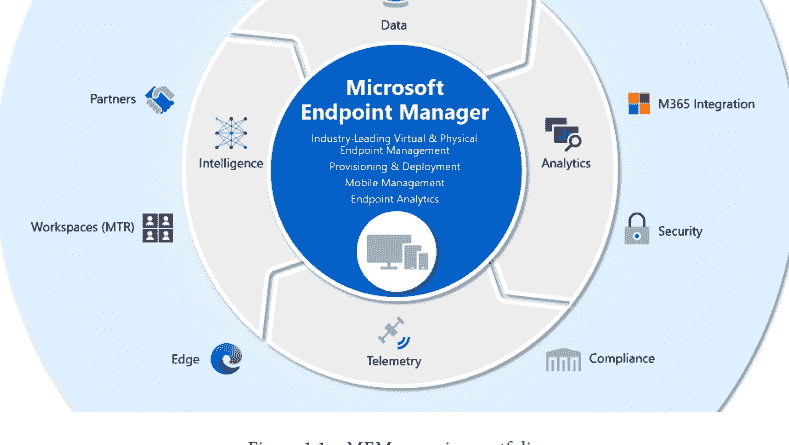
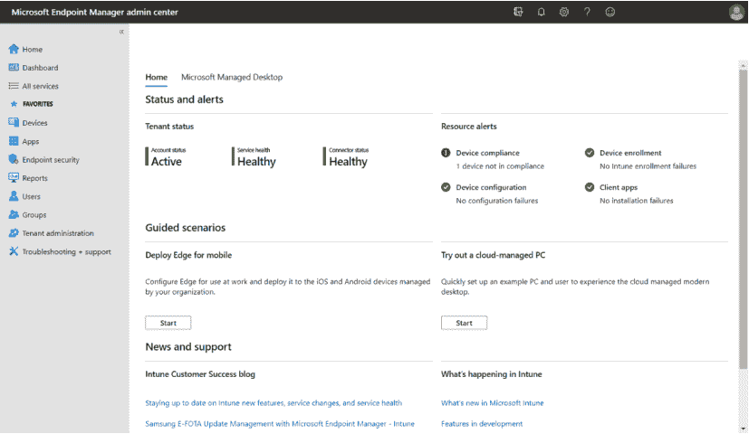
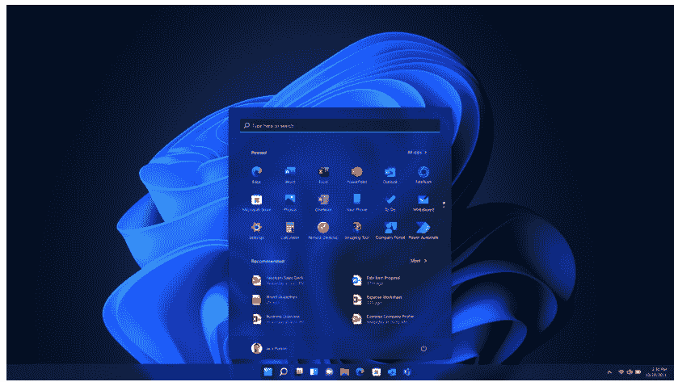
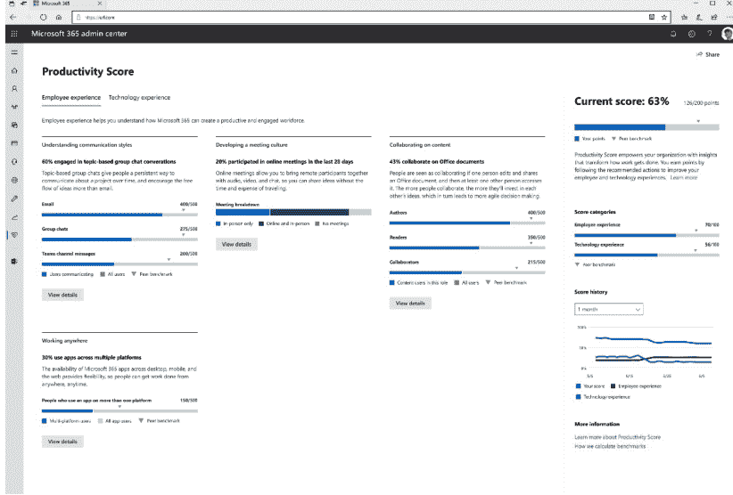
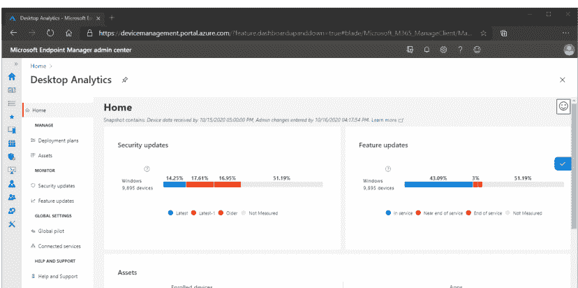
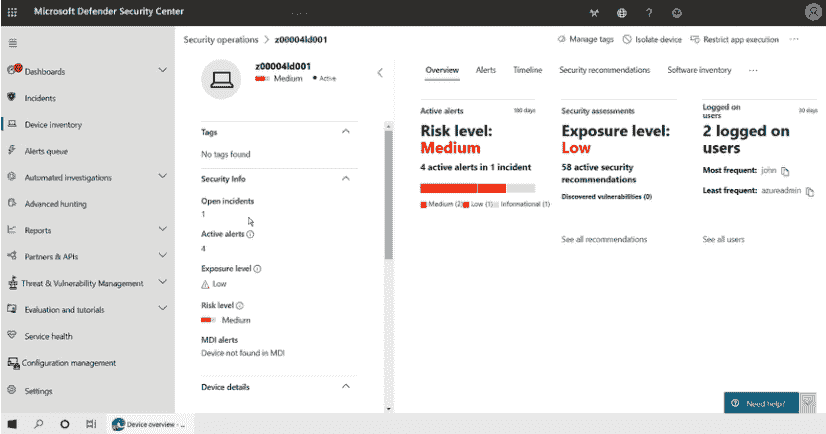

## Microsoft 365 简介

理解产品的核心概念是成功部署的最重要因素。在本章中，你将学习如何在利用 Microsoft 365 产品套件中其他服务的同时保持资源安全。

在本章中，我们将介绍以下主题：
- Microsoft 365 服务
- Azure Virtual Desktop 和 Windows 365
- Windows 10 和 Windows 11

### Microsoft 365 简介

Microsoft 365 包含许多你在日常工作中可能会使用的服务，无论你是 IT 专业人员还是非技术用户。这些服务通过简化在本地环境中需要大量工作才能完成的任务，帮助你提高生产力。一个很好的例子就是我们从 Exchange Server 向 Exchange Online 的转变。

## 服务实现了什么？

在本章的引言部分，我们将简要介绍与本书主题相关的 Microsoft 365 核心服务和功能，以便对各种服务之间的差异有一个良好的基础理解。你还将了解每项服务的用途和优势。

## Microsoft Endpoint Manager

**Microsoft Endpoint Manager (MEM)** 是 Microsoft Intune 和 **Microsoft Endpoint Configuration Manager (MECM)** 的整合。它提供统一的整体管理体验，同时在不进行复杂迁移或影响生产力的情况下增加新功能和智能操作。

它提供了一系列资产来帮助你过渡到现代管理，同时提高客户的安全性并帮助他们迁移到云端。MEM 现在还包括对不同终端的<|message|> 管理功能：

图 1.1 – MEM – 服务组合

MEM 帮助你管理物理和虚拟桌面、笔记本电脑、平板电脑和其他移动设备，包括 iOS、Android 和 macOS 设备。

MEM 使用 **Azure Active Directory (Azure AD)** 作为主要身份和目录存储。它取代了传统的 Active Directory，包含混合身份功能，并且可以与本地管理基础设施（如通过 Kerberos 的 Configuration Manager）集成。

Intune 对于超出组策略管理范围的设备非常有帮助，例如移动电话、不是 **Active Directory Domain Services (AD DS)** 域成员的设备，或加入 Azure AD 的 Windows 10 设备：

图 1.2 – MEM – 管理控制台

使用 MEM，你可以实现以下目标：
- 让组织员工使用其个人物理和虚拟终端设备访问组织数据（通常称为 **自带设备 (BYOD)**）。
- 管理组织拥有的手机。
- 控制从未受管设备（如公共自助终端和移动设备）访问 Microsoft 365。
- 确保连接企业数据的设备和应用符合安全策略。

例如，当用户尝试在其手机或 Windows 10 终端上打开其 **业务线 (LOB)** 应用时，Microsoft 365 会与 Azure AD 检查以验证用户身份并确认该用户是否可以从该应用在该设备上访问数据。访问授权取决于以下因素：
- Azure AD 中定义的条件访问策略
- 该设备上的应用是否符合应用配置和数据保护策略（Intune 将为 Azure AD 确认此项）

如果设备和应用都符合所有策略，Azure AD 会通知 Microsoft 365 数据可以被访问。

## Azure Virtual Desktop

**Azure Virtual Desktop**，简称 AVD，是 Microsoft 在 Microsoft Azure 云之上提供的托管平台即服务。与传统的 **虚拟桌面基础架构 (VDI)** 部署不同，所有基础设施服务，如代理、Web 访问、负载均衡、管理、监控等，都作为控制平面的一部分为你设置好。

## Windows 365 Cloud PC

*在任何设备上体验 Windows 的新方式*——这是描述新 Microsoft 云服务 **Windows 365 Cloud PC** 的最佳方式。Microsoft 的愿景是让人们使用 Windows 365 的方式与管理物理终端相同，但具有云的灵活性。

如果你正在寻找一种简单的方式在云中运行 Windows 桌面，Windows 365 就是你所需要的一切。你可以通过在 MEM 中部署和管理虚拟终端来降低环境成本和复杂性；无需额外的 VDI 专业知识或资源。本章后面会对此进行更详细的解释。

## AVD 和 Windows 365 Cloud PC – 共享责任模型

与许多云服务一样，存在一组共享的安全责任。你拥有控制权和灵活性，而这也带来了责任。如果你采用 Windows 365 Cloud PC，了解这一点很重要：虽然某些组件已为你的环境预先安全配置，但仍有其他领域需要你根据组织的安全需求进行配置：

| 责任 | 传统 VDI | Azure Virtual Desktop | Windows 365 |
|---|---|---|---|
| 虚拟化管理平面 | 客户/合作伙伴 | Microsoft | Microsoft |
| 身份平台 (Azure AD) | 客户/合作伙伴 | Microsoft | Microsoft |
| 平台安全 | 客户/合作伙伴 | Microsoft | Microsoft |
| 网络 | 客户/合作伙伴 | Microsoft | Microsoft |
| 数据中心 | 客户/合作伙伴 | Microsoft | Microsoft |
| 映像管理平台 (通过 MEM) | 客户/合作伙伴 | 客户/合作伙伴 | Microsoft |
| 操作系统更新 | 客户/合作伙伴 | 客户/合作伙伴 | 客户/合作伙伴 |
| 终端用户设备 (物理 PC/移动) | 客户/合作伙伴 | 客户/合作伙伴 | 客户/合作伙伴 |

表 1.1 – 共享责任模型 1

## AVD 和 Windows 365 Cloud PC – 共享责任模型

下表是对前一表的扩展，但在管理体验的差异方面更深入：

| 责任 | Azure Virtual Desktop | Windows 365 |
|---|---|---|
| 身份 | Azure AD |  |
| 终端用户设备 (移动和 PC) | Windows, MacOS, iOS, Android, HTML, Linux SDK |  |
| 映像管理和受支持操作系统 | Windows Server, Windows 10, Windows 11 | Windows 10, Windows 11 |
| 桌面 | 个人和池化桌面 | 个人桌面 |
| 部署 | Microsoft Azure 和 Endpoint Manager | Microsoft Endpoint Manager |
| 配置/管理/应用部署 | Microsoft Azure 和 Endpoint Manager | Microsoft Endpoint Manager |
| 虚拟化控制平面 | Azure Virtual Desktop |  |
| 物理主机 | Microsoft Azure |  |
| 物理网络 | Microsoft Azure |  |
| 物理数据中心 | Microsoft Azure |  |

表 1.2 – 共享责任模型 2

## Windows 10 Enterprise

Windows 10 Enterprise 是 Microsoft 365 订阅的主要组件之一。Windows 10 满足大型和中型组织的需求，为用户和组织提供工具、服务和支持，以提高个人和组织生产力。

Windows 10 还通过 Microsoft 365 应用、Microsoft Teams、Microsoft Whiteboard 和 OneNote 支持协作。

Windows 10 通过提供更快、更安全的工作方式来提高生产力，让用户在所有设备上完成工作。用户可以通过企业搜索和 Cortana 查找应用、设置、文档和消息，并使用时间线查看其活动和文档的 chronological 视图。Windows 10 的硬件选项从 Surface Hub 到新的始终连接 PC。这些选项支持用户在他们需要或偏好的任何地方工作。用户可以在 Microsoft Edge 中使用继续到 PC 功能从一个设备移动到另一个设备，或使用 Microsoft Ink 直接在网页上做笔记。Windows 10 还提供了一套强大的辅助功能，例如旁白、单词预测和眼控。

Windows 10 包含工具，可帮助你自定义设备设置、管理所有设备，并在不影响个人数据的情况下控制个人设备上的企业身份、数据和应用。通过保持 Windows 10 的最新状态来最大化安全性和生产力。更新 Windows 的方式已完全改变。过去每几年发生一次的大型升级现在已改为每年两次的更新。Windows 即服务，Windows 10 的模式，提供了管理和分发更新所需的灵活性和控制，可以使用你当前的方法或使用 Microsoft 的基础设施。

Windows 10 可保护、检测并自动响应最先进的恶意软件和黑客威胁，同时保护用户身份、设备和组织信息。Windows 10 会在威胁演变时进行调查并自动化补救措施，从而加快响应时间，这要归功于 Intelligent Security Graph（使用安全情报、机器学习和行为分析）。这些安全解决方案内置于其中，为你提供 **终端保护** (EPP) 和 **终端检测和响应** (EDR) 的完整安全生命周期管理。

它还能与其他 Microsoft 365 服务集成，这些服务甚至覆盖了最复杂的多平台环境：

- **威胁防护：** Windows 10 威胁防护包含下一代恶意软件和黑客攻击防御，可帮助抵御包括零日攻击在内的各种威胁。它提供了一个加固平台，有助于防范攻击、隔离威胁，并阻止恶意应用和内容的执行。Windows 10 可以检测并响应最先进的威胁，并自动修复。
- **身份访问：** Windows 10 通过帮助你迈向无密码的世界，保护用户身份免受哈希传递和票据传递攻击。**Windows Hello** 是一种生物识别身份验证工具，可加强身份验证，并有助于防范潜在的身份欺骗。
- **信息保护：** Windows 10 让数据保护变得简单——无论数据处于静态还是使用中。Windows 信息保护有助于防止敏感信息泄露。当您将 Windows 10 与 Azure 信息保护和 Microsoft 365 结合使用时，您将获得一个高度完善的解决方案，以最少的投入满足数据丢失防护的最高要求。

## Windows 11 企业版

Windows 11 是 Windows 的下一个演进阶段；它是自 Windows 10 以来 Windows 操作系统最重要的一次更新。它提供了许多创新，专注于在灵活流畅的全新体验中提高最终用户的工作效率。Windows 11 旨在支持当今的混合工作环境，并且致力于成为有史以来最安全、最可靠、连接性最强、性能最佳的 Windows 操作系统。

Windows 11 与 Windows 10 基于相同的体系结构构建，因此您在更新和设备管理工具方面的投资可以持续沿用。

Windows 11 已为零信任做好准备，并且从设计上就注重安全，内置的新安全技术将从芯片到云端提供全面保护，同时提升生产力并带来全新体验。加密、基于硬件的隔离和恶意软件防护等关键安全功能默认为开启状态。此外，通过简化部署 Windows Hello 企业版的步骤，实现无密码化也变得更加容易。

为了满足当今市场对混合办公的需求，地点不应成为障碍。应对我们工作的新*方式、时间*和*地点*，需要在 Windows 操作系统中融入简洁与安全性的变革，并以更简单的方式交付 Windows——通过 Windows 365 从云端交付：

图 1.3 – Windows 11

您可以为用户提供高度安全且一致的体验，并配置所有必要的 IT 控制，以不干扰业务的方式交付更新，同时结合焕然一新的现代外观和体验——这可以说是在总体上对 Windows 10 功能的最佳描述。

我们将在*第 6 章“Windows 部署和管理”*中进一步介绍 Windows 11。

## 生产力评分

生产力评分支持数字化转型之旅，它可让您深入了解组织如何使用 Microsoft 365 以及支持这些应用的技术体验。您组织的评分反映了员工工作效率和技术的有效性，并可以与规模类似的组织基准进行比较。

生产力评分提供以下内容：

- 用于帮助您了解自己在数字化转型进程中所处位置的指标
- 基于数据的见解，帮助您识别提高组织生产力和满意度的机会
- 您可采取的行动，帮助您的组织高效使用 Microsoft 365 产品

以下生产力评分屏幕截图显示了您在 Microsoft 365 管理门户中根据评分指标所获得的见解层级：

图 1.4 – 生产力评分

端点分析及其带来的种种益处可以极大地改善您的端到端体验。另一个巨大优势是，所有服务成本均已包含在内；与 Azure Monitor 不同，您无需为存储保留付费！

## 桌面分析

桌面分析是完整 MEM 服务的重要组成部分；它基于云，并与 Configuration Manager 集成。该服务还为 IT 管理员提供不同层级的见解和智能，以便就 Windows 10 终结点的更新就绪状况做出前瞻性决策。该服务将您业务中的数据与从连接到 Microsoft 云服务的数百万台设备聚合而来的数据相结合。

以下是桌面分析与 Configuration Manager 配合使用的各种优势：

- 创建组织中正在运行的应用程序清单。
- 评估应用程序与最新 Windows 10 功能更新的兼容性。
- 识别兼容性问题，并基于云支持的数据见解获得缓解建议。
- 创建代表整个应用程序和驱动程序资产（涵盖最少的设备集）的试点组。
- 将 Windows 10 部署到试点设备和生产托管设备。

以下示例屏幕截图展示了在桌面分析中，安全更新和功能更新如何在一个统一的体验中汇集在一起：

图 1.6 – 桌面分析 – 管理控制台

既然我们已经讨论了用于监控和分析终端的各种增强功能，接下来我们将介绍可以在物理桌面和云托管桌面中使用的各种 Microsoft 365 服务。

## Microsoft 365 企业应用版

Microsoft 365 企业应用版包含 Microsoft 生产力应用程序套件，例如 Word、Excel、PowerPoint、Outlook 和 Teams，适用于 Windows 和 Mac 设备。Microsoft 365 企业应用版不是基于 Web 的 Office 版本，而是用户可在设备上安装和运行的完整版 Office。您可以将 Microsoft 365 企业应用版附带的 Office 应用程序与本地部署或在线版的 Exchange、SharePoint 或 Skype for Business 结合使用。

您可以从网络共享或直接从互联网安装 Microsoft 365 企业应用版。安装后，您不必连接互联网即可使用它。但是，您至少需要每 30 天连接一次，以确保您的许可证仍然有效。

Microsoft 365 企业应用版会每月或每半年更新一次，包含 Microsoft 提供的新功能、安全更新和其他质量更新。您可以通过选择特定的更新频道，来决定哪种更新频率最适合您的组织。

与 Office 专业增强版 2019 相比，Microsoft 365 企业应用版具有一些优势，例如支持隔离设备和基于设备的激活。对 Office 2019 感兴趣的组织应联系 Microsoft 获取更多信息。

## OneDrive for Business（Microsoft 365 企业应用版的组成部分）

Microsoft OneDrive 是一项企业文件共享服务，可让您轻松存储并从所有物理设备、虚拟设备和移动设备安全访问文件。您还可以与任何地点的人员协同工作，无论他们是在组织内部还是外部，同时利用全面的安全功能，例如仅允许基于若干安全基线条件进行数据共享。您在 OneDrive 中的所有数据在传输过程中以及数据中心内静态存储时，均会通过高级加密得到保护。

OneDrive 通过将您连接到 Microsoft 365 中的个人文件和共享文件，增强了 Microsoft 365 应用中的协作能力。借助 Web、桌面或移动设备上的 OneDrive，您可以访问所有个人文件，以及其他人或团队与您共享的任何文件，包括来自 Microsoft Teams 和 SharePoint 的文件。

另一个重要功能是 OneDrive 云备份——也称为 OneDrive 文件夹备份（以前称为已知文件夹移动）。此服务会自动将物理或虚拟终结点上的`Desktop`、`Documents`和`Pictures`文件夹同步到您的 OneDrive 云存储。您的文件和文件夹将受到保护，并且可以从任何设备访问！

## Microsoft Teams

Microsoft Teams 是一款统一通信协作工具，它将不同的服务整合在一起，使您与同事以及外部企业的协作方式更加现代化。Teams 允许您将基于聊天的工作区作为 Windows 10 物理和虚拟 PC 的一部分，同时也可作为各种平台上的移动应用，帮助您在办公室和外出途中都能随时了解最新动态。

Teams 通过共享 OneDrive 和 SharePoint 文档、见解和状态更新，让您的团队保持同步，同时能够管理重要项目并轻松找到人员——无论身处何地，使用任何设备！

使用 Microsoft Teams，您可以执行以下操作：

- **通过聊天、会议和通话进行沟通：** 主持音频、视频和网络会议，并与组织内外的任何人聊天。
- **通过集成的 Microsoft 365 应用进行协作：** Teams 允许用户通过流行的 Microsoft 365 应用（从 Microsoft Word 到 Microsoft Power BI）共同创作和共享文件，从而让团队协作变得轻松。
- **自定义工作区并实现更多目标：** 使用 Teams，您可以集成 Microsoft 和第三方合作伙伴服务的应用，以满足您组织的独特需求。
- **跨设备连接：** Teams 和 Teams 设备可完美配合，提供智能会议和通话体验。找到适合您需求的设备，将您的最佳想法付诸实践。

## Microsoft Edge

Microsoft Edge 作为 Internet Explorer 的下一代现代迭代产品，已经存在了一段时间，于 2015 年首次发布。5 年后，基于开源软件项目 Chromium 构建的新版本 Edge 发布。它使用与 Google Chrome 浏览器相同的核心引擎。

Microsoft Edge 已被证明非常快速。它与 MEM 等其他 Microsoft 服务保持一致以设置策略，以及该应用跨平台同步个人历史记录和收藏夹设置等数据的能力，都受到了好评。这使得 Edge 至今仍是 Windows 10 的默认浏览器。

Microsoft Edge 可用于 Windows、macOS、iOS、Android 和 Linux。您可以选择要在不同平台上使用相同原生 Edge 体验的设备。

## Universal Print

您可能还记得以下工作流程——或者至今仍在这样做：启动 Windows Server 环境，添加打印服务器角色，然后开始将打印机和指定驱动程序添加到服务器。这并不现代或高效，不是吗？Universal Print 提供了相同甚至更多的功能，同时还消除了对本地基础架构的需求。它使您能够直接通过 Microsoft Azure 中的集中式门户管理打印机。告别在设备和/或黄金映像上安装（和维护）打印机驱动程序吧。额外的好处是，一切都可与 Azure AD 配合使用。这意味着用户可以使用他们用于其他 Microsoft 服务的同一组凭据，无论他们登录的是物理桌面还是云端运行的虚拟桌面。

## Microsoft Defender for Endpoint（前身为 MDATP）

Microsoft Defender for Endpoint 是 Microsoft Defender 的企业版，Windows 10 企业版和 Windows 11 企业版默认启用。它是一个云安全平台，旨在帮助企业网络预防、检测、调查和响应高级威胁。

该服务已端到端集成到 MEM 控制台中，因此可以轻松地作为安全基线的一部分，与其他合规性和安全设置及角色保持一致。

将 Defender 集成到 MEM 中的一大优势是，在您的组织使用配置包载入设备后，您将无需再次执行此操作。您的所有物理和/或云 PC 都将开箱即用地受到保护：

图 1.7 – Defender for Endpoint – 管理控制台

Intune 中的 Defender for Endpoint 配置过程非常简单，我们将在本书后面更详细地说明。

## Exchange Online

Exchange Online 是一个用于电子邮件、日历、联系信息和任务的消息传递与协作平台。您可以通过 Microsoft Outlook、Outlook 网页版或 Outlook Mobile 访问所有这些内容。您可以在大多数设备上访问 Exchange Online，包括 Android、iOS 和 Windows 10 设备。

## SharePoint Online

SharePoint Online 是 Microsoft SharePoint Server 的云端演进。它帮助您创建以团队或沟通为中心的网站，以实现高效的协作和沟通。拥有相应 Microsoft 365 或 SharePoint Online 许可证的内部用户可以使用 SharePoint Online。他们可以与组织内外的其他人共享文件或文件夹。组织外部的共享可由网站管理员控制。

使用 SharePoint Online，用户可以执行以下操作：

- 构建网站、页面、文档库和列表。
- 添加 Web 部件以自定义其页面。
- 与团队共享重要视觉内容、新闻和更新。
- 在整个组织中搜索和发现网站、文件、人员和新闻。
- 使用流程、表单和列表管理其业务流程。
- 将其文件同步并存储在云端，以便任何人都可以安全地使用它们。
- 通过 SharePoint 移动应用随时了解最新动态。

## 总结

在本章中，您了解了在日常工作中或在使用 MEM 简化环境管理开销的过程中可能使用的所有不同 Microsoft 365 服务。

本章主要是为本书后续章节提供背景；现在我们将转换重点，带您踏上使用 MEM 进行统一端点管理的旅程。

## 问题

1. 使用 MEM 的主要好处是什么？
   A. MEM 确保组织不再需要凭据即可访问和共享公司数据。
   B. MEM 阻止远程设备和应用访问组织的资源。
   C. MEM 帮助保护组织的云和本地设备、应用及数据的安全。
2. Windows 365 Cloud PC 和 AVD 之间的主要区别是什么？
   A. Windows 365 Cloud PC 专为简单性而设计，AVD 则专为灵活性而设计。
   B. Windows 365 Cloud PC 采用固定价格成本模型，而 AVD 基于消耗量计费。

## 答案

1. (C)
2. (A)

## 拓展阅读

读完本章后，如果您想了解有关 MEM 的更多信息，请使用以下免费在线资源：

- MEM 基础知识：https://docs.microsoft.com/en-us/learn/paths/endpoint-manager-fundamentals/
- MEM 简介：https://docs.microsoft.com/en-us/learn/modules/intro-to-endpoint-manager/
