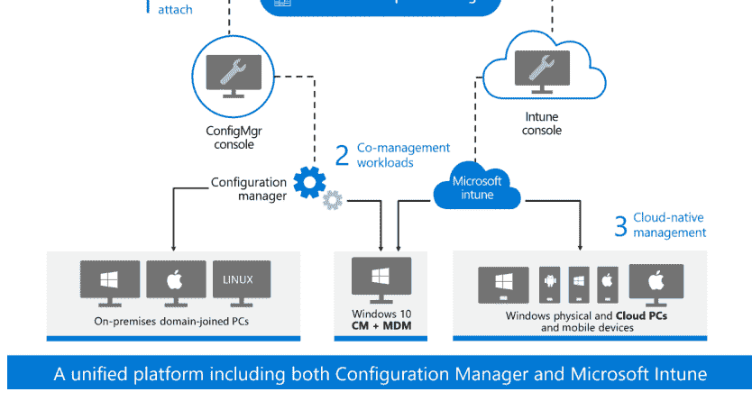
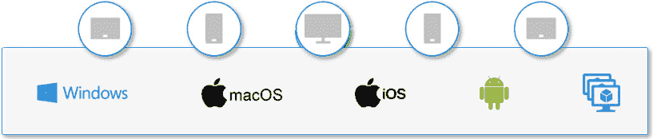
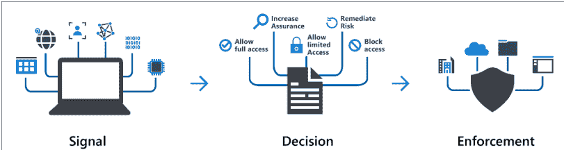

## 2 什么是统一端点管理？

现代管理的基础有时难以理解。您将了解现代管理和零信任的概念，以及作为 Microsoft Endpoint Manager 一部分的 Intune，及其历史和架构概念，从而清楚地理解所有设备——物理设备、虚拟设备和移动设备——如何汇聚到一个管理控制台中。

在本章中，我们将讨论以下主题：

- 现代管理之路
- Microsoft Endpoint Manager 和 Intune
- 深入了解 Windows 10 企业版
- 自带设备
- 什么是零信任？

### Microsoft Endpoint Manager 和 Intune

什么是统一端点管理？通过 **Microsoft Endpoint Manager** 的概念，它又是怎样的？下图的高级架构图解释了 Microsoft Endpoint Manager 中的一切如何汇聚为统一的端点管理体验。

通过 **Windows 365** 端点和移动设备，一个控制台即可管理您的物理和云 PC。这是唯一可以统一管理它们的地方。此外，Intune 公司门户可以部署来自 Configuration Manager、Intune、Windows 365、Azure Virtual Desktop 和 Azure Active Directory 的应用——为所有应用提供统一的最终用户体验！

图 2.2 – Microsoft Endpoint Manager 架构图

上图中的 Microsoft Endpoint Manager 架构展示了使用 Configuration Manager 和 Intune 在单一、统一端点管理解决方案中进行云管理之旅的三个阶段：

1. 租户附加
2. 共同管理工作负载
3. 云原生管理

所有新的 Windows 设备都应直接通过 **Azure Active Directory（Azure AD）** 进入云，并自动注册到 Intune。如果您的组织已经拥有 Configuration Manager 环境，且正在向本地托管设备部署大量应用程序，那么这可以利用 Windows Autopilot 为 IT 和最终用户提供最佳入门体验。

对于现有设备，请开始使用租户附加功能，该功能为 Configuration Manager 客户提供了最灵活的路径，无需将 Windows 客户端注册到 Intune 即可开始获得云优势。将 Configuration Manager 环境连接到云，并立即获得大量远程操作和终结点分析。

如果您的组织已准备好进入下一步，则可以开始将 Windows 设备载入到共同管理状态，这意味着同时使用 Configuration Manager 和 Intune 管理 Windows 客户端。一次将一个工作负载迁移到云，从而兼得两者之优势。

## Endpoint Manager 管理中心门户

Microsoft Endpoint Manager 管理中心门户（`https://endpoint.microsoft.com/#home`）是您创建策略和管理设备的全面一站式管理体验。它允许 IT 管理员接入其他关键设备管理服务，例如组、安全基线和设置、条件访问、分析工具和报告。

**Microsoft Intune** 是 100% 基于云的 MDM 和 **移动应用程序管理（MAM）** 提供商，适用于您的应用和设备。Microsoft Intune 允许您控制 Android、Android Enterprise、iOS/iPadOS、macOS 和 Windows 10 设备上的功能和设置。它与其他服务集成，包括 Azure AD 和移动威胁防御。

Microsoft Intune 可以创建合规性策略并检查合规性状态，从而将设备标记为合规或不合规。如果您已在 Microsoft 365 云环境中启用条件访问，则可以利用 Intune 中的合规性状态来允许或阻止对公司数据的访问。

Intune 还可用于应用程序生命周期管理。

## Microsoft 365 管理中心门户

在 Microsoft 365 管理中心门户（`https://admin.microsoft.com`）中，您可以管理和掌管所有 Microsoft 365 云服务。您在此门户中最常见的任务是购买和分配 Microsoft 服务的许可证。

以下是通过 Microsoft 365 管理中心可以执行的操作的完整列表：

| 菜单 | 用途 |
|------|---------------|
| 主页 | 这是管理中心中的登陆页面。您将看到在哪里管理用户、计费、服务运行状况和报告。 |
| 用户 | 创建和管理组织中的用户，例如员工或学生。您还可以设置其权限级别或重置其密码。 |
| 组 | 创建和管理组织中的组，例如 Microsoft 365 组、通讯组、安全组或共享邮箱。了解如何创建 (https://docs.microsoft.com/en-us/microsoft-365/admin/create-groups/create-groups?view=o365-worldwide) 和管理 (https://docs.microsoft.com/en-us/microsoft-365/admin/create-groups/manage-groups?view=o365-worldwide) 组。 |
| 资源 | 创建和管理资源，例如 SharePoint 网站集。了解如何创建网站集 (https://docs.microsoft.com/en-us/sharepoint/create-site-collection)。 |
| 计费 | 查看、购买或取消组织的订阅。查看过去的账单或查看分配给各个用户的许可证数量。了解如何管理计费 (https://docs.microsoft.com/en-us/microsoft-365/commerce/?view=o365-worldwide)。 |
| 支持 | 查看现有服务请求或创建新的服务请求。在“联系业务产品支持 – 管理员帮助”(https://docs.microsoft.com/en-us/microsoft-365/business-video/get-help-support?view=o365-worldwide) 中了解更多信息。 |
| 设置 | 管理应用（例如电子邮件、网站和 Office 套件）的全局设置。更改密码策略和过期日期。添加和更新域名，例如 contoso.com。更改组织配置文件并选择发布首选项，以及选择合作伙伴是否可以访问您的管理中心。 |
| 安装 | 管理现有域，启用和管理 **多因素认证（MFA）**，管理管理员访问权限，将用户邮箱迁移到 Office 365，管理功能更新，并帮助用户安装其 Office 应用。 |
| **报告** | 一目了然地查看您的组织如何使用 Microsoft 365，包括电子邮件使用、Office 激活等的详细报告。了解如何使用新的活动报告 (https://docs.microsoft.com/en-us/microsoft-365/admin/activity-reports/activity-reports?view=o365-worldwide)。 |
| **运行状况** | 一目了然地查看运行状况。您还可以查看更多详细信息和运行状况历史记录。有关详细信息，请参阅 *如何检查 Microsoft 365 服务运行状况* (https://docs.microsoft.com/en-us/microsoft-365/enterprise/view-service-health?view=o365-worldwide) 和 *如何检查 Windows 版本运行状况* (https://docs.microsoft.com/en-us/windows/deployment/update/check-release-health)。  使用消息中心跟踪即将对功能和服务进行的更改。我们在其中发布公告，提供有助于您规划变更并了解其可能对用户产生何种影响的信息。在此处获取更多详细信息：*消息中心* (https://docs.microsoft.com/en-us/microsoft-365/admin/manage/message-center?view=o365-worldwide)。 |
| **管理中心** | 为 Exchange、Skype for Business、SharePoint、Yammer 和 Azure AD 打开单独的管理中心。每个管理中心都包含该服务的所有可用设置。  例如，在 Exchange 管理中心中，设置和管理电子邮件、日历、通讯组等。在 SharePoint 管理中心中，创建和管理网站集、网站设置和 OneDrive for Business。在 Skype for Business 管理中心中，设置即时消息通知、拨入会议和在线状态。  在 *Exchange Online* (https://docs.microsoft.com/en-us/exchange/exchange-admin-center) 和 *Microsoft 365 中的 SharePoint 简介* (https://docs.microsoft.com/en-us/sharepoint/introduction) 中了解有关 Exchange 管理中心的更多信息。  注意：您可用的管理中心取决于您的计划和区域。 |

## 什么是统一终结点管理？

作为 Endpoint Manager 的一部分，共同管理使用云功能，包括条件访问。您可以将某些任务保留在本地，同时使用 Intune 在云中运行其他任务。

共同管理支持以下工作负载：

- 合规性策略
- Windows 更新策略
- 资源访问策略
- 终结点保护
- 设备配置
- Office 即点即用应用
- 客户端应用

### 合规性策略

合规性策略定义了设备必须遵守的规则和设置，才能被条件访问策略视为合规。此外，从 Configuration Manager 评估规则开始，可以使用合规性策略独立于条件访问监视和修正设备的合规性问题。

### Windows 更新策略

**Windows 更新企业版（WUfB）** 策略允许您将 WUfB 策略配置为环形概念，以便您可以决定何时以及如何为 Windows 10 及更高版本的设备提供服务。

您可以为直接由 WUfB 管理的 Windows 10 及更高版本的设备配置 Windows 10 功能更新或质量更新的延迟策略。

在 Intune 中，您还可以选择配置 Windows 10 功能更新。此策略允许设备更新到您指定的 Windows 版本，并且不会在那些设备上升级到更新的 Windows 功能版本。您在 Windows 10 及更高版本功能更新策略中指定的 Windows 功能版本将保留在设备上，直到您选择更改策略设置。虽然功能版本保持静态，但设备将继续下载和安装该功能版本可用的质量更新和安全更新。

### 资源访问策略

资源访问策略在 Windows 10 及更高版本的设备上配置**虚拟专用网络（VPN）**、Wi-Fi、电子邮件和证书设置。

## 端点保护

端点保护工作负载包括 Windows Defender 系列的恶意软件防护功能：

- **防病毒：** 防病毒策略帮助安全管理员专注于管理以下设置：适用于 Intune 管理设备的 Microsoft Defender 防病毒、Microsoft Defender 排除项以及 Windows 安全体验。
- **磁盘加密：** 端点安全磁盘加密配置文件仅关注与设备内置加密方法（如 BitLocker）相关的设置。这使得 IT 管理员能够部署并自动加密最终用户的 Windows 设备。
- **防火墙：** 使用 Intune 中的端点安全防火墙策略，为运行 Windows 10 的设备配置设备内置防火墙。防火墙策略分为两种：防火墙策略本身和防火墙规则策略。
- **端点检测和响应：** 当你将 Microsoft Defender for Endpoint 与 Intune 集成时，请使用针对**端点检测和响应 (EDR)** 的端点安全策略来管理 EDR 设置并将设备载入 Microsoft Defender for Endpoint。
- **攻击面减少：** 当你的 Windows 10 设备上正在使用 Defender 防病毒时，请使用 Intune 端点安全策略进行攻击面减少，以管理这些设备的设置。

攻击面减少策略分为不同的策略：

- A. 应用和浏览器隔离
- B. 设备控制
- C. 攻击面减少规则
- D. 漏洞利用保护
- E. Microsoft Edge Legacy 的 Web 保护
- F. 应用程序控制

- **帐户保护：** 帐户保护策略帮助你保护用户的身份和帐户。帐户保护策略专注于 Windows Hello 和 Credential Guard 的设置，这是 Windows 身份和访问管理的一部分。

当你切换此工作负载时，Configuration Manager 策略会保留在设备上，直到 Intune 策略覆盖它们。此行为确保设备在转换期间仍然具有保护策略。

端点保护工作负载也是设备配置的一部分。当你切换设备配置工作负载时，也会应用相同的行为。当你切换设备配置工作负载时，它还包括 Windows 信息保护功能的策略，而该功能不包含在端点保护工作负载中。

作为 Intune 设备配置设备限制配置文件类型一部分的 Microsoft Defender 防病毒设置不在端点保护滑块的范围内。要为启用了端点保护滑块的共同管理设备管理 Microsoft Defender 防病毒，请在 **Microsoft Endpoint Manager 管理中心 | 端点安全 | 防病毒**中使用新的防病毒策略。新的策略类型提供了新的和改进的选项，并支持设备限制配置文件中可用的所有相同设置。

Windows 加密功能包括 BitLocker 管理。我们将在*第 10 章 高级策略管理*和*第 13 章 身份与安全管理*中更多地讨论 BitLocker。

## 设备配置

设备配置工作负载包括你为组织中的设备管理的设置。切换此工作负载也会移动资源访问和端点保护工作负载。

即使 Intune 是设备配置权威，你仍然可以将设置从 Configuration Manager 部署到共同管理的设备。此例外可能用于配置你的组织需要但 Intune 中尚不可用的设置。在 Configuration Manager 配置基线上指定此例外。创建基线时，启用即使对于共同管理的客户端也始终应用此基线的选项。你可以在现有基线属性的**常规**选项卡中稍后更改它。

有关 Intune 功能的更多信息，请参阅 Microsoft Intune 中的**创建设备**配置文件。

## Office 即点即用应用

除非设备重新启动，否则 Office 更新可能需要大约 24 小时才能显示在客户端上。

Office 365 应用程序由 Intune 管理。Intune 中的此条件默认作为新 Microsoft 365 应用程序的要求添加。当你转换此工作负载时，共同管理的客户端不满足应用程序的要求，因此它们不会安装通过 Configuration Manager 部署的 Microsoft 365。

移动工作负载后，从 Microsoft Intune 分配的 Microsoft 365 应用会显示在设备上的公司门户中。

## 客户端应用

使用 Intune 管理共同管理的 Windows 10 设备上的客户端应用和 PowerShell 脚本。转换此工作负载后，从 Intune 部署的任何可用应用都将在公司门户中提供。你从 Configuration Manager 部署的应用在软件中心和公司门户中可用。公司门户可以将 SCCM 和 Intune 的可用应用显示为一个最终用户软件门户。

## 桌面分析

**桌面分析**是一项与 Configuration Manager 集成的基于云的服务。它提供见解和智能，帮助你更明智地决定 Windows 客户端的更新就绪情况。该服务将你组织的数据与从连接到 Microsoft 云的数百万台设备聚合的数据相结合。它提供有关组织中安全更新、应用和设备的信息，并识别应用和驱动程序的兼容性问题。为最有可能为整个组织的资产提供最佳见解的设备创建试点。

作为 Endpoint Manager 的一部分，使用桌面分析的云驱动见解来保持 Windows 10 设备的最新状态。桌面分析需要设备上的 SCCM 客户端，仅使用 Intune 不受支持。

**Windows Autopilot**：Windows Autopilot 设置并预配置新设备，使其准备好使用。它旨在简化 Windows 设备的生命周期，无论是对 IT 还是最终用户，从初始部署到生命周期结束。

作为 Endpoint Manager 的一部分，使用 Autopilot 预配置设备并自动在 Intune 中注册设备。你还可以将 Autopilot 与 Configuration Manager 和共同管理集成，以实现更复杂的设备配置（预览版）。

强烈建议在仅 Azure AD 环境中使用 Windows Autopilot，以利用整个 Windows Autopilot 功能套件，例如 Autopilot 重置和 Autopilot 中的共同管理。

**Azure AD：** Endpoint Manager 使用 Azure AD 来识别设备、用户、组和 MFA。Azure AD Premium 是 Microsoft 365 许可证的一部分，具有额外的功能来帮助保护设备、应用和数据，包括动态组、自动注册和条件访问。Windows Autopilot 也需要 Azure AD Premium，因为自动注册是先决条件。

**Endpoint Manager 管理中心：** 管理中心是一个一站式网站，用于创建策略和管理设备。它与其它关键设备管理服务集成，包括组、安全、条件访问和报告。

Microsoft Endpoint Manager 是用于管理所有设备的集成解决方案。Microsoft 将 Configuration Manager 和 Intune 整合到一个名为 Microsoft Endpoint Manager 管理中心的单一控制台中。

从 Configuration Manager 版本 2002 开始，你可以将 Configuration Manager 设备上传到云服务，并从管理中心的**设备**边栏选项卡执行操作：

- **客户端详细信息**：此功能为 IT 管理员或帮助台提供属性和设备状态的快速概览。
- **安装应用程序**：此功能为 IT 管理员或帮助台提供将应用程序部署到最终用户设备的选项。
- **设备时间线**：设备每天向管理中心发送一次事件。只有在客户端收到启用 Endpoint analytics 数据收集策略后收集的事件才在管理中心可见。通过安装应用程序或从 Configuration Manager 安装更新，或重新启动设备，可以轻松生成测试事件。事件保留 30 天。使用图表查看已收集的事件。
- **资源浏览器**：从 Microsoft Endpoint Manager 管理中心，你可以使用资源浏览器查看已上传的 Configuration Manager 设备的硬件清单。
- **运行脚本**：此选项允许其他 IT 管理员或帮助台实时从云中针对单个 Configuration Manager 管理的设备运行 PowerShell 脚本。这提供了 PowerShell 脚本的所有传统优势，这些脚本已由本地环境中的 Configuration Manager 管理员定义和批准。

最常见的批量激活方法要求设备连接到组织网络，或通过 VPN 连接，以便定期与组织的激活服务*签到*以维护其许可证。然而，当人们在家工作且不在公司或学校网络中时，其设备接收或维护激活的能力会受到限制。

有几种方法可以进行 Windows 激活：

- 密钥管理服务
- 多次激活密钥
- 基于 Active Directory 的激活
- Windows 10 订阅激活

## 通过 Windows 365 云电脑使用 Windows

前面的激活 Windows 10 企业版的选项已内置到 Windows 365/云电脑中。如果你打算在 Azure 上自行管理和部署虚拟桌面，这意味着 Windows 10 企业版将通过 Azure **密钥管理服务 (KMS)** 自动激活。

## Azure KMS – 云电脑/Windows 365/AVD

如果你的 Windows 桌面是虚拟的并在 Azure 上运行，例如使用 **Azure 虚拟桌面 (AVD)**，你需要连接到 Azure `kms.core.windows.net:1688` KMS 服务器才能激活你的虚拟机。使用 Azure 映像库中的映像时，这会自动发生。确保你的 Azure **虚拟网络 (vNET)** 能够连接到该地址，并相应配置防火墙策略和规则。稍后将在云电脑/Windows 365 和要求章节中了解更多相关内容。

Windows 11 将在今年秋季晚些时候该操作系统正式发布后加入产品阵容。本书后面还会介绍更多关于 Windows 11 的内容。

通过 Active Directory 激活的设备在与域最近一次联系后的最多 180 天内保持激活状态。设备会在此期间结束前定期尝试重新激活（默认每 7 天一次），并在 180 天结束时再次尝试。

## Windows 10 及更高版本的订阅激活

从 Windows 10 版本 1703 开始，Windows 10 专业版支持订阅激活功能，如果用户订阅了 Windows 10 企业版 E3 或 E5，则可以自动从 Windows 10 专业版*升级*到 Windows 10 企业版。

借助 Windows 10 版本 1703，Windows 10 企业版 E3 和 Windows 10 企业版 E5 都可以作为在线订阅服务提供。现在，在组织中部署 Windows 10 企业版无需密钥，也无需重启。

## 适用于 Windows 10 版本 1703 或更高版本

拥有当前 Windows 10 专业版许可证的设备可以无缝升级到 Windows 10 企业版。基于产品密钥的 Windows 10 企业版软件许可证可以转换为 Windows 10 企业版订阅。

拥有企业协议的组织也可以使用传统的加入 Active Directory 的设备，从这项新服务中受益。在这种情况下，在其设备上登录的 Active Directory 用户必须使用 Azure AD Connect 同步与 Azure AD 进行同步。

订阅激活功能消除了在每台目标设备上手动部署 Windows 10 企业版或教育版映像，然后建立本地密钥管理服务（例如基于 KMS 或 MAK 的激活）、输入**通用批量许可密钥 (GVLK)**，以及随后重启客户端设备的需要。

## WUfB 是管理 Windows 服务的新方式

WUfB 允许 IT 专业人员利用基于云的 Windows 更新服务来部署和管理 Windows 更新。你可以使用组策略或 MDM 解决方案（如 Microsoft Intune）来配置 WUfB 设置，以控制 Windows 10 设备的更新方式和时间。

WUfB 自 Windows 10 版本 1511 起可用，并在后续 Windows 10 版本中得到了增强。其中一些改进旨在为 IT 专业人员提供更大的控制权，同时为最终用户提供更好的体验。

## 谁应该使用 WUfB？

WUfB 面向组织中管理的运行 Windows 10 教育版、专业版或企业版的设备。WUfB 不支持 Windows 10 **长期服务渠道 (LTSC)**：

- 所有组织都可以利用它来更高效地维护其联网设备。
- 中小型企业可以在继续使用 Windows 更新的同时获得灵活性，并且比之前不使用 System Center Configuration Manager、Microsoft Intune、**Windows Server 更新服务 (WSUS)** 或第三方解决方案时拥有更多控制。

## 为什么需要 WUfB？

WUfB 可以帮助你为最终用户提供最佳的 Windows 更新体验，并降低维护 Windows 的成本，同时为你提供许多更复杂、更耗时的解决方案所具备的灵活性和控制力：

- 降低批准、部署和监控更新的成本。
- 管理组织生态系统中的应用程序兼容性。
- 找到合适的权衡方案来保护设备，同时尽量减少对员工工作的干扰。
- 管理支持快速更新速度所需的基础设施配置，包括找到合适的方法来处理很少连接到企业的设备。

## WUfB 允许我配置什么？

当你使用配置设置从 Microsoft Intune 配置 WUfB 策略时，WUfB 将被启用。如果你传统上使用 WSUS 进行服务，一旦你设置了 WUfB 设置，你的客户端将同时连接到云中的 Windows 更新以及你的 WSUS 服务器。如果你想更改此行为，则需要删除端点上旧的 WSUS 配置设置。

通过 Windows 更新客户端设置（通过组策略、MDM 或 UX），WUfB 提供了延迟应用更新的能力。质量更新和功能更新分开处理，以提供更大的灵活性。

此外，如果你需要在早期环中测试更新后有时间对更新实施补救，则可以利用“暂停”功能：

- **功能更新**：以前称为**升级**，功能更新不仅包含安全性和质量修订，还包含重要的功能新增和更改。功能更新于每年秋季和春季每半年发布一次。
- **质量更新**：质量更新是传统的操作系统更新，通常于每月第二个星期二发布（尽管它们可以随时发布）。其中包括安全更新、关键更新和驱动程序更新。WUfB 还将非 Windows 更新（例如 Microsoft Office 或 Visual Studio 的更新）视为质量更新。这些非 Windows 更新称为 **Microsoft 更新**，你可以设置设备在接收 Windows 更新的同时接收（或不接收）此类更新。
- **驱动程序更新**：适用于与你设备相关的非 Microsoft 驱动程序的更新。驱动程序更新默认开启，但如果你愿意，可以使用 WUfB 策略将其关闭。
- **Microsoft 产品更新**：其他 Microsoft 产品的更新，例如通过 Windows Installer (MSI) 安装的 Office 版本。通过 Click-to-Run 安装的 Office 版本无法使用 WUfB 更新。产品更新默认关闭。你可以使用 WUfB 策略将其开启。

Windows 10 功能更新策略与你的*Windows 10 更新环*策略协同工作，以防止设备收到比功能更新策略中指定的值更新的 Windows 功能版本。

要使 Windows 10 功能更新策略生效，需要 Windows 10 版本 1709 或更高版本。设备需要注册到 Intune MDM，并加入混合 AD、加入 Azure AD 或注册到 Azure AD。Windows 遥测需要打开，最低设置为“基本”。如果遥测关闭，Windows 可能会升级到比功能更新策略中定义的版本更高的 Windows 版本。

当设备收到 Windows 10 功能更新策略时，该设备将更新到策略中指定的 Windows 版本。已经运行更高版本 Windows 的设备将保持当前版本不变。通过冻结版本，设备的功能集将在策略有效期内保持稳定。

当设备对某个 Windows 版本存在保护暂停时，该设备将不会安装更新。当设备评估更新版本的适用性时，如果存在未解决的已知问题，Windows 会创建临时的保护暂停。一旦问题得到解决，该暂停即被移除，设备随后便可以更新。

与使用更新环中的**暂停**（有效期为 35 天）不同，Windows 10 功能更新策略会一直生效。在您修改或移除 Windows 10 功能更新策略之前，设备不会安装新的 Windows 版本。如果您编辑策略以指定较新的版本，设备随后即可安装该 Windows 版本中的功能。

如今，Windows 10 有 3000 多个组策略设置。尽管 Microsoft 针对不同的安全功能提供了大量指导，但要逐一探究每个设置仍可能需要很长时间。您需要自行确定每个设置的影响，然后为每个设置确定合适的值。

适用于 Windows 10 的 WUfB 提供了一组可配置的策略，只要设备具有 Internet 连接，即可通过配置以下多个领域的策略设置，在更新时提供最安全的 Windows 环境，同时保持最佳最终用户体验：

- 配置截止日期
- 重启行为
- 考虑低活动设备（活动时间）
- 传递优化
- 电源策略

在保持软件更新合规性的需求与维持员工生产力的愿望之间，始终存在一种张力。虽然安全部门要求在软件更新后的 7 天内看到设备群完全更新，但现实是，部署所述更新会给用户带来相关成本，而且很少有公司能够在单个工作日的中间向全体员工推送更新，除非是紧急情况下的零日补丁。

鉴于“受保护的劳动力”和“高生产力的劳动力”这两个目标相互竞争，您可能会发现，您需要做出的选择可能不是最大化更新速度的最佳选项，而是更符合企业生产力需求的体验。

## 自带设备 (BYOD)

BYOD 根据 Windows SKU 的不同而提供不同的选项。所有 BYOD 场景都可以利用 Windows 365 和 Azure 虚拟桌面，以远程应用的形式访问完整桌面或单个应用程序。

Windows 设备也可以注册到 Azure AD，以访问公司资源，例如电子邮件。

将设备作为个人拥有的设备 (BYOD) 注册到 Intune。如果管理员已配置自动注册（可通过 Azure AD Premium 订阅获得），则用户只需输入一次凭据。否则，他们必须通过仅限 MDM 的注册单独注册，并重新输入凭据。

Microsoft Intune 管理在 BYOD 上无法提供相同的管理功能；并非所有 Windows 版本都内置相同的 MDM 管理设置：

图 2.5 – Microsoft Endpoint Manager 终结点支持

Windows 10 企业版具有完整的管理功能，而家庭版和专业版由于 Windows 的限制，管理功能较少。Microsoft 为 IT 管理员提供了利用注册限制的选项，以便您可以阻止个人注册到 Microsoft Intune。

## 什么是零信任？

过去，组织在创建对公司网络的远程访问时，通常通过 VPN 连接实现访问，无论是在公司所有还是个人所有的 Windows 设备上，都仅由 MFA 令牌保护。

如今，组织需要一种新的安全模型，它能够有效适应现代环境的复杂性，支持移动办公人员，并保护人员、设备、应用程序和数据，无论它们位于何处。

这就是零信任的核心。零信任模型不相信企业防火墙背后的一切都是安全的，而是假定已发生入侵，并像验证来自不受控制网络的请求一样验证每个请求。无论请求来自何处或访问什么资源，零信任模型都教导我们“永不信任，始终验证”。

### 验证身份

当今大多数安全漏洞都涉及凭据窃取，而网络卫生方面的疏失会放大员工乃至整个组织的潜在风险。这就是为什么零信任系统的主要组件之一是在授予对公司网络的访问权限之前验证用户身份的能力。

首先，通过 Azure Authenticator 的现代体验和 Windows Hello 企业版，在所有 Windows 10 设备上实施 MFA。

### 验证设备

由于不受管理的设备是恶意行为者的易入点，确保只有健康且受信任的设备才能访问关键应用程序和数据，对企业安全至关重要。我们零信任实施的一个基本部分是将所有最终用户设备注册到设备管理系统（如 Microsoft Intune）中。

通过这种方式启用合规性策略，检查设备的 BitLocker 加密、安全启动和设备健康验证等参数，对于管理控制对公司资源访问的策略至关重要。

Microsoft Endpoint Manager 是这种新思维方式的关键组成部分，因为它通过合规性策略验证设备是否符合要求，从而使设备成为受信任的设备。

条件访问是 Azure AD 内置的工具，用于汇集信号、做出决策并强制执行组织的条件访问策略：

- **信号**：设备或用户通过特定应用程序或浏览器登录。
- **决策**：根据策略，您将被授予什么级别的访问权限。
- **强制执行**：这可能很简单，例如通过 MFA 令牌授予最终用户访问权限，或拒绝访问：

图 2.6 – 零信任验证设备示意图

## 问题

1. 现代管理与市场上的其他管理解决方案有何不同？

   A. 通过统一的管理门户体验，对设备进行安全管理。

   B. 它为移动设备管理提供了更多功能。

   C. 其他解决方案不支持 Windows 10 企业版。

2. 零信任背后的主要原则是什么？

   A. 永不信任，始终验证。

   B. 始终信任，永不验证。

## 答案

1. (A)
2. (A)

## 延伸阅读

读完本章后，如果您想了解更多关于现代管理的内容，请使用以下免费在线资源之一：

- 推动我们 Microsoft Endpoint Manager 愿景的现代管理和安全原则 – Microsoft Tech Community：https://techcommunity.microsoft.com/t5/microsoft-endpoint-manager-blog/modern-management-and-security-principles-driving-our-microsoft/ba-p/946797
- Microsoft 365 中的现代管理简介：https://docs.microsoft.com/en-us/learn/modules/introduction-to-modern-management-in-microsoft-365/
- 使用 Microsoft Endpoint Manager 进行现代管理 – YouTube：https://www.youtube.com/watch?v=103UXEnIOFg
