## Introducing
Windows 365

在本章中，你将从概念层面了解有关 Windows 365 的所有必要信息。

阅读完本章后，你将更了解使用 Windows 365 的好处以及不同的服务组件。在下一章中，你将学习如何部署它！

本章内容非常全面——我们将介绍以下主题：

- What is Windows 365?
- Microsoft Endpoint Configuration Manager support

## What is Windows 365?

用户希望技术熟悉、易于使用且始终可用，以便他们能够在不同设备间流畅地工作和创作。Cloud PC 通过将云的强大功能和安全性与 PC 的熟悉感相结合，使这一切成为可能。只有微软能够将 PC 和云结合起来，提供一致且集成的 Windows 体验。Windows 365 是全球首个云 PC。借助 Windows 365 Cloud PC，Windows 从基于设备的操作系统演变为混合个性化计算。

Cloud PC 是你的个性化桌面、应用、设置和内容，通过安全流式传输从云端到你的设备。在 Microsoft Endpoint Manager 中部署和管理虚拟终端时，降低了环境复杂性，无需额外的 **Virtual Desktop Infrastructure (VDI)** 专业知识或资源。

Windows 365 为你提供了 Windows 的所有优势，而没有任何传统硬件限制，因为你的桌面在 Azure 云中运行。

你可以在以下列表中找到该服务的全部主要原则：

- 在 Microsoft Endpoint Manager 中部署和管理虚拟终端；无需额外的 VDI 专业知识或资源。
- 在几分钟内采购、配置和部署，并可选择自动操作系统更新。
- 从任何地方访问你的个性化 Windows 桌面体验。
- 为弹性劳动力量身定制计算和配置。
- 在你选择的设备上继续上次的工作。
- 在 Windows 终端上优化体验。
- 以按用户计费的方式自信扩展。

## Removing the complexity of traditional VDI deployments

所有构建块都已为你自动化，并且服务会以最优化的方式随你扩展以使用 Microsoft 365 应用。这是微软对 Windows 和 Microsoft 365 的最佳表达，并且始终安全且保持最新。

Cloud PC 可以从任何设备在任何地方访问，并且可以根据用户不断变化的计算需求进行扩展，这意味着用户可以获得自助服务权限，从而使 IT 管理员无需分配提供更多计算资源的许可证。存储升级和 Cloud PC 重启也适用——稍后会详细介绍。

## Why virtualize Windows in the cloud?

对你们中的一些人来说，这可能听起来是常识。然而，如果你对在云上运行的虚拟化桌面带来的好处了解不多，这里有一个快速概述：

- **Mobility** – 用户可以从任何设备、任何地方访问 Cloud PC。
- **Security** – 业务数据永远不会离开云。
- **Scalability** – 适应劳动力波动。
- **Compatibility** – 旧应用可以虚拟化运行。
- **Performance** – 应用更接近数据。
- **Management** – 一个镜像供多位用户使用。
- **Cost** – 利用云的灵活性。

## Removing complexity while increasing security

Windows 365 在各方面都减少了复杂性，同时也提高了终端的安全级别。该服务完全由 Microsoft Defender for Endpoints 和零信任原则支持，并增强了 Azure AD 条件访问规则的支持——保护你的虚拟桌面从未如此易于配置。

## Low costs as a fixed-price model

另一个巨大的好处是成本，因为该服务可以降低维护 VDI 环境或任何其他用例的当前成本，例如远程员工通过昂贵且不可靠的 VPN 连接连接。所有服务均采用订阅模式构建，也符合大多数企业的 CapEx 需求。

以下比较模型完美展示了传统远程桌面服务（基于会话）和 VDI 与 Azure Virtual Desktop 和 Windows 365 之间的差异：

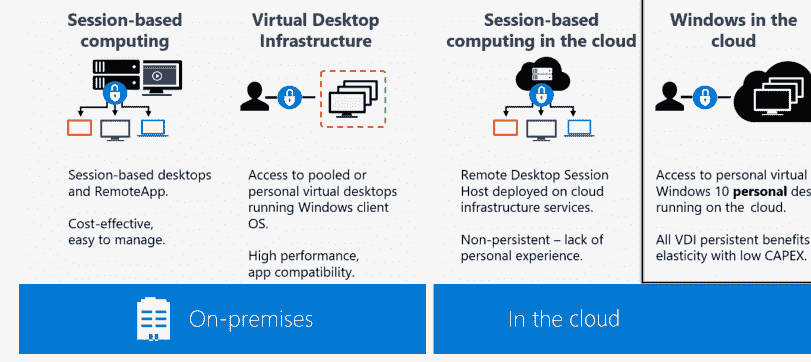

Figure 3.1 – Comparison between an on-premises and in-the-cloud environment

Windows 365 是一种固定价格服务，其个人桌面体验完全通过 Microsoft Endpoint Manager 管理。

## Comparing Windows 365 Enterprise and Business

Windows 365 有两个版本，一个可通过 Microsoft Endpoint Manager 完全管理和配置（本书主要涵盖），称为 **Windows 365 Enterprise**，另一个称为 **Windows 365 Business**，你需要自行提供更多服务，例如应用交付和管理。

客户可以直接从 Microsoft 365 管理中心门户购买 Windows 365 Business，无需域即可设置其帐户，并直接从 Windows 365 在线主页配置和管理其 Cloud PC。

无需其他 Microsoft 许可证——如果你愿意，只需一张信用卡即可开始。Windows 365 Business 适用于希望在其组织内为 300 个或更少用户部署 Cloud PC 的客户。

Windows 365 Business 允许客户在从 Microsoft 365 管理中心将许可证分配给用户后直接开始配置 Cloud PC。无需 IT 管理员交互。用户在许可证分配后不到一小时即可访问 Cloud PC 并开始工作！

在下表中，你可以找到每个产品可用的功能列表，以便在每个场景中更轻松地做出决定：

|  | Windows 365 Business | Windows 365 Enterprise |
|---|---|---|
| Click to provision directly from the product page | ● |  |
| "No-domain" set up | ● |  |
| Self-serve troubleshooting – reset | ● |  |
| "Cloud Save" (minimal Azure storage and potentially **OneDrive for Business (ODfB)**) | ● | ● |
| Self-serve upgrades |  | ● |
| **Universal Print (UP)** integration |  | ● |
| Partner/programmatic enablement (Graph APIs, **Managed service providers (MSP)** tooling) |  | ● |
| Custom images |  | ● |
| Image management (store, replicate, deploy) |  | ● |
| MEM policy-driven provisioning, management, and guided scenarios |  | • |
| EA-based reporting, monitoring |  | • |
| Service health, operational health alerts |  | • |
| Connection to on-premises (networks, apps, resources) and diagnostics |  | • |
| Advanced MEM-based troubleshooting and device management |  | • |

我们想为你提供更多关于 Windows 365 Business 版本产品的信息。在 Enterprise 中，有一些先决条件，并且需要 Microsoft Endpoint Manager 才能为大型组织提供受支持的配置。

然而，Windows 365 Business 只需通过 Microsoft 365 管理中心将许可证分配给用户即可开始 Cloud PC 的配置流程。在分配 2vCPU/8 GB/128 GB Cloud PC 许可证后，用户可以直接前往 windows365.microsoft.com 门户访问其工作区：

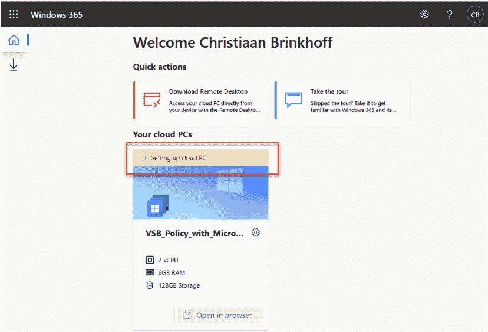

Figure 3.2 – Windows 365 Business – provisioning a Cloud PC

由于原生 Azure AD 的支持，这种简单流程成为可能，该支持将在 Enterprise 产品 H2CY22 中推出。配置完成后，用户可以直接登录其 Cloud PC：

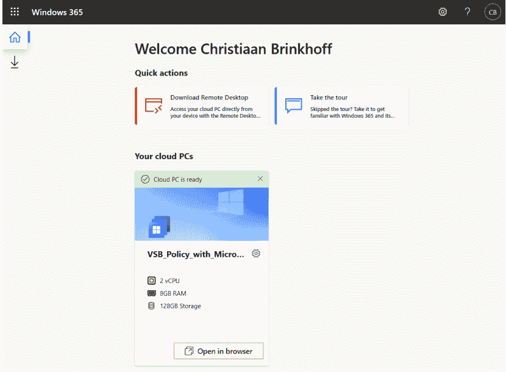

Figure 3.3 – Windows 365 Business Cloud PC ready

我们现在已经解释了不同产品之间的所有差异，因此你可以做出正确的决定，Business 或 Enterprise 更适合。让我们现在切换到 Microsoft Endpoint Manager，并告诉你更多关于 Windows 365 Enterprise 的信息。

## Microsoft Endpoint Manager

Windows 365 与 Microsoft Endpoint Manager 协同工作，因此本书名为 *Mastering Microsoft Endpoint Manager.*


从 **Devices** 刀片中，您将获得访问 Windows 365 – 云 PC 服务 – 的权限，您可以在其中找到显示环境状态的 **Overview** 仪表板屏幕：

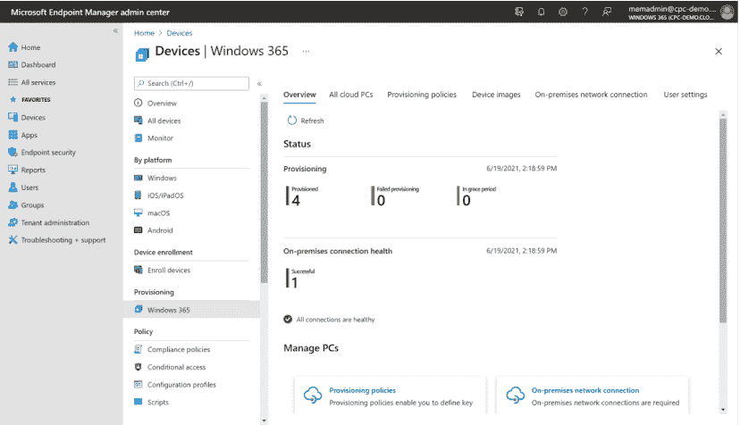

图 3.4 – Overview 仪表板

当您在菜单中进入 **Devices** 并向下滚动到 **Provisioning** 时，您将找到开始创建您的 Cloud PCs 的位置：

| Device name | Provisioning policy | Image | OPNC | PC type | Status |
|---|---|---|---|---|---|
| CPC-Nila-E7R-A9 | East US – Finance users | Windows 10 Enterpris... | East US Office location | Windows 365 Enterpri... | Provisioned |
| CPC-Christia-MP | East US – Finance users | Windows 10 Enterpris... | East US Office location | Windows 365 Enterpri... | Provisioned |
| CPC-mason-OQ-L6 | East US – Finance users | Windows 10 Enterpris... | East US Office location | Windows 365 Enterpri... | Provisioned |
| CPC-Natasjal-L5 | East US – Finance users | Windows 10 Enterpris... | East US Office location | Windows 365 Enterpri... | Provisioned |

图 3.5 – Provisioning Cloud PCs

本章后面将介绍所有先决条件步骤以及配置 Cloud PCs 的主要步骤。

## High-level architecture components and responsibilities

Windows 365 的架构相对简单易懂，与 Azure Virtual Desktop (AVD) 有所不同，因为某些对象现在位于 Microsoft 管理的环境中。

所有蓝色部分现在由 Microsoft 管理，而灰色元素由客户/合作伙伴负责。这与您需要自行负责大部分事物的解决方案不同，这意味着管理开销更大，很可能也更复杂。

Microsoft 作为 Windows 365 的一部分管理以下服务：

- Virtualization control plane（信息工作者（web access）门户、网关、连接代理、诊断和 REST API）
- Cloud PCs 和 Azure 计算服务（VMs、配置、Azure 订阅、Cloud PC VM 配置、自动扩展等）

客户和/或合作伙伴作为 Windows 365 的一部分管理以下组件：

- Azure Virtual Network（子网、ExpressRoute、S2S VPN 等）
- Microsoft Endpoint Manager（设备配置、设置目录、PowerShell 等）
- Azure Active Directory 配置（混合 Azure AD、条件访问、合规策略等）
- Active Directory Domain Services 配置（本地 AD、Azure AD Connect 等）
- 物理端点客户端（Windows、macOS、Linux、Android、iOS 等）

Microsoft Endpoint Manager 是所有其他服务的统一管理控制台，我们利用的其他服务包括 Azure AD、Defender for Endpoint、用于监控的 Desktop Analytics，以及 Intune 用于同时管理您的物理和云端点。

下图显示了 Windows 365 Enterprise 的高层架构，其中域配置为混合 Azure AD 加入。它概述了客户和合作伙伴作为服务的一部分所承担的不同职责，以及与其他 Microsoft Endpoint Manager 组件的紧密集成情况：

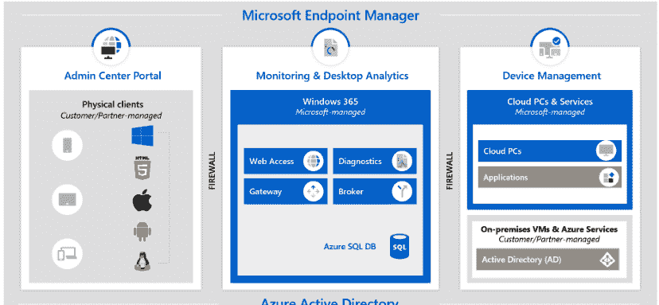

图 3.6 – Microsoft Endpoint Manager 和 Windows 365 架构

## Microsoft Endpoint Configuration Manager support

Configuration Manager 是用于管理位于您网络或基于互联网的桌面、服务器和笔记本电脑的本地管理解决方案。您可以使其云启用以集成 Intune、Azure AD、Microsoft Defender ATP 和其他云服务。使用 Configuration Manager 部署应用、软件更新和操作系统。您还可以监控合规性、实时查询和操作客户端，以及更多功能。

## Co-management and Windows 365

作为 Endpoint Manager 的一部分，您可以继续像以往一样使用 Configuration Manager。如果您准备将某些任务转移到云端，请考虑共管。

共管将您现有的本地 Configuration Manager 投资与云结合，使用 Intune 和其他 Microsoft 365 云服务。您可以选择 Configuration Manager 或 Intune 作为七个不同工作负载组的管控权限。

## Sizes and performance of fixed-price licenses

Windows 365 的工作方式与其他虚拟化服务略有不同。您的 Cloud PC 的性能由用户分配的许可证定义，通过 Microsoft 365 管理中心门户进行分配，与您为用户分配例如 Microsoft 365 E3/E5 许可证的方式相同。

有多个许可证反映不同的 VM 大小。考虑更多的 vCPU、RAM 和操作系统，以及配置文件存储。图形增强型大小将在不久的将来添加。

下表列出了今天可用的所有不同的 Cloud PC 许可证。GPU 增强型 Cloud PC 大小将很快添加，并且在您阅读本书时很可能已经可用：

| VM/OS disk size | Example scenarios | Recommended apps |
|---|---|---|
| 1vCPU/2 GB/64 GB | 第一线员工、呼叫中心以及教育/培训/CRM 访问。<br>注意：此 SKU 不支持 Windows 11。 | Office 轻量版（基于 Web）、Microsoft Edge、OneDrive、轻量型业务应用（例如呼叫中心应用 – Web 应用）、Defender 支持 |
| 2vCPU/4 GB/256 GB<br>2vCPU/4 GB/128 GB<br>2vCPU/4 GB/64 GB | 合并与收购、短期和季节性、客户服务、自带 PC 和在家办公。 | Microsoft 365 应用、Microsoft Teams（仅音频）、Outlook、Excel、PowerPoint、OneDrive、Adobe Reader、Edge、业务应用、Defender 支持 |
| 2vCPU/8 GB/256 GB<br>2vCPU/8 GB/128 GB | 自带 PC、在家办公、市场研究人员、政府和顾问。 | Microsoft 365 应用、Microsoft Teams、Outlook、Excel、Access、PowerPoint、OneDrive、Adobe Reader、Edge、业务应用、Defender 支持 |
| 4vCPU/16 GB/512 GB<br>4vCPU/16 GB/256 GB<br>4vCPU/16 GB/128 GB | 金融、政府、顾问、医疗服务、自带 PC 和在家办公。 | Microsoft 365 应用、Microsoft Teams、Outlook、Excel、Access、PowerPoint、Power BI、Dynamics 365、OneDrive、Adobe Reader、Edge、业务应用、Defender 支持 |
| 8vCPU/32GB/512GB<br>8vCPU/32GB/256GB<br>8vCPU/32GB/128GB | 软件开发人员、工程师、内容创作者以及设计和工程工作站。 | Microsoft 365 应用、Microsoft Teams、Outlook、Access、OneDrive、Adobe Reader、Edge、Power BI、Visual Studio Code、业务应用、Defender 支持 |

## On-premises connections

需要本地网络连接来连接到您自己的数据中心环境。这可能是仅连接到您自己的 Azure Virtual Network，但也可能是连接到您的托管设施或其他私有/混合云环境。很可能，您将在 Cloud PCs 上安装业务应用，这些应用需要连接到仍驻留在本地的数据<|message|> 库或应用服务器。

要连接到本地位置，您需要在本地网络上建立站点到站点 VPN 或 ExpressRoute（更可靠）。当您是拥有多个网络位置的企业时，您可以轻松通过点击 **+ Create connection** 添加更多，如下图所示。

以下屏幕截图是本地网络连接成功的示例，该连接已由我们的 Watchdog 服务检查并定义为成功：

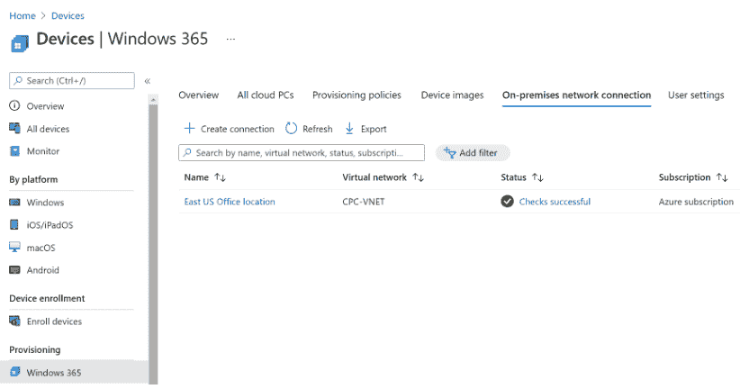

图 3.7 – Create an on-premises network connection

有关此内容的更深入信息以及如何配置它，可以在第 4 章《Deploying Windows 365》中找到。

## Provisioning policies

配置策略顾名思义 – 用于配置您的 Cloud PCs 的策略。策略必须在您配置本地连接后进行配置，因为这是继续前进的要求之一。

配置策略包括 Cloud PC 的基线配置，例如 Windows 10 Enterprise 或 Windows 11 的映像版本、本地连接（位置）以及包含应接收此基线配置的用户 Azure AD 组。

一旦配置策略完成，它将显示在 Provisioning policies 菜单下。您可以按部门或位置设置多个策略，因为这是企业将其拆分为不同配置策略的最常见原因：

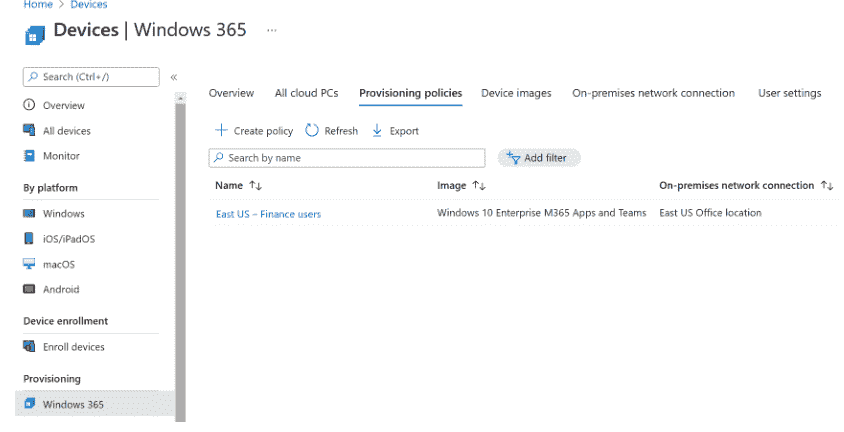

图 3.8 – Provisioning policies

现在您已经了解了有关配置策略所需了解的信息，我们将更深入地探讨作为配置策略一部分所支持的映像。


## Windows 365 – 库镜像

如前一节所述，镜像选择选项是配置策略的一部分。还有选择运行 Windows 10 或 11 的库镜像的选项，并按工作负载类型提供预先制作的镜像。

例如，我们的第二个许可规格 2vCPU/4 GB/64 GB 及更高版本的镜像开箱即用包含 Microsoft 365 应用和 Teams AV 优化，而 1vCPU/2 GB/64 GB Lite 镜像则为该特定工作负载类型提供优化的操作系统体验，以获得最佳体验，因为我们已从镜像内部移除了不同内置服务，而这些服务对于支持的工作负载类型是不需要的：

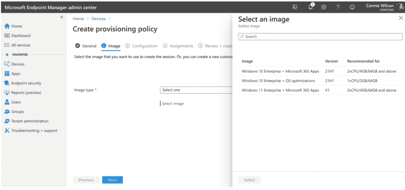

图 3.9 – 选择 Windows 365 镜像

现在，我们已经解释了如何使用首选路径为 Windows 365 Cloud PC 选择镜像。在下一节中，我们将解释如何使用自定义镜像。

## 自定义镜像

一些客户更喜欢使用自己预先构建的自定义镜像，也称为黄金镜像。在 Windows 365 中也支持这种方法，可在配置策略向导期间选择。

支持的自定义镜像服务如下：

- Azure 管理镜像
- 共享镜像库

客户可以自由选择最适合其需求的解决方案，因为我们同时支持 Windows 10 和 11。一些客户更喜欢更现代化的管理方法，即使用一个包含最新 Windows 更新和基础应用的基础镜像，其余部分将通过 Microsoft Intune 应用交付配置文件添加：

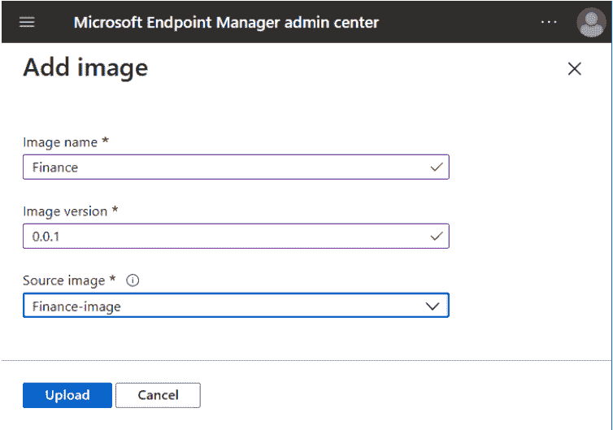

图 3.10 – 添加自定义镜像

本章后面我们将解释如何创建自己的自定义镜像以用作 Windows 365 的基础。

## 角色和委派

Windows 365 在 Microsoft Endpoint Manager 中提供在现有 Intune 角色之上委派访问功能和功能的能力。例如，您希望为帮助台员工提供对 Windows 365 门户的只读访问权限，以检查 Cloud PC 是否不可用。其他示例包括将安全相关设置作为安全策略的一部分进行分离。让我在下面的表格中更深入地解释所有角色：

| 角色 | 在 | 可以执行的操作 |
|---|---|---|
| 应用管理器 | Windows 365 Enterprise Cloud PC | Intune 应用管理器可以管理应用程序、读取设备信息并查看设备配置配置文件。 |
| Cloud PC 管理员 | Windows 365 Enterprise Cloud PC | Cloud PC 管理员可以在 MEM 中的 Cloud PC L2 节点中执行读取和写入操作。 |
| Cloud PC 读者 | Windows 365 Enterprise Cloud PC | Cloud PC 读者可以在 MEM 中的 Cloud PC L2 节点中执行读取操作。 |
| 端点安全管理员 | Windows 365 Enterprise Cloud PC | Intune 端点安全管理员可以管理安全和合规功能，例如安全基线、设备合规性、条件访问和 Microsoft Defender for Endpoint，以管理其 Cloud PC。 |
| 帮助台操作员 | Windows 365 Enterprise Cloud PC | Intune 帮助台操作员可以在 Cloud PC 上执行远程任务并将应用程序或策略分配给设备。 |
| Intune 管理员角色 | Windows 365 Enterprise Cloud PC | Intune 管理员角色可以将 Intune 角色（内置和自定义）分配给其他管理员，但不能分配 Cloud PC 角色。 |
| 策略和配置文件管理器 | Windows 365 Enterprise Cloud PC | Intune 策略和配置文件管理器可以管理 Cloud PC 的合规策略、配置配置文件、企业设备标识符和安全基线。 |
| 只读操作员 | Windows 365 Enterprise Cloud PC | Intune 只读操作员对所有 Intune 节点包括 Cloud PC 节点具有只读访问权限。 |
| 学校管理员 | Windows 365 Enterprise Cloud PC | Intune 学校管理员可以在 Intune for Education 中管理 Windows 10 设备。 |

在下面的屏幕截图中，请查看 Microsoft Endpoint Manager 管理中心门户中可用的角色列表：

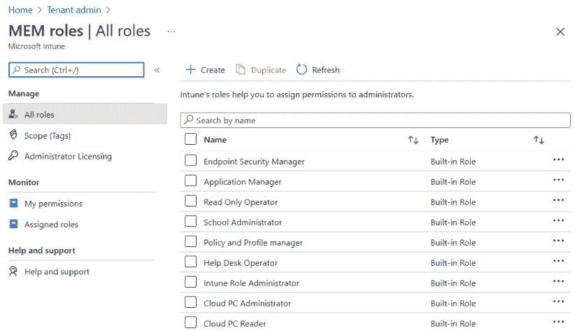

图 3.11 – Microsoft Endpoint Manager 中可用的 Cloud PC 角色

直接将它们分配给您的用户或 Azure AD 组，以使其更动态地可用。

## Watchdog 服务

我们之前分享了 Windows 365 的愿景，即作为复杂 VDI 相关基础设施的替代方案，使事情更易于使用。Watchdog 服务是煤矿里的金丝雀，是一个很好的例子，说明了我们承担了您通常必须自行排查的工作。

在您完成本地网络连接的配置后（本章后面会更详细地解释），Watchdog 服务将检查您的环境是否满足使用 Windows 365 的所有先决条件，因此请考虑以下项目：

- 检查服务 URL
- 网络访问
- DNS 解析
- 在正确的组织单位中创建计算机帐户的权限
- Azure AD Connect 配置
- 子网范围 – 您的部署是否有足够的 IP 地址可用？
- 端点连接性（MEM 和 AV 服务 URL）

这个功能/服务的另一个优点是它会不断在后台运行。例如，当您的环境中发生某些变化时，它会尝试为您修复 – 或向您作为 IT 管理员发送通知并提供问题的解决方案！

在下面的屏幕截图中，您可以找到一次成功的 Watchdog 检查结果。您可以看到它概述了成功 Windows 365 部署的所有要求，以及更多内容：

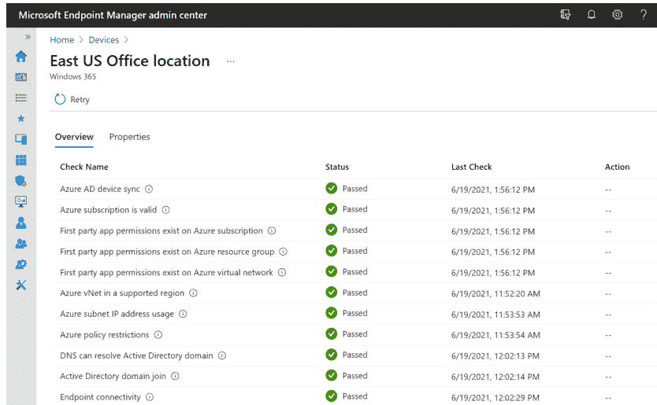

图 3.12 – Watchdog 服务 – 检查

## Windows 365 上的优化 Teams

镜像库 – Microsoft 准备的 Windows 10 Enterprise 镜像 – 包含提供 Cloud PC 优化 Teams 体验所需的所有软件。作为 IT 管理员或用户，您只需安装和配置 Microsoft Teams 应用程序即可使用。

这种方法的主要好处是，您可以直接从物理端点到另一方进行 Teams 音视频通话，点对点进行，这有效地创建了与在运行 Microsoft Teams 的物理端点上相同的体验。

优化的一些主要好处如下：

- 由 WebRTC 促进的高性能点对点流媒体 – 流量将点对点流动并通过端点呈现。
- 设备将作为相同的硬件设备重定向，提供更好的硬件重定向支持。
- 在 Windows 10 客户端上，现代媒体堆栈的所有好处，包括硬件视频解码。

## Microsoft Edge

Microsoft Edge Chromium 已被证明非常快速，并且其与其他 Microsoft 服务（如 Microsoft Endpoint Manager）设置策略以及跨平台支持应用同步，例如个人历史记录和收藏夹设置，得到了广泛好评。这导致 Edge 至今成为 Windows 10 Enterprise 的默认浏览器。

## 休眠标签页

Edge 工程团队不久前为 Edge Chromium 添加了休眠标签页作为 Edge 的新原生功能。此功能使您可以在浏览器处于非活动模式时减少每个标签页的 RAM 使用量。使用此功能时 CPU 利用率也会降低。

该功能是在 Chromium 冻结技术的核心之上构建的。冻结会暂停标签页的脚本计时器以最大限度地减少资源使用。休眠标签页在点击时会自动恢复，这与丢弃的标签页不同，后者需要完全重新加载页面。此设置默认启用，设置为 1 小时。

## 启动加速

启动加速可使您的浏览器启动速度快达 41%！在工作和在线浏览时，速度很重要。启动加速通过显著减少设备重启或重新打开浏览器后打开浏览器的耗时来最大化计算机的性能。初步测试显示，使用此功能后启动时间可提高 29% 至 41%。


此设置在我们的市场镜像中默认启用，适用于所有 4GB 及以上内存的 Cloud PC。

以下截图是 Microsoft Edge 中的系统设置菜单。您可以看到“启动提升”和“通过休眠标签页节省资源”均已启用：

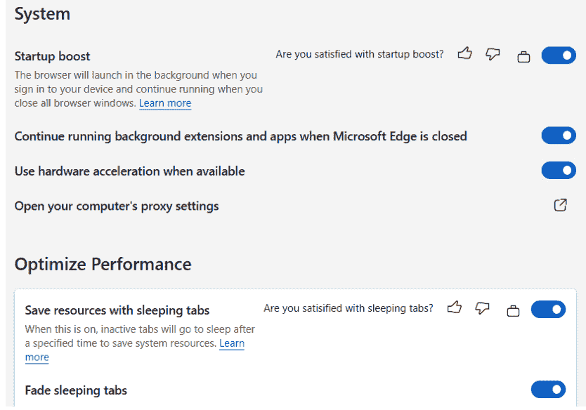

图 3.13 – 启动提升和休眠标签页

## 屏幕捕获保护

屏幕捕获保护功能可防止敏感信息在客户端终结点上被捕获。启用此功能后，远程内容将自动被阻止或隐藏在屏幕截图和屏幕共享中。

它还会对可能持续捕获屏幕内容的恶意软件隐藏。我们建议您在使用此功能时禁用剪贴板重定向，以防止将远程内容复制到终结点。

要启用屏幕捕获保护功能，您只需运行以下命令来添加指定的注册表项，以在您的镜像中启用该功能：

## 重要说明

您可以通过 PowerShell 将以下设置作为脚本操作推送到您的 Cloud PC。

```
reg add "HKLM\SOFTWARE\Policies\Microsoft\Windows NT\Terminal Services" /v fEnableScreenCaptureProtection /t REG_DWORD /d 1
```

至此，我们已经到了本章的结尾。恭喜您成功走到这一步！

## 总结

在本章中，您已了解有关新 Windows 365 服务所需了解的所有基础知识。您准备好开始实际体验了吗！？

在下一章中，我们将学习如何部署 Windows 365。

## 问题

+ 1. 什么服务用于管理、维护和操作您的 Windows 365 云桌面？
+ A. Microsoft Endpoint Manager
+ B. Microsoft Endpoint Configuration Manager
+ C. System Center Configuration Manager
+ 2. Windows 365 是否完全集成并能与其他 Microsoft 365 云服务开箱即用？
+ A. 是
+ B. 否

## 答案

+ 1. (A)
+ 2. (A)

## 延伸阅读

如果阅读本节后您想进一步了解 Windows 365，请参阅本书的以下章节之一：

+ - *第 4 章，部署 Windows 365*
+ - *第 14 章，监控与终结点分析*
+ - *第 17 章，Windows 365 故障排除*

## 4