## 部署 Windows 365

在本章中，您将学到有关如何部署 Windows 365 所需了解的一切，包括有哪些要求以及必须掌握的提示和技巧。

学完本章后，您将掌握开始使用这项新的 Microsoft 云服务所需的一切，该服务通过 Microsoft Endpoint Manager 简化了部署以及云 PC 的维护。

本章内容非常全面，涵盖以下主题：

+ - 部署 Windows 365 的技术要求
+ - 自助服务功能 – IT 管理员
+ - Azure AD – MyApps 统一（工作区）门户
+ - 在远程桌面客户端中自动订阅用户
+ - Autopilot 和云 PC – 瘦客户端（Kiosk）
+ - 监控与分析
+ - 使用快速助手（Quick Assist）的影子用户
+ - Windows 11
+ - Microsoft 托管桌面

## 部署 Windows 365 的技术要求

要使用 Windows 365，您必须满足以下要求：

+ - 以下是使用 Cloud PC/Windows 365 所需的许可证：
+ - *具有 Windows Pro 终结点的用户*：W10 E3 + EMS1 E3 或 M365 F3/E3/E5/BP
+ - *具有非 Windows Pro 终结点的用户*：Win VDA E3 + EMS1 E3 或 M365 F3/E3/F5/BP
+ - Azure 订阅：
+ - 订阅所有者（设置网络连接）
+ - Azure 订阅中的**虚拟网络（VNet）**：
+ - Azure VNet 必须路由到能够解析本地或 Azure 上的 **Active Directory（AD）** 记录的 DNS 服务器。
+ - 此 AD 必须与 Azure AD 同步，以提供**混合 Azure AD 加入（HAADJ）**。**Azure AD 加入（AADJ）** 目前正在开发中。
+ - Microsoft Intune 支持的许可证（例如 Microsoft 365 E3）：
+ - Intune 服务管理员或云 PC 管理员

我们将更详细地介绍其中一些必需的订阅。

## Azure 订阅

请确保您拥有用于配置 Azure VNet 的 Azure 订阅，即用于 Windows 365 中的本地连接。如果您已经设置好了，可以跳过此步骤。

> **重要说明**
> 一旦我们支持原生 Azure AD，将不再需要 Azure 订阅。这很快就会实现。在撰写本文时，Windows 365 Business 已经支持这一点！

## Azure VNet

使用 Windows 365 的要求之一是您需要拥有 Azure VNet。该网络将作为您的云 PC 的互联网网关。如果您已经拥有一个，那么这将是一项轻松的任务！

## Azure VNet – DNS 配置

作为 HAADJ 要求的一部分，您需要与一个能够与您的 Active Directory 域通信的 DNS 服务器建立直接连接。

始终确保将 DNS 更改为“自定义”，并输入能够解析您的 AD DS 域的 DNS 服务环境的 IP 地址：

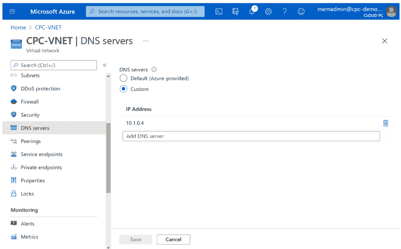

图 4.1 – 将 DNS 更改为自定义

## Azure VNet – 所需的相关 URL 和端口

要使用所有 Windows 365 服务，您必须允许流量访问以下服务 URL，因为这些服务是成功使用该服务的关键：

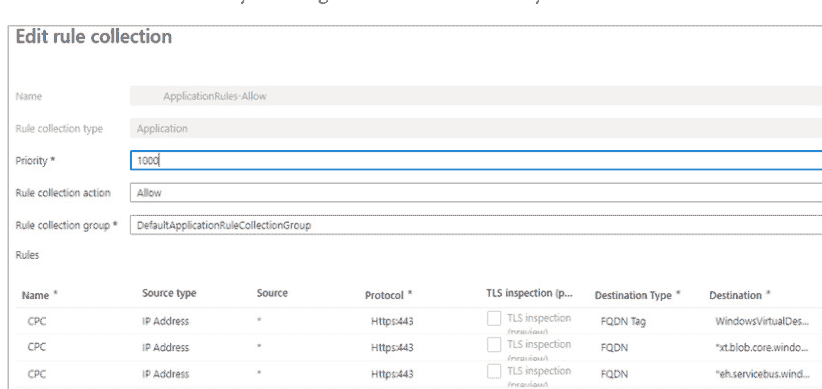

图 4.2 – 允许所有 URL

> 重要说明
> 请确保通过 Azure 防火墙或第三方防火墙允许所有 URL 和端口。最佳做法是使用基于通配符和 FQDN 域名的标签。

## Microsoft Endpoint Manager 和 AVD – 服务 URL

使用 Windows 365 服务需要以下 URL 和端口。如果某些未正确添加，服务将无法正常运行：

+ - https://docs.microsoft.com/en-us/azure/virtual-desktop/safe-url-list
+ - https://docs.microsoft.com/en-us/mem/intune/fundamentals/intune-endpoints:
+ - cpcsacnrysalprodprna02.blob.core.windows.net
+ - cpcsacnrysalprodprap01.blob.core.windows.net
+ - cpcsacnrysalprodprau01.blob.core.windows.net
+ - `cpcsacnrysalprodpreu01.blob.core.windows.net`
+ - `cpcsacnrysalprodpreu02.blob.core.windows.net`
+ - `cpcsacnrysalprodprna01.blob.core.windows.net`

现在，让我们看一下远程桌面协议的网络要求。

## 远程桌面协议要求

Windows 365 使用**远程桌面协议（RDP）**，因此您应遵循组织中每个场景所需的相同网络带宽要求。

在设计 Windows 365 的网络基础架构环境时，请使用下表作为指导：

| 场景 | 默认模式 | H.264/AVC 444 模式 | 描述 |
|---|---|---|---|
| 空闲 | 0.3 Kbps | 0.3 Kbps | 用户已暂停工作，没有活动的屏幕更新。 |
| Microsoft Word | 100-150 Kbps | 200-300 Kbps | 用户正在积极使用 Microsoft Word：打字、粘贴图形以及在文档之间切换。 |
| Microsoft Excel | 150-200 Kbps | 400-500 Kbps | 用户正在积极使用 Microsoft Excel：包含公式和图表的多个单元格同时更新。 |
| Microsoft PowerPoint | 4-4.5 Mbps | 1.6-1.8 Mbps | 用户正在积极使用 Microsoft PowerPoint：打字、粘贴、修改丰富的图形，并使用幻灯片切换效果。 |
| 网页浏览 | 6-6.5 Mbps | 0.9-1 Mbps | 用户正在访问包含多个静态和动画图像的图形丰富的网站。用户水平和垂直滚动页面。 |
| 图片库 | 3.3-3.6 Mbps | 0.7-0.8 Mbps | 用户正在积极使用图片库应用程序：浏览、缩放、调整大小和旋转图像。 |
| 视频播放 | 8.5-9.5 Mbps | 2.5-2.8 Mbps | 用户正在观看一个占用半屏的 30 FPS 视频。 |
| 全屏视频播放 | 7.5-8.5 Mbps | 2.5-3.1 Mbps | 用户正在观看一个最大化到全屏的 30 FPS 视频。 |


## 混合 Azure AD 加入

在开始配置 Windows 365 之前，你必须确保你的环境已启用 HAADJ。激活它相对简单。如果你尚未使用它，只需重新打开 Azure AD Connect 安装程序，并在“设备选项”菜单中，选择“配置混合 Azure AD 加入”选项。你可以在第 13 章“身份与安全管理”中了解详细信息，或访问 https://docs.microsoft.com/en-us/azure/active-directory/devices/hybrid-azuread-join-managed-domains。

> **重要提示**
> Azure AD 原生支持即将推出。Windows 365 小型企业的自助服务版本已支持 Azure AD。

在这里，你可以找到 Azure AD Connect 向导的主配置屏幕。在这里，你需要选择“配置混合 Azure AD 加入”以使用 Windows 365 企业版：

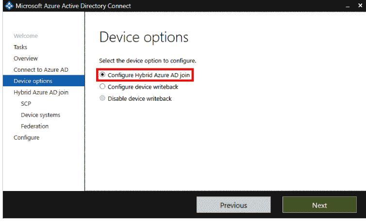

图 4.3 – Azure AD Connect 混合 Azure AD 加入设置

创建你的计算机后，你会看到它们以“混合 Azure AD 加入”的联接类型列在 Azure AD 门户中：

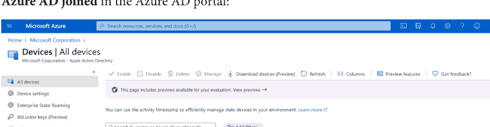

图 4.4 – Azure 门户中列出的设备

## 通过 Microsoft 365 管理中心门户购买和分配云电脑许可证

在继续操作之前，请确保你的租户已分配 Microsoft Intune 的试用版或生产版许可证。执行以下步骤：

- 1. 前往 https://admin.microsoft.com/ 并按大小购买 Windows 365 许可证。
- 2. 转到“活动用户”。
- 3. 打开所需用户。
- 4. 分配 Windows 365 云电脑大小许可证。

以下截图显示了我如何将普通知识工作者 Windows 365 云电脑许可证分配给我刚出生的儿子 Mason，他已经是一位狂热的 Windows 用户：

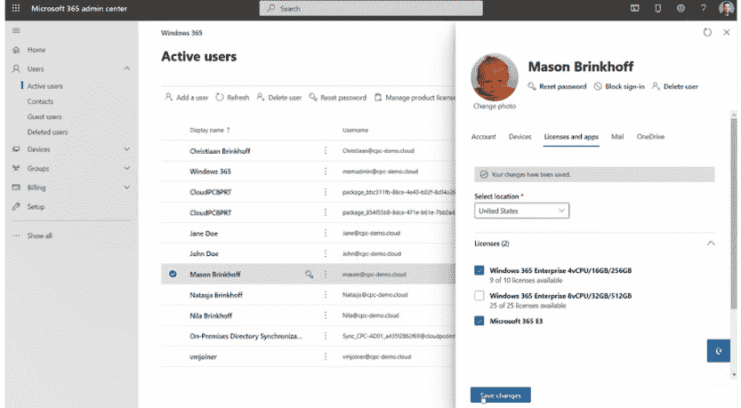

图 4.5 – 分配许可证

在继续之前，请确保已在 Azure AD 中设置 AAD 用户的位置。

你也可以从 Azure 门户执行此操作，或者如果你要处理更多批量/企业用户，可以通过 Azure AD 组分配自动执行。

## 本地网络连接

我们需要本地网络连接，以便创建云电脑、将它们加入指定域，并使用 Microsoft Endpoint Manager 进行管理。

在开始之前，请创建到本地环境的连接，以实现与 AD DS 的直连。要执行这些步骤，你应具有 VNet 上的网络参与者权限。

> **重要提示**
> “**组织单位 (OU)**”部分是可选的。如果输入 OU 位置，请确保输入 **可分辨名称 (DN)**。

创建本地网络连接的步骤如下：

- 1. 单击“**本地网络连接**”，然后选择“**+ 创建连接**”：

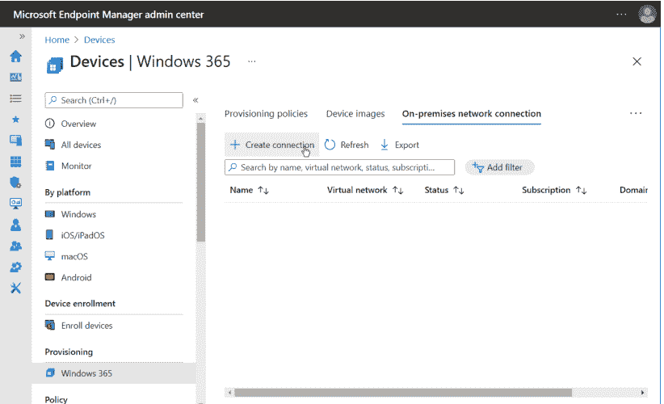

图 4.6 – 创建连接

2. 输入 Azure VNet 连接信息和建议的子网，你将在其中创建云电脑：

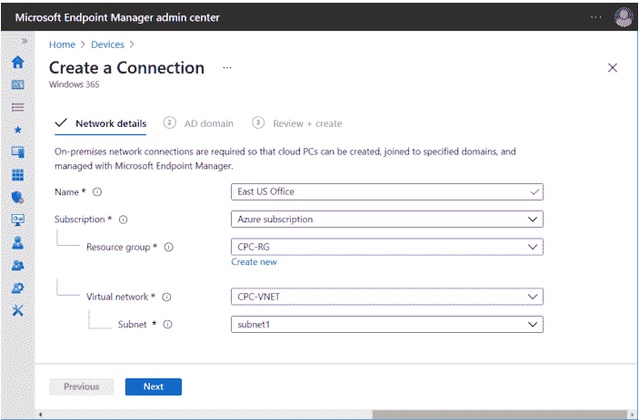

图 4.7 – 网络详细信息

3. 输入所需的 AD DS 信息：

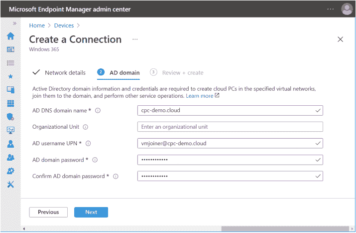

图 4.8 – AD 域设置

4. 检查所有信息并确认无误后，单击“查看 + 创建”：

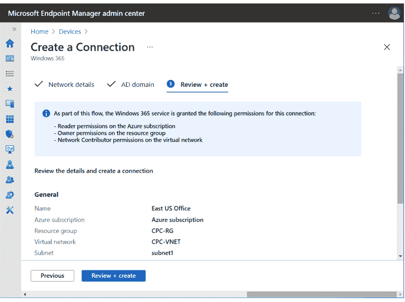

图 4.9 – 查看所有详细信息

重要提示  
确保创建网络连接的人员拥有 Azure 订阅的读取者权限、资源组的所有者权限以及 VNet 的网络参与者权限。

5. 接下来的几个步骤将配置你的本地网络连接。此过程最多可能需要 30 分钟才能完成。Watchdog 服务将在后端执行操作，确保你能够顺利实施云电脑。

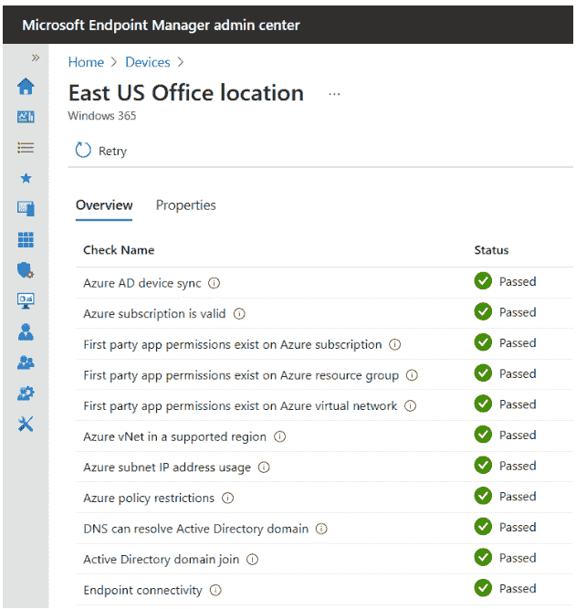

图 4.10 – 配置完成

既然我们已经创建了本地连接，接下来让我们预配一台云电脑。

## 预配云电脑

在开始之前，请确保你使用的帐户至少已分配 Intune 服务管理员角色。预配完成后，你可以将权限恢复为标准的 MEM RBAC。执行以下步骤：

- 1. 转到管理中心门户的 Windows 365 边栏以预配策略。
- 2. 单击“+ 创建策略”：

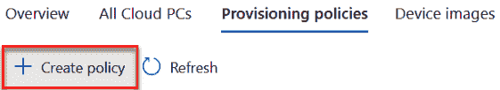

图 4.11 – 创建预配策略

- 3. 为策略提供名称，例如“East US Office”。
- 4. 选择你想要放置云电脑的本地网络连接（位置）：

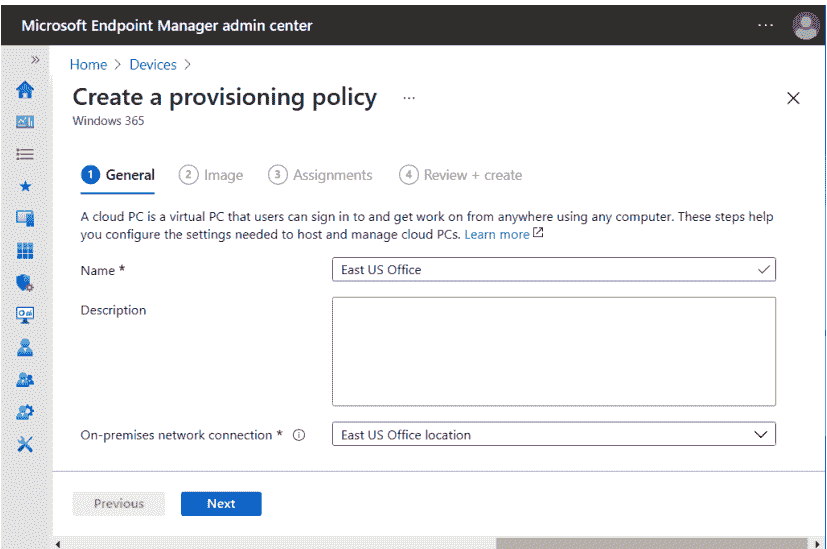

图 4.12 – 选择本地网络连接

- 5. 选择你的映像类型，可以是库映像或自定义映像。
- 6. 单击“**选择**”。
- 7. 选择你的 Windows 10 企业版映像。我们建议你使用预装了 Microsoft 365 应用和 Teams 的映像，以获得最佳体验：

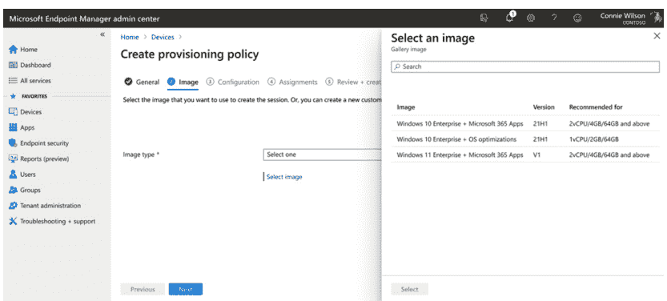

一旦云电脑通过 Microsoft Endpoint Manager 上线，你的所有企业应用都将被添加。

> **重要提示**
> 你也可以选择预装了所有代理和应用的自定义映像。创建自定义映像的步骤将在本章下一节中说明。

- 8. 选择要应用预配策略的 Azure AD 组。

> **重要提示**
> 该组中每个已分配云电脑许可证的用户都将收到一台根据映像和本地网络连接配置预配的云电脑。

我使用的是“**财务用户 – AAD**”组。

- 9. 确认组的配置，然后单击“**下一步**”：

图 4.14 – 确认组配置

10. 查看策略设置，然后单击“创建”：

图 4.15 – 查看预配策略设置

11. 如果一切运行顺利，你将在列表中看到新的预配策略：

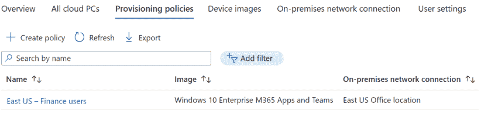

图 4.16 – 成功添加预配策略

新的云电脑将开始直接为你分配给预配策略的 AAD 组成员进行预配。20-30 分钟后，你的云电脑将可以使用，其状态将更改为“已预配”。

## 用户设置 – 自助服务

在 Windows 365 中使用自助服务选项的主要目标是减轻 IT 支持部门和 IT 管理员的工作负担。当用户拥有自助服务升级权限时（如以下截图所示），他们可以重启其云桌面，并升级到更大的 VM 大小，以获得适合其需求的更好性能：

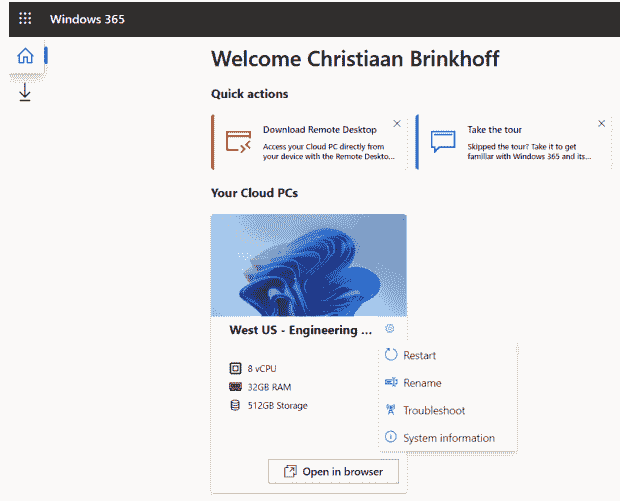

图 4.17 – Windows 365 Web 门户 – 自助服务用户设置

## 本地管理员

在 Microsoft Endpoint Manager 版本的云电脑中，用户默认没有本地管理员权限。当你希望所有或部分用户成为本地管理员时，我们可以将以下功能作为配置配置文件内置到 Microsoft Endpoint Manager 中，使用户成为本地管理员。

请确保仅为需要这些权限的设备或用户配置此配置配置文件。

## VM SKU 升级（预览功能）

作为 IT 管理员，你将能够把云 VM 升级到更大的大小。这意味着用户将从例如 1 vCPU/2 GB RAM 升级到 2 vCPU/4 GB RAM，从而为其工作负载提供更多资源。

你可以在 Microsoft Endpoint Manager 门户的“设备”下，单击“调整大小”按钮时找到此功能（预览版）：

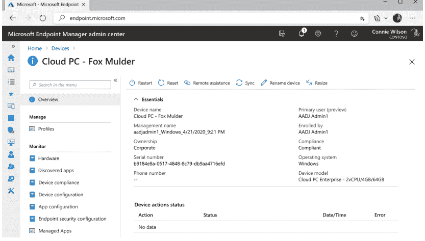

图 4.20 – 调整云电脑功能大小

## 映像管理 – 创建自定义映像（可选）

在传统 VDI 环境中，推出虚拟桌面总是从创建自定义映像（也称为黄金映像）开始。Microsoft 理解这一需求，因此 Windows 365 也支持这种做法。

但是，建议仅将映像用于基线应用程序、代理、操作系统更新和语言包。然后，你必须通过 Microsoft Endpoint Manager 和 Intune 添加其他配置项和应用程序。

> 重要提示
> 此步骤是可选的。Microsoft 还将为 Windows 10 和 Windows 11 提供市场映像，你可以在创建预配策略过程中选择这些映像，其中预装了 Microsoft 365 应用、Edge 和 Teams 优化。

如果你希望在开始云电脑预配流程之前构建映像，请执行以下步骤：

- 1. 单击“+ 添加”：

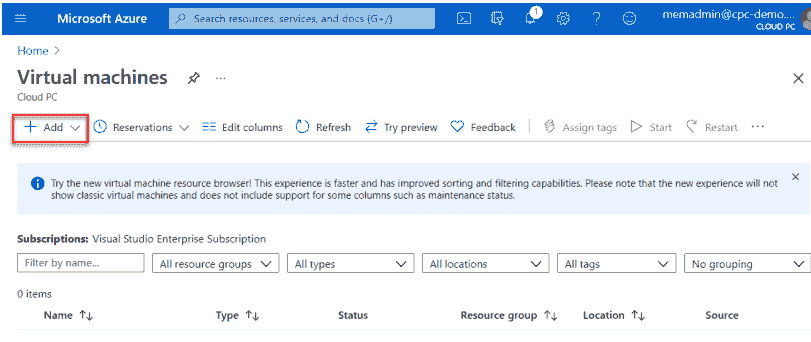

图 4.21 – 构建映像

- 2. 根据你的具体要求创建 VM 映像。


- 3. 选择 **Windows 10 企业版或 Windows 11 – Gen**，如下所示：

> **重要说明**
> Windows 365 支持 Windows 10 企业版和 Windows 11 单会话。仅当你要为 Azure 虚拟桌面创建自定义映像时，才选择 Windows 10 企业版多会话。

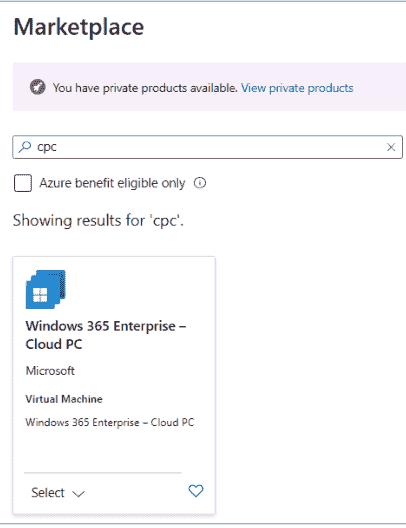

图 4.22 – Cloud PC 映像

- 4. 填写所有其他属性，并将自定义映像添加到正确的 Azure VNet（至少为标准 SSD）以获得合适的性能。

- 5. 在 **高级** 选项卡中，确保为 **VM 代系** 选择了 **Gen 2**；例如，**Windows 10 企业版 Cloud PC，版本 20H2 + Microsoft 365 应用 - Gen2**：

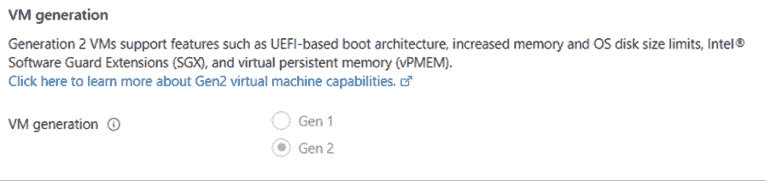

图 4.23 – 高级选项卡

> **重要说明**
> 确保你的映像是作为 Gen 2 创建的；Microsoft 不再支持将新的 Gen 1 映像作为 Windows 365 企业版的一部分添加。

- 6. 单击 **查看 + 创建**：

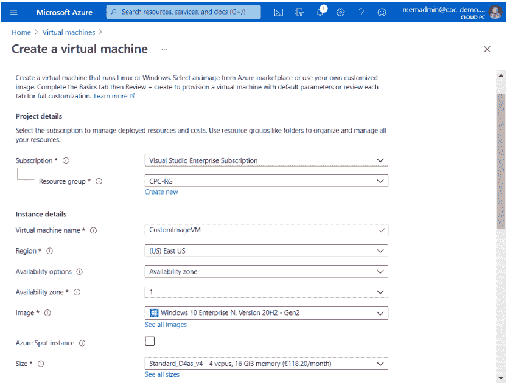

图 4.24 – 查看你的设置

- 7. VM 预配完成后，使用 Azure Bastion 或 RDP 连接到自定义映像虚拟机。

- 8. 在虚拟机上安装你的代理和其他软件。

> **重要说明**
> 我们建议尽可能保持映像干净，并通过 Microsoft Endpoint Manager – Intune 添加业务线应用，以使映像管理过程简单而现代。Microsoft 还在预建的 marketplace 映像中提供了 Microsoft 365 应用。

- 9. 在 VM 映像中通过 `%WINDIR%\system32\sysprep\sysprep.exe /generalize /shutdown /oobe` 命令运行 **sysprep**。

- 10. 准备就绪后，停止虚拟机，使其进入已停止（已解除分配）状态：

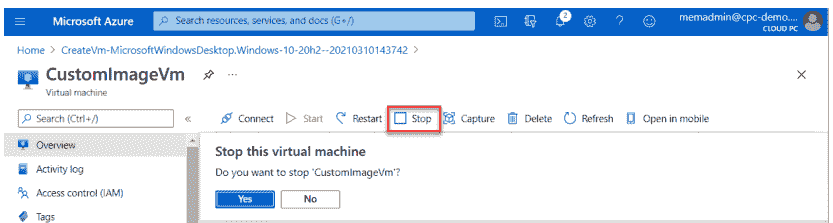

图 4.25 – 停止 VM

- 11. 单击 **捕获** 按钮开始捕获映像：

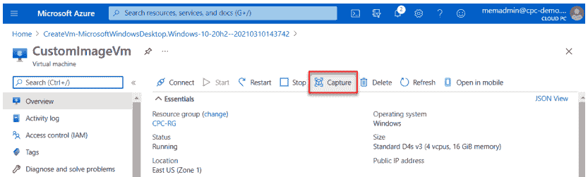

图 4.26 – 捕获映像

- 12. 等待 VM 将其状态更改为 **已停止**（已解除分配）。

- 13. 选择 **否，仅捕获托管映像**。然后，单击 **查看 + 创建**：

**创建映像**

创建映像之前，此虚拟机将被自动解除分配。你可以将此映像共享到共享映像库。了解详细信息

**项目详细信息**

订阅
Visual Studio 企业版订阅

资源组 *
(新建) CPC-RG1
新建

**实例详细信息**

区域
(美国) 美国东部

将映像共享到共享映像库
是，将其作为映像版本共享到库。
否，仅捕获托管映像。

创建映像后自动删除此虚拟机

区域冗余

> 创建映像之前，请使用“generalize”准备虚拟机上的 Windows 来宾操作系统。如果你从未通用化的虚拟机创建映像，则从该映像创建的任何虚拟机都将无法启动。了解详细信息

名称 *
CustomImageVM-v0.1

查看 + 创建
< 上一步
下一步：标记 >

图 4.27 – 查看你的设置

- 14. 确认摘要并单击 **创建**。该过程现在将自动对映像执行 sysprep：

**创建映像**

验证通过

基本信息
标记
查看 + 创建

**基本信息**

订阅
Visual Studio 企业版订阅

资源组
(新建) CPC-RG1

区域
美国东部

将映像共享到共享映像库
否

创建映像后自动删除此虚拟机
否

名称
CustomImageVM-v0.1

区域冗余
关闭

创建
< 上一步
下一步 >
下载自动化模板

图 4.28 – 验证成功

现在将准备映像。此过程只需一分钟左右。

- 15. 一旦过程准备就绪，你可以在 Windows 365 的 Cloud PC – 预配策略下选择自定义映像。

- 16. 切换回 Microsoft Endpoint Manager 管理中心。转到 **设备映像**，然后单击 **+ 添加**：

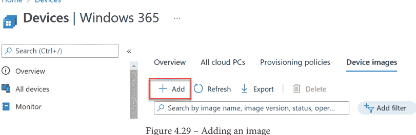

提供映像的名称、版本和 Windows 10 企业版的 OS 内部版本号，以及源映像。

- 17. 单击 **上传**：

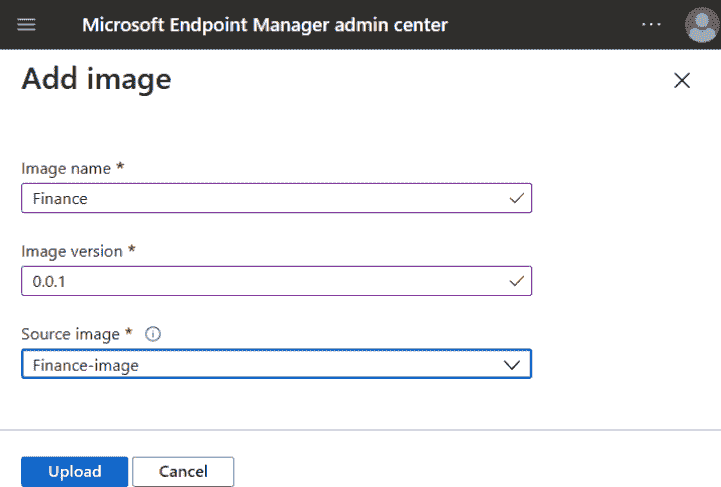

下表说明了撰写本文时 Windows 365 支持的不同终结点之间的差异：

|  | Windows 桌面 | 商店客户端 | Android | iOS/iPadOS | macOS | Web |
|---|---|---|---|---|---|---|
| 键盘 | X | X | X | X | X | X |
| 鼠标 | X | X | X | X* | X | X |
| 触摸 | X | X | X | X |  | X |
| 串行端口 | X |  |  |  |  |  |
| USB | X |  |  |  |  |  |
| Teams 音视频重定向 | X |  |  |  |  |  |
| 多媒体重定向 | 即将推出 |  |  |  |  |  |
| 多监视器 | 16 台监视器 |  |  |  |  |  |
| 动态分辨率 | X | X |  |  | X | X |
| 屏幕捕获保护 | X |  |  |  |  |  |
| 摄像头 | X |  | X | X | X |  |
| 开始菜单集成 | X |  |  |  |  |  |
| 剪贴板 | X | X | 文本 | 文本、图像 | X | 文本 |
| 本地驱动器/存储 | X |  | X | X | X |  |
| 辅助功能 | X |  |  |  |  |  |
| 位置 | X |  |  |  |  |  |
| 麦克风 | X | X | 即将推出 | X | X | X |
| 打印机 | X |  |  |  | X（仅 CUPS） | PDF 打印 |
| 扫描仪 | X |  |  |  |  |  |
| 智能卡 | X |  |  |  | X |  |
| 扬声器 | X | X | X | X | X | X |

这让你可以根据重定向要求更轻松地调整设备。我们一直在不断改进客户端，因此当你开始阅读本书时，某些功能很可能会得到支持。

## 支持的终结点 – 设备重定向设置

就支持摄像头或串行端口重定向而言，这并未作为 Windows 365 基线配置的一部分默认启用。开箱即用，Windows 365 允许你重定向本地音频、剪贴板和麦克风。

要允许更多重定向功能，你必须从 Microsoft Endpoint Manager 的 Intune 配置文件中分配不同的配置集。我们之所以保留这么多设置禁用，是出于安全考虑。我们的服务符合我们的零信任原则，因此我们默认将其禁用，让客户决定什么最适合他们的用例。

默认情况下，最终用户将拥有更多的功能集，管理员可以选择是允许所有这些重定向，还是创建策略来阻止它们。

你可以如下所示启用这些设置：

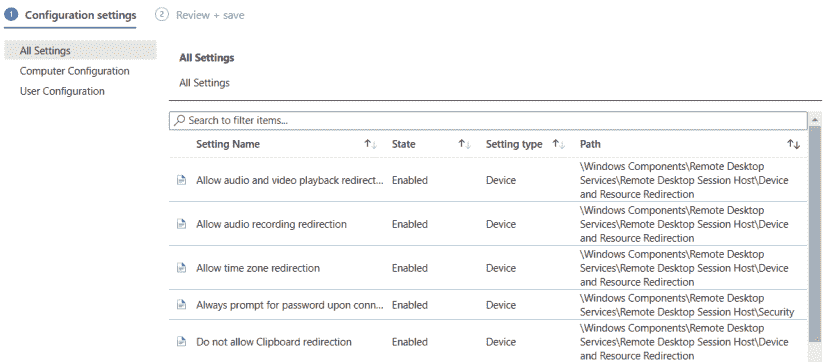

## 信息工作者门户（IWP）

如“支持的终结点”部分所述，最终用户可以从不同平台访问其云电脑。Web 门户是最统一的方法，因为它只需要支持 HTML5 的浏览器，例如 Microsoft Edge。

为了简化访问，我们创建了 IWP，你可以在以下屏幕截图中看到它。该门户允许最终用户选择通过浏览器或远程桌面（MSRDC）客户端访问其云电脑。

- 4. 你在寻找我们在 Windows 365 中支持的不同终结点客户端吗？单击左上角主页图标下方的下载图标：

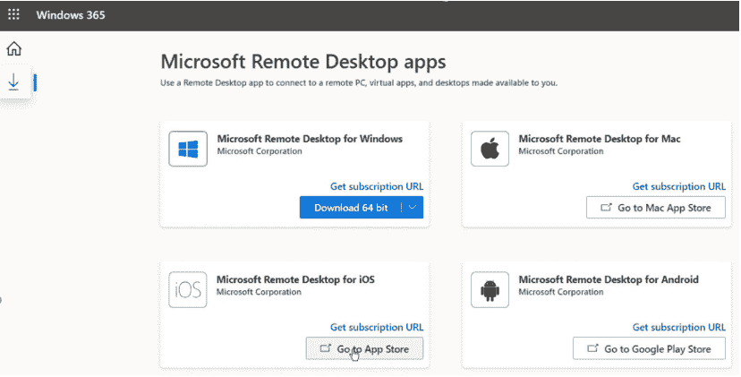

图 4.33 – 下载远程桌面客户端终结点支持的应用

- 5. 选择你的本地资源重定向首选项。

- 6. 几个月以来，你也可以在通过 Web 门户连接时，使用新的文件传输上传功能从设备上传数据。启用此功能将在此计算机上创建网络驱动器，以便你可以将文件从本地终结点传输到云电脑：

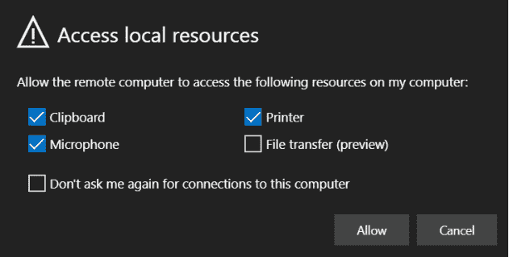

图 4.34 – 允许访问本地资源

## 多重身份验证和条件访问

我们建议你参阅本书后面的*第 13 章，身份与安全管理*，以了解有关条件访问的更多信息。

多重身份验证默认在你的 Azure AD 租户上启用，以确保黑客和其他入侵者远离你的环境。在 Windows 365 上启用此功能将使你被黑客攻击的可能性降低 99.9%。它还具有简化管理层作为运营顶层的优势。简而言之，你应该启用此功能！

这也相当容易做到。对于 Windows 365，我们有一个云电脑应用，可以在 **条件访问** 配置菜单中选择。步骤如下：

- 1. 开始配置。转到 Microsoft Endpoint Manager 中 **终结点安全** 菜单下的 **条件访问** 菜单：

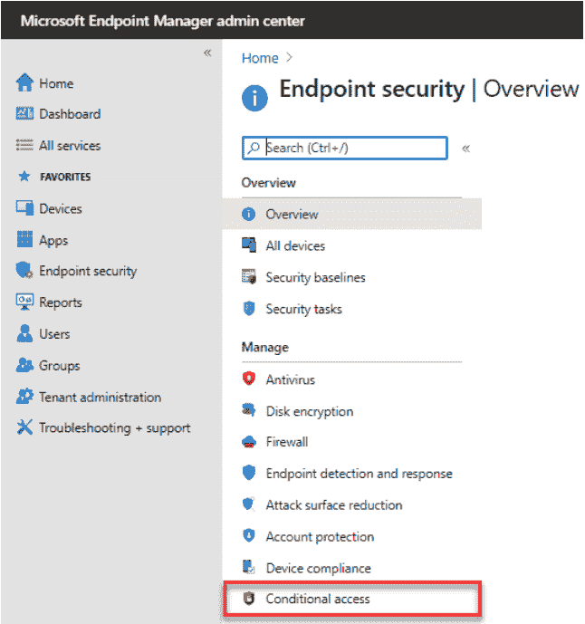

图 4.39 – 条件访问


2. 创建新策略，并为你的 Azure MFA 策略输入自定义名称。完成此操作后，你可以逐步浏览向导中的所有层，以激活正确的设置来触发 MFA 的二级身份验证：

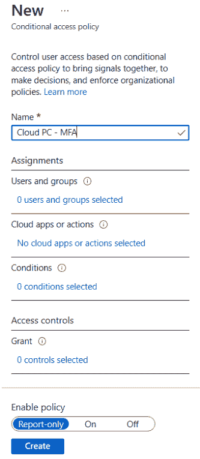

图 4.40 – 输入策略的名称

3. 选择要筛选并为其激活 MFA 的用户和/或 AAD 组列表。我将选择云电脑用户。

> 重要说明
> 选择“所有用户”时，请确保不要将自己锁定在外！此策略将影响你的所有用户。我们建议先将策略应用于一小部分用户，以验证其行为是否符合预期。

4. 打开云应用或 **“操作”** 菜单，然后选择 **“云电脑”** 作为云应用。确保 **“云电脑”** 的云应用 ID 为 `0af06dc6-e4b5-4f28-818e-e78e62d137a5`。

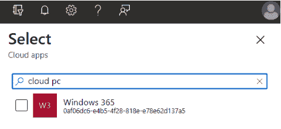

图 4.41 – 选择 Windows 365

5. 单击 **“条件”** 开始创建过程。这将允许你根据风险、设备平台、位置、客户端应用或设备状态等条件的信号来控制用户访问层。

6. 选择最符合你安全要求的设置。我将使用标记为 **“合规”** 的设备，以确保拥有合规设备的用户可以无需输入 MFA 即可连接到云电脑。

> **重要说明**
> 
> 所有其他帐户都将通过 MFA 提示强制执行。

7. 移至 **“授予”** 菜单。选择最符合你安全要求的设置。

8. 确保选择 **“需要多重身份验证”**：

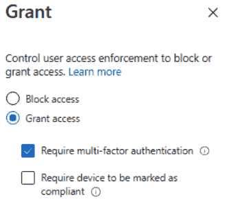

图 4.42 – 需要多重身份验证

9. 转到“会话”菜单。此部分是可选的；但是，登录频率可以在现有令牌过期后仅 1 小时就强制执行 MFA 提示。

> 重要说明
> 特别是在自带设备 (BYOD) 场景中，这可能非常有用。在配置此设置的时间内，你云电脑上的现有会话将保持活动状态。

10. 持久性浏览器功能使得在关闭并重新打开浏览器窗口后仍能保持登录状态。

11. 通过单击“开启”然后“创建”来启用并创建策略。

12. 确保“启用策略”设置默认设置为“关”。

13. 确认策略已以“开”状态添加。

下次登录云电脑时，系统会提示你进行 MFA！

## 云电脑的安全基线

在 Microsoft 云中使用虚拟化桌面需要与物理 Windows PC 不同的安全基线。因此，我们在配置文件目录中为云电脑创建了一个新的优化基线。确保选择云电脑安全基线，以获得适合你业务的最佳性能和安全设置：

主页 > 终结点安全性

终结点安全性 | 安全基线

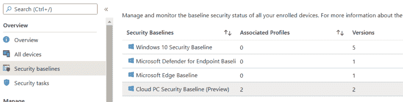

图 4.43 – 选择云电脑安全基线

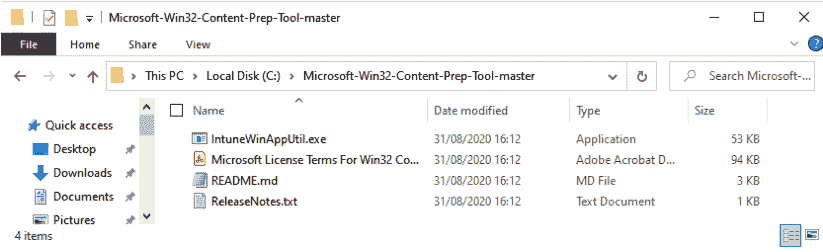

图 4.45 – 解压准备工具

3. 从 `http://aka.ms/wvdclient` 下载最新的远程桌面客户端。
4. 将 **Microsoft 安装程序 (MSI)** 保存在准备工具所在的同一文件夹中。
5. 创建 Win32 `.Intunewin` 包。
6. 打开 PowerShell 并将目录更改为 Intune 准备工具的位置；例如，`C:\Microsoft-Win32-Content-Prep-Tool-master`：

```
cd "C:\Microsoft-Win32-Content-Prep-Tool-master"
```

7. 运行 `\IntuneWinAppUtil.exe` 并填写以下要求：
   - 将源文件夹指定为 `C:\Microsoft-Win32-Content-Prep-Tool-master`。
   - 将安装文件指定为 `RemoteDesktop_1.2.1755.0_x64.msi`。
   - 将输出文件夹指定为 `C:\Microsoft-Win32-Content-Prep-Tool-master`。
   - **是否要指定目录文件夹 (Y/N)？** N。

你可以根据需要自定义文件夹，如下所示：

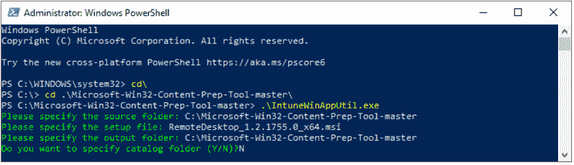

图 4.46 – 运行 `\IntuneWinAppUtil.exe`

如果一切运行正常，将启动以下创建向导：

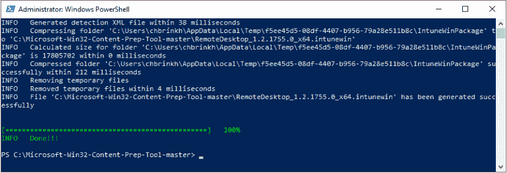

图 4.47 – 运行成功

8. 如果一切运行成功，你将看到 `.intunewin` 文件列在文件夹中。现在，我们可以切换到 Microsoft Endpoint Manager：

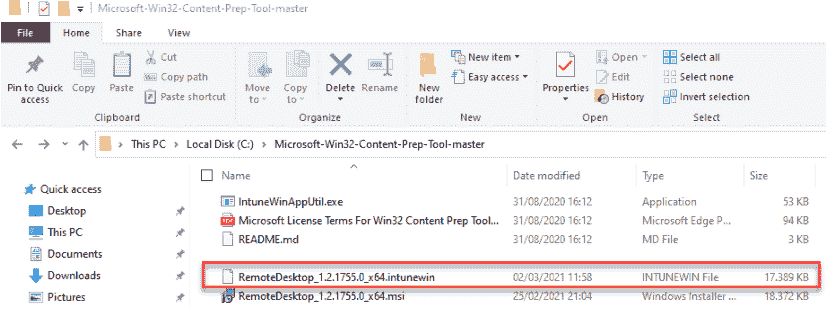

图 4.48 – 已添加 Intune win32 包

9. 转到 `http://endpoint.microsoft.com/` 以在 Microsoft Endpoint Manager 管理中心继续此配置过程。

10. 转到 **“应用”|“Windows 应用”|“添加”**：

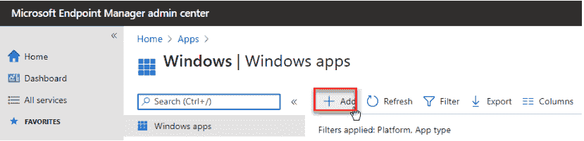

图 4.49 – 添加新的 Windows 应用

11. 选择 **“Windows 应用 (Win32)”**。

12. 单击 **“选择应用包文件”**。

13. 浏览并选择我们之前创建的 `.Intunewin` 包文件，其中包含远程桌面客户端 (MSRDC)。

14. 单击 **“确定”**：

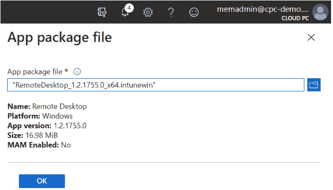

图 4.50 – 选择包文件

15. 在下一个屏幕上，你可以自定义应用的名称。

*可选：* 如果你希望安装注册过程对用户是可选的，请将 **“公司门户”** 设置为 **“是”**：

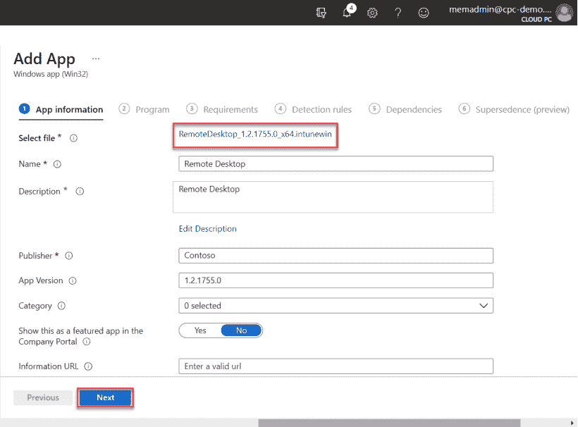

16. 单击 **“下一步”**。

17. 使用以下设置：

```
msiexec /i "RemoteDesktop_1.2.1755.0_x64.msi" /qn
ALLUSERS=2 MSIINSTALLPERUSER=1
```

图 4.52 – 定义安装命令

18. 提供最低应用要求：

图 4.53 – 添加要求

19. 基于手动配置创建检测规则。

20. 选择 MSI 以基于 MSI 产品代码执行检测，以查看应用是否已安装在终结点上。

21. 单击 **“确定”**：

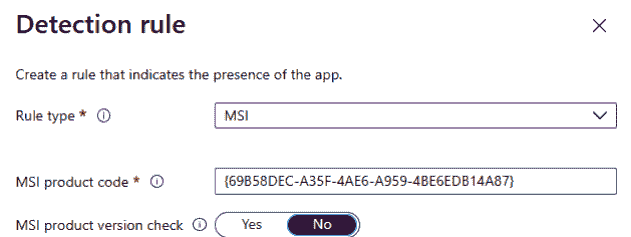

图 4.54 – 检测规则

22. 我们可以跳过依赖项。然后，单击 **“下一步”**：

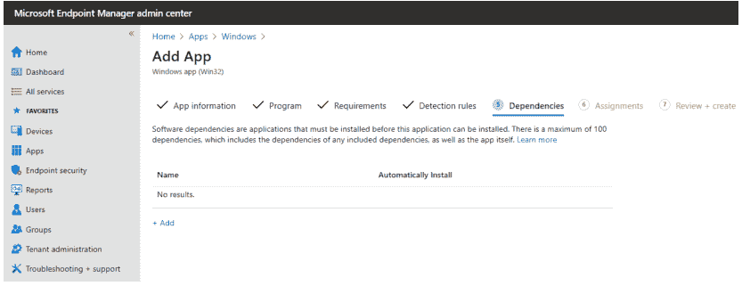

图 4.55 – 跳过依赖项

23. 将应用程序分配给一个 AAD 组或所有设备，以强制部署到你的物理 Windows PC/终结点。

> 重要说明
> 客户端不应安装在云电脑 VM 内部，而应安装在物理终结点上。如果你的物理终结点不受 MEM 管理，请从以下位置手动更新/安装远程桌面客户端：http://aka.ms/CPCclient。

24. 单击 **“选择”**，然后 **“下一步”**。

25. 如果要强制执行注册或更新过程，请编辑分配。

*可选：* Microsoft Endpoint Manager 中有一个新的预览功能，称为 **“取代”**。此新功能使你能够使用相同应用的较新版本更新和替换现有 Win32 应用。你可以通过访问 `https://docs.microsoft.com/en-us/mem/intune/apps/apps-win32-supersedence` 了解更多信息。

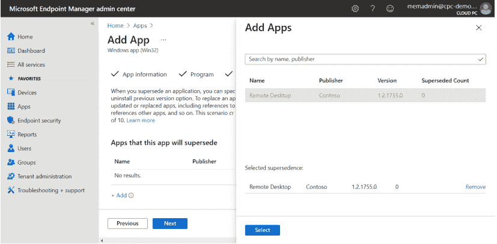

图 4.56 – 选择取代

26. 单击 **“创建”** 以将远程桌面客户端推送到你的物理 Windows PC：

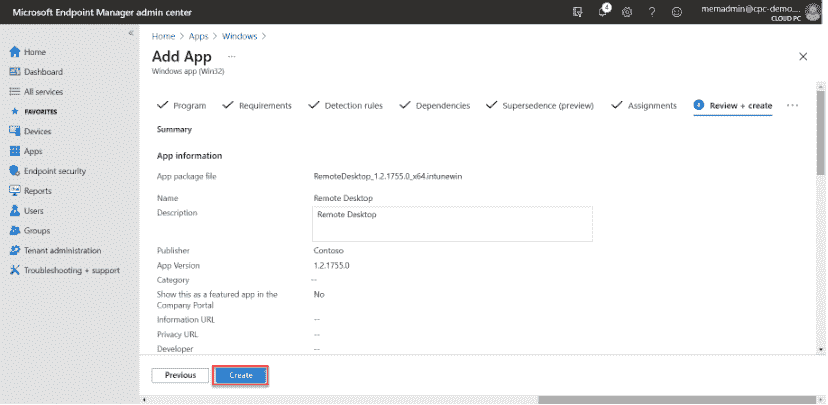

图 4.57 – 将远程桌面客户端推送到你的电脑

现在，该应用程序将推送到属于 AAD 组筛选条件的所有用户的终结点。

你将看到远程桌面应用已作为最近应用添加。

远程桌面 Windows 应用已添加到“开始”菜单：

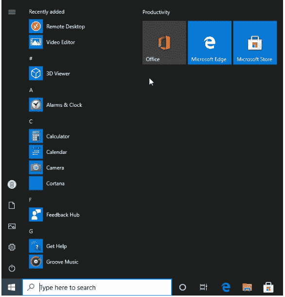

图 4.58 – 应用已添加到“开始”菜单

27. 注册后，你将可以直接从磁贴和“开始”菜单启动云电脑：

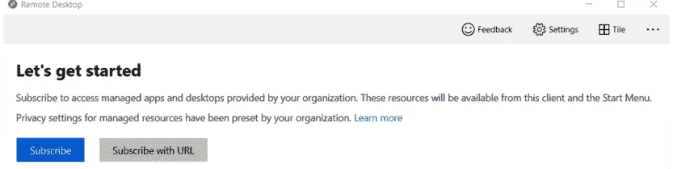

图 4.59 – “让我们开始吧”配置屏幕

28. 使用你的 AAD 用户帐户登录，并通过必要的 MFA 提示：

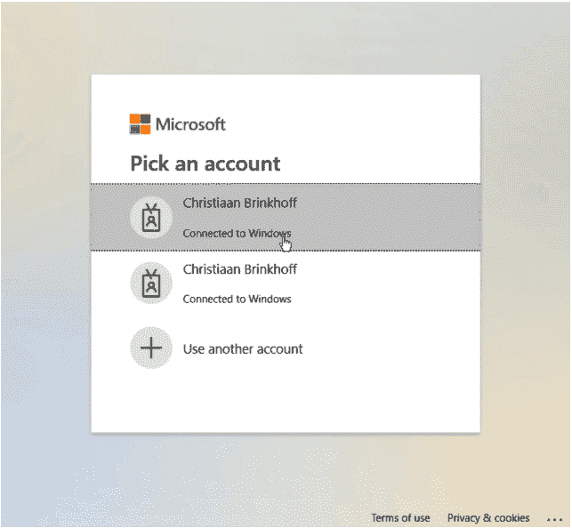

图 4.60 – 使用你的帐户登录

你也可以直接将它们固定到任务栏！

## 云电脑 – 基于设备的筛选

你可能会遇到这样的情况：你已经配置了 Microsoft Endpoint Manager 租户来管理你的物理终结点。现有策略、应用程序交付规则或其他配置项可能被筛选为 **“所有设备”**。这可能会导致冲突，因为有些情况下设置应仅应用于你的物理环境。


所有云 PC 设备都有一个特定的型号名称（包含 cloud PC）和一个注册配置文件名称（等同于云 PC 部署配置文件），可用于从全设备分配中将其筛选出来：

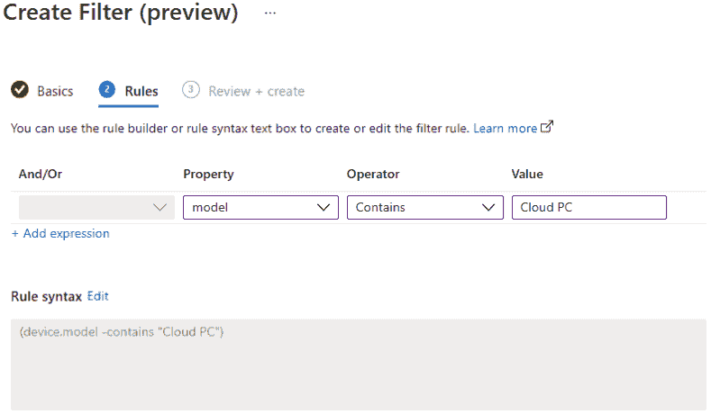

图 4.61 – 创建基于设备的筛选器

## 发布应用和脚本化操作

本章不会深入介绍应用交付，我们将在 *第 8 章，应用管理和交付* 中进行介绍。不过，我想重点介绍以下受支持的格式：

- `.MSI`
- `.exe`
- `.MSIX`
- `.AppV`
- `.AppX`

如果你想提供任何自定义脚本化操作并将其发布到你的云 PC，这也是可能的。你可以轻松地将脚本操作作为 PowerShell 脚本发布。

你可以在此 GitHub 仓库中找到操作/脚本列表 https://github.com/CloudManagedDesktops。

## 在远程桌面客户端中自动订阅用户

请注意，以下设置仅在 Windows 11 作为终端时有效，并将很快回溯到 Windows 10。 当你阅读本书时，该功能可能已经可用！

一旦你配置了将远程桌面客户端注册到你的 Windows 10 终端的能力，你就完成了最基本的一步。 然而，如果你在此停止，打开应用的用户将被提示先使用其 Azure AD 凭据登录，然后你才会看到你的云 PC 以开始会话。

本节解释了如何让用户自动订阅远程桌面（MSRDC/Store）应用，而无需输入凭据！

使这种登录方式成为可能 的设置必须通过 设备 | 配置文件，通过设置目录功能来实现。步骤如下：

1. 首先，打开设备菜单并创建一个新配置文件（适用于 Windows 10 及更高版本）：

   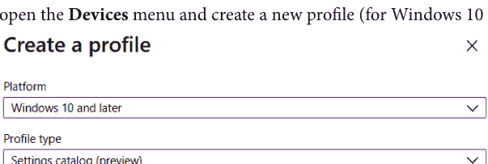

   图 4.62 – 创建配置文件

2. 在继续之前，请确保为你的配置配置文件输入一个名称，例如 Auto-subscribe Remote Desktop client：

   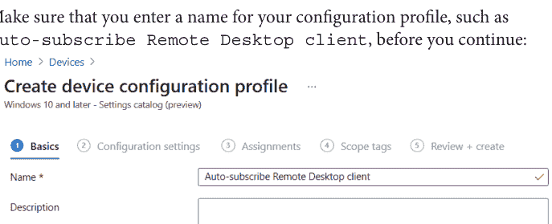

   图 4.63 – 为配置输入名称

3. 点击 + 添加设置 以打开目录：

   基础 2 配置设置 3 分配 4 范围标记 5 查看 + 创建

   设置目录

   使用设置目录，你可以选择要配置的设置。点击添加设置以浏览或搜索目录中要配置的设置。

   了解更多

   + 添加设置

   图 4.64 – 打开设置目录

4. 搜索 Remote Desktop；将出现远程桌面特定设置的列表。点击 Remote Desktop 并确保选中 Auto-subscription (User) 旁边的复选框：

   设置选择器

   使用逗号 “,” 在搜索词之间查找设置关键字

   远程桌面

   搜索

   + 添加筛选器

   按类别浏览

   - RD Connection Broker
   - RD Gateway
   - RD Licensing
   - Remote Desktop
   - Remote Desktop Connection Client
   - Remote Session Environment
   - RemoteApp and Desktop Connections
   - RemoteFX for Windows Server 2008 R2

   “Remote Desktop” 类别中有 1 个结果

   选择所有这些设置

   设置名称

   Auto-subscription (User)

   图 4.65 – 选中 Auto-subscription (User) 复选框

5. 点击 +Add 并输入以下 URL：https://rdweb.wvd.microsoft.com/api/arm/feeddiscovery：

   主页 > 设备 >

   创建设备配置配置文件

   Windows 10 及更高版本 - 设置目录（预览）

   基础 2 配置设置 3 分配 4 范围标记 5 查看 + 创建

   + 添加设置

   远程桌面

   删除类别

   Auto-subscription (User)

   + 添加 删除 排序

   https://rdweb.wvd.microsoft.com/api/arm/feeddiscovery

   图 4.66 – 输入 URL

6. 为你的用例配置正确的分配设置，例如基于 Azure AD 组，并完成配置，以便你可以开始将这些设置注册到你的用户/终端设备。

7. 在设备菜单中，你可以找到创建的设备配置配置文件以及注册状态：

   主页 > 设备 >

   Auto-subscribe Remote Desktop client

   设备配置配置文件 - 设置目录

   删除

   设备状态

   成功 8 错误 0 冲突 0 不适用 0

   查看报告

   图 4.67 – 注册状态

8. 注册后，你可以点击远程桌面客户端。你将不再被要求使用 Azure AD 凭据登录，尽管如果你已强制执行，可能仍需要为 MFA 通过 Azure MFA 执行此操作：

   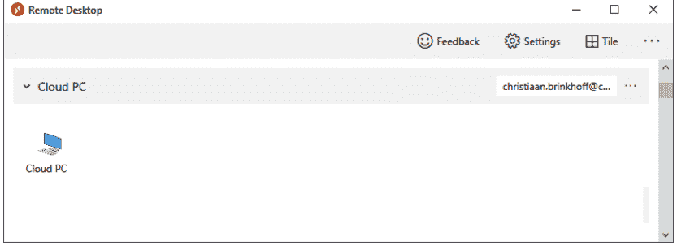

   图 4.68 – 无需登录

在下一节中，你将学习如何进一步简化注册流程。

## Autopilot 和云 PC – 轻量级瘦客户端（Kiosk）

微软 Endpoint Manager、Autopilot 和 Windows 365 结合的强大功能的好处在于，你可以配置物理和虚拟 MEM 管理的终端。

例如，在 Autopilot 中，你可以配置多应用 Kiosk 类型的 Surface Go，这是一种仅填充远程桌面客户端的瘦客户端。完整配置和注册无需用户交互完成，当客户端完成后，最终用户只需使用其 Azure AD 凭据登录即可访问其云 PC！

在你附加的设备配置配置文件中，例如附加到你的轻量级瘦客户端，你可以配置远程桌面 Win32 或 Store 应用的自动启动功能，以使体验更出色：


图 4.69 – 配置 Kiosk 模式配置文件

然而，这还不是全部。

当将此设置与上一节中解释的设置结合使用时，Auto-subscribing users in the Remote Desktop client，设备配置配置文件用户将自动登录到远程桌面客户端并直接登录到其云 PC！这非常棒：


图 4.70 – 直接登录到云 PC

现在，让我们介绍监控和分析。

## 监控和分析

确保你的云 PC 环境的性能和质量水平良好与实施一样重要（或更重要）。用户需要对他们的云 PC 感到满意，并且不应损害其生产力。

Windows 365/云 PC 与你今天为物理终端使用的所有监控和分析功能无缝集成。这意味着你可以轻松区分问题是活跃在物理终端上还是在云 PC 会话中。

你将在第 14 章，监控和端点分析中了解更多关于监控的内容，我们将在那里深入探讨确保你的 Windows 365/云 PC 环境性能和质量的具体指标，无论是主动还是被动！

以下是截至撰写时可用的报告/仪表板的快速预览列表：

- 启动性能
- 主动修复
- 推荐软件
- 应用可靠性
- 资源性能
- 远程连接：


| 登录阶段 | 每次登录平均时间（秒） | 登录百分比 | 每个阶段平均时间（秒） |
|---|---|---|---|
| 远程登录 ⓘ | 23.76 | 100 | 23.76 |
| 核心登录 ⓘ | 226.8 | 25 | 56.7 |
| 核心启动 ⓘ | 78.17 | 33 | 26.06 |

图 4.71 – 登录时间 – 登录持续时间，端点分析

等待会话加载。

在加载过程中，服务台用户将被要求输入他们希望实施的控制类型：


图 4.73 – 控制类型

用户随后会收到提示。至此，你已准备好通过 Quick Assist 进行故障排除。

## Windows 11

Windows 365 在 **通用可用性（GA）** 于 2021 年 10 月 5 日期间为 Windows 11 提供了第 1 天支持。客户可以将其云 PC 启用 **可信平台模块（TPM）**，以便他们可以使用 Windows 11 的硬件要求。


这里，你可以看到 Windows 11 如何作为 Windows 365 的一部分在浏览器中运行。当然，其他所有终端，如 Windows 和 macOS，也都受支持：


*Figure 4.74 – Windows 11*

## Microsoft Managed Desktop

Microsoft Managed Desktop 将 Microsoft 365 Enterprise、微软提供的基于云的设备管理和安全监控整合在一起，使你的 IT 团队能够专注于核心（IT即服务）业务需求。

此服务与云 PC/Windows 365 不同，但该服务可用于简化你的物理终端的管理层，而你作为合作伙伴或客户，负责你的云终端。

当你有兴趣使用此服务时，请联系你的 Microsoft 销售代表。启用流程从 Microsoft Endpoint Manager 控制台开始，在租户管理员下，然后点击租户注册：


*Figure 4.75 – Managed Desktop*

至此，本章已结束。恭喜你完成本章！

### Summary

在本章中，你已了解有关全新 Windows 365 服务所需的一切知识，从其基础到深入配置的物流。我们涵盖了部署 Windows 365 Enterprise 所需的所有步骤、其先决条件，以及一些很棒的提示，以便了解有关部署优化的更多信息。

在下一章中，我们将更深入地探讨管理 Windows 365 环境的不同方面，以及思考监控、经典 Windows 应用程序（Win32）和 MSIX 的应用程序分发、身份和安全等诸多方面。

### Questions

- 1. 你可以在全球多个区域使用 Windows 365，从美国到欧洲，甚至到中东、亚洲和新西兰？
  - A. Yes
  - B. No
- 2. Windows 365 在连接云 PC 时使用什么协议？
  - A. Unified Desktop Protocol
  - B. Blaster Disaster Protocol
  - C. Remote Desktop Protocol

### Answers

- 1. (A)
- 2. (C)

### Further reading

如果你在阅读本章后想了解更多关于 Windows 365 的信息，请前往本书中的以下其他章节之一：

- *Chapter 12, User Profile Management*
- *Chapter 14, Monitoring and Endpoint Analytics*
- *Chapter 16, Troubleshooting Microsoft Endpoint Manager*
