## 5 Requirements for Microsoft Endpoint Manager

在本章中，你将清楚了解 Microsoft Endpoint Manager（MEM）的不同要求，从操作系统版本和 URL 防火墙允许列表到所需许可证和权限。在我们开始本书的技术深入内容之前，我们将介绍 MEM 的要求。其中一些要求可能对你的环境没有任何影响，而其他要求则影响很大。例如，如果你处于采用所有 Microsoft 技术零信任环境中，网络 URL 防火墙要求就不那么重要，但如果你出于某种原因在环境中拥有防火墙、代理服务器等，那么它们就非常重要。

在本章中，我们将介绍以下主题：

- Endpoint scenarios
- Identity roles and privileges
- Network URL firewall requirements
- Licensing requirements
- Supported OSes
- Windows 11 hardware requirements
- Administrator licensing

### Endpoint scenarios

MEM 支持我们将在本书中深入介绍的不同终端场景。

受支持的终端场景如下：

- Physical desktops
- Cloud PC endpoints
- Mobile devices

现在我们提到了不同的终端场景，我们将解释 MEM 中可用的不同角色。

### Identity roles and privileges for Microsoft Intune

为了配置 MEM，你首先必须确保拥有执行此操作的必要权限。你在 Azure Active Directory（AD）租户中创建的第一个用户将自动成为全局管理员，是 Global Admin 角色的成员。Global Admin 角色拥有完整的 Microsoft Intune 权限。

还有其他角色可以帮助你在用户角色设计中委派访问权限。Intune 的某些后续步骤需要 Global Admin 角色，因此我们建议对初始设置使用此类帐户。

以下是 MEM 中受支持的角色列表。

**Compliance Administrator**

具有此角色的用户有权在 Microsoft 365 合规中心、Azure、Microsoft 365 管理中心和 Microsoft 合规中心中管理与合规相关的功能。

具有此角色的用户可以查看所有 Intune 审计数据。

**Compliance Data Administrator**

具有此角色的用户有权在 Microsoft 365 合规中心、Microsoft 365 管理中心和 Azure 中跟踪数据。

具有此角色的用户可以查看所有 Intune 审计数据。

**Intune Administrator**

具有此角色的用户在 Microsoft Intune 中拥有全局权限。

Intune Administrator 角色包含管理用户和设备以关联策略的能力，以及在 Azure AD 中创建和管理所有安全组的能力。

> **Important Note**
>
> Intune Administrator 不具有 Office 组的管理员权限。

**Message Center Reader**

此角色中的用户可以监控其组织在 Microsoft Intune 消息中心中的通知和咨询健康更新。

> **Important Note**
>
> 这对于范围受限的 Intune 管理员用户很重要。

**Security Administrator**

具有此角色的用户有权在 Microsoft 365 安全中心、Azure AD 身份验证、Azure AD Identity Protection、Azure Information Protection 和 Microsoft 365 合规中心中管理与安全相关的功能。

此角色中的用户可以查看用户、设备、注册、配置和应用程序信息。但是，他们无法更改 Intune。

**Security Operator**

具有此角色的用户可以管理警报，并对与安全相关的功能具有全局只读访问权限，包括 Microsoft 365 安全中心、Identity Protection、Azure AD、特权身份管理 和 Microsoft 365 合规中心中的所有信息。

此角色中的用户可以查看用户、设备、注册、配置和应用程序信息。但是，他们无法更改 Intune。

**Security Reader**

具有此角色的用户对与安全相关的功能具有全局只读访问权限，包括 Microsoft 365 安全中心、Azure AD、特权身份管理、Identity Protection 和 Microsoft 365 合规中心中的所有信息，以及读取 Azure AD 登录报告和审计日志的能力。

此角色中的用户可以查看用户、设备、注册、配置和应用程序信息。但是，他们无法更改 Intune。

### Identity roles and privileges for a Windows 365 cloud PC

为了使用 Windows 365 云 PC，你的 Azure AD 配置应为混合 Azure AD 加入（HAADJ），以将你的云 PC 注册到 Intune。

**Azure Subscription Owner**

具有此角色的用户可全局访问 Azure 订阅中的所有资源。这些权限是 Windows 365 初始设置所需的。

此角色授予用户完全访问以管理所有资源的能力，包括在 Azure RBAC 中分配角色的能力。

**Intune Administrator**

具有此角色的用户在 Microsoft Intune 中拥有全局权限。

Intune Administrator 角色包含管理用户和设备以关联策略的能力，以及在 Azure AD 中创建和管理所有安全组的能力。

> **Important Note**
>
> Intune Administrator 不具有 Office 组的管理员权限。

## 域管理员

拥有此角色的用户将能够在您的本地域中创建计算机帐户。这是为云电脑在您的域中创建计算机帐户所必需的。您还可以通过直接使用域中的相应组织单位进行委派控制来委派访问权限。

## 通用打印的身份角色与权限

通用打印在 Azure AD 中引入了两个角色：打印机管理员和技术员。初始配置需要打印机管理员。全局管理员帐户也完全足够。

我们将在本书后面进一步讨论通用打印。

## 打印机管理员

拥有此角色的用户拥有完全访问权限，可以管理通用打印中打印机的所有方面。

## 打印机技术员

拥有此角色的用户可以注册和注销打印机，并设置打印机状态。

## 许可要求

要使用 MEM，您必须拥有 Intune 许可证的使用权。您也可以选择获取 30 天的试用许可证，以此进行测试并验证服务。

MEM 作为一项服务并不需要 Azure 订阅；但是，当您将服务与云电脑一起使用时，您需要设置 Azure 虚拟网络，因此需要 Azure 订阅。当云电脑支持 Azure AD 加入时（即将推出），将不再需要 Azure 订阅。

以下类型的许可证可提供 MEM 的访问权限：

- 仅限 Intune 的许可证
- Microsoft 365 E3
- Microsoft E5
- **企业移动性 + 安全性 (EMS)** E5

您的公司很可能已拥有其中一种许可证，因此已经可以访问 MEM。

创建试用帐户相对简单；您只需访问 `admin.microsoft.com`，点击**计费**，然后点击**购买服务**。搜索前面列出的许可证之一，并购买试用版（免费）。此过程无需信用卡或任何其他信息：

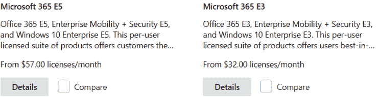

图 5.1 – Microsoft 365 许可证购买

## 受支持的操作系统

在本节中，我们将了解支持 MEM 的操作系统和 Web 浏览器版本。首先让我们看一下操作系统：

- Microsoft：
  - Windows 11（企业版**单会话和多会话版本**）
  - Windows 10（企业版**单会话和多会话版本**）
  - Windows 10 专业版、教育版
  - Windows 10 企业版 2019 LTSC
  - Windows 10 IoT 企业版（x86、x64）
  - Windows 10 Teams – Surface Hub
  - Windows Holographic for Business

- 受支持的移动操作系统：
  - Apple：
    - Apple iOS 12.0 及更高版本
    - Apple iPadOS 13.0 及更高版本
    - Mac OS X 10.13 及更高版本

- **存储：** 安装 Windows 11 需要 64 GB* 或更大的可用存储空间（可能需要额外的存储空间来下载更新和启用特定功能）。
- **显卡：** 兼容 DirectX 12 或更高版本，并带有 WDDM 2.0 驱动程序。
- **系统固件：** 支持 UEFI、安全启动。
- **TPM：** 受信任的平台模块 (https://docs.microsoft.com/en-us/windows/security/information-protection/tpm/trusted-platform-module-overview)。
- **显示器：** 高清晰度 (720p) 显示器，9 英寸或更大的显示器，每颜色通道 8 位。
- **互联网连接：** 需要互联网连接才能执行更新。

*随着时间推移，更新以及启用操作系统中的特定功能可能会有其他要求。*

遵循这些要求非常重要，因为在 Windows 11 正式发布后，您可能会遇到各种问题：

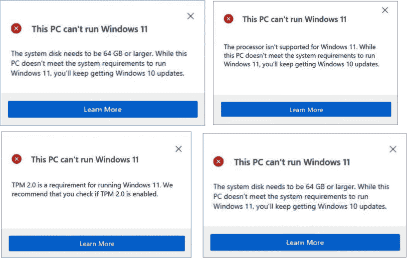

在上图中，您可以看到 Windows 11 安装过程中的错误截图。它会在开始就地升级过程之前检测硬件要求。

在升级之前，您还必须了解 Windows 10 和 Windows 11 之间的一些其他差异。您可以在以下列表中找到它们：

- Windows 11 中的“开始”界面发生了重大变化，包括以下主要的弃用和移除项：
  - 动态磁贴
  - 动态预览
  - 命名组和应用文件夹
- 从 Windows 10 升级时，固定应用和网站不会迁移。
- Windows 采用了新的现代图标。
- Teams 已集成到操作系统中。
- Windows 应用商店应用已更新，并允许安装 Win32 应用程序。
- 一项新功能，支持多个窗口的灵活性，并能够并排对齐应用。
- 动态磁贴不再可用。如需一目了然的动态内容，请查看新的小组件功能。
- 平板模式已移除，并新增了针对键盘连接和断开姿势的功能和能力。
- 任务栏功能已更改，包括以下内容：
  - **人员**不再显示在任务栏上。
  - 某些图标可能不再显示在**系统托盘（systray）**中，包括之前针对升级设备的自定义设置。
  - 仅允许对齐到屏幕底部。
  - 应用无法再自定义任务栏的区域。
- **时间线**已移除。Microsoft Edge 中提供了某些类似功能。
- **Internet Explorer** 已移除。Edge 是推荐的替代品，并包含 IE 模式，该模式在某些场景下可能很有用。
- **数学输入面板**已移除。

3. 在 Microsoft 365 管理中心，访问 admin.microsoft.com。如果您是全局管理员，您可以分配您的 Intune 许可证：

图 5.5 – Microsoft 365 管理中心 – 许可证分配

Microsoft Intune 许可证是 Microsoft 365 E3、面向一线员工的 Microsoft 365 F1/F3、EMS E3 以及独立的 Microsoft Intune 的一部分。

还有许多其他许可证也授予您使用 Microsoft Intune 的权利。请始终咨询您的许可证合作伙伴，以确定适合您场景的正确许可证。

您租户中的用户也需要许可证才能将其设备注册到 Intune。

为您的用户分配 Intune 许可证的一个建议是利用 Azure AD 基于组的许可。

## Azure AD 基于组的许可

Microsoft 付费云服务（例如 Microsoft 365、EMS、Windows 10、Office 365、Dynamics 365 和其他类似产品）需要许可证。这些许可证分配给每个需要访问这些服务的用户。管理员使用其中一个管理门户（admin.microsoft.com 或 aad.portal.azure.com）和 PowerShell cmdlet 来管理许可证。Azure AD 是支持所有 Microsoft 云服务身份管理的基础架构。Azure AD 存储用户的许可证分配状态信息。

Azure AD 包括基于组的许可，这意味着可以将一个或多个产品许可证分配给一个组。Azure AD 确保将许可证分配给该组的所有成员。这包括后来成为该组成员的新成员。当他们离开该组时，这些许可证将被移除。这种许可证管理消除了通过 PowerShell 自动化许可证管理以反映组织和部门结构逐用户变化的必要性。

对于任何分配了许可证的组，您还必须有足够的许可证来覆盖每个唯一成员。虽然您不必为组中的每个成员分配许可证，但您必须至少有足够的许可证来包含所有成员。例如，如果您的租户中有 10,000 个属于许可组的唯一成员，则您必须至少有 10,000 个许可证才能满足许可证分配的要求。

许可证可以分配给 Azure AD 中的任何安全组。安全组可以使用 Azure AD Connect 从本地同步。您也可以直接在 Azure AD 中创建安全组（也称为纯云组），或通过 Azure AD 动态组功能自动创建。Office 365 组不能用于基于组的许可。

## 启用 Windows 自动注册

自动 MDM 注册意味着当 Windows 设备加入 Azure AD 时，设备将自动通过 MDM 注册流程注册到 Intune。

要实现 Windows 自动注册，请按照以下步骤操作：

- 1. 登录到 MEM 管理中心 (https://endpoint.microsoft.com)。
- 2. 选择 Devices | Windows | Windows enrollment 然后选择 Automatic Enrollment：

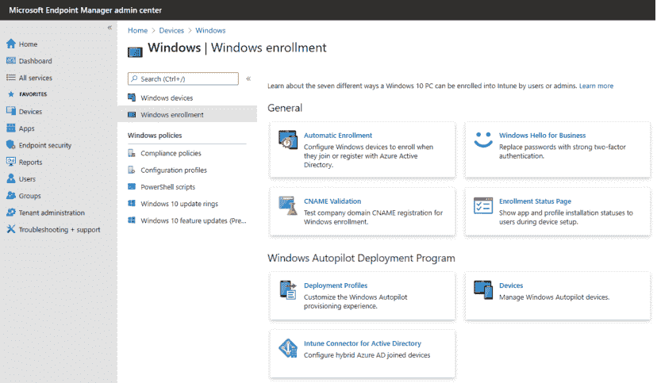

图 5.6 – MEM 管理中心 – Windows 自动 MDM 注册

如果所有用户都已分配 Intune 许可证，用户注册也可以限定为特定用户组。最佳选择是利用 Intune 注册限制来配置用户可以注册的 Windows 设备。

3. 确保将 MDM 用户范围选择为 All：

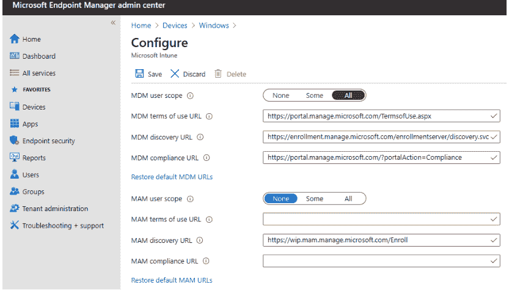

图 5.7 – MEM 管理中心 – MDM 用户范围

以下是 MDM 用户范围所有选项的含义：

- None：MDM 自动注册已禁用。
- Some：选择可以自动注册其 Windows 设备的组。
- All：所有用户都可以自动注册其 Windows 设备。

> 重要说明
> 自动 MDM 注册需要 Azure AD 高级订阅。

对于 Windows 自带设备 (BYOD) 设备（个人注册），如果 MAM 用户范围和 MDM 用户范围（自动 MDM 注册）都已为所有用户（或同一组用户）启用，则 MAM 用户范围优先。如果您已配置它们，设备将不会进行 MDM 注册，并且将应用 Windows 信息保护 (WIP) 策略。

## 使用 Azure Virtual Desktop 与 Intune

在 Windows 365 中，以下步骤不需要，因为 Intune 注册会自动完成。此外，请确保在继续之前已执行上一步（将 MDM 用户范围设置为 All 且 MAM 用户范围设置为 None）。

> **重要说明**
> 请确保 RemoteDesktopServices/AllowUsersToConnectRemotely 策略未被禁用。

请注意，以下 Windows 10 桌面设备远程操作不适用于/不建议用于 Azure Virtual Desktop 虚拟机：

- Autopilot reset
- BitLocker key rotation
- Fresh start
- Remote lock
- Reset password
- Wipe

让我们开始执行操作：

- 1. 登录到您的会话主机。
- 2. 打开 **Local Computer Policy** 并单击 **Administrative Templates | Windows Components | MDM：**

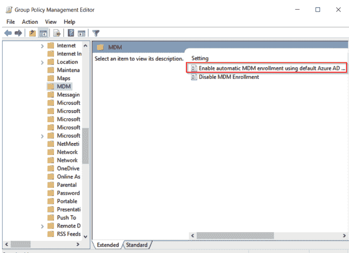

图 5.8 – 本地组策略 – MDM

- 3. 将策略设置为 **Enabled.**
- 4. 将凭据类型设置为 **User Credential：**

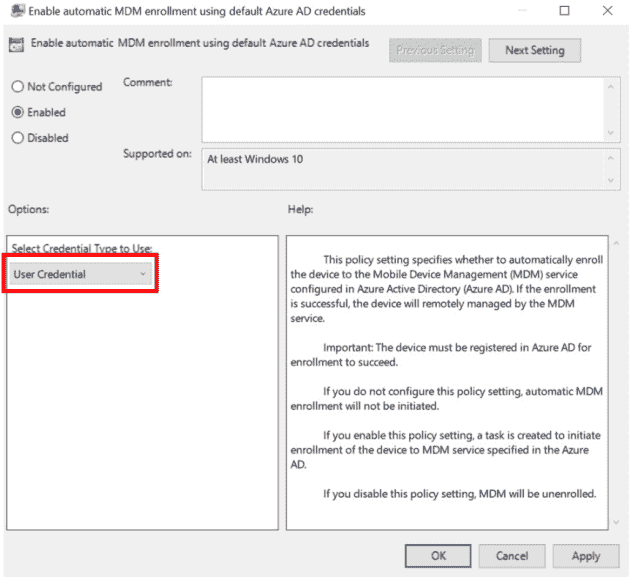

图 5.9 – 本地组策略 – MDM

- 5. 确认您的会话主机已注册到 Azure AD 的 MDM 注册，其应如下例所示：

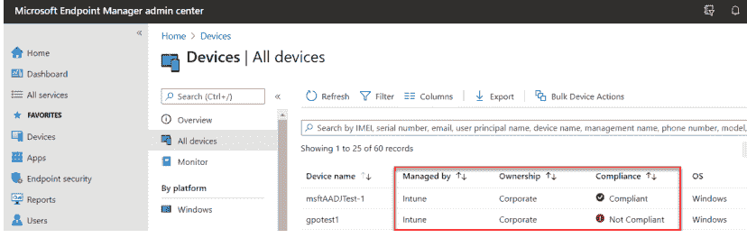

图 5.10 – 管理中心 – 所有设备

正如我们刚刚向您展示了将 Windows 设备注册到 Microsoft Intune 的不同选项，我们现在将向您展示如何通过 Microsoft Intune 注册限制来限制 Windows 注册。

## Microsoft Intune Windows 注册限制

如果您阻止个人拥有的 Windows 设备注册，Intune 会检查每个新的 Windows 注册请求是否已作为企业注册获得授权。未经授权的注册将被阻止。

> **重要说明**
> 在默认注册限制中阻止 Windows MDM 注册将阻止一些涉及企业设备的场景。

## Microsoft Intune Windows 设备限制

在本节中，我们将了解如何为 Windows 设备创建注册限制：

- 1. 登录到 MEM 管理中心 (endpoint.microsoft.com)。
- 2. 选择 Devices | Enrollment restrictions：

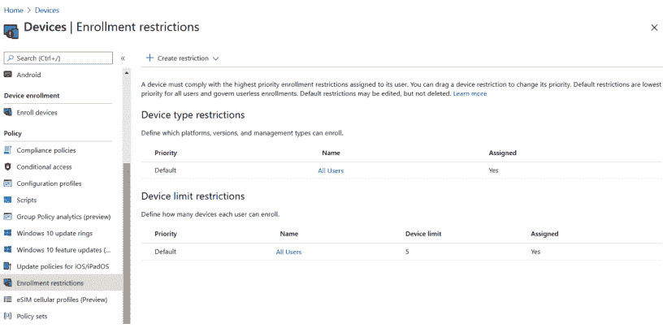

图 5.11 – 管理中心 – 注册限制

- 3. 创建设备类型限制。输入 `Device type restriction - HR` 作为名称：

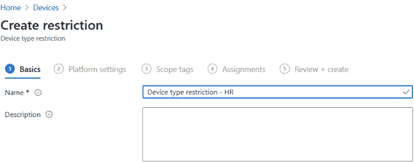

图 5.12 – 管理中心 – 注册限制

- 4. 选择同时对 MDM 和个人拥有的设备在特定操作系统上进行阻止和允许，以允许或阻止设备注册。

如果您阻止特定操作系统注册，则适用于企业和个人设备注册。

如果您允许 Windows (MDM) 平台注册，您可以阻止个人设备；请参阅以下部分以了解 *阻止个人 Windows 设备* 的含义。

**Allow min/max range** 对于操作系统版本仅在注册时阻止设备，对已注册到 Microsoft Intune 的设备没有影响：

> **重要说明**
> 
> Windows 仅对 Windows 10 支持 `major.minor.build.rev`。
> 
> Windows 10 在注册期间不提供 rev 编号，因此，例如，如果您输入 `10.0.17134.100` 而设备为 `10.0.17134.174`，它将在注册期间被阻止。

Home > Devices >

# Create restriction

Device type restriction

Basics 1 Platform settings 2 Scope tags 3 Assignments 4 Review + create

Specify the platform configuration restrictions that must be met for a device to enroll. Use compliance policies to restrict devices after enrollment. Define versions as major.minor.build. Version restrictions only apply to devices enrolled with the Company Portal. Intune classifies devices as personally-owned by default. Additional action is required to classify devices as corporate-owned. Learn more

| Type | Platform | versions | Personally owned | Device manufacturer |
| Android Enterprise (work profile) | Allow Block | Allow min/max range: Min Max | Allow Block | Manufacturer name here |
| Android device administrator | Allow Block | Allow min/max range: Min Max | Allow Block | Manufacturer name here |
| iOS/iPadOS | Allow Block | Allow min/max range: Min Max | Allow Block | Restriction not supported |
| macOS | Allow Block | Restriction not supported | Allow Block | Restriction not supported |
| Windows (MDM) | Allow Block | Allow min/max range: Min Max | Allow Block | Restriction not supported |

图 5.13 – 管理中心 – 注册限制 – 平台设置

5. 在 Assignments 步骤中，选择 HR Department。

当您创建自定义注册限制时，您可以将其范围限定为应用于组织中的特定用户组、部门、国家/地区等。

更改分配设置以根据您想要提供的任何限制进行筛选，以避免组注册到 MDM Intune：

Home > Devices >

# Create restriction

Device type restriction

Basics Platform settings Scope tags 4 Assignments 5 Review + create

Included groups

Add groups

Groups

HR Department Remove

图 5.14 – 管理中心 – 注册限制 – 分配

在下一节中，让我们了解如何阻止个人设备。

## 阻止个人 Windows 设备

如果您阻止个人拥有的 Windows 设备注册，Intune 会检查每个新的 Windows 注册请求是否已作为企业注册获得授权。未经授权的注册将被阻止。

以下方法被视为已作为 Windows 企业注册获得授权：

- 注册用户正在使用设备注册管理器帐户。
- 设备通过 Windows Autopilot 注册。
- 设备已使用 Windows Autopilot 注册，但不是来自 Windows 设置的仅 MDM 注册选项。
- 设备的 IMEI 号码列在 **Device enrollment | Corporate device identifiers** 中。
- 设备通过批量预配包注册。
- 设备通过 **Group Policy Object (GPO)** 注册，或通过 Configuration Manager 的自动注册进行共管。

以下注册会被 Intune 标记为企业。但由于它们不提供 Intune 管理员按设备控制，它们将被阻止：

- 在 Windows 设置期间使用 Azure AD 加入的自动 MDM 注册*
- 从 Windows 设置使用 Azure AD 加入的自动 MDM 注册*

以下个人注册方法也将被阻止：

- 从 Windows 设置使用 **Add Work Account** 的自动 MDM 注册*
- 来自 Windows 设置的仅 MDM 注册选项

*如果已使用 Autopilot 注册，这些将不会被阻止。

## Microsoft Intune Windows 设备限制限制

在本节中，我们将学习如何限制设备的限制。让我们开始：

- 1. 登录到 MEM 管理中心 (endpoint.microsoft.com)。
- 2. 选择 **Devices | Enrollment restrictions | Create restriction | Device limit restriction**。输入 `Device type restriction - HR` 作为名称：

创建限制

设备限制

1 基础 2 设备限制 3 范围标签 4 分配 5 查看 + 创建

名称 *

设备限制 - HR

描述

图 5.15 – MEM 管理中心 – 设备限制

3. 您可以将设备限制设置为 1 到 15 之间的数字。Microsoft Intune 中的默认值为 5：

创建限制

设备限制

基础 2 设备限制 3 范围标签 4 分配 5 查看 + 创建

指定用户可以注册的最大设备数。

设备限制

15

图 5.16 – MEM 管理中心 – 设备限制

4. 对于分配步骤，选择 HR 部门。

当您创建自定义注册限制时，您可以将其范围限定为应用于组织中的特定用户组、部门、国家等：

创建限制

设备限制

基础 设备限制 范围标签 4 分配 5 查看 + 创建

包含的组

添加组

组

HR 部门

删除

图 5.17 – MEM 管理中心 – 设备限制 – 分配

5. 您始终可以概览默认设备类型限制和设备限制限制：

设备必须符合分配给其用户的优先级最高的注册限制。您可以拖动设备限制来更改其优先级。默认限制对所有用户都是最低优先级，并管理无用户注册。默认限制可以编辑，但不能删除。了解更多

### 设备类型限制

定义哪些平台、版本和管理类型可以注册。

| 优先级 | 名称 | 已分配 |
| --- | --- | --- |
| 1 | 设备类型限制 – HR | 是 |
| 默认 | 所有用户 | 是 |

### 设备限制

定义每个用户可以注册多少设备。

| 优先级 | 名称 | 设备限制 | 已分配 |
| --- | --- | --- | --- |
| 1 | 设备限制 – HR | 15 | 是 |
| 默认 | 所有用户 | 5 | 是 |

图 5.18 – MEM 管理中心 – 注册限制 – 概览

6. 如果您限制了个人注册，您的终端用户在设备为 Azure AD 加入且设备不在 Windows Autopilot 服务中的情况下，将会看到 `Something went wrong.` 屏幕：

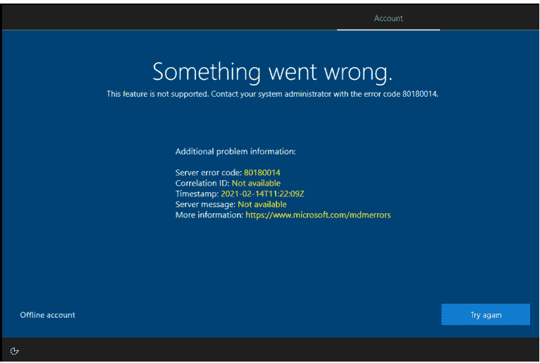

图 5.19 – Windows 10 – OOBE 错误

现在我们已经了解了在 Microsoft Intune 中限制设备注册的不同方法，我们将在下一节中查看 Microsoft Intune 的公司品牌。

## 自定义 Intune 公司门户应用、公司门户网站和 Intune 应用

您可以使 Intune 登录屏幕、公司门户和网站自定义并添加您的品牌。按照以下步骤为您的组织实现此功能：

1. 转到 **租户管理**。点击 **自定义 | 设置 | 编辑**：

> **重要说明**
> 这是应用于所有用户和设备的默认自定义。它可以编辑，但不能删除。

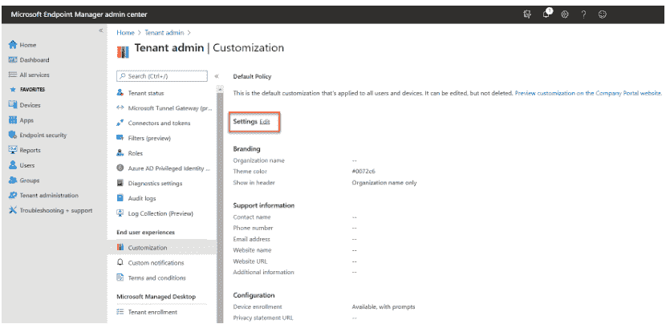

图 5.20 – 管理门户 – 自定义

以下操作可用：

- 隐藏企业 Windows 设备上的删除按钮。
- 隐藏企业 Windows 设备上的重置按钮。
- 隐藏企业 iOS/iPadOS 设备上的删除按钮。
- 隐藏企业 iOS/iPadOS 设备上的重置按钮。

您可以创建自定义策略并将其分配给组织中的选定组。分配后，此类策略将覆盖默认策略。如果您将多个此类策略分配给用户，用户将获得您创建的第一个策略。

您最多可以在 Microsoft Intune 租户中创建 10 个自定义策略。

公司门户是终端用户自助服务应用，可从 Microsoft Intune、Microsoft Store for Business、Azure AD 企业应用、Office Online 应用、网络链接以及 Configuration Manager 应用获取应用（如果设备处于共管状态）：

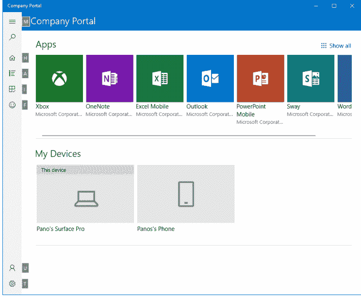

图 5.23 – 公司门户 – 示例

我们已在本节中介绍了 Microsoft Intune 的品牌部分。在下一节中，我们将介绍 Microsoft Store for Business 与 Microsoft Intune 的集成。

## 将您的 Microsoft Store for Business 帐户与 Intune 关联

Microsoft Store for Business 为您提供了一个查找和购买组织应用的地方，单独或批量购买。您可以通过将商店连接到 Microsoft Intune 从 Azure 门户管理批量购买的应用。参见以下示例：

- 您可以将从商店购买的应用（或免费应用）列表与 Intune 同步。
- 同步的应用会出现在 MEM 管理中心；您可以像其他应用一样分配这些应用。
- 在线和离线许可版本的应用程序都将同步到 Intune。应用名称将在门户中附加 Online 或 Offline。
- 您可以跟踪 Intune 管理控制台中可用许可证的数量和正在使用的数量。
- 如果可用许可证数量不足，Intune 会阻止应用的分配和安装。
- 由 Microsoft Store for Business 管理的应用将在用户离开企业时或管理员删除用户和用户设备时自动撤销许可证。

> **重要说明**
> Microsoft Store for Business 和 Microsoft Store for Education 将于 2023 年第一季度停用。客户可在该时间之前继续免费使用当前功能。Windows 11 上将不再支持 Microsoft Store for Business 和 Education。您仍然可以利用 Microsoft Intune 在 Windows 11 上部署来自 Microsoft Store for Business 的应用，无论是必需的还是在公司门户中可用。

由于 Microsoft Store for Business 对于将商店应用获取到 Windows 设备仍然很重要，我们仍建议您按照以下指南创建连接：

1. 登录 MEM 管理中心（endpoint.microsoft.com）。
2. 选择 **租户管理 | 连接器和令牌 | Microsoft Store for Business**。

> **重要说明**
> 首先，您需要注册并将您的 Microsoft Store for Business 帐户与 Intune 关联。

3. 选择 **打开业务商店**：

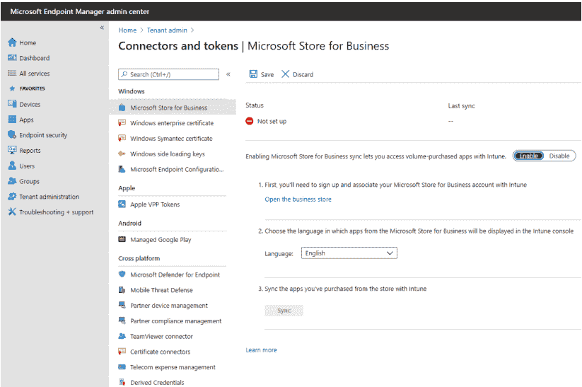

图 5.24 – MEM 管理中心 – 连接 Microsoft Store for Business

4. 您始终可以直接从 http://aka.ms/msfb 访问 Microsoft Store for Business。

5. 以全局管理员身份登录以在租户中激活 Microsoft Store for Business。

6. 点击 **管理**：

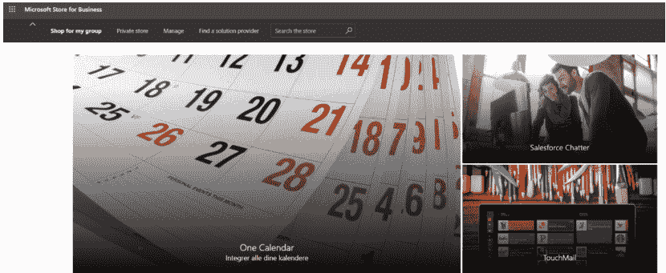

图 5.25 – MEM 管理中心 – Microsoft Store for Business

7. 点击 **设置** 开始配置您的 Microsoft Store for Business。

8. 在 **购物体验** 下，将 **显示离线应用** 更改为 **开启**。

您从 Microsoft Store for Business 购买的在线和离线许可应用都会同步到 Intune。然后可以将这些应用部署到设备组或用户组。

在线应用安装由商店管理。免费的离线应用也可以同步到 Intune。这些应用由 Intune 安装，而不是由商店安装：

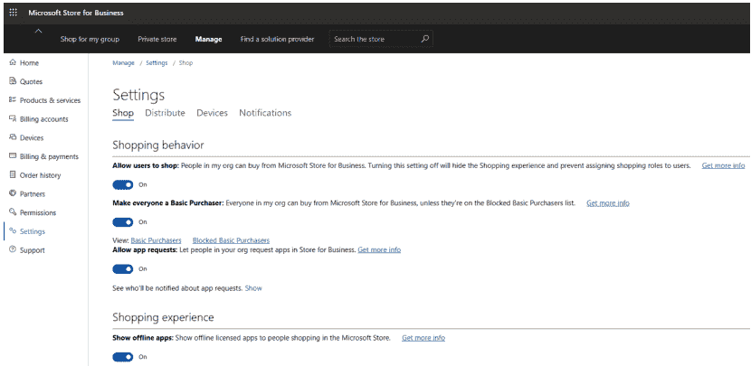

图 5.26 – MEM 管理中心 – Microsoft Store for Business

Microsoft Intune 将在后台每 24 小时同步一次：

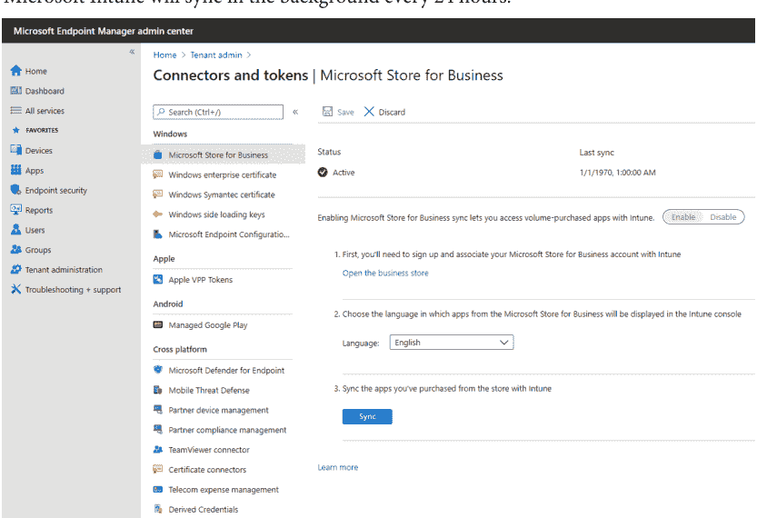

图 5.28 – MEM 管理中心 – Microsoft Store for Business

## MEM – 网络 URL 防火墙要求

本节中的表格列出了从物理端点位置以及 Azure 上获得完全访问权限所需的 IP 地址和端口设置。您可以在此处找到所有必需的 MEM URL 的完整列表：aka.ms/MEMURLs。

> **重要说明**
> 您是否在中国使用 Intune？请确保通过中国由 21Vianet 运营的 Intune 打开正确的网络访问级别 | Microsoft Docs：https://docs.microsoft.com/en-us/mem/intune/fundamentals/china。

### 受管设备的访问

下表列出了为受管设备提供访问权限的域：

| 域名 |
|---|
| login.microsoftonline.com |
| *.officeconfig.msocdn.com |
| config.office.com |
| graph.windows.net |
| enterpriseregistration.windows.net |
| portal.manage.microsoft.com |
| m.manage.microsoft.com |
| sts.manage.microsoft.com |
| portal.fei.msua01.manage.microsoft.com |
| m.fei.msua01.manage.microsoft.com |
| portal.fei.amsua0102.manage.microsoft.com |
| m.fei.amsua0102.manage.microsoft.com |
| portal.fei.msua02.manage.microsoft.com |
| m.fei.msua02.manage.microsoft.com |
| portal.fei.msua04.manage.microsoft.com |
| m.fei.msua04.manage.microsoft.com |
| portal.fei.msua05.manage.microsoft.com |
| m.fei.msua05.manage.microsoft.com |
| portal.fei.amsua0502.manage.microsoft.com |
| m.fei.amsua0502.manage.microsoft.com |
| portal.fei.msua06.manage.microsoft.com |
| m.fei.msua06.manage.microsoft.com |
| portal.fei.amsua0602.manage.microsoft.com |
| m.fei.amsua0602.manage.microsoft.com |
| fei.amsua0202.manage.microsoft.com |
| portal.fei.amsua0202.manage.microsoft.com |
| m.fei.amsua0202.manage.microsoft.com |
| portal.fei.amsua0402.manage.microsoft.com |
| portal.fei.amsua0702.manage.microsoft.com |
| portal.fei.amsua0801.manage.microsoft.com |
| portal.fei.msua08.manage.microsoft.com |
| m.fei.msua07.manage.microsoft.com |
| m.fei.amsua0702.manage.microsoft.com |
| m.fei.msua08.manage.microsoft.com |
| m.fei.amsua0801.manage.microsoft.com |
| portal.fei.msub01.manage.microsoft.com |
| m.fei.msub01.manage.microsoft.com |
| portal.fei.amsub0102.manage.microsoft.com |
| m.fei.amsub0102.manage.microsoft.com |
| portal.fei.msub02.manage.microsoft.com |
| m.fei.msub02.manage.microsoft.com |
| portal.fei.msub03.manage.microsoft.com |
| m.fei.msub03.manage.microsoft.com |
| portal.fei.msub05.manage.microsoft.com |
| m.fei.msub05.manage.microsoft.com |
| portal.fei.amsub0202.manage.microsoft.com |
| m.fei.amsub0202.manage.microsoft.com |
| portal.fei.amsub0302.manage.microsoft.com |
| m.fei.amsub0302.manage.microsoft.com |
| portal.fei.amsub0502.manage.microsoft.com |
| m.fei.amsub0502.manage.microsoft.com |
| portal.fei.amsub0601.manage.microsoft.com |
| m.fei.amsub0601.manage.microsoft.com |
| m.fei.amsua0402.manage.microsoft.com |
| portal.fei.msua07.manage.microsoft.com |
| portal.fei.msuc01.manage.microsoft.com |
| m.fei.msuc01.manage.microsoft.com |
| portal.fei.msuc02.manage.microsoft.com |
| m.fei.msuc02.manage.microsoft.com |
| portal.fei.msuc03.manage.microsoft.com |
| m.fei.msuc03.manage.microsoft.com |
| portal.fei.msuc05.manage.microsoft.com |
| m.fei.msuc05.manage.microsoft.com |
| portal.fei.amsud0101.manage.microsoft.com |
| m.fei.amsud0101.manage.microsoft.com |
| fef.msuc03.manage.microsoft.com |
| Admin.manage.microsoft.com |
| wip.mam.manage.microsoft.com |
| mam.manage.microsoft.com |
| *.manage.microsoft.com |

## Windows 365 终结点 URL

使用云电脑终结点时，请将以下 URL 加入白名单：

- `cpcsacnrysalprodprna02.blob.core.windows.net`
- `cpcsacnrysalprodprap01.blob.core.windows.net`
- `cpcsacnrysalprodprau01.blob.core.windows.net`
- `cpcsacnrysalprodpreu01.blob.core.windows.net`
- `cpcsacnrysalprodpreu02.blob.core.windows.net`
- `cpcsacnrysalprodprna01.blob.core.windows.net`

## PowerShell 脚本和 Win32 应用的网络 URL 要求

要查找你的租户位置（或 Azure 缩放单元 (ASU)），请按照以下步骤操作：

1. 登录 MEM 管理中心。
2. 转到**租户管理 | 租户详细信息**。

位置可在**租户位置**下找到，例如**北美 0501**或**欧洲 0202**。请在下表中查找匹配的编号。

行按地理区域区分，从名称的前两个字母可以看出（eu = 欧洲，na = 北美，ap = 亚太）。虽然你的组织的实际地理位置可能在其他地方，但你的租户位置将是以下三个区域之一：

| Azure 缩放单元 (ASU) | 存储名称 | 内容分发网络 (CDN) |
|---|---|---|
| AMSUA0601 | naprodimedatapri | naprodimedatapri.azureedge.net |
| AMSUA0602 | naprodimedatasec | |
| AMSUA0101 | naprodimedatahotfix | naprodimedatasec.azureedge.net |
| AMSUA0102 | | naprodimedatahotfix.azureedge.net |
| AMSUA0201 | | |
| AMSUA0202 | | |
| AMSUA0401 | | |
| AMSUA0402 | | |
| AMSUA0501 | | |
| AMSUA0502 | | |
| AMSUA0701 | | |
| AMSUA0702 | | |
| AMSUA0801 | | |
| AMSUB0101 | euprodimedatapri | euprodimedatapri.azureedge.net |
| AMSUB0102 | euprodimedatasec | euprodimedatasec.azureedge.net |
| AMSUB0201 | euprodimedatahotfix | euprodimedatahotfix.azureedge.net |
| AMSUB0202 | | |
| AMSUB0301 | | |
| AMSUB0302 | | |
| AMSUB0501 | | |
| AMSUB0502 | | |
| AMSUB0601 | | |
| AMSUC0101 | approdimedatapri | approdimedatapri.azureedge.net |
| AMSUC0201 | approdimedatasec | approdimedatasec.azureedge.net |
| AMSUC0301 | approdimedatahotfix | approdimedatahotfix.azureedge.net |
| AMSUC0501 | | |
| AMSUD0101 | | |

## Windows 推送通知服务 – 必需的 URL

Windows 推送通知服务 (WNS) 使 Microsoft Intune 能够从 Microsoft Intune 云服务向 Windows 客户端发送 Toast 通知、磁贴、徽章和原始更新：

- *.notify.windows.com
- *.wns.windows.com
- *.notify.live.net
- login.microsoftonline.com
- login.live.com

## Windows 365 和 Azure 虚拟桌面 – 必需的 URL

你为 Windows 365 和 Azure 虚拟桌面创建的 Azure 虚拟机必须能够通过客户 Azure 订阅中所需的 Azure 虚拟网络，对以下 URL 进行出站 TCP 443 访问。你可以在此处找到所有必需的 Azure 虚拟桌面 URL 的完整列表：aka.ms/CPCURLs。

有关 Windows 365 要求的详细信息，请参阅上一章。

你可以在下表中找到按服务用途列出的所有 URL 列表：

| 地址 | 出站 TCP 端口 | 用途 |
|---|---|---|
| *.wvd.microsoft.com | 443 | 服务流量 |
| gcs.prod.monitoring.core.windows.net | 443 | 代理流量 |
| production.diagnostics.monitoring.core.windows.net | 443 | 代理流量 |
| *xt.blob.core.windows.net | 443 | 代理流量 |
| *eh.servicebus.windows.net | 443 | 代理流量 |
| *xt.table.core.windows.net | 443 | 代理流量 |
| catalogartifact.azureedge.net | 443 | Azure 市场 |
| kms.core.windows.net | 1688 | Windows 激活 |
| mrsglobalsteus2prod.blob.core.windows.net | 443 | 代理和 SXS 堆栈更新 |
| wvdportalstorageblob.blob.core.windows.net | 443 | Azure 门户支持 |
| 169.254.169.254 | 80 | Azure 实例元数据服务终结点 (https://docs.microsoft.com/en-us/azure/virtual-machines/windows/instance-metadata-service) |
| 168.63.129.16 | 80 | 会话主机运行状况监视 (https://docs.microsoft.com/en-us/azure/virtual-network/security-overview) |

## Universal Print – 必需的 URL

与 Universal Print 一起使用的 Windows 终结点需要具有 Internet 连接，并能访问以下 Internet (TCP/IP – 443) 终结点：

- *.print.microsoft.com
- *.microsoftonline.com
- *.azure.com
- *.msftauth.net
- go.microsoft.com
- aka.ms

## 传递优化

对于对等流量，传递优化使用 TCP/IP 的 7680 端口，或用于 NAT 遍历（可选 Teredo）的 3544 端口。对于客户端-服务通信，它使用 80/443 端口上的 HTTP 或 HTTPS。

传递优化将有助于减少 Windows 终结点上的带宽消耗：

- *.do.dsp.mp.microsoft.com
- *.dl.delivery.mp.microsoft.com
- *.emdl.ws.microsoft.com

## 总结

在本章中，你已了解 MEM 中支持的各种终结点方案，以及使用该服务的要求。

在下一章中，我们将深入探讨如何将 Windows 10 企业版部署到你的终结点。我们还将讨论 Autopilot，以及此部署服务如何为你的物理终结点提供开箱即用的配置！

## 问题

1. 配置 MEM 所需的最重要的一组权限是什么？
   A. 全局管理员
   B. Azure 所有者
   C. Intune 管理员

+   2. 在 MEM 中，用于更改品牌和徽标（作为组织的一部分）的菜单选项叫什么？
+      A. Tenant admin
+      B. Customization
+      C. Tenant administration

+   3. 使用 Windows 365 和 Azure Virtual Desktop 所需的 Azure AD 配置应是什么？
+      A. Azure AD
+      B. Azure AD Domain Services
+      C. Azure AD hybrid-joined

## Answers

+   1. (C)
+   2. (B)
+   3. (C)

## Further reading

如果您在阅读本章后想了解更多关于 MEM 要求的信息，请使用以下免费在线资源：

+   - Network endpoints for Microsoft Intune | Microsoft Docs: https://docs.microsoft.com/en-us/mem/intune/fundamentals/intune-endpoints
+   - OSes and browsers supported by Microsoft Intune | Microsoft Docs: https://docs.microsoft.com/en-us/mem/intune/fundamentals/supported-devices-browsers
+   - Intune operated by 21Vianet in China | Microsoft Docs: https://docs.microsoft.com/en-us/mem/intune/fundamentals/china
+   - Network requirements and bandwidth details for Microsoft Intune | Microsoft Docs: https://docs.microsoft.com/en-us/mem/intune/fundamentals/network-bandwidth-use

## 6

### Windows Deployment and Management

在本章中，您将清楚地了解如何使用 Microsoft Endpoint Manager 的 Intune 为不同的云 PC 和物理 PC Microsoft Endpoint Manager 管理的终端场景部署和更新 Windows 10 Enterprise。您将了解不同的部署方法和可用于在企业级别提供 Windows 更新和管理 的其他功能。

+   在本章中，我们将介绍以下主题：
+   
+   - 将现有 Windows 设备部署到 Microsoft Endpoint Manager
+   - 那本地设备呢？
+     - Co-management
+     - Tenant attach
+   - Microsoft Surface 和其他 **Original Equipment Manufacturer (OEM)** 设备
+   - Windows Update for Business
+   - Windows 10 和 Windows 11 更新通道

## Deploying existing Windows devices into Microsoft Endpoint Manager

*此场景仅适用于物理 Windows 终端。*

在当今的企业公司中，正常的做法是利用来自 Microsoft Endpoint Manager Configuration Manager 或 Microsoft Deployment Toolkit 的操作系统部署。

Microsoft Deployment Toolkit 更简单，因为它只需要访问一个共享位置，在那里存储 Windows 10 操作系统驱动程序应用程序。

Configuration Manager 和 Deployment Toolkit 通常要求设备位于本地以加入企业 **Active Directory (AD)**，并访问 **Preboot eXecution Environment (PXE)** 服务器才能开始操作系统部署。

在过去的几十年里，企业公司开始删除 OEM 为使设备以最佳方式运行 Windows 10、驱动程序以及在全新设备上实现最佳性能所需的一系列设置所做的工作。这是通过利用 *wipe and load* 映像概念完成的，并且只有公司批准安装在设备上的内容才会被安装。通常，这将是旧版本的 Windows、旧版本的驱动程序和 Microsoft Enterprise 应用。

如果能更简单地从任何地方完成此操作就好了。随着 Covid-19 的爆发，几乎所有人都开始在家工作，幸运的是，现代技术让我们能够摆脱物理位置的束缚，转向随时随地工作。这也包括将全新设备配置到最终用户的家庭地址，而无需最终用户去办公室领取新设备。今天，这可以通过现代配置来实现，称为 **Windows Autopilot**。我们将在本章中对 Windows Autopilot 进行高层次介绍，并在下一章中通过真实案例进行更深入的介绍。

Windows Autopilot 是一组不同的技术组件，它们汇聚成一项服务，用于开箱即用地配置新设备，使其准备好投入生产使用。Autopilot 的好处是，您也可以在需要重新开始时使用它来重置、重新利用和从头恢复设备。所有这些都是为了让 IT 部门摆脱这些工作；无需管理基础设施，因为 Autopilot 作为 Microsoft Endpoint Manager 内的云服务运行，因此简单易用，可以更快地提高生产力！

## Enrolling devices – Windows enrollment

在本节中，我们将了解 Windows 10 PC 可以通过用户或管理员以多种不同方式注册到 Intune 的方法，您可以在管理中心门户中在 **Devices | Enroll devices | Windows enrollment** 下找到。

> **Important Note**
> 
> Windows 365 Cloud PCs 会自动注册到 Microsoft Endpoint Manager 的 Intune。

## Automatic enrollment

本节介绍配置 Windows 设备在加入或注册到 **Azure Active Directory (AAD)** 时进行注册。我们已在上一章 *Chapter 5, Requirements for Microsoft Endpoint Manager* 中介绍过此内容，因此请返回该章节以了解更多信息。

您在此处看到 Windows enrollment 仪表板，这是配置该部分大多数元素的起点：

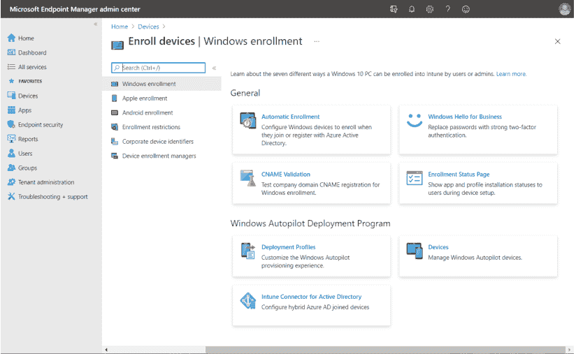

Figure 6.1 – Windows enrollment

## Testing company domain CNAME registration for Windows enrollment

在 DNS 中配置 CNAME 可以让您的用户在注册 Windows 设备时无需输入 **Mobile Device Management (MDM)** 服务器的地址。

在 DNS 中配置 CNAME 资源记录后，输入相应的域以确认其已正确配置。

DNS 记录的更改可能需要长达 72 小时才能传播。您可以在以下屏幕截图中找到使此操作成为可能的配置选项：

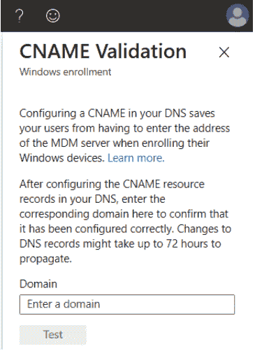

Figure 6.2 – CNAME validation setup

让我们现在切换到 **Enrollment Status Page** 屏幕，了解有关您注册到 Microsoft Endpoint Manager 的结果和状态的更多信息。

## Enrollment Status Page

**Enrollment Status Page** 屏幕显示新设备注册后以及新用户登录设备时的配置进度。这使 IT 管理员可以选择性地阻止（阻止）设备访问，直到其完全配置完成，同时为用户提供有关配置过程中剩余任务的信息。

默认注册状态页适用于所有用户和所有设备，但您可以创建多个具有不同配置的注册状态页配置文件，以满足您的场景需求。

这些配置文件按优先级顺序指定；将使用适用的最高优先级。每个注册状态页配置文件都可以针对包含设备或用户的组。当确定使用哪个配置文件时，将遵循以下标准：

+   - 首先使用针对设备的最高优先级配置文件。
+   - 如果没有针对设备的配置文件，则将使用针对当前用户的最高优先级配置文件。（这仅适用于有用户的场景。在白手套和自部署场景中，只能使用设备定位。）
+   - 如果没有针对特定组的配置文件，则将使用默认注册状态页配置文件。

注册状态页不仅适用于 Windows Autopilot 设备，还适用于分配给用户或设备的、注册到 Microsoft Intune 的所有设备。

我们将在下一章中深入介绍 Windows Autopilot，包括如何设置它以及如何为不同场景配置注册状态页。

在以下屏幕截图中，您可以看到如何在 Enrollment Status Page 屏幕上捕获设备：

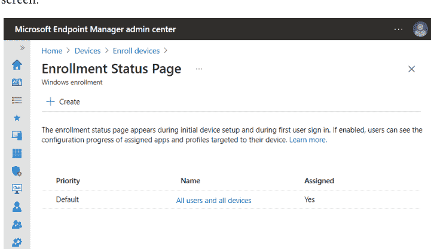

Figure 6.3 – Enrollment Status Page screen

部署 Windows Autopilot 后，组织保持与最新 Windows 版本同步非常重要。许多公司将此称为 *保持常绿*。为了帮助您的组织保持最新，您应考虑使用 Windows Update for Business。

## 现有基础架构怎么办？

我们在前两章中讨论了 Microsoft Endpoint Manager 的更广泛的统一端点管理概念，解释了您可以从单一统一仪表板控制台管理和维护所有设备。

我们也认识到，并非所有客户都会直接以 AAD 管理的方式迁移到 Microsoft Endpoint Manager。因此，在 Microsoft Endpoint Manager 中也支持共同管理现有的本地 Windows 10 设备和混合 AAD 加入的设备。这将为您的混合配置创建相同的统一端点管理体验。

## 共管和租户附加

共管并不是一项新功能，因为它已经存在一段时间了。共管使工作负载能够从 Configuration Manager（前称 **System Center Configuration Manager (SCCM)**）迁移到 Microsoft Endpoint Manager 的 Intune。它告诉由 Configuration Manager 管理的 Windows 10 客户端不同工作负载的管理权限属于谁，并且还允许您从 Microsoft Endpoint Manager 控制台查看和管理它们。简单来说，共管设备同时由 Configuration Manager 和 Microsoft Endpoint Manager 管理。

租户附加则有所不同，并且在管理能力方面有限，因为租户附加仅使您可以将 Configuration Manager 环境添加到 Microsoft Endpoint Manager 中，这意味着您可以利用 Microsoft Endpoint Manager 中可用的功能。租户附加允许您使用 MEM 门户对 Configuration Manager 管理的客户端执行操作，例如安装应用、运行脚本等。

例如，通过共管，您现有的 Windows 10 企业端点主要通过 Configuration Manager 接收应用部署和安全策略，而它则查看 Intune 以获取合规策略和设备配置策略。这有助于企业在不直接对 Microsoft Endpoint Manager 进行影响重大的切换的情况下，结合 Configuration Manager 和 Microsoft Endpoint Manager 的优势。

或者，创建集合以仅将某些设备添加到 Microsoft Endpoint Manager **Devices** 菜单中，如下图所示的第二个选项：

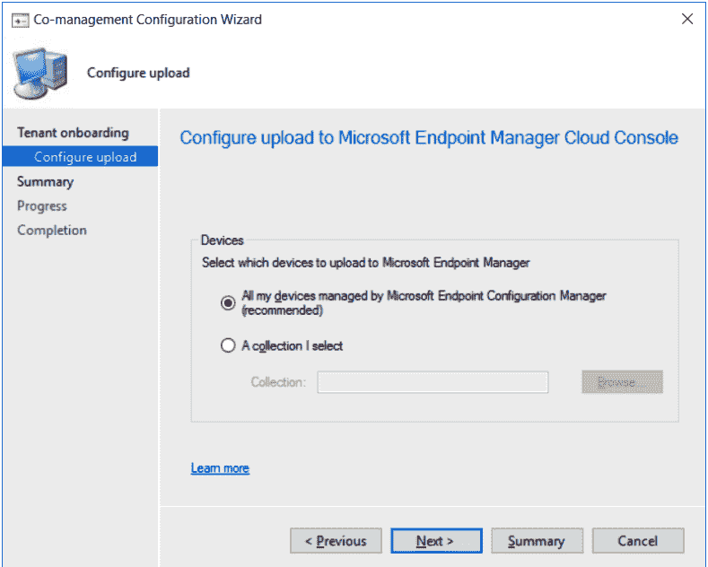

图 6.6 – 共管配置向导

设置完成后，以下完成确认应会弹出在屏幕上，以确认一切按预期进行：

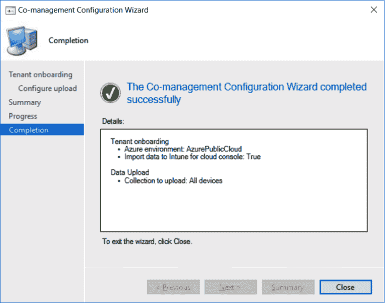

图 6.7 – 共管配置向导

设备现已添加。

此外，当您希望在 Endpoint Analytics 中除了 Microsoft Endpoint Manager 管理的设备外，还主动监控您的设备时，请确保选择 **Enable Endpoint Analytics for devices uploaded to Microsoft Endpoint Manager** 选项。

在下面的屏幕截图中，您可以看到如何将设备信息从 Configuration Manager 环境上传到 Endpoint Analytics。您将在 *第 14 章，监控和 Endpoint Analytics* 中了解更多关于 Endpoint Analytics 的信息：

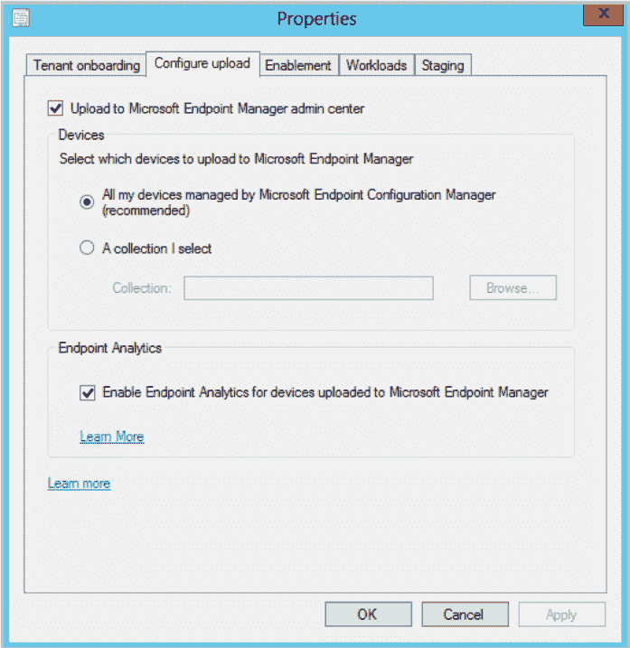

图 6.8 – Endpoint Analytics 上传设置

我们将在本书后面更深入地讨论 Endpoint Analytics 的好处，如果您想了解更多关于监控上下文中附加价值的信息。

向导完成后，在 Configuration Manager 控制台中，您将在 **Cloud Services | Co-management** 下看到与 Microsoft Endpoint Manager 租户的连接，如下图所示：

图 6.9 – Configuration Manager 中的共管概览

如果一切操作正确，您的设备也将显示在 Microsoft Endpoint Manager 管理中心控制台中，在 All devices 下：

图 6.10 – Microsoft Endpoint Manager 中的设备状态

## 何时使用何种解决方案

可能有点令人困惑，不知道何时为您的组织使用何种管理方案，因此这里有一个快速表格来澄清这一点：

| Identity | Management | Provisioning |
|---|---|---|
| Active Directory only | Configuration Manager + tenant attach | OS deployment |
| Hybrid AAD-joined | Microsoft Endpoint Manager's Intune or tenant attach + co-management | Microsoft Endpoint Manager and other OS deployments (Configuration Manager/Microsoft Deployment Toolkit (MDT)) Windows 365 Cloud PC Enterprise |
| AAD only | Co-management or Microsoft Endpoint Manager's Intune | Windows Autopilot Windows 365 Cloud PC Business |

这将帮助您做出最符合当前以及未来场景的决定。好消息是，Microsoft Endpoint Manager 从统一可管理性的角度支持所有这些方案，同时您正在朝着 Microsoft 云中的完全现代管理之旅努力！

共管的设备，或注册到 Intune 的设备，可能直接加入 AAD，也可能是混合 AAD 加入，但它们必须具有云身份。

## Windows Update for Business

在第一章中，我们介绍了 Windows Update for Business 的概述。在本章中，我们将介绍如何进行配置。

当您使用 Windows Update for Business 来管理和控制更新工作流的设备时，有几个策略值得关注。为了在保持对用户生产力影响谨慎的同时最大化更新速度，Microsoft 建议了一组特定的策略及其推荐值。在本节中，我们将介绍这些策略以及如何配置它们。

本节中的 Windows Update for Business 策略适用于 Microsoft Intune 或将 Windows Update 策略工作负载设置为 Microsoft Intune 的共管设备。

## Windows Update for Business 管理的更新类型

Windows Update for Business 旨在为 IT 管理员提供管理对 Windows 10 设备多种类型更新的策略的能力：

- **功能更新：** 以前称为 **升级**，功能更新包含重大的功能新增和更改以及安全和质量修订。功能更新每年在秋季（H1）和春季（H2）发布两次。
- **质量更新：** 质量更新是传统的操作系统更新，通常在每个月的第二个星期二发布，尽管它们可能在任何时间发布。这些包括驱动程序、安全和关键更新。
- **驱动程序更新：** 与您的设备相关的非 Microsoft 驱动程序的更新。驱动程序更新默认开启，但您可以使用 Windows Update for Business 策略将其关闭（如果您愿意）。
- **Microsoft 产品更新：** Windows Update for Business 还将非 Windows 更新（例如 Microsoft Office、.NET 或 Visual Studio 的更新）视为质量更新。这些非 Windows 更新称为 **Microsoft 更新**，您可以设置设备是否与 Windows 更新一起接收此类更新（或不接收）。

但首先，Windows 更新是如何工作的？Windows 更新过程分为四个阶段：

1. **扫描：** 设备在随机间隔检查 Microsoft 更新服务器或您的 **Windows Server Update Services (WSUS)** 端点，以查看自上次搜索更新以来是否添加了任何更新，然后通过检查管理员设置的上游准则（例如组策略）来评估更新是否合适。此过程对用户不可见。
2. **下载：** 一旦设备确定更新可用，它就开始下载更新。下载过程对用户不可见。对于功能更新，下载发生在多个顺序阶段。
3. **安装：** 更新下载后，根据设备的 Windows Update 设置，更新会安装到系统上。
4. **提交和重启：** 安装后，设备通常（但并非总是）必须重启才能完成安装并开始使用更新。在此阶段之前，设备运行软件的先前版本。

在流程的每个阶段，都有通过策略和设置提高速度的机会，我们的建议如下。

## 强制执行更新合规性截止日期

为许多组织部署功能或质量更新只是管理其设备生态系统的部分工作。下一个重要部分是对更新合规性执行强制管控的能力。Windows Update for Business 提供了相关控制措施，用于管理设备应迁移到更新版本的截止日期。

## 如何处理冲突或旧版策略

我们有时会发现，管理员为设备同时设置了组策略设置和来自 MDM 服务器（如 Microsoft Intune）的 MDM 设置。根据这些策略的最终配置方式，策略冲突会以不同方式处理：

-   **Windows 更新**：组策略设置优先于 MDM。
-   **Microsoft Intune**：如果在两个不同的组上为同一策略设置了不同的值，您将收到一条警报，并且在该冲突解决之前，两个策略都不会生效。

对于组织中的设备，禁用相互冲突的策略以确保其按预期更新至关重要。例如，如果设备对您的 MDM 策略更改没有反应，请检查是否通过组策略设置了具有不同值的类似策略。

如果您发现更新速度未达到预期，或者某些设备比其他设备慢，那么可能是时候清除所有策略和设置，仅指定本文档中概述的建议更新策略了。

## 如何设置和配置 Windows Update for Business

Microsoft Intune 提供了两种策略类型来管理 Windows Update for Business：

-   **Windows 10 更新圈**：此策略是一组设置，用于配置 Windows 10 更新的安装时间。自 Windows 10 版本 1607 起就支持 Windows 10 更新圈策略，因此这并不是什么全新功能。
-   **Windows 10 功能更新**：此策略将设备更新到您指定的 Windows 版本，然后冻结这些设备上的功能集版本。此版本冻结将一直保持，直到您选择将其更新到更高的 Windows 版本。虽然功能版本保持不变，但设备可以继续安装适用于其功能版本的质量和安全更新。Windows 10 功能更新策略支持运行 Windows 10 版本 1709 或更高版本的设备。

设置和配置 Windows Update for Business 的步骤如下：

-   **1.** 登录 Microsoft Endpoint Manager 管理中心 (https://endpoint.microsoft.com)。
-   **2.** 选择“设备”|“Windows”|“Windows 10 更新圈”|“创建配置文件”：
-   **3.** 在“更新设置”部分，填写“服务通道”、“质量更新延迟期”和“功能更新设置”：

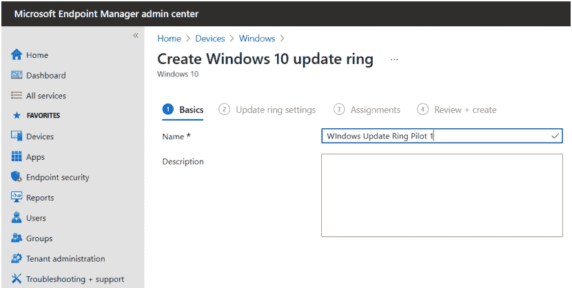

图 6.11 – 创建 Windows 10 更新圈

### 更新设置

| 设置 | 值 |
| --- | --- |
| 服务通道 | 半年度通道 |
| Microsoft 产品更新 * | 允许 / 阻止 |
| Windows 驱动程序 * | 允许 / 阻止 |
| 质量更新延迟期（天） * | 0 |
| 功能更新延迟期（天） * | 0 |
| 设置功能更新卸载期（2 - 60 天） * | 10 |

图 6.12 – 创建 Windows 10 更新圈

对于**服务通道**，**半年度通道**是默认选项，也是用于生产的通道；而如果您在**服务通道**中选择**Windows Insider**，则 Microsoft Intune 会自动配置 Windows 更新设置，以便 Windows Insider 版本可以正常工作。有关 Windows Insider for Business 的更多信息，请参阅后续章节。

以下是更新圈不同配置设置的细分：

-   半年度通道
-   半年度通道（定向）适用于 1809 及以下版本
-   Windows Insider – 快速
-   Windows Insider – 慢速
-   Windows Insider – 发布预览

IT 管理员可以将功能更新和质量更新的安装推迟到这些更新首次在 Windows 更新服务上可用之后的限定时间范围内，然后再部署到设备。

此延迟可用于留出时间，以便在更新推送到设备时验证部署。

延迟功能允许您指定更新发布后多少天才会提供给设备。通过这种方式，您可以为以下组创建具有不同延迟天数的圈部署：

-   试点组
-   生产圈 1
-   生产圈 2
-   广泛部署

更新发布圈如下图所示，以帮助您更好地理解顺序：

对于 **Microsoft 产品更新**，默认选择是**允许**。可用的两个选项如下：

-   **允许**：选择**允许**可从 Microsoft Update 扫描应用更新。
-   **阻止**：选择**阻止**可阻止扫描应用更新。

> **提示**
>
> 建议值为**允许**，这样可以使设备上安装的所有 Microsoft 产品（如 C++、.NET 等）保持最新状态。

对于 **Windows 驱动程序**，默认选择是**允许**。可用的两个选项如下：

-   **允许**：选择**允许**可在更新期间包含 Windows 更新驱动程序。
-   **阻止**：选择**阻止**可阻止扫描驱动程序。

> **提示**
>
> 建议值为**允许**，这样您可以直接通过 Windows 更新保持所有驱动程序的最新状态，无论是驱动程序、固件中的安全相关修复，还是稳定性方面的修复——请注意，这是一个开关，用于启用或禁用来自 Windows 更新的全部或全部驱动程序更新。

**设置功能更新卸载期（天）(2 - 60 天)** 允许您设置可以从设备远程卸载功能更新的天数。

在 Microsoft Intune 的更新圈策略中，您可以选择卸载设备上的 Windows 功能或质量更新。

请参阅以下屏幕截图，了解如何在 Microsoft Endpoint Manager 管理中心控制台中更新圈策略：

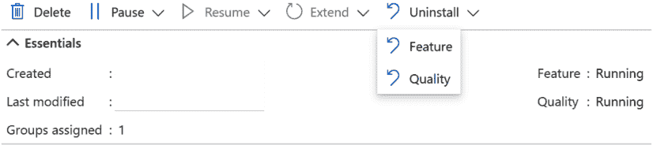

图 6.14 – 更新圈策略

-   **4.** 在**用户体验设置**部分，您可以创建围绕应用更新的用户体验行为：

### 用户体验设置

图 6.15 – 更新圈策略活动时间

以下屏幕截图显示了 Intune 中 Windows Update for Business 策略的默认设置，除非您在策略中更改，否则该设置还会将 Windows 的活动时间指定为上午 8 点到下午 5 点：

图 6.16 – 更新圈策略重置为默认值

相反，使用 **重置为默认值** （Microsoft 推荐的设置），您的最终用户可以自行设置活动时间，并且如果最终用户未配置活动时间，则可以利用智能活动时间。当员工的工作时间与在家办公成为新常态之前不同时，这一点比以往任何时候都更加重要：

### 活动时间

设置活动时间，让我们了解您通常何时使用此设备。我们不会在活动时间内自动重启，并且不会在不检查您是否正在使用的情况下重启。

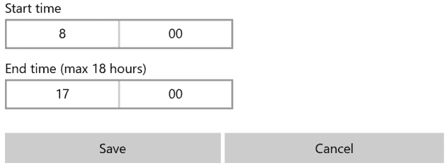

图 6.17 – 客户端活动时间

**重启检查** 可以设置为在重启前跳过所有检查。这包括电池电量是否达到 40%、用户是否存在、是否需要显示器、演示模式、全屏模式、通话状态、游戏模式等。

**暂停 Windows 更新的选项** 为最终用户提供通过 Windows 更新暂停更新最多 7 天的选项。

如果您在部署功能或质量更新时发现问题，IT 管理员可以从指定的开始日期起将其暂停 35 天，以防止其他设备安装该更新，直到问题解决。如果您暂停了功能更新，质量更新仍会提供给设备，以确保其安全。功能更新和质量更新的暂停期均从您设置的开始日期起计算。

在 Microsoft Intune 的更新圈策略中，您可以选择暂停设备上的 Windows 功能或质量更新：

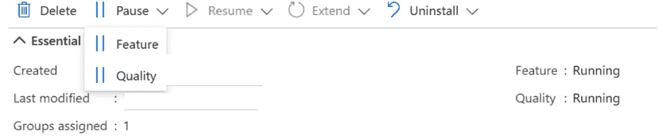

图 6.18 – 更新环策略

**检查Windows更新的选项**是Windows更新中的一项设置，启用后，允许设备用户检查更新服务以获取更新。

对于**要求用户批准以解除重启通知**，指定解除自动重启所需通知的方式。为了获得最佳最终用户体验，请将其设置为**是**，但当最终用户掌握控制权时，这可能会降低设备的更新合规性。建议保留默认值：**否**。您可以在以下屏幕截图中找到这些设置：

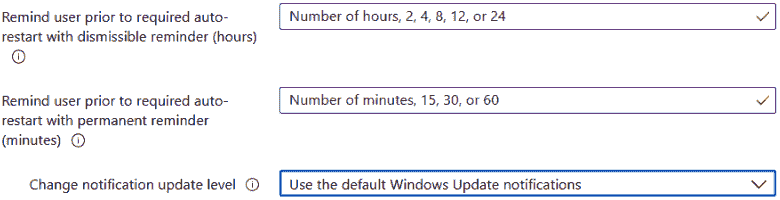

图 6.19 – 更新环策略

对于**在所需自动重启前通过可关闭的提醒提醒用户（小时）**，指定自动重启警告提醒通知的时间段。允许值为**2、4、8、12或24**。默认值为4小时。建议将其留空。

对于**在所需自动重启前通过持续提醒提醒用户（分钟）**，指定自动重启即将进行的警告通知的时间段。允许值为**15、30或60**。默认值为15。建议将其留空。

**更改通知更新级别**指定用户可以看到哪些Windows更新通知。建议将其设置为**使用默认的Windows更新通知**，以便最终用户获得尽可能多的通知，并可以选择相应地采取行动。

如果您有自助服务终端设备、ATM或其他没有用户使用的设备，建议将其设置为**关闭所有通知，包括重启警告**，因为这些设备上没有最终用户响应通知。您可以在以下屏幕截图中找到这些设置：

更改通知更新级别 ① 关闭所有通知，包括重启警告

图 6.20 – 更新环策略通知级别

**使用截止日期设置**使您能够利用截止日期设置。建议设置为**允许**。利用**允许**设置，作为IT管理员，您可以为功能更新和质量更新设置截止日期。

对于**功能更新截止日期**，允许的天数为2到30天。建议设置为**7**，这样Windows功能更新将在强制安装和重新启动之前有7天的截止日期。

对于**质量更新截止日期**，允许的天数为2到30天。建议设置为**5**，这样Windows质量更新将在强制安装和重新启动之前有5天的截止日期。这不会阻止最终用户在截止日期结束之前安装质量更新。

对于**宽限期**，允许的天数为0到7天。建议设置为**2**天，这样如果最终用户休假回来，他们将有2天时间安装更新并重新启动设备。

对于**截止日期前自动重启**，建议设置为**是**。这指定设备是否应在截止日期前自动重启。**是**将确保重启时尽可能减少最终用户的交互。**否**将确保最终用户在设备重启时始终在场。

使用截止日期设置 ① 允许 未配置

功能更新截止日期 ① 7

质量更新截止日期 ① 5

宽限期 ① 天数，0到7

截止日期前自动重启 ① 是 否

图 6.21 – 更新环策略使用截止日期设置

当您为自动Windows更新和操作系统重启指定不同截止日期时，最终用户通知将如下所示：

- 用户会收到一条toast通知，几天后用户会收到此对话框：

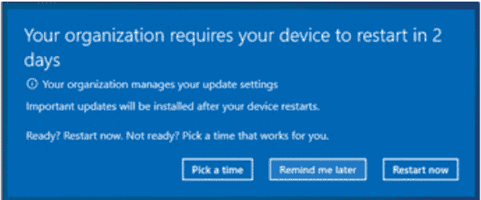

图 6.22 – Toast通知

- 如果用户计划了重启或安排了自动重启，用户将在重启前15分钟收到此通知：

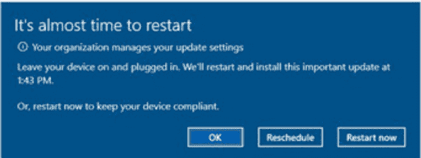

图 6.23 – 重启通知

如果截止日期过后重启仍处于待处理状态，将显示以下通知：

- 截止日期前12小时，用户会收到此通知：

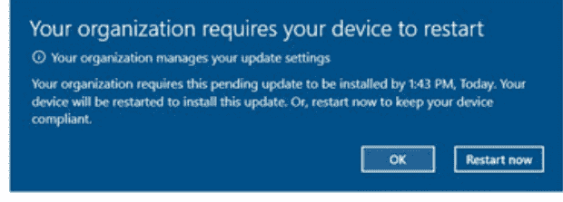

图 6.24 – 截止日期前的通知

- 一旦截止日期已过，用户必须重启以保持设备合规，并会收到此通知：

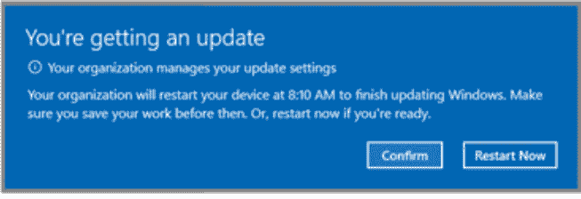

图 6.25 – 截止日期后的通知

为获得最佳Windows更新体验，请遵循以下准则：

- 每月至少使用设备6小时，其中至少连续使用2小时。
- 定期为设备充电。夜间插入电源可使设备在非使用时间自动更新。
- 确保设备至少有10 GB可用空间（启用存储感知策略）。
- 让设备不受阻碍地访问Windows更新服务。

## Windows 10 功能更新

Windows 10功能更新策略与来自Microsoft Intune的Windows 10更新环策略配合使用，以防止设备接收到比功能更新策略中指定的值更高的Windows功能版本。

Windows更新环策略中的功能更新应配置为0，您可以在Microsoft Endpoint Manager中进行以下设置：

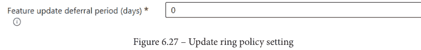

更新环的功能更新必须正在运行，不得暂停。

设备将更新到策略中指定的Windows版本。但是，如果设备已在运行更高版本的Windows，则它保持当前版本。通过冻结版本，设备的功能集能在策略有效期内保持稳定。

Microsoft Intune Windows 10功能更新需要满足以下先决条件：

- 已注册Intune MDM，并且已加入混合AD、已加入AAD或已注册AAD。
- 已开启遥测，最低设置为“基本”。

现在我们将配置Microsoft Endpoint Manager中的Windows 10功能更新配置文件设置：

1. 登录Microsoft Endpoint Manager管理中心 (https://endpoint.microsoft.com)。
2. 选择“设备” | “Windows” | “Windows 10功能更新” | “创建配置文件”：

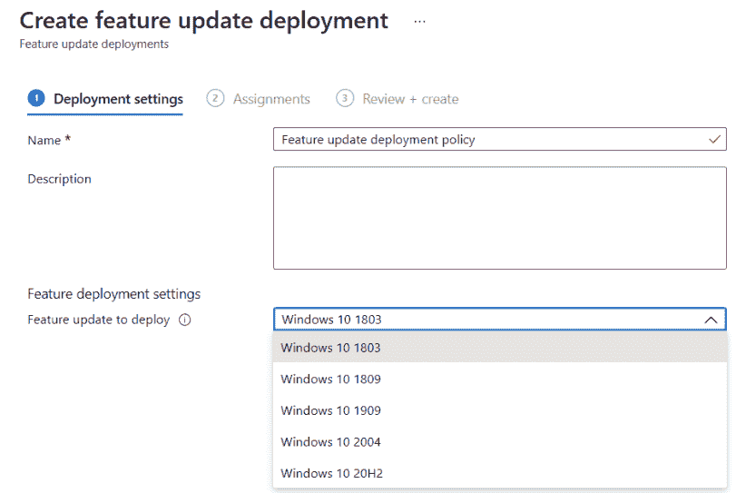

图 6.28 – 创建功能更新部署

您可以选择要部署的功能更新，如下所示：

- Windows 10 1803
- Windows 10 1809
- Windows 10 1909
- Windows 10 2004
- Windows 10 20H2

通过设置此策略，指定的Windows功能不会从Microsoft Intune下载和安装，而是告知设备在从Microsoft Intune接收策略后的下一个计划时间执行Windows更新同步时，应发送设备应处于的功能更新信息。

## 选择退出保护性暂停

选择退出Windows更新保护性暂停适用于运行Windows 10版本1809及更高版本，并安装了2020年10月安全更新的Windows Update for Business设备。

保护性暂停会阻止具有已知兼容性问题的设备接收新操作系统版本。一旦修复程序发布并在受暂停的设备上验证通过，将继续提供。

保护性暂停保护默认提供给所有尝试通过Windows更新升级到新的Windows 10功能更新版本的设备。

IT管理员如有必要，可以使用组策略设置或通过**禁用功能更新的保护性暂停**MDM设置，将设备退出保护性暂停保护。

MDM策略可以作为Microsoft Intune中的自定义策略进行配置。
有关如何在Microsoft Intune中创建自定义策略的更多详细信息，请参见*第10章，高级策略管理*。在Microsoft Intune中创建自定义策略时，您需要填写每个必填字段，如下例所示：

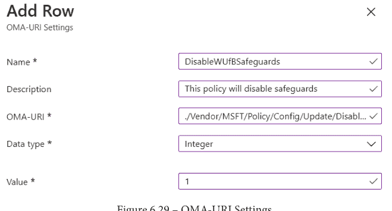

更多详细信息如下：

- **名称：** `DisableWUfBSafeguards`
- **描述：** `This policy will disable safeguards`
- **OMA-URI：** `./Vendor/MSFT/Policy/Config/Update/DisableWUfBSafeguards`
- **数据类型：** 整数
- **值：** 1

此选项支持的取值如下：

- **0（默认）**：启用保护措施，在保护措施解除之前，设备可能会被阻止升级。
- **1**：不启用保护措施，升级将在不受保护措施阻止的情况下进行部署。

选择退出保护措施可能会使设备面临已知性能问题的风险。建议仅在 IT 受控环境中为验证目的而选择退出。

**“禁用保护措施策略”**选项在设备升级到新的 Windows 10 版本后将恢复为**“未配置”**，即使之前已启用也是如此。这可以确保管理员在每个新功能更新中出于对已知问题的考虑而有意禁用 Microsoft 的默认保护。

禁用保护措施并不能保证你的设备能够成功更新。更新仍可能在该设备上失败，并且很可能会导致升级后体验不佳，因为你绕过了 Microsoft 针对已知问题所提供的保护。

在下一节中，你将了解加速部署 Windows 更新的选项。

## 加速 Windows 补丁

加速质量修补是为了在你的设备环境中比正常速度更快地部署更新。如果发布了一个重要的质量更新并包含重要的安全修复，你可以利用加速策略。

通过创建加速策略，预期在 2 天内让超过 90% 分配了加速策略的设备完成更新并重新启动。这也意味着，使用此类策略时，由于重启行为更加激进，可能会对最终用户的工作效率产生负面影响。与配置了 Windows Update for Business 通道策略设置的设备相比，部署后的第一周内成功更新的设备数量要多出两到三倍。

加速更新的一项好处是你无需修改 Windows 10 更新通道的现有质量更新设置。加速配置文件将临时覆盖任何 Windows Update for Business 设置，并使用加速策略中的必要设置代替；这是为了确保加速更新尽快安装到目标设备上。成功安装加速更新后，Windows Update for Business 策略中的设置将自动恢复为正确状态。

加速更新策略的支持适用于仍通过 Windows Update 接收更新且尚未到达服务终止日期的 Windows 10 设备。设备需要加入混合 Azure AD 或加入 Azure AD，该策略才能正常工作。

加速更新使用 **Windows 推送通知服务 (WNS)** 和推送通知渠道向设备传递存在需要安装的加速更新的消息。这样做是为了加快安装速度。此过程使设备能够尽快从 Windows Update 开始下载和安装加速更新，而无需等待设备通过正常计划的签入过程与 Windows Update 后端服务通信。

要配置质量更新配置文件，请执行以下操作：

1. 登录 Microsoft Endpoint Manager 管理中心 (https://endpoint.microsoft.com)。
2. 选择**“设备 | Windows | Windows 10 质量更新 | 创建配置文件”**：

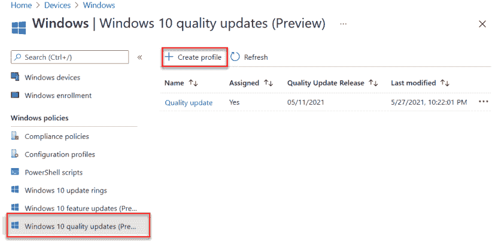

图 6.30 – Windows 10 质量更新设置

你可以选择要部署的质量更新。你始终可以选择为 Windows 10 发布的最新三个补丁：

## 创建质量更新配置文件

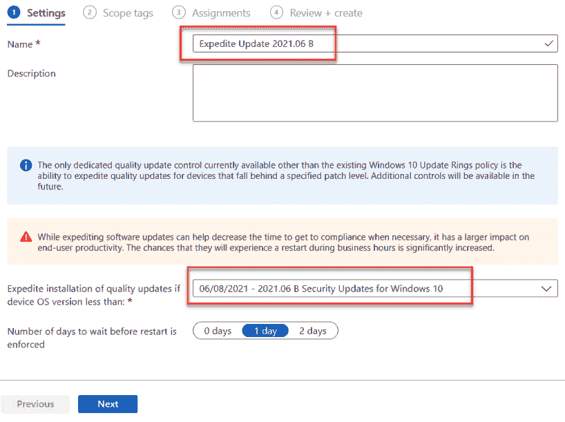

图 6.31 – Windows 10 质量更新配置文件

> **重要说明**
> 
> 使用 2 天以获得最佳最终用户体验。如果更新非常重要，请选择 0 天，但请注意，分配了此策略的设备将在下载并安装补丁后强制重启。

你可以看到，随着截止日期的临近，通知会变得越来越强制：

1. 你首先会收到**“在 x 天后重启”**的消息，具体取决于策略中设置的天数：

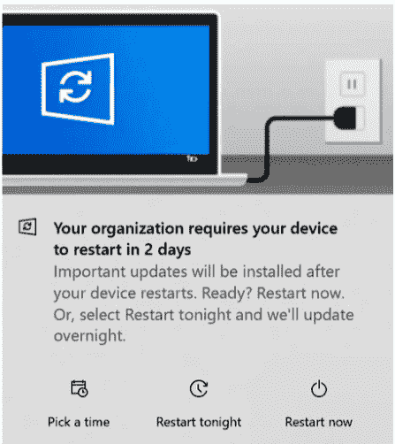

图 6.32 – 在 x 天后重启

2. 然后，它会变得更加强制，并在重启前 2 天在最终用户的屏幕上显示此消息，此时最终用户可以选择时间：

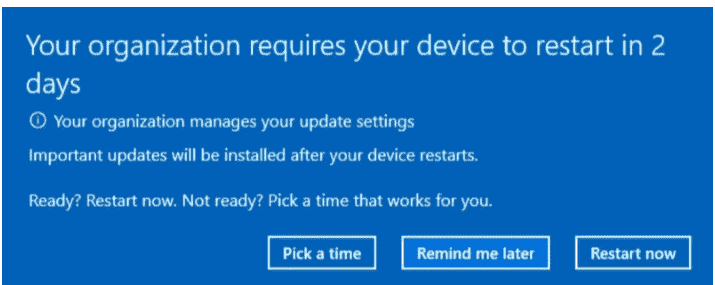

图 6.33 – 选择重启时间的通知

3. 然后，它会变得更加强制，并在重启前 2 小时在最终用户的屏幕上显示此消息。最终用户可以选择确认并等待，或立即重启：

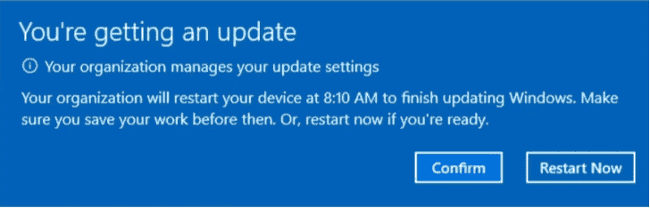

图 6.34 – 重启前 2 小时的通知

4. 在重启截止时间前 15 分钟，最终用户只能选择重启：

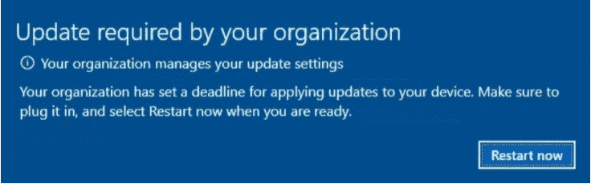

图 6.35 – 强制重启

## Windows 11 更新

Windows 11 已于 10 月 5 日作为**正式发布版 (GA)** 发布，现在可以用在生产工作负载中。从配置管理的角度来看，Microsoft Endpoint Manager 从第一天起就支持 Windows 11。

例如，你可以将 Windows 11 更新作为更新通道推送到你的物理或云电脑。请务必选择正确的 Windows 11 服务渠道。

你可以在这篇 Microsoft 官方博客文章中了解更多信息：https://techcommunity.microsoft.com/t5/windows-it-pro-blog/commercial-previews-for-windows-11-and-windows-10-version-21h2/ba-p/2676467。

你可以在以下屏幕中单击“下载并安装”以开始更新：

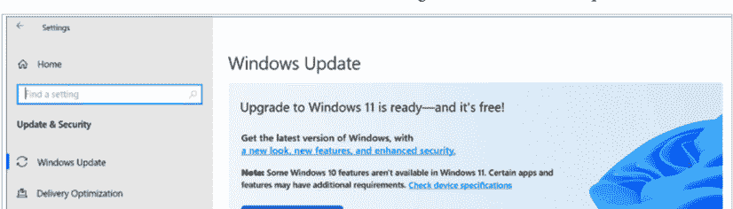

图 6.36 – Windows 11 更新

## 面向企业的 Windows 预览体验计划

注册面向企业的 Windows 预览体验计划。将你的企业租户注册到面向企业的 Windows 预览体验计划的好处是，作为 IT 管理员，你可以使用 Microsoft Intune 管理组织中多台设备上的 Windows 10 和 Windows 11 预览体验成员预览版安装。

请使用你的 AAD 工作帐户（我们建议使用此帐户以获得最佳体验）或个人 Microsoft 帐户注册。如果你使用组织帐户，你将能够代表组织向 Microsoft 提供反馈，以帮助塑造 Windows，满足你业务的特定需求。你必须使用 AAD 帐户注册，才能在组织中集中管理 Windows 10/11 预览体验成员预览版（https://insider.windows.com/en-us/for-business）：

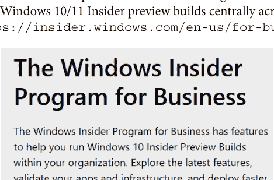

图 6.37 – Windows 预览体验计划

你需要使用全局管理员帐户注册 Windows Insider for Business：

## 注册 Windows 预览体验计划

要将你的组织域注册到 Windows 预览体验计划（以下简称“计划”），请阅读计划协议和隐私声明，然后接受计划的条款。

- 计划协议
- 我接受此协议的条款。（必需）
- 立即注册

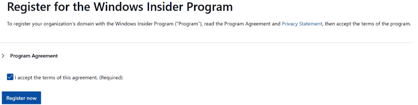

图 6.38 – Windows 预览体验计划

你需要阅读计划协议并单击**“我接受此协议的条款。（必需）”**：

## 注册你的域

要注册域，你必须已使用 Azure Active Directory (AAD) 中的工作帐户注册了该计划，并且必须在该 AAD 域中分配有全局管理员角色。

图 6.39 – Windows 预览体验计划注册

现在，你的域已注册，可以使用 Windows Insider for Business。

你现在可以创建包含 Windows 预览体验成员通道的 Windows Update for Business 通道部署，并将其分配给一组测试设备：

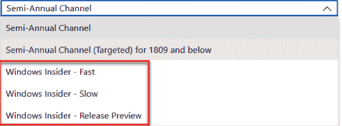

图 6.40 – Windows 预览体验成员部署通道

您的终端用户现在可以使用其 AAD 账户在 Feedback Hub 中发送反馈，并且您组织的其他成员可以看到此反馈。

从侧边菜单中选择反馈部分。

在筛选下拉菜单下，选择我的组织。这将显示您组织中所有使用其注册的 AAD 账户登录 Feedback Hub 的用户的反馈：

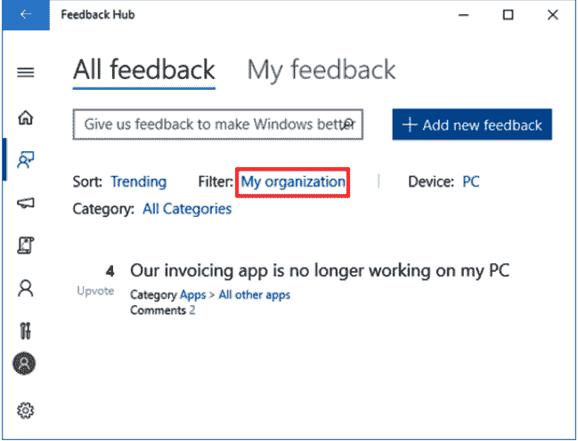

图 6.41 – Windows Feedback Hub

## 更新 Microsoft 365 应用

当您开始在云管理的设备或共管设备上使用 Windows Update for Business 时，您还应考虑如何管理 Microsoft 365 应用的更新。

有两种选择：

- Microsoft 365 应用的服务配置文件：您可以在 Microsoft 365 应用管理中心（config.office.com）的服务配置文件部分查看设备的概览，包括下一次构建的推出情况、预计的波次以及任何设备故障和问题的信息。

从那里，您可以点击设备、操作、问题和设置，以获取有关由服务配置文件管理的设备的更多信息：

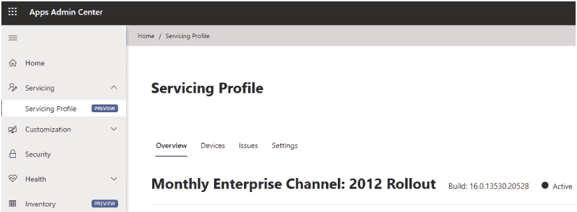

图 6.42 – Microsoft 365 应用服务策略

- 使用管理模板配置策略：管理模板是您习惯在本地环境中使用组策略配置策略设置的方式。

建议查看 Office 365 应用管理中心提供的新的服务功能。我们将在本书后面的第 8 章《应用程序管理和交付》中深入介绍这一点。

这就结束了本章。

## 摘要

在本章中，您了解了开始使用 Microsoft Endpoint Manager 和 Windows Update for Business 为不同终端场景部署和更新 Windows 所需了解的所有主题。

我们介绍了更新 Windows 的不同选项以及应应用的策略设置。如果您习惯使用 SCCM 部署 Windows Update，您可能在业务中部署 Windows 更新时已经有某种环形部署。借助 Windows Update for Business，您可以采用相同的方法，因为 Windows Update for Business 也有基于环的部署。

如果您尚未运行 Windows Insider for Business，我们解释了为什么开始使用它是个好主意，现在您已准备好在组织中配置 Windows Insider for Business。在下一章中，我们将深入探讨 Windows Autopilot 的世界。

## 问题

- 1. 什么是 Windows Update for Business？
  A. 更新 Microsoft 应用的一种方式
  B. 更新 Microsoft Edge 的一种方式
  C. 更新 Windows 的一种方式

- 2. 设置功能更新卸载期的最大天数是多少？
  A. 30
  B. 60
  C. 90

- 3. 什么是 Windows Insider for Business？
  A. 获取 Windows 预发布版本的一种方式
  B. Windows 信息保护
  C. Microsoft 365 应用预发布

## 答案

- 1. (C)
- 2. (B)
- 3. (A)

## 延伸阅读

如果您在阅读本章后想了解更多关于 Microsoft Endpoint Manager 要求的信息，请使用此处列出的免费在线资源之一：

- 了解如何使用 Windows Update for Business – Azure，Microsoft Docs：https://docs.microsoft.com/en-us/mem/intune/protect/windows-update-for-business-configure
- 了解混合 Azure AD 加入和共管：https://techcommunity.microsoft.com/t5/microsoft-endpoint-manager-blog/understanding-hybrid-azure-ad-join-and-co-management/ba-p/2221201
