## 7 管理 Windows Autopilot

在本章中，您将了解 Windows Autopilot 的工作原理以及为什么它对简化物理终端的交付流程对您的组织有益。

Windows Autopilot 是一组用于预配置全新设备并使其处于终端用户可以提高生产力的状态的技术。

Windows Autopilot 设计用于从任何地方轻松地将全新设备上线。以前，企业依赖于 **Operation System Deployment (OSD)**，但在全球 Covid 大流行期间，许多员工在家工作，越来越多的企业正在寻找替代方案，即使在家工作也能将新设备交付给终端用户。Windows Autopilot 非常适合此场景，其中 **Original Equipment Manufacturer (OEM)** 或经销商可以将设备直接发送给终端用户，终端用户可以拆箱新设备、使其运行并开始工作，而无需进入办公室。

## Windows Autopilot 概述

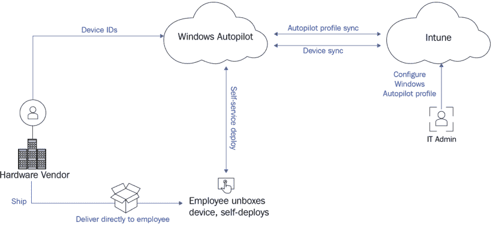

图 7.1 – Autopilot 流程

您通过将设备上传到 Autopilot 服务、创建并分配 Autopilot 配置文件，然后创建并分配 ESP 配置文件（此步骤是可选的，但建议）来开始使用 Autopilot。

设备发货后，用户只需输入其凭据，自动注册就会开始。就是这么简单：

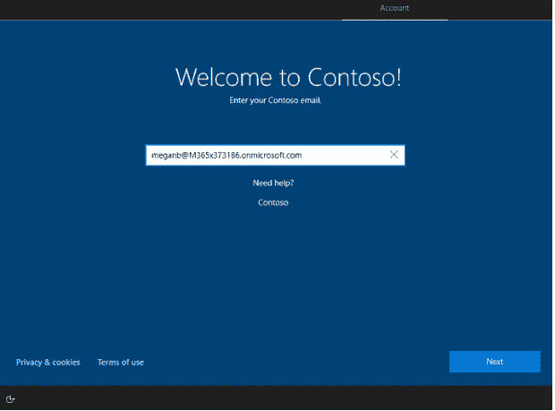

图 7.2 – Autopilot 欢迎屏幕

输入正确的凭据后，注册开始，所有配置项、策略、证书和应用程序都将应用于您的物理终端设备。

一旦此阶段完成，用户就可以看到桌面：

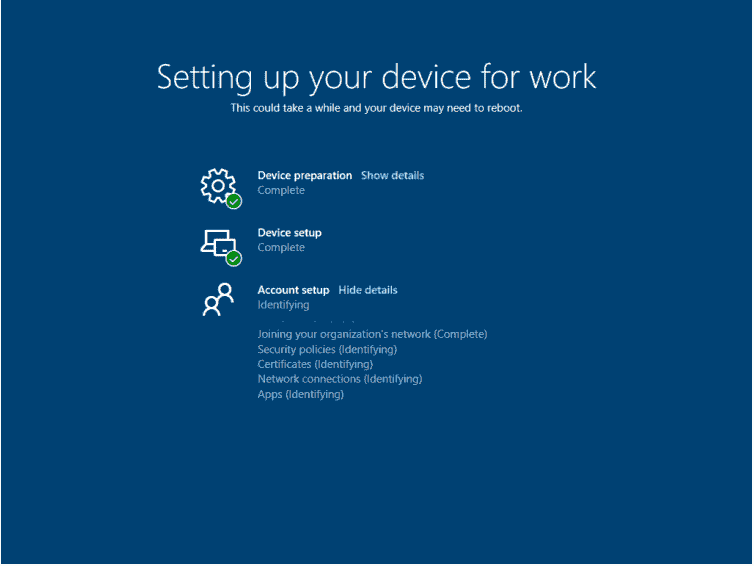

图 7.3 – Autopilot 设置设备

如果您使用企业状态漫游，您将以熟悉的方式看到桌面，因为您的大部分配置文件将从云端下载到设备。

顺便说一下，Windows 11 也支持 Autopilot，并且体验完全现代化，如以下屏幕截图所示：

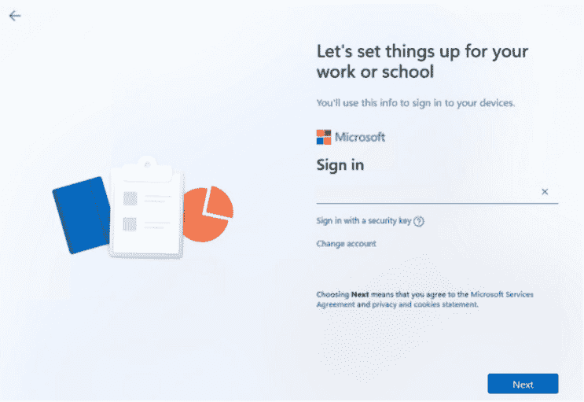

图 7.4 – Autopilot Windows 11 欢迎屏幕

一旦您继续并输入分配了 Autopilot 和其他 Microsoft Endpoint Manager 配置文件配置的用户 AAD 凭据，设备注册设置过程就会开始，如以下 Windows 11 示例所示：

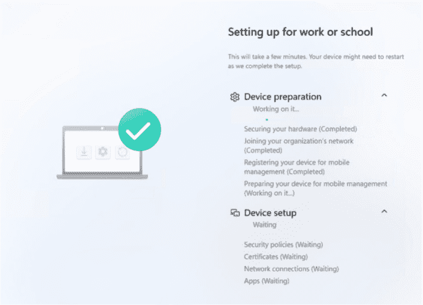

图 7.5 – Autopilot Windows 11 设备设置

在下一节中，我们将解释如何使用硬件 ID 作为唯一标识符将设备添加到 Windows Autopilot。

## 将硬件 ID 上传到 Windows Autopilot

Windows Autopilot 硬件哈希是一个 4K 字符串，通过在设备上运行 Windows 10 操作系统并运行 `Get-WindowsAutoPilotInfo.ps1` 获取：

```
New-Item -Type Directory -Path "C:\Temp\Autopilot"
Set-Location -Path "C:\Temp\Autopilot"
Set-ExecutionPolicy -Scope Process -ExecutionPolicy Unrestricted
Install-Script -Name Get-WindowsAutoPilotInfo
Get-WindowsAutoPilotInfo.ps1 -OutputFile AutoPilotHWID.csv
```

Windows Autopilot 设备注册可以在组织内部手动完成，用于测试或组织已拥有的设备。

它用于收集设备的硬件标识（硬件哈希）并以 **Comma-Separated Values (CSV)** 文件的形式将此信息上传到 Microsoft Endpoint Manager 管理中心的 Windows Autopilot 服务，并捕获硬件哈希以进行手动注册，这需要将设备启动到 Windows 10。因此，此过程主要用于测试和评估场景。

将全新设备导入 Windows Autopilot 服务的推荐方法是让 OEM 或 Microsoft **Cloud Solution Provider (CSP)** 合作伙伴上传信息。

对于 *Microsoft Surface* 或 *HoloLens* 设备，您可以向 Microsoft Devices Autopilot Support 开启支持案例：https://prod.support.services.microsoft.com/supportrequestform/0d8bf192-cab7-6d39-143d-5a17840b9f5f。您只需提供以下信息：

- AAD 租户 ID
- AAD 域名
- 所有权证明
- 设备序列号

此过程也可以用于从租户中取消注册 Autopilot。

您可以使用 CSP 合作伙伴以比您在 Microsoft Intune 中自行操作时更少的信息将设备上传到 Windows Autopilot：

- `ProductKey only`
- `SerialNumber + OemManufacturerName + ModelName`

让我们描述一下这些字段：

- `ProductKey`：这是 Windows 产品 ID，即 PKID，是一个 13 位数字，对应于在设备制造时插入设备固件中的 Windows 产品密钥（使用 OAv3）。
- `SerialNumber`：这是 OEM 分配给每个制造设备的唯一值。
- `OemManufacturerName`：这是 OEM 在设备的 **System Management Basic Input/Output System (SMBIOS)** 固件中指定的值，例如 *Microsoft Corporation* 或 LENOVO（稍后会详细介绍）。


-   ModelName：这是由设备 OEM 在 SMBIOS 固件中为特定型号指定的值，例如 *Surface Pro 7*。

要手动注册 Windows Autopilot 设备，过程如下：

CSV 文件最多可以有 500 行。下面显示了标头和行格式，包括设备序列号、Windows 产品 ID、硬件哈希、组标记和分配的用户：

```
<serialNumber>,<ProductID>,<hardwareHash>,
<optionalGroupTag>,<optionalAssignedUser>
```

> **重要说明**
> 从 CSV 文件导入 Windows Autopilot 设备。在 CSV 文件中分配用户时，请确保分配了正确的 **用户主体名称 (UPN)**，因为导入过程中不会验证 UPN。这意味着如果 CSV 文件中的 UPN 不正确，则不会将用户分配到 Windows Autopilot 设备对象。

如果使用的是 **Active Directory 联合身份验证服务 (ADFS)**，则无法将用户分配到特定的 Autopilot 设备。

## Windows Autopilot 部署计划

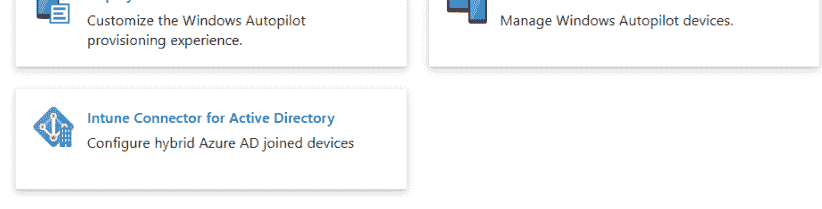

图 7.6 – Windows Autopilot 部署计划

转到 Microsoft Endpoint Manager 管理中心 https://endpoint.microsoft.com/，然后选择“设备 | Windows | Windows 注册 | 设备”。

## 选择导入：

主页 > Windows >

## Windows Autopilot 设备

Windows 注册

同步   筛选   导入   导出   分配用户   刷新   删除

基本信息

上次同步请求：04/10/21, 12:48 AM

上次成功同步：04/10/21

Windows Autopilot 允许你为用户自定义开箱即用体验 (OOBE)。

按序列号搜索

| 序列号 | 制造商 | 型号 | 组标记 |
|---|---|---|---|

图 7.7 – Windows Autopilot 设备

浏览你的 autopilot.csv 文件，然后选择导入。

你将在门户中看到以下消息：导入正在进行中。已用时间：0 分钟。此过程最长可能需要 15 分钟。

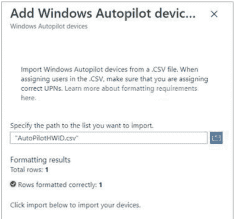

图 7.8 – 添加 Windows Autopilot 设备

选择设备。选择 **分配用户。**

浏览并选择你希望分配给设备的用户：

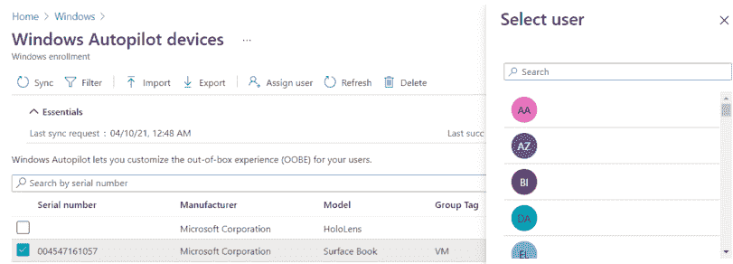

图 7.9 – 分配用户

在 **Windows Autopilot 设备** 边栏中选择设备时，你将获得更多信息，以及 IT 管理员可以更改的一些属性：

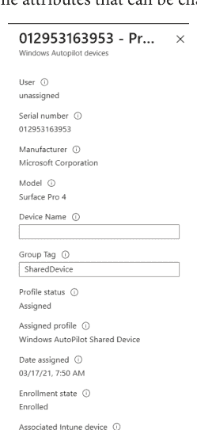

图 7.10 – Windows Autopilot 设备

在下表中，你可以看到 Windows Autopilot 对象中可能存在的不同设置和值类型：

| 设置 | 值 |
|---|---|
| 用户 | UPN。 |
| 用户友好名称 | 可以更改，并将在 OOBE 预配期间显示。 |
| 序列号 | 序列号。 |
| 制造商 | 示例：“Microsoft Corporation。” |
| 型号 | 示例：“Surface Book 2。” |
| 设备名称 | 可以配置，设备将在载入过程中获得此名称（在 OOBE 期间设置设备名称时会导致重启）。 |
| 组标记 | 除非在 autopilot 上传文件中设置，否则为空白。可以更改，并会影响动态 AAD 组。 |
| 配置文件状态 | 已分配或未分配。 |
| 已分配的配置文件 | 分配给设备的配置文件名称。 |
| 分配日期 | 配置文件分配给设备时的时间戳。 |
| 注册状态 | 指定设备是否已注册到 Microsoft Intune。已注册或未注册。 |
| 关联的 Intune 设备 | N/A 表示没有关联的设备。在设备首次完成 Autopilot 流程或 Intune 对象被删除之前，状态为 N/A。 |
| 关联的 Azure AD 设备 | N/A 表示没有关联的设备 AAD 对象。 |
| 上次联系 | 上次联系设备时的时间戳。并不意味着设备从未与 Microsoft Intune 联系过。 |
| 采购订单 | 当 OEM 代表你的组织上传设备时，会发送采购订单 ID。 |

较新的 Windows 10 版本具有用于 Windows Autopilot 服务的 4K 硬件哈希。例如，如果更换了 TPM 或主板，则需要新的硬件哈希。Windows Autopilot 服务中识别设备的一些方式基于 SMBIOS UUID、**媒体访问控制 (MAC)** 或磁盘序列号——原因是 Windows 设备没有唯一标识符。如果我们查看 Autopilot 硬件哈希中包含哪些信息，我们也会了解为什么在更换主板后需要新的硬件哈希。

SMBIOS 中唯一值的最低要求如下：

- `ProductKeyID`
- `Sm biosSystemManufacturer`
- `Sm biosSystemProductName`
- `Sm biosSystemSerialNumber`
- `Sm biosSkuNumber`
- `Sm biosSystemFamily`
- `MacAddress`
- `Sm biosUuid`
- `DiskSerialNumber`
- `TPM EkPub`

Windows Autopilot 设备信息存储在哪里？

Windows Autopilot 数据存储在美国 (US)，而不是你的 AAD 租户所在的区域。存储的不是客户数据，而是业务数据，这使得 Microsoft 能够提供 Windows Autopilot 服务。

首先，你需要从 https://docs.microsoft.com/en-us/windows-hardware/get-started/adk-install 下载 Windows **评估和部署工具包 (ADK)**：

> **重要说明**
> 你至少需要使用 ADK 版本 1703。

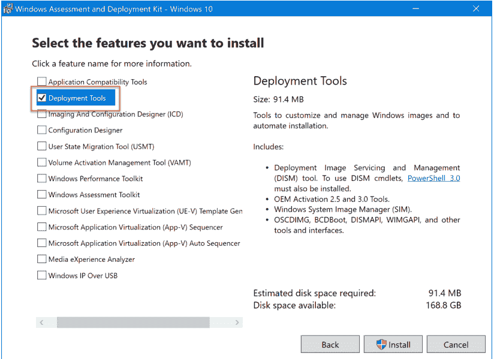

# 图 7.11 – Windows ADK

安装 Microsoft ADK 后，你可以在此处找到所需工具：

```
C:\Program Files (x86)\Windows Kits\10\Assessment and Deployment Kit\Deployment Tools\amd64\Licensing\OA30\oa3tool.exe
```

假设你运行以下命令：

```
oa3tool.exe /DecodeHwHash=HardwareHash
```

然后，你将获得硬件哈希中存储内容的结果：

```
OEM Activation Tool 3.0
```

```
(c) Copyright 2019 Microsoft Corp.
```

```
Version: 10.0.19041.1
```

解码后的硬件哈希如下：

```
<?xml version="1.0"?>
<HardwareReport>
    <HardwareInventory>
        <p n="ToolVersion" v="3" />
        <p n="HardwareInventoryVersion" v="131" />
        <p n="ToolBuild" v="10.0.17134.1" />
        <p n="OSType" v="FullOS" />
        <p n="OsCpuArchitecture" v="x64" />
        <p n="OsBuild" v="10.0.17134.1" />
        <p n="OsSystemTime" v="2018-05-18T12:51:13Z" />
        <p n="OsLocalTime" v="2018-05-19T18:51:13+30:00" />
        <p n="ProcessorModel" v="      Intel(R) Xeon(R) CPU E3-1220L V2 @ 2.30GHz" />
        <p n="ProcessorPackages" v="1" />
        <p n="ProcessorThreads" v="2" />
        <p n="ProcessorCores" v="2" />
        <p n="ProcessorHyperThreading" v="false" />
        <p n="Sm biosRamArrayCount" v="1" />
        <p n="Sm biosRamSlots" v="1" />
        <p n="Sm biosRamErrorCorrection" v="None" />
        <p n="Sm biosRamMaximumCapacity" v="2048" />
        <p n="TotalPhysicalRAM" v="2" />
        <p n="Sm biosFirmwareVendor" v="Microsoft Corporation" />
        <p n="Sm biosSystemManufacturer" v="Microsoft Corporation" />
        <p n="Sm biosSystemProductName" v="Virtual Machine" />
        <p n="Sm biosSystemSerialNumber" v="2378-0002-7885-9434-1355-6165-71" />
        <p n="Sm biosUuid" v="192a7ab2-4b1d-4433-9026-3b54c6e8353c" />
        <p n="Sm biosSkuNumber" v="None" />
        <p n="Sm biosSystemFamily" v="Virtual Machine" />
        <p n="Sm biosSystemVersion" v="Hyper-V UEFI Release v1.0" />
```

```
<p n="SmbiosBoardManufacturer" v="Microsoft Corporation" />
<p n="SmbiosBoardProduct" v="Virtual Machine" />
<p n="SmbiosBoardVersion" v="Hyper-V UEFI Release v1.0" />
<p n="ChassisType" v="0x03" />
<p n="Disk1.DiskCapacity" v="80" />
<p n="Disk1.DiskType" v="HDD" />
<p n="Disk1.StorageBusType" v="SAS" />
<p n="Disk1.IncursSeekPenalty" v="255" />
<p n="Disk1.TrimEnabled" v="1" />
<p n="Disk1.DiskSerialNumber" v="|Virtual Disk |Msft " />
<p n="InternalDiskCount" v="1" />
<p n="TotalDiskCapacity" v="80" />
<p n="OpticalDiskDriveType" v="true" />
<p n="PhysicalMedium" v="Unspecified" />
<p n="MacAddress" v="00:15:5D:00:0A:49" />
<p n="DisplayResolutionHorizontal" v="1024" />
<p n="DisplayResolutionVertical" v="768" />
<p n="DisplaySizePhysicalH" v="0" />
<p n="DisplaySizePhysical" v="0" />
<p n="DigitizerSupportID" v="(null)" />
<p n="PowerPlatformRole" v="Desktop" />
<p n="Status" v="0x00000000" />
<p n="OfflineDeviceIdType" v="UEFI_VARIABLE_RANDOMSEED" />
<p n="OfflineDeviceId" v="deabBSuZ84Tt3id+ipi2g9qdw tBUrOYwUmzOEQnbYO=" />
<p n="DiskSSNKernel" v="|Virtual Disk |Msft " />
</HardwareInventory>
</HardwareReport>
```

OEM 激活工具 3.0 已成功完成其所需进程。


# 适用于现有设备的 Windows Autopilot

如果你不想将设备收集并上传到 Autopilot，还有其他一些选项可供选择。

对于已在 Intune 中的设备（可以是 Azure AD 加入的设备或共同管理的设备），你可以利用 Autopilot 配置文件中的“将所有目标设备转换为 Autopilot”选项：


图 7.12 – 将所有目标设备转换为 Autopilot

选择“是”以将所有目标设备注册到 Autopilot（如果尚未注册）。下次已注册设备经历 Windows OOBE 时，它们将按照分配的 Autopilot 场景进行。

请注意，某些 Autopilot 场景需要特定最低版本的 Windows。请确保你的设备满足执行该场景所需的最低版本。

删除此配置文件不会从 Autopilot 中移除受影响的设备。要从 Autopilot 中移除设备，请使用 Windows Autopilot 设备视图。

你还可以通过从 System Center Configuration Manager (SCCM) 或 Microsoft Deployment Toolkit (MDT) 执行传统操作系统部署，来为现有设备利用 Windows Autopilot。

你只需将 Autopilot 配置文件放在 `%windir%\provisioning\AutoPilot\AutopilotConfigurationFile.json` 中。

在 Microsoft Intune 中创建 Autopilot 配置文件后，你可以利用 WindowsAutopilotIntune PowerShell 模块导出它：

```
Install-Module WindowsAutopilotIntune -Force
Install-Module Microsoft.Graph.Intune -Force
Connect-MSGraph
Get-Autopilotprofile
```

你将获得租户中所有 Autopilot 配置文件的列表。以下是一个示例。我们将利用 ID 获取它，并将其转换为所需的 JSON 内容：

```
@odata.type                     : #microsoft.graph.
azureADWindowsAutopilotDeploymentProfile
id                              : 264c05b0-683c-4537-87ff-
1ff5151d5b98
displayName                : Intune Book
description                 :
language                    : os-default
createdDateTime            : 4/10/2021 9:59:13 AM
lastModifiedDateTime       : 4/10/2021 9:59:13 AM
enrollmentStatusScreenSettings :
extractHardwareHash        : True
deviceNameTemplate         : OSD-%RAND:5%
deviceType                 : windowsPc
enableWhiteGlove          : True
roleScopeTagIds            : {0}
outOfBoxExperienceSettings : @{hidePrivacySettings=True; hideEULA=True; userType=standard; deviceUsageType=singleUser; skipKeyboardSelectionPage=True; hideEscapeLink=True}
```

使用唯一的 Autopilot 配置文件 ID 调用命令时，你可以将其转换为在 Windows 设备映像处理过程中所需的 JSON 文件：

```
Get-Autopilotprofile -id 264c05b0-683c-4537-87ff-1ff5151d5b98 | ConvertTo-AutopilotconfigurationJSON
{
    "CloudAssignedDomainJoinMethod": 0,
    "CloudAssignedDeviceName": "OSD-%RAND:5%",
    "CloudAssignedAutopilotUpdateTimeout": 1800000,
    "CloudAssignedForcedEnrollment": 1,
    "Version": 2049,
    "CloudAssignedTenantId": "c56dd45b-1da6-4bd0-a53b-1466782d6ee5",
    "CloudAssignedAutopilotUpdateDisabled": 1,
    "ZtdCorrelationId": "264c05b0-683c-4537-87ff-1ff5151d5b98",
    "Comment_File": "Profile Intune Book",
    "CloudAssignedAadServerData": "{\"ZeroTouchConfig\":{\"CloudAssignedTenantUpn\":\"\",\"ForcedEnrollment\":1,\"CloudAssignedTenantDomain\":\"osddeployment.dk\"}}",
    "CloudAssignedOobeConfig": 1310,
    "CloudAssignedTenantDomain": "osdeployment.dk",
    "CloudAssignedLanguage": "os-default"
}
```

然后，你可以将 Autopilot 配置文件的内容复制到记事本，并将其保存为 `AutopilotConfigurationFile.json`。

Windows 设备可以通过 Configuration Manager 使用适用于现有设备的 Autopilot 进行注册时，通过关联 ID 进行分组。关联 ID 是 Autopilot 配置文件的一个参数。Azure AD 设备属性 `enrollmentProfileName` 会自动设置为 `OfflineAutopilotprofile-<correlator ID>`。因此，可以使用 `enrollmentProfileName` 属性，根据关联 ID 创建任意 Azure AD 动态组。

要创建 Windows Autopilot 配置文件，请执行以下步骤：

- 1. 在 Microsoft Endpoint Manager 管理中心（https://endpoint.microsoft.com/）中，选择“设备”|“Windows”|“Windows 注册”|“部署配置文件”。
- 2. 然后，选择“创建配置文件”|“Windows PC”。
- 3. 在“输入配置文件名称”字段中，输入“Autopilot 默认配置文件”。
- 4. 将“将所有目标设备转换为 Autopilot”设置为“否”。
  选择“是”以将所有目标设备注册到 Autopilot（如果尚未注册）。下次已注册设备经历 Windows OOBE 时，它们将按照分配的 Autopilot 场景进行。
- 5. 除非你有理由更改，否则将所有其他设置保留为默认值。

在 OOBE 步骤中，配置以下值，然后单击“下一步”：

| 设置 | 值 |
|---|---|
| 部署模式 | 用户驱动。 |
| 加入 Azure AD 为 | 已加入 Azure AD。 |
| Microsoft 软件许可条款 | 隐藏。 |
| 隐私设置 | 隐藏。 |
| 隐藏更改帐户选项 | 隐藏。 |
| 用户帐户类型 | 标准。 |
| 允许 White Glove OOBE | 否。 |
| 语言（区域） | 操作系统默认值。 |
| 自动配置键盘 | 是。 |
| 应用设备名称模板 | 你可以选择应用设备名称模板。使用一个有助于你通过此配置识别设备的前缀，例如：`OSD-%RAND:x%` |

> **重要说明**
> **语言（区域）** 需要在进行 OOBE 时具备以太网连接才能生效；否则，此 OOBE 向导将显示给最终用户。操作系统默认值仅在操作系统为单操作系统时才会生效，因此，例如，如果操作系统同时为 en-US 和 nl-NL，则不会显示此 OOBE 向导页面。
> 
> **自动配置键盘** 需要在进行 OOBE 时具备以太网连接才能生效；否则，此 OOBE 向导将显示给最终用户。

如果在 OOBE 阶段设备上存在 unattended.xml 文件，Windows Autopilot 很可能会失败，因此，如果你正在对现有设备进行映像部署，请确保这些文件不存在于 `%WINDIR%\Panther\Unattend unattended.xml` 和 `%WINDIR%\Panther\unattend.xml` 中。

## 在开箱体验 (OOBE) 期间的 Windows 更新

IT 管理员不能选择退出这些关键更新，因为它们是 Windows Autopilot 预配的一部分，设备需要这些更新才能正常运行。

在用户连接到网络后，关键驱动程序更新和关键 Windows **零日补丁 (ZDP)** 更新将在 OOBE 期间自动开始下载。此后，Autopilot 功能更新和关键更新也会自动下载并安装。

在此 OOBE 阶段，不会更新功能更新和质量更新。

Windows 将提醒用户设备正在检查和应用更新：

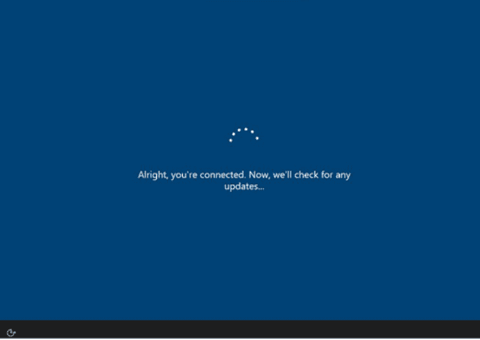

图 7.13 – Windows 在 OOBE 期间检查更新

> **重要说明**
> 
> 如果你使用未集成任何驱动程序的自定义映像，Windows 可以在此过程中下载驱动程序，但可能会发生重新启动，从而中断 Windows Autopilot 体验。对于 Windows Autopilot，建议对新设备使用 OEM 映像，对现有设备使用带正确驱动程序的自定义映像；在测试适用于现有设备的 Windows Autopilot 时，也应如此，以获得最接近新设备的体验。

## 在 Intune 中自动分配 Windows Autopilot 配置文件

从 Microsoft Intune 将 Autopilot 配置文件分配给设备有两种方式：静态 Azure AD 组或动态 Azure AD 组。静态组无法提供你在企业中想要的自动化，因此在本节中，我们将指导你完成自动配置文件分配。

ZTDID 是 Windows Autopilot 服务中设备的唯一标识符。ZTDID 和组标签都是 Azure AD 设备对象上的属性。组标签是在将设备上传到 Windows Autopilot 时，你可以放入 CSV 中的值，并且这个值你可以自行选择。使用你创建的组标签，你可以利用组标签将 Autopilot 设备分组用于特定目的，例如信息工作者、共享设备、Microsoft Teams 会议室系统、自助服务终端设备或其他用途。如果你希望设备对象位于不同的 AD 动态设备组中，稍后可以更改 Autopilot 对象中的组标签。请记住在 Autopilot 设备边栏选项卡中单击“同步”；否则，你需要等待更改，直到后台运行同步。

你将拥有标准信息——设备序列号、Windows 产品 ID、硬件哈希——因此你只需创建一个名为 `OrderID` 的自定义列，并使用你想要用于创建 Autopilot 动态组以进行配置文件分配的值，例如 `EdgeKIOSK`。

将 Autopilot 信息导入 Microsoft Intune 后，你可以使用 Microsoft Graph Explorer 通过刚创建的信息查看设备。你需要查找 Azure AD 设备对象，因为 Microsoft Intune 设备对象是在 Windows 在 Microsoft Intune 中执行移动设备管理 (MDM) 注册时首次创建的。

转到 Graph Explorer：https://developer.microsoft.com/en-us/graph/graph-explorer：

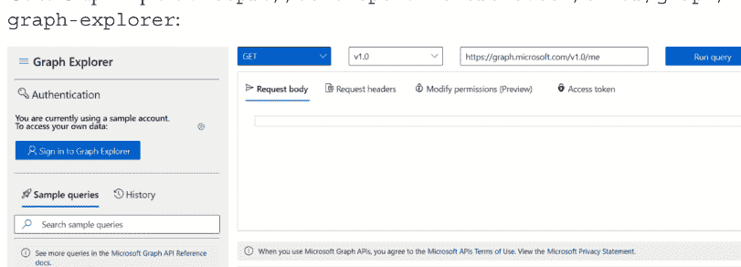

图 7.14 – Graph Explorer


# 登录到 Graph Explorer

输入 `https://graph.microsoft.com/v1.0/devices` 以获取所有设备——然后你可以找到刚刚创建的设备并看到它具有 ZTDID，且具有唯一值，并且在 Graph 中 Group Tag 显示为 OrderID。你也可以在末尾加上 ID 运行 graph 调用，只获取单个设备的值：`https://graph.microsoft.com/v1.0/devices/[id]`。数据存储在一个名为 physicalIds 的多值属性中：

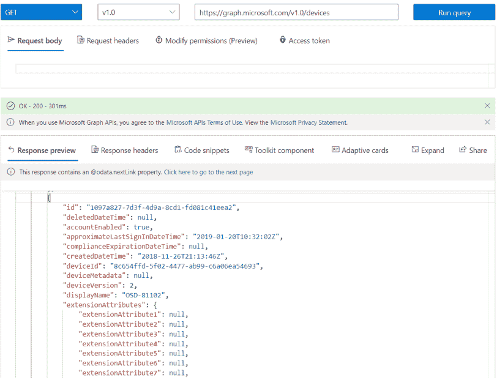

*Figure 7.15 – Graph Explorer devices*

然后，你可以在 graph 中的设备对象上找到 `physicalIds` 作为属性，以验证 AzureAD 设备对象上是否存在 ZTDID – ZTDID 表示它是 Autopilot 对象。你还可以看到 OrderID（OrderID 与 Microsoft Endpoint Manager 管理中心中的 Group Tag 相同）：

```
```json
"physicalIds": [
    "[HWID]:h:6755414090630361",
    "[ZTDID]:able4d57-66e5-4143-bb43-753be871075f"
]
```
```

```
" [OrderId] :EdgeKIOSK",
" [USER-HWID] :44cd8da3-8f37-49e0-aa01-93c7179969d1:6755414090630361",
" [GID] :g:6825777827713522",
" [USER-GID] :44cd8da3-8f37-49e0-aa01-93c7179969d1:6825777827713522",
],
```

现在我们拥有了创建两个动态 AAD 组所需的所有信息，一个用于所有 Autopilot 设备，一个用于 EdgeKIOSK。

我们将创建三个动态组，以便区分不同的 Windows Autopilot 场景。我们将组命名为 All AutoPilot Devices、All AutoPilot EdgeKIOSK 和 All AutoPilot JSON。

在 Microsoft Endpoint Manager 管理中心，https://endpoint.microsoft.com/，选择 Groups。

选择 New Group。

在 Group name 字段中输入以下内容：All Autopilot Devices。

选择 Dynamic Device 作为 Membership type：

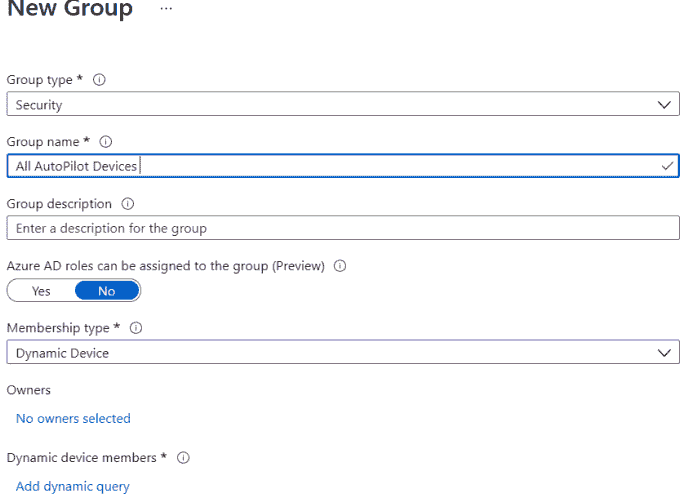

Figure 7.16 – New AAD device group

第一个组 **All AutoPilot Devices** 具有如下的动态组成员资格规则：

```
```text
(device.devicePhysicalIDs -any _ -contains "[ZTDId]") -and -not
(device.devicePhysicalIDs -any _ -eq "[OrderID]: EdgeKIOSK")
```
```

此规则将找到所有具有 ZTDID 的设备，并排除 OrderID 的值为 EdgeKIOSK 的所有设备：

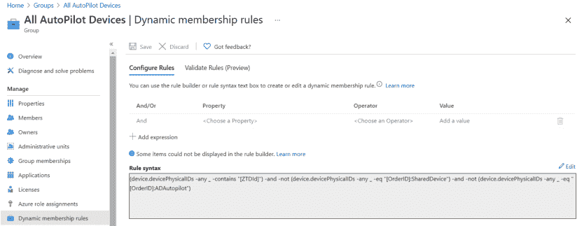

*Figure 7.17 – AAD group Autopilot rule syntax*

第二个组 **All AutoPilot EdgeKIOSK** 具有如下的动态组成员资格规则： `(device.devicePhysicalIDs -any _ -eq "[OrderID]: EdgeKIOSK")`。

此规则将找到所有 OrderID 的值等于 EdgeKIOSK 的设备。

你也可以仅使用 PowerShell 创建 AAD 动态组：

```
```powershell
Install-Module AzureAD
$AzureAdCred = Get-Credential
Connect-AzureAD -Credential $AzureAdCred
# Create a dynamic group called "All AutoPilot Devices"
New-AzureADMSGroup -Description "All AutoPilot Devices"
-DisplayName "All AutoPilot Devices" -MailEnabled $false
-SecurityEnabled $true -MailNickname "Win" -GroupTypes
"DynamicMembership" -MembershipRule "(device.devicePhysicalIDs
-any _ -contains \"[ZTDId]\") -and -not (device.
devicePhysicalIDs -any _ -eq \"[OrderID]:SharedDevice\")"
-MembershipRuleProcessingState "On"
# Create a dynamic group called "All AutoPilot EdgeKIOSK"
```
```

```
New-AzureADMSGroup -Description "All AutoPilot EdgeKIOSK" -DisplayName "All AutoPilot EdgeKIOSK" -MailEnabled $false -SecurityEnabled $true -MailNickname "Win" -GroupTypes "DynamicMembership" -MembershipRule "(device.devicePhysicalIds -any _ -eq "[OrderID]:EdgeKIOSK")" -MembershipRuleProcessingState "On"
```

```
# Create a dynamic group called "All AutoPilot JSON"
```

```
New-AzureADMSGroup -Description "All AutoPilot JSON" -DisplayName "All AutoPilot JSON" -MailEnabled $false -SecurityEnabled $true -MailNickname "Win" -GroupTypes "DynamicMembership" -MembershipRule "(device.enrollmentProfileName -eq "OfflineAutopilotprofile-264c05b0-683c-4537-87ff-1ff5151d5b98")" -MembershipRuleProcessingState "On"
```

现在你已将硬件信息导入到 Windows Autopilot，并创建了配置注册状态页所需的所有组。

# 注册状态页 ESP

许多人认为 ESP 和 Windows Autopilot 是同一回事。那并不完全正确，因为 ESP 是 Windows 的核心功能，可以作为 Windows CSP 设置。

ESP 可作为任何 Windows Autopilot 配置场景的一部分使用。它也可以与 Windows Autopilot 分开使用，作为 AAD 加入的默认 OOBE 的一部分，以及任何新用户首次登录设备时使用。

基本上，这意味着任何在 OOBE 阶段加入 AAD 的 Windows 10 设备都会向最终用户显示 ESP，无论它是否是 Windows Autopilot 设备，只要用户或设备分配了 ESP 即可。

你可以创建多个具有不同配置的 ESP 配置文件，指定以下内容：

- 显示安装进度
- 在配置过程完成前阻止访问
- 时间限制
- 允许的故障排除操作

我们将在本节中向你展示如何执行此操作，并在后面的章节中介绍 Windows Autopilot 亭场景。

# ESP 实现 Windows CSP

ESP 使用 `EnrollmentStatusTracking` **配置服务提供程序 CSP** 和 `FirstSyncStatus` CSP 来跟踪不同应用的安装：

- `EnrollmentStatusTracking` CSP：`/Vendor/MSFT/EnrollmentStatusTracking`。
- `EnrollmentStatusTracking` CSP：Windows Client Management | Microsoft Docs（`https://docs.microsoft.com/en-us/windows/client-management/mdm/enrollmentstatustracking-csp`）。
- `EnrollmentStatusTracking` CSP 在 Windows 10 版本 1903 及更高版本中受支持。
- `EnrollmentStatusTracking` CSP 用于跟踪 Microsoft Intune 管理扩展和 Microsoft Intune Win32 应用的安装，这些应用针对的是被 ESP 阻止的目标设备和/或用户。
- `FirstSyncStatus` CSP：`/Vendor/MSFT/DMClient/Provider/ProviderID/FirstSyncStatus`。
- DMClient CSP – Windows Client Management | Microsoft Docs（`https://docs.microsoft.com/en-us/windows/client-management/mdm/dmclient-csp`）。
- `FirstSyncStatus` CSP 在 Windows 10 版本 1709 及更高版本中受支持。
- `FirstSyncStatus` CSP 负责将 ESP CSP 有效负载从 Microsoft Intune 传递到 Windows 10 客户端。有效负载包括 ESP 设置，例如超时时间和需要安装的应用。它还传递预期的 MSI（业务线）应用、Microsoft Store for Business 应用、Wi-Fi 配置文件和 SCEP 证书配置文件，以及 Microsoft Edge、分配访问和 Kiosk Browser 的策略。

我们将按以下步骤查看创建 ESP 的方法：

1. 通过启动 Microsoft Endpoint Manager 管理中心，`https://endpoint.microsoft.com/`，并选择 **Devices | Windows | Windows enrollment | Enrollment Status Page** 创建第一个 ESP。
2. 在 **Settings** 下选择一个配置文件。
3. 选择 **Yes** 用于 **Show app and profile installation progress**。
4. 选择 **Yes** 用于 **Block device use until all apps and profiles are installed**。
5. 选择 **Selected** 用于 **Block device use until these required apps are installed if they're assigned to the user/device**。
6. 选择 **Select apps**，然后选择 **Select | Save** 用于应用。

在 **Settings** 步骤中，配置以下值然后单击 **Next**：

| Setting | Value |
|---|---|
| Show app and profile configuration process | Yes |
| Show an error when installation takes longer than the specified number of minutes | 60 |
| Show custom message when time limit error occurs | Yes (you may modify the default message) |
| Allow users to collect logs about installation errors | Yes |
| Only show page to devices provisioned by out-of-box experience (OOBE) | Yes |
| Block device user until all apps and profiles are installed | Yes |
| Allow users to reset the device if an installation error occurs | Yes |
| Allow users to use the device if an installation error occurs | No |
| Block device user until these required apps are installed if they are assigned to the user/device | All or select up to 100 apps |

现在我们已经了解了如何创建注册页面，让我们继续学习 Autopilot 报告和诊断。

# Autopilot 报告和诊断

以管理员身份运行 cmd.exe，然后你可以运行 MdmDiagnosticsTool 来获取本地设备的日志：

```
C:\windows\system32\MdmDiagnosticsTool.exe -area Autopilot -cab
C:\temp\MdmDiagnostics.cab
```

然后你将获得 MdmDiagnostics.cab 文件，你可以将其内容提取到文件夹中以访问内容：

```
AgentExecutor-20210331-083241.log
AgentExecutor.log
ClientHealth.log
DeviceHash_DESKTOP-86N3?3H3.csv
DiagnosticLogCSP_Collector_Autopilot.etl
```


- DiagnosticLogCSP_Collector_DeviceEnrollment.etl
- DiagnosticLogCSP_Collector_DeviceProvisioning_2021_1_31_20_4_38.etl
- DiagnosticLogCSP_Collector_DeviceProvisioning_2021_2_11_4_18_29.etl
- DiagnosticLogCSP_Collector_DeviceProvisioning_2021_2_24_19_11_54.etl
- DiagnosticLogCSP_Collector_DeviceProvisioning_2021_3_13_3_31_33.etl
- IntuneManagementExtension-20210228-125401.log
- IntuneManagementExtension-20210319-102847.log
- IntuneManagementExtension.log
- LicensingDiag.cab
- LicensingDiag_Output.txt
- MdmDiagLogMetadata.json
- MdmDiagReport_RegistryDump.reg
- MdmLogCollectorFootPrint.txt
- microsoft-windows-aad-operational.evtx
- microsoft-windows-appxdeploymentserver-operational.evtx
- microsoft-windows-assignedaccess-admin.evtx
- microsoft-windows-assignedaccess-operational.evtx
- microsoft-windows-assignedaccessbroker-admin.evtx
- microsoft-windows-assignedaccessbroker-operational.evtx
- microsoft-windows-crypto-ncrypt-operational.evtx
- microsoft-windows-devicemanagement-enterprise-diagnostics-provider-admin.evtx
- microsoft-windows-devicemanagement-enterprise-diagnostics-provider-debug.evtx
- microsoft-windows-devicemanagement-enterprise-diagnostics-provider-operational.evtx
- microsoft-windows-moderndeployment-diagnostics-provider-autopilot.evtx
- microsoft-windows-moderndeployment-diagnostics-provider-managementservice.evtx
- microsoft-windows-provisioning-diagnostics-provider-admin.evtx
- microsoft-windows-provisioning-diagnostics-provider-autopilot.evtx
- microsoft-windows-provisioning-diagnostics-provider-managementservice.evtx
- microsoft-windows-shell-core-operational.evtx
- microsoft-windows-user device registration-admin.evtx
- Sensor-20210105-105450.log
- Sensor-20210207-191747.log
- Sensor.log
- setupact.log
- TpmHliInfo_Output.txt
- _IntuneManagementExtension.log

从 MDM 诊断工具中获得的最重要的信息如下：

```
Registry Dump
MdmDiagReport_RegistryDump.reg captures the
HKEY_LOCAL_MACHINE
HKEY_CURRENT_USER
Registry values associated with autopilot device provisioning are written to HKEY_LOCAL_MACHINE\SOFTWARE\Microsoft\Provisioning\Diagnostics\AutoPilot

HKEY_CURRENT_USER\software\microsoft\enterprisemodernappmanagement and HKEY_LOCAL_MACHINE\software\microsoft\enterprisemodernappmanagement
```

在 Microsoft Endpoint Manager 管理中心进行报告的情况下，流程如下。

在 Microsoft Endpoint Manager 管理中心，https://endpoint.microsoft.com/，选择 设备 | 监视 | Autopilot 部署（预览）。

您可以查看最近 30 天的 Windows Autopilot 部署：

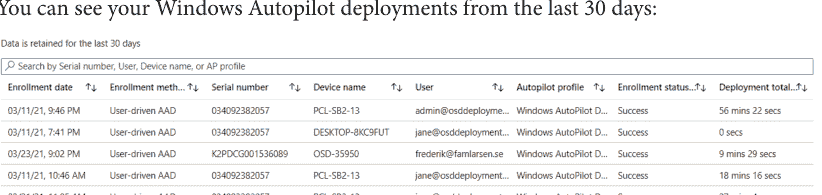

图 7.18 – Autopilot 报告

您可以查看以下属性：

- **注册日期**
- **注册方法**
- **序列号**
- **设备名称**
- **用户**
- **Autopilot 配置文件**
- **注册状态页部署状态**
- **部署总时间**

## Company Portal

Company Portal 是面向终端用户的自助服务工具，以便他们可以安装 IT 管理员已为终端用户提供的应用。

对于 Windows 10 Autopilot 部署的设备，建议您将 Microsoft Store for Business 账户与 Intune 关联。Company Portal 应用将在分配给 Autopilot 组时以设备上下文安装，并在用户登录前安装到设备上。您可以使用以下步骤选择安装 Company Portal（离线）应用：

- 1. 在 Microsoft Endpoint Manager 管理中心，`https://endpoint.microsoft.com/`，选择 **应用 | Windows**。
- 2. 从 Windows 应用列表中，选择 **Company Portal**（离线）。
- 3. 将 Company Portal 作为必需应用分配给您选择的 Autopilot 设备组。
- 4. 由于这是一个离线应用，请确保将 **许可证类型**更改为 **设备许可**。

## 为 Autopilot 设备配置自动 BitLocker 加密

使用 Windows Autopilot，可以在自动加密开始前配置 BitLocker 加密设置。此配置可确保默认加密算法不会自动应用。在自动 BitLocker 加密开始前也可以应用其他 BitLocker 策略。

BitLocker 自动设备加密使用 BitLocker 驱动器加密技术，在用户完成 *Modern Standby* 或符合 **硬件安全可测试性规范 (HSTI)** 的硬件上的 OOBE 后自动加密内部驱动器。

在 Modern Standby 要求或 HSTI 验证的情况下，此要求通过以下其中一种方式满足：

- 已实施 Modern Standby 要求。这些要求包括 **统一可扩展固件接口 (UEFI)** 安全启动要求和防止未经授权的 **直接内存访问 (DMA)** 保护。
- 从 *Windows 10 版本 1703* 开始，此要求可通过 HSTI 测试满足。
- 平台安全启动自检（或在注册表中配置的其他自检）必须由 HSTI 报告为已实施并通过。
- 除 Thunderbolt 外，HSTI 必须不报告任何不允许的 DMA 总线。
- 如果存在 Thunderbolt，HSTI 必须报告 Thunderbolt 已安全配置（安全级别必须为 SL1 – *用户授权* 或更高）。

*Windows 10（Modern Standby）* 扩展了 *Windows 8.1 Connected Standby 电源模型*。Connected Standby，进而 Modern Standby，使能类似智能手机电源模型的即时开启/即时关闭用户体验。就像手机一样，S0 低功耗空闲模型使系统在低功耗模式下仍可连接到网络。

通过利用 `powercfg /a` 命令，您可以查看设备是否支持 Modern Standby（S0 低功耗空闲）：

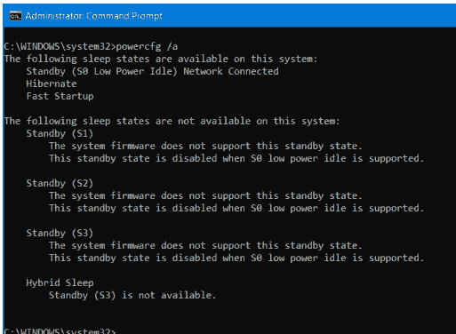

图 7.19 – powercfg

## 重要说明

BitLocker 自动设备加密在 OOBE 体验期间开始。但是，BitLocker 驱动器保护仅在用户使用 AAD 账户登录后启用。在此之前，保护处于暂停状态，数据未受保护。

BitLocker 加密算法在 BitLocker 首次启用时使用。该算法为全卷加密设置强度。可用加密算法为 AES-CBC 128 位、AES-CBC 256 位、XTS-AES 128 位和 XTS-AES 256 位加密。BitLocker 将使用默认加密方法 XTS-AES 128 位或任何设置脚本指定的加密方法。

要确保在 Autopilot 设备的自动加密发生前设置您想要的 BitLocker 加密算法，请确保满足以下要求：

- 设备包含 **受信任平台模块 (TPM)**，TPM 1.2 或 TPM 2.0。
- 已启用 UEFI 安全启动。
- 已启用平台安全启动。
- 已启用 DMA 保护。
- 在 Windows 10 Endpoint Protection 配置文件中配置 **加密方法** 设置为您想要的加密算法。
- 将策略分配给您的 Autopilot 设备组。加密策略必须分配给组中的设备，而不是用户。
- 为这些设备启用 Autopilot ESP。如果未启用 ESP，则策略不会在加密开始前应用。

## 重要说明

当您启用 EncryptionMethodByDriveType 时，必须为所有三个驱动器（操作系统、固定数据和可移动数据）指定值；否则将失败（500 返回状态）。例如，如果您仅为操作系统和可移动驱动器设置加密方法，您将收到 500 返回状态。

按如下方式在 Intune 中创建用于自动 BitLocker 加密的 BitLocker 策略：

- 1. 在 Microsoft Endpoint Manager 管理中心，`https://endpoint.microsoft.com/`，选择 **设备 | Windows | 配置配置文件**。
- 2. 选择 **创建配置文件**。
- 3. 选择 **平台 | Windows 10 及更高版本**。
- 4. 选择 **配置文件类型 | 模板 | 模板名称 | Endpoint Protection**。
- 5. 选择 **名称 | Autopilot Bitlocker | 下一步**。
- 6. 展开 **Windows 加密**。
- 7. 选择 **Windows 设置 | 加密设备 | 要求**。

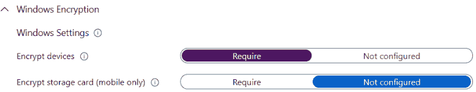

BitLocker 基础设置应如下所示：

- 1. 选择 **BitLocker 基础设置 | 其他磁盘加密的警告 | 阻止**。

  选择 **阻止** 将禁用 BitLocker 配置提示和其他磁盘加密的警告提示。阻止是自动 BitLocker 加密设备的需要。
- 2. 选择 **允许标准用户在 Azure AD 加入期间启用加密 | 允许**。

  将此设置设为 **允许** 时，即使用户不是本地管理员，也可让终端用户自动加密设备。
- 3. 对于 **配置加密方法**，选择您的组织所需的内容。Windows 默认值为 **XTS-AES 128 位**，这也是 Windows 安全基线中推荐的值：

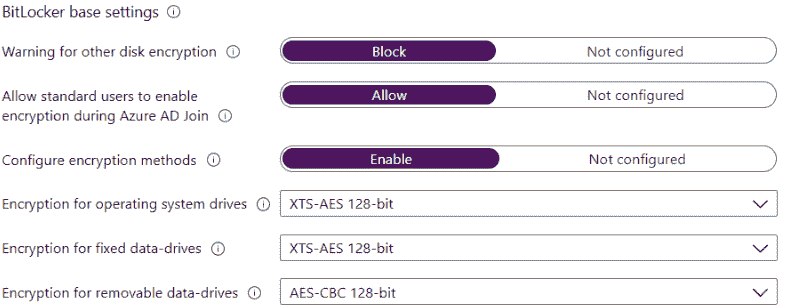


BitLocker 操作系统驱动器设置如下：

1. 选择 **启动时需要额外身份验证 | 要求**。

   BitLocker 操作系统驱动器设置

   启动时需要额外身份验证

   要求

   未配置

   图 7.22 – BitLocker 操作系统驱动器设置

2. 选择 **操作系统驱动器恢复 | 启用**。

3. 选择 **将 BitLocker 恢复信息保存到 Azure Active Directory | 启用**。

4. 启用将 BitLocker 恢复信息存储在设备对象上的 AAD 中，以便最终用户可以在他们是主要用户的设备上自行检索。具有相应权限的 AAD 管理员始终可以检索 BitLocker 恢复密钥。

5. 选择 **在启用 BitLocker 之前将恢复信息存储在 Azure Active Directory 中 | 要求**。这将防止用户在计算机成功将 BitLocker 恢复信息备份到 AAD 之前启用 BitLocker。选择 **要求** 将确保在启用加密之前恢复密钥已成功存储在 AAD 中：

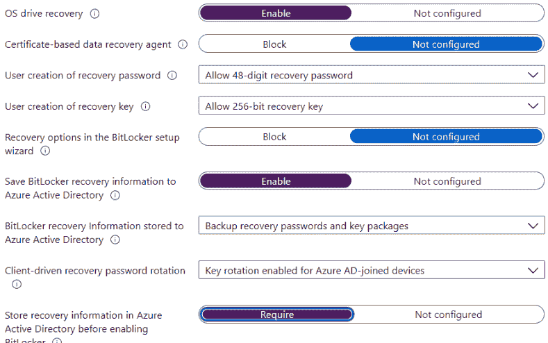

图 7.23 – BitLocker 存储恢复信息

> **重要说明**
> 
> 如果在 Hyper-V 或任何其他虚拟平台上测试 Autopilot 和 BitLocker 加密，我们建议分配 2–4 GB 的内存和 2–4 个虚拟 CPU。

6. 要使自动 BitLocker 加密正常工作，您需要为虚拟设备启用 **可信平台模块**：

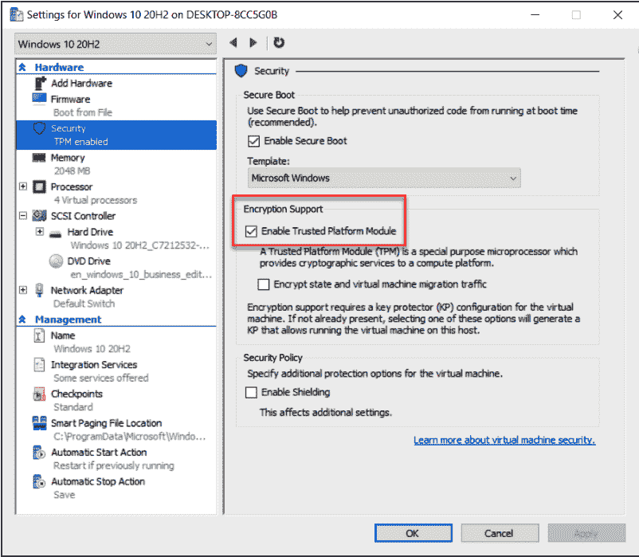

在 Hyper-V 等虚拟设备上测试时，您可能会遇到与在物理设备上测试时不同的行为。

要以简单的方式开始测试 Autopilot，已经有一个名为云配置的指导场景在 Microsoft Intune 中。此内容将在下一节中介绍。

## 云配置场景

您可以在云配置中部署 Windows 10。在 Microsoft Endpoint Manager 管理中心，https://endpoint.microsoft.com/，选择 **疑难解答 + 支持 | 指导场景（预览）**。

使用简单、安全、标准化的配置，优化您的 Windows 10 设备以适应云端，满足您的需求：

1. 在 **以云配置部署 Windows 10** 指导场景中选择 **开始**。
2. 在介绍中，选择 **下一步**。

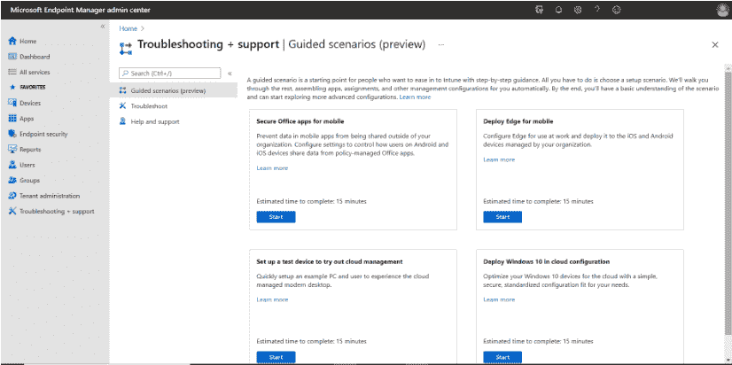

图 7.25 – 指导场景

### 介绍

Windows 10 云配置有助于为具有专注工作流程需求的用户标准化并简化设备管理。您可以使用云配置来配置新设备，或重新利用和延长现有硬件的使用寿命。它适用于任何 Windows 10 Pro、Windows 10 Enterprise 或 Windows 10 Education 设备。现在让我们了解更多并评估云配置。

以下指导工作流可轻松部署云配置概述和设置指南中推荐的应用程序和设备配置。

### 此配置适用于谁？

Windows 10 云配置专为设备用户设计，他们的需求较为简化，例如生产力和浏览。理想的候选用户是组织中以下用户组：

- 那些使用 IT 为其工作流程需求精选的一组专注应用程序的用户，例如电子邮件、Microsoft Teams、浏览器以及必要的生产力和业务线应用程序。应用程序可以直接交付到设备或通过虚拟化交付。
- 那些在角色中成功工作不依赖本地基础设施的用户。
- 那些使用的设备不需要复杂的设置配置或自定义代理的用户。
- 作为管理员，您可以享受在整个组织中应用标准化设备配置的好处，从而简化管理、故障排除和设备更换。
- 最终用户可以享受熟悉的 Windows 10 体验，该体验针对云进行了优化，仅包含他们需要的应用程序和设置。

### 继续所需的内容

确保您已启用自动注册。您可以在 **设备 | Windows | Windows 注册 | 自动注册** 下管理自动注册设置。

### 基础

这是您配置 Windows Autopilot 的步骤：

1. 对于 **应用设备名称模板**，选择 **是**。
2. 输入 Autopilot 命名模板的名称，例如 `Win-%RAND:5%`。
3. 输入资源前缀名称，例如 `CloudConfig`。

### 以云配置部署 Windows 10

介绍  **2 基础**  3 应用  4 分配  5 查看 + 部署

### Autopilot 设备名称模板

设备将配置为使用 Windows Autopilot 注册。您可以应用设备名称模板来组织您的设备。

应用设备名称模板 — 否 / 是

为您的设备创建唯一名称。名称必须为 15 个字符或更少，可以包含字母（a-z、A-Z）、数字（0-9）和连字符。名称不得仅包含数字。名称不能包含空格。使用 `%SERIAL%` 宏添加硬件特定的序列号。或者，使用 `%RAND:x%` 宏添加随机数字字符串，其中 x 等于要添加的位数。

输入名称 * — `Win-%RAND:5%`

### 资源名称前缀

为云配置创建和部署的资源命名。此页面底部的列表显示名称将在每个资源旁边出现的样式。

输入资源前缀名称 * — `CloudConfig`

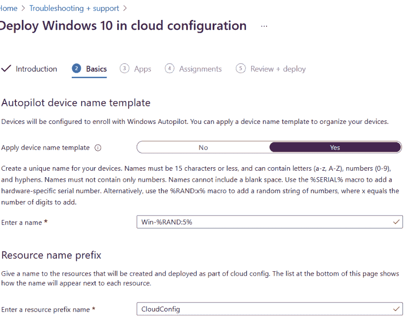

### 要创建的资源

所有这些配置文件都将具有所选的前缀：

- CloudConfig M365（Teams）
- CloudConfig Microsoft Edge
- CloudConfig 安全基线
- CloudConfig Autopilot 配置文件
- CloudConfig ESP
- CloudConfig OneDrive 已知文件夹移动设置
- CloudConfig Microsoft Edge 应用设置

### 分配

选择 **创建新组**，并为 **组名称** 选择 CloudConfig。

这将创建一个空组，以便您可以将设备放入该组并根据需要测试部署：

主页 > 疑难解答 + 支持 >

### 以云配置部署 Windows 10

介绍   基础   应用   4 分配   5 查看 + 部署

### 选择组

- 创建新组
- 选择现有组

> 我们建议将云配置分配给尚未分配其他配置文件和应用程序的设备。您可以暂时从组中删除或排除现有资源，并在部署云配置后将其添加回来。

组名称 * — CloudConfig

图 7.28 – 云配置分配

### 部署

在摘要中查看您的设置并选择部署：

主页 > 疑难解答 + 支持 >

### 以云配置部署 Windows 10

✓ 介绍   ✓ 基础   ✓ 应用   ✓ 分配   5 查看 + 部署

### 摘要

### 基础

应用设备名称模板
是

输入名称
Win-%RAND:5%

输入资源前缀名称
CloudConfig

### 应用

所选应用
Microsoft Teams
Microsoft Edge for Windows 10
Outlook

### 分配

组名称
CloudConfig

### 选择部署时会发生什么？

您选择的组将配置为 Windows 10 云配置。

上一步   部署

图 7.29 – 云配置 查看 + 部署

4. 所有配置文件现在将被创建：

主页 > 疑难解答 + 支持 >

### 以云配置部署 Windows 10

部署成功。

### 部署详细信息

| 资源 | 资源类型 | 更多 | 状态 | 分配 |
| --- | --- | --- | --- | --- |
| CloudConfig | AAD 安全组 | 文档 | 已创建 | -- |
| CloudConfig M365（Teams） | M365 应用套件 | 文档 | 已创建 | 已分配 |
| CloudConfig Microsoft Edge | 应用 | 文档 | 已创建 | 已分配 |
| CloudConfig 安全基线 | Windows 10 安全基线 | 文档 | 已创建 | 已分配 |
| CloudConfig Autopilot 配置文件 | Autopilot 配置文件 | 文档 | 已创建 | 已分配 |
| CloudConfig ESP 20210419_0:04:18 | 注册状态页 | 文档 | 已创建 | 已分配 |
| CloudConfig OneDrive 已知文件夹移动 | 管理模板 | 文档 | 已创建 | 已分配 |
| CloudConfig Microsoft Edge 应用设置 | 管理模板 | 文档 | 已创建 | 已分配 |
| CloudConfig 合规策略 | 合规策略 | 文档 | 已创建 | 已分配 |
| CloudConfig 内置应用删除脚本 | 脚本 | 文档 | 已创建 | 已分配 |
| CloudConfig 更新环 20210419_0:04:18 | Windows 10 更新环 | 文档 | 已创建 | 已分配 |

图 7.30 – 云配置部署成功

以下是您可以接下来执行的操作：

- 将设备添加到您配置的组中。
- 将您预注册的 Autopilot 设备或其他现有设备添加到您配置的组中。对于现有设备，我们建议删除其他配置文件和应用程序并重置它们，以便它们仅使用云配置全新开始。
- 部署必要的业务线应用程序和配置。

我们建议将额外的必要配置保持在最低限度，包括在云配置之上部署的业务线应用程序数量。这有助于保持设备管理和故障排除更简单。


## 用户可能需要访问的工作或学校资源部署要点

确保配置证书、VPN 配置文件、Wi-Fi 配置文件以及桌面/应用虚拟化客户端，以启用对组织资源的访问。

## 监控云配置设备

使用 Microsoft Endpoint Manager 监控云配置设备的部署状态和设备运行状况。有关如何监控各个组件的信息，请参阅云配置概述和设置指南。

这是一种轻松开始测试 Windows Autopilot 和云配置设备的便捷方式。在下一节中，我们将介绍如何部署由 Windows Autopilot 提供的 kiosk 模式设备。

## Edge kiosk 自部署场景

从 Windows 10 20H2 开始，基于 Chromium 的 Microsoft Edge 已内置于操作系统中。本场景将介绍如何使用 Microsoft Endpoint Manager 为单个应用配置 Microsoft Edge kiosk 模式：

- 1. 上传带有组标签（如 EdgeKIOSK）的 Autopilot 设备。
- 2. 为 Edge kiosk 创建特定的 ESP。
- 3. 创建 Windows Autopilot 配置文件。
- 4. 创建可受益于 kiosk 场景的一些配置文件。
- 5. 创建 kiosk 配置文件。

## 为 Edge kiosk 创建特定的 ESP

kiosk 设备可以是无用户的，并且使用 Windows Autopilot 自部署模式，在将设备加入 AAD 或 Microsoft Intune 时无需用户登录，因此我们将创建一个 ESP 并将其分配给此特定场景的 Autopilot 组。

创建您偏好的设置的 ESP：

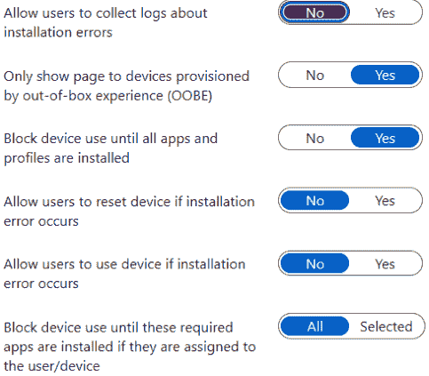

图 7.31 – 为 Edge kiosk 创建 ESP

将其分配给 AAD **All Autopilot KIOSK** 动态组，该组将忽略默认 ESP 配置文件，因为它已分配给设备组。

## 创建 Windows Autopilot 配置文件

为此场景创建新的 Autopilot 配置文件：

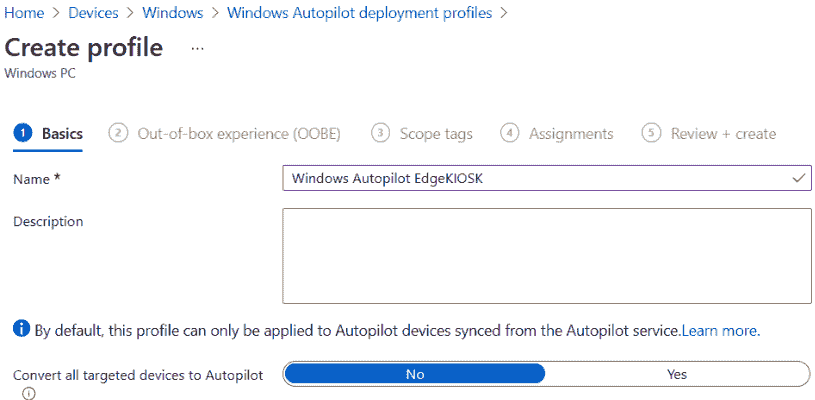

图 7.32 – Edge kiosk 的 Windows Autopilot 配置文件

将 **Deployment mode** 设置为 **Self-Deploying (preview)** 以将设备作为无用户设备加入：

Home > Devices > Windows > Windows Autopilot deployment profiles >

# Create profile

Windows PC

Basics   Out-of-box experience (OOBE)   Scope tags   Assignments   Review + create

Configure the out-of-box experience for your Autopilot devices

Deployment mode *   Self-Deploying (preview)

Join to Azure AD as   Azure AD joined

Microsoft Software License Terms   Show   Hide

Important information about hiding license terms

Privacy settings   Show   Hide

The default value for diagnostic data collection has changed for devices running Windows 10, version 1903 and later. Learn more

Hide change account options   Show   Hide

User account type   Administrator   Standard

Language (Region)   Operating system default

Automatically configure keyboard   No   Yes

Apply device name template   No   Yes

Figure 7.33 — Windows Autopilot profile OOBE

## Self-Deploying (preview)

自部署模式目前不会将用户与设备关联（因为在流程中未指定用户 ID 或密码）。

自部署模式使用设备的 TPM 2.0 硬件对组织 AAD 租户中的设备进行身份验证。因此，没有 TPM 2.0 的设备不能使用此模式使用。设备还必须支持 TPM 设备证明。此 Windows Autopilot 场景需要具有物理 TPM 的设备，因此虚拟设备将无法工作。

要实现 100% 的零接触入职体验，需要以太网连接；否则，设备会提示您选择区域和键盘布局。

## 创建自定义 Windows 10 配置文件以禁用用户 ESP

这是为了确保用户部分的 ESP 不会在 Edge kiosk 上显示，因为它是一个无用户设备：

- - **Name:** `Disable User ESP`
- - **Description:** `Disable User ESP for Edge KIOSK`
- - **OMA-URI:** `./Vendor/MSFT/DMClient/Provider/ProviderID/FirstSyncStatus/SkipUserStatusPage`
- - **Data type:** `Boolean`
- - **Value:** `True`

## 创建自定义 Windows 10 配置文件以禁用 FirstLogonAnimation

此策略设置允许您控制用户在首次登录计算机时是否看到首次登录动画。这适用于完成初始设置的计算机的第一位用户以及后来添加到计算机的用户。它还控制 Microsoft 帐户用户在其首次登录时是否会被提供服务选择加入提示。

如果您未配置此策略设置，完成初始 Windows 设置的用户在其首次登录时将看到动画。如果第一位用户已完成初始设置且未配置此策略设置，则新用户登录此计算机时不会看到首次登录动画。

在此 Edge kiosk 场景中，我们只需要快速轻松的入职体验：

- - **Name:** `Disable FirstLogonAnimation`
- - **Description:** `Disable FirstLogonAnimation for Edge KIOSK`
- - **OMA-URI:** `./Device/Vendor/MSFT/Policy/Config/WindowsLogon/EnableFirstLogonAnimation`
- - **Data type:** `Integer`
- - **Value:** `0`

## 创建 Windows 10 模板 kiosk 配置文件

将 Windows 10 配置为单应用 kiosk 模式。我们使用 Microsoft Intune 中内置的配置文件类型模板，模板名称为 Kiosk。此配置文件类型将引导您完成必要的配置步骤。如果您需要在 kiosk 配置文件中进行更高级的设置，则需要使用 XML 格式的 kiosk 配置文件创建自定义 kiosk 策略：

Figure 7.36 – Edge kiosk profile

以下是配置设置选项卡上的设置：

Figure 7.37 – Edge kiosk Configuration settings

需要在 Windows 10 模板 Administrative Templates 配置文件中配置其他 Edge 设置：

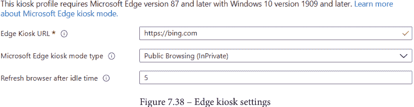

## Kiosk 模式支持的功能

在此表中，您可以看到不同 Microsoft Edge 版本可用的设置：

| Feature | Digital/Interactive Signage | Public Browsing | Available with Microsoft Edge Version (and Higher) |
|---|---|---|---|
| InPrivate Navigation | Y | Y | 89 |
| Reset on inactivity | Y | Y | 89 |
| Read-only address bar (policy) | N | Y | 89 |
| Delete downloads on exit (policy) | Y | Y | 89 |
| F11 blocked (enter/exit fullscreen) | Y | Y | 89 |
| F12 blocked (launch Developer Tools) | Y | Y | 89 |
| Multi-tab support | N | Y | 89 |
| Allow URL support (policy) | Y | Y | 89 |
| Block URL support (policy) | Y | Y | 89 |
| Show home button (policy) | N | Y | 89 |
| Manage favorites (policy) | N | Y | 89 |
| Enable printer (policy) | Y | Y | 89 |
| Configure the new tab page URL (policy) | N | Y |  |
| End session button* | N | Y | 89 |
| All internal Microsoft Edge URLs are blocked, except for edge://downloads and edge://print | N | Y | 89 |
| Ctrl + N blocked (open a new window) * | Y | Y | 89 |
| Ctrl + T blocked (open new tab) | Y | N | 89 |
| Settings and more (...) will display only the required options | Y | Y | 89 |
| Restrict the launch of other applications from the browser | Y | Y | 90/91 |
| UI print settings lockdown | Y | Y | 90/91 |

建议配置其他配置文件，例如 Windows Defender、Windows Update for Business 以及可能与您的 kiosk 场景相关的其他策略。

此场景也可以使用多应用 kiosk 模式实现；它只需要在 Microsoft Endpoint Manager 中的 kiosk 配置文件中进行不同的配置。

## Autopilot Reset

Windows Autopilot Reset 仅适用于 AAD 加入的设备。

Windows Autopilot Reset 将设备恢复到业务就绪状态，允许同一用户或新用户快速轻松地登录并开始工作。Windows Autopilot 重置后登录设备的第一位用户将成为设备的新主要用户和所有者。

以下是 Windows Autopilot Reset 的特别之处：

- - 它会删除个人文件、应用和设置。
- - 它会保留设备与 AAD 的身份连接，因此它保留相同的 AAD 对象。
- - 它会保留设备与 Intune 的管理连接，因此它保留相同的 Microsoft Intune Windows 对象。

使用 Windows Autopilot Reset 时，流程会自动保留设备上的以下信息：

- - 它保留设备上配置的区域、语言和键盘。
- - 它保留 Wi-Fi 连接详细信息。
- - 它预配之前已应用于设备的软件包。
- - 当重置流程启动时，预配包存在于 USB 驱动器上。
- - 它保留 AAD 设备成员身份和 Microsoft Intune 注册信息。

Windows Autopilot Reset 将阻止用户在这些信息恢复之前访问桌面，包括在 Microsoft Intune 同步完成之前重新应用任何预配包。

在 Microsoft Endpoint Manager 管理中心执行以下步骤，https://endpoint.microsoft.com/：

- 1. 选择 Devices | Windows | Configuration Profiles。
- 2. 选择 Create Profile。


+   3. 选择 **Platform Windows 10 and Later** 和 **Profile Type Templates**。
+   4. 选择 **Device restrictions** | **Create**。
+   5. 输入 `Enable Autopilot Reset` 作为名称。
+   6. 选择 **General** | **Autopilot Reset** | **Allow**：


Figure 7.39 – Autopilot Reset

+   7. 允许具有管理员权限的用户使用 *Ctrl + Win + R* 在设备锁屏上删除所有用户数据和设置，以便设备可以自动重新配置并重新注册到管理中。
+   8. 将配置文件分配给你的 Autopilot 设备组。
+   9. 作为 IT 管理员，你也可以直接从 Microsoft Intune 中的设备启动 Autopilot Reset：

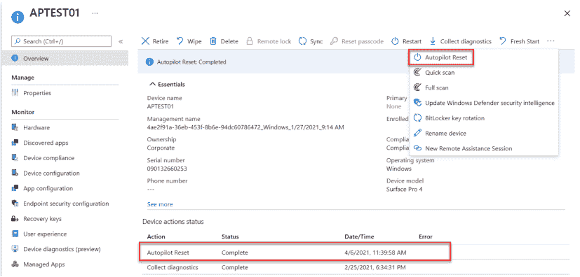

Figure 7.40 – Windows device Autopilot Reset

+   10. 在 **Device actions status** 部分，你将看到 Autopilot Reset 的状态，显示其是否已完成或失败。
+   11. 其他来自 Microsoft Intune 的重置场景包括那些不依赖设备为 Windows Autopilot 设备的场景。

> **Important Note**
> 如果 **Windows Defender Application Control (WDAC)** 配置为由 Microsoft 的 Intelligent Security Graph 确定应用声誉，Autopilot Reset 可能会失败。

Windows Autopilot Reset 在同一用户需要再次重复使用设备时具有很好的设备重置用例，在其他场景下也有其他选项可用。在下一节中，我们将介绍擦除和重置。

## Wiping and resetting your devices

出厂重置会将设备恢复为默认设置。这会从该设备中删除所有个人和公司数据及设置。你可以选择是否保留设备的注册状态和与该设备关联的用户账户。此操作无法撤消。你确定要重置此设备吗？以下是可供你选择的选项：

- **Wipe device, but keep enrollment state and associated user account.**
- **Wipe device, and continue to wipe even if device loses power. If you select this option, please be aware that it might prevent some Windows 10 devices from starting up again..**

此选项可确保即使关闭设备也无法规避擦除操作。此选项将一直尝试重置设备直至成功。在某些配置中，此操作可能会导致设备无法重新启动。

此问题可能是由于 Windows 安装存在严重损坏，导致操作系统无法重新安装而引起的。在这种情况下，流程会失败并使系统停留在 Windows Recovery Environment 中：

**Wipe - APTEST01**
Factory reset returns the device to its default settings. This removes all personal and company data and settings from this device. You can choose whether to keep the device enrolled and the user account associated with this device. You cannot revert this action. Are you sure you want to reset this device?
☐ Wipe device, but keep enrollment state and associated user account
☐ Wipe device, and continue to wipe even if device loses power. If you select this option, please be aware that it might prevent some Windows 10 devices from starting up again.
[Yes] [No]

Figure 7.41 – Windows device wipe

- Wipe device, but keep enrollment state and associated user account：

| Retained during a wipe | Not retained |
|---|---|
| User accounts associated with the device | User files |
| Machine state (domain join, AAD-joined) | User-installed apps (store and Win32 apps) |
| MDM enrollment | Non-default device settings |
| OEM-installed apps (store and Win32 apps) |  |
| User profile |  |
| User data outside of the user profile |  |
| User auto logon |  |

## Fresh start

清理设备将删除所有预装的 Win32 应用。你可以选择是否保留设备上的用户数据以及是否确定要清理设备：

Fresh Start - APTTEST01
Cleaning this device will remove all preloaded Win32 apps. You can choose whether to retain user data on this device. Are you sure you want to clean this device?
☐ Retain user data on this device
[Yes] [No]

Figure 7.42 – Windows device Fresh Start

你还可以设置以下选项：

- Keep the device AAD joined.
- A device is enrolled in MDM again when an AAD-enabled user signs in to the device.
- Keep the contents of the device user's Home folder, and remove any apps and settings.

> **Important Note**
> 如果你不保留用户数据，设备将被恢复到默认的 OOBE 完成状态，保留内置管理员账户。该账户在 Windows Autopilot 设备上默认处于禁用状态，你可能会发现自己无法登录设备。
> 
> BYOD 设备将从 AAD 和 MDM 注销。AAD 加入的设备在 AAD 启用的用户登录设备时将再次注册到 MDM。

## Questions

+   1. What is the name of the policy that disables the Windows first logon animation process?
+   
+      A. `FirstLogonAnimationExperience`
+      B. `FirstExperience`
+      C. `FirstLogonAnimation`
+      D. `WindowsLogonAnimation`
+   
+   2. What is the default BitLocker encryption method on Windows 10?
+   
+      A. AES-CBC 128-bit
+      B. XTS-AES 128-bit
+      C. AES-CBC 258-bit
+      D. XTS-AES 258-bit

## Answers

+   1. (C)
+   2. (B)

## Further reading

If you want to learn more about Windows Autopilot after reading this chapter, please use the following free online resources, and join the Autopilot Microsoft Tech Community!

- Windows Autopilot | Microsoft Tech Community: https://techcommunity.microsoft.com/t5/windows-management/windows-autopilot/m-p/90052
- Windows Autopilot documentation | Microsoft Docs: https://docs.microsoft.com/en-us/mem/autopilot/
- Windows AutoPilot: An introduction | Microsoft Tech Community: https://techcommunity.microsoft.com/t5/windows-deployment/windows-autopilot-an-introduction/td-p/87291

## 8
Application Management and Delivery

在本章中，你将学习如何将 Microsoft 365 和业务线应用部署和管理到你的 Windows 10 端点，这是每个 Windows 10 Enterprise 部署中非常重要的一项要素。应用程序使终端用户保持生产力，但应用程序也可以是帮助终端用户或 IT 管理员的工具。

在本章中，我们将介绍以下主题：

- Application delivery via Microsoft Endpoint Manager
- Different application types you can deploy
- Community tool – Win32App Migration Tool
- Deploying Microsoft 365 apps
- Microsoft 365 Apps admin center
- Deploying Microsoft Teams
- OneDrive
- What is MSIX?

## Application delivery via Microsoft Endpoint Manager

我们一直在解释使用统一端点管理解决方案从同一管理体验中获得的好处。当然，这些好处同样适用于向你的端点交付应用程序，无论它们是在虚拟云还是物理端点上运行 Windows 10 Enterprise，均可通过 Microsoft Endpoint Manager 进行管理。

另一个重要层面是安全性。通常，安装应用需要安装权限，例如在 Windows 10 Enterprise 端点上需要本地管理员权限。通过 Microsoft Endpoint Manager 交付应用，你可以以模块化方式分配和安装应用，而无需将用户设为本地管理员。

将应用程序与映像分开模块化添加（单独添加）也将极大地简化你的映像维护流程。例如，在传统的虚拟桌面基础架构中，你会创建一个所谓的 master image。使用 Microsoft Endpoint Manager – Intune 则不需要此步骤，因为所有应用程序都可以与操作系统映像层分开管理。在你注册 Windows 10 Enterprise 映像后，所有分配的应用程序都将根据用户、组或设备筛选自动添加。听起来很酷，对吧？

要开始交付应用，你必须进入 Microsoft Endpoint Manager 中的 **Apps** 菜单。你开始配置并将应用程序分配给你的用户或设备的旅程。很简单，并且支持不同的应用程序格式，其说明你将在本书的本章中找到。

## Different application types you can deploy

向终端用户交付应用程序，无论他们主要使用物理还是虚拟云桌面，对企业来说都是一个非常重要的因素。

大多数企业多年来一直使用 SMS、ConfigMgr 和 **Microsoft Endpoint Configuration Manager (MECM)** 来实现这一目标（面向其本地基础设施）。在 Microsoft Endpoint Manager – Intune 中，流程更简单，因为后端基础设施已预先构建，可几乎立即开始部署应用！


那么，针对每种操作系统，支持哪些应用格式作为交付类型呢？让我们为您全面介绍，以便您可以决定对您的业务来说最佳的方法。

当您在 Microsoft Intune 中创建新应用时，首先需要选择适合要交付到设备的应用的应用类型：

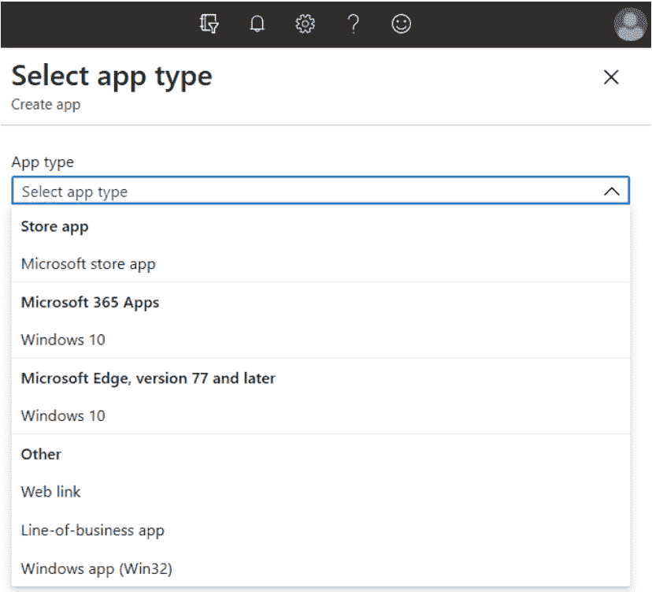

图 8.1 – 选择应用类型

支持的 Windows 10 应用交付类型将在以下小节中详细介绍。

## LOB 应用

在 Intune 中，您可以使用不同的方法部署不同格式。支持的格式包括现代应用，例如 **Universal Windows Platform (UWP)** 应用和 **Windows App Packages (AppX)**，以及更经典的格式，例如 Win32 应用，包括简单的 **Microsoft Installer (MSI)** 程序包文件。

### .MSI – 通过 LOB 应用

MSI 格式安装程序同时受 Intune 中 LOB 和 Windows 应用（Win32）选项支持，后者对应用依赖项的支持更完善。

### MSIX – 通过 LOB 应用

MSIX 是 Microsoft 的新 Windows 应用程序包格式，为所有 Windows 应用提供现代化的打包体验。MSIX 程序包格式保留了现有应用程序包和/或安装文件的功能，同时还为 Win32、WPF 和 Windows Forms 应用启用了新的现代打包和部署功能。我们将在本书后面更深入地介绍 MSIX。

MSIX 结合了 MSI、.appx 和 App-V 的最佳功能。

### AppX – 通过 LOB 应用

AppX 应用分发文件格式首次随 Microsoft Windows 8 推出。也称为现代（UWP）应用，带有 AppX 扩展名的文件可直接用于分发和安装。

在 Windows 10 Enterprise 的 Windows Store 中，应用会自动以 AppX – UWP 格式分发。

AppX 对于分发支持多设备的应用非常有益，包括运行 Windows 的 PC、平板电脑和智能手机。

> **重要提示**
> 
> 当您使用 Autopilot 时，我们建议您不要将 LOB 应用与 Windows 32 应用（Win32）作为交付选项混合使用 – 您可以在 *第 7 章，管理 Windows Autopilot* 中找到更多相关信息。

要配置简单的 LOB 应用，在 Microsoft Endpoint Manager 控制台中，您必须在菜单中进入 Apps 以开始配置：

### 企业内部应用

要添加自定义或内部应用，请上传应用的安装文件。确保文件扩展名与应用的预期平台匹配。Intune 支持以下企业内部应用平台和扩展：

- Android (APK)
- iOS (IPA)
- macOS (.IntuneMac)
- Windows (.msi, .appx, .appxbundle, .msix, 和 .msixbundle)

了解更多

图 8.2 – LOB 应用

您可以通过 + Add 按钮开始配置：

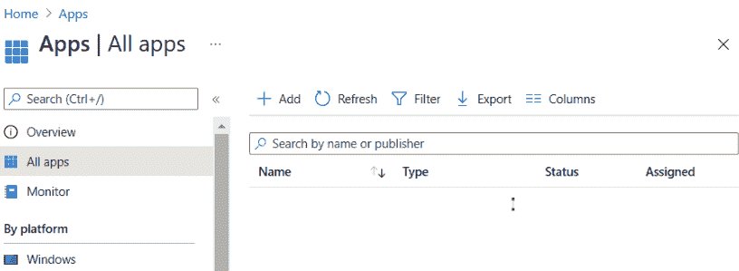

图 8.3 – 所有应用

以下菜单显示了之前提到的所有支持的应用类型。要开始以最简单的方式部署 MSI 文件的配置，您选择 Line-of-business app。

要以更高级的方式部署 MSI 文件和其他 Win32 应用格式，我们建议您使用 Windows 应用（Win32）选项 – 在下一节中进行说明：

> 重要提示
> Win32 支持交付优化和设置依赖项，而 LOB 不支持这些。

### 选择应用类型

创建应用

应用类型

企业内部应用

### 企业内部应用

要添加自定义或内部应用，请上传应用的安装文件。确保文件扩展名与应用的预期平台匹配。Intune 支持以下企业内部应用平台和扩展：

- Android (APK)
- iOS (IPA)
- macOS (.IntuneMac)
- Windows (.msi, .appx, .appxbundle, .msix, 和 .msixbundle)

了解更多

图 8.4 – 应用类型 – 企业内部应用

搜索 .msi 文件（.exe 不受支持 – 请改用 Win32 应用类型）：

### 应用程序包文件

应用程序包文件 *

"Notepad++7_8.9.msi"

名称：Notepad++ (64-bit x64)
平台：Windows
大小：3.41 MiB
MAM 已启用：否
执行上下文：每台机器

图 8.5 – 应用程序包文件

为 LOB 应用提供正确的应用名称、描述和发布者。

您还可以选择其他可选值：

- 应用安装上下文（用户或设备）
- 应用版本忽略
- 命令行参数（安装参数）
- 定义应用类型的类别
- 在公司门户中列出该应用（或不列出）

正如您所见，这里可用的功能有限。

当您需要更多功能时，请使用 Win32 应用方法：

### 添加应用

Windows MSI 企业内部应用

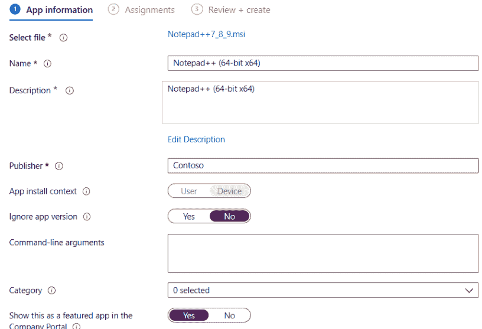

图 8.6 – 添加应用 – Windows MSI 应用信息

为您的 Windows MSI LOB 应用创建正确的 AAD 用户、AAD 组或基于设备的筛选。

在您验证配置摘要后开始部署应用：

### 添加应用

Windows MSI 企业内部应用

应用信息   分配   查看 + 创建

必需

组模式   组   筛选模式   筛选（预览）   安装上下文
无分配
+ 添加组  + 添加所有用户  + 添加所有设备

可用于已注册设备

组模式   组   筛选模式   筛选（预览）   安装上下文
无分配
+ 添加组  + 添加所有用户

卸载

组模式   组   筛选模式   筛选（预览）   安装上下文
无分配
+ 添加组  + 添加所有用户  + 添加所有设备

上一步   下一步

图 8.7 – 添加应用 – Windows MSI 分配

在管理中心的右上角出现以下提示后，注册将直接为指定的用户和设备开始。

安装成功后，Notepad++ 会作为新添加的应用出现在开始菜单中：

添加自定义或内部 Win32 应用。上传 .intunewin 格式的应用安装文件。以下示例演示了用于演示中最著名应用 – Notepad++ 的打包过程。

用于筛选和创建依赖项的功能比之前的 LOB 方法要强大得多。本节中使用的功能适用于您拥有的任何 Win32 应用。让我们开始：

1. 首先，下载 Microsoft Win32 Content Prep Tool：https://github.com/Microsoft/Microsoft-Win32-Content-Prep-Tool。
2. 解压该工具，例如到 C:\ 驱动器（您也可以选择任意文件夹）。
3. 将您的应用 .exe 或 .msi 文件保存在例如与 Prep Tool 相同的目录中（之前选择的目录）。当然也可以保存在其他位置。我使用 Notepad++ 作为此示例，因为它是免费的：
4. 现在我们开始创建 Win32 .Intunewin 程序包。

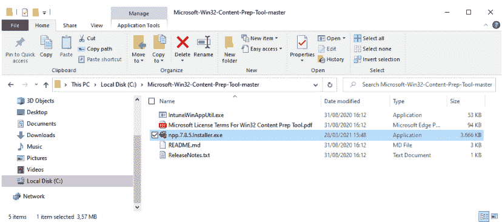

图 8.10 – 浏览您的应用

5. 打开 PowerShell 并将目录更改为 Intune Prep Tool 位置，例如 `C:\Microsoft-Win32-Content-Prep-Tool-master`：

```
cd "C:\Microsoft-Win32-Content-Prep-Tool-master"
```

此命令会产生以下输出：

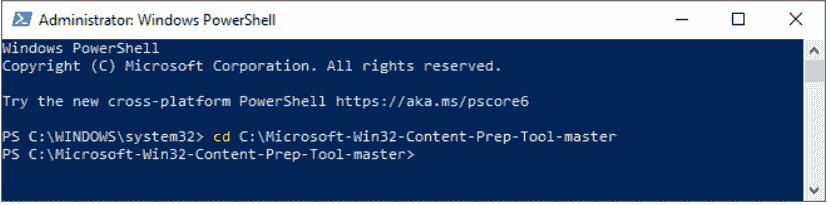

图 8.11 – Win32 Content Prep Tool master

6. 运行 `./IntuneWinAppUtil.exe` 并填写以下要求：

- **Please specify the source folder:** `C:\Microsoft-Win32-Content-Prep-Tool-master`
- **Please specify the setup file:** `npp.7.8.5.Installer.exe`
- **Please specify the output folder:** `C:\Microsoft-Win32-Content-Prep-Tool-master`
- **Do you want to specify catalog folder (Y/N)?** `N`

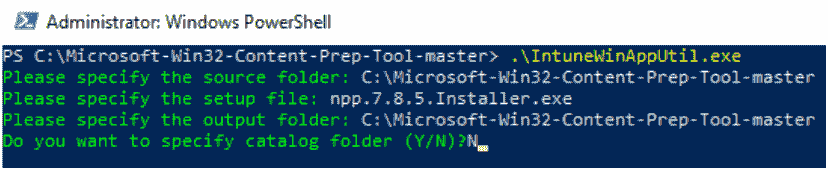

图 8.12 – IntuneWinAppUtil

> **重要提示**
> 
> 您可以随意自定义文件夹。这只是一个示例。

9. 单击 Windows：

图 8.15 – 应用 | Windows

10. 单击添加：

图 8.16 – 添加应用


11. 选择 Windows 应用（Win32）。点击“选择应用包文件”：

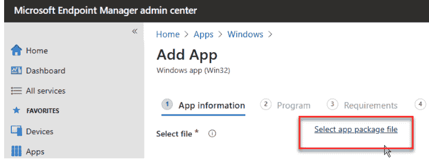

图 8.17 – 选择应用包文件

12. 浏览并选择之前创建的 .intunewin 包文件。点击“确定”：

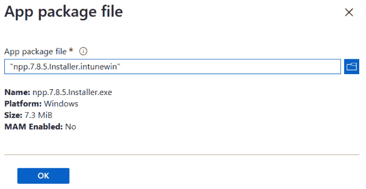

图 8.18 – 应用包文件

13. 在下一个屏幕中，你可以自定义应用的名称。

可选：如果你希望将安装设为用户可选，请将“在公司门户中将此应用显示为精选应用”设为“是”：


图 8.19 – 显示为精选应用

14. 按如下方式在“应用信息”选项卡中输入设置：

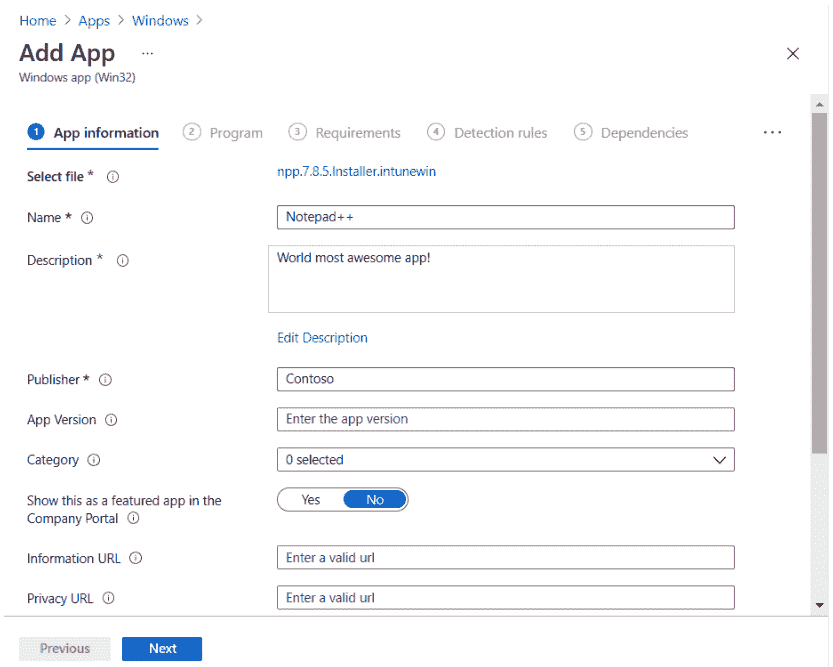

图 8.20 – 应用信息

15. 请务必手动输入应用版本，以便更好地使用如 supersedence 等功能，因为这可以在应用程序供应商未在安装文件中包含版本时，更容易检测到之前的版本：


图 8.21 – 应用版本

16. 输入应用特定的参数以提供应用的静默安装：npp.7.9.Installer.exe/S。

选择应用的安装行为。如果是系统安装应用，请选择“系统”（最常用，适用于所有用户），如果应用应作为用户安装（在用户配置文件中），则选择“用户”：


图 8.22 – 安装行为

17. 如果你的应用需要重启，请将“设备重启行为”部分更新为最适合你使用场景的设置：

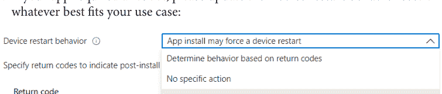

图 8.23 – 设备重启行为

18. 提供最小应用要求，例如操作系统版本。

使用返回代码来处理应用是否已成功安装的问题。这使你能够在其他 Microsoft Endpoint Manager 服务（如 Endpoint Analytics）中检测到任何失败，以便执行自动修复操作：

| 返回代码 | 代码类型 |
|---|---|
| 0 | 成功 |
| 1707 | 成功 |
| 3010 | 软重启 |
| 1641 | 硬重启 |
| 1618 | 重试 |

图 8.24 – 返回代码

19. 完成所有设置后，点击“下一步”以定义应用的要求：

Home > Apps > Windows >

# Add App
Windows app (Win32)

App information   2 Program   3 Requirements   4 Detection rules   5 Dependencies

Specify the commands to install and uninstall this app:

Install command *  npp.7.8.5.Installer.exe /S

Uninstall command *  npp.7.8.5.Installer.exe /S

Install behavior  System  User

Device restart behavior  No specific action

Specify return codes to indicate post-installation behavior:

| Return code | Code type |
|---|---|
| 0 | Success |
| 1707 | Success |
| 3010 | Soft reboot |
| 1641 | Hard reboot |
| 1618 | Retry |

Previous   Next

图 8.25 – Add App | Program

20. 指定设备在应用安装前必须满足的要求。支持以下要求，如你所见：

- 磁盘空间要求（MB）
- 物理内存要求（MB）
- 所需的最小逻辑处理器数量
- 所需的最小 CPU 速度（MHz）
- 配置其他要求规则

Home > Apps > Windows >

# Add App

Windows app (Win32)

App information   Program   Requirements   Detection rules   Dependencies

Specify the requirements that devices must meet before the app is installed:

Operating system architecture *

2 selected

Minimum operating system *

Windows 10 1903

Disk space required (MB)

Physical memory required (MB)

Minimum number of logical processors required

Minimum CPU speed required (MHz)

Configure additional requirement rules

| Type | Path/Script |
| No requirements are specified. | |

+ Add

Previous   Next

图 8.26 – 应用要求

21. 如开头所述，你也可以将脚本操作添加到应用的安装要求中。例如，你可以先运行 PowerShell 脚本：

# Add a Requirement rule

Create a requirement.

Requirement type *

Select one
File
Registry
Script

图 8.27 – 添加要求规则脚本

22. 当你想使用此功能/在安装过程之前运行此脚本时，必须添加脚本信息和要求：

# Add a Requirement rule

Create a requirement.
Requirement type *  Script
Script name *  preq.ps1
Script file  Select a file
Run script as 32-bit process on 64-bit clients  Yes  No
Run this script using the logged on credentials  Yes  No
Enforce script signature check  Yes  No
Select output data type *  Date and Time
Operator *  Not equal to
Value *  03/28/2021  12:00:00 AM

图 8.28 – 添加要求规则

23. 创建检测规则以检查应用是否已安装，因为它指示应用是否存在于你定义的位置：

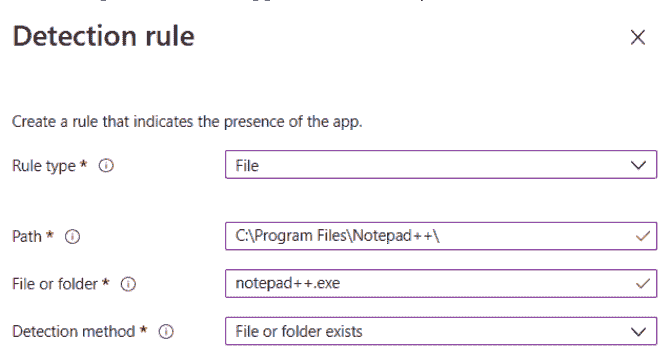

图 8.29 – 检测规则

24. 软件依赖项是在此应用可以安装之前必须安装的应用。

当安装前对其他应用有依赖时，你可以将其添加为依赖项。如果未检测到应用，则不会运行你的应用的安装或升级。

你可以配置的最大依赖项数量为 100：

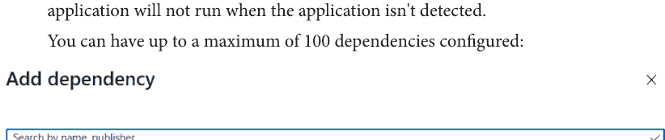

图 8.30 – 添加依赖项

在向 Win32 应用添加依赖项时，你可以浏览已创建的 Win32 应用或内置的 Microsoft Edge 应用。

# Add Apps

Search by name, publisher

| Name | Publisher | Version | Superseded Count |
| Notepad++ | Contoso | 7.8.5 | 0 |
| Remote Desktop | Contoso | 1.2.1755.0 | 0 |

Selected supersedence:

| Notepad++ | Contoso | 7.8.5 | 0 | Remove |

图 8.32 – 添加应用 supersedence

将应用分配给（AAD）组或所有设备，以强制部署到你的物理 Windows PC/端点：

Home > Apps > Windows >
Add App
Windows app (Win32)

Detection rules
Dependencies
Supersedence (preview)
Assignments

Any Win32 app deployed using Intune will not be automatically removed from the device when the device is retired. The app and the data it contains will remain on the device. If the app is not removed prior to retiring the device, the end user will need to take explicit action on the device to remove the app.

Required

| Group mode | Group | End user notifications | Availability | Installation deadline | Resta |
| No assignments | | | | | |

+ Add group + Add all users + Add all devices

Available for enrolled devices

| Group mode | Group | End user notifications | Availability | Restart grace period |
| No assignments | | | | |

+ Add group + Add all users

Previous Next

图 8.33 – Add App – Assignments

编辑分配以强制执行注册或更新过程。

其他很棒的选项是根据不同的时区和可定义的序列安排更新过程：

Remove

# Assignment settings

Mode

Included Excluded

# App settings

End user notifications
Show all toast notifications

Delivery optimization priority
Content download in background

> This application will be available as soon as it has been deployed, unless you specify an availability time below. If this is a required application, you may specify the installation deadline.

Time zone
UTC Device time zone

App availability
As soon as possible

App installation deadline
As soon as possible

OK

图 8.34 – 分配设置

确认你的应用配置已设置。如果一切都对齐，你可以通过点击“创建”开始部署。务必再次仔细检查你的设置：

# Summary

# App information

App package file
npp.7.8.5.Installer.intunewin
Name
Notepad++
Description
World most awesome app!
Publisher
Contoso
App Version
--
Category
--
Show this as a featured app in the Company Portal
No
Information URL
--
Privacy URL
--
Developer
--
Owner
--
Notes
--

Previous   Create

图 8.35 – 查看 + 创建

该应用现在将被推送给属于 AAD 组筛选器的所有用户的端点：

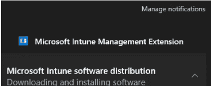

图 8.36 – Microsoft Intune Management Extension toast 通知

你可以对环境中的所有应用重复相同的步骤，或选择先使用 MSIX 进行应用虚拟化以简化应用分发流程。

该应用将显示为用户“开始”菜单中最近添加的应用。


## 社区工具 – Win32 应用迁移工具

该工具由社区驱动，由 Microsoft MVP Ben 创建，旨在将您现有的 SCCM/MECM Configuration Manager 应用程序迁移到 Microsoft Endpoint Manager – Intune 支持的部署类型，作为应用程序交付包。

该工具会自动完成所有工作，因此无需手动检查应用程序和部署类型，它会以批处理方式为您完成，并输出 .intunewin 文件。

您可以在此处免费下载该工具。如前所述，该工具由社区驱动，意味着它不受 Microsoft 支持部门的正式支持：https://github.com/byteben/win32App-Migration-Tool。

这是 ByteBen（企业移动性 MVP）的杰出作品。该工具在 PowerShell 中运行，并在屏幕上显示详细日志：

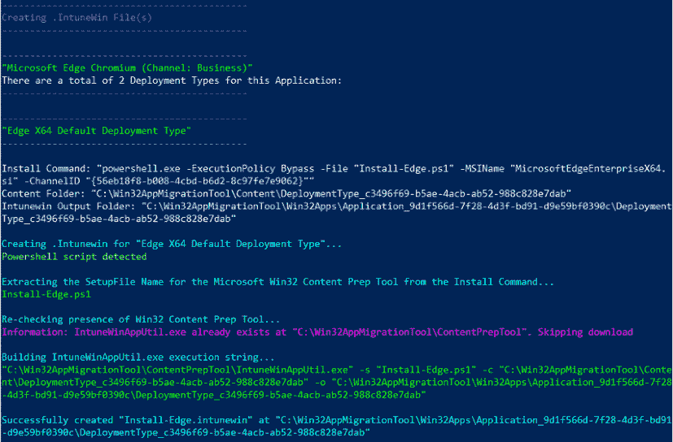

图 8.37 – Win32 应用迁移工具

本节到此结束，介绍了 Microsoft Intune 中的 Win32 应用程序。在下一节中，我们将深入介绍 Microsoft 365 应用程序。

## 部署 Microsoft 365 应用

Office 即点即用是向端点部署 Microsoft 365 应用（Office）的新方式。如下例所述，安装过程分为以下五个阶段，并涉及从互联网主动下载。因此，安装元素非常小。

Microsoft 365 应用不同于 Microsoft Intune 中的其他应用，因为它是部署到托管设备的策略。该策略类似于通过 MDM 通道部署到设备的其他 CSP：

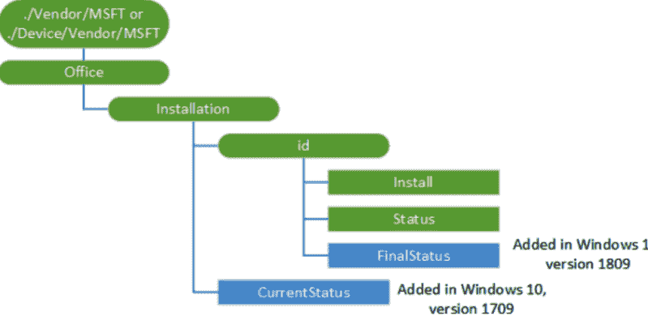

图 8.38 – Office CSP

由于它是策略而非 Win32 应用，因此不能将其用作 Win32 应用中的依赖项。CSP 写入注册表键 Computer\HKEY_LOCAL_MACHINE\SOFTWARE\Microsoft\OfficeCSP，并在其中创建值为 http://go.microsoft.com/fwlink/?LinkID=829801 的默认键，此时 setup.exe 会将该文件与存储在同一注册表位置（带有 GUID）的 XML 文件一起下载到本地设备。

setup.exe/configure [Microsoft 365 应用 XML 文件名称] 的组合随后将开始从 Office CDN（Microsoft Intune UI 和配置 XML 中的默认选项）下载所有二进制文件。

安装完成后，FinalStatus 注册表键将更新如下：

- 当状态 = 0 时：70（成功）
- 当状态 != 0 时：60（失败）

Microsoft Endpoint Manager 应用交付支持从应用配置文件配置菜单中直接注册 Microsoft 365 应用。

它只是一个下拉菜单，允许您包含或排除 Microsoft 365 应用的安装（无需 ODT – XML 文件）：

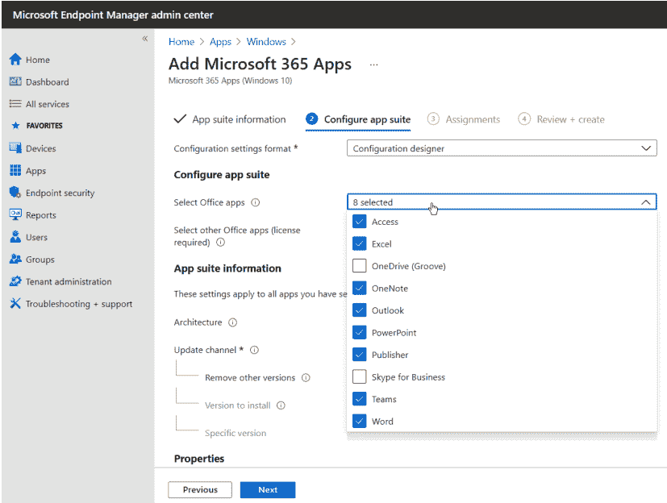

图 8.39 – 添加 Microsoft 365 应用

选择要在此部署中包含的 Office 应用后，您可以继续 Microsoft 365 应用向导。

## 更新通道

选择所选 Microsoft 365 应用的 32 位或 64 位版本，并选择最符合您业务需求的更新通道：

### 应用套件信息

这些设置适用于您在该套件中选择的所有应用。了解更多

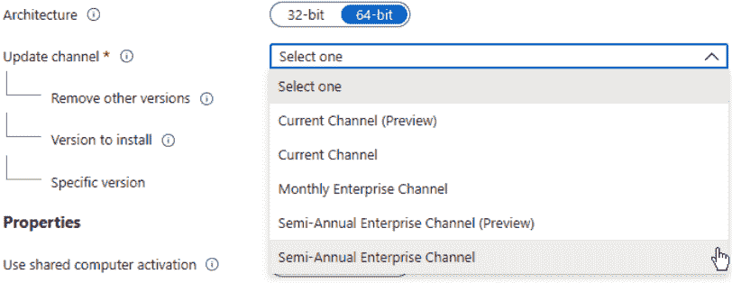

图 8.40 – 应用套件信息

控制台直接支持的其他出色设置包括以下功能：

### 属性

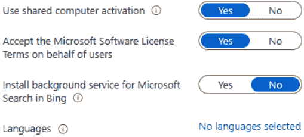

图 8.41 – 属性

共享计算机激活允许您将 Microsoft 365 应用部署到多个用户使用的计算机。通常，用户只能在有限数量的设备（例如五台 PC）上安装和激活 Microsoft 365 应用。使用共享计算机激活的 Microsoft 365 应用不计入该限制。

## Office 自定义工具

Microsoft 365 应用类型的注册流程还支持自定义配置 XML 文件。Office 自定义工具通常用于本地环境，在大型组织中部署 Office。

您可以将该配置集合并到应用类型配置中，Intune 将接管特定的排除和其他配置设置：

### 添加 Microsoft 365 应用

Microsoft 365 应用（Windows 10）

- 应用套件信息
- 配置应用套件
- 分配
- 查看 + 创建

配置设置格式 *

输入 XML 数据

### 配置文件

使用 Office 自定义工具创建用于在大型组织中部署 Office 的配置文件。了解更多

```
<Configuration>
<Add OfficeClientEdition="32" Channel="Current">
<Product ID="O365ProPlusRetail">
<Language ID="en-us" />
</Product>
</Add>
<AppSettings>
<User Key="software\microsoft\office\16.0\excel\security"
Name="vbawarnings"
Value="3"
Type="REG_DWORD"
App="excel16"
Id="L_VBAWarningsPolicy" />
</AppSettings>
</Configuration>
```

验证 XML

图 8.42 – 配置文件

选择要安装的 Office 语言版本。Office 会自动安装 Windows 中已安装语言的版本。如果要安装其他语言，请使用这些设置：

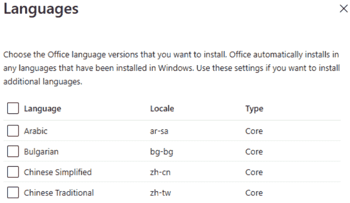

图 8.43 – 语言

您需要使 Office 语言设置与部署给用户的 Microsoft 365 应用中的 Office 语言设置保持一致，因为 Office CSP 每台设备仅支持一项分配。

## Microsoft 365 管理中心

在*第 6 章，Windows 部署和管理*中，我们已经大致讨论了如何更新 Microsoft 365 应用。现在，我们将更详细地讨论 config.office.com 管理中心门户中的以下选项，它会将您带到以下页面：

> **重要提示**
> Microsoft 365 管理中心应作为上一节关于 Microsoft 365 应用交付的扩展来使用。

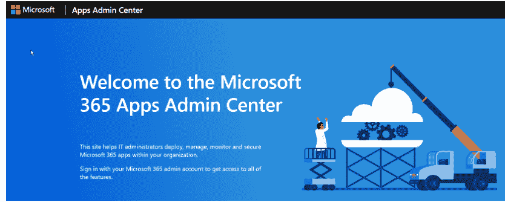

图 8.44 – Microsoft 365 管理中心

使用您的（Intune）管理员凭据登录后，您必须转到 **服务** 以开始为 Microsoft 365 应用创建自定义配置文件。

在该菜单中，如果这是您首次登录此配置门户，系统会要求您启用该服务，因为它仍处于预览模式。请务必单击 **启用预览功能** 按钮：

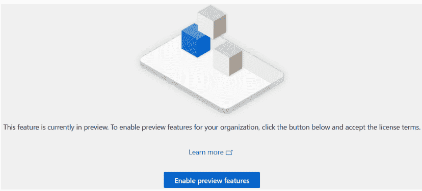

图 8.45 – 启用预览功能

接受条款以继续使用该服务，开始配置和维护 Microsoft 365 应用。此过程可能需要 10 分钟：

### 预览功能的许可条款

此功能目前处于预览阶段。要启用预览功能，您必须接受许可条款。

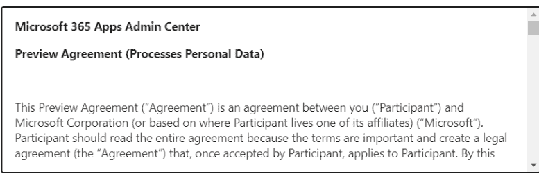

图 8.46 – 预览功能的许可条款

**当前通道** 是您登录 Microsoft 365 管理中心时的默认选择。要更改此项，您必须转到 **设置 | 组织设置 | 服务** | 以及 Office 安装选项。

## 设备选择标准

我们已经确定了环境中适合自动更新的候选设备。您可以通过以下筛选器添加附加条件，进一步缩小这组设备的范围。

通道

设备将从其当前更新通道移至月度企业通道

包含以下通道上的设备：

- Beta 通道
- 当前通道（预览）
- 当前通道
- 月度企业通道
- 半年企业通道（预览）
- 半年企业通道

磁盘空间
大于 5 GB

宏
包括所有设备
排除有宏使用情况的设备（过去 28 天）

### 选择要添加到配置文件的设备

0 台设备

设备数量基于环境中的设备总数，并受选择条件限制

通道 0
磁盘空间 0
宏 0
加载项 0
设备 0

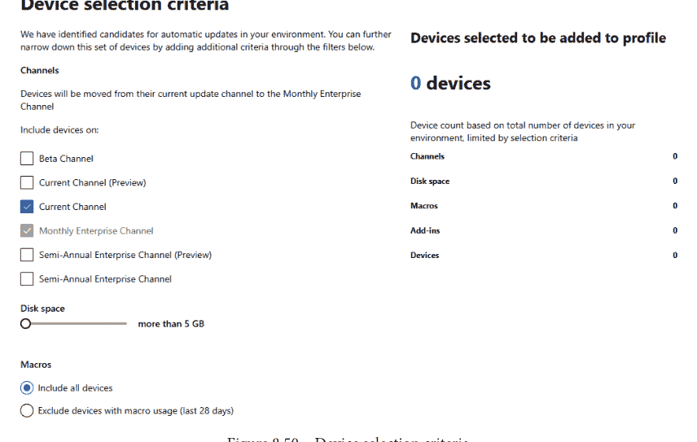

图 8.50 – 设备选择标准

选择更新通道后，您可以继续设置更新排除日期，如下一节所述。

## 更新排除日期

更新排除可用于防止设备在特定时间下载安全更新和功能更新。您可以创建不同的排除集，以便在繁忙时段减少环境中的变更。


点击下一步：

## 更新截止日期

管理 Microsoft 365 Apps for enterprise 的更新应用方式。了解有关更新截止日期的更多信息。

您希望如何管理更新？

设置更新截止日期
让用户自行决定更新节奏

更新强制执行前有多少天？

3 天

图 8.52 – 更新截止日期

查看所有设置并点击“创建配置文件”以将设置发布到您的设备：

## 查看并启用

设备选择条件
设备：0 台设备
组：使用 0 个组
宏：包含所有设备
频道：Monthly Enterprise Channel、Current Channel
磁盘空间：7 GB
加载项：包含所有设备
设备：包含
编辑设备选择条件

更新截止日期
设置和更新截止日期：3 天
编辑更新截止日期

更新排除日期
2 个排除日期
编辑排除日期

返回
创建配置文件

图 8.53 – 查看并启用

配置文件已成功创建：

## 创建配置文件


图 8.54 – 配置文件已创建

**Servicing profile** 的注册现在将使用您刚刚在配置文件中定义的具体设置进行。

您可以通过稍后在以下菜单中点击设置轻松修改现有的 **Servicing Profile**：

## Servicing Profile

+   概览
+   设备
+   问题
+   设置

## Monthly Enterprise Channel: 2101 Rollout  Build: 16.0.13628.20528  Active

隐藏发布详情

发布开始日期：03/09/2021 即将发布的版本 (2102)：2021 年 04 月 13 日可用

图 8.55 – Monthly Enterprise Channel

至此，Microsoft 365 应用更新的配置已完成。在下一节中，我们将介绍 Microsoft 365 应用的自定义。

## Microsoft 365 apps – customization

Apps Admin Center 门户中的另一个强大功能是 Customization。在这里，您可以为终端提供默认的策略设置，所有设置均集中管理：


图 8.56 – 策略管理

“创建策略配置”菜单允许您在 Office 中创建不同的配置集，这些配置集通常以管理模板或组策略的形式完成：


图 8.57 – 创建策略配置

我们将在第 10 章《高级策略管理》中更深入地介绍此内容。

## 部署 Microsoft Teams

Microsoft Teams 将通过上述 Microsoft 365 应用设置以机器范围安装程序的形式安装。值得一提的是，Teams 是一款按用户计费的应用。Microsoft 365 设置会将安装程序添加到您的 Windows 10 Enterprise 终端，并在新用户登录终端时自动安装。Teams 然后会安装在用户配置文件中。

在 Microsoft Intune 中的 Microsoft 365 应用设置中，您可以选择与其它应用一起安装 Teams：


图 8.58 – 应用套件信息

Teams 应用每 2 周更新一次，经过内部更新计划（如 Technology Adoption Program (TAP)）测试后发布。

安装在用户配置文件中的机器范围桌面应用会自动更新，无需用户或 IT 管理员进行任何操作。

您也可以通过右上角的三点菜单手动更新 Teams 应用。点击“检查更新”将触发更新过程，并在屏幕顶部显示“我们将在您继续工作时检查并安装任何更新”的通知：


图 8.59 – MS Teams 检查更新菜单选项

Microsoft Teams 遵循自己的更新流程，不遵循其他 Microsoft 365 应用的更新流程。

## OneDrive

OneDrive 并非 Microsoft 365 应用交付流程的一部分，原因很简单：OneDrive 是 Windows 10 Enterprise 的必备组件，因此在注册后即包含在操作系统中。

OneDrive 根据 **Insiders**、**Standard** 或 **Deferred** 周期自动更新。OneDrive 在运行时每 24 小时检查一次终端是否有可用更新。

生产环（即默认）每 20 天接收一次更新，而延迟环则提供更多灵活性，每 2-3 个月更新一次。在此期间，客户可以自行部署更新，从而精确记录软件更新时间。当天数超过时，更新将自动应用：

> > **重要说明**
> >
> > Microsoft 保留在关键更新时绕过 60 天宽限期的权利。


*图 8.60 – OneDrive 更新计划*

您可以通过指定的 OneDrive 策略将 OneDrive 客户端置于 **Deferred** 环中，我们将在下一章中进行说明。

当您想通过 Microsoft Endpoint Manager 强制终端更新时，可以向终端发送以下命令以使其成为可能。`restart` 参数会重新启动您的 Windows 10 Enterprise 桌面：

```
Execute C:\<location>\OneDriveSetup.exe /update /restart
```

OneDrive 客户端安装在每个用户的配置文件下的 %localappdata% 中。自 OneDrive 同步客户端版本 19.174.0902.0013 起，您可以按机器安装 OneDrive。只需运行 OneDriveSetup.exe/allusers 即可将安装从按用户转换为按机器：

```
This can be done by creating a Powershell Script and run it from Microsoft Intune to the device where you want the change.
#>
##########################################################################################
###################################################################

$url = "https://go.microsoft.com/fwlink/?linkid=2083517"
$output = "$ENV:temp" + '\OneDriveSetup.exe'
$O4BPath = "$ENV:localappdata" + 'Microsoft/OneDrive/OneDriveSetup.exe'
#write $O4BPath
#write $output
IF(Test-Path $output)
{
}
ELSE {
Invoke-WebRequest -Uri $url -OutFile $output
}
IF(!(Test-Path $O4BPath))
{
    & "$output" + '/allusers'
}
ELSE {
}
```

此脚本将下载最新版本的 OneDrive 同步客户端，并将安装转换为按机器安装，安装位置为 Program Files (x86)\Microsoft OneDrive。

## 部署 Microsoft Edge

自更新 79 以来，Microsoft Edge 已相当容易分发到您的终端——它完全集成在 Microsoft Endpoint Manager 中，并且我们将在下一章中介绍的大多数策略也适用。

在 Intune 应用菜单中，您必须添加适用于 Windows 的 Microsoft Edge，以在受管理的 Windows 10 设备上安装 Microsoft Edge 浏览器——作为应用类型开始配置：


图 8.61 – 适用于 Windows 10 的 Microsoft Edge

当您希望比 Stable 环中的其他用户更早测试新功能时，可以简单地将 Channel 设置更改为最适合您使用场景的设置。

您也可以分别从 Windows 10 Enterprise 终端部署所有不同的频道版本：


图 8.62 – 适用于 Windows 10 的 Microsoft Edge Stable

语言设置也适用。选择操作系统默认设置以从 Windows 操作系统内部驱动语言设置，或覆盖它们以分离浏览器语言：


图 8.63 – 适用于 Windows 10 的 Microsoft Edge 语言菜单

Microsoft Edge 是 Windows 每个新版本的一部分，因此此应用类型在未来某个时候将变得多余。

## 什么是 MSIX？

MSIX 是一种 Windows 应用包格式，为所有 Win32、UWP 和 Windows 应用提供现代化的打包体验。它是与 App-V 等技术相比进行应用虚拟化的新方法。

将应用与映像分离，以便在不进行映像更新的情况下更新和分配应用，这听起来像是一个解决方案，对吧？好吧，这正是 MSIX 可以实现的功能。让我解释一下您如何在此处打包一个应用：

- 1. 通过清单文件声明式安装。
- 2. 应用签名需要在设备上受信任。
- 3. 通过 BlockMap 和签名进行防篡改保护。


4. 操作系统管理安装、更新和移除：


图 8.64 – MSIX 包

## AppxManifest.xml

包清单是一个 XML 文档，其中包含系统部署、显示和更新 MSIX 应用所需的信息。此信息包括包标识、包依赖项、所需功能、视觉元素和可扩展性点。

## AppxBlockMap.xml

包块映射文件是一个 XML 文档，其中包含应用文件的列表，以及存储在包中的每个数据块的索引和加密哈希值。块映射文件本身在包签名时通过数字签名进行验证和保护。块映射文件允许 MSIX 包进行增量下载和验证，并且还支持在安装后对应用文件进行差异更新。

## AppxSignature.p7x

AppxSignature.p7x 在包签名时生成。所有 MSIX 包在安装前都必须签名。有了 AppxBlockmap.xml，平台可以安装该包并且可以对其进行验证。

## 如何创建 MSIX 包

创建 MSIX 包的过程看起来与您过去使用 App-V 时所做的大致相似。应用开发人员创建应用程序并创建 MSIX 包（这可能是 **独立软件供应商 (ISV)**），之后您通过 Intune – Microsoft Endpoint Manager 自定义应用程序以进行部署并将其分配给正确的 AAD 组或用户。

让我们解释以下步骤，以便您对流程有良好的感觉：


图 8.65 – MSIX 工具

首先，在 Microsoft Store 中搜索 MSIX Packaging Tool 并将其安装在您的 Windows 10 虚拟机上：


图 8.66 – MSIX Packaging Tool

启动打包工具：


图 8.67 – 启动 MSIX Packaging Tool

点击 Create your app package：


图 8.68 – 应用程序包

点击 Create package on this computer：


图 8.69 – 在此计算机上创建包

确保您在映像/会话主机上的状态与不同操作项的屏幕截图中显示的一致。

然后，点击 Next：


图 8.70 – 创建新包

浏览应用程序安装程序。这可以是您任何 Win32 应用程序。我将使用 Notepad++ 进行练习。

输入应用特定的要求。发布者名称是组织的证书 CN（例如，Contoso）。确保证书已注入到您的映像中，否则应用程序无法注册并将失败。

> **重要提示**
> 如果 CN 检测正确，您将看到 **Subject of the certificate provided** 通知。证书可以是自签名、公开的或通过根 CA 内部创建的。私钥和 CN 必须在后续流程中匹配。

点击 **Next**：


图 8.73 – 发布者名称

现在，运行您的应用程序的安装过程：


图 8.74 – 安装程序语言

确保禁用自动更新，因为 MSIX 将为只读。

启动应用程序以确保一切已正确安装。

如果应用程序安装正确，您将看到以下屏幕。如果需要，请在继续下一步之前重新启动机器：


图 8.75 – 安装

我们几乎准备好了。点击 **Next**。

> **重要提示**
> 
> 当您想在同一个 MSIX 包中打包额外的插件或其他附加应用程序时，请点击 **No, I'm not done**。

我已完成，所以我点击 **Yes, move on**：


图 8.76 – 是的，继续

然后，点击 Next：


图 8.77 – 依赖于

将 .msix 包文件保存在计算机或网络上的某个位置。然后，点击 Create：


图 8.78 – 创建包

包已准备好进行下一步。当您想在包中编辑内容时，请点击 Package editor：


图 8.79 – 包创建成功

## 将 MSIX 包应用程序推送到您的终端

如开头所述，要部署 MSIX 应用程序，您必须使用 Line-of-business app 作为应用类型设置：

> 重要提示
> MSIX 的部署通过 Intune SideCar 代理进行。


## Line-of-business app

要添加自定义或内部应用，请上传应用的安装文件。确保文件扩展名与应用的预期平台匹配。Intune 支持以下内部应用平台和扩展：

- Android (APK)
- iOS (IPA)
- macOS (.IntuneMac)
- Windows (.msi, .appx, .appxbundle, .msix, 和 .msixbundle)

了解更多

图 8.80 – 内部 MSIX

它会提示您上传将上传到 Microsoft Endpoint Manager 并分发到您的 Windows 10 Enterprise 终端的 .msix 包文件：

## App package file

App package file *
"Notepadplusplus_1.0.0.0_x64__h91ms92gds mmt.msix"
Name: Notepad++
Platform: Windows
Size: 3.84 MiB
MAM Enabled: No

图 8.81 – MSIX 应用包

应用程序设置与其它应用程序格式基本相同——非常简单：

## Add App

Windows Universal line-of-business app

1 App information   2 Assignments   3 Review + create

Select file *
Notepadplusplus_1.0.0.0_x64__h91ms92gds mmt.msix
Name *
Notepad++
Description *
None
Edit Description
Publisher *
Contoso
Category
0 selected
Show this as a featured app in the Company Portal
Yes No

图 8.82 – 应用信息 MSIX

完成后，您应将 MSIX 应用程序分配给正确的 AAD 组，并且应用程序将在 Windows 10 Enterprise 中注入，而无需安装它：


图 8.83 – 应用分配 MSIX

这结束了关于使用 MSIX 进行应用程序虚拟化以及通过 Microsoft Endpoint Manager 将其交付到您的终端的部分。无需切换到 Azure 门户——所有内容都从统一的管理体验中整合。

## Summary

在本章中，您了解了配置和分发面向物理和云终端的应用程序的所有不同选项。由于这是现代桌面非常重要的因素，您离成为现代工作场所的摇滚明星又近了一步。

在下一章中，我们将深入探讨现代桌面的另一个重要元素，即策略管理！

## Questions

- 1. Windows 应用程序（Win32）的首选和最全面的应用程序部署类型是什么？
  A. Line-of-business app
  B. Windows app (Win32)
  C. Web link
  D. Microsoft Store app

2. 生产使用工作负载的 Edge 发布通道叫什么？

A. Canary
B. Stable
C. Dev
D. Beta

## Answers

- 3. (B)
- 4. (B)

## Further reading

如果您想了解更多关于 Microsoft Endpoint Manager – Intune 应用程序部署选项的信息，请使用以下免费在线资源之一：

- Windows 10 app deployment by using Microsoft Intune | Microsoft Docs: `https://docs.microsoft.com/en-us/mem/intune/apps/apps-windows-10-app-deploy`
- Assign apps to groups with Microsoft Intune | Microsoft Docs: `https://docs.microsoft.com/en-us/mem/intune/apps/apps-deploy`


