## 9 了解策略管理

在本章中，你将了解来自 Microsoft Intune 的策略管理与 **组策略对象 (GPO)** 有何不同，以及在你的环境中用于自定义和保护 Windows 10/11 企业版桌面的不同策略选项。本章内容会非常广泛，但它将为你提供理解 Windows 与 Microsoft Intune 之间策略管理如何工作所需的基础信息。

我们在本书中将策略管理分为三章；在这一章之后，*第 10 章，高级策略管理* 将介绍不同场景下的高级策略管理，而 *第 11 章，Office 策略管理* 则介绍来自 Office 云策略服务的 Office 策略管理。

在本章中，我们将涵盖以下主题：

- 策略管理
- 什么是内容安全策略 (CSP) 策略？
- Windows 推送通知服务 (WNS)
- 策略设计的入门
- Microsoft Endpoint Manager 内的策略管理
- 从 Azure 目录 (AD) 迁移现有策略 – 组策略管理（预览）

## 策略管理

使用 Microsoft Endpoint Manager – Intune 管理你的 Windows 10/11 企业版桌面，全部都是关于标准化并简化环境的管理层。如上一章所述，一切都围绕着将配置集（和应用程序）分层，针对来宾操作系统进行分离，从而无需从一开始就创建包含这些内容的自定义映像。

Microsoft Endpoint Manager – Intune 内的策略管理使得可以从“设备”菜单中配置以下选项：

- 合规策略
- 条件访问
- 配置配置文件
- 设置目录
- 脚本
- 组策略分析（预览）
- 注册限制
- 策略集

组策略管理已有 20 多年的历史，一直是配置域中一组用户或计算机行为的方式。今天在本地域中仍然可以实现这一点，但如果你想开始现代化你的策略和设置管理，你应该开始关注 Microsoft Intune 以及其为策略管理提供的功能集。使用 GPO 有一些缺点，其中之一是它需要与域控制器保持可见性。另一个是 GPO 是即发即忘，但这是什么意思呢？GPO 分配给特定的一组用户和设备，并在设备定期连接到域控制器时应用。如果设备正确接收并应用了策略、无法联系到域控制器，或没有应用新的或更改的策略，域控制器不会收到任何报告。

有时，由于配置错误，Windows 设备可能会联系到内部网络上非常遥远且连接非常慢的域控制器，这会导致启动和登录时间非常长。许多这些问题都可以通过纯云加入并管理的设备来避免。

随着 COVID-19 在 2020 年初席卷全球，许多公司被迫让员工在家工作，而许多公司对此并不准备就绪。这也推动了从云端对设备进行 MDM 管理的新方法。Microsoft Intune 是这种新型工作方式的完美匹配，因为它在初始加入 Microsoft Intune 后仅需要互联网连接。

在本章中，我们将重点关注纯云管理的 Azure Active Directory Windows 10 设备，但同样也适用于从 Microsoft Intune 管理的混合域加入设备，甚至在共管状态下。需要在此注意的一点是，GPO 和 MDM 设置管理位于身份层，即用户或设备，而 Microsoft Intune 与 **System Center Configuration Manager (SCCM)** 之间的共管则位于管理平面上。

首先，我们需要回顾传统的 Windows 管理，即所有 Windows 设备都在办公室的本地、生产环境中，或最终用户通过 VPN 在家工作。如果这些设备混合加入 Azure Active Directory，现代策略管理仍然是一个选项。对于新设备而言，最佳的前进方向是纯 Azure Active Directory 加入并通过 Windows Autopilot 上线。我们在本章中介绍的内容涵盖这两种场景。本书致力于云管理，并且某些场景不适用于混合加入的设备，因此你需要做出一些决定，将设备迁移到 Azure AD 加入，以获得最佳的最终用户体验。从小开始，从 **概念验证 (POC)** 开始，并展示现代策略管理的优势。最佳实践方法是，在你的 POC 中阻止本地设备从本地 Active Directory 获取 GPO；否则，你可能会陷入无法 100% 确定设置是从何处应用的情况。

**配置服务提供程序 (CSP)** 是用于在设备上读取、设置、修改或删除配置设置的接口。这些设置映射到注册表项或文件。某些 CSP 支持 WAP 格式，某些支持 SyncML，而某些两者都支持。SyncML 仅用于通过空中传输的 **开放移动联盟设备管理 (OMA DM)**。另一方面，WAP 可用于通过空中传输的 OMA 客户端配置，或作为 `.provxml` 文件包含在手机映像中，该文件在启动期间安装。

### 什么是 CSP 策略？

某些策略只能在设备级别配置，而其他策略可以在用户级别配置。这意味着设备级策略将独立于登录设备的用户而产生效果，而用户级策略将取决于登录设备的用户。

用户范围是指策略仅适用于登录设备的用户，并且策略可以根据登录设备的用户而变化。以下是配置用户策略时 CSP 树的示例：

- `./User/Vendor/MSFT/Policy/Config/AreaName/PolicyName` 用于配置策略
- `./User/Vendor/MSFT/Policy/Result/AreaName/PolicyName` 用于获取结果

设备范围是指策略仅适用于设备本身，而与登录设备的用户无关。以下是配置设备策略时 CSP 树的示例：

- `./Device/Vendor/MSFT/Policy/Config/AreaName/PolicyName` 用于配置策略
- `./Device/Vendor/MSFT/Policy/Result/AreaName/PolicyName` 用于获取结果

GPO 与 CSP 策略之间最大的区别在于，CSP 策略还具有结果通道，因此设备上配置的每个设置都会向 MDM 系统报告 – 在本例中为 Microsoft Intune。

如果我们更仔细地查看策略结构，它看起来像 Windows 注册表以树结构排列：

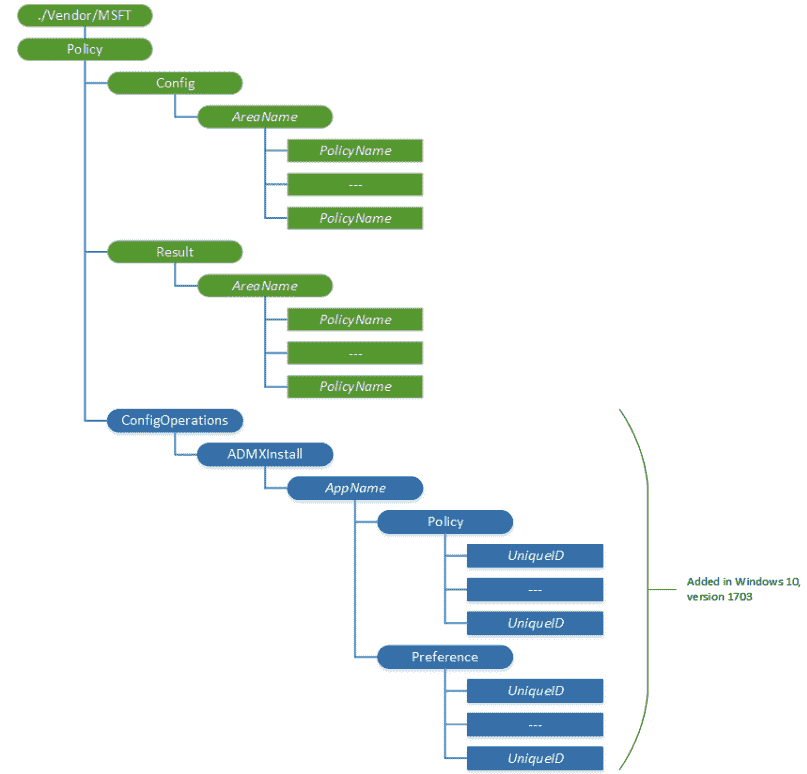

通过使用 ADMXInstall，你可以为在操作系统版本之间添加的那些 Win32 或 Desktop Bridge 应用添加 ADMX 支持的策略。ADMX 支持的策略通过使用 CSP 策略 URI 在你的设备中摄取：`./Vendor/MSFT/Policy/ConfigOperations/ADMXInstall`。

OMA-URI 字符串需要进入 CSP 策略 URI：

- `./Vendor/MSFT/Policy/ConfigOperations/ADMXInstall/Applicationname/Policy/ADMXFileName`。
- `./Vendor/MSFT/Policy/Config/` 保持不变，用于你部署到设备的所有机器策略。

Applicationname 和 ADMXFileName 都是用户定义的。在本例中，Applicationname 为 App1，你可以使用与 ADMXFileName 相同的名称。只需记住 ADMXFileName 必须唯一，这意味着你不能在同一设备上部署两个同名的 ADMX 文件。

以下是我的 ADMX 文件的内容 – 这也可能是 Google Chrome、Microsoft Office、Internet Explorer 或其他：

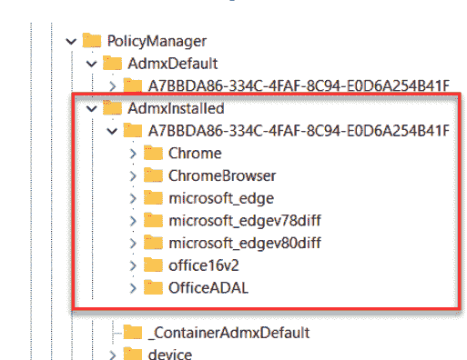

图 9.2 – AdmxInstalled 的注册表项

然后，如果你更仔细地查看注册表，它们首先被写入的地方是 HKLM\SOFTWARE\MICROSOFT\PolicyManager\AdmxInstalled。

策略始终在 GUID 下声明，并使用你在 Microsoft Intune 中创建策略时为策略指定的名称。

然后，你将能够在创建策略设置时看到你使用的策略类别的命名：

```
HKLM\Software\Microsoft\PolicyManager\AdmxDefault
```

如果策略是设备策略，你将能够在以下位置看到适用于设备的直接结果：HKEY_LOCAL_MACHINE\SOFTWARE\Microsoft\PolicyManager\current\device。

最终，策略在 Windows 设备上所做的全部工作就是设置一些注册表项，而 MDM 策略也是如此。所有策略设置都进入这里：HKEY_LOCAL_MACHINE\SOFTWARE\Policies\。


MDM 策略在设备同步时应用，无论是在 Microsoft Intune 中触发，还是作为 Windows 设备在开启 MDM 同步时按 8 小时计划自动执行。

IT 管理员要从 Microsoft Intune 同步设备，请启动 Microsoft Endpoint Manager 管理中心，然后按照以下步骤操作：

- 1. 点击**主页 | 设备 | Windows | Windows 设备**。
- 2. 搜索要同步的设备，然后可以选择单个设备并点击**同步**。Intune 随后将通过 **Windows 推送通知服务 (WNS)** 尝试与设备取得联系：

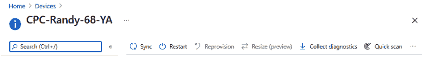

图 9.3 – 设备同步

- 3. 在刚刚选择单个设备的同一视图中，你还可以使用批量设备操作：

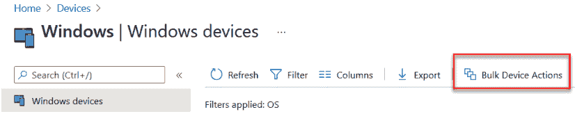

图 9.4 – 批量设备操作

- 4. 在**操作系统**中选择 **Windows**，在**设备操作**中选择**同步**：

## 批量设备操作

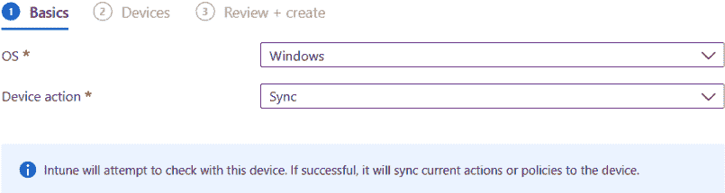

图 9.5 – 批量设备操作 – Windows

5. 然后，你可以选择最多 100 台设备，Microsoft Intune 将联系这些设备并执行同步：

主页 > 设备 > Windows >

## 批量设备操作

基本信息  2 设备  3 查看 + 创建

已选择 7 台设备（最多 100 台）

| 设备名称 | 主要用户 UPN | 操作系统 | 操作 |
|---|---|---|---|
| APTEST01 | jane@osddeployment.dk | Windows | 移除 |
| DESKTOP-N13M0LC | jane@osddeployment.dk | Windows | 移除 |
| OSD-18555 | John@osddeployment.dk | Windows | 移除 |
| OSD-35950 | frederik@famlarsen.se | Windows | 移除 |
| OSD-62868 | jane@osddeployment.dk | Windows | 移除 |
| OSD-96411 | pcl@osddeployment.dk | Windows | 移除 |
| PCL-SB2-13 | jane@osddeployment.dk | Windows | 移除 |

+ 选择要包含的设备

图 9.6 – 批量设备操作

使用批量设备操作时，Microsoft Intune 会使用 WNS。在下一节中，你将了解 WNS 的工作原理。

## Windows 推送通知服务（WNS）

WNS 使 Microsoft Intune 能够将 toast 通知、磁贴、徽章和原始更新从 Microsoft Intune 发送到已注册 MDM 的设备。这提供了一种以节能且可靠的方式向用户传递新更新的机制：

- 1. Microsoft Intune 向通道 URI 发出 HTTP POST 请求。该请求通过 SSL 发出，并包含必要的标头和通知负载。
- 2. WNS 响应以表明通知已收到，并将在下一个可用时机送达。

WNS 不提供端到端确认，无法确认你的通知已被设备或应用程序接收。Microsoft Intune 通过在特定设备的“概述”边栏选项卡中的“设备操作状态”视图中显示状态来提供此选项：

如果**公司门户**已固定到开始菜单，你可以右键单击并同步此设备：

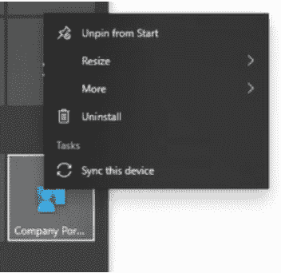

图 9.9 – 同步此设备

在**公司门户**中，转到设置，然后点击**同步**：

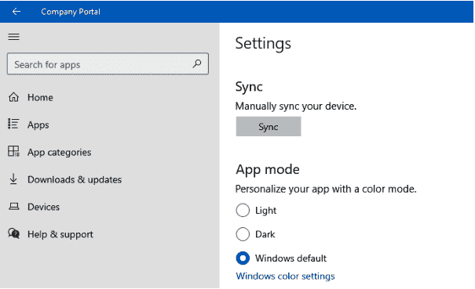

图 9.10 – 手动同步设备

在 Windows 设置应用中，你可以转到**帐户 | 访问工作或学校**。

从 Azure Active Directory 中选择身份，然后点击**信息**。

然后你就能看到由你的公司管理的策略区域。

在 Windows 11 上，你也有与 Windows 10 相同的选项，但你可以直接从设置应用中的**访问工作或学校**页面导出管理日志文件：

## 图 9.11 – 由你的公司管理（Windows 11）

以下是在 Windows 10 上这些信息的显示方式：

## 由 Osddeployment 管理

连接到工作或学校允许你的组织控制此设备上的某些内容，例如设置和应用程序。

## Osddeployment 管理的区域

Osddeployment 管理以下区域和设置。标记为“动态”的设置可能会根据设备位置、时间和网络配置而变化。

有关动态管理的详细信息

## 策略

- Experience
- InternetExplorer
- Update
- Authentication
- microsoft_edge~Policy~microsoft_edge~NativeMessaging
- microsoft_edge~Policy~microsoft_edge~Startup
- msteamsADMX~Policy~_L_Teams
- microsoft_edgev80diff~Policy~microsoft_edge

显示更多

## 应用程序

- 公司门户：成功
- VLC（Windows 商店版）：成功
- Microsoft.OneNoteWebClipper_8wekyb3d8bbwe
- Office 365 管理员：成功
- {f9f6a79-3bd1-464b-a224-165b746f4451}
- {2b802c36-cfc3-4d40-8b0d-7527d5dd684a0}
- {{e4dc7b28-2245-404f-a9e9-cf96254033ae}}：强制完成
- {{e4dc7b28-2245-404f-a9e9-cf96254033ae}}：强制完成

## 图 9.12 – 由你的公司管理（Windows 10）

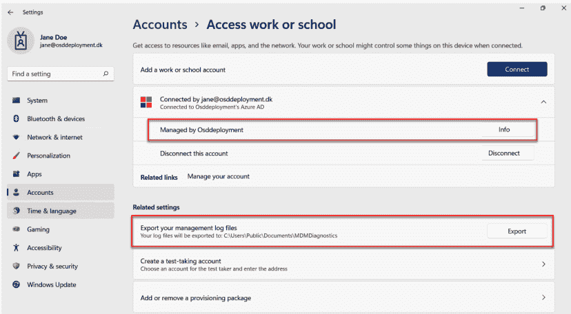

在 Windows 11 上看起来略有不同，但显示相同的信息：

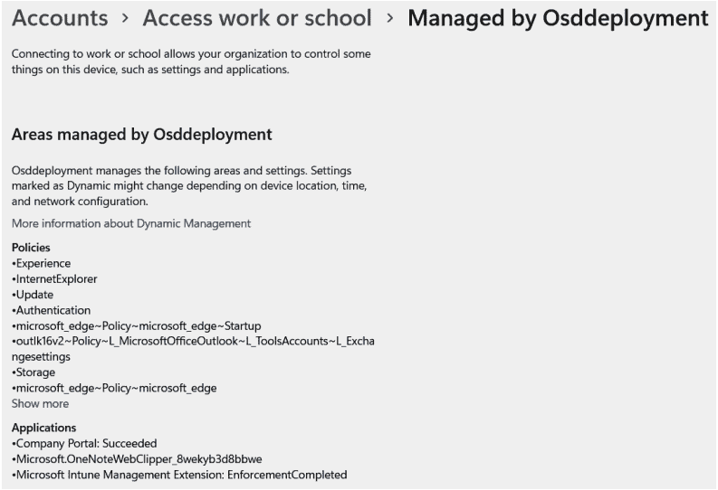

图 9.13 – 由你的公司管理（Windows 11）

如果你滚动到此设置页面底部，你将看到设备同步状态，其中你可以看到上次尝试同步和同步按钮：

## 设备同步状态

同步可使安全策略、网络配置文件和管理应用程序保持最新。

上次尝试同步：
同步成功
5/18/2021 7:31:47 AM


图 9.14 – 设备同步状态（Windows 10）

当用户执行 MDM 同步时，所有新策略都将应用于设备，并且所有现有策略都将得到验证以确保它们已应用。

## 策略设计入门

在设计使用 Microsoft Intune 进行策略管理的策略时，采用正确的方法非常重要。Microsoft Intune 中有多种策略类型。在以下列表中，你可以看到不同的策略类型以及开始创建策略的顺序：

- 1. 配置安全基线。
- 2. 从**终结点安全**边栏选项卡配置策略。
- 3. 从**设置**目录配置策略。
- 4. 配置管理模板。
- 5. 配置设备配置。
- 6. 将自定义策略作为最后手段。

请记住，没有绝对的对错，但如果你正在进行从 AD GPO 到 MDM 设置管理的迁移，现在可能是重新开始并查看需要配置什么的好时机，而不是将本地环境中的 GPO 设置历史一并带走。有时，组织甚至不知道他们当初实施特定策略设置的原因。也许负责实施此策略设置的人已经不在公司，并且没有留下任何文档说明最初为什么这样配置该设置。

由于 MDM 堆栈中没有冲突处理机制，你可能会无意中在来自两个不同策略的两个设置之间对同一用户或设备造成冲突。

这可能来自相同或不同的策略类型，因此注意并监控任何冲突的策略非常重要。

在 Microsoft Endpoint Manager 管理中心的每台设备下，转到**监视器 > 设备配置**：

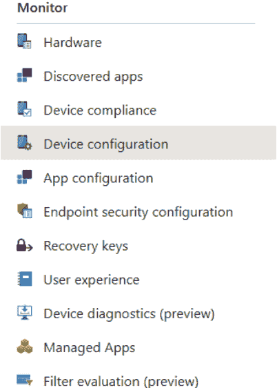

图 9.15 – 设备配置

你可以看到存在冲突的策略以及解决冲突所需的工作：


图 9.16 – 策略冲突

深入查看策略时，你可以看到哪些设置存在冲突。在本例中，我知道这是**终结点安全**边栏选项卡中的策略与防病毒 – Windows Defender 防病毒策略类型之间的冲突：

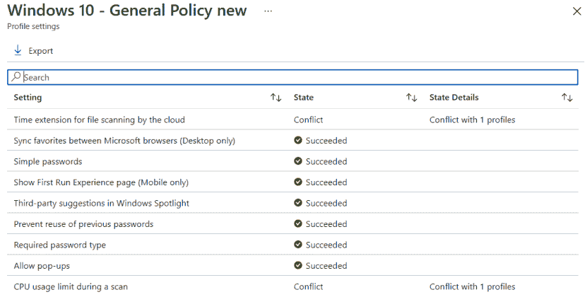

图 9.17 – 配置文件设置

转到该策略，你可以在**每个设置的状态**边栏选项卡中看到第一行**每次扫描的 CPU 使用率限制**存在冲突：

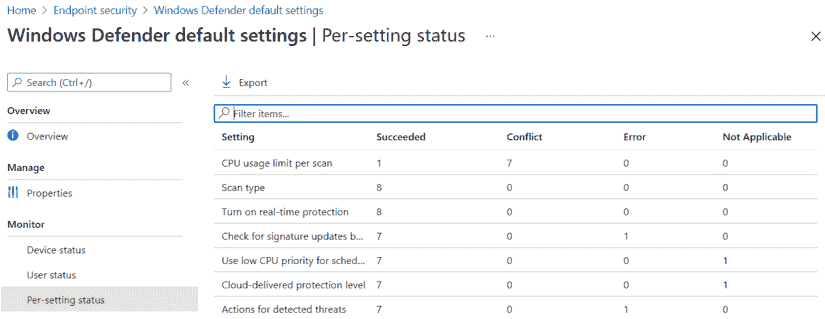

图 9.18 – 每个设置的状态

现在让我们看一下如何实现不同的策略类型。


## Microsoft Endpoint Manager 中的策略管理

策略集允许您创建对已存在的需要作为单个概念单元进行标识、定位和监控的管理实体的引用捆绑包。策略集是可以分配的应用程序、策略和其他您创建的管理对象的集合。创建策略集可让您一次选择多个不同的对象并从一个位置进行分配。随着组织的变更，您可以重新访问策略集以添加或删除其对象和分配。您可以使用策略集将现有的对象（如应用程序、策略和 VPN）关联并分配为单个包。

您可以使用策略集执行以下操作：

- 对需要一起分配的对象进行分组。
- 在所有受管设备上分配组织的最少配置要求。
- 向所有用户分配常用或相关的应用程序。

您可以在策略集中包含以下管理对象：

- 应用配置策略
- 应用保护策略
- 设备配置配置文件
- 设备合规性策略
- 设备类型限制
- Windows Autopilot 部署配置文件
-  enrollment status page

## 从 AD 迁移现有策略 – 组策略管理（预览版）

可以将现有的基于 Active Directory 的组策略迁移到 Microsoft Endpoint Manager – Intune中。这可以使用组策略分析功能完成。

许多正在考虑 Microsoft Endpoint 管理的企业需要一条通往新现代工作场所的良好路径。将现有策略设置翻译到 Endpoint Manager 可能很棘手。此服务将使 IT 管理员的生活变得轻松得多。让我更详细地解释它所做的工作以及您如何自行使用它；它可以在 Devices 刀片上找到：

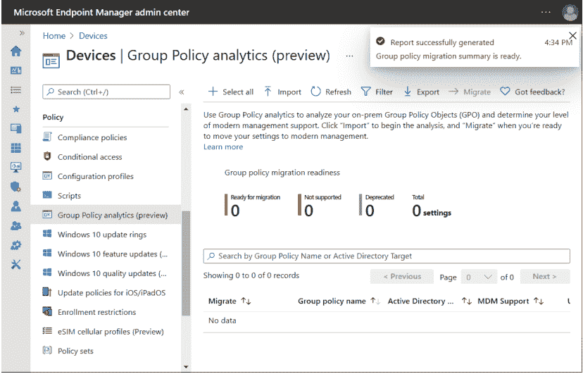

图 9.19 – 组策略分析

首先，确保从本地的组策略管理控制台导出现有的策略设置。

通过右键单击，然后 **Save Report** 导出策略。

将文件保存在集中位置，因为我们需要将其上传到 Endpoint Manager：

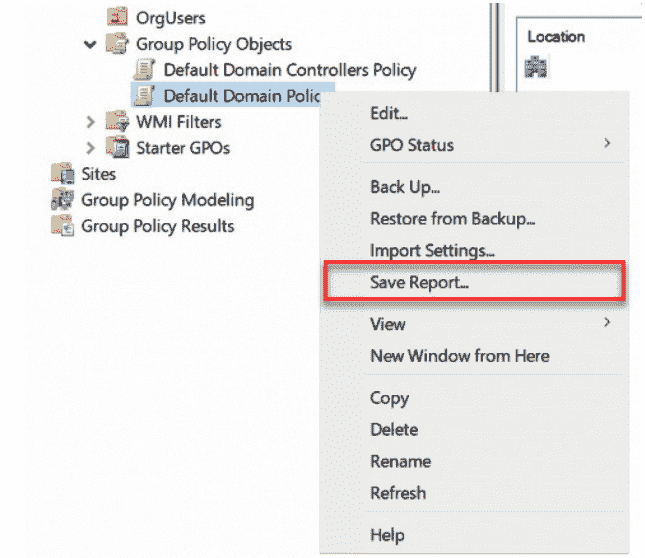

图 9.20 – 保存策略报告

点击 **Import**：

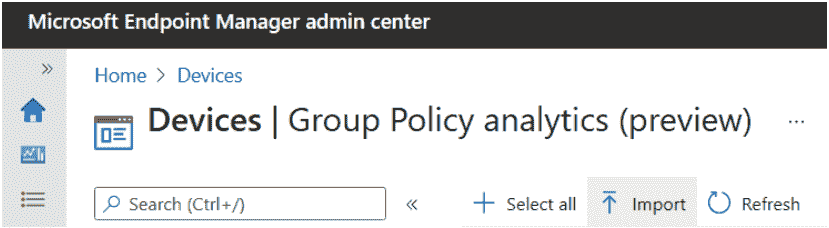

图 9.21 – 导入 – 组策略

搜索您导出的策略报告文件：

### 导入 GPO 文件

导入完成

导入组策略的步骤

- 打开组策略管理 gpmc.msc 工具。
- 右键单击相关的 GPO 备份并导出。
- 导入 "GPReport.xml" 文件：

选择一个或多个 GPO 文件进行导入

"GPORReport.xml"

| File | Status |
|------|--------|
| GPORReport.xml | Import completed |

图 9.22 – 导入 GPO 文件

### 重要说明

当您有多个策略时，您也可以在此处全部上传以进行进一步分析。

在运行策略分析后，您将看到 MDM 支持率（也适用于 Windows），显示您的设置/策略中有多少也可以在 Endpoint Manager 中使用，以便从 GPO 1:1 迁移到 Intune 设置：

按组策略名称或 Active Directory 目标搜索

显示 1 到 1 条记录，共 1 条

| Group policy name | Active Directory Target | MDM Support | Targeted in AD |
|---|---|---|---|
| Default Domain Policy | Default_Domain_Policy | ⚠ 46% | Yes |

图 9.23 – MDM 支持

您将获得继续的信息。您导入的 GPO 现在都列出了以下信息：

- **Group policy name:** 名称是使用 GPO 中的信息自动生成的。
- **Active Directory Target:** 目标是使用 GPO 中 OU 目标信息自动生成的。
- **MDM Support:** 显示 GPO 中组策略设置的百分比在 Intune 中具有相同的设置。
- **Targeted in AD:** 是表示 GPO 已链接到本地组策略中的 OU。否表示 GPO 未链接到本地 OU。
- **Last imported:** 显示最后一次导入的日期。

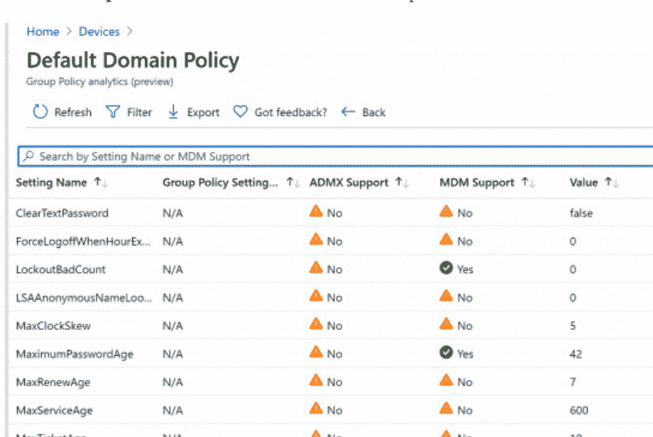

图 9.24 – 默认域策略

这结束了有关组策略分析的部分，该部分可以帮助您将策略从本地 GPO 迁移到 Microsoft Intune MDM 策略。

## 总结

在本章中，您了解了 Microsoft Intune 中的基本策略以及它们如何应用于您的 Windows 端点。这是您可以在从 Microsoft Intune 开始向端点部署策略时更好地了解 Windows 设备上发生的事情的知识。

在下一章中，我们将更深入地介绍如何从 Microsoft Intune 中配置不同类型的策略。

## 问题

- 1. CSP 和 ADMX 策略是否以相同的方式写入本地注册表？
  a) No
  b) Yes
  
- 2. MEM 中批量操作的设备最大数量是多少？
  a) 10
  b) 50
  c) 100
  d) 1000
  
- 3. 什么是策略集？
  a) A group of guided scenario management objects
  b) A set of policies
  c) A template to configure a device
  d) A group of management objects

## 答案

- 1. (b)
- 2. (c)
- 3. (d)

## 进一步阅读

如果您想在阅读本节后了解更多信息，请使用以下免费在线资源之一：

- Manage endpoint security in Microsoft Intune | Microsoft Docs: https://docs.microsoft.com/en-us/mem/intune/protect/endpoint-security
- Device compliance policies in Microsoft Intune – Azure | Microsoft Docs: https://docs.microsoft.com/en-us/mem/intune/protect/device-compliance-get-started
- Use templates for Windows 10 devices in Microsoft Intune – Azure | Microsoft Docs: https://docs.microsoft.com/en-us/mem/intune/configuration/administrative-templates-windows
- Restrict device features using policy in Microsoft Intune – Azure | Microsoft Docs: https://docs.microsoft.com/en-us/mem/intune/configuration/device-restrictions-configure
