## 高级策略管理

这是本书中关于策略管理的第二章。您将了解可用于自定义和保护环境中 Windows 10 Enterprise 桌面的不同策略选项。本章在内容和与 Windows 操作系统自定义、Microsoft 365 应用程序（Office、OneDrive 等）和组策略管理相关的话题方面将非常广泛。

我们将涵盖不同的场景——一些部分场景和一些端到端场景。本章最重要的部分将让您深入了解 Microsoft Intune 中存在的所有不同策略选项，以及何时以及如何以最佳方式利用不同的策略类型来完成企业所需的任务。

在本章中，我们将涵盖以下主题：

- 从 Endpoint Manager 安全刀片配置策略
- 配置您的 Endpoint 安全配置文件
- Windows 10 不健康端点
- 从设置目录配置策略
- 配置管理模板
- OneDrive 已知文件夹移动配置
- OneDrive – 阻止同步特定文件扩展名
- 配置设备配置（模板）
- 将自定义策略作为最后的手段利用
- 推送 PowerShell 脚本 – 向端点推送脚本化操作
- 合规性策略
- 组织合规性报告

## 策略管理

使用 Microsoft Endpoint Manager 的一部分 Microsoft Intune 来管理您的 Windows 10 或 11 Enterprise 桌面，全部都是关于标准化并简化环境的管理层。在 *Chapter 9, Understanding Policy Management* 中，我们介绍了 MDM 策略在客户端的工作原理。我们还学习了如何从头开始或使用组策略分析开始 MDM 策略管理。

在本章中，我们将查看在 Microsoft Intune 中配置设置的各种方法。我们将从安全基线开始，因为它们是保护桌面方面的最佳实践。

### 从 Endpoint Manager 安全刀片配置策略

如果您的组织已准备好，您应该从安全基线开始。假设您的组织已经利用了 Microsoft 安全基线，例如 **Center for Internet Security (CIS)** 基准。使用 GPO，您今天已经知道安全基线对 Windows 生产环境可能产生的影响。Microsoft Intune 中有多个不同的基线：

- **Windows 10 Security Baseline:** 使用 Windows 10 安全基线来帮助您保护用户和设备。此基线由 Windows 安全团队创建的设置建议会影响安全性。如果您今天在 **Group Policy Object (GPO)** 中已经使用某种安全基线，强烈建议您也采用 Intune Windows 10 安全基线。


- **Microsoft Defender for Endpoint 基线：** Microsoft Defender for Endpoint 基线代表了 Defender for Endpoint 的默认推荐配置，可能与其它安全基线的默认基线不匹配。这意味着，如果你将此基线与 Windows 10 安全基线一起使用，可能会在不同的策略设置之间产生冲突。
- **Windows 365 安全基线（预览版）：** Windows 365 安全基线提供了一组基于安全最佳实践和真实世界实施经验的策略模板。你可以使用安全基线获取安全建议，帮助降低风险。Windows 365 基线是针对 Cloud PC 的一个基线，包含 Windows、Microsoft Edge 和 Microsoft Defender for Endpoints 的安全设置。这也意味着，你不应将其他安全基线分配给同一组设备，否则可能导致策略冲突。
- **Microsoft Edge 基线：** Microsoft Edge 基线设置了 Microsoft Edge 浏览器的推荐配置。Microsoft Edge 安全基线占用非常小，仅设置与安全相关的设置，因此在你的组织中易于测试。如果允许用户在公司拥有的 Windows 10 设备上使用不同的浏览器，你还应为这些第三方浏览器创建安全基线；否则，存在终端用户始终使用安全性最低浏览器的风险。

请注意，当基线更改其版本时，旧版本将变为只读。你可以继续使用这些配置文件，但无法编辑它们。你应每次新版本发布时更改基线版本，以利用最新的建议。

Microsoft Edge 基线默认值代表了 Microsoft Edge 浏览器的推荐配置，因此可能与其它安全基线的基线默认值不匹配。

在本示例中，我们将创建一个 Microsoft Edge 基线策略：

Home > Endpoint security > Microsoft Edge baseline >

## Create profile

1 Basics   2 Configuration settings   3 Scope tags   4 Assignments   5 Review + create

Name *   Microsoft Edge September 2020 (Edge version 85 and later)
Description
Platform   Windows 10 and later
Baseline Version   September 2020 (Edge version 85 and later)

Figure 10.1 – Microsoft Edge baseline – Create profile screen

如果你测试后得出结论，基线中的设置不会破坏你环境中的应用程序或生产力，你可以更改安全基线中的设置。如果你对设置满意，可以保留所有推荐值不变：

Basics   2 Configuration settings   3 Scope tags   4 Assignments   5 Review + create

Settings
Search for a setting
Microsoft Edge
Supported authentication schemes   Enabled
Supported authentication schemes   2 items
Default Adobe Flash setting   Enabled
Default Adobe Flash setting   Block the Adobe Flash plugin
Control which extensions cannot be installed   Enabled
Extension IDs the user should be prevented from installing (or * for all)   1 item

Figure 10.2 – Microsoft Edge baseline – Configuration settings

本节关于 Microsoft 安全基线的介绍到此结束。接下来，我们将介绍 Endpoint security policies。

## Configuring your Endpoint security profile

Microsoft Intune 的 **Endpoint security** 节点旨在允许 IT 或安全管理员配置设备安全。通过使用这些以安全为重点的策略，你将仅在此刀片视图中看到与安全相关的策略，而不会看到其他类型设置的常规策略。Endpoint Security 刀片中的策略可以应用于 Windows 或 macOS。这些策略可以是 Windows 10 MDM（Microsoft Intune）或 Windows 10 和 Windows Server（ConfigMgr）。最后一种适用于未加入 Microsoft Intune 的租户附加设备。

## Microsoft Defender policy

防病毒策略包含与设备配置策略的端点保护或设备限制配置文件相同的设置。

然而，这些策略类型包含与防病毒策略无关的额外设置类别。虽然 **Endpoint security** 刀片中的 Windows Defender 策略类型仅包含 Windows Defender 设置，但你可以在此处看到三种不同的策略类型：

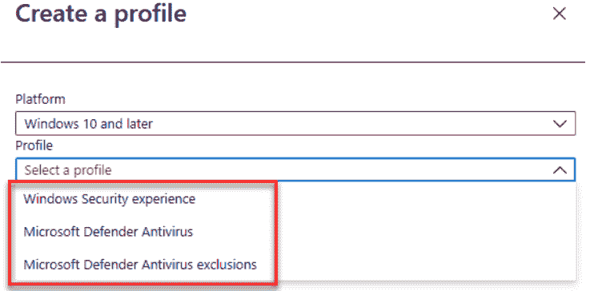

Figure 10.3 – Windows Defender policy types

## Profile: **Windows Security experience**

Windows Security 应用由多个 Windows 安全功能使用，以提供有关机器健康和安全状态的通知。安全应用通知包括防火墙、防病毒产品和 Windows Defender SmartScreen。

Windows Security experience 配置文件可用于关闭 Windows Security 应用中的某些区域，例如家庭选项，如果你不想在 Intune 管理的设备上显示家庭选项：

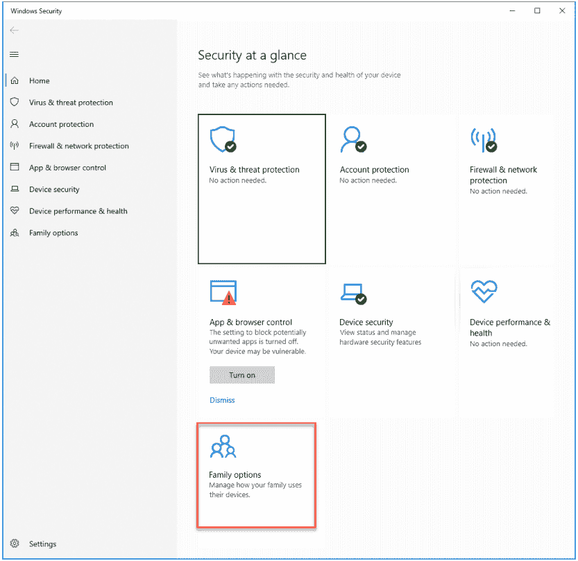

Figure 10.4 – Windows Security app

一个很好的例子是 **Application control** 策略类型。

**Application control** 策略可以帮助缓解安全威胁。它通过限制用户允许运行的应用程序以及在系统核心（内核）中运行的代码来实现这一点。Application control 策略还可以阻止未签名的脚本和 Windows Installer（MSI），并将 Windows PowerShell 限制为在受限语言模式下运行。

通过几个设置，你可以轻松加固你的 Windows 操作系统：

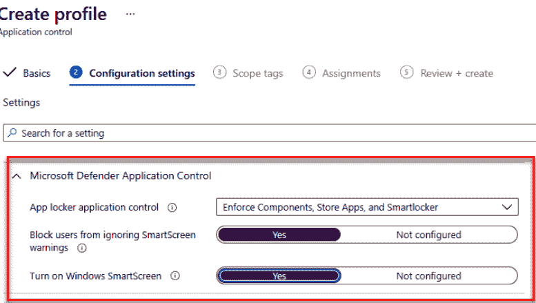

Figure 10.8 – Microsoft Defender Application control policy

现在，让我们启用 Windows SmartScreen（不仅限于 Microsoft Edge，正如本章后面将展示的）。

将 **App locker application control** 设置为 **Enforce Components, Store Apps, and Smartlocker** – 这将启用 **Windows Defender Application Control (WDAC)**，以便仅以下内容可以在 Windows 操作系统上执行：

- Windows components
- Third-party hardware and software kernel drivers
- Microsoft Store-signed apps
- [Optional] Reputable apps, as defined by the **Intelligent Security Graph (ISG)**

WDAC 策略适用于整个受管理的计算机，并影响设备的全部用户。

设置目录中的设置直接从 Windows CSP 生成，并且目录中的设置体验是根据设置的类型及其元数据（如工具提示）动态生成的。设置目录不断添加新的 Windows 设置，并减少了从 Microsoft Intune 部署自定义策略（基于 OMA-URI）的需求。设置目录中的新功能之一是，如果某个设置不在你的策略中，则该设置将被视为未配置。稍后编辑策略并从现有的设置目录策略中删除一个设置，不仅会将该设置从策略中删除，而且在下一次设备检查入时，还会从已分配的设备上删除先前的强制执行。

设置目录中有数千个设置可供选择，其中包括 Microsoft Intune 中任何其他策略类型中都没有且之前在控制台中不可用的设置。你还可以在设置目录中配置 Administrative Templates。随着 Windows 向 MDM 提供商添加或公开更多设置，这些设置会迅速添加到 Microsoft Intune 设置目录中以供配置。

要使用设置目录创建配置文件，请打开 Microsoft Endpoint Manager 管理中心：

1. Go to Home > Devices > Windows > Configuration profiles and apply the following:
   - Platform: Select Windows 10 and later
   - Profile type: Select Settings catalog (preview):

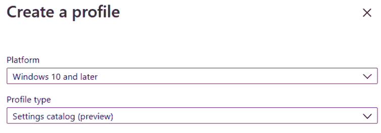

Figure 10.11 – Create a profile

2. 作为配置文件创建的一部分，你需要填写向导：
   - Name: Enter a descriptive name for the profile, such as Settings Catalog Policy.


+   - **描述：** 为配置文件输入描述。此设置是可选的，但强烈建议输入描述，以便您稍后可以返回并查看此策略的意图：

Home > Devices > Windows >

# 创建设备配置配置文件

Windows 10 及更高版本 - 设置目录（预览）

1 Basics 2 Configuration settings 3 Assignments 4 Scope tags 5 Review + create

Name *

Settings Catalog Policy

Description

Platform

Windows 10 and later

Figure 10.12 – Create device configuration profile

3. 在 Configuration settings 中，选择 Add settings。在设置选择器中，选择 User Rights 类别或另一个类别以查看所有可用设置：

Home > Devices > Windows >

# 创建设备配置配置文件

Windows 10 及更高版本 - 设置目录（预览）

Basics 2 Configuration settings 3 Assignments 4 Scope tags 5 Review + create

# 设置目录

使用设置目录，您可以选择要配置的设置。单击 Add settings 以浏览或搜索目录以查找要配置的设置。

Learn more

+ Add settings

Figure 10.13 – Create device configuration profile

4. UI 将自动展开显示您刚刚选择的设置 - 在本例中为 **User Rights** 策略。在设置目录发布之前，这是 IT 管理员被迫利用 Microsoft Intune 中的自定义策略的策略，这需要大量的专业知识：

> **专业提示**
> 
> 工具提示始终为您提供有关策略执行的操作所需的信息。这是来自 **Windows Configuration Service Providers (CSPs)** 的元数据的一部分。工具提示还包括指向 Microsoft Windows 文档页面中底层 CSP 的 **Learn more** 链接。

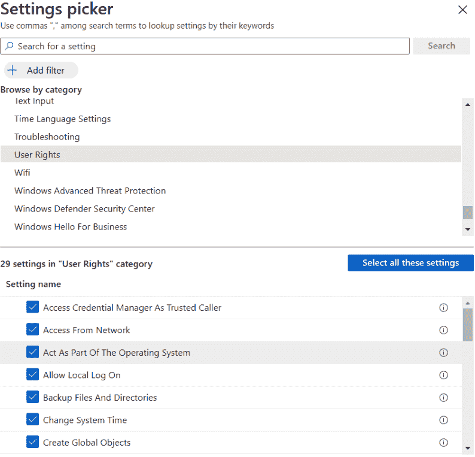

Figure 10.14 – Settings picker

> **专业提示**
> 如果您没有配置所有设置，可以通过单击 *not configured* 图标来删除单个设置，并且该设置将在保存设置目录时被删除。这意味着部署时它不会影响用户或设备。

5. 配置单个设置时，您可以通过单击 Add 以多值方式展开它：

Figure 10.15 – Create device configuration profile

6. 在本例中，我们允许用户和管理员拥有本地登录的权限：

Figure 10.16 – Allow Local Log On

7. 您不需要在设置目录中使用任何分隔符，就像过去在 Microsoft Intune 中创建相同策略作为自定义策略时一样。

在本例中，我们还将拒绝具有 Azure AD 全局管理员角色或设备管理员的用户登录设备。因此，我将在我的 Azure AD 加入的设备上本地管理员组中检查安全标识符（SID）：

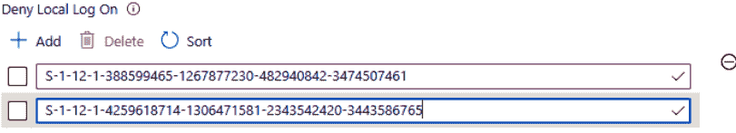

Figure 10.17 – Deny Local Log On

8. 从 Windows 10 版本 2004 开始，您可以利用 Azure AD 组的 SID：

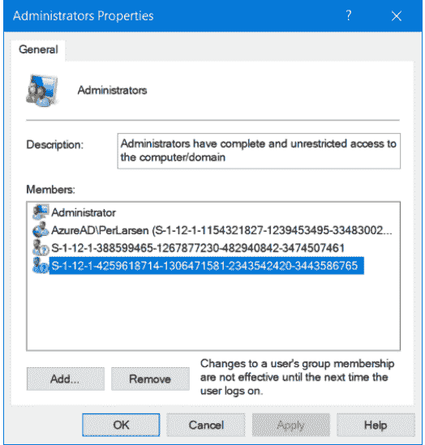

Figure 10.18 – Administrators Properties

9. SID 可以在加入您组织 Azure Active Directory 的 Windows 10 设备上的本地管理员组中找到。

10. 找到您要配置的策略类别并选择所有这些设置或选择一个或多个单独的设置。在本例中，我们将选择 Microsoft Edge Update：

Basics 2 Configuration settings 3 Assignments 4 Scope tags 5 Review + create

+ Add settings

Microsoft Edge Update

Remove category

# Applications > Microsoft Edge

Remove subcategory

1 of 5 settings in this subcategory are not configured

Allow installation Enabled

Prevent Desktop Shortcut creation upon install Enabled

"Rollback to Target version" has been set to not configured

Target version override Enabled

Target version (Device) * 90.0.818.66

Update policy override Enabled

Policy (Device) Always allow updates (recommended)

# Applications > Microsoft Edge > Microsoft Edge Beta

Remove subcategory

4 of 5 settings in this subcategory are not configured

Allow installation Disabled

"Prevent Desktop Shortcut creation upon install" has been set to not configured

Figure 10.20 – Settings in this subcategory are not configured

11. 配置您想要设置的设置并删除您不希望在设备上配置的设置。

在本例中，我们已配置 Applications | Microsoft Edge 中的所有设置，除了一个名为 Rollback to Target version 的设置，我们已将其删除。这意味着该设置已被设置为未配置。这与其他一些 Microsoft Intune 配置文件类型的行为不同，其中设置要么启用要么禁用。

12. 在 Applications | Microsoft Edge | Microsoft Edge Beta 中，我们配置了一个设置并删除了其余设置：

# 编辑配置文件 - Policy baseline

Settings catalog (preview)

1 Configuration settings 2 Review + save

+ Add settings

Microsoft Edge Update

Remove category

Applications > Microsoft Edge

Remove subcategory

1 of 5 settings in this subcategory are not configured

Allow installation Enabled

Prevent Desktop Shortcut creation upon install Enabled

Target version override Enabled

Target version (Device) * 90.0.818.66

Update policy override Enabled

Policy (Device) Always allow updates (recommended)

Applications > Microsoft Edge > Microsoft Edge Beta

Remove subcategory

4 of 5 settings in this subcategory are not configured

Allow installation Disabled

Figure 10.21 – Settings in this subcategory are not configured

13. 当我们在稍后某个时间点编辑设置目录策略时，我们将只看到最初配置的设置。

现在，我们可以添加一个新的子类别并继续在 Microsoft Intune 中构建现有策略。在本例中，我们将添加 Microsoft Edge Canary 子类别：

# 创建配置文件

Administrative templates

Home > Devices > Windows >

Basics  Configuration settings  Scope tags  Assignments  Review + create

All Settings
Computer Configuration
Microsoft Edge
SmartScreen settings
User Configuration

# SmartScreen settings

Computer Configuration\Microsoft Edge\SmartScreen settings

Search to filter items..

| Setting Name | State | Setting type | Path |
| Configure Microsoft Defender SmartScr... | Not configured | Device | \Microsoft Edge\SmartScreen settings |
| Configure Microsoft Defender SmartScr... | Not configured | Device | \Microsoft Edge\SmartScreen settings |
| Configure the list of domains for which ... | Not configured | Device | \Microsoft Edge\SmartScreen settings |
| Force Microsoft Defender SmartScreen ... | Not configured | Device | \Microsoft Edge\SmartScreen settings |
| Prevent bypassing Microsoft Defender S... | Not configured | Device | \Microsoft Edge\SmartScreen settings |
| Prevent bypassing of Microsoft Defende... | Not configured | Device | \Microsoft Edge\SmartScreen settings |

Figure 10.26 – SmartScreen settings

6. 对于每个设置，都有一个描述策略执行操作的说明。

7. 大多数策略都有 Enabled、Disabled 和 Not configured 选项 - 在本例中，我们将启用 SmartScreen：

# 配置 Microsoft Defender SmartScreen

\Microsoft Edge\SmartScreen settings

此策略设置让您可以配置是否打开 Microsoft Defender SmartScreen。Microsoft Defender SmartScreen 提供警告消息以帮助保护用户免受潜在的网络钓鱼诈骗和恶意软件的侵害。默认情况下，Microsoft Defender SmartScreen 已打开。

如果您启用此设置，Microsoft Defender SmartScreen 将打开。

如果您禁用此设置，Microsoft Defender SmartScreen 将关闭。

如果您未配置此设置，用户可以选择是否使用 Microsoft Defender SmartScreen。

此策略仅在加入 Microsoft Active Directory 域的 Windows 实例上可用；或在为设备管理注册的 Windows 10 专业版或企业版实例上可用。

Setting type: Device

Supported on: Microsoft Windows 7 or later

Enabled  Disabled  Not configured

OK

Figure 10.27 – Configure Microsoft Defender SmartScreen


8. 我们将在此策略中配置所有需要的设置，并将不需要配置的设置保留为**未配置**：

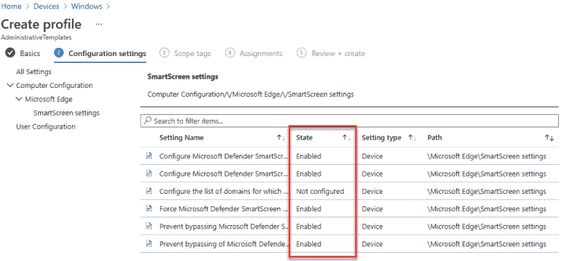

*图10.28 – SmartScreen设置 – 已配置*

**计算机配置**可以分配给Microsoft Intune中的用户组或设备组。考虑为设备策略使用设备组。

将策略部署到设备后，你可以通过Microsoft Defender测试场（https://demo.wd.microsoft.com/）测试Microsoft SmartScreen功能。

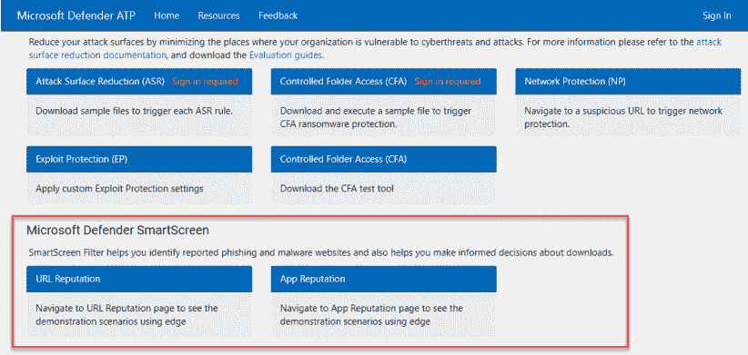

*图10.29 – Microsoft Defender SmartScreen测试场*

借助Microsoft Defender测试场，你可以测试已部署的策略，还可以测试最终用户体验，以及他们是否被阻止执行某些操作或被阻止的方式。让我们仔细看看可用的测试设置。

## URL信誉

通过此测试站点，你可以测试Microsoft Defender SmartScreen并查看最终用户体验：

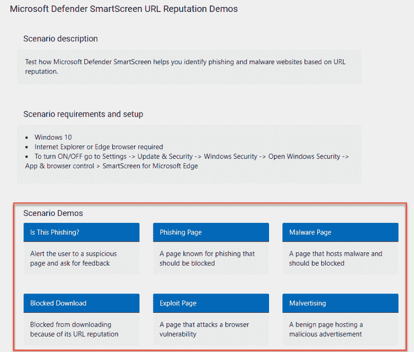

图10.30 – 场景演示

要为最终用户静默配置OneDrive KFM，你需要配置以下一些设置：

- **使用Windows凭据将用户静默登录到OneDrive同步应用：**选择**已启用：**
- **将Windows已知文件夹静默移动到OneDrive：**选择**已启用。**
- **租户ID：**使用你的Microsoft 365租户中的租户ID。

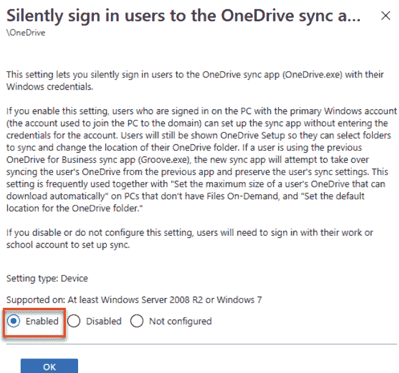

图10.34 – 将用户静默登录到OneDrive

此设置允许你输入关键字，以防止OneDrive将某些文件上传到OneDrive。你可以输入完整名称，例如setup.exe，或使用星号（*）作为通配符来表示一系列字符：

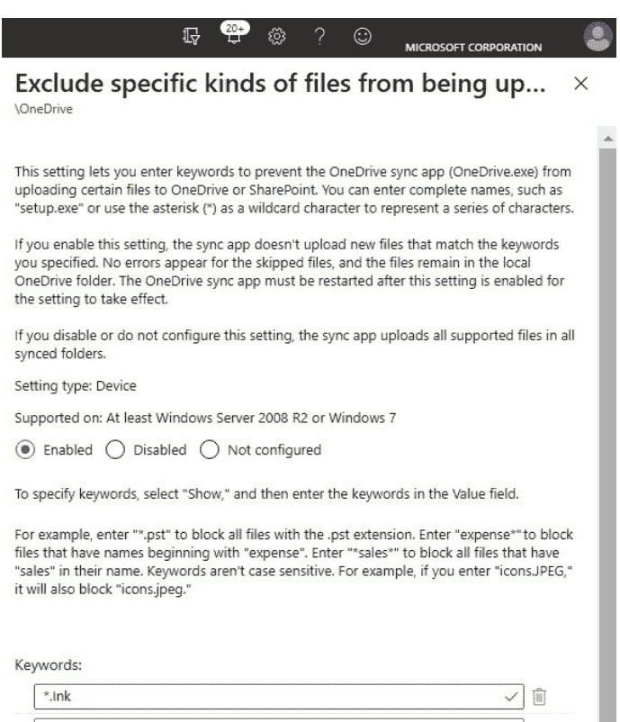

图10.37 – 排除特定类型的文件被上传

你可以将OneDrive KFM策略分配给设备组。

本节内容到此结束，我们介绍了管理模板。接下来，我们将介绍Microsoft Intune中使用模板进行设备配置的众多不同选项中的一部分。

## 配置设备配置（模板）

模板包含按功能组织的设置组。当你不想手动构建策略，或希望配置设备以访问公司网络（例如配置Wi-Fi或VPN）时，应使用模板。

在本节中，我们将展示一些示例以及用例。

第一个是传递优化。建议在所有Windows设备上配置它，尤其是在运行Windows Update for Business时：

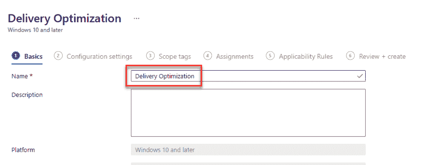

图10.38 – 模板 – 传递优化

查看i图标中的信息，它将为你提供每个设置的推荐值：

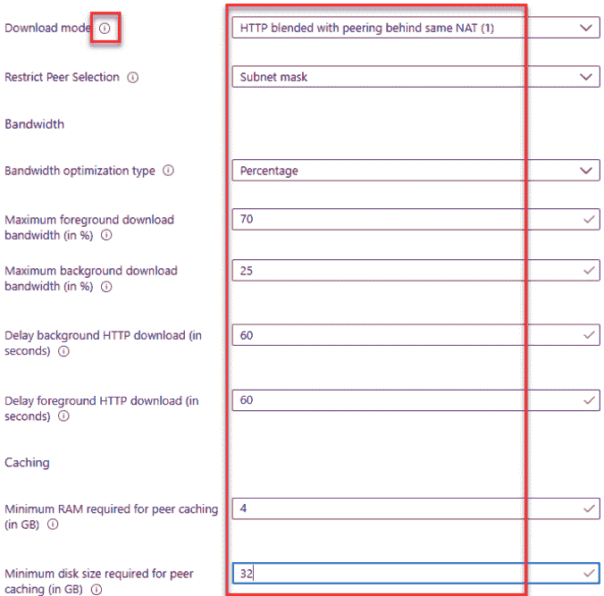

图10.39 – 传递优化 – 推荐值

然后，配置所有设置，测试它们，并评估所有推荐设置是否在你的组织中按预期工作。

另一个很好的设备配置模板示例是**共享多用户设备**，它用于为组织中多个用户使用的共享Windows 10设备配置访问、账户删除、维护和电源管理设置：

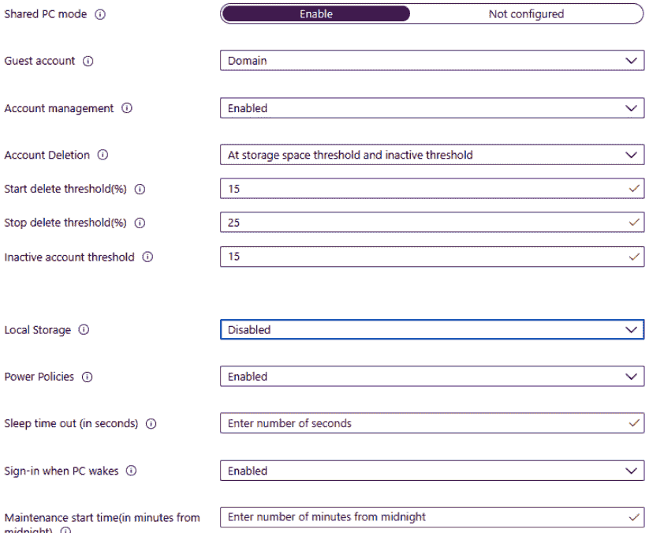

图10.40 – 共享多用户设备

最终用户可以使用AAD账户登录这些共享设备。登录后，他们的凭据会被缓存。在使用设备时，最终用户只能访问你允许的功能。例如，你可以选择设备何时进入睡眠模式，以及用户是否可以在本地查看和保存文件，启用或禁用电源管理设置等。你还可以通过设置特定阈值来控制AAD账户是否会被删除；当达到阈值时，用户账户将被删除。此功能使用已针对共享使用进行优化的同一本地用户配置文件，因此首次使用该设备的用户登录时间只需几秒钟。

## 推送PowerShell脚本 – 对端点执行脚本操作

如果没有策略来满足你在公司设备上需要进行的配置更改，你可以利用Microsoft Intune中的PowerShell脚本。这也是将一次性安装或自定义脚本操作发布到物理和云端点的一个好方法：

1. 在Microsoft Endpoint Manager管理中心，浏览到“主页 | 设备 | Windows | PowerShell脚本”，然后单击“添加”：

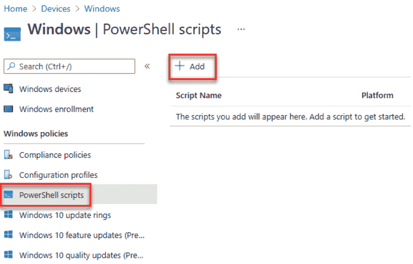

图10.43 – PowerShell脚本

2. 单击**选择文件**，将PowerShell脚本上传到Microsoft Intune：

> **重要说明**
> 确保选择**在64位PowerShell主机上运行脚本**，以获得正确的注册表位置。

主页 > 设备 > Windows >

# 添加PowerShell脚本...

基本信息
2 脚本设置
3 分配
4 查看并添加

脚本位置 *

选择文件

使用登录凭据运行此脚本

强制脚本签名检查

在64位PowerShell主机中运行脚本

图10.44 – 上传PowerShell脚本

将脚本分配给用户组或设备组。然后，脚本将在每个已分配的设备上运行一次。以下是一些脚本示例：

- **启用保留存储：**

```
$Storage = Invoke-Command {DISM /Online /
Get-ReservedStorageState}
$Output = $Storage | Select-String "Reserved storage is disabled."
Write-Host $Output
If ($Output -like "Reserved storage is disabled.") {
    Invoke-Command {DISM /Online /
Set-ReservedStorageState /State:Enabled}
}
```

- 为OneDrive启用ADAL：

```
$registryPath = "HKCU:\SOFTWARE\Microsoft\OneDrive"
$Name = "EnableADAL"
$value = "1"
IF(!(Test-Path $registryPath))
{
    New-Item -Path $registryPath -Force | Out-Null
    New-ItemProperty -Path $registryPath -Name $name -Value $value `
    -PropertyType DWORD -Force | Out-Null}
ELSE {
    New-ItemProperty -Path $registryPath -Name $name -Value $value `
    -PropertyType DWORD -Force | Out-Null}
```

这些只是利用PowerShell脚本配置Intune管理的Windows设备的一些示例。接下来，我们将介绍合规策略。

## 合规策略

Microsoft Endpoint Manager可以在设备上设置合规状态。设备有两种可能的结果：合规或不合规。

在Microsoft Intune中，你可以定义用户和设备必须满足的规则和设置才能合规。如果已配置条件访问，则不合规的用户和设备可能会被阻止访问包含公司数据的资源。

> **重要说明**
> 条件访问需要Azure AD Premium许可证。

包括适用于不合规设备的操作。针对不合规的操作可以提醒用户不合规的情况，并保护不合规设备上的数据。

Microsoft Intune中有两种类型的合规策略：

- **合规策略设置**：租户级设置，类似于每台设备都会接收的内置合规策略。合规策略设置为合规策略在Microsoft Intune环境中的工作方式设定基线。

这些设置配置合规服务处理设备的方式。每台设备都会将其评估为*内置设备合规策略*，这一点体现在设备监控中。

以下是你可以在内置策略中配置的选项：

- 将未分配合规策略的设备标记为**默认值为“合规”**。这意味着此安全功能默认处于禁用状态。建议你将此设置更改为**“不合规”**，以便所有没有合规策略的设备自动标记为不合规。

- 增强型越狱检测：**默认值“已禁用”**（仅适用于iOS/iPadOS）。

- 合规状态有效期（天）：默认值为30天。
指定一个时间段，设备必须在此时间段内成功报告其收到的所有合规策略。如果设备在有效期到期前未能报告其策略的合规状态，则该设备被视为不合规。你可以将时间段配置为1到120天。

要管理合规策略设置，请登录Microsoft Endpoint Manager管理中心，然后转到**终结点安全 | 设备合规 | 合规策略设置**。

- **设备合规策略**：你配置并部署到用户组或设备组的平台特定规则。这些规则定义了设备的要求，例如最低操作系统版本或使用磁盘加密。设备必须满足这些规则才能被视为合规。

## Windows

**设备运行状况证明（DHA）**服务验证设备的**受信任的平台模块（TPM）**和**平台配置寄存器（PCR）**日志，然后发布DHA报告。Microsoft提供DHA云服务，这是一项由Microsoft托管的DHA服务，免费、跨地域负载均衡，并针对全球不同区域的访问进行了优化。


DHA 使企业能够将组织的安全水平提升至硬件监控和可验证的安全水平，同时对运营成本的影响最小或为零。

DHA 服务与 MDM 解决方案集成，并执行以下操作：

- 将 DHA 服务通过现有 MDM 设备管理通信渠道从设备接收到的信息与 DHA 报告结合。
- 基于可验证的硬件和受保护的数据做出更安全、更可信的安全决策。
- 在合规策略中利用 DHA 时，Windows 10 必须在 Microsoft Intune 中进入合规状态之前重新启动。

在 Windows 合规策略的设备健康部分，有三个设置：

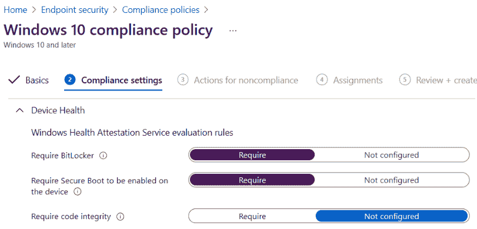

图 10.45 – 合规策略 – 设备健康

按如下方式更新这些设置：

- 要求 BitLocker：要求 – 设备可以在系统关闭或休眠时保护存储在驱动器上的数据免受未经授权的访问。
- 要求设备启用安全启动：要求 – 系统被强制启动到工厂受信任状态。用于启动计算机的核心组件必须具有组织制造设备所信任的正确加密签名。这些签名在 UEFI 固件允许机器启动之前进行验证。如果任何文件被篡改，从而破坏其签名，系统将无法启动。

作为 IT 管理员，您可以监控合规状态的不同部分：

- **合规运营报告**：提供实时运营报告，可帮助 IT 管理员根据在此报告中找到的数据采取行动。

转到 **Home | Devices | Monitor | Windows health attestation report**。在这里，您可以选择查看有多少设备未启用 BitLocker 和安全启动，例如：

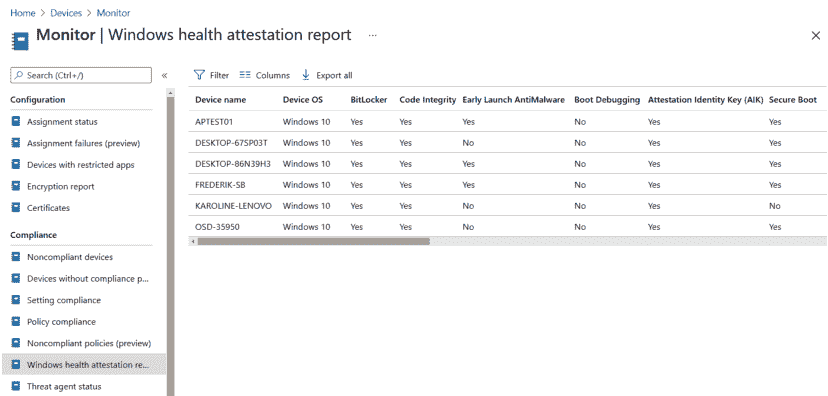

图 10.49 – Windows 健康证明报告

- **不合规设备报告**：转到 **Home | Devices | Monitor | Noncompliant devices.**

在此报告中，您可以选择查看所有不合规设备。如果应用 **OS == Windows** 过滤器，您将只看到不合规的 Windows 设备：

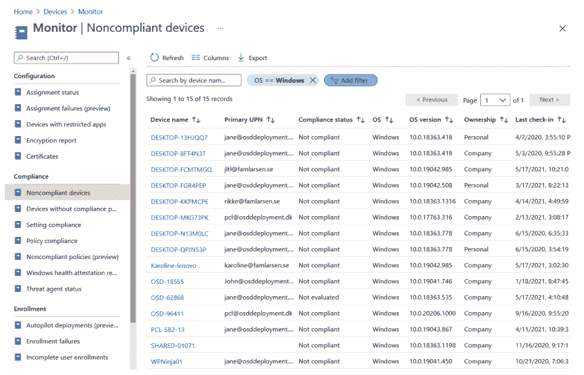

图 10.50 – 监控 – 不合规设备

- **不合规策略（预览）**：转到 Home | Devices | Monitor | Noncompliant policies (preview)。

在此报告中，您可以快速了解 Microsoft Intune 中的合规策略概览以及有多少设备不符合特定合规策略：

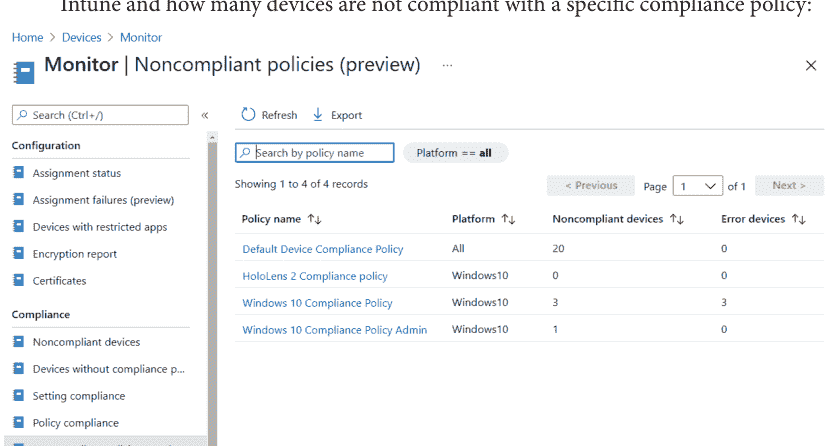

图 10.51 – 监控 – 不合规策略（预览）

本节关于合规策略以及如何对合规策略进行运营监控到此结束。接下来，我们将介绍合规的组织报告。

点击 Reports，您将获得设备合规性和设备合规性趋势选项：

图 10.53 – 报告 – 设备合规性

使用设备合规性，通过利用过滤器，您可以选择 Windows 设备并仅获取这些设备的报告。您还可以根据合规状态和/或所有权进行过滤：

图 10.54 – 报告 – 设备合规性

## 设备合规性趋势

此报告将为您提供过去 60 天合规状态的历史视图。

在此视图中，我们再次对设置 Windows 作为操作系统进行了过滤：

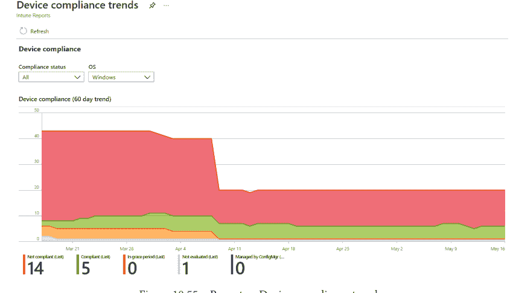

图 10.55 – 报告 – 设备合规性趋势

本节关于设备合规性组织报告到此结束。

## 总结

在本章中，您了解了不同类型的策略，并查看了通过 Microsoft Endpoint Manager 为物理和云端点以更现代的方式配置 Windows 的场景。我们查看了一些您可以利用的场景和策略配置。在策略管理领域，您需要在企业环境中确定想要采取何种方法。当查看纯云管理的设备和策略时，将是向前看而非向后看的完美时机。例如，首先部署具有安全影响的策略，例如 Edge 安全基线、Windows Defender 策略等。然后，查看部署将帮助最终用户提高生产力的策略，例如配置 OneDrive 已知文件夹移动、帮助最终用户更好地在应用程序中开始工作的策略，例如自动配置 Microsoft Edge、从应用程序中删除提示等。当您完成这两个大领域后，您可能就完成了，或者至少处于良好的起点。在与最终用户测试他们的体验以及他们提供的任何反馈后，您可以返回并更改策略以适应业务需求。当您与业务中的应用程序所有者交谈时，或您的安全部门对设备上的某些策略或设置有特定要求时也是如此。这是一个持续的过程，用于评估您是否在环境中使用正确的策略，就像您在策略配置使用 GPO 时可能有类似的过程一样。

在本章之后，您将能够管理您的物理和云端点，并知道在未来何时遵循哪种配置路径。下一章是策略管理的第三部分。最后一部分介绍了一个云服务，如果您拥有 Office 365，您可以利用它来配置 Microsoft 365 应用程序，无论是否使用 Microsoft Intune。

## 问题

- 1. 什么是 Storage Sense？
  a) 用于优化 SSD 性能的服务。
  b) 具有幽默感的服务。
  c) 用于清理端点上 OneDrive 缓存和配置文件中下载文件夹的服务。
  d) 用于阻止服务运行的服务。

2. 配置 Windows 端点设置的推荐选项是什么？

- a) 设置目录
- b) 管理模板
- c) 安全基线
- d) 设备限制配置文件

3. 可以使用哪种策略类型来配置 Microsoft Edge？

- a) 共享多用户设备
- b) 管理模板
- c) Kiosk 配置文件
- d) 设备限制配置文件

## 答案

- 1. (c)
- 2. (a)
- 3. (b)

## 进一步阅读

如果您想在阅读本章后了解更多信息，请查看以下免费在线资源：

- Device compliance policies in Microsoft Intune – Azure | Microsoft Docs:
  https://docs.microsoft.com/en-us/mem/intune/protect/device-compliance-get-started
- Use templates for Windows 10 devices in Microsoft Intune – Azure | Microsoft Docs: https://docs.microsoft.com/en-us/mem/intune/configuration/administrative-templates-windows
- Restrict device features using policies in Microsoft Intune – Azure | Microsoft Docs: https://docs.microsoft.com/en-us/mem/intune/configuration/device-restrictions-configure

## 11

## Office 策略管理

在本章中，您将了解 Office 云策略，以及如何使用此云服务来配置最终用户在其 Windows 设备上安装的 Microsoft 365 应用程序，无论是在家中的 Windows 设备还是由 Microsoft Intune 等管理工具管理的公司发放的 Windows 设备。这不是 GPO、Microsoft Intune 中的管理模板或设置目录策略的替代品，但在某些场景中，您可以利用 Office 云策略服务。

我们还将展示 Office 云策略服务具有安全策略顾问，它可以帮助您和您的企业了解是否已实施正确的策略建议。这些建议基于 Microsoft 最佳实践以及有关您现有环境的信息。

安全策略顾问只能与 Office 云策略服务结合使用。

在本章中，我们将涵盖以下主题：

- Office 云策略服务
- 使用 OCP 服务创建策略配置
- 安全策略顾问


## Office 云策略服务

Microsoft 365 Apps 管理中心（https://config.office.com）提供对 Microsoft 365 企业版应用的基于云的策略管理。从 **Office 云策略 (OCP)** 服务部署的策略将适用于受管设备和未受管设备，因此基本上适用于贵组织 Office 365 用户登录的所有设备，包括公司设备和个人设备。

当用户在设备上登录 Microsoft 365 Apps for enterprise 时，策略设置会漫游到该设备。您还可以强制实施适用于 Office 网页版、iOS、macOS 和 Android 的某些策略设置。

Office 云策略服务包含许多与 Group Policy 或 Microsoft Intune 中可用的基于用户的策略设置相同的设置。OCP 服务与来自 **组策略对象 (GPO)** 或 Microsoft Intune 的策略设置的冲突处理方式为 Microsoft Intune 或 GPO 始终获胜。用户可以是具有冲突策略设置多个 Azure Active Directory 组 的成员。通过在 OCP 上为 Office 策略设置优先级，您可以控制应用哪个策略设置。优先级最高者将被应用，其中 0 是可在 OCP 服务中分配给策略的最高优先级。

使用 Office 云策略服务的条件如下：

- 至少为 Microsoft 365 Apps for enterprise（以及 Project 和 Visio 桌面应用的订阅版本）的 1808 版本。
- 用户帐户必须在 **Azure Active Directory (AAD)** 中创建或同步。用户必须使用基于 AAD 的帐户登录 Office 365 ProPlus。
- 安全组必须在 **AAD** 中创建或同步，并将适当的用户添加到这些组中。

基于云的策略管理的优点如下：

- 它适用于所有设备 – 受管和未受管设备，均适用于 Microsoft Intune 和 SCCM。
- 它适用于 BYOD 和个人设备。
- 设置始终是最新的，并且由于它是来自 Microsoft Office 团队的服务，因此无需下载更新的 Administrative Template 文件（ADMX/ADML）。

## 使用 OCP 服务创建策略配置

以下是从 MEM 管理中心创建策略配置的基本步骤。

要创建策略配置，您必须在 AAD 中被分配以下角色之一：全局管理员、安全管理员或 Office 应用管理员。Intune 服务管理员无权创建 OCP 策略。

- 1. 转到 **Home | Apps | Policies for Office apps.**

如果这是您第一次查看 Office 云策略服务，您将没有任何策略配置。

点击 **Create** 创建您的第一个策略配置。

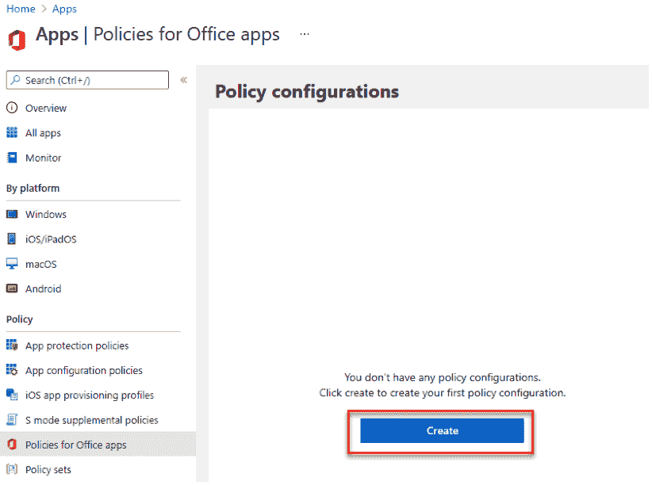

图 11.2 – Policies for Office apps

2. 在 Name 字段中输入 Office policy，然后点击 Select type 以展开到以下屏幕截图中显示的视图。选择 This policy configuration applies to users。

选择此选项时，您可以从 AAD 中选择目标用户组。如果您选择 This policy configuration applies to users that access documents anonymously using Office web apps，它将应用于 Office Online，如果文档是匿名访问的。IT 管理员始终可以设置外部共享，以便访客用户必须登录或提供验证码：

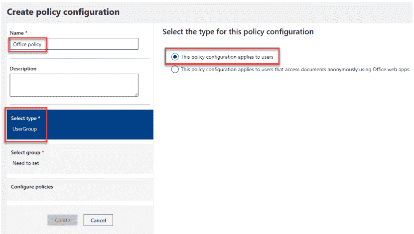

图 11.3 – Create policy configuration – Select type

3. 对于 Select group 选项，选择 Office 365 Users（自定义组）。

然后点击 Select group 以展开到以下屏幕截图中显示的视图。您可以选择 AAD 安全组，但一个安全组只能分配一个 OCP 服务策略：

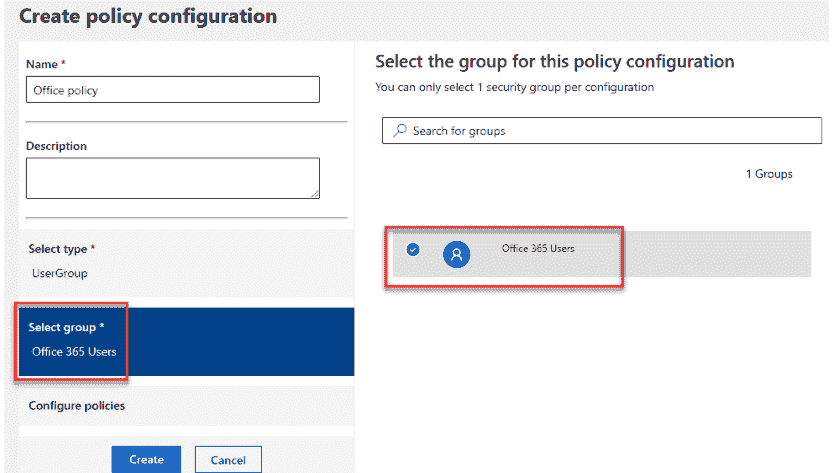

图 11.4 – Create policy configuration – Select group

- 4. 如果已将 OCP 分配给 AAD 组，它将在 UI 中变灰，因为您只能在 Azure AD 中为每个组分配一个 Office 云策略：

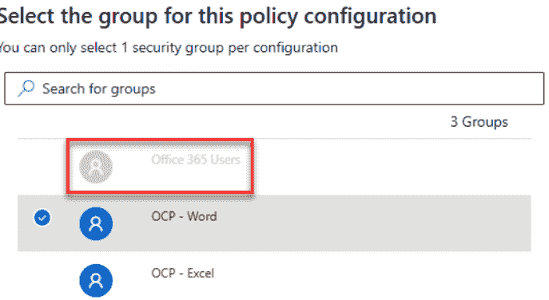

图 11.5 – Select the group for this policy configuration

## 配置策略

截至目前，Office 云策略服务中共有 2,133 个不同的策略设置。

配置要包含在策略配置中的策略设置。您可以搜索策略设置名称以查找要配置的策略设置。您还可以按应用程序筛选，按策略是否为推荐的安全基线，以及策略是否已配置进行筛选。Platform 列指示策略是应用于 Windows 设备的 Microsoft 365 Apps for enterprise、Office for the web，还是两者都适用。

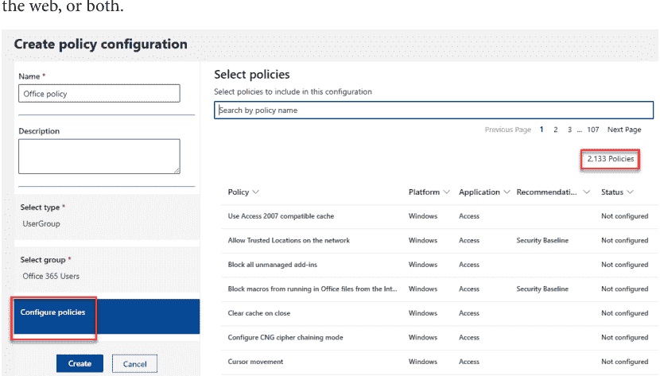

图 11.6 – Create policy configuration

在本例中，我们将配置所有 Microsoft 365 企业版应用的默认文件格式：

- 1. 搜索 `Default file format`。
- 2. 选择 Word 的 **Default file format**。
- 3. 从 **Not configured** 更改为 **Enabled**。

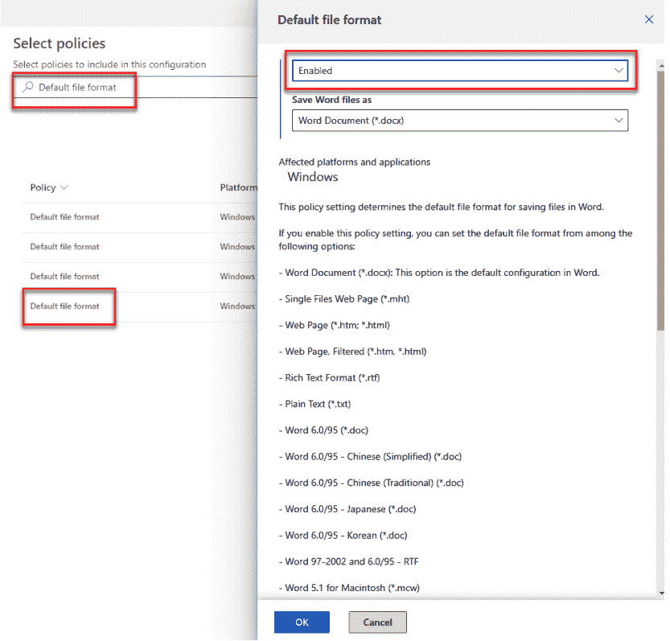

对其他 Microsoft 365 企业版应用执行相同的操作。

点击 Create。

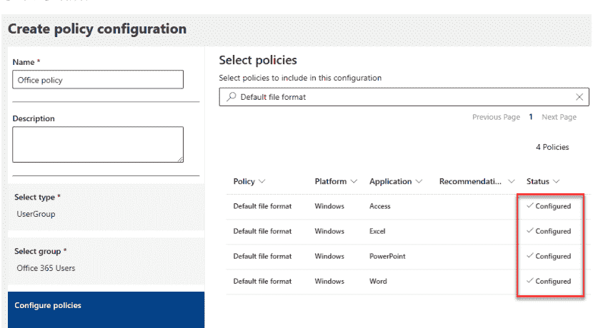

图 11.8 – Create policy configuration

至此，关于 Microsoft Endpoint Manager 中 Office 云策略的部分结束。我们向您展示了如何创建可部署到组织中所有终端的 Office 策略。在下一节中，我们将向您展示 OCP 服务中的一些技巧。

如果您输入 Word，您将只看到适用于 Word 的策略：

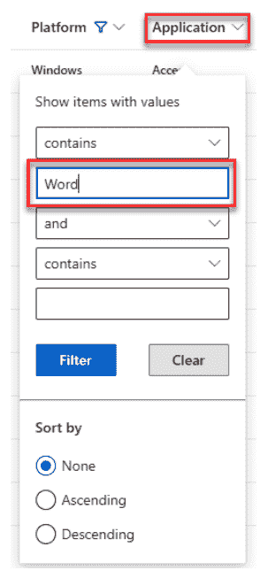

图 11.10 – Filters on Application

如果您选择 Security Baseline，您将只看到适用于 Windows 的策略；其他操作系统没有安全基线：

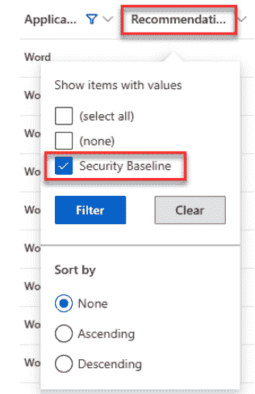

图 11.11 – Filters on Recommendations

当您选择安全基线中的策略设置时，您只需选择 Microsoft recommended security baseline 即可将策略配置为正确的值：

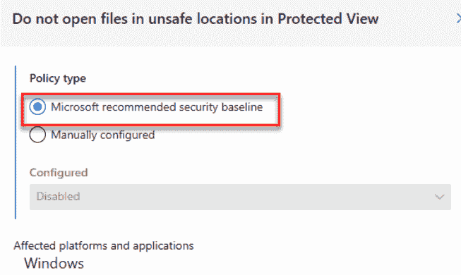

图 11.12 – Microsoft recommended security baseline

如果您勾选 **Configured**，您将只看到策略中已配置的策略：

图 11.13 – Filters by Status

如果您使用 **Configured** 作为筛选器，您可以看到所有已配置的策略设置：

图 11.14 – Filter – Configured

> Note
> 如果您仅在设备上安装 Microsoft Teams，则不会安装 Click-to-Run 服务，并且 Office 云策略不会应用于设备。

可以通过转到 File | Account | Switch account 在 Office 应用程序中切换帐户：

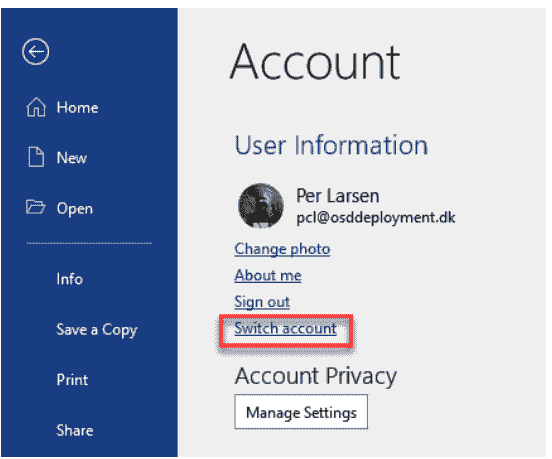

图 11.16 – Office – Account

Microsoft Intune ADMX 策略或 GPO 用户策略可以位于本地注册表中，

```
HKCU\software\policies\Microsoft\Office\16.0\
```

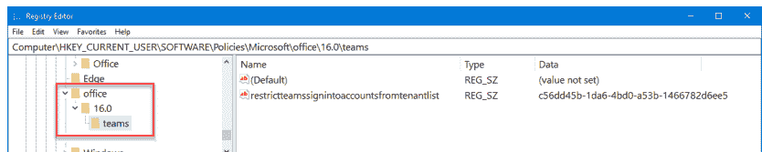

图 11.17 – Registry path for Office ADMX

来自 GPO 或 Microsoft Intune ADMX 策略的许多策略都是按设备设置的。在本例中也是如此，这也是只有一个策略值显示的原因。

从 Office 云策略服务检索的策略设置存储在注册表中的 HKEY_CURRENT_USER\Software\Policies\Microsoft\Cloud\Office\16.0。此键在每次在签入过程中从策略服务检索新一组策略时都会被覆盖。

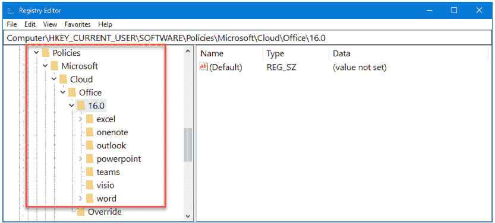

图 11.18 – Registry path for Office cloud policy

策略服务签入活动存储在注册表中的 HKEY_CURRENT_USER\Software\Microsoft\Office\16.0\Common\CloudPolicy。删除此键并重新启动 Office 应用将在下次启动 Word 或 Excel 等 Office 应用时触发策略服务签入：

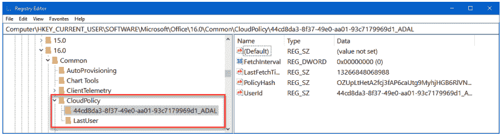

图 11.19 – Registry path for Office cloud policy check-in

至此，关于使用 Office 云策略服务配置策略的部分结束。在下一节中，我们将介绍 Apps 管理中心中的 Security Policy Advisor 如何帮助您改进在 Office 云策略服务中配置的策略的安全设置。


# 安全策略顾问

在 Microsoft Intune 之外，直接在 Microsoft 365 Apps 管理中心中，还有更多 Office 策略管理的选项。

登录 Apps 管理中心 https://config.office.com：

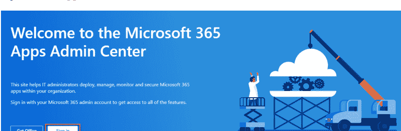

图 11.20 – 欢迎使用 Microsoft 365 Apps 管理中心

你可以选择使用安全策略顾问，根据企业版 Microsoft 365 应用的使用情况，为你提供安全策略的智能建议：

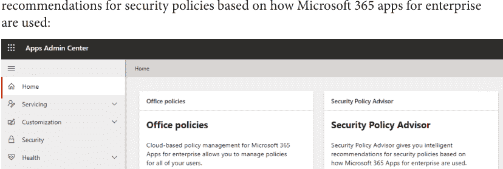

图 11.21 – Apps 管理中心 – 安全策略顾问

图 11.24 – Office 企业版应用策略

进入已应用策略刀片，你可以看到或回滚刚刚应用的策略设置：

图 11.25 – Office 企业版应用策略 – 已应用策略

启用 **显示所有建议（包括生产力影响高的建议）**：

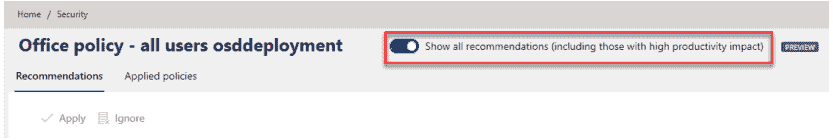

图 11.26 – Office 企业版应用策略 – 显示所有建议

你将获得推荐策略设置及其对终端用户的生产力影响的概览。这可以帮助你在更改策略设置前做出正确的决定：

| 推荐策略 | 功能 ↑ | 应用 ↑ | 生产力影响 ↓ | 置信度 ↑ |
|---|---|---|---|---|
| New! Word 的 Office Open XML 转换器 | 文件阻止 | Word | 用户组中 100% 的用户 | 高 |
| New! Excel 2007 及更高版本的二进制工作簿 | 文件阻止 | Excel | 用户组中 100% 的用户 | 高 |
| 预览仅信任使用 V3 签名签名的 VBA 宏 | VBA | Office | 用户组中 0% 的用户 | 高 |
| New! Word 的旧版转换器 | 文件阻止 | Word | 用户组中 0% 的用户 | 高 |

图 11.27 – Office 企业版应用策略 – 推荐策略

你还会看到具有高用户影响的策略建议，在本例中为 **用户组中 100% 的用户。**

# 总结

至此，本书关于策略管理的章节已全部结束。在本章中，你了解了 Office 云策略服务，你可以从其管理门户或从 Microsoft Intune 中使用它。Office 云策略适用于各种类型的终端，包括 Windows（桌面版和 Windows 365）、macOS、iOS 和 Android。后三种操作系统类型在本書中未涵盖，但重要的是要知道 Office 云策略服务可在多个操作系统上运行，而不仅仅是 Windows。本章要带走的一个要点是，Office 云策略仅在用户上下文中应用，这意味着目前你无法设置仅存在于设备级别的策略。

在下一章中，你将了解用于配置文件管理的不同工具。

# 问题

+   1. 什么是 Office 云策略服务？
+      A. 本地服务
+      B. 一组组策略
+      C. 一个帮助你为 Microsoft 365 应用配置策略的云服务
+      D. 用于配置 Microsoft Edge 的服务
+   2. 你可以从 Microsoft Endpoint Manager 管理中心配置 Office 云策略服务吗？
+      A. 是
+      B. 否
+   3. 你可以用 Office 云策略服务配置 Office 2016 吗？
+      A. 是
+      B. 否

# 答案

+   1. (C)
+   2. (A)
+   3. (B)

# 进一步阅读

如果你想在阅读本章后了解更多信息，请使用以下免费在线资源：

+   - Microsoft 365 Apps for enterprise 的 Office 云策略服务概述： https://docs.microsoft.com/en-us/deployoffice/overview-office-cloud-policy-service
