# 用户配置文件管理

配置文件管理是确保良好用户体验的非常重要的因素。你的 Windows 配置文件包含一组基线设置，用于个性化你的 Windows 10 体验。因此，使用满足你需求的技术非常重要，以确保你在其他设备和终端上也能获得相同的体验。

幸运的是，随着云服务的出现，配置文件管理如今变得容易得多——得益于 **Azure Active Directory (Azure AD)**、OneDrive 和 Microsoft Edge 等服务，这几乎是轻而易举的事！

阅读本章后，你将了解在物理和云终端上配置现代配置文件管理的全部内容。

在本章中，我们将介绍以下主题：

+   - Windows 配置文件
+   - **企业状态漫游 (ESR)**
+   - Microsoft Office 的漫游设置
+   - OneDrive for Business 已知文件夹移动
+   - Microsoft Edge
+   - ESR + OneDrive + Edge + Office

# Windows 配置文件

Windows 配置文件是 Windows 10 Enterprise 的一个非常重要的组件。

在桌面环境中，你可以使用不同类型的配置文件。首先，本地用户配置文件主要作为 Microsoft Endpoint Manager 的一部分使用。为了使其现代化，我们将向配置文件中添加云服务（稍后解释）。

过去使用的其他版本是为了简化配置文件。让我们看看 Microsoft Endpoint Manager 中使用的不同配置文件版本的更多细节：

+   - **本地用户配置文件**：这些是存储在操作系统磁盘上的用户配置文件，在你首次登录 Windows 10 Enterprise 时创建。本地配置文件中存储的一切都特定于用户而不是计算机。本地配置文件是我们同时在物理终端和 Windows 365 中使用的解决方案。

+   - **临时用户配置文件**：如果出现配置文件错误，则会发放临时配置文件，使用临时配置文件是为了避免用户加载一个新空配置文件从而覆盖现有配置文件。临时配置文件在用户登录后会被清除，作为安全机制。临时配置文件仅在出现错误情况、无法加载正常的本地配置文件时使用。

我们不建议在撰写本书时使用的配置文件类型是漫游和强制配置文件：

+   - **漫游用户配置文件**：这是一种相对较旧的技术，可在登录和注销时将你的本地配置文件复制到中央文件服务器共享。此配置文件复制过程基于文件，可能会在配置文件较大时延长用户的登录过程。随着 Office 365 服务在启用缓存的情况下使用，这种技术并不是最佳选择。当你是物理或云终端的所有者时，本地配置文件是作为持久终端用户体验的最佳替代方案。

+   - **强制用户配置文件**：强制配置文件是应用了许多自定义设置或修改的本地配置文件模板。每次用户登录时，都会基于此强制配置文件模板创建一个新的 Windows 本地配置文件。这使得为终端用户提供一致且全新的配置文件体验成为可能。注销后配置文件设置不会保存。因此，此配置文件类型仅适用于非持久使用场景。

+   - **简化管理与监控：** 提供轻松访问、控制和查看谁能够将其 Windows 配置文件设置同步到 ESR 以及谁不能。在 Azure 门户中，你可以根据 Azure AD 组过滤访问权限。

当你的环境中同时存在物理设备和虚拟设备时，可以利用 ESR 在你的设备之间传输配置文件的一部分，以实现统一的配置文件设置体验。以下屏幕截图显示了如何为所有用户或选定的（Azure AD）人员组激活该设置：

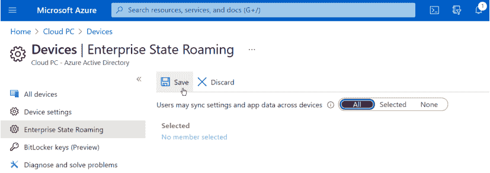

*图 12.1 – ESR 设置*

# ESR 中包含哪些特定的配置文件数据？

以下是存储在 ESR 数据中、属于 Azure AD 用户的配置文件设置列表，每当用户登录到干净的 Windows 10 Enterprise 设备时，这些设置将被还原，以提供统一的体验：

| 配置文件组件 | 描述 |
|---|---|
| Windows 主题 | 你的桌面主题和任务栏设置已保存。 |
| 语言设置 | 键盘布局、系统语言、日期和时间设置等。 |
| 缓存密码 | 你的密码存储在 Windows 和你的浏览器中。 |
| 易用性功能 | 高对比度主题偏好以及 Narrator 和 Magnifier 设置已保存。 |
| 其他 Windows 设置 | 鼠标属性和设置已保存。 |

一旦启用 ESR，登录你的 Windows 10 Enterprise 桌面并在 **设置** 菜单下打开 **帐户**。你将看到作为 Windows 配置文件一部分同步的所有已激活设置！


通常情况下，作为 IT 管理员，您会创建强制执行以下设置的策略，以便最终用户无法禁用这些设置。这将确保配置文件设置数据始终安全地存储在 Microsoft 云中：

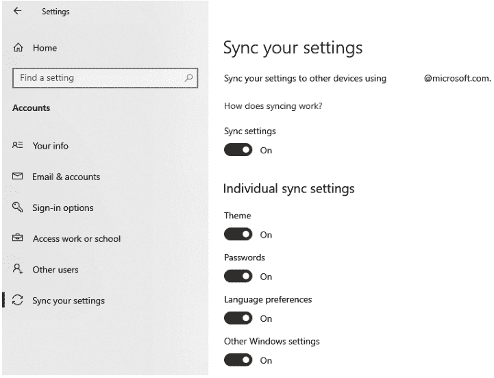

图 12.2 – Windows 中的 ESR 设置

在下一节中，我们将更详细地解释 Microsoft Office 产品如何自动将设置同步到云中，以实现无缝的最终用户体验。

## Microsoft Office 的漫游设置

Office 的漫游功能可在 Microsoft 365 应用和设备之间实现体验，从而提高生产力，并在任何设备上让 Office 更个性化。一些设置和功能的示例包括最近使用文件列表、文档中的最后阅读位置、Office 加载项的首次运行体验、自动更正首选项和主题。

以下是完整的设置列表：

- 最近使用文件（所有应用）
- 最近使用位置（所有应用）

在下一节中，我们将解释 Outlook 签名如何同步到云中。

## Outlook 的签名云设置

Office 漫游功能提供的另一个很酷的新增强功能是能够将您的 Outlook 设置存储在云中，作为您的 Azure AD/Office 365 帐户的一部分。我们在上一节中解释了不同的 Office 服务，例如最近使用文件，以及保存的其他组件。

其中一个长期以来一直具有挑战性的 Outlook 设置是 Outlook 签名。现在已修复，因为签名设置存储在云中，因此无论您在任何计算机上访问 Outlook for Windows，您的体验都是一致的。

要启用此功能，您只需打开 **Outlook 选项** 菜单，然后选择 **常规**。在此窗格中，您勾选 **将我的 Outlook 设置存储在云中** 旁边的复选框。

您的 Outlook 签名现在会跟随您，即使在本地配置文件重置后也是如此，这很酷，对吧？

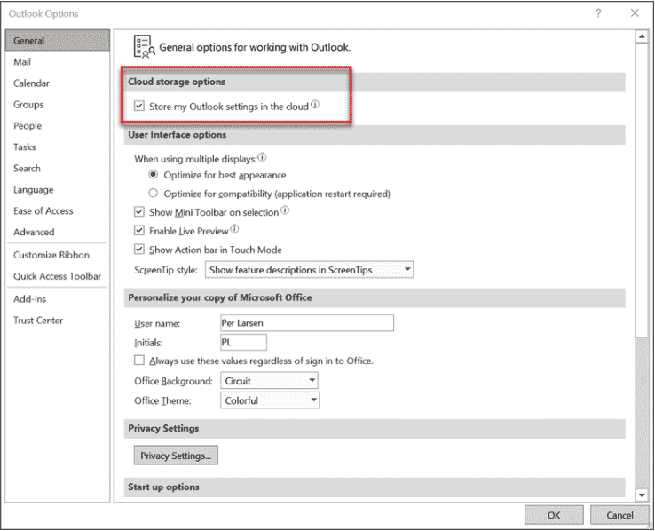

图 12.4 – Outlook 的云存储选项

在下一节中，您将了解有关 OneDrive for Business **已知文件夹移动 (KFM)** 的信息。

## OneDrive for Business 已知文件夹移动

OneDrive for Business KFM 是一种简单的方法，可备份您的重要文件夹（**桌面**、**文档** 和 **图片** 文件夹）到您的虚拟 Windows 365 PC 中，以便在无需任何用户交互的情况下受保护并在其他设备上可用。

OneDrive PC 文件夹备份在 **Windows 365 上默认启用**，因此这是一种轻松的方式，可在其他设备上继续工作，例如您的物理终端或移动设备，因为所有文件夹也会立即在这些设备上可用。

由于 OneDrive Files On-Demand 默认启用，您 Cloud PC 配置文件内的存储分配也将保持较低，因为 OneDrive 中的此功能让您无需占用计算机上的存储空间即可访问文件。

作为 Windows 365 的一部分，OneDrive 会静默配置，并且 PC 文件夹备份（KFM）也会默认激活，以确保在您的 Windows 10/11 Enterprise 桌面环境中为业务连续性和灾难恢复目的保护您的数据。

您可以在安装在 Windows 设备上的 OneDrive 客户端中找到 OneDrive KFM 设置，以将您的 **桌面**、**文档** 和 **图片** 文件夹同步到 OneDrive 云，如下所示：

### 管理文件夹备份

这些文件夹正在 OneDrive 中同步。新的和现有文件将被添加到 OneDrive、备份，并在其他设备上可用，即使您丢失了此 PC。

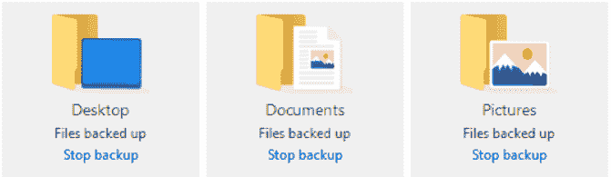

选择后 OneDrive 剩余空间：4,639 GB

图 12.5 – OneDrive KFM

## 重要说明

以下屏幕截图中显示的设置允许您在 Windows 10 Enterprise 终端上静默配置 OneDrive PC 文件夹备份。正如您所见，这相对容易...

顺便说一下，OneDrive 中内置了一个新的错误消息，用于在您使用 KFM 时警告您在 PC 上本地删除文件。幸运的是，文件会自动备份到回收站中 30 天。因此，完全不用担心。

当您想在 Windows 10 Enterprise 终端上使用此设置时，请直接在 Microsoft Endpoint Manager 中作为策略设置激活以下选项：

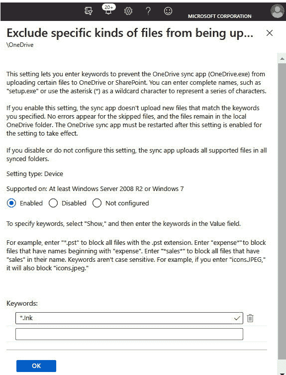

图 12.6 – 从同步中排除 OneDrive 文件和扩展名

如果您不小心删除了 Windows 配置文件中的文件，OneDrive 会自动拍摄文件快照——并且始终提供在接下来的 30 天内恢复的选项。请参阅出现的以下新消息：

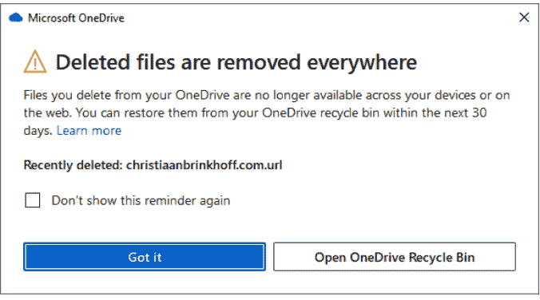

图 12.7 – OneDrive 中意外删除文件的新的提示

在下一节中，我们将解释如何从 Windows 对 OneDrive 缓存执行维护和清理操作。

## Windows 10 存储感知

Windows 10 存储感知与 OneDrive 协同工作，通过将您最近未使用的本地可用的 OneDrive 文件再次设为仅在线，从而自动释放空间。

如果您在过去 30 天内未使用任何文件，当设备可用空间不足时，可以将其设置为仅在线。您还可以安排并定义存储感知运行的频率：

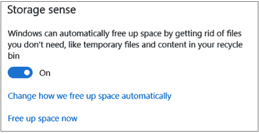

图 12.8 – 存储感知

## OneDrive 和存储感知

借助存储感知，您可以静默协助 Windows 设备管理存储，例如释放 OneDrive 缓存空间。OneDrive 使用 Files On-Demand 同步仅必要的數據到您的终端。由于 OneDrive 会在本地缓存数据，您可能希望在一段时间后释放此缓存空间。存储感知使您能够根据业务偏好执行此操作。

OneDrive 数据始终在您的配置文件中可见，并且只有在您需要再次访问并进行更改时才需要重新下载。

您可以在 Windows 的 **系统** 设置菜单中，在 **存储** 下找到存储感知。您可以使用 **内容在未打开超过：** 下的下拉菜单清理数据：

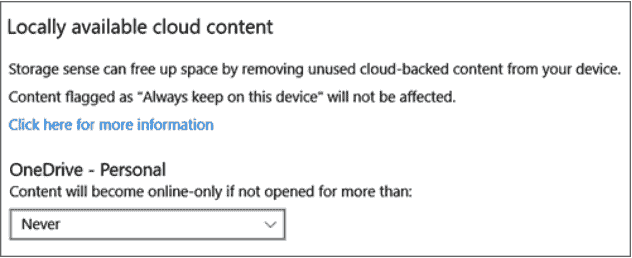

图 12.9 – 清理缓存

您也可以仅在操作系统磁盘空间不足时才执行此操作——以防紧急情况：

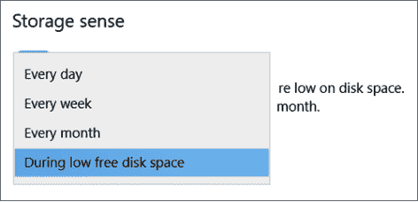

图 12.10 – 清理计划

您还可以使用此功能清理 Windows 配置文件中的下载文件夹。这也很方便：

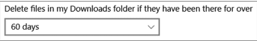

图 12.11 – 下载文件夹清理

## Microsoft Edge

Microsoft Edge 越来越多地成为绝大多数用户的主流浏览器。这是 Microsoft Edge 工程团队努力工作的结果，最近添加了许多功能以解决客户反馈并使 Edge 准备好用于企业采用。

在配置文件管理的背景下，Microsoft Edge 也提供了很棒的功能，因为它支持将所有浏览器相关数据作为 Azure AD 凭据的一部分进行同步。这意味着您的历史记录、收藏夹、密码集合、设置、扩展和打开的标签页将为您存储在 Microsoft 云中。

例如，您可以为配置文件相关数据配置 OneDrive KFM 到您的 Windows 配置文件中，以将文档、图片和桌面文件夹重定向为备份层——Edge 对浏览器设置也做同样的事情。此外，重要的是要注意，Edge 浏览器特定的配置文件数据在您使用 Edge 作为浏览器的所有设备之间共享。想象一下，从您的物理或虚拟终端切换到 Surface Duo 或 iPhone 并继续您离开的地方。

在初始配置过程中，或在首次启动 Edge 时，您将被要求使用 Azure AD 凭据登录。之后，它会要求您同步您的配置文件。在此首次启动之后，它现在将开始保存您的 Edge 配置文件数据——从您第二次启动 Edge 开始，您的所有浏览器设置都将预先加载，您的 Edge 浏览器看起来和感觉与在其他设备上完全相同。

您还可以使用组策略预设 Edge 中的静默登录和自动同步激活，以强制执行此设置以确保配置文件同步。

在 Edge 中手动启用配置文件同步的设置如下图所示：


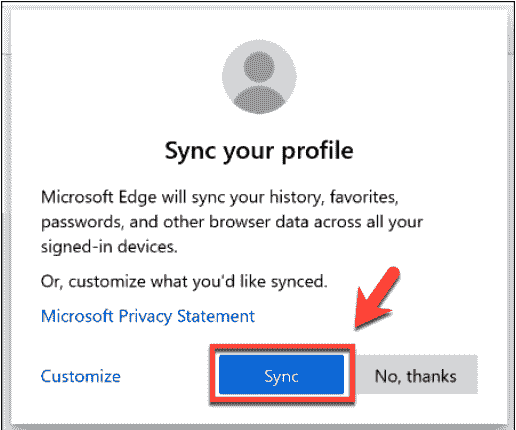

图 12.12 – Edge 配置文件同步选项

启用同步设置后，以下 Edge 专属配置文件数据将自动同步：

- 收藏夹
- 密码
- 表单填充数据
- 历史记录
- 打开的标签页（会话）
- 设置（首选项）
- 扩展

另一个值得强调的选项是使用多个配置文件。例如，假设你有一个用于私人使用的个人账户，以及一个业务账户。你可以简单地再创建一个配置文件，个人配置文件将完全与另一个隔离。再见了，只能打开一个隐私模式会话的限制，或因这个原因而使用其他浏览器的情况。

你也可以使用“以访客身份浏览”选项，在不创建配置文件的情况下使用隔离会话，当你不想将其保存到 Azure AD 账户凭据的在线配置文件存储中时。

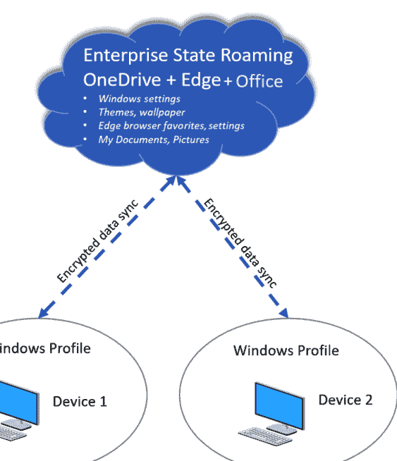

图 12.14 – OneDrive + ESR + Edge

## 从传统迁移到现代配置文件管理

本章中的所有章节都解释了如何将配置文件管理配置现代化，作为物理或云端点的组成部分。

配置一切的便捷性也适用于从任何其他配置文件管理解决方案的迁移路径，无论是漫游配置文件还是市场上任何其他解决方案。

在迁移前需要在传统环境中执行以下步骤：

1. 如果你正在使用漫游配置文件，你唯一需要做的就是激活 OneDrive PC 文件夹备份（KFM）和 ESR，并确保 Edge 和 OneDrive 静默配置已打开。
2. 当你在现有配置文件解决方案之上配置此项时，数据的同步将在用户继续使用现有解决方案的同时进行。
3. IT 管理员随后可以在成功配置所有现代组件后，安排切换时间以移除漫游配置文件元素并继续使用本地配置文件。此方法也适用于 FSLogix。

这可能是一个可选择的方案，当你目前使用传统的 VDI 解决方案并希望利用 Windows 365 时，也适用于你使用 Endpoint Configuration Manager 或任何其他物理端点管理解决方案，并希望将其迁移到由 Microsoft Endpoint Manager 管理的物理端点时。

## 总结

在本章中，你了解了使用 OneDrive 和 Microsoft Edge 等产品在 Windows 10 Enterprise 环境中现代化和优化 Windows 配置文件的各种选项。

在下一章中，我们将解释身份和安全管理世界的方方面面。

## 问题

1. 允许你在 OneDrive 中重定向配置文件文件夹的功能名称是什么？
   A. PC 文件夹备份
   B. 文件夹快照
   C. 文件夹复制
   D. OneDrive 配置文件备份

2. 在现代化的 Windows 配置文件背景下，使用 Edge 的主要好处是什么？
   A. Edge 可以通过 Microsoft Endpoint Manager 进行注册。
   B. 它默认包含在 Windows 10 Enterprise 中，因此无需在 Windows 配置文件中安装。
   C. Edge 支持同步 Edge 配置文件相关数据，包括收藏夹、历史记录和密码缓存。

## 答案

1. (A)
2. (C)

## 进一步阅读

如果你在阅读本章后想了解更多关于 Windows 配置文件的信息，请查阅以下免费在线资源：

- Enterprise State Roaming FAQ – Azure Active Directory | Microsoft Docs: `https://docs.microsoft.com/en-us/azure/active-directory/devices/enterprise-state-roaming-faqs`
- Microsoft Edge and Enterprise State Roaming | Microsoft Docs: `https://docs.microsoft.com/en-us/deployedge/microsoft-edge-enterprise-state-roaming`

## 13
身份和安全管理

在本章中，你将了解有关 Azure Active Directory（AAD）和安全性的所有内容。我们将介绍 AAD 的历史以及你可以配置的不同安全方面，以保护组织内的 Windows 10 Enterprise 设备。

在本章中，我们将介绍以下主题：

- Microsoft Identity
- AAD
- 用户和组
- 混合 AAD
- 条件访问
- BitLocker 磁盘加密
- 自助密码重置
- AAD 密码保护
- 无密码身份验证
- 每个无密码场景中支持和不支持的内容
- Microsoft Defender for Endpoint

## Microsoft Identity

**Active Directory Domain Services（AD DS）** 自 2000 年起就已面市。正如你们中的一些人可能还记得的那样，它随 Windows 2000 Server 的首次发布而推出。

其工作原理是，你将 Windows 客户端或服务器设备加入 **Active Directory（AD）**，以通过组策略或安全设置接管其管理层，或将其用于将不同的 AD 环境相互连接，以将组织权限委托给存储在不同 AD 环境中的资源——在不同的林中。

在 **Microsoft Endpoint Manager（MEM）** 的上下文中，可以连接到同时加入 AD DS 和 AAD 的 Windows 设备。加入 AD DS 且也需要在 AAD 中可用的设备称为 **混合 AAD 加入（HAADJ）**。在你的业务准备好原生使用 AAD 之前，混合 AAD 可能是作为过渡方案的最佳选择。让我们在下一节中进一步讨论这个问题。

如果你的设备直接注册到 AAD 并在 MEM 中的 **所有设备** 中列出，你可以在 Windows 10 Enterprise **设置** 菜单中看到 AAD 域属性。

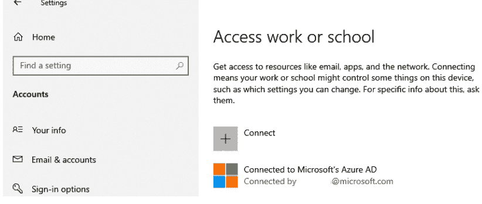

图 13.1 – 访问工作或学校

设备可能处于不同状态，但共同点是，你都可以在设置应用下的 **账户 | 访问工作或学校** 中看到它们。

让我们接下来看 AAD。

## AAD

AAD 为 Windows 10 Enterprise 和 MEM 提供 **单点登录（SSO）** 和 **多因素身份验证（MFA）**，以帮助保护你的用户免受 99.9% 的网络安全攻击。

AAD 是传统 AD（AD DS）的演进，使其能够实现以下功能：

- SSO 简化了从任何地方访问你的应用。
- 条件访问和 MFA 有助于保护你的环境免受外部入侵者。
- 作为单一身份平台，它让你能更安全地与内部和外部用户互动。
- 开发人员工具使将身份集成到你的应用和服务中变得容易。

让我们接下来看 AAD 用户。

## AAD 用户

AAD 用户包括组织中用户的账户设置，仅存在于 Microsoft Azure 云中。创建和删除用户可以通过使用 AAD 全局管理员角色或分配了账户管理员 **基于角色的访问控制（RBAC）** 角色的账户来完成。

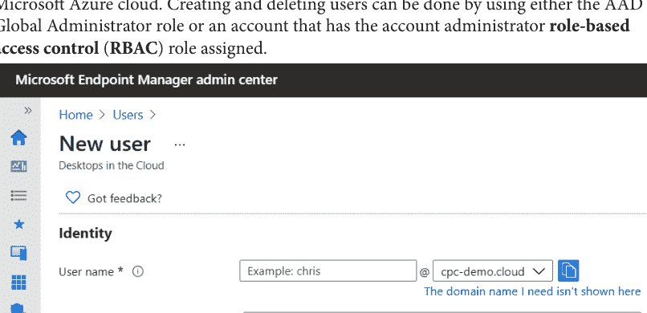

图 13.2 – MEM 管理中心中的新用户

直接在 AAD 中创建新用户适用于仅云身份；混合身份仍需在本地 AD 中创建并通过 AD Connect 同步到 AAD。让我们接下来看 AAD 访客用户。

## AAD 访客用户

访客用户账户旨在与 AAD 租户环境之外的其他组织协作，而无需创建包含组织域的普通 AAD 用户账户。一个例子是允许访问 SharePoint 站点。如果最终用户有权在 OneDrive for Business 中共享文档，也可以使用访客用户完成。

请注意，访客用户无法将设备注册到 AAD 或 Microsoft Intune。

在 **创建新用户** 工作流中，IT 管理员可以选择邀请用户而不是在企业 AAD 中创建用户，如此工作流所示：

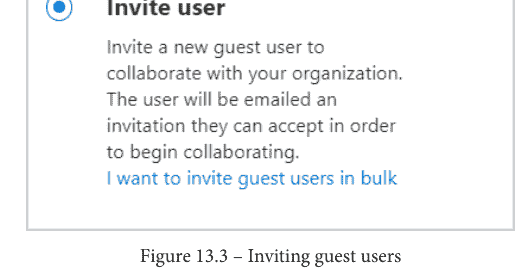

图 13.3 – 邀请访客用户

在 **邀请用户** 工作流中，IT 管理员还可以分配 AAD 中的组或角色。这意味着访客用户可以被分配 Intune 管理员角色，例如，你可以将该角色授予外部顾问。

让我们接下来看 AAD 中组的各种选项。

## AAD 组类型

AAD 组有两种类型，如下所示：

- **安全**：这是最常用的类型，因为它用于将成员添加到组以获得对文件夹共享、应用程序、RBAC、安全策略或云桌面环境的访问权限。


+   - **Microsoft 365**：这是其他 Microsoft 云服务（如 Exchange Online 和 SharePoint）中使用的组类型，以实现更好的协作。此组类型还允许客户与组织 AAD 租户环境之外的成员共享访问权限。

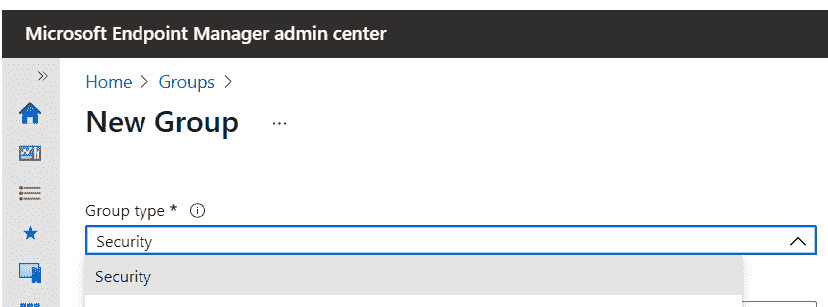

图13.4 – 创建新组

安全组可用于用户和设备，但不能混合使用。接下来，我们将探讨不同的成员类型。

## AAD 成员类型

在上一节中，我们解释了 AAD 组类型的区别。有三种方式可以让用户或设备成为 AAD 组的成员：

- **已分配**：这是向特定组分配访问权限的最常见方式。你将特定用户添加到 AAD 组中以获得访问权限，例如访问安全策略。
- **动态用户**：此类型可根据你定义的条件自动将用户添加到组中。当用户不再满足成为组成员的要求时，无需任何交互即可将其添加或移出 AAD 组。
- **动态设备**：此类型与动态用户成员类型有些类似；不过，它现在用于自动在 AAD 组中添加或移除设备。

选择最适合你的用例的类型，因为动态成员身份可以为大型组织提供更具可扩展性的方法。动态组仅支持用户类型或设备类型之一，而不是两者。

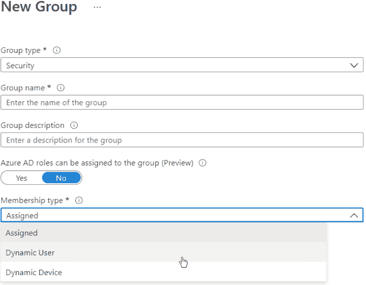

图13.5 – 创建新组

在动态成员规则中，你可以创建基于属性的复杂规则来为组启用动态成员身份，并可使用这些规则在 AAD 组中添加和移除用户。

例如，你可以通过添加以下规则，自动将所有在 AAD 中将 @contoso.com 配置为 proxyAddresses 的用户添加进来。可以想象，通过这种方法将会有无数种选项可用。

## 动态成员规则

保存 放弃 有反馈？

配置规则 验证规则（预览）

你可以使用规则生成器或规则语法文本框来创建或编辑动态成员规则。了解更多

和/或 属性 运算符 值 proxyAddresses 包含 "contoso"

+ 添加表达式 + 获取自定义扩展属性

### 规则语法

```
(user.proxyAddresses -contains "contoso")
```

图13.6 – 动态成员规则

你现在也可以使用“验证规则”选项轻松测试表达式。如果验证结果显示为红色，则表示该用户不属于允许的筛选属性范围，因此不会动态添加到 AAD 组中：

添加用户以根据此规则进行验证。了解更多

+ 添加用户 验证 在组中 不在组中 未知

| 名称 | 状态 |
|---|---|
| Christiaan Brinkhoff<br>Christiaan@cpc-demo.cloud | ❌ 查看详细信息 |

图13.7 – 动态规则验证

动态组可以帮助你在 Microsoft Intune 分配中更加敏捷。例如，动态设备具有多个属性，可以帮助将类似设备类型分组。

接下来，我们将了解混合 AAD 及其重要性。

## 混合 AAD

HAADJ 设备是你组织的一部分，并使用属于该组织的 AD (AD DS) 账户登录。它们同时存在于云和本地环境中，以便在传统 AD DS 与 AAD 之间实现转换。这在 MEM 以及 *Windows 365* 中的不同场景下都是必需的。

要使用混合 AAD，你必须复制本地环境，将身份和设备导入/同步到 AAD。你可以使用 Microsoft AAD Connect 软件完成此操作。

该软件基于 **Microsoft 身份管理 (MIM)** 构建，并预配置了所有配置项目，可将本地用户、组和设备复制到 AAD。

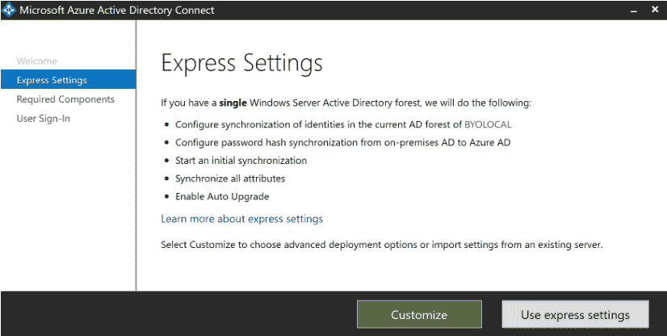

*图13.8 – Microsoft AAD Connect – 快速设置*

如果你过去已配置过 AAD Connect，则必须将配置更改为 HAADJ，以支持 Windows 365 等服务。混合 AAD 在以下替代场景中也可能很有帮助：

- 你已将依赖 AD 机器身份验证的 Win32 应用部署到这些设备。
- 你希望继续使用组策略来管理设备配置。
- 你希望继续使用现有的映像解决方案来部署和配置设备。
- 除了 Windows 10 之外，你还必须支持较低级别的 Windows 7 和 8.1 设备。

确保你配置 AAD Connect – HAADJ – 的服务器能够连接到以下所有 URL：

- https://enterpriseregistration.windows.net
- https://login.microsoftonline.com
- https://device.login.microsoftonline.com
- https://autologon.microsoftazuread-sso.com

请按照以下步骤满足该服务的先决条件。对于物理电脑，请执行以下操作：

1. 转到你的 AAD Connect 服务器，该服务器很可能在本地私有云数据中心环境中运行。
2. 打开 Microsoft AAD Connect 程序。
3. 打开“配置设备选项”任务。

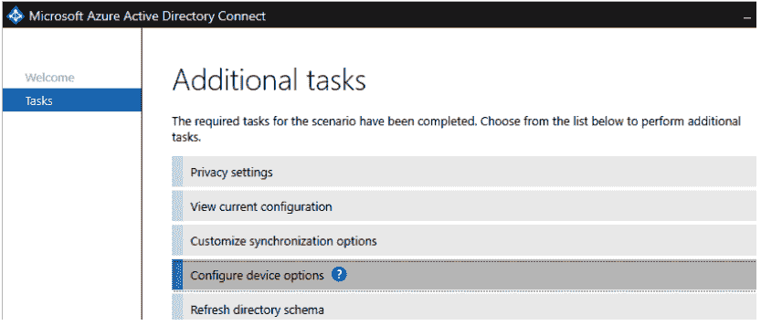

图13.9 – 配置设备选项

4. 使用组织的全局管理员账户登录，以验证你是此 AAD 租户的所有者。

图13.10 – 连接到 AAD

5. 完成后，系统会要求你更改 AAD 配置的设备选项。请将其更改为“配置混合 Azure AD 加入”。

图13.11 – 配置混合 Azure AD 加入

6. 确保选择“Windows 10 或更高版本已加入域的设备”选项。

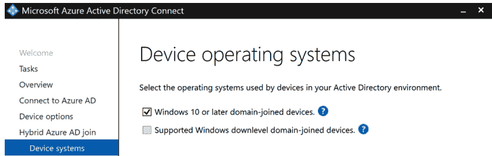

图13.12 – 设备操作系统

7. 单击“下一步”后，你必须为你的 AD 林配置服务连接点 (SCP)。

你必须单击绿色的“添加”按钮，将本地 AD 的相应企业管理员凭据添加到 AAD 身份验证服务中。

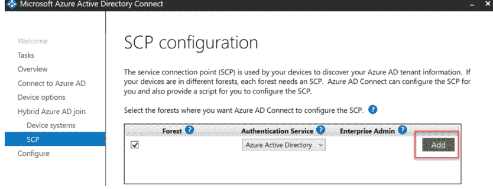

图13.13 – SCP 配置

8. 完成后，单击“下一步”按钮。

现在，你可以将 AAD Connect 配置更改为混合 AAD。

9. 单击“配置”以开始配置。

接下来，让我们了解条件访问。

## 条件访问

条件访问是 AAD 用于汇聚信号、做出决策并强制执行组织策略的工具。它是全新的身份驱动控制平面的核心。

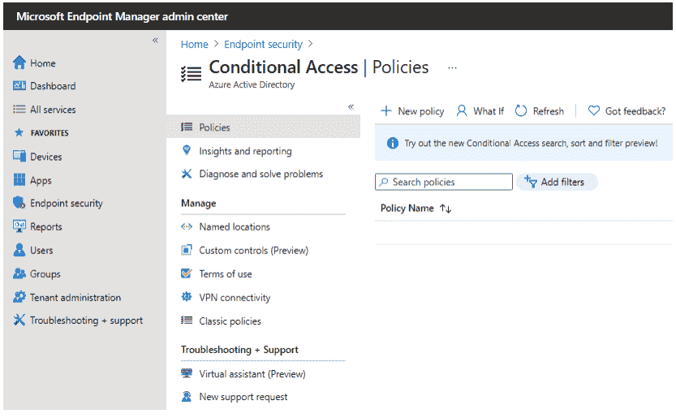

图13.14 – 条件访问

管理员必须有两个主要目标：

- 无论何时何地，都要让用户高效工作。
- 保护组织的资产。

借助条件访问策略，你可以在需要时应用适当的访问控制来保持组织安全，并在不需要时避免干扰用户。

以下截图是一个基于 AAD 组配置筛选器的示例：

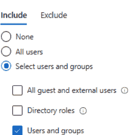

图13.16 – 包含用户和组

可以配置包含和排除用户及组分配，以满足你公司的访问控制需求。

接下来，我们将了解条件访问策略中的云应用。

## 云应用

云应用是代表 Microsoft 云或第三方应用程序的 AAD 企业应用程序。例如，可以是 Windows 365、软件即服务 (SaaS) 应用程序或 Office 365 服务。

若要为每个云应用强制执行不同的条件访问设置，可以创建仅适用于该特定应用程序的不同策略，以自定义访问权限：

## 选择

云应用

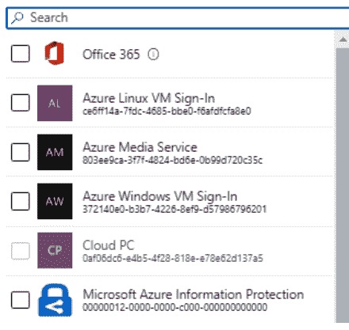

图13.17 – 选择云应用

云应用很可能以服务名称命名；否则，你必须根据相应的应用 ID 选择它们，例如 0af06dc6-e4b5-4f28-818e-e78e62d137a5。

除了按云应用进行筛选外，你还可以在操作期间应用条件访问设置，例如将设备注册和加入 MEM 的过程。此时你必须选择用户操作而不是云应用：

- 注册安全信息
- 注册或加入设备

基于所有或特定的云应用或操作控制用户访问。了解更多

选择此策略的适用范围

用户操作

选择此策略将应用的操作

注册安全信息

注册或加入设备

图13.18 – 用户操作


接下来，我们将查看条件访问策略中的条件。

## 条件

有四种不同类型的条件可供配置：

- **设备平台**：控制用户从不同设备平台的访问；例如，此策略仅在用户从 Android、Windows、macOS、iOS 或 Windows Phone 登录时适用。

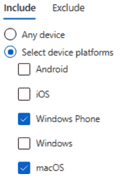

图 13.19 – 包含/排除平台

- **位置**：根据用户的物理位置控制用户访问，例如基于公共 IP 允许列表。

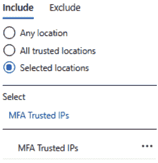

图 13.20 – 包含/排除位置

您可以在 **命名位置** 菜单中配置 IP 授权 – 条件访问中的 IP 列表。

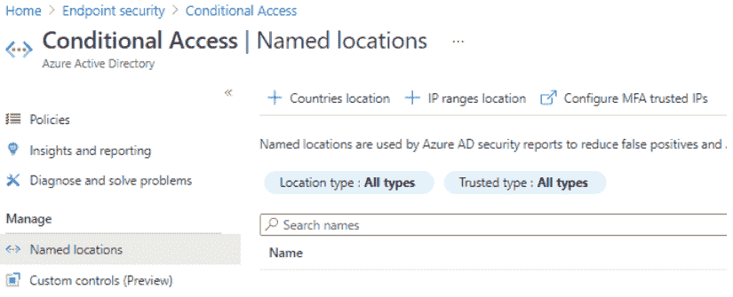

图 13.21 – 条件访问 – 命名位置

- **客户端应用**：控制用户访问以针对不使用现代身份验证的特定客户端应用程序。

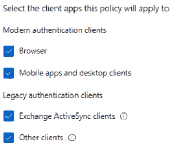

图 13.22 – 选择此策略适用的客户端应用

设置 **授予访问** 可以配置为全部或部分控制。

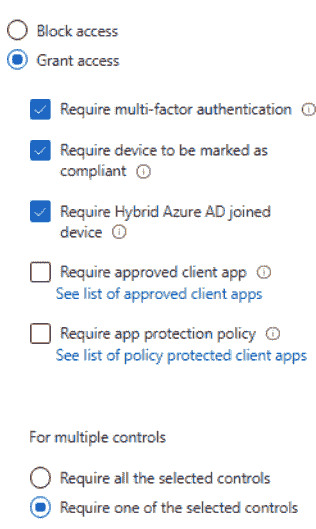

图 13.24 – 授予访问

MFA 应该是强制性的；根据需要添加其他设置，例如控制未受 MEM 管理的设备上的访问。

基于会话控制控制用户访问，以在特定云应用程序内启用有限的体验：

- **使用应用强制限制**：应用强制限制可能需要在云应用内进行额外的管理员配置。限制仅对新会话生效。
- **访问控制设置**：条件访问应用控制可实时监控和控制用户应用访问和会话，基于访问和会话策略。访问和会话策略用于云应用安全门户中，以进一步细化筛选器并设置对用户的操作。
- **登录频率**：这是用户在尝试访问资源时再次被要求登录的时间段。默认设置是 90 天的滚动窗口，即用户在机器上不活动 90 天或更长时间后，首次尝试访问资源时将被要求重新进行身份验证。

> 提示
> 此设置可能有助于在 **自带设备 (BYOD)** 设备上强制每小时进行一次 MFA，以确保在此时间后访问过期！

- **持久浏览器会话**：持久浏览器会话允许用户在关闭并重新打开浏览器窗口后仍保持登录状态：

> 注意
> 持久浏览器会话仅在选择 **所有云应用** 时才能正确工作

- 这不会影响令牌生命周期或登录频率设置。
- 这将覆盖公司品牌上的 **显示保持登录选项** 策略。
- **永不持久** 将覆盖从联合身份验证服务传递的任何持久 SSO 声明。
- **永不持久** 将阻止移动设备上的 SSO 跨应用程序以及应用程序与用户移动浏览器之间进行。

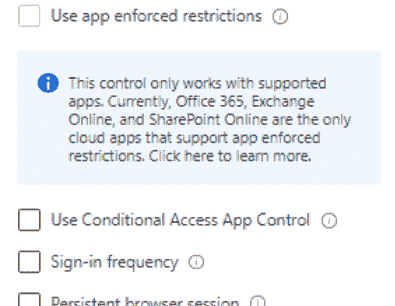

图 13.25 – 会话控制

至此，我们完成了可用于保护企业数据的条件访问策略的演练。接下来，我们将展示一个选项，以防止用户在其 BYOD 设备上执行 AAD 设备注册。

## 防止用户执行 AAD 设备注册

要阻止用户在其加入企业域、加入 AAD 或混合加入 AAD 的 Windows 10 设备上添加额外的企业工作账户，请启用以下注册表项。此策略也可用于阻止加入域的机器意外地使用同一用户账户进行 AAD 注册：HKLM\SOFTWARE\Policies\Microsoft\Windows\WorkplaceJoin，"BlockAADWorkplaceJoin"=dword:00000001。

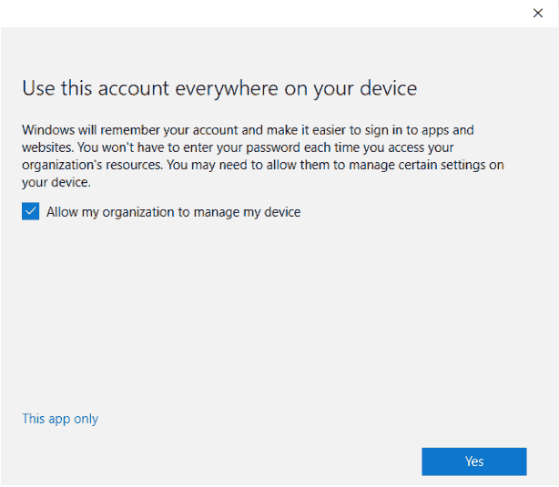

图 13.26 – 在您的设备上随处使用此账户

没有集中方式可以防止用户在其 BYOD 设备上在 AAD 中注册。如果已配置 AAD 自动 MDM 注册并且已设置允许我的组织管理我的设备的复选标记，则设备将被注册到 Microsoft Intune。接下来，我们将查看自助密码重置 (SSPR)。

## 自助密码重置

SSPR 功能允许企业让用户无需服务台交互即可自行重置密码。这可以大幅减少组织中的支持工单数量，因为大多数用户可以自行恢复。

当用户多次错误输入密码时，账户将进入锁定状态。借助 SSPR 服务，最终用户可以更改密码，并在该过程中被提示进行 MFA。

> 注意
> 在用户可以解锁账户或重置密码之前，他们必须注册其联系信息。

SSPR 需要 AAD Premium P1 许可证，该许可证随 Microsoft 365 E3 或更高版本提供。

您必须转到 Azure 门户中的 AAD (https://portal.azure.com/#home) 来激活该功能。

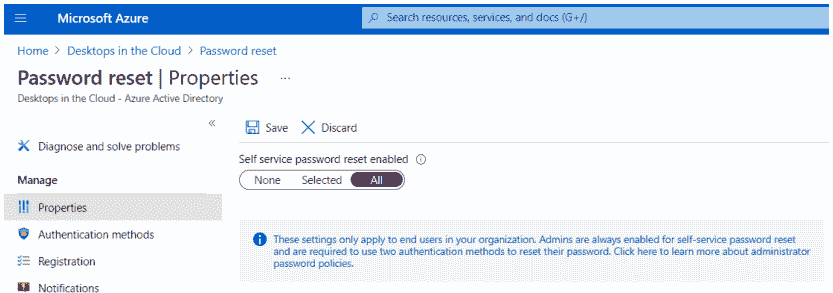

图 13.27 – 自助密码重置已启用

也可以仅对 AAD 组成员启用 SSPR – 通过菜单中的“所选”选项。

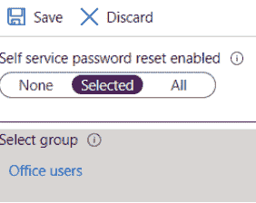

图 13.28 – 密码重置 – 选择用于范围限定的组

接下来，我们将查看 AAD 密码保护。

## 无密码身份验证

阅读上一节时，您可能会想，密码-less 登录身份验证怎么办？好问题！

Microsoft 旨在让设置密码变得更容易；我们的策略是四步方法，我们部署替代方案，减少密码攻击面，过渡到无密码部署，最后消除密码。

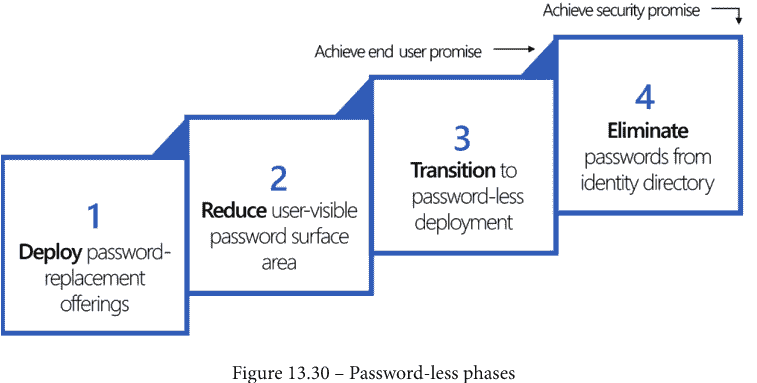

无密码身份验证是一种无需输入密码即可登录 Windows 10 Enterprise 端点的方式。最常见的方法之一是通过所谓的 YubiKey 安全密钥。您有 USB-C、USB 以及其他设备的版本，例如 Apple 设备。其他选项是使用短信或 Microsoft Authenticator 应用。

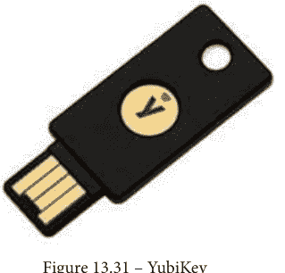

让我们谈谈 YubiKey。最终用户体验看起来与您通常登录 Windows 的方式非常相似。虽然您通常使用 Windows Hello 或密码登录，但现在您可以选择 USB 密钥，如图所示：


图 13.32 – Windows 登录选项

之后，Windows 会要求您将安全密钥插入 USB 端口，该密钥保存用于登录 Windows 10 设备的密码短语，无需密码。

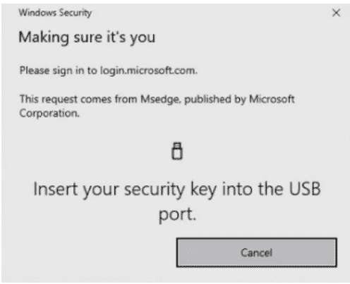

图 13.33 – FIDO2 身份验证

首先，您需要在 AAD 租户中启用无密码身份验证。

### 启用无密码身份验证

要启用无密码身份验证，您必须进入 Azure 门户并打开 AAD。然后，按照以下步骤操作：

- 1. 转到 安全。
- 2. 打开 身份验证方法。

3. 在 **管理** 菜单下，选择 **身份验证方法。**

图 13.34 – 身份验证方法

4. 点击 **FIDO2 安全密钥。**

身份验证方法 | 策略
云桌面 - Azure AD 安全

搜索 (Ctrl+/)

有反馈？

点击此处为用户启用组合安全信息注册体验。

在身份验证方法策略中配置您的用户以启用无密码身份验证，您需要为用户启用增强注册预览，以便他们可以注册这些并让他们登录。

| 方法 | 目标 | 已启用 |
|---|---|---|
| FIDO2 安全密钥 |  | 否 |
| Microsoft Authenticator |  | 否 |
| 短信 (预览) |  | 否 |
| 临时访问通行证 (预览) |  | 否 |

图 13.35 – 身份验证方法 – 策略


5. 启用（至少）登录和强身份验证的设置。

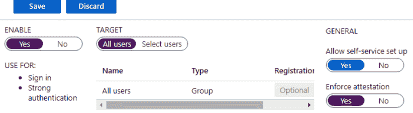

你还可以使用密钥限制策略，通过输入带有验证器证明 GUID (AAGUID) 的设备的允许或阻止列表，来指定最终用户可以在你的租户中使用哪些 FIDO2 密钥。

FIDO2 规范要求每个安全密钥提供程序在证明期间提供 AAGUID。AAGUID 是一个 128 位标识符，用于指示密钥类型，例如制造商和型号。

你现在已完成先决条件，可以开始使用 FIDO2 密钥。通过 Microsoft Authenticator 移动应用使用无密码身份验证时，你会看到以下 AAD 登录屏幕，全程无需输入密码。

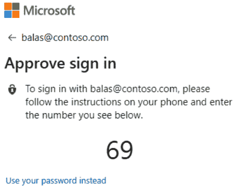

无密码登录更加安全，最终用户几乎无需在任何地方输入密码。

接下来，我们将展示一个表格，说明最终用户可以在哪些场景中使用无密码登录。

## 每种无密码方案支持和不支持的内容

Microsoft 的无密码身份验证方法支持不同的场景。在选择无密码身份验证策略之前，需要考虑每种身份验证方法的组织需求、先决条件和功能。

> **注意**
> 无密码身份验证无需额外费用。

在下表中，你可以看到基于不同场景的选项：

| 场景 | 手机身份验证 | 安全密钥 | Windows Hello for Business |
|---|---|---|---|
| 计算机登录：从已分配的 Windows 10 设备 | 否 | 是，支持生物识别和/或 PIN | 是，支持生物识别和/或 PIN |
| 计算机登录：从共享的 Windows 10 设备 | 否 | 是，支持生物识别和/或 PIN | 否 |
| Web 应用登录：从用户专用计算机 | 是 | 是，前提是计算机登录已为应用启用 SSO | 是，前提是计算机登录已为应用启用 SSO |
| Web 登录：从移动设备或非 Windows 设备 | 是 | 否 | 否 |
| 计算机登录：从非 Windows 计算机 | 否 | 否 | 否 |

本节关于无密码登录的内容到此结束。接下来，我们将介绍 BitLocker 磁盘加密。

## BitLocker 磁盘加密

自 Windows Vista 首次发布以来，BitLocker 一直可用，它提供了加密连接到终结点的驱动器的选项。在大多数情况下，BitLocker 可以与带有受信任的平台模块 (TPM) 芯片的终结点配合使用。

只要你能够通过设备身份验证，并且不会将操作系统磁盘从终结点中取出并更换为另一台设备，你就不太可能需要使用与设备磁盘关联的 BitLocker 密钥来解密所有内容。服务台操作员角色将能够访问所有密钥以进行还原：

- 1. 要为 Windows 10 或 Windows 11 终结点启用 BitLocker，你必须转到终结点安全，然后选择磁盘加密。

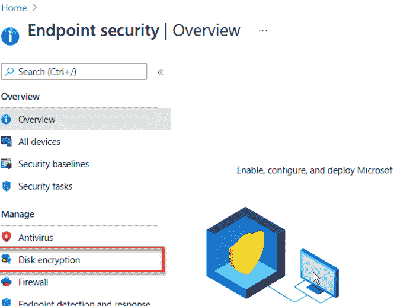

图 13.38 – 终结点安全 – 磁盘加密

> 注意
> BitLocker 目前尚不支持 Windows 365。

2. 单击“创建策略”。
3. 选择 Windows 10 及更高版本作为平台，并为配置文件选择 BitLocker。

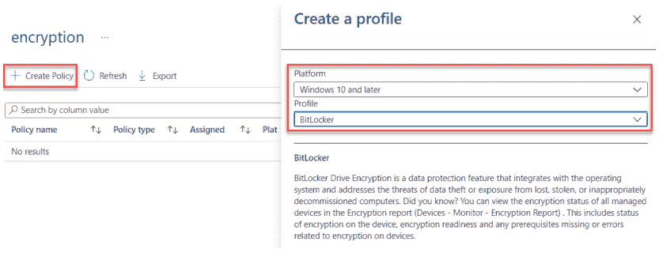

图 13.39 – BitLocker 配置文件

4. 为策略输入名称。
5. 更改 BitLocker 基本设置以满足你的需求。以下是对每个设置含义的简要说明：

- 为操作系统和固定数据驱动器启用全磁盘加密：如果未配置，将不会执行任何 BitLocker 强制措施。如果驱动器在应用此策略之前已加密，则不会采取额外操作。如果加密方法和选项与此策略匹配，配置应返回成功。
- BitLocker 固定驱动器策略：此策略设置用于控制固定驱动器的 BitLocker。此策略的值决定 BitLocker 用于加密的密码强度。
- BitLocker 系统驱动器策略：此策略设置用于控制系统驱动器的 BitLocker。此策略的值决定 BitLocker 用于加密的密码强度。
- BitLocker 可移动驱动器策略：此策略设置用于控制可移动驱动器的 BitLocker。此策略的值决定 BitLocker 用于加密的密码强度。

很可能你想要为操作系统和固定驱动器启用全磁盘加密，包括可能轮换恢复密码以提高安全性。

在 Windows 10 设备上配置静默加密时，请考虑以下最佳实践：

- 使用*推荐*设置创建 BitLocker 策略。

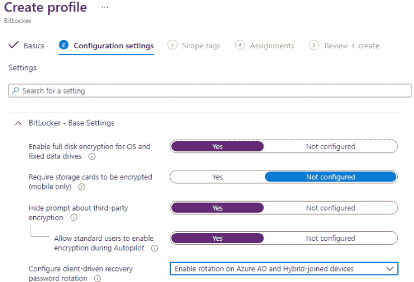

图 13.40 – 配置设置

- 在**固定驱动器设置**和**操作系统驱动器设置**部分，你可以调整基本设置以使其更严格。

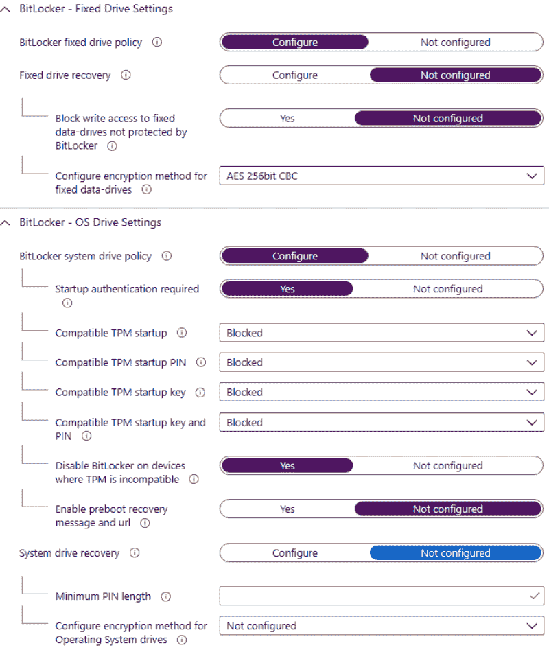

图 13.41 – BitLocker 固定驱动器设置

> **重要说明**
> 
> 如果将这些设置配置为“必需”，BitLocker 将无法静默加密设备，因为这些设置需要用户交互。

完成 BitLocker 特定配置后，你必须完成分配，很可能基于 AAD 用户或组进行分配。

## BitLocker 恢复密钥

当你的终结点出现问题并且需要恢复驱动器时，你很可能会需要恢复密钥。幸运的是，BitLocker 密钥会自动保存到 MEM。

你可以在 MEM 中的**设备 | *用户的设备* | 恢复密钥**下找到设备的 BitLocker 恢复密钥：

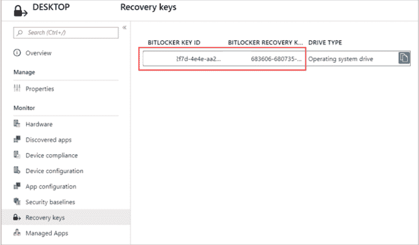

图 13.42 – BitLocker 恢复密钥

在 Windows 10 的密钥字段中输入恢复密钥，一切就绪了！

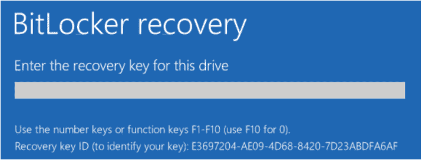

图 13.43 – BitLocker 恢复

在不知道设备名称的情况下，你可以在 AAD 管理中心中搜索设备的 BitLocker 恢复密钥，路径为**设备 | BitLocker 密钥**。

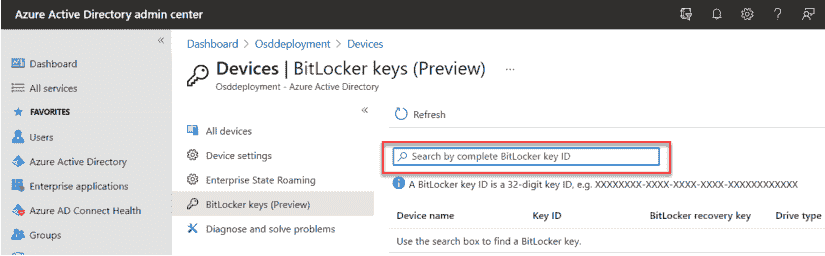

图 13.44 – 搜索 BitLocker 密钥

本节关于 Microsoft Intune 中 BitLocker 管理的内容到此结束。接下来，我们将介绍 Microsoft Defender for Endpoint。

## Microsoft Defender for Endpoint

Microsoft Defender for Endpoint 是 Microsoft 的企业终结点安全平台，旨在帮助企业防范、调查、检测和响应威胁。这有助于提高整个终结点配置的安全级别。

Microsoft Defender for Endpoint 是一个安全解决方案，包括基于风险的漏洞管理和评估、减少攻击面、基于行为和云端的新一代保护、**终结点检测和响应 (EDR)**、自动调查和修正、托管搜寻服务、丰富的 API 以及统一安全管理。

### 与 MEM 集成

对于使用 Windows 365/Azure 虚拟桌面的客户来说，MEM 变得越来越重要，因为它提供了一种统一的方式来配置和维护你的物理和虚拟云终结点以及其他设备（例如移动设备）。

Microsoft Defender for Endpoint 可无缝集成到 MEM。你只需要在初始设置期间激活一次 Intune 集成，你的报告就会流入 MEM。

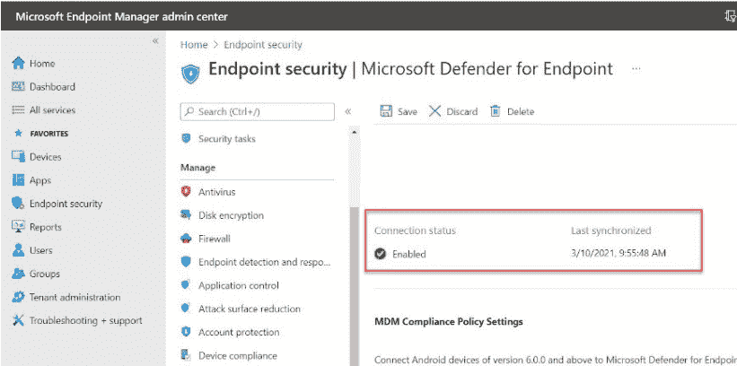

图 13.45 – Microsoft Defender for Endpoint

本节关于 Microsoft Defender for Endpoint 的概述到此结束。接下来，我们将向你概述安全基线。

## 安全基线

安全基线是预先配置的 Windows 设置组，可帮助你应用由相关安全团队推荐的安全设置。你可以自定义部署的基线，以仅强制执行你需要的设置和值。

Windows 以及 Microsoft Edge 中有多个与安全相关的设置可用于你的终结点。另一个重要优势是，可以基于不同的操作系统或需要更严格控制的场景进行版本控制和筛选。你不再需要使用 GPO 来确保终结点的安全设置——只需创建一个安全基线配置文件，一切就绪。

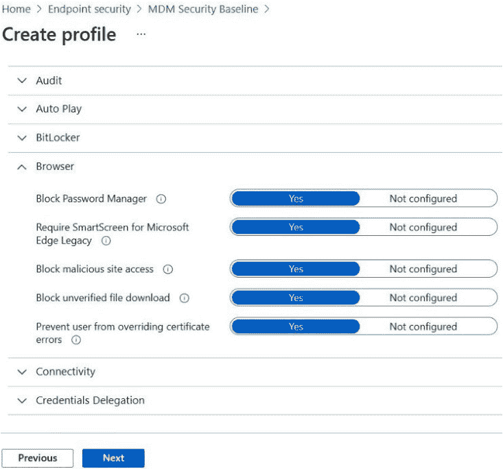

图 13.46 – MDM 安全基线

本节安全基线概述到此结束。接下来，我们将介绍合规策略。


## 合规策略

我们可以定义用户和设备必须满足的规则和设置才能合规。这可以包括适用于不合规设备的操作。针对不合规的操作可以向用户发出不合规条件警报，并保护不合规设备上的数据。

请参阅以下示例，了解当你的终结点不符合合规预期时，如何在 Microsoft Defender 中设置风险级别。你的设备将在 Microsoft Defender for Endpoint 和 Intune 中显示为风险设备，并标记为不合规。

主页 > 设备 > 合规策略 >

### Windows 10 合规策略

Windows 10 及更高版本

有效的操作系统内部版本

Configuration Manager 合规性

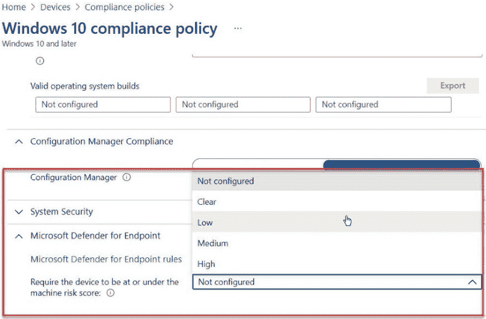

图 13.47 – Microsoft Defender for Endpoint 合规设置

### 注意

有关合规策略的更多信息，请参阅第 10 章“高级策略管理”。

## Windows 365 安全基线

Windows 365 提供其自有品牌的安全基线，其中包含针对云电脑虚拟化场景优化的各种最佳实践。

我们强烈建议客户使用这些基线，因为它们来自实际实施经验。你可以使用这些策略来降低风险，同时提高云电脑的安全边界。

你可以使用安全基线获取有助于降低风险的安全建议。Windows 365 基线支持 Windows 10、Edge 和 Microsoft Defender for Endpoint 的安全配置。这些基线包含版本管理功能，可帮助客户选择何时将用户策略更新到最新版本。

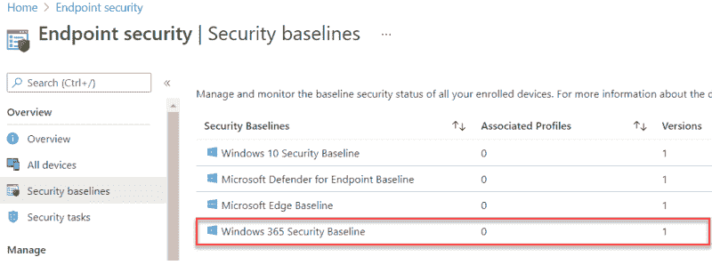

图 13.48 – 安全基线

### Defender for Endpoint 的要求

在本节的下一部分，我将解释如何通过 MEM 配置 Microsoft Defender for Endpoint，以保护你的虚拟或物理 Windows 终结点：

- 1. 通过 https://endpoint.microsoft.com/#home 转到 MEM 管理中心。
- 2. 转到终结点安全性。

图 13.49 – 终结点安全性

3. 单击“打开 Microsoft Defender 安全中心”。

图 13.50 – Microsoft Defender for Endpoint

4. 单击**下一步**。

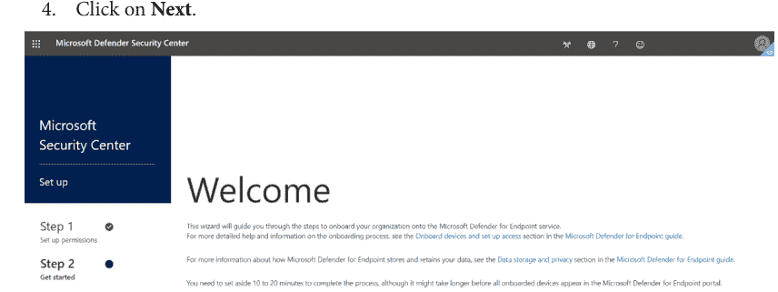

图 13.51 – Microsoft Defender 安全中心 – 第 2 步

5. 填写你的区域、数据保留策略时间和组织规模。

> **注意**
> 你还可以选择**预览功能**选项，率先体验即将推出的功能。

单击**下一步**。


图 13.52 – Microsoft Defender 安全中心 – 第 3 步

- 6. 确保所有设置正确无误，因为无法返回。单击**继续**。

### 创建云实例

单击“继续”后，你将无法更改某些偏好设置（例如数据存储位置）。如果要检查或进行任何更改，请单击“返回偏好设置”并查看你的偏好设置。如果希望设置你的帐户，请单击“继续”。


图 13.53 – 创建云实例

7. 正在创建你的 Microsoft Defender for Endpoint 帐户，请稍候。


图 13.54 – Microsoft Defender 安全中心 – 第 3 步

现在，你已准备好创建 Microsoft Defender for Endpoint 与 Microsoft Intune 的集成。

### 连接到 Intune – MEM 集成

按照以下步骤继续集成：

- 1. 打开安全中心门户：https://securitycenter.windows.com/。
- 2. 转到“设置”。


图 13.55 – 设置

3. 将“Microsoft Intune 连接”旁边的滑块打开。

### 设置


图 13.56 – Microsoft Intune 连接

4. 单击“保存偏好设置”。


图 13.57 – 已保存偏好设置

5. 此时，Microsoft Defender 已集成到 MEM 中。你可以在“终结点安全性”菜单中查看状态。

连接状态
已启用
上次同步时间
7/16/2021, 11:10:10 AM

### MDM 合规策略设置

将 Android 设备连接到 Microsoft Defender for Endpoint

将 iOS 设备连接到 Microsoft Defender for Endpoint

将 Windows 设备连接到 Microsoft Defender for Endpoint

阻止不支持的 OS 版本

### 应用保护策略设置

将 Android 设备连接到 Microsoft Defender for Endpoint 以进行应用保护策略评估

将 iOS 设备连接到 Microsoft Defender for Endpoint 以进行应用保护策略评估

### 通用共享设置

合作伙伴无响应之前的天数

图 13.58 – 连接器和令牌 – Microsoft Defender for Endpoint

> 注意
> 启用后，使用设备威胁级别规则的合规策略将评估设备，包括来自此连接器的数据。禁用后，对于配置了设备威胁级别的策略，Intune 将不会在设备合规性计算中使用通过此连接器发送的设备风险详细信息。由于从此连接器获取的风险级别而不合规的现有设备也将变为合规。

MDM 合规策略设置：启用后，使用“设备威胁级别”规则的合规策略将评估设备，包括来自此连接器的数据，建议利用设备威胁级别作为 Windows 设备合规策略的一部分。

禁用后，对于配置了“设备威胁级别”的策略，Intune 在设备合规性计算期间将不会使用通过此连接器发送的设备风险详细信息。由于从此连接器获取的风险级别而不合规的现有设备也将变为合规。

### MDM 合规策略设置


图 13.59 – MDM 合规策略设置

- 6. 我们现在需要将 Windows 终结点注册到 Defender 中。


图 13.60 – Windows 10 设备 – Microsoft Defender for Endpoint 运行状态

- 7. 切换回 MEM 门户。

8. 转到**终结点安全性**，然后转到**终结点检测和响应**。


图 13.61 – 终结点检测和响应

开始之前，请下载你的 Defender 载入文件。你可以在 Defender 的“设置 | 载入”下找到该文件：https://securitycenter.windows.com/preferences2/onboarding。

图 13.62 – 正在下载载入文件

9. 将其存储在你的计算机上的某个位置，并解压缩该文件夹。

图 13.63 – 保存载入文件

- 10. 在相应字段中选择**Windows 10 及更高版本**和**终结点检测和响应 (MDM)**。


图 13.64 – 创建终结点检测和响应 (MDM) 配置文件

- 11. 输入名称，然后单击**下一步**。


图 13.65 – 创建配置文件 1

12. 启用“载入 blob”设置。

### 创建配置文件

终结点检测和响应

终结点检测和响应

Microsoft Defender for Endpoint 客户端配置包类型

载入 blob

图 13.66 – 创建配置文件 2

13. 选择你之前下载的 WindowsDefenderATP.onboarding 文件并将其上传到你的租户。

### 选择文件

选择文件

“WindowsDefenderATP.onboarding”

选择

图 13.67 – 正在上传载入文件

14. 确认载入文件已正确添加。此文件包含将推送到终结点的配置，以便它们了解如何连接到你的 Defender for Endpoint 租户。


图 13.68 – 正在创建终结点载入配置文件

15. 单击“下一步”。

主页 > 终结点安全性 >

### 创建配置文件

终结点检测和响应

基本信息  配置设置  作用域标记  分配  查看 + 创建

作用域标记

作用域标记

默认

+ 选择作用域标记

图 13.69 – 作用域标记

16. 单击“添加所有设备”，然后单击“下一步”。

主页 > 终结点安全性 >

### 创建配置文件

终结点检测和响应

基本信息  配置设置  作用域标记  分配  查看 + 创建

包含的组

添加组  添加所有用户  添加所有设备

组

所有设备

移除

图 13.70 – 分配


# 17. 单击“创建”。

主页 > 终结点安全 >

# 创建配置文件 ...

终结点检测和响应

基础知识  配置设置  范围标记  分配  5 查看 + 创建

# 摘要

# 基础知识

名称
Defender for Endpoint 注册
说明
--
平台
Windows 10 及更高版本

# 配置设置

自动填充 Microsoft Defender for Endpoint 加入 blob
未配置
Microsoft Defender for Endpoint 客户端配置包类型
加入 blob
Microsoft Defender for Endpoint 加入 blob
{"body":"{\"previousOrgIds\":[],\"orgId\":\"d2a78cc6-0fbc-41eb-bfcc-1148f58163aa\",\"geoLocationUrl\":\"https://winatp-gw-eus.microsoft.com/\",\"dataCenter\":\"EastUs2\",\"vortexGeoLocation\":\"US\"\,\"version\":\"1.35\",\"sig\":\"S3lZVJb1RQuSwx9eLAlg/3Wadr4bRE7XF55cL5TwVhr5+Hi6rQzMqtWw/OyUjWibwONU20OPbQNOAhdZnnXMPNZDRh8dI0sh9KYgJbxGTRdEkE7LDV0X1wAtqG/4v7ViomQzxaZvJkvbZNKzdF7WKxNZHWtJ/6LUhNLRZAy89DzoU/HP99n2xKjg6CaB5bGKQlCLVdnIQwNfQgWJGyDeIoDktJ1/DolDImB8+VcG3z4o9TdBdp9T1GyRHC0Tzz1RHSbIZ/4fgUcbUwUmE5fK5Ho1y1EhCXhek/KZNXoH7w2pRAvEGEIMSbCMZbchvSRBGjigkptnA==\",\"sha256sig\":\"9pg1lSsxq8fS9T2dU7l1ymGNTJfL1+kfP4BsWRkuvmHLPwPppS5+3+N19pyyE0\"}

上一个  创建

图 13.71 – 创建策略

# 18. 确认规则在“已分配”下显示“是”。

主页 > 终结点安全

# 终结点安全 | 终结点检测和响应

搜索 (Ctrl+/)   + 创建策略  刷新  导出

概述
概述
所有设备
安全基线
安全任务

按列值搜索
策略名称  策略类型  已分配  平台  目标
Defender for Endpoint 注册  终结点检测和响应...  是  Windows 10 及更高版本  MDM

图 13.72 – 终结点检测和响应

现在，您应该会看到 Windows 10 虚拟或物理终结点的状态从**没有 Microsoft Defender for Endpoint 传感器的设备**更改为**具有 Microsoft Defender for Endpoint 传感器的设备**。

> **注意**
> 此视图中的设备数量仅显示通过 Microsoft Intune 加入配置文件加入的设备，不包括通过脚本、Microsoft Endpoint Configuration Manager 或第三方工具加入的设备。

接下来，我们将介绍 Microsoft Defender 安全中心中的不同选项。

## 警报和安全评估

完成部署和激活后，并配置了一些安全基线和合规性配置文件并将其分配给您的桌面设备，您就可以在 Microsoft Defender 安全中心控制台中查看设备。当您单击设备时，您可以深入了解正在检测到的不同评估和警报（如果有）。

## 安全建议

Microsoft Defender 还建议在**安全建议**选项卡中激活不同的功能，以提高桌面的安全级别。在此处，您可以找到多个设置，当您正确设置与 Intune 租户环境的连接后，可以直接启用这些设置并将其推送到 Intune。


## 摘要

在本章中，您了解了 AD 和 AAD 的历史，以及使用条件访问和 Microsoft Defender for Endpoint 更好地保护身份有哪些选择。

您学习了如何通过利用 Microsoft 零信任安全模型中的所有条件，在合规性策略中将 Microsoft 365 E5 的强大功能与 Microsoft Intune 管理设备上的设备合规性以及 Microsoft Defender for Endpoint 风险评分相结合，以仅允许访问公司数据。

在下一章中，我们将更深入地探讨如何使用 Endpoint analytics 监控您的 Windows 10 企业版终结点。

## 问题

+   1. 使用 Azure MFA 是否需要许可证？
+      A. 是
+      B. 否
+   2. 配置 Windows 10 设备以使用 Microsoft Defender for Endpoint 需要哪种配置配置文件设置？
+      A. 终结点集合和响应
+      B. 安全评估
+      C. 终结点检测和响应
+      D. 所有文件的示例共享

## 答案

+   1. (B)
+   2. (C)

## 延伸阅读

如果在阅读本章后想了解更多关于 AAD、条件访问和 Microsoft Defender for Endpoint 的信息，请使用以下免费在线资源之一：

+   - *Microsoft Defender for Endpoint – Microsoft 技术社区：* https://techcommunity.microsoft.com/t5/microsoft-defender-for-endpoint/bg-p/MicrosoftDefenderATPBlog
+   - *练习安全管理 – 学习 | Microsoft 文档：* https://docs.microsoft.com/en-us/learn/modules/m365-security-threat-protect/practice-security-administration
