# 14

# 监控和 Endpoint Analytics

部署桌面设备后，确保环境中物理和 Windows 365 云 PC 中 Windows 以及应用程序的性能和质量水平非常重要。

您将在本章中学习如何通过 Endpoint analytics、生产力评分以及 Microsoft Endpoint Manager 的其他监控功能来实现这一目标。

在本章中，我们将介绍以下主题：

+   - 监控和分析
+   - 监控您的物理和虚拟云终结点
+   - Endpoint analytics – 高级监控
+   - 影响启动进程的前 10 名
+   - 操作系统重启历史记录
+   - 资源性能
+   - 见解和建议 – 评分趋势
+   - 应用程序可靠性
+   - Windows 365 特定指标
+   - 见解和建议
+   - 自定义基线
+   - 生产力评分
+   - 服务运行状况

## 监控和分析

监控您的 Windows 10 企业版环境与实施它同样重要。用户体验是成功实施中最重要的部分。

Microsoft Endpoint analytics 和生产力评分作为内置服务，使您能够在环境中可能遇到的问题发生之前提前应对。作为此服务的一部分，您无需额外环境或为基于消耗的资源付费；一切都包含在您的 Microsoft 365 许可证中。您将在本章中阅读与此相关的所有需要了解的内容！

## 监控您的物理和虚拟云终结点

如果您是现有的 Microsoft Endpoint Manager 客户，您可能已经使用“设备”菜单中的“监视”选项。由于 Windows 365 等同于物理 Windows 10 企业版桌面，您可以在此处统一监控虚拟设备和物理设备，以获得统一的体验。

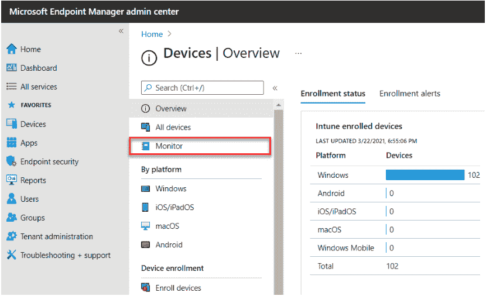

# 图 14.1 – Microsoft Endpoint Manager 管理中心

您可以收集有关环境的见解，也可以考虑应用许可证、已发现应用、应用安装和应用保护状态等指标。

以下是可用的不同监控仪表板的完整列表：

+   - **配置：**
+     - 分配状态
+     - 分配失败
+     - 具有受限应用的设备
+     - 加密报告
+     - 证书
+   - **合规性：**
+     - 不合规设备
+     - 没有合规性策略的设备
+     - 设置合规性
+     - 策略合规性
+     - 不合规策略
+     - Windows 运行状况证明报告
+     - 威胁代理状态
+   - **注册：**
+     - Autopilot 部署
+     - 注册失败
+     - 不完整的用户注册
+   - **软件更新：**
+     - 每个更新环的部署状态
+     - iOS 设备的安装失败
+     - 功能更新失败
+     - Windows 加速更新失败
+   - **其他：**
+     - 设备操作

例如，您可以轻松找出正在部署哪些应用以及成功数量，如下一节示例所示。

## Endpoint analytics – 高级监控

Endpoint analytics 的主要目的是主动优化用户体验并在此过程中跟踪您的进度。作为 IT 管理员，它是您跟踪物理和虚拟桌面环境质量水平的主要仪表板。

您可以找到的指标显示了环境中所有 Microsoft Endpoint Manager 管理设备的价值，例如，您的物理设备与 Windows 10 或 11 云 PC 合计的价值。

以下是 Endpoint analytics 中当前可用的报告/仪表板列表：

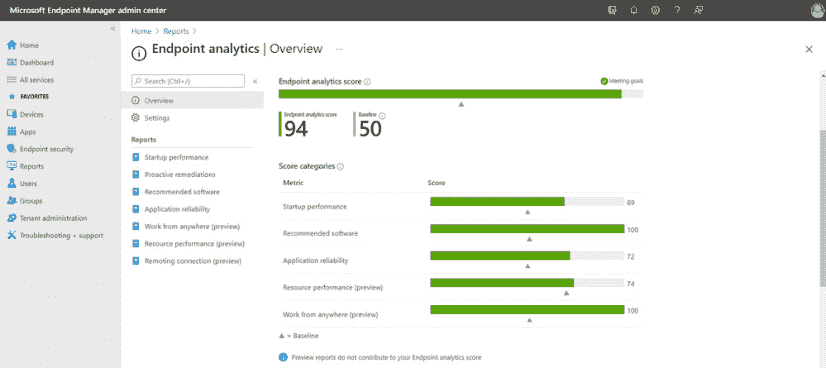

图 14.2 – 环境概览

### 启动性能 – 登录持续时间

改善启动性能以优化从打开物理计算机到高效工作的时间，最适合在提高工作效率速度方面实现一致的性能。

查看您当前的分数，并将其与所选基线进行比较。参阅不同的见解和建议列表，了解如何改善设备启动时间和分数；这些可以在 Endpoint analytics 仪表板中找到。

以下是 Endpoint analytics 中可用的指标列表，按组织和每台用户设备级别划分，以便深入挖掘特定场景：

- **Core boot**：设备开机后达到登录提示的平均时间。排除操作系统更新时间：
- **Group Policy**：设备核心启动期间处理组策略所花费的平均时间
- **To sign-in screen**：核心启动时间减去处理组策略所花费的时间
- **Core sign-in**：用户登录后达到响应式桌面的平均时间。排除新用户登录和功能更新后的首次登录：
- **Group Policy**：设备核心登录期间处理组策略所花费的平均时间
- **To desktop**：从登录到桌面渲染之间的平均时间，减去处理组策略所花费的时间
- **To responsive desktop**：从桌面渲染到 CPU 使用率降至 50% 以下之间的平均时间

启动性能评分让 IT 部门了解从开机到投入生产的终端用户体验。有了这些见解，就能获得改进终端用户体验的建议。接下来，我们将介绍性能评分的细分。

## Performance score breakdown

要计算租户的评分，我们会查看每台设备完成核心启动阶段所需的时间，并将每次体验从 0（较差）到 100（卓越）进行评分。然后我们计算所有设备的平均分，以获得核心启动评分。

在下面的屏幕截图中，您可以找到从物理机启动和登录过程到云 PC 甚至 Windows 10 Enterprise 端点的完整登录过程的示例细分。

## Startup score

Meeting goals

Startup score
65
Baseline
50

## Score breakdown

| Metric | Score/Baseline |
|---|---|
| Core boot score | 83 |
| Core sign-in score | 47 |

## Average startup time (in seconds)

| Startup phase | Average time/Baseline |
|---|---|
| Core boot | 22 |
| Group Policy | 0 |
| To sign-in screen | 22 |
| Core sign-in | 56 |
| Group Policy | 0 |
| To desktop | 21 |
| To responsive desktop | 36 |

Figure 14.3 – Performance score

如果您需要查看单台 Windows 10 物理机或云 PC 的个人状态，可以前往 **Endpoint Analytics | Reports | Startup performance | Device performance.**

Home > Reports > Endpoint analytics

## Endpoint analytics | Startup performance

Startup score   Model performance   Device performance   Startup processes   Restart frequency

查看租户中设备的启动时间和重启频率。选择一台设备以深入了解启动详情。Learn more.

Refresh   Export   Columns

Search by device name, model, manufacturer, or disk type

Showing 1 to 32 of 32 records

| Device name | Model | Manufacturer | Disk type | Core boot time (s...) | Core sign-in time ... |
|---|---|---|---|---|---|
| msftAADJTestN-1 | Virtual Machine | Microsoft Corporation | Unknown | 37 | 0 |
| msftAADJTest-1 | Virtual Machine | Microsoft Corporation | Unknown | 43 | 48 |
| gpotest1 | Virtual Machine | Microsoft Corporation | Unknown | 43 | 35 |

Figure 14.4 – Device performance

点击设备名称后，会显示不同的个人指标。在这里，您可以找到端点的登录持续时间和启动历史记录。

## Important note

登录历史记录已分段，以便更轻松地找到延迟的潜在根本原因。

## Boot history

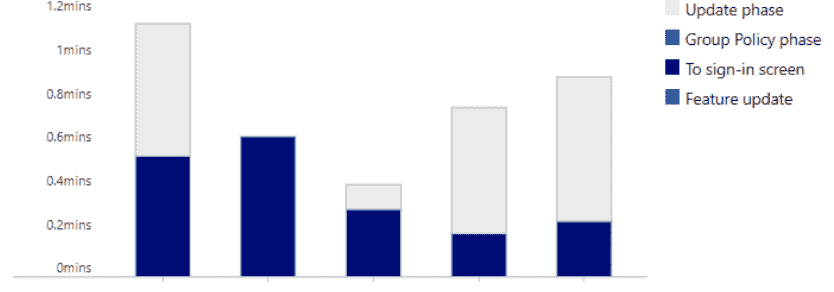

Figure 14.5 – Boot history

如果向下滚动一点，您也可以在这里找到登录历史记录。这是跟踪性能是否下降（或未下降）的最简单方法。

## Sign-in history

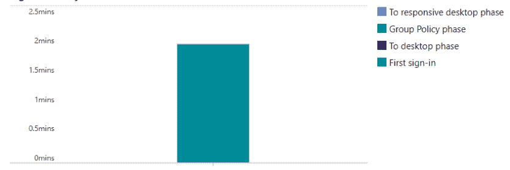

Figure 14.6 – Sign-in history

如果您的云 PC 性能不佳并导致大量 CPU 峰值，Endpoint analytics 将建议您调整云 PC 的大小。这是一种新的主动方法，可确保终端用户的性能。

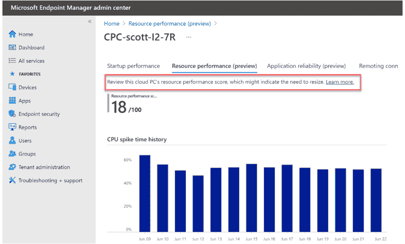

Figure 14.7 – Resource performance

您可以在 Microsoft Endpoint Manager 门户中找到此功能（预览版），在 Devices 下；选择 Resize 按钮，如以下屏幕截图所示：

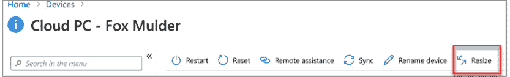

Figure 14.8 – Resize feature

点击 **Resize** 后，您将被带到以下屏幕：

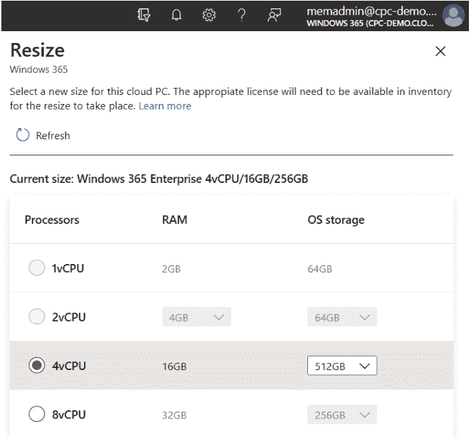

Figure 14.9 – Resize

在本节中，我们介绍了 Windows 365 的 Endpoint analytics 报告。接下来，我们将更深入地了解 Endpoint analytics 可为您提供的 Windows 设备详细数据。

## Top 10 impacting start up processes

在 **startup performance** 下的 **device performance** 刀片中，您可以选择单台设备，显示对设备启动性能影响最大的前 10 个进程。

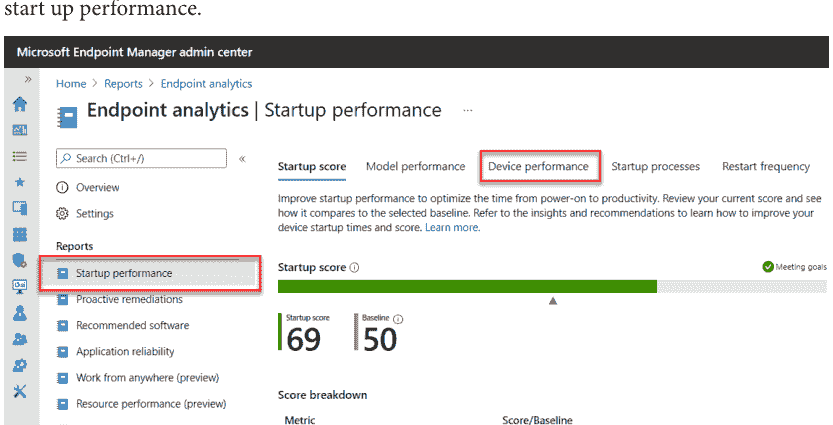

Figure 14.10 – Startup performance

此数据在 **Device** 刀片中也可见，如果您进入特定设备然后转到 **Monitor | User Experience。**

## Top 10 impacting startup processes ①

| Process name | Description | Publisher | Impact (seconds) |
|---|---|---|---|
| WmiPrvSE | WMI Provider Host | Microsoft Corporation | 6 |
| omadmclient | Windows MDM Client | Unknown | 5 |
| svchost-netsvcs | Service Host: netsvcs | Microsoft Corporation | 1 |
| svchost-RPCSS | Service Host: RPCSS | Microsoft Corporation | 1 |
| svchost-UnistackSvcGroup | Service Host: UnistackSvcGroup | Microsoft Corporation | 1 |
| svchost-DcomLaunch | Service Host: DcomLaunch | Microsoft Corporation | 1 |
| svchost-LocalSystemNetworkRestricted | Service Host: LocalSystemNetworkRestri... | Microsoft Corporation | 1 |
| svchost-LocalServiceNetworkRestricted | Service Host: LocalServiceNetworkRestri... | Microsoft Corporation | 1 |
| svchost-AppReadiness | Service Host: AppReadiness | Microsoft Corporation | 1 |
| svchost-LocalServiceNoNetwork | Service Host: LocalServiceNoNetwork | Microsoft Corporation | 1 |

Figure 14.11 – Top 10 impacting start up processes

## OS restart history

最后，您还可以在仪表板的最后一部分找到每台物理机和云 PC 上的重启操作：

## OS restart history ①

| Date | OS version | Restart category | Stop code | Failure bucket Id |
|---|---|---|---|---|
| 03/30/21 | 10.0.19042.867 | Update |  |  |
| 04/15/21 | 10.0.19042.928 | Update |  |  |

Figure 14.12 – OS restart history

## Resource performance

在此仪表板中，可以查看物理机和云 PC 上的应用程序事件。这为您提供了不良用户体验的最重要指标之一的洞察——CPU 和 RAM 利用率。

Resource score   Model performance   Device performance

查看当前的资源评分并了解其与所选基线的比较情况。参考见解和建议，了解如何提高资源评分。Learn more.

Baseline  All organizations (median)

Resource score  Meeting goals

Resource score 35   Baseline 39

## Resource performance metrics (14 days)

| Metric | Score/Baseline |
|---|---|
| CPU spike time score | 65 |
| RAM spike time score | 5 |

▲ = Baseline

Figure 14.13 – Resource utilization

## Insights and recommendations – score trends

您还可以查看最近 30 天的资源消耗情况以及是否存在趋势。这使得在您提供修复方案时，可以轻松查看改进是否影响了所有用户。

反之，当出现问题或您安装的更新比以前需要更多资源时，您可以开始将结果与该补丁或更新的注册时间相关联。非常有洞察力。

## Daily metric trends (30 days)

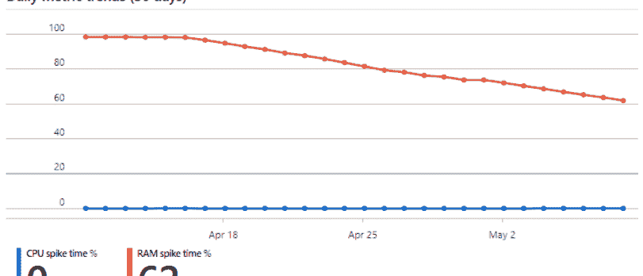

Figure 14.14 – Score trends

## Application reliability

健康的、高性能的应用程序使您组织中的用户能够保持生产力。查看当前的应用程序可靠性评分，并了解其与所选基线的比较情况。参考见解和建议，了解如何提高应用程序可靠性评分。

Home > Reports > Endpoint analytics

## Endpoint analytics | Application reliability (preview)

Search (Ctrl+/)

App reliability score   App performance   Model performance

Figure 14.15 – App reliability score

App reliability score 为 IT 管理员提供对环境中桌面应用程序稳健性的高层次视图。App reliability score 是一个介于 0 到 100 之间的数字。该分数是根据环境中每个桌面应用程序的应用程序可靠性评分计算得出的，该评分可在 App performance 选项卡中找到。

每个 App 性能 选项卡上的应用程序都会根据以下内容分配一个应用可靠性评分：

- **崩溃频率**：对于每个应用，有两个指标：
  - 应用崩溃的总数。
  - 在 14 天滚动窗口内的总使用时长用于计算 **App performance** 选项卡中的平均故障时间值。
- **总使用时长**：是 Endpoint analytics 中所有已注册设备使用时长的因素。这确保你获得最具破坏性的应用程序问题的[content]

每个 App 性能 选项卡上的应用程序都会根据以下内容分配一个应用可靠性评分：

- **崩溃频率**：对于每个应用，有两个指标：
  - 应用崩溃的总数。
  - 在 14 天滚动窗口内的总使用时长用于计算 **App performance** 选项卡中的平均故障时间值。
- **总使用时长**：是 Endpoint analytics 中所有已注册设备使用时长的因素。这确保你获得最具破坏性的应用程序问题的[content]

每个 App 性能 选项卡上的应用程序都会根据以下内容分配一个应用可靠性评分：

- **崩溃频率**：对于每个应用，有两个指标：
  - 应用崩溃的总数。
  - 在 14 天滚动窗口内的总使用时长用于计算 **App performance** 选项卡中的平均故障时间值。
- **总使用时长**：是 Endpoint analytics 中所有已注册设备使用时长的因素。这确保你获得最具破坏性的应用程序问题的优先数据，这些问题在应用可靠性评分中得到优先考虑。

## Windows 365 专属指标

另一个巨大的好处是，Endpoint analytics 也是你用来检查物理端点状态的工具。这意味着你可以创建一个单一的玻璃窗，一次性检查你的物理端点和云 PC 端点的状态。

有六个新的 Windows 365 Endpoint analytics 类别来衡量你的环境性能：

- **资源性能：**
  - CPU 峰值时间百分比
  - RAM 峰值时间百分比
- **远程连接：**
  - RD 客户端登录时间
  - RD 客户端登录失败
- **往返时间 Round Trip Time (RTT)**

以下屏幕截图是测量连接到你的 Windows 365 云 PC 环境的延迟的一个示例：

## 远程连接指标

| Metric | Current Value |
|---|---|
| Avg cloud PC round trip time ⓘ | 120ms |
| Avg cloud PC sign-in time ⓘ | 328.73s |

## 每日指标趋势（30 天）

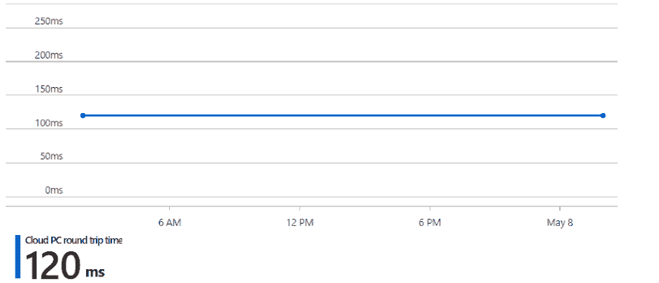

图 14.16 – 远程连接指标

以下是可用于衡量启动性能和登录时长的指标类型：

- **启动性能：**
  - Windows 365 云 PC 端点的启动时间
  - Windows 365 云 PC 端点的登录时间

以下是关于你的物理和云 PC 环境的启动时间、登录时长以及往返时间 RTT 的见解。

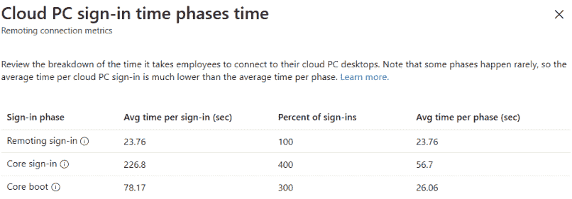

图 14.17 – 启动性能

- **主动修复：**
  - 自动操作以修复 Windows 365 云 PC 的常见问题
- **推荐软件：**
  - Windows 10 版本
  - **Azure Active Directory (AAD)** 设备
  - Intune 设备
- **应用程序健康：**
  - 云 PC 应用使用情况和崩溃

## 见解和建议

Endpoint analytics 还会在检测到环境中存在性能问题时为你提供建议。例如，如果在资源性能仪表板上检测到超过 90% 的 CPU 使用率，它会建议升级你的云 PC。这也适用于物理 PC。

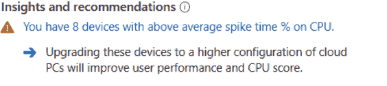

图 14.18 – 建议

## Configuration Manager 数据收集

你也可以从由 Microsoft Endpoint Configuration Manager 管理的设备收集用户体验数据以计算分数和见解。我们在 *第 6 章，Windows 部署和管理* 中解释了启用租户附加和共管理的步骤。

在 **Endpoint analytics | Settings** 菜单中，你可以了解连接是否正常工作。如果不正常，如以下示例所示，来自 Configuration Manager 的数据将不会显示在 Endpoint analytics 中。

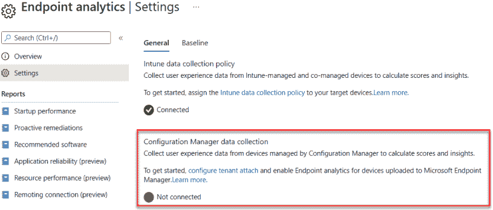

图 14.19 – 设置菜单

## 自定义你的基线

通过设置菜单将你的基线更改为自己的值，因为你可能有高于或低于默认设置的标准。这将允许组织根据其环境和应用程序的期望调整评分。

基线定义了分数以及指标在 Endpoint analytics 中显示为绿色或红色。谨慎定义自己的基线，以确保你的 Windows 10 物理和云 PC 的质量和性能水平。

你可以在以下屏幕截图中看到如何更改基线回归阈值。你可以在 Endpoint analytics | Settings 下找到此设置。

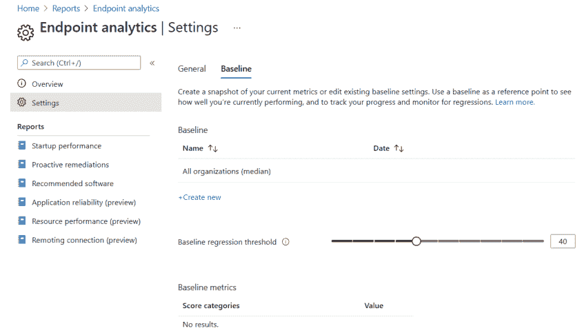

图 14.20 – 更改基线

## 主动修复

使用 Endpoint analytics 的另一个好处是你可以在设备上创建和运行脚本包，以主动查找并修复组织中排名靠前的支持问题。

例如，你可以创建检测脚本来搜索 Windows 10 端点上的设置——如果设置或注册表项不再存在，它会触发修复脚本以恢复设置。这是一种非常独特和主动的方式来确保你的环境保持一致。

以下屏幕截图中显示的部分允许你查看已部署脚本包的状态并监控检测和修复结果。结果显示为受影响的设备数量。

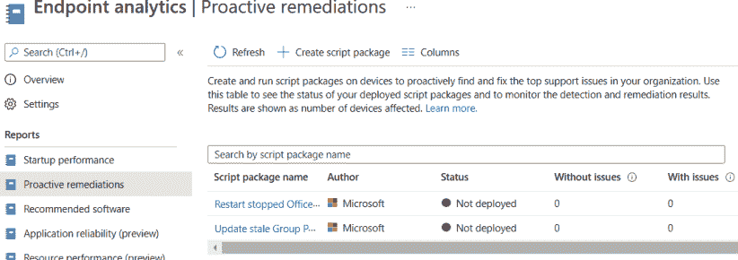

图 14.21 – 主动修复

如果你想自己创建一个主动修复脚本包操作，只需点击 + Create script package。

为脚本输入名称并使用正确的设置配置检测和修复脚本，如以下示例所示。

## 重要说明

如果你向 64 位 Windows 端点添加注册表项，请确保启用 Run script in 64-bit PowerShell 以确保它位于正确的位置！

## 创建自定义脚本

从你编写的脚本创建自定义脚本包。默认情况下，脚本每天在分配的设备上运行。

Detection script file *

Select a file

Detection script

Input script text

Remediation script file

Select a file

Remediation script

Input script text

Run this script using the logged-on credentials

Yes No

Enforce script signature check

Yes No

Run script in 64-bit PowerShell

Yes No

Previous

Next

图 14.22 – 创建自定义脚本

将自定义脚本操作分配给正确的组/用户，无论是通过 AAD 还是按设备进行，检测将立即开始：

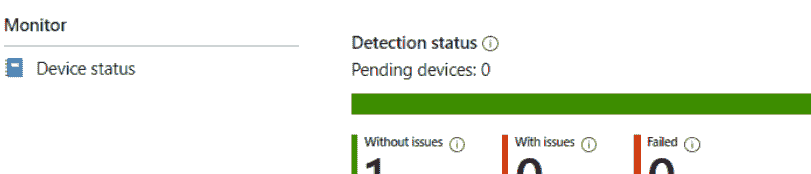

图 14.23 – 检测状态

## Azure Monitor 集成

也可以将诊断信息导出到 Azure Monitor，以便你可以查询数据并随心所欲地使用它。例如，你可以创建工作簿来映射你的环境状态。

要启用此功能，请激活其中一个诊断设置。还涉及额外的成本，因为它需要存储帐户和 Log Analytics 工作区。

以下日志列表可以自动导出到 Log Analytics 工作区：

- AuditLogs
- OperationalLogs
- DeviceComplianceOrg
- Devices

通过在诊断设置中为 Microsoft Endpoint Manager 启用日志分析集成，如以下屏幕截图所示，你将能够基于收集在 Azure Monitor 中的遥测数据创建查询和自定义仪表板：

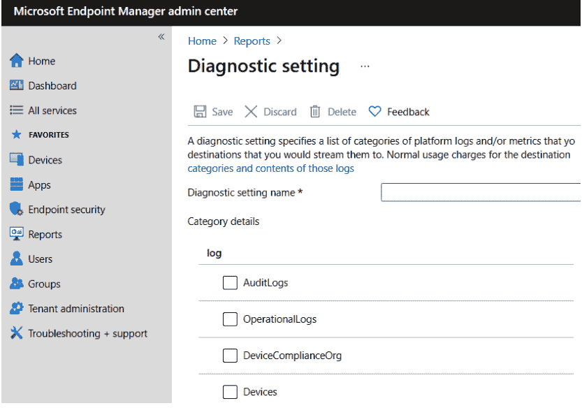

图 14.24 – 诊断设置

## 生产力评分

Endpoint analytics 包含很棒的见解，但大多数人无法看到它们，因为它需要访问 Microsoft Endpoint Manager 管理中心。如果你是 Intune 管理员或具有全局管理员角色，你可以显示分析。

通过生产力评分，你可以量化 Microsoft Endpoint Manager 如何在你的环境中实现生产力。

生产力评分中的一些重要指标如下：

- 了解用户生产力如何受到底层技术性能因素的影响。
- 专注于需要改进的领域。
- 根据整体体验影响，在技术领域分配分数。

以下是作为你的 Windows 10 端点一部分的 Microsoft 365 活动健康的示例。

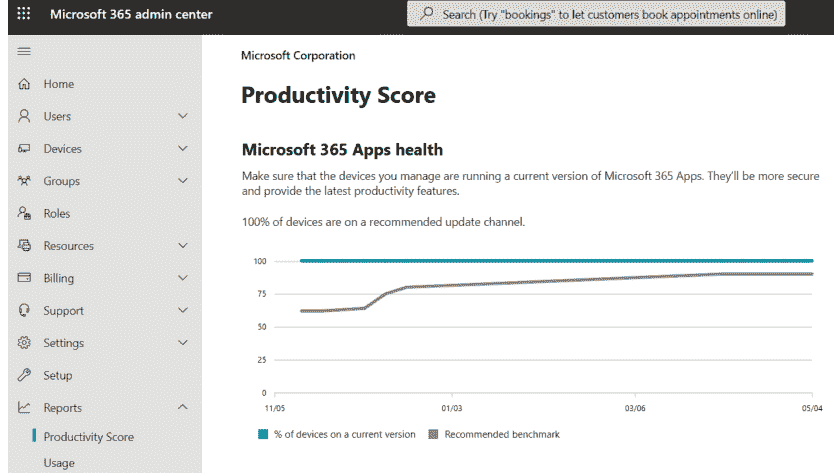

图 14.25 – 生产力评分

## 服务运行状况

除了 Microsoft Endpoint Manager 中前面章节中解释的 Endpoint analytics 和其他监控功能外，你还可以从高层次监控服务可用性。

如果您在 Windows 365、Microsoft 365 或 Microsoft Endpoint Manager 中遇到问题或其他故障，您可以在联系支持或花费时间进行故障排除之前，检查服务运行状况以确定这是否是已知问题且正在解决中。

要*查找* **服务运行状况** 仪表板，您必须*打开* Microsoft 365 管理中心门户。

依次转到 **Health**，然后转到 **Service health**。

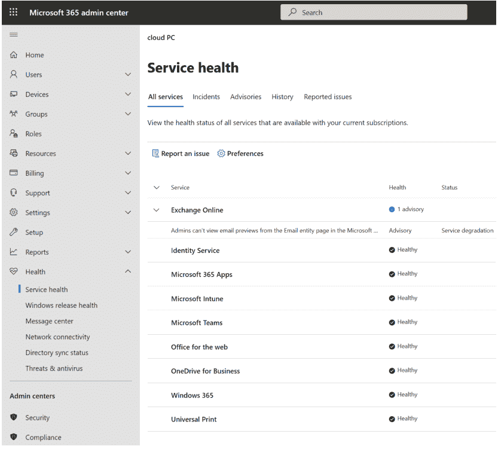

图 14.26 – 服务运行状况

至此，关于监控和 Endpoint analytics 的章节就结束了。正如我们所展示的，只有在您的环境中启用 Endpoint analytics，您才能更深入地了解您的 Windows 环境。

## Summary

在本章中，您了解了 Microsoft Endpoint Manager 中不同的监控、分析和报告功能。Endpoint analytics 为您提供了可以做出反应的宝贵见解，但修复脚本可以选择在最终用户注意到问题之前检测到问题并进行修复。这是保持最终用户高效工作并将支持呼叫降至最低的最佳方式。Endpoint analytics 是 Microsoft Intune 和 Windows Enterprise 许可证的一部分，无需额外费用；您只需启用它即可开始获取有关您设备的數據，其中包括有关应用程序崩溃和重启原因的信息，包括蓝屏。

在下一章中，我们将向您解释如何使用 Microsoft Universal Print 简化您的传统打印环境。

## Questions

+   1. 是否可以衡量您的物理和云 PC 的登录持续时间？
+      A. 是
+      B. 否
+   2. 服务运行状况仪表板显示什么？
+      A. 不同 Microsoft 云服务的可用性
+      B. 不同 Microsoft 云服务的 SLA
+      C. 不同 Microsoft 云服务的停机时间

## Answers

+   1. (A)
+   2. (A)

## Further reading

如果您在阅读本章后想了解更多关于监控和分析的信息，请使用以下免费在线资源之一：

- What is Endpoint analytics? Microsoft Endpoint Manager | Microsoft Docs: https://docs.microsoft.com/en-us/mem/analytics/overview
- Endpoint analytics page in Microsoft Productivity Score – Microsoft Endpoint Manager | Microsoft Docs: https://docs.microsoft.com/en-us/mem/analytics/productivity-score
