## 15
Universal Print

企业越来越多地进行数字化操作；然而，在物理纸张上打印仍然很重要。Universal Print 是 Azure 上相对较新的平台即服务，可以将整个打印配置和维护流程与传统的打印服务器环境相比进行简化。

阅读本章后，您将能够将传统打印机和支持 Universal Print 的现代打印机连接到 Microsoft 云。我们还将更详细地了解如何通过 Microsoft Endpoint Manager 将打印机分配给物理 PC 和云 PC 作为终端。

长话短说，您将成为打印方面的专家！

在本章中，我们将介绍以下主题：

- What is Universal Print?
- Configuring Universal Print

### What is Universal Print?

Universal Print 是一种新的基于云的打印解决方案，允许 IT 管理员通过云共享打印机。Universal Print 消除了对本地打印服务器的需求，让您可以轻松地直接使用 Microsoft Endpoint Manager 管理和部署打印机，以便将其用作云和物理桌面的组成部分。

它使您能够直接通过 Microsoft Azure 中的集中式门户管理打印机。再见安装（和维护）设备和/或基础映像上的打印机驱动程序。此外，一切都与 Azure Active Directory (AD) 配合使用。这意味着用户可以使用他们用于其他 Microsoft 服务的同一组凭据，无论他们登录的是物理桌面还是在云中运行的虚拟桌面。

该服务的另一个好处是您很可能已经拥有许可证 – 大多数有资格使用 Microsoft Endpoint Manager 的客户也获得 Universal Print 许可证。您可以在本章后面的要求部分找到 Universal Print 所需的许可证。

### Universal Print – architecture explained

核心打印服务作为在 Azure 上运行的平台服务在云中运行，而 Universal Print 连接器(们)必须安装在运行 Windows Server 或 Windows 客户端操作系统的设备上。连接器设备可以是物理设备、本地虚拟化或托管在 Azure 上：

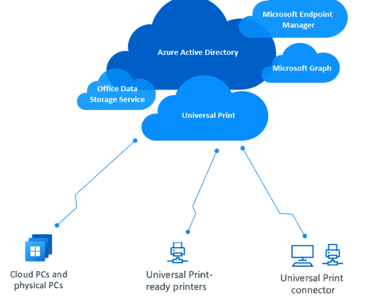

图 15.1 – Universal Print 的架构 – 经 Microsoft 许可使用

当您的打印机支持 Universal Print 时，您就可以直接将打印机连接到云！在所有场景中都不需要 ExpressRoute 或站点到站点 VPN 连接。您是否正确共享和连接了打印机？然后您就可以开始通过 Microsoft Endpoint Manager 将打印机分配给您的虚拟（和物理）Windows 10 Enterprise 桌面！

请参阅以下示例 – 支持 Universal Print 的 Lexmark 打印机的设置菜单：

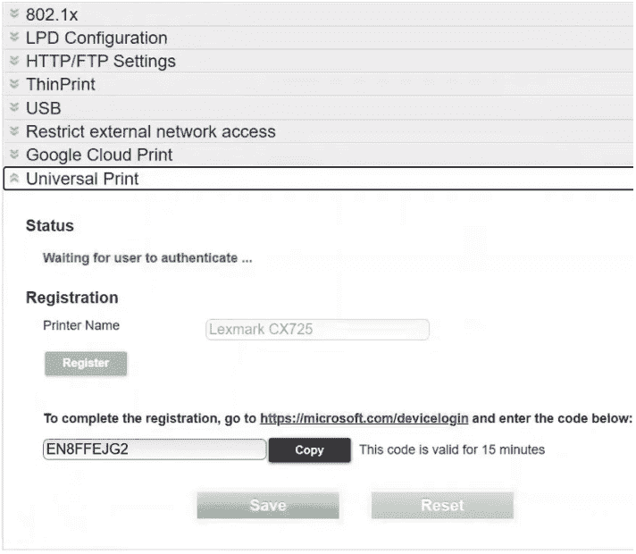

图 15.2 – Universal Print – Lexmark 打印机设置

本节解释了如何直接从打印机连接到 Universal Print 服务。现在，我们将切换到 Universal Print 连接器流程，并解释如何将非 Universal Print 就绪打印机连接到 Universal Print。

### The print connector

打印连接器是您本地位置与 Universal Print 服务之间的代理。如果您的打印机不支持 Universal Print，这将支持每种打印机场景。

请参阅以下打印连接器连接流程。我们将在本章后面更详细地解释此流程：

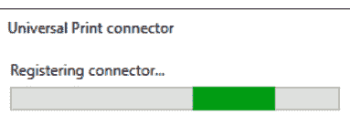

图 15.3 – Universal Print – 打印连接器

现在您知道如何连接打印机，我们可以开始解释数据流的工作方式。

### Where does my printed data go?

Universal Print 将所有打印队列存储在 Office 数据存储中。这是存储客户 Office 365 邮箱和 OneDrive 文件的同一存储。作业在打印队列中保留几天。如果作业在 3 天内未在打印机上被认领，则会被标记为已中止。即使打印后，作业也可能在 Universal Print 中保留几天（最长可达 10 天）。

### Printer defaults

所有 Universal Print 的管理都从 Azure 门户内进行，这也适用于更改打印机的默认设置，例如颜色模式、纸张大小、输出托盘等。通常，您会登录到传统的打印服务器；使用 Universal Print，您可以从云中通过一个管理控制台完成（请参阅以下示例）。

您定义的设置默认会被 Windows 10 物理或虚拟桌面继承：

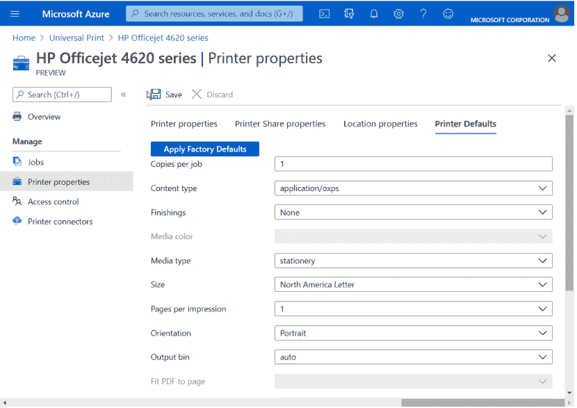

图 15.4 – Universal Print – 打印机默认值

让我们进入服务的系统要求，现在您已经了解了所有基础知识，可以开始试用。

### Universal Print – service requirements

在本节中，您将了解使用 Universal Print 的所有先决条件：

- 您的桌面应加入 Azure AD。**混合 AAD 加入 (HAADJ)** 物理和虚拟桌面也受支持。
- 一个 *符合条件* 的 Microsoft 365 或 Windows SKU 许可证。
- 通过全局管理员将 Universal Print 许可证分配给 Azure AD 租户。
- 一个支持 Universal Print 的打印机，可以直接连接到云 – 无需连接器。
- 普通 USB 或网络打印机（通过连接器）。
- 要配置 Universal Print，执行工作的管理员应具有打印机管理员 Azure AD 角色，或只是全局管理员。
- Windows 10 客户端设备 – 版本 1903 或更高版本。
- Universal Print 连接器主机。

在这些更具功能性和许可性的要求之后，让我们来看一下网络要求。由于 Universal Print 是一种云服务，您可以想象网络和防火墙非常重要。

### Network requirements

连接器和您的桌面应能够连接到以下 Universal Print 服务 URL：

- https://login.microsoftonline.com
- https://aadcdn.msftauth.net
- *.print.microsoft.com

够谈了。让我们切换到部署步骤，在您的环境中部署 Universal Print。

### Learning how to deploy Universal Print

在开始之前，请确保您的环境已启用混合 Azure Active Directory (AD) – 或仅 Azure AD。请确保已勾选第一个 Windows 10 或更高版本域加入设备的框。您可以在第 13 章《身份和安全管理》中找到有关如何设置混合 Azure AD 加入和 Azure AD 加入的信息。

另外，请确保已将 Universal Print 许可证分配给您的 Azure AD 租户。

请参阅以下屏幕截图，了解如何在设置流程期间更改您的 Azure AD Connect 配置以进行混合 Azure AD 加入：

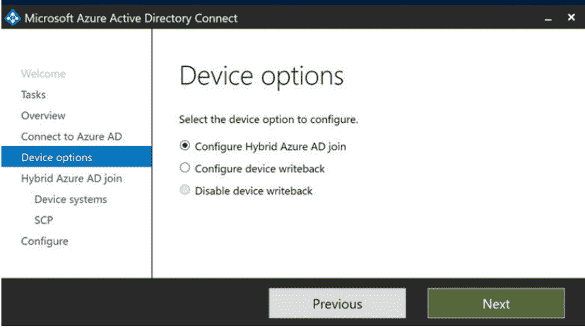

Figure 15.5 – Azure AD Connect – enable Hybrid Azure AD join

现在，让我们来看一下配置和维护 Universal Print 所需的权限。

## 委派打印机访问权限 – 自定义角色

如果您想要委派访问权限，例如，如果您需要使用除全局管理员之外的账户来配置 Universal Print 服务，那么要实现这一点，您需要为用户账户分配打印机管理员或打印机技术员权限。

请参阅以下屏幕截图以查看管理中心门户中的角色：

- Devices
  - Cloud device admin
  - Desktop Analytics admin
  - Intune admin
  - Printer admin
  - Printer tech

Figure 15.6 – Universal Print role-based access controls

有关增值解决方案简报和联系方式的更多信息，请访问这里：http://aka.ms/uppartners。

## 配置 Universal Print

让我们进入 Universal Print 的配置流程。在本节中，我们将解释您需要了解的有关购买许可证以及配置和为终端用户分配 Universal Print 打印机所需的一切。让我们开始：

- 1. 通过 portal.azure.com 进入 Azure 门户，并以全局管理员身份登录，或使用分配了打印机管理员/技术员角色的账户登录。
- 2. 搜索 Universal Print：

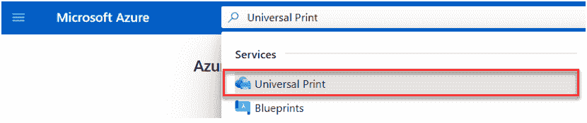

Figure 15.7 – Universal Print – Azure portal

- 3. 是否出现此错误？请确保已为您分配 Universal Print 许可证。

Figure 15.8 – Universal Print subscription prompt

- 4. 设置 Universal Print 连接器以连接到您的本地位置/打印机。

您自己的打印机无法直接与 Universal Print 连接，需要一个网桥/代理，这必须通过 Universal Print 连接器完成。

> **重要说明**
> 您也可以在其中一台旧版打印服务器上安装该软件以将其连接到 Universal Print 服务。

- 5. 在本地物理桌面上安装 Universal Print 连接器，即与您的打印机在同一网络上。

- 6. 在此处下载最新的 Universal Print 连接器：https://aka.ms/UPConnectorMSI。

- 7. 要安装 Universal Print 连接器，请点击 **Install**：

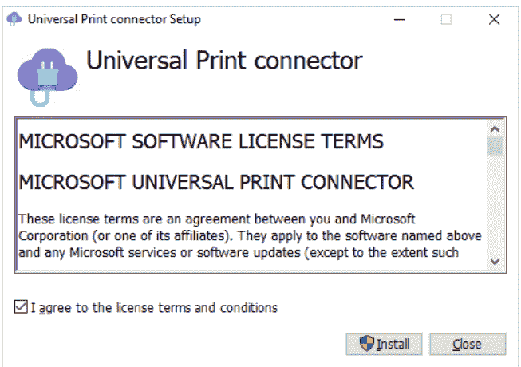

Figure 15.9 – Universal Print – print connector

安装准备就绪后，点击 **Launch**：

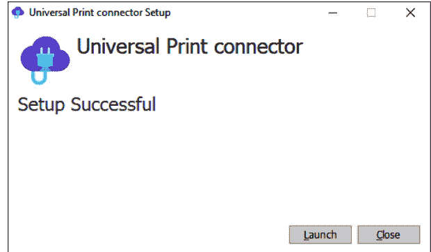

Figure 15.10 – Universal Print – print connector

8. 点击 **Ok** 确认诊断数据提示。

9. 点击 **Login**：

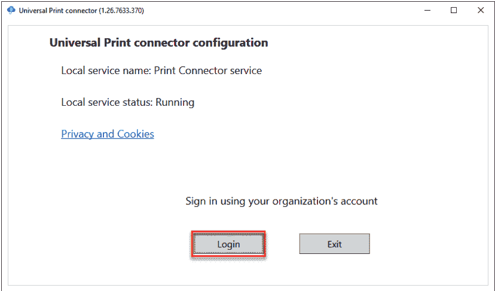

Figure 15.11 – Universal Print – print connector

10. 使用您的用户 Azure AD 凭据登录。

**重要说明**
无需使用打印管理员/全局管理员账户。

11. 为连接器输入一个名称 – 连接器稍后将在 Universal Print 管理门户中显示为指定打印机(们)的代理：

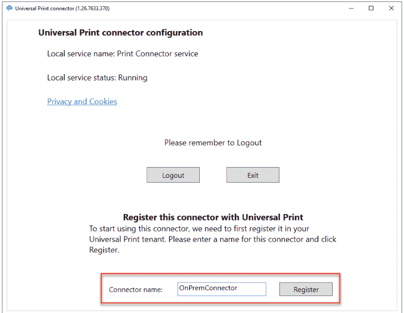

Figure 15.12 – Universal Print – print connector

连接器现在将注册到 Universal Print 服务。

12. 在连接器菜单中，您将看到连接器名称显示出来：

Figure 15.13 – Universal Print – print connector

**重要说明**

打印连接器将作为设备在 Azure Active Directory 中创建 – 作为具有对象 ID 的设备对象。

您可以在此处在 Azure 门户中看到一个示例：

Figure 15.14 – Azure AD – print connector

13. 您可以点击连接器名称查看该特定机器的一些详细信息及其状态：

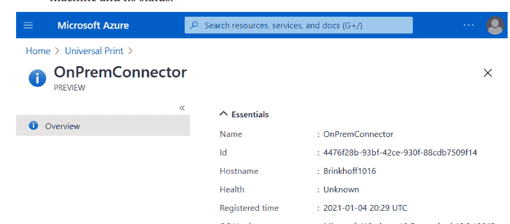

Figure 15.15 – Universal Print – print connector

配置连接器后，我们现在需要为混合 Azure AD 加入准备我们的域配置。

## 启用混合 AD 配置 – 通过 Universal Print 连接器

以下启用混合 AD 配置的步骤仅在终端为 Azure 混合 AD 加入时才需要。当您的物理终端已在 Azure AD 中处于活动状态时，您可以跳过以下步骤。

通过勾选 On 框在 Universal Print 连接器中激活混合 Azure AD：

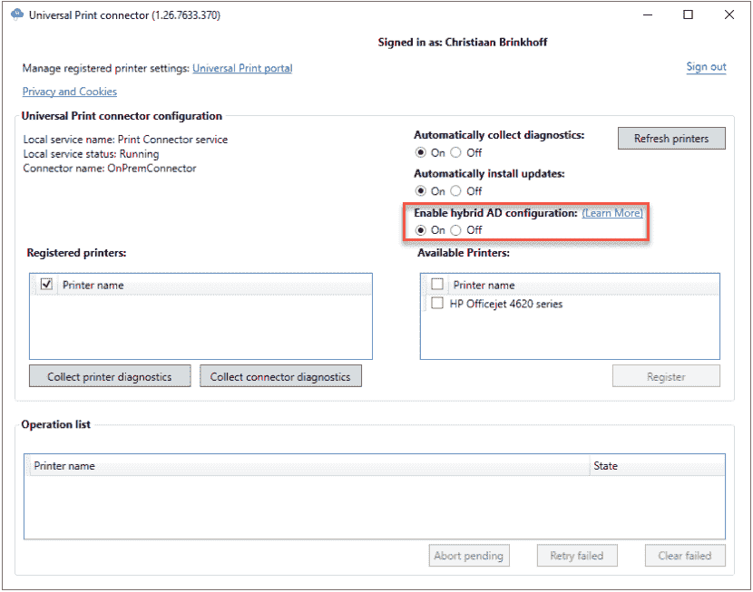

Figure 15.16 – Universal Print – print connector

## 使用 Universal Print 注册您自己的自定义打印机

我们已完成连接部分；现在我们需要将打印机作为 Universal Print 服务的一部分在云中可用：

- 1. 在可用打印机列表中选择打印机。点击注册：

> 重要说明
> 可用打印机列表是从您安装打印机连接器的桌面/服务器上连接的打印机检测到的。

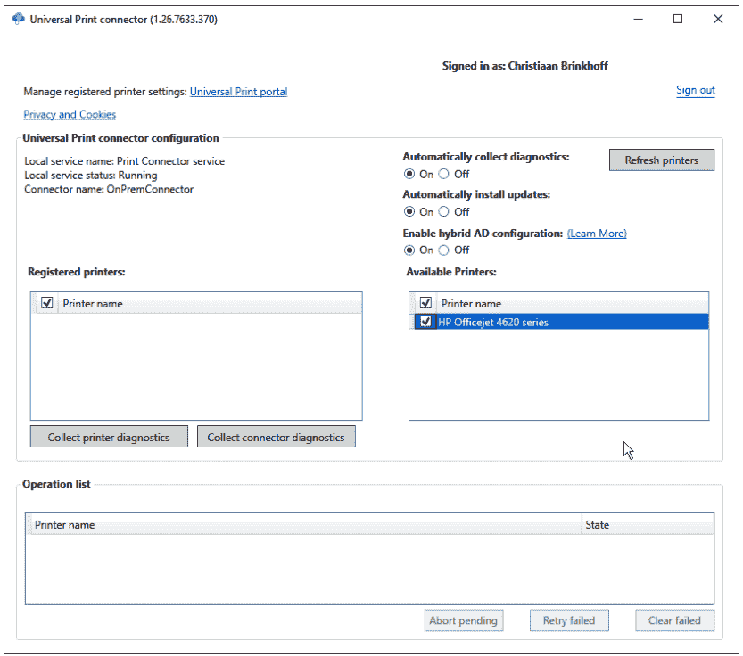

Figure 15.17 – Universal Print – print connector

2. 打印机已添加到云中。状态为 **in progress**。这需要一分钟左右的时间。

我们现在已完成所有预步骤。打印机现在都可见于 **Registered Printers** 列表中；不过，正如您所见，它们尚未共享。这就是我们现在要做的事情。

## 与用户共享您的打印机

让我们来看一下如何与终端用户共享您的打印机：

- 1. 进入 Universal Print 门户并打开 **Printers**。

> **重要说明**
> 如您所见，它们的状态为 **Not shared**。

- 2. 选择您想要共享的打印机(们)。点击 **Share**：

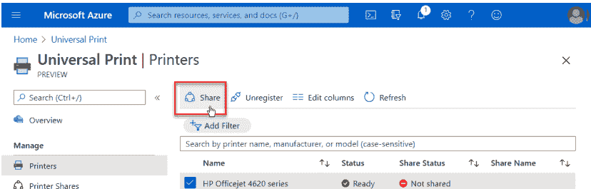

Figure 15.18 – Universal Print – management console

现在我们已准备好打印共享/发布步骤，用户仍然无权查看和使用打印机。因此，我们需要将 Azure AD 组或用户直接添加到成员列表中。

## 分配使用打印机(们)的权限

在本节中，您将学习如何为终端用户分配正确的权限级别，以便他们可以打印：

> Tip
> 您知道也可以选择允许组织中所有人访问的选项以允许所有用户打印吗？

- 1. 选择您的 Azure AD 用户或组。准备就绪后，点击 Share Printer：

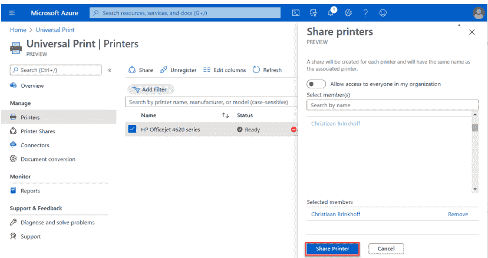

Figure 15.19 – Universal Print – management console

- 2. 打印机现在已准备好在您的桌面上进行测试，因为状态为 Printer Shared：

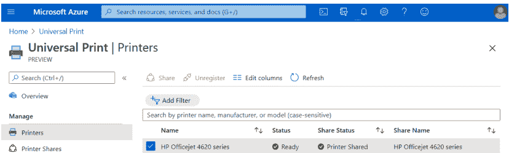

Figure 15.20 – Universal Print – management console

我们几乎准备就绪。让我们继续下一节，该节将解释如何测试您的打印机！

## 测试您的 Universal Print 连接打印机

在本节中，您将学习如何测试您的打印机以确认配置成功完成。成功后，您将成为一名正式的 Universal Print 专家：

- 1. 首先，您需要以 Azure AD 用户身份登录到您的 Windows 365 云或物理 PC 环境，该环境已分配到 Universal Print 中之前共享的打印机之一。

- 2. 在开始菜单中搜索打印机和扫描仪：

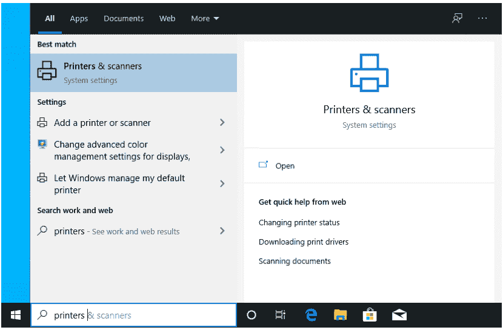

Figure 15.21 – Printers & scanners – Windows 10

3. 点击添加打印机或扫描仪：

Printers & scanners

Add printers & scanners

Add a printer or scanner

Printers & scanners

Fax

Microsoft Print to PDF

Microsoft XPS Document Writer

Let Windows manage my default printer
When this is on, Windows will set your default printer to be the one you used most recently at your current location.

Download over metered connections
To help prevent extra charges, keep this off so device software (drivers, info, and apps) for new devices won't download while you're on metered Internet connections.

Troubleshoot your printer
If you can't get your printer to work, try running the printer troubleshooter.
Open troubleshooter settings

Related settings
Print server properties
Run the troubleshooter

Help from the web
Changing printer status
Downloading print drivers
Scanning documents

Get help
Give feedback

Figure 15.22 – Printers & scanners

- 4. 点击 **Search Universal Print for printers**。你的已分配云打印机应会自动弹出：

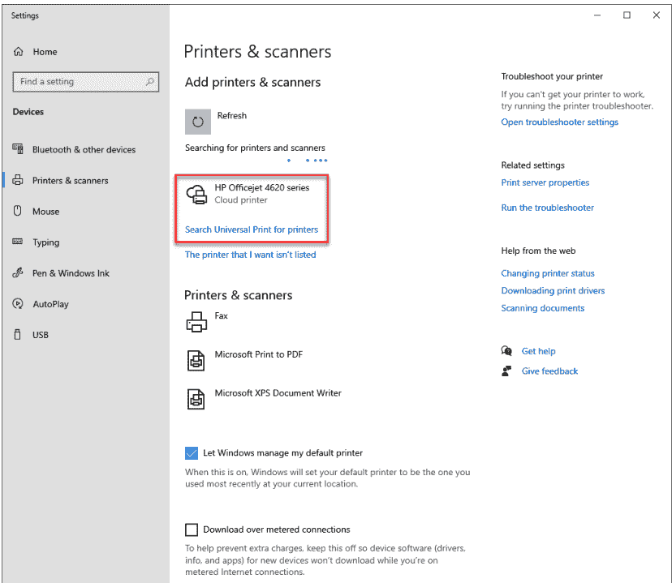

图 15.23 – Printers & scanners – Windows 10

- 5. 点击 **Add device** 将基于云的打印机添加到你的虚拟或物理桌面：

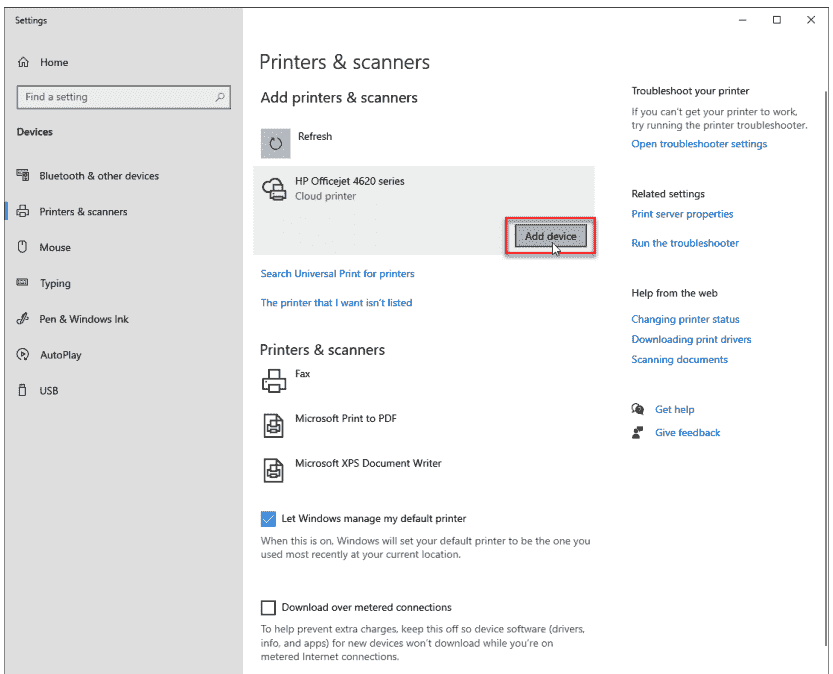

图 15.24 – Add device

- 6. 打印机现已添加并准备测试：

图 15.25 – Printers & scanners – printer added

- 7. 打开基于云的打印机并点击 Manage。

- 8. 点击 Print a test page。测试页已发送到打印机。你可以打开打印队列查看是否有反应：

图 15.26 – Printers & scanners – Print a test page

- 9. 测试打印作业已发送到打印机。

- 10. 如果一切顺利，打印作业也应可在 Universal Print 管理门户中看到并列出。你可以在 Universal Print 门户中点击打印机，然后点击 Jobs 找到作业。你应能看到状态为 Completed 的作业。做得好：

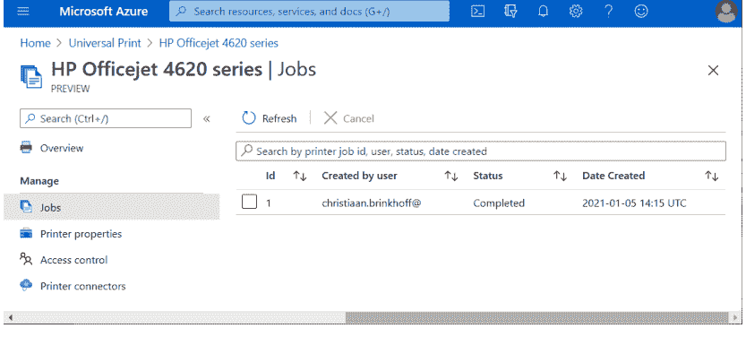

图 15.27 – Universal Print – print jobs

在下一节中，你将学习如何通过 Microsoft Endpoint Manager 发布打印机。

## Assigning and deploying cloud printers with Microsoft Endpoint Manager

在上一节中，你了解了分配打印机的所有基础知识以及手动流程。此流程也可以通过 Microsoft Endpoint Manager 执行，如前所述，这是一种更适合企业的部署方式，例如将全球数百台打印机分配给你的用户：

- 1. 首先，通过此链接下载 Universal Print 部署工具：https://www.microsoft.com/en-us/download/details.aspx?id=101453。
- 2. 准备好用于部署的 CSV 列表，因为 Microsoft Endpoint Manager  enrolment 将使用 CSV 文件作为源。你可以在工具中的 SamplePolicy.zip 中找到 printers.csv 文件。
- 3. 在 CSV 文件中按以下顺序添加所有 Universal Print 打印机共享名称和共享 ID 以及打印机是否应设为默认打印机，SharedId、SharedName、IsDefault：

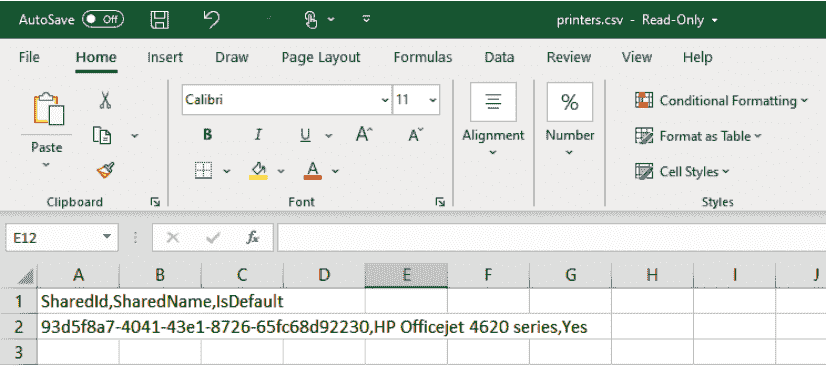

图 15.28 – Universal Print – Microsoft Endpoint Manager CSV config file

- 4. 通过 Microsoft Endpoint Manager 查找你想要添加的打印机共享名称和共享 ID：

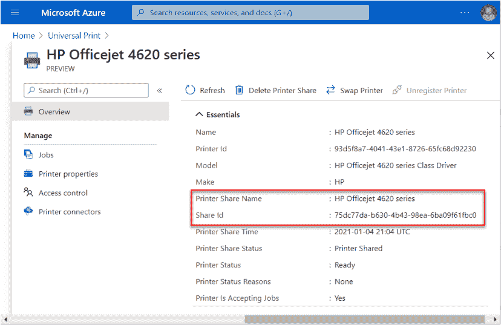

图 15.29 – Universal Print – printer overview

- 5. 生成包含新 CSV 文件的自定义 Win32 应用程序包，其中包含正确的打印机共享名称和 ID。你已在 *Chapter 8, Application Management and Delivery* 中学习过创建包的方法。
- 6. 下载 Microsoft Win32 Content Prep Tool。
- 7. 解压该工具，例如到 C:\ 驱动器上（你可以选择任意文件夹），来源为 https://github.com/Microsoft/Microsoft-Win32-Content-Prep-Tool：

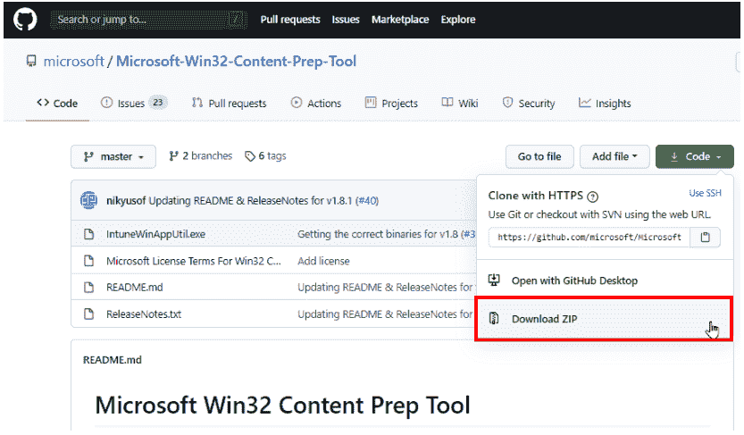

图 15.30 – Intune – Win32 Content Prep Tool

- 8. 打开 PowerShell 并更改目录到 Intune Prep Tool 位置，例如 C:\Microsoft-Win32-Content-Prep-Tool-master：

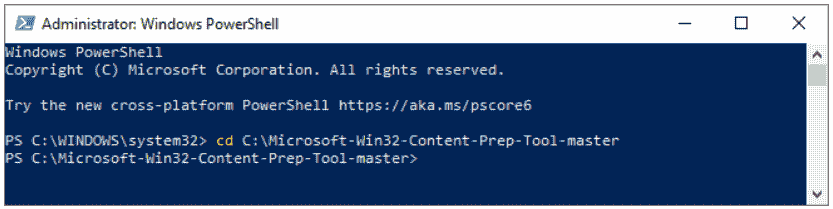

图 15.31 – PowerShell

- 9. 运行 .\IntuneWinAppUtil.exe 并填写以下要求：
  - **Source folder**：包含打印机列表 (`printers.csv`) 和 `InstallPolicy.cmd` 文件所在的文件夹。
  - **Setup file**：`InstallPolicy.cmd` 文件的路径（或将用于在用户设备上复制 `printers.csv` 文件的任何其他脚本）。
  - **Output folder**：你希望生成的 `intunewin` 包文件存储的文件夹。
  - **Do you want to specify catalog folder (Y/N)**：输入 N。

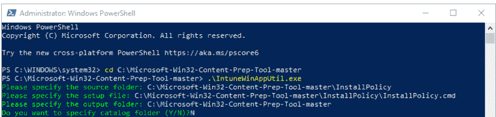

图 15.32 – PowerShell

- 10. .intunewin 包已准备好在 Microsoft Endpoint Manager 中使用：

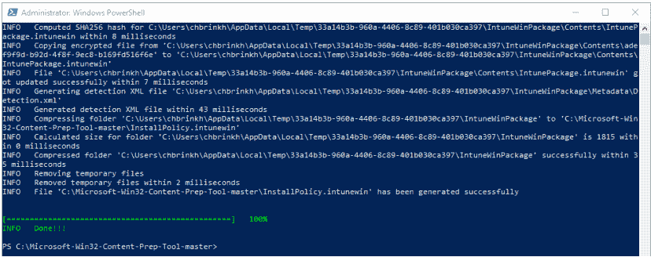

图 15.33 – The .intunewin package ready to use

- 11. 通过 http://endpoint.microsoft.com/ 打开 Microsoft Endpoint Manager 控制台。然后打开 Apps 菜单并点击 Add：

图 15.34 – Intune – Win32 configuration

- 12. 选择 Windows app (Win32)：

图 15.35 – Select app type

- 13. 点击 **Select app package file** 并浏览到 `.intunewin` 文件输出 – 例如 `InstallPolicy.intunewin` 在 `C:\Microsoft-Win32-Content-Prep-Tool-master` 文件夹中：

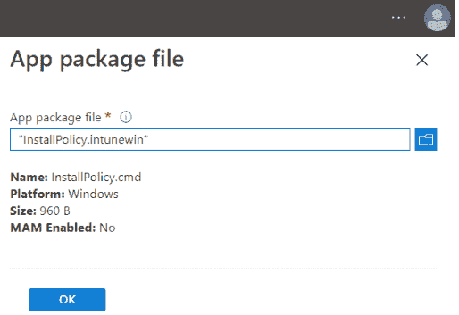

图 15.36 – App package file

- 14. 为应用指定自定义名称，例如 `Install HP Printer`，如下例所示：

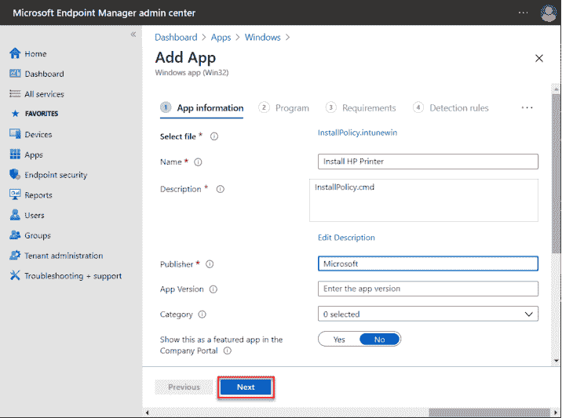

图 15.37 – Add app

- 15. 更改 **Install command** 和 **Uninstall command** 字段中的后续行。确保它是一个 **User** 安装的应用：
  - InstallPolicy.cmd user install
  - InstallPolicy.cmd user uninstall：

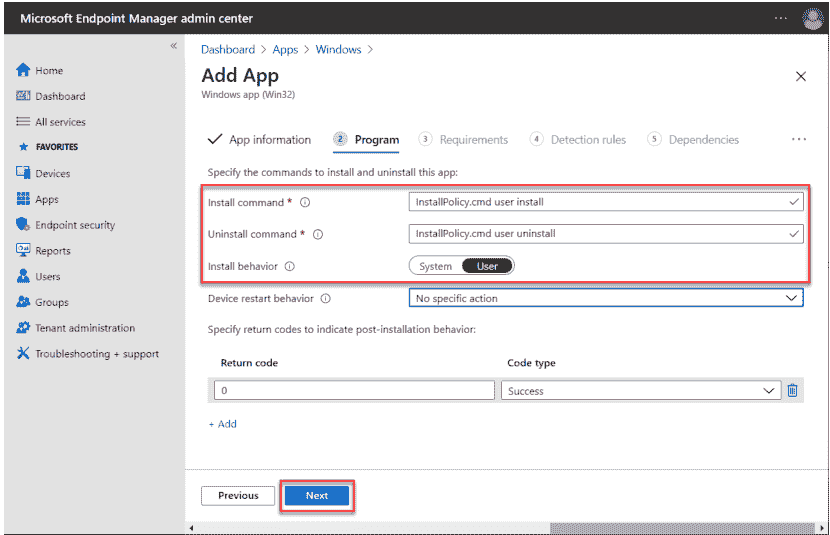

图 15.38 – Specify the commands to install and uninstall the app

- 16. 将截图中的要求更改为基线操作系统版本并点击 **Next**。基线定义了接收打印机分配包所需的最低 Windows 版本：

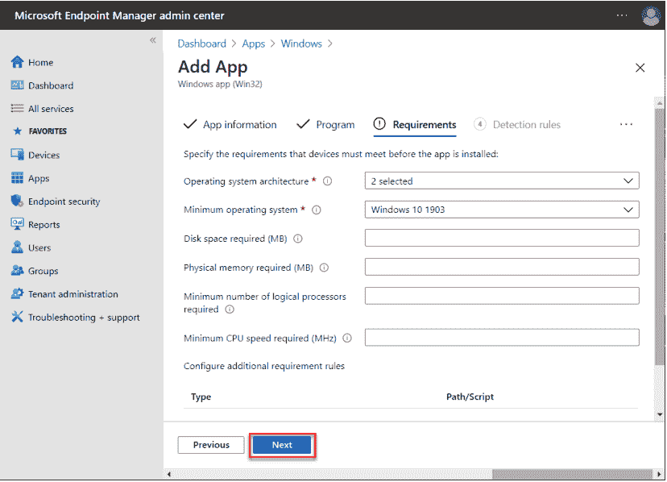

图 15.39 – Intune – Win32 configuration

- 17. 根据包含要添加打印机的 CSV 文件填写检测规则。在 **Path** 字段中添加以下位置，并在 **File or folder** 字段中输入 `printers.csv`：`%AppData%\UniversalPrintPrinterProvisioning\Configuration`。

- 18. 确保 Detection method 设置为 File or folder exists。点击 OK：

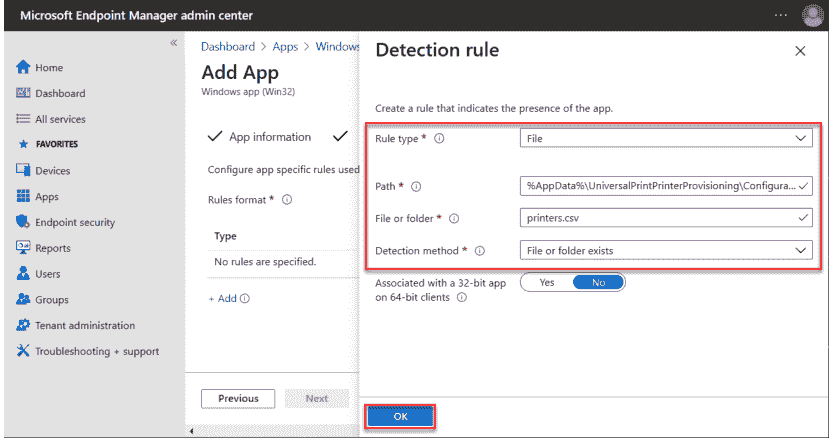

图 15.40 – Detection rule

- 19. 在 Assignments 菜单中按部门过滤打印机列表，例如按 AD 组：

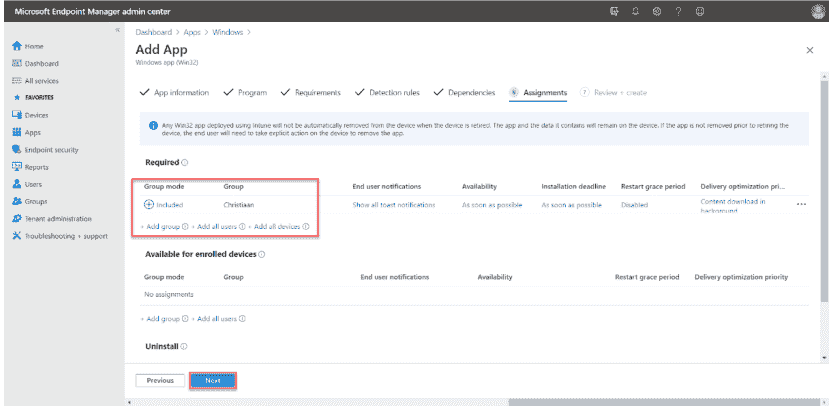

图 15.41 – Filter the list of printers

- 20. 通过点击 Next 然后 Create 确认设置：

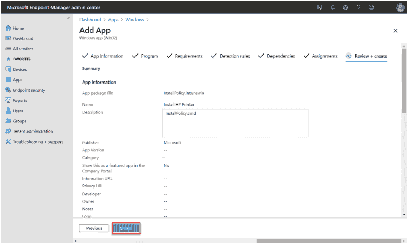

图 15.42 – Confirm the settings

- 21. 你的打印机随后将被推送到你的物理和云桌面：

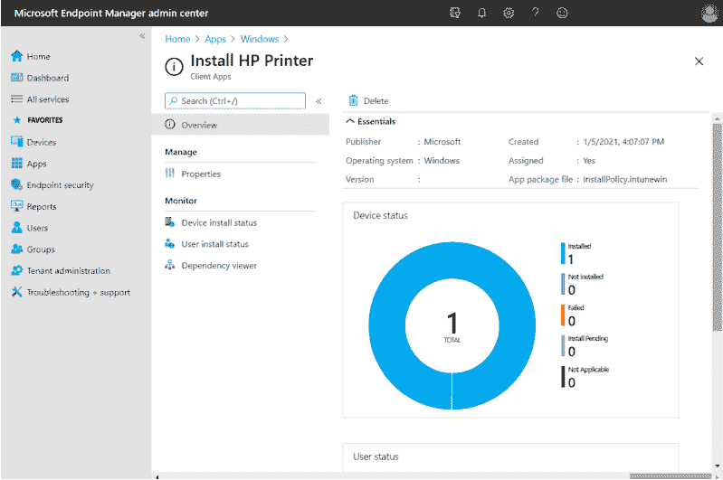

图 15.43 – Intune – Win32 configuration

你现在已完成 Universal Print 的配置，并成为云打印的真正专家。这将使你作为 IT 专业人员的生活变得轻松许多，同时与传统打印环境相比维护打印机也更简单。

## Summary

在本章中，你了解了名为 Universal Print 的新 Microsoft 365 服务，如何配置该服务，以及如何通过 Microsoft Endpoint Manager 将打印机发布到你的终端。

在下一章，我们将讨论你可以用 Microsoft Endpoint Manager 管理的其他受管设备。

## Questions

- 1. 为了使用 Universal Print，防火墙中需要开放哪个端口？
  - A. TCP - 443
  - B. TCP - 445
- 2. Universal Print 的打印作业是否在云中加密发送？
  - A. Yes
  - B. No
- 3. Universal Print 是否支持零信任？
  - A. Yes, all traffic goes over the internet over SSL.
  - B. No.

## Answers

- 1. (A)
- 2. (A)
- 3. (A)

## Further reading

如果你想在阅读本章后了解更多关于 Universal Print 的信息，请使用以下免费在线资源：

- Universal Print – Tech Community via aka.ms/upcommunity: https://techcommunity.microsoft.com/t5/universal-print/ct-p/UniversalPrint
- Universal Print – Get started via aka.ms/updocs: https://docs.microsoft.com/en-us/universal-print/fundamentals/universal-print-getting-started
