## 16
故障排除 Microsoft Endpoint Manager

在本章中，您将了解在配置 Microsoft Endpoint Manager (MEM) 环境时请求帮助的方法，以及在遇到问题时，如何自行或在 Microsoft 支持的少量帮助下解决这些问题。

在本章中，我们将介绍以下主题：

- Troubleshooting MEM
- Service health and message center
- Troubleshoot blade in MEM
- Troubleshooting Windows 10 MEM enrollment
- Windows 10 device diagnostics
- Troubleshooting application delivery
- Troubleshooting Autopilot
- Windows 11 Autopilot diagnostics page
- Troubleshooting locating a Windows device
- Troubleshooting Microsoft Edge

## Troubleshooting MEM

在 **Tenant admin** 刀片下，您有 **Tenant status**。这里存储了一些关于租户的重要信息，例如以下内容：

- **Tenant name and Tenant location:** 在这里，您可以看到您的租户位于世界的哪个部分——在本例中为欧洲。
- **MDM authority:** MDM 代表 **mobile device management**。这在过去并不那么重要。
- **Service release:** 这很重要。在这里，您可以跟踪您的租户是否已升级到最新的服务版本。

Intune 是 Microsoft 每月更新的服务，因此根据租户所在的位置，您可能会看到您的 Intune 版本根据以下部署计划在其他版本之前得到更新：

1. **Day 1: User interface (UI)** 推广到亚太地区。
2. **Day 2:** UI 推广到欧洲、中东和非洲。
3. **Day 3:** UI 推广到北美。
4. **Day 4+:** UI 推广到 Intune for Government。

以下屏幕截图显示了存储在 **Tenant status** 中的信息概览：

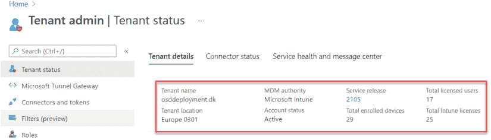

*Figure 16.1 – Tenant status*

**Connector status** 是您可以查看 Windows Autopilot 同步、Microsoft Store for Business 同步以及 Microsoft Defender for Endpoint 连接器状态的地方，这些都与 Windows 相关。

您还可以查看所有其他连接器类型的状态。连接器可能有三种不同的状态，如下所述：

- **Unhealthy:**
  - 证书或凭据已过期。
  - 最后一次同步是在 3 天或更久之前。
- **Warning:**
  - 证书或凭据将在 7 天内过期。
  - 最后一次同步是在 1 天前以上。
- **Healthy:**
  - 证书或凭据在未来 7 天内不会过期。
  - 最后一次同步是在 1 天前以内。

您可以在以下屏幕截图中看到此概览：

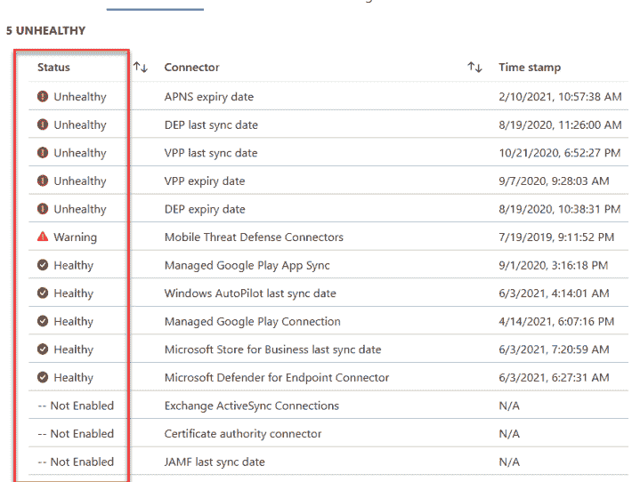

Figure 16.2 – Connector status

## Service health and message center

SERVICE HEALTH 显示活动事件和通知。此信息在 MEM 管理中心中易于访问，如以下屏幕截图所示。相同的信息也在 Microsoft 365 管理中心的 Microsoft 365 服务运行状况仪表板中提供：

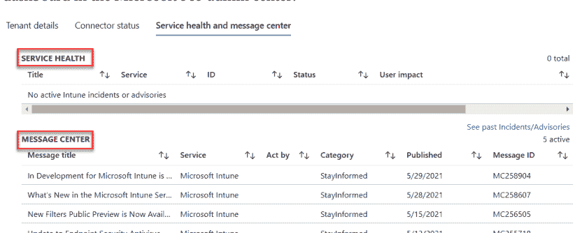

Figure 16.3 – Service health and message center

在 Tenant admin 刀片中，如果您拥有 Microsoft Intune 订阅，您可以选择记录免费支持票证，如以下屏幕截图所示：

## Tenant admin | Help and support

## What can we help you with?

Choose a topic and we’ll find the best solution for you. Learn more

For on-premises Configuration Manager issues, open your case at https://www.support.microsoft.com.

Configuration Manager
Example: Desktop Analytics, Endpoint analytics for Configuration Manager, Tenant attach for Configuration Manager devices

Intune
Example: Device management, Endpoint analytics for Intune devices

Co-management
Co-management workloads with either Intune or Configuration Manager as the management authority

- Tenant status
- Microsoft Tunnel Gateway
- Connectors and tokens
- Filters (preview)
- Roles
- Azure AD Privileged Identity Man...
- Diagnostics settings
- Audit logs
- Device diagnostics (preview)
- End user experiences
- Customization
- Custom notifications
- Terms and conditions
- Microsoft Managed Desktop
- Tenant enrollment
- Help and support

Figure 16.4 – Intune support

点击 Intune 开始 Microsoft Intune 支持工作流。首先，您将通过常见场景或推荐的支持文章进行指导。如果这些都无法帮助您解决问题，您可以创建支持请求，其中需要提供尽可能详细的信息。

## Troubleshoot blade in MEM

在 **Troubleshoot** 刀片内部，**information technology (IT)** 管理员可以从 MEM 管理中心选择用户以开始故障排除。

转到 **Troubleshooting + support** 即可开始。如果您想排查无用户设备，您可以启动 **Device** 刀片并直接定位设备，以查看分配给设备的配置文件和应用。在本例中，我们希望通过执行以下步骤找到并帮助终端用户：

1. 通过点击 **Select user** 按钮选择您要帮助的用户，如以下屏幕截图所示：

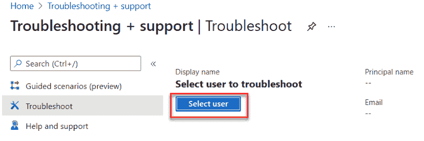

Figure 16.5 – Troubleshooting: Select user button

2. 第一个部分是 **ASSIGNMENTS**，您可以在这里看到用户可用的或需要的应用程序，如以下屏幕截图所示：

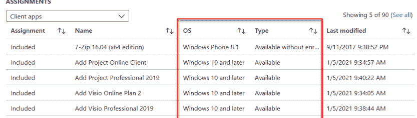

Figure 16.6 – Troubleshooting assignments

3. 作为示例，您可以选择将范围更改为 **Configuration profiles**，如以下屏幕截图所示：

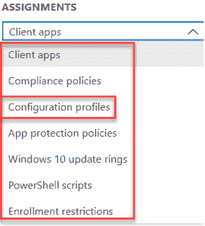

Figure 16.7 – Troubleshooting configuration profiles

4. 在新的视图中，您可以看到分配给此用户的所有策略，如以下屏幕截图所示：

| Assignment | Name | OS | Policy Type | Last modified |
|---|---|---|---|---|
| Included | Intune data collection policy | Windows 10 and later | Windows health monitoring | 12/12/2020 10:17:00 AM |
| Included | SCEP – trusted root certificate | Windows 8.1 and later | Trusted certificate | 8/23/2019 9:15:49 PM |
| Included | SCEP Device certificate | Windows 8.1 and later | SCEP certificate | 8/23/2019 9:19:31 PM |
| Included | Edge Security Baseline Mac 79 | macOS | Preference file | 3/8/2020 9:00:08 AM |
| Included | OsddeploymentNetwork boundary | Windows 10 and later | Network boundary | 12/7/2018 10:40:37 AM |
| Included | Windows 10 - WDATP Onboarding | Windows 10 and later | Microsoft Defender for Endpoint | 1/27/2018 1:04:04 AM |
| Included | Windows 10 – Enable WH4B | Windows 10 and later | Identity protection | 7/24/2019 8:34:35 AM |
| Included | Kernel Extensions | macOS | Extensions | 3/8/2020 10:52:53 AM |
| Included | Configure Application Guard | Windows 10 and later | Endpoint protection | 3/23/2019 8:35:56 AM |
| Included | Firewall 123 | Windows 10 and later | Endpoint protection | 5/27/2020 10:10:32 AM |
| Included | Edge Browser - IEEM | Windows 10 and later | Device restrictions | 7/21/2019 10:54:23 AM |

Figure 16.8 – Troubleshooting policy type

5. 当您深入选择其中一个策略时，您将进入策略刀片，在那里您可以查看策略的状态、错误以及每个设置的详细状态。

在本例中，您可以看到所有具有此策略的设备都已正确应用设置：

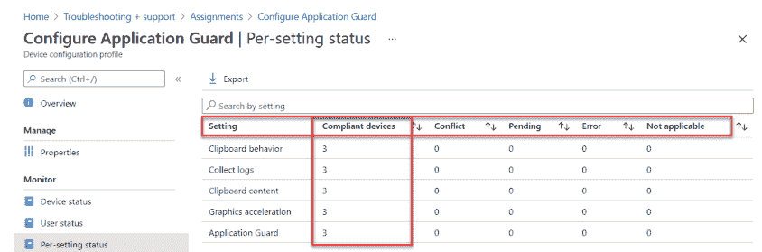

Figure 16.9 – Troubleshooting compliant settings per device

6. 如果策略存在错误，它将显示在 Per-setting status 刀片上，如以下屏幕截图所示：

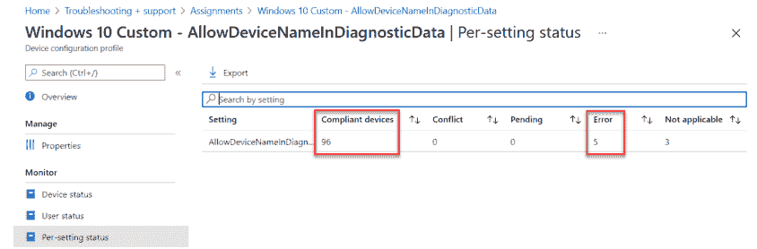

Figure 16.10 – Troubleshooting a compliant settings error

7. 然后，您可以转到 Device status 刀片，在那里您可以查看错误出现在哪些设备上，如以下屏幕截图所示：


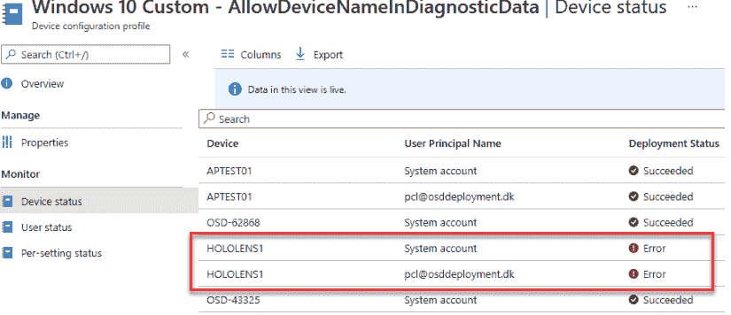

图 16.11 – 设备状态：策略错误

如果该策略是设置目录（Settings Catalog）策略，你将看到更完善的报告概览，如下面的截图所示：

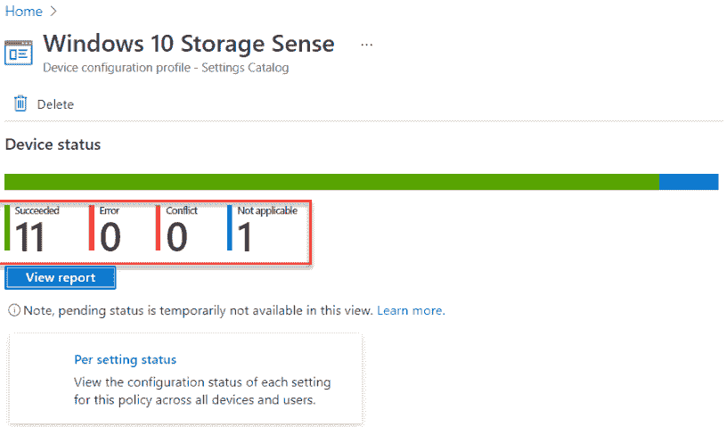

图 16.12 – 排查设置目录问题

3. 点击 **自动注册** 以配置 MDM 用户范围，这将带你进入以下屏幕：

图 16.17 – MDM 用户范围

4. 检查你的 MDM 用户范围是否设置为 **无**。建议允许 **全部**；你还可以在 **System Center Configuration Manager (SCCM)** 中设置一个入口来控制共同管理设备的 Windows MDM 自动注册，因为设备需要位于某个集合中才能进入 Microsoft Intune。

在 Microsoft Intune 内部，你还有注册限制，以确保你能区分注册到 Microsoft Intune 的个人设备和企业拥有的设备。这也可以针对不同的 Azure AD 用户组设置不同的范围。

## BitLocker 故障

你可以按照以下步骤排查 BitLocker 故障：

1. 在“主页 | 设备 | 监视 | 加密报告”中，你可以看到“加密就绪状态”列，以确定设备是否已准备好进行 BitLocker 加密，如下面的截图所示：

图 16.20 – 加密报告

2. 你还可以深入查看特定设备，以查看该设备应用了哪个策略，如下面的截图所示：

图 16.21 – 设备加密状态

至此，我们介绍完了 Microsoft Intune 中的部分监视功能。

IT 管理员会让你先单击“是”，然后 Intune 才会访问设备并收集日志，如下面的截图所示：

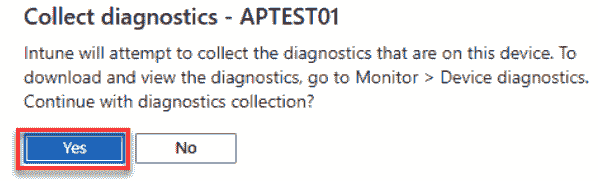

图 16.23 – 收集 Windows 设备的诊断信息

你可以在设备上跟踪状态（请记住刷新此页面以获取更新后的状态），如下面的截图所示：

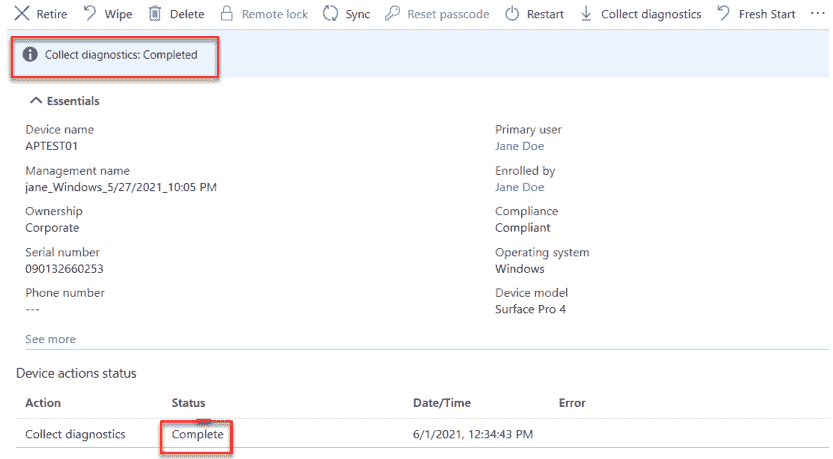

图 16.24 – 诊断信息收集完成

诊断日志收集有三种状态消息，如下所述：

- **完成**：已成功从设备收集诊断信息，可在 **设备诊断** 边栏选项卡中下载。
- **诊断信息上传挂起**：设备正在进行诊断日志收集，不久将完成；或者设备处于脱机/不可达状态，尚未收到请求。诊断收集操作的有效期为 12 小时，超过该时间后，IT 管理员需要再次单击该操作；因此，如果计算机重新联机和/或签入 Intune 服务，设备上将会启动诊断日志收集。
- **失败**：设备已运行诊断，但未能完成任务或未能将日志上传到后端服务。要排查此问题，请查看 `HKEY_LOCAL_MACHINE\SOFTWARE\Microsoft\MdmDiagnostics` 处的 **MDMDiagnostics** 注册表项及其内部的子项。

在 MEM 中该设备的 **监视** 区域，你可以找到 **设备诊断（预览）** 边栏选项卡的入口，如下面的截图所示：

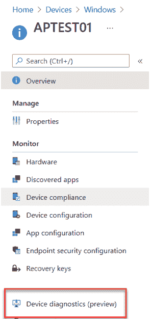

图 16.25 – 设备诊断

在下一节中，我们将介绍应用程序交付的故障排除。

## 应用程序交付故障排除

Microsoft Intune 中有不同类型的应用，它们需要不同的故障排除方法，如下所列：

- Win32 应用
- 业务线 (LOB) 应用
- Microsoft Store 应用

### Win32

在 MEM 管理中心的特定设备上，“托管应用”边栏选项卡为 IT 管理员提供应用的安装状态信息，并包含安装失败信息。

Intune 中的“故障排除”窗格提供失败详细信息，包括用户设备上托管应用的详细信息。在“托管应用”窗格中，每个设备下都会提供应用的端到端 (E2E) 生命周期详细信息。你可以查看安装问题，例如应用何时创建、修改、定向并交付到设备，如下面的截图所示：

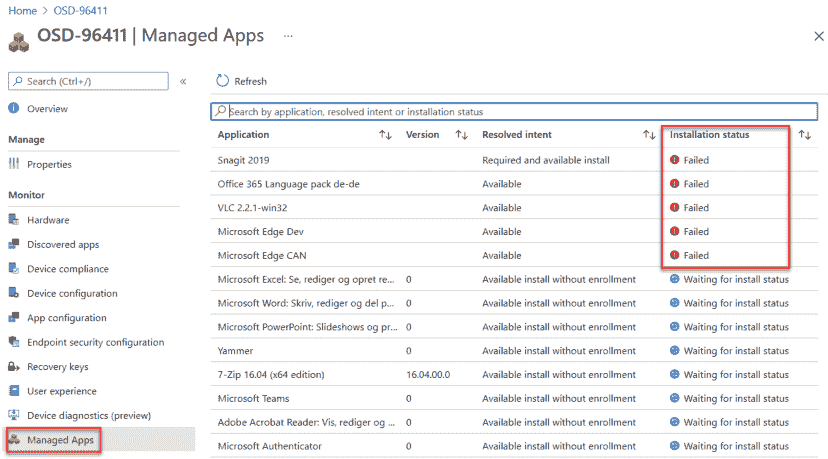

图 16.28 – 托管应用安装状态

## Autopilot 故障排除

作为 MEM 管理中心的 **监视** 边栏选项卡的一部分，有一个报告显示租户中 Autopilot 部署的状态。此报告可用作监视经历 Windows Autopilot 的新设备的示例，并为 IT 管理员提供设备的成功/失败概览以及总部署时间。

在对 Windows Autopilot 进行故障排除时，熟悉以下工作流非常重要：

1. 建立无线 (Wi-Fi) 或有线（以太网）连接。
2. 下载 Windows Autopilot 配置文件。当你使用有线连接或手动建立无线连接时，只要网络连接就绪，配置文件就会从 Autopilot 部署服务下载。如果你使用以太网连接，可能会遇到跳过区域和语言设置的情况。这可以在 Autopilot 配置文件中进行配置。
3. 下一步是用户身份验证。执行 **用户驱动部署 (UDD)** 时，用户将输入其 Azure AD 凭据和密码。如果用户已分配到 Windows Autopilot 对象，用户名将自动完成，只需验证密码。
4. 下一步是 Azure AD 加入。对于 UDD，设备将使用指定的用户凭据加入 Azure AD。对于自部署场景，设备将在不指定任何用户凭据的情况下加入。
5. 接下来是自动 MDM 注册。作为 Azure AD 加入过程的一部分，当在 Azure AD 中配置后，设备将注册到 Microsoft Intune。
6. 应用设置、应用程序和证书。如果配置了 **注册状态页 (ESP)**，则在显示 ESP 期间将应用大多数设置。如果未配置或不可用，则在用户登录后应用设置。

导航到 **主页 | 设备 | 监视 | Autopilot 部署**。Autopilot 报告将包含最近 30 天的数据。使用 Autopilot 重置的设备不会显示在此报告中。你可以在此处看到报告概览：

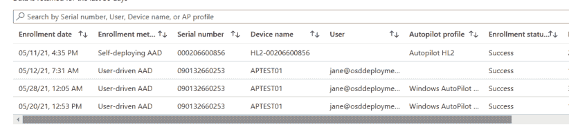

图 16.31 – Autopilot 报告

如果在设备加入 Azure AD 时看到正常的 OOBE 屏幕，则说明设备没有经历 Autopilot 工作流。最有可能的原因是设备未分配 Autopilot 配置文件。你可以通过导航到“主页 | 设备 | Windows | Windows Autopilot 设备”找到 Windows Autopilot 设备并查看其他详细信息，这将带你进入以下屏幕：

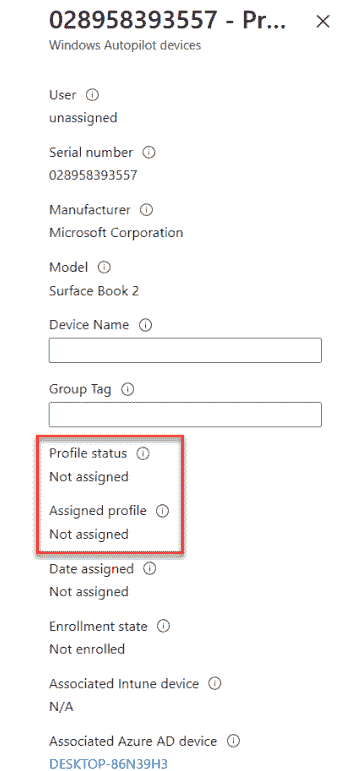

图 16.32 – 未分配 Autopilot 配置文件

在这种情况下，未分配配置文件——最可能的原因是 Autopilot 设备对象不属于分配了 Autopilot 配置文件的正确组。你还可以看到该设备位于 Azure AD 中，但不在 Intune 中。单击 Autopilot 设备对象时，上面会显示很多有用的信息。

你不能从 Microsoft Intune 直接将 Autopilot 配置文件分配到设备；只能为 Azure AD 组执行此操作。从 Microsoft Store for Business 中，你可以直接将配置文件分配到设备。这可能会破坏预期的 Windows Autopilot 部署体验，并使你自己的故障排除更加困难。

### Windows 11 Autopilot 诊断页面

当你使用 Autopilot 部署 Windows 11 时，你可以让用户查看有关 Autopilot 预配过程的更多详细故障排除信息。新的 Windows Autopilot 诊断页面为 IT 管理员和最终用户提供了用户友好的视图，以便对 Windows Autopilot 失败进行故障排除。

如果你将“为最终用户打开日志收集和诊断页面”设置为“是”，则会在 Autopilot 设备上启用 Windows Autopilot 诊断，如下面的截图所示：

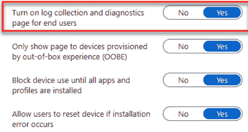


如果在 Windows Autopilot 过程中出现任何错误，最终用户可以通过点击 **view diagnostics** 查看更多详细信息，如以下屏幕截图所示：

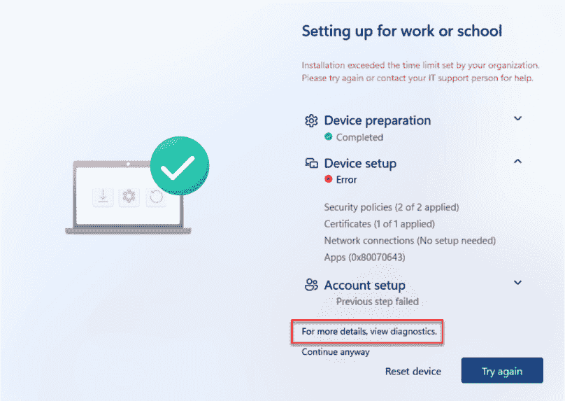

图 16.34 – Windows Autopilot 失败

这将启动适用于 Windows 11 的新的 **Windows Autopilot diagnostics** 页面，目前该页面仅适用于用户驱动的 Windows Autopilot 部署模式。

最终用户随后会看到清晰的图标显示如下等状态：

- **Task failed**
- **Task in progress**
- **Task unknown or incomplete**
- **Task successfully completed**

在 **Enrollment Status** 下，您可以看到已完成的各项检查，例如 **Trusted Platform Module (TPM)** 证明和 MDM 注册，如以下屏幕截图所示：

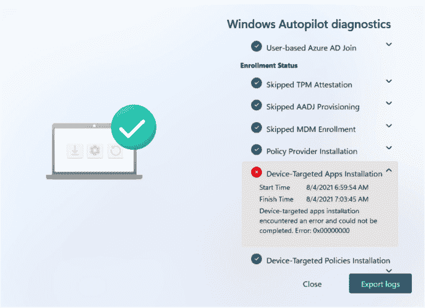

图 16.35 – Windows Autopilot 注册状态

借助 **Windows Autopilot diagnostics** 概览，您可以展开 **General** 和 **Hardware** 以获取有关设备的更多信息。您还可以深入 **Apps and policies status** 以获取有关此区域不同错误的更多信息，如以下屏幕截图所示：

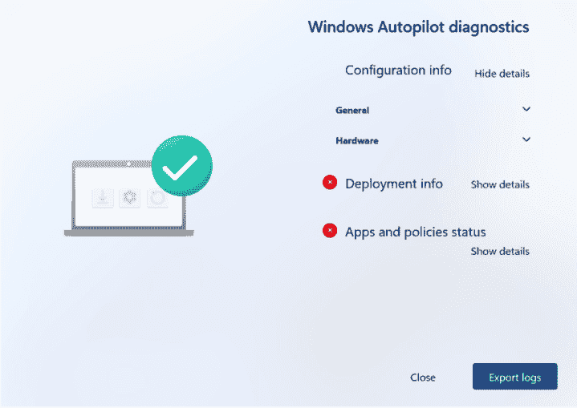

图 16.36 – Windows Autopilot diagnostics 配置信息

您可以在以下屏幕截图中看到应用失败的不同任务消息示例：

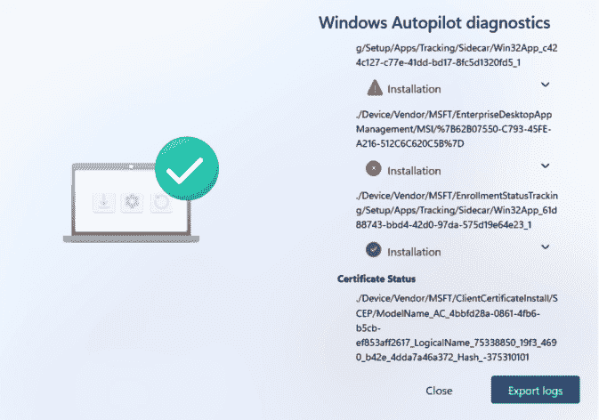

图 16.37 – Windows Autopilot 应用失败消息

您可以在此 **Windows Autopilot diagnostics** 屏幕中看到，LOB MSI 的安装不完整，并且 Win32 应用出现错误。一旦获得应用的 **identifier (ID)**，您就可以返回 Microsoft Intune 并从应用侧继续进行故障排除。

在下一节中，我们将介绍如何确保您的设备已启用位置服务，以便在设备丢失时找到您的 Windows 设备。

## Troubleshooting locating a Windows device

要在地图上获取丢失或被盗的 Windows 设备的当前位置，请在 Microsoft Intune 中使用 **Locate device** 操作。

支持的 Windows 版本如下：

- Windows 10 version 20H2 (10.0.19042.789) 或更高版本
- Windows 10 version 2004 (10.0.19041.789) 或更高版本
- Windows 10 version 1909 (10.0.18363.1350) 或更高版本
- Windows 10 version 1809 (10.0.17763.1728) 或更高版本

Windows **Location** 服务默认处于关闭状态，如以下屏幕截图所示：

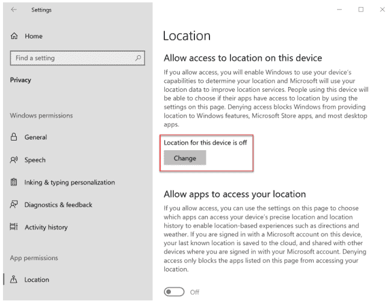

图 16.38 – 位置服务已关闭

如果用户希望使用此功能，则需要将其打开，或创建一项策略来打开位置服务。为此，请执行以下步骤：

- 1. 在设置目录中创建策略以在 Windows 设备上启用位置服务，如以下屏幕截图所示：

Home > Devices > Windows >
Create device configuration profile
Windows 10 and later - Settings catalog (preview)
1 Basics 2 Configuration settings 3 Assignments 4 Scope tags 5 Review + create
Name * Enable Location Service
Description
Platform Windows 10 and later

图 16.39 – 启用位置服务配置文件

- 2. 搜索 privacy 并选择 Let Apps Access Location，如以下屏幕截图所示：

Settings picker
Use commas "," among search terms to lookup settings by their keywords
privacy Search
+ Add filter
Browse by category
Administrative Templates\Windows Components\Internet Explorer\Privacy
Administrative Templates\Windows Components\Windows Media Player\User Interface
Privacy
99 results in the "Privacy" category Select all these settings
Setting name
Let Apps Access Location
Let Apps Access Location Force Allow These Apps
Let Apps Access Location Force Deny These Apps
Let Apps Access Location User in Control Of These Apps
Let Apps Access Messaging
...

图 16.40 – 允许应用访问位置

3. 将设置更改为 Force allow，如以下屏幕截图所示：

Home > Windows >

# Create device configuration profile

Windows 10 and later - Settings catalog (preview)

Basics Configuration settings Assignments Scope tags Review + create

+ Add settings

Privacy Remove category

98 of 99 settings in this category are not configured

Let Apps Access Location Force allow.

图 16.41 – 强制允许

4. 将策略部署到设备后，您将看到以下消息：Some of these settings are hidden or managed by your organization。在这种情况下，Location for this device is on 字段会被激活，最终用户无法将其关闭，因为它已通过 Microsoft Intune 作为策略进行配置。这在以下屏幕截图中有所说明：

Settings Home Find a setting Privacy Windows permissions General Speech Inking & typing personalization Diagnostics & feedback Activity history App permissions Location Camera

# Location

*Some of these settings are hidden or managed by your organization.

# Allow access to location on this device

If you allow access, you will enable Windows to use your device's capabilities to determine your location and Microsoft will use your location data to improve location services. People using this device will be able to choose if their apps have access to location by using the settings on this page. Denying access blocks Windows from providing location to Windows features, Microsoft Store apps, and most desktop apps.

Location for this device is on Change

# Allow apps to access your location

If you allow access, you can use the settings on this page to choose which apps can access your device's precise location and location history to enable location-based experiences such as directions and weather. If you are signed in with a Microsoft account on this device, your last known location is saved to the cloud, and shared with other devices where you are signed in with your Microsoft account. Denying access only blocks the apps listed on this page from accessing your location.

On

图 16.42 – 位置服务已开启

## Troubleshooting Microsoft Edge

Microsoft 已发布基于 Chromium 的新版 Microsoft Edge。此新版本提供与扩展和网站的最佳兼容性。这也意味着有新的故障排除方式以及可管理 Edge 浏览器的新策略。

让我们先来看看浏览器内置的策略故障排除工具。通过在地址栏中输入 Edge : //policy/，您可以访问策略页面，如以下屏幕截图所示：

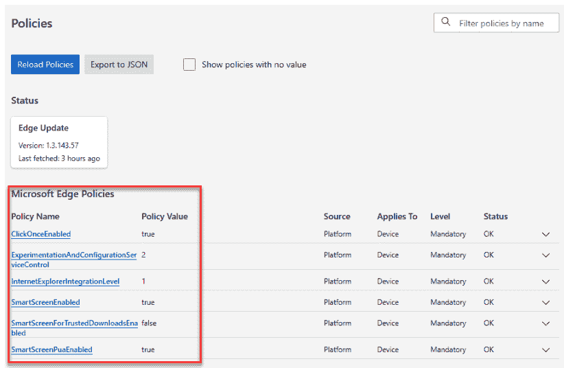

图 16.45 – Edge 策略

您可以看到所有策略设置以及应用于 Edge 浏览器的每个设置的策略值。

要检查浏览器是否已更新到最新版本，您可以在 Edge 浏览器的地址栏中输入 edge : // settings/help。这将带您进入以下屏幕：

## Summary

在本章中，您了解了在配置 MEM 期间可能出现的绝大多数部署错误。

阅读本章后获得的知识将帮助您在试用过程中排查一些常见错误，并使您成为维护企业生产工作负载所需的专家！

在下一章中，我们将学习有关 Windows 365 的故障排除。

## Questions

- 1. Microsoft Support 是否包含在您的 Microsoft Intune 订阅中？
  a) Yes
  b) No
- 2. 从 Microsoft Intune 工作时，是否需要在 Windows 上启用 Windows 位置服务？
  a) Yes
  b) No

## Answers

- 1. (A)
- 2. (A)

## Further reading

如果您在阅读本章后想了解更多信息，请使用以下免费在线资源之一：

- *Troubleshoot app installation issues—Intune | Microsoft Docs*: https://docs.microsoft.com/en-us/troubleshoot/mem/intune/troubleshoot-app-install#:~:text=Intune%20provides%20app%20troubleshooting%20details%20based%20on%20the,Select%20user%20to%20select%20a%20user%20to%20troubleshoot
- *Troubleshooting packaging, deployment, and query of Windows apps—Win32 apps | Microsoft Docs*: https://docs.microsoft.com/en-us/windows/win32/appxpkg/troubleshooting


## 自我故障排除和 Microsoft 支持

以下部分将介绍作为**信息技术 (IT)** 部门，如何为用户提供最佳支持，以及如何向 Microsoft 请求支持。通过 **Microsoft Endpoint Manager (MEM)** 管理中心门户中的**故障排除 + 支持**，即可轻松请求支持。

你可以在此处查看不同支持工单主题的概览，以便为你的案例分配合适的支持工程师：

- **Intune**
  - 使用 Intune 管理设备
  - Intune 设备的终结点分析
- **Configuration Manager**
  - Desktop Analytics
  - Configuration Manager 设备的终结点分析
  - Configuration Manager 设备的租户附加
- **共同管理**
  - 由 Intune 或 Configuration Manager 作为管理机构管理共同管理工作负载
- **云电脑**
  - 在任何设备上体验 Windows 的新方式

你可以在以下屏幕截图中查看**故障排除 + 支持**的概览：

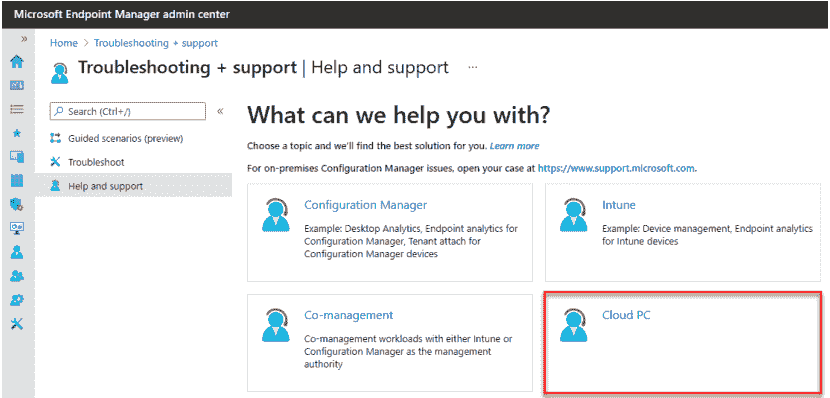

图 17.1 – 故障排除 + 支持

在“帮助和支持”下，选择“云电脑”选项以创建帮助台工单。

之后，输入你遇到的问题的简要摘要。系统可能会根据你输入的内容提供解决方案。

如果没有，请单击“使用搜索描述问题并联系支持人员”，如下图所示：


图 17.2 – 联系支持人员

## 域名解析

一个非常常见的错误是：客户配置 Azure 环境并创建 Azure **虚拟网络 (VNet)**，却忘记将 VNet 上的 **DNS 服务器**设置更改为自己的域服务器。

请始终确保将 **域名系统 (DNS)** 服务器更改为“自定义”，并输入你自己的 DNS 服务环境的**Internet 协议 (IP)** 地址，该环境能够解析你的 **Active Directory 域服务 (AD DS)** 域。

云电脑的注册将会失败。好消息是，前面在*第 3 章，介绍 Windows 365*中介绍的 Watchdog 服务也会通知你相关情况。

以下屏幕截图显示了**DNS 服务器**设置：

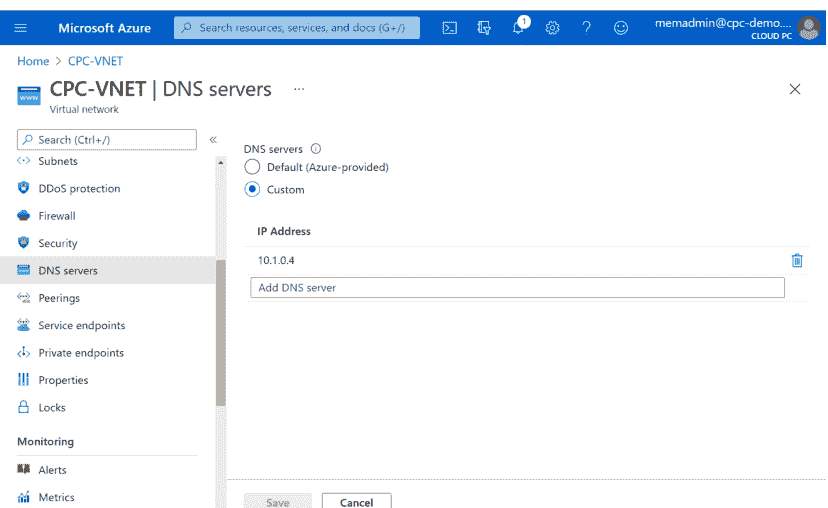

图 17.4 – DNS 服务器

现在继续介绍故障排除中的网络部分，并进一步讨论需要检查并为流量列入允许列表的不同服务**统一资源定位符 (URL)**。

## 服务 URL 防火墙流量

一些客户倾向于阻止所有出站流量，除非该流量经过验证。如果你的组织采用这种做法，则必须确保允许使用以下所有 URL 和端口。否则，部署将返回错误。

防火墙应允许访问两个 MEM 服务——Intune 和 Azure Virtual Desktop (AVD)——的流量。

你可以对这些 URL 执行 `nslookup -type ping`，以检查连接是否正常。对于以下域，可以使用 80/443 TCP 端口作为出站端口：

- portal.manage.microsoft.com
- *.manage.microsoft.com
- m.manage.microsoft.com
- login.microsoftonline.com
- *.officeconfig.msocdn.com
- config.office.com
- graph.windows.net
- enterpriseregistration.windows.net
- sts.manage.microsoft.com
- Manage.microsoft.com
- i.manage.microsoft.com
- r.manage.microsoft.com
- a.manage.microsoft.com
- p.manage.microsoft.com
- EnterpriseEnrollment.manage.microsoft.com
- EnterpriseEnrollment-s.manage.microsoft.com

除前面列表中提到的 MEM URL 外，还需将以下 AVD 指定的 URL 和端口列入允许列表：

| 地址 | 出站传输控制协议 (TCP) 端口 | 用途 |
|---|---|---|
| *.wvd.microsoft.com | 443 | 服务流量 |
| gcs.prod.monitoring.core.windows.net | 443 | 代理流量 |
| production.diagnostics.monitoring.core.windows.net | 443 | 代理流量 |
| *xt.blob.core.windows.net | 443 | 代理流量 |
| *eh.servicebus.windows.net | 443 | 代理流量 |
| *xt.table.core.windows.net | 443 | 代理流量 |
| catalogartifact.azureedge.net | 443 | Azure Marketplace |
| kms.core.windows.net | 1688 | Windows 激活 |
| mrsglobalsteus2prod.blob.core.windows.net | 443 | 代理和并行 (SXS) 堆栈更新 |
| wvdportalstorageblob.blob.core.windows.net | 443 | Azure 门户支持 |
| 169.254.169.254 | 80 | Azure 实例元数据服务 (IMDS) 终结点 |
| 168.63.129.16 | 80 | 会话主机运行状况监视 |
| cpcsacnrysalprodprna02.blob.core.windows.net<br>cpcsacnrysalprodprap01.blob.core.windows.net<br>cpcsacnrysalprodprau01.blob.core.windows.net<br>cpcsacnrysalprodpreu01.blob.core.windows.net<br>cpcsacnrysalprodpreu02.blob.core.windows.net<br>cpcsacnrysalprodprna01.blob.core.windows.net |  | 云电脑缩放单元 |

现在让我们进入 Windows 365 中最常见的错误：云电脑预配过程中的错误。

## Windows 365 预配错误

在以下部分中，你将进一步了解 Windows 365 预配过程中出现的各种错误，这些错误属于 Watchdog 网络配置服务的检查范围。

### 域加入失败

Windows 365 会尝试将云电脑加入你的本地 AD 域。此步骤失败可能由许多受组织控制的因素导致，但你可以按以下方式进行故障排除：

- 请确保关联的**本地网络连接 (OPNC)** 中的 AD 域、**组织单位 (OU)** 和凭据正确。
- 请确保域加入用户拥有执行域加入所需的足够权限。
- 请确保 VNet 和子网能够正确访问域控制器。

`JsonADDomainExtension` 是用于执行域加入的 Azure 函数。请确保成功完成此操作所需的一切条件均已具备。

**解决方法：**将 Azure **虚拟机 (VM)** 附加到已配置的 VNet，并使用提供的凭据执行域加入。

### 混合 Azure AD 加入失败

Windows 365 不会代表客户执行任何 **混合 Azure AD 加入 (HAADJ)** 操作。HAADJ 必须作为云电脑的先决条件进行配置，并且运行状况良好。

如果预配因 HAADJ 失败，可能是因为 AD Connect 同步服务配置的同步周期不足。请确保 Microsoft Azure AD Connect 配置为每 30 分钟同步一次 AD 计算机对象，且同步间隔不超过 60 分钟。如果 Azure AD 对象未在 90 分钟内出现，此步骤将超时。

另一个需要考虑的因素是本地 AD 复制时间。请确保用于 Windows 365 的域控制器能够足够快地完成复制，使对象在此超时窗口内进入 Azure AD。

**解决方法：**检查 AD 对象是否出现在正确的 OU 中，并确认其已在预配超时之前成功同步到 Azure AD。

### 缺少 SCP 记录

你可能需要修改混合 Azure AD 配置，才能成功预配云电脑。Azure AD Connect 会同步计算机对象，而计算机通过查找 AD 中的服务连接点 (SCP) 对象来确定要注册到哪个 Azure AD 域。你可以在 ADSI Edit 工具中找到这些对象，路径为 `CN=Configuration | CN=Services | CN=Device Registration Configuration`。你将看到一个全局唯一标识符 (GUID)，并且在该记录中会看到一个多字符串值，其中包含 Azure AD 租户名称和 GUID，如以下屏幕截图所示：

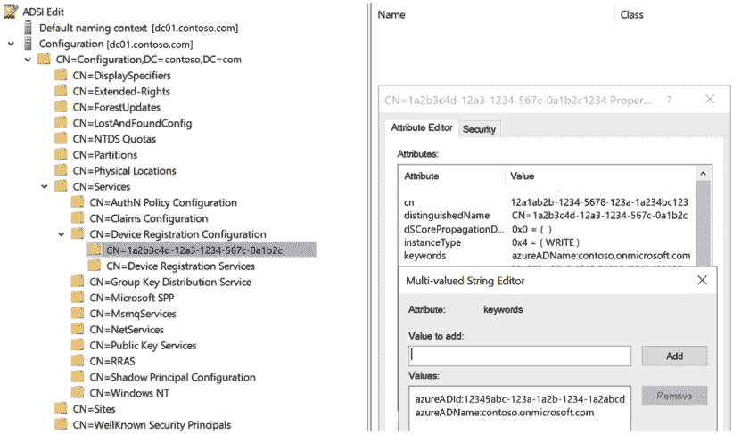

图 17.5 – ADSI Edit

如果缺少这些记录，可以在混合配置过程中使用 Azure AD Connect 创建它们（https://docs.microsoft.com/azure/active-directory/devices/hybrid-azuread-join-managed-domains），如下图所示：

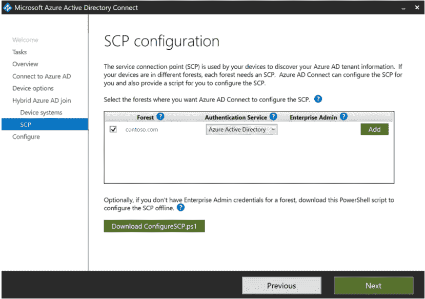

图 17.6 – SCP 配置

在某些情况下，你可能只希望某个 OU 中的特定计算机执行 HAADJ。为此，请跳过 SCP 记录创建操作，而是创建自定义组策略对象 (GPO)，并将其链接到云电脑所在的 OU（https://docs.microsoft.com/azure/active-directory-domain-services/manage-group-policy#create-a-custom-group-policy-object）。在 GPO 中，你需要创建两个注册表项，其值名称分别为 `TenantId` 和 `TenantName`，如下例所示：


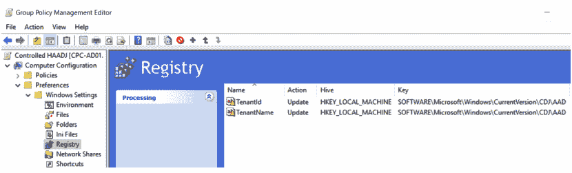

Figure 17.7 – GPO Policy Management Editor

你将云 PC 添加到的 OU 不在 Azure AD Connect 同步的范围内。

如果你创建了一个新的 OU，那么它很可能未被包含，你需要返回 Azure AD Connect 并将其包含在同步规则中，如以下屏幕截图所示：

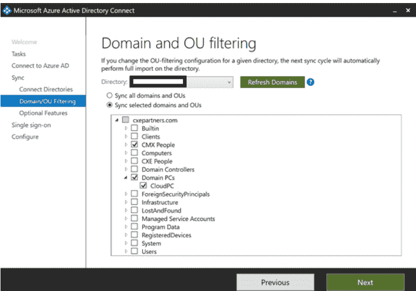

Figure 17.8 – Azure AD Connect domain filtering

## Azure AD 同步和复制导致延迟

云 PC 部署过程在 90 分钟后超时，而你的环境可能配置为引入不必要的延迟。让我们讨论同步和复制导致此问题发生的两种场景。

## Azure AD 同步间隔

默认的 Azure AD Connect 同步间隔为每 30 分钟。完成同步过程所需的时间取决于 Azure AD Connect 处理的对象数量。

为了防止你的云 PC 超时，你需要确保同步间隔和同步时间小于 90 分钟。首先，确认你的 Azure AD Connect 同步服务正在运行，并且其间隔未被延长，例如延长至每 2 小时。有关说明，请参阅 Azure AD Connect sync: https://docs.microsoft.com/azure/active-directory/hybrid/how-to-connect-sync-feature-scheduler。接下来，如果你正在同步大量对象，请查阅本文档以了解如何优化环境：https://docs.microsoft.com/azure/active-directory/hybrid/plan-connect-performance-factors。

## AD DS 站间复制

考虑以下 AD DS 拓扑。我们有一个站点上的域控制器运行 Azure AD Connect，而云 PC 部署服务用于创建计算机对象的域控制器位于另一个站点，如以下屏幕截图所示：

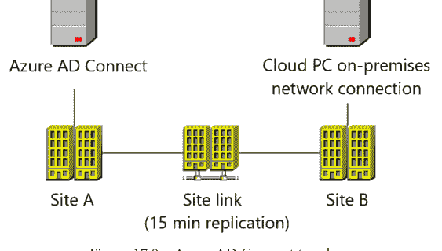

Figure 17.9 – Azure AD Connect topology

我们之前解释过，Azure AD Connect 同步间隔和同步时间需要在云 PC 部署超时之前完成（90 分钟）。此场景增加了另一个需要考虑的时间：域的站间复制时间。该默认值是 15 分钟，如果将其添加到计算机对象出现在 AD DS 中然后出现在 Azure AD 中的总可能时间，则会产生新的总时间为 1 小时，如以下图表所示：

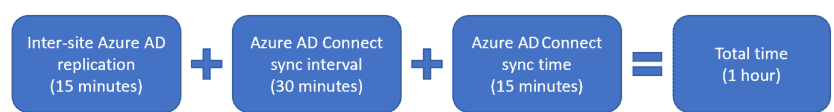

Figure 17.10 – Azure AD sync cycle

这是理论上的最大时间，并不适用于每个组织；然而，我们见过长时间的站间复制导致超时问题的例子。结论是，如果你由于规模和复杂性导致同步时间较长，请尽量减少其他可能的延迟。凭借现代的连接性，很少有理由限制站间同步间隔，因此你可能需要考虑将复制设置为默认的 15 分钟。

感谢并致谢 Steven DeQuincey，Microsoft 365 for Partners 的 Field PM，为本节做出贡献。

## Intune 注册失败

Windows 365 会将设备基于的移动设备管理（MDM）注册到 Intune。这应该非常可靠。

如果 Intune 注册失败，请确保云 PC 的 VNet 上所有必需的 Intune 端点均可用。还请确保租户上没有 MDM 注册限制，并且 Intune 租户处于活动且健康状态。

Resolution: 使用测试设备或 VM 尝试 Intune 注册。

## 没有足够的 IP 地址可用

向 OPNC 提供子网时，请确保有足够的 IP 地址。

每次云 PC 部署过程都会使用提供的范围内其中一个 IP 地址。

如果部署失败，将重试总共三次。每次都会分配新的 **虚拟网络接口卡（vNIC）** 和 IP 地址。这些 IP 地址会在数小时内释放，但如果地址空间太窄，这可能会导致问题。

**Resolution:** 检查 VNet 中可用的 IP 地址，并确保有足够多的 IP 地址可供重试过程成功。

## 未找到部署策略

部署进行中时，有人删除了部署策略。

**Resolution:** 确保部署策略可用并且已分配给正确的用户组。

## 未找到用户

部署进行中时，有人删除了关联的用户。

**Resolution:** 确保分配的用户帐户有效。

## 未找到许可证

部署进行中时，有人移除了用户的 Windows 365 许可证。

**Resolution:** 确保用户已为其帐户分配了有效的 Windows 365 许可证。

## 请求被策略禁止

Windows 365 使用客户提供的 VNet 将云 PC VM 的 vNIC 摄取到客户的 VNet 中。企业有时会实施 Azure 策略来限制某些 Azure 对象的创建。

**Resolution:** 在 Azure 门户中查看 **Policy**，并查找任何会阻止 Windows 365 服务部署云 PC 的策略事件。

## OPNC 不健康

如果关联的 OPNC 不健康，云 PC 部署将被阻止。

OPNC 每 6 小时刷新一次。如果部署进行中时 OPNC 刷新失败，将导致整个部署过程失败。

**Resolution:** 确保 OPNC 健康并重试部署。

## Web Proxy Auto-Discovery（WPAD）问题

云 PC 服务使用 AVD 代理连接到虚拟化控制平面的代理服务。当你通过 DNS 使用 WPAD 使用代理时，可能会遇到诸如机器帐户不被允许连接到 AVD 和 MEM 的服务 URL 的问题。

**Resolution:** 允许机器帐户或网络中的 IP 地址通过互联网连接到服务 URL 列表。作为替代方案，你可以删除代理设置，使其不再应用于云 PC，并使用直接路由到互联网（推荐）。

## 用户名和密码不正确或加入域的权限不足

Windows 365 Enterprise 需要域环境才能将云 PC 加入你的 AD 域。

**Resolution:** 为此创建并在 OPNC 中配置的 AD 服务帐户需要具有以下权限：

- 1. **在 OU 中创建计算机对象**（将计算机加入域）。
- 2. **在 OU 中删除计算机对象**（用于取消部署云 PC 以从 AD 中删除计算机帐户）。
- Permissions to enumerate user objects so that they can be found, to be added to the local `Remote Desktop Users` group when provisioning.

另一个问题可能是你只是输入了错误的凭据！

## 无法访问 DSC 文件

在部署期间无法访问 **Desired State Configuration（DSC）** 文件会导致失败，并显示以下消息：


Figure 17.11 – Failure message

**Resolution:** 确保防火墙访问已正确配置以允许 DSC 端点通过以下地址：

- `prod.warmpath.msftcloudes.com`
- `cpcsacnrysalprodprna01.blob.core.windows.net`（北美）
- `cpcsacnrysalprodprna02.blob.core.windows.net`（北美）
- `cpcsacnrysalprodprap01.blob.core.windows.net`（亚太）
- `cpcsacnrysalprodprau01.blob.core.windows.net`（澳大利亚）
- `cpcsacnrysalprodpreu01.blob.core.windows.net`（欧盟）
- `cpcsacnrysalprodpreu02.blob.core.windows.net`（欧盟）
- `mrsgglobalsteus2prod.blob.core.windows.net`
- `catalogartifact.azureedge.net`
- `kms.core.windows.net`

要检查这是否是网络连接 URL 访问问题，你可以尝试以下操作：

- 1. 对你所在区域的 Azure 容器执行 nslookup 操作，以检查你是否可以使用组织的 DNS 服务器解析，如以下屏幕截图所示：

```
C:\WINDOWS\system32>nslookup cpcsacnrysalprodpreu01.blob.core.windows.net
Server:  UnKnown
Address:  172.16.0.1

Non-authoritative answer:
Name:    blob.dub07prdstr05a.store.core.windows.net
Address:  52.239.138.100
Aliases:  cpcsacnrysalprodpreu01.blob.core.windows.net
```

Figure 17.12 – nslookup on Azure container


2. 如果 DNS 解析成功，则使用 PsPing 检查是否可以建立连接（无法通过浏览器完成此操作，因为无法进行身份验证），如下图所示：

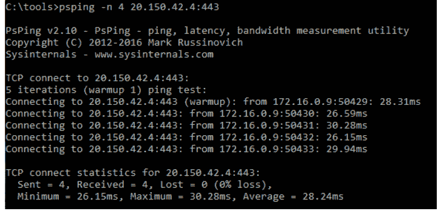

图 17.13 – 使用 PsPing 检查连接

## 云电脑 – 基于设备的筛选

你可能会遇到这样的情况：你已经配置了 MEM 租户来管理物理端点。现有策略、应用程序交付规则或其他配置项在 MEM 管理中心控制台的 Windows 365 窗格中可能会被筛选为“所有设备”。这可能会导致冲突，因为在某些情况下，该设置应仅适用于物理环境。

所有云电脑设备都有一个特定的型号名称（包含 Cloud PC）和一个注册配置文件名称（与云电脑预配配置文件相同），可以使用这些名称在“所有设备”分配中筛选出它们。

## 用户收到错误“你对此 Cloud PC 的访问将在 5 天后结束。请立即备份你的文件”

当你在 Windows 365 门户中看到上述错误时，表示 IT 管理员已从你的用户帐户中移除 Windows 365 许可证。Cloud PC 不会立即被删除，而是会进入 7 天的宽限期。

要解决此问题，IT 管理员必须重新分配许可证，以避免最终用户的数据丢失，如下图所示：

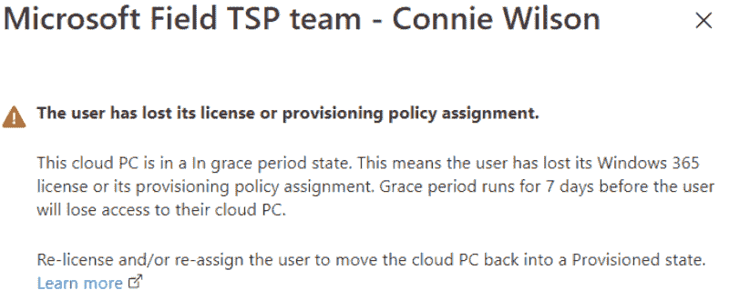

图 17.14 – 许可证丢失错误

你可以在这里找到此错误如何呈现给最终用户的屏幕截图：

你可以通过远程桌面客户端找到该工具。当你在顶栏中有一个活动会话时，右键单击该栏并选择“体验监视器”，如下图所示：

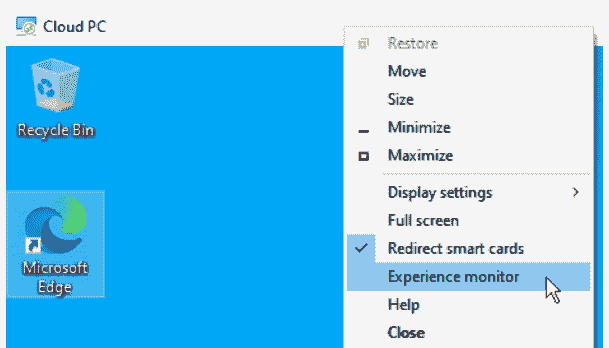

图 17.16 – 体验监视器

单击“查看详细信息”，如下图所示：

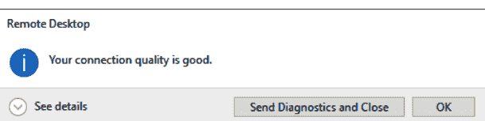

图 17.17 – 查看详细信息

以下屏幕显示有关活动连接的所有相关信息。它还显示了该服务所使用的网关：

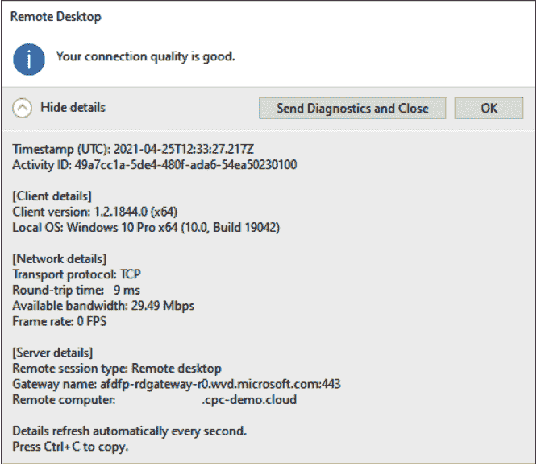

图 17.18 – 诊断信息

你也可以直接从此处将诊断信息发送给 Microsoft，以附加到你的支持工单中，用于故障排除。

请确保满足连接的网络带宽要求，如第 4 章“部署 Windows 365”中的远程桌面连接要求表所列。

你现在已经了解了许多最常见的错误，以及可用于分析和跟踪用户体验（UX）的工具。大多数情况下，Endpoint Analytics 会帮助你并主动警告你环境中的错误；但是，了解自己可以做些什么来解决问题总是好的！

## 总结

在本章中，你了解了在 Windows 365/云电脑注册过程中可能发生的大部分部署错误。

读完本章后，你掌握的知识将帮助你在体验新服务时解决任何错误！在下一章中，你将找到社区中的众多专家，从他们那里你可以获得有关该主题的更多知识。

## 问题

- 1. 成为 Windows 365/云电脑故障排除达人是什么感觉？
   - A. 感觉很棒。
   - B. **读完这本书的那一天改变了我的生活！**
   - C. 还不错！
   - D. 等等，让我先拿杯啤酒。

## 延伸阅读

如果你想在读完本章后了解更多关于 Windows 365 故障排除的信息，请访问 Microsoft Docs 公共故障排除页面以查找更多信息，包括以下链接：

- Windows 365 故障排除文档：https://docs.microsoft.com/en-us/windows-365/troubleshooting
- Windows 365 技术社区（获取他人帮助）：https://techcommunity.microsoft.com/t5/windows-365/bd-p/Windows365Discussions

## 社区帮助

### 加入新的 W365 社区！

加入新的 Windows 365 技术社区，以及在 Twitter 上由 MVP 驱动的新 W365 社区 @W365Community，与其他用户一起了解有关 Windows 365 和 Microsoft Endpoint Manager 的更多信息！

将 www.w365community.com 加入书签！

### Microsoft 技术社区和 MS Learn

立即加入我们的 Microsoft 技术社区平台。它包括有关新版本的信息，以及有关修复问题和实现新功能的技术信息：

| 技术社区 | 网址 |
|---|---|
| Windows 365 技术社区 | aka.ms/W365TC |
| W365 Twitter 社区 | @W365community |
| Intune 客户成功 | techcommunity.microsoft.com/t5/intune-customer-success/bg-p/IntuneCustomerSuccess |
| Microsoft Endpoint Manager 博客 | https://techcommunity.microsoft.com/t5/microsoft-endpoint-manager-blog/bg-p/MicrosoftEndpointManagerBlog |
| Microsoft Intune | https://techcommunity.microsoft.com/t5/microsoft-intune/bd-p/Microsoft-Intune |
| Defender for Endpoint | techcommunity.microsoft.com/t5/microsoft-defender-for-endpoint/bg-p/MicrosoftDefenderATPBlog |
| Windows | community.windows.com |
| Windows 365 | https://techcommunity.microsoft.com/t5/windows-365/bd-p/Windows365Discussions |
| Windows IT Pro | techcommunity.microsoft.com/t5/windows-it-pro-blog/bg-p/Windows10Blog |
| Microsoft Learn | learn.microsoft.com |

## 其他社区博客、Microsoft MVP 等...

你可以找到各种各样为 Microsoft Endpoint Manager、Windows 365 和 Azure 虚拟桌面-企业移动性社区做出贡献的人。有些是 Microsoft MVP，有些则正在或曾在 Microsoft 工作——他们都是出色的社区大使！这样一来，你就可以在一个地方找到所有内容，以防万一。

## 说明

根据上海市的相关规定，就用人单位与劳动者解除劳动合同经济补偿金支付的相关事宜，说明如下：

### 一、法律依据

**（一）《劳动合同法》第四十六条**

有下列情形之一的，用人单位应当向劳动者支付经济补偿金：

- （一）劳动者依照本法第三十八条规定解除劳动合同的；
- （二）用人单位依照本法第三十六条规定向劳动者提出解除劳动合同并与劳动者协商一致解除劳动合同的；
- （三）用人单位依照本法第四十条规定解除劳动合同的；
- （四）用人单位依照本法第四十一条第一款规定解除劳动合同的；
- （五）除用人单位维持或者提高劳动合同约定条件续订劳动合同，劳动者不同意续订的情形外，依照本法第四十四条第一项规定终止固定期限劳动合同的；
- （六）依照本法第四十四条第四项、第五项规定终止劳动合同的；
- （七）法律、行政法规规定的其他情形。

|   |   |
|---|---|
| Mirko Colemberg | blog.colemberg.ch |
| Peter Daalmans | www.peterdaalmans.com |
| Peter Klapwijk | www.inthecloud247.com |
| Anoop Chandran | www.howtomanagedevices.com |
| Ronni Pedersen | www.ronnipedersen.com |
| Oliver Kieselbach | www.oliverkieselbach.com |
| Martin Bengtson | www.imab.dk |
| James Kindon | www.jkindon.com |
| Jörgen Nilsson | https://ccmexec.com/ |
| Freek Berson | www.themicrosoftplatform.net |
| Tim Mangan | www.tmurgent.com/TmBlog |
| Pieter Wigleven | aka.ms/pieter/windows |
| Stefan Georgiev | www.twitter.com/stg3orgi |
| Dean Cefola | www.youtube.com/AzureAcademy |
| Neil McLoughlin | www.virtualmanc.co.uk |
| Bas van Kaam | www.basvankaam.com |
| Christiaan Brinkhoff | www.christiaanbrinkhoff.com |
| Per Larsen | www.osddeployment.dk |
| Marcel Meurer | blog.itprocloud.de |

## 总结

这是本书的最后一章，我们看到了所有令人惊叹的社交媒体渠道，在这些渠道中你可以找到一些对技术社区有重要贡献的人。我们希望本书中的所有知识对你有所帮助，并感谢你与我们一同完成这段旅程。


Packt.com

订阅我们的在线数字图书馆，即可完全访问超过 7,000 本图书和视频，以及行业领先的工具，帮助你规划个人发展和推进职业生涯。如需更多信息，请访问我们的网站。

## 为什么订阅？

- 通过来自 4,000 多位行业专业人士的实用电子书和视频，减少学习时间，花更多时间编写代码
- 通过专为你打造的技能计划改善学习效果
- 每月免费获得一本电子书或一个视频
- 完全可搜索，方便获取关键信息
- 可复制、粘贴、打印和收藏内容

你是否知道，Packt 为已出版的每本书都提供电子书版本，并提供 PDF 和 ePub 文件？你可以在 packt.com 升级到电子书版本，作为印刷版图书的客户，你有权享受电子书副本的折扣。请通过 customercare@packtpub.com 与我们联系以了解更多详情。

在 www.packt.com，你还可以阅读一系列免费技术文章，订阅各种免费新闻通讯，并获得 Packt 图书和电子书的独家折扣和优惠。


# 你可能喜欢的其他书籍

如果你喜欢这本书，你可能对 Packt 出版的其他这些书籍感兴趣：

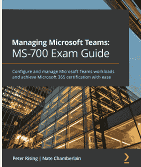

# 管理 Microsoft Teams：MS-700 考试指南

Peter Rising, Nate Chamberlain

ISBN: 9781801071000

- 探索 Teams 功能的安全合规配置选项
- 在 Microsoft Teams 中管理会议、通话和聊天功能
- 了解如何在 Teams 中管理电话号码、系统和设置
- 管理单个团队设置、成员资格和访客访问
- 为 Microsoft Teams 应用和功能创建策略
- 部署访问审查和动态团队成员资格

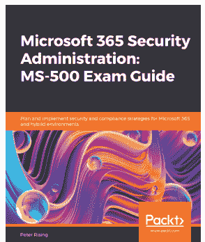

# Microsoft 365 安全管理：MS-500 考试指南

Peter Rising

ISBN: 9781838983123

- 快速掌握身份和访问的实现与管理
- 了解如何部署和管理威胁防护
- 掌握 Microsoft 365 中治理和合规功能的管控
- 探索有效配置和部署的最佳实践
- 实现并管理信息保护
- 通过自测题和模拟考试帮助你通过 Microsoft 考试并获得认证

# Packt 正在寻找像你这样的作者

如果你有兴趣成为 Packt 的作者，请访问 authors.packtpub.com 并立即申请。我们已与数千名开发人员和技术专业人士合作，帮助他们与全球技术社区分享自己的见解。你可以提交通用申请、申请我们正在招聘作者的特定热门主题，或提交自己的想法。

# 分享你的想法

现在你已经读完了 *Mastering Microsoft Endpoint Manager*，我们很想听听你的想法！如果你是从 Amazon 购买的书籍，请点击这里直接前往该书在 Amazon 的评论页面并分享你的反馈，或在你购买的网站上留下评论。

你的评论对我们和技术社区非常重要，将帮助我们确保提供优质的内容。
