# 第 2 章：SQL Server 工具
## SQL Server工具

作为开发人员，我们习惯于在软件项目中使用**集成开发环境（IDE）**。Visual Studio多年来（甚至几十年来）一直是IDE领域的主要参与者，它让开发人员能够使用最新的软件开发流程，进一步提高软件项目的质量和效率。另一方面，服务器管理在过去对于许多产品来说通常被当作“二等公民”。总的来说，这一点即使不被认同，也是可以理解的。IDE是设计和创建能为企业带来收入的软件的工​​具，而管理工具通常只能提供某种成本节约的好处，而不是直接创造收入。

过去的SQL Server工具（2005版之前）非常侧重于满足管理和查询SQL Server实例及数据库的要求，但在使这些工具使用起来更*舒适*甚至愉悦方面却没有投入多少精力。高级IDE明确属于应用程序开发领域，而应用程序开发人员认为数据库充其量只是一个存储系统，因此不需要精致的工具来处理。

幸运的是，SQL Server 2005的到来，以及.NET Framework的发布，促使Microsoft中的一些人投入了更多时间和资源，为开发人员和DBA提供改进的数据库和数据管理界面。**SQL Server Management Studio（SSMS）**应运而生，统一了两个遗留工具的功能：**查询分析器**和**企业管理器**。任何自2005版以来使用过SQL Server的人都会认出这个应用程序，无论他们使用的是2005版还是最新的2016版本。


本章的第二种工具 **SQL Server Data Tools (SSDT)** 曾有多个不同的名称和版本，可追溯至 SQL Server 2005/2008，当时该工具名为 **Visual Studio Database Projects**（即 **Data Dude**）。自 SQL Server 2005 以来，该工具的诸多版本都专注于数据库项目的开发。SSDT 拥有 Visual Studio 用户熟悉的许多工具和界面，能够让经验丰富的 Visual Studio 用户迅速熟悉该工具。特别有趣的是，将数据库和商业智能项目集成到源代码控制、持续集成以及自动化部署流程的能力得到了改进。

在本章中，我们将探讨：
- 安装和更新 SQL Server 工具
- 新的 SSMS 功能和增强
- SQL Server Data Tools
- 用于开发 R 和 Python 代码的工具

## 安装和更新 SQL Server 工具

我们与 SQL Server 之旅的起点就是安装过程。在之前的 SQL Server 版本中，数据管理和开发工具与 SQL Server 安装镜像一起交付。因此，如果开发者想要安装 SSMS，就必须使用 SQL Server 的安装程序来完成安装。

从 SQL Server 2016 开始，微软做出了非常明智的决定，将管理工具与服务器安装分离。这不仅是安装介质的分离，也是发布流程的分离。这种分离意味着两个产品可以在无需等待另一团队准备就绪的情况下独立开发和发布。让我们看看这一变化如何在安装时影响我们。

在以下截图所示的 **SQL Server Installation Center** 屏幕中。这是运行安装截图中所示的 `SQL Server setup.exe` 时我们会遇到的第一个屏幕。在左侧选择 **Installation** 菜单项后，我们会看到 SQL Server 的通用安装选项，这些选项在最近的版本中仅做了最小程度的更改。此屏幕上呈现的第二个和第三个选项是 **Install SQL Server Management Tools** 和 **Install SQL Server Data Tools**。如果我们阅读这些选项的描述，会注意到这两个链接都会将我们重定向到 SSMS 或 SSDT 的 **Downloads** 页面。这是工具的交付已与服务器安装解耦的第一个明确迹象：

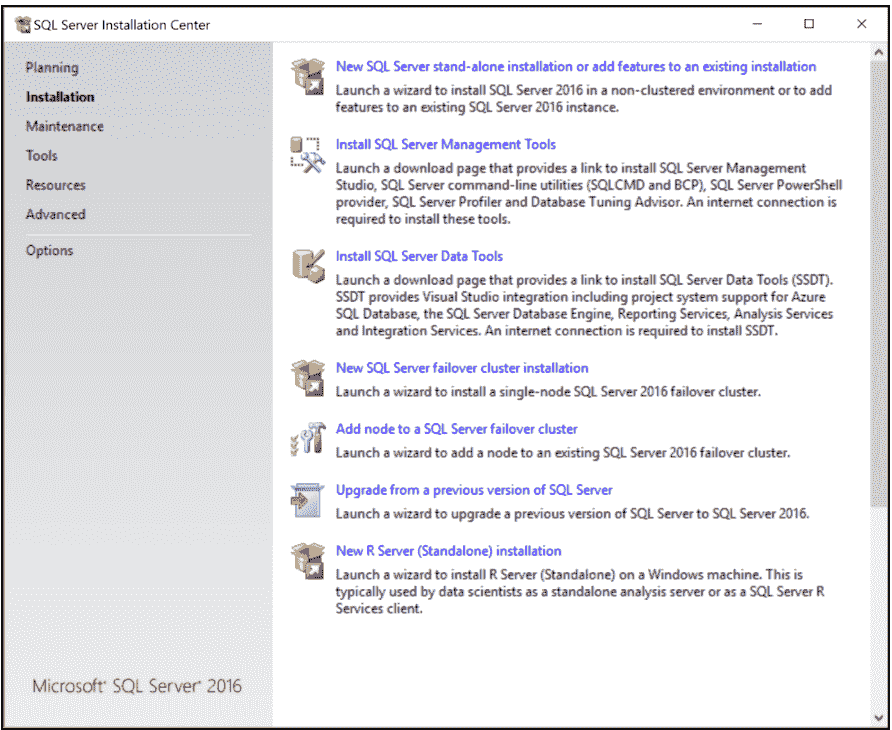

SQL Server Installation Center

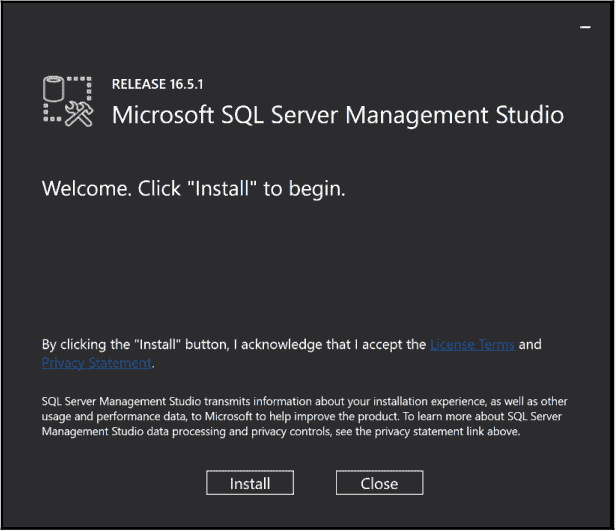

下载所需版本的 SSMS 后，我们可以像以前版本一样运行安装。接下来立刻 noticeable 的不同是安装程序本身。SSMS 2016.x 及更高版本基于 Visual Studio 2015 Isolated Shell，因此使用与 Visual Studio 2015 相似的配色方案和图标。

安装完成后，我们可以启动 SSMS，并看到与 SSMS 所有先前版本中相同的熟悉启动屏幕。应用程序的细微差异确实是细微的。应用程序启动时的启动画面显示 SSMS 现在 *powered by Visual Studio*；除此之外，没有明显的迹象表明我们正在使用基于 Visual Studio 的工具。界面可能感觉很熟悉，但可用的菜单和选项完全集中于与 SQL Server 的工作。

以前，SQL Server 和 SQL Server 工具是打包在一起的。这导致对工具的错误修复和功能添加必须捆绑在 **Cumulative Updates (CU)** 和 **Service Packs (SP)**，或 SQL Server 产品的通用版本发布中。

我们也有选项可以请求 SSMS 在应用程序启动时自动检查更新。如果有新版本可用，这将在 Windows 中创建一个通知气球消息。以下截图中可以看到 Windows 10 机器上的示例通知：

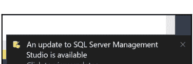

SQL Server Management Studio 的更新通知

一旦打开更新检查，SSMS 会连接到微软的更新系统，并将当前安装的版本与软件的最新可下载版本进行检查。如果发现更新，这些更新将使用更新机制提供，如以下截图所示。我们也可以决定是否应执行自动更新检查：

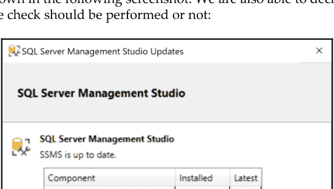

SQL Server Management Studio 更新检查器

这些对安装和更新流程的增强并不令人震惊，尤其是考虑到这些功能在其他产品中已有数年甚至数十年的历史。然而，这些是与从独立应用程序转向基于极其成功的 Visual Studio 框架的应用程序相关的首批主要改进。

## 新 SSMS 功能和增强

正如我们在安装过程中所看到的，SSMS 的安装和更新流程中已经有一些增强功能。通过将 SSMS 应用程序迁移到 Visual Studio 2015 Isolated Shell，SSMS 中增加了许多对使用 Visual Studio 2015（或其衍生产品）的应用程序开发人员来说熟悉的功能。虽然其中一些只是简单的改进，但这些添加可以帮助许多一直局限于 SSMS 16.x 及更高版本的 SQL 开发者。

### 自动保存打开的选项卡

第一个改进是可以选择是否在决定关闭 SSMS 时提示保存未保存的选项卡。这是一个简单的更改，但如果你使用 SSMS 运行许多临时查询，并且不想不断关闭并保存每个选项卡，现在这是一个选项。默认情况下，SSMS 在关闭窗口时会提示，但通过取消选中以下截图中标记的复选框，你可以强制 SSMS 静默关闭这些窗口：

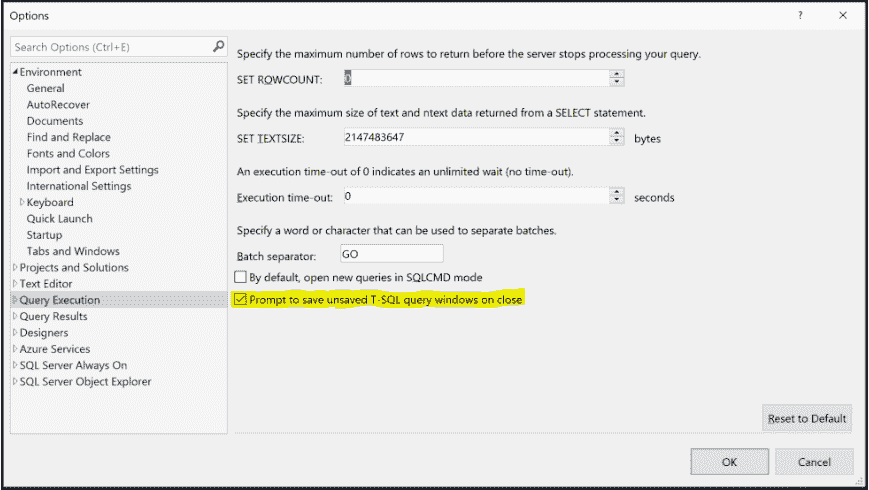

SQL Server Management Studio 中的选项窗口——提示保存未保存的工作

### 可搜索的选项

下一个可用性或生产力增强来自 Visual Studio 2015 Isolated Shell 功能。Visual Studio 和 SSMS 中的 **Options** 菜单中充满了可以配置的功能和功能。不幸的是，这些选项数量众多，以至于难以导航并找到你感兴趣的选项。为了帮助我们搜索感兴趣的设置，我们现在能够在 **Options** 菜单中快速搜索和过滤。以下截图解释了能够通过文本搜索快速搜索选项中的设置，而无需记住设置隐藏在哪里。转到 **Tools | Options**，然后你就可以在 **Options** 窗口左上角的文本框中输入搜索字符串。在以下截图中，搜索词 `execution` 已输入，结果在将单词输入搜索表单时被过滤：

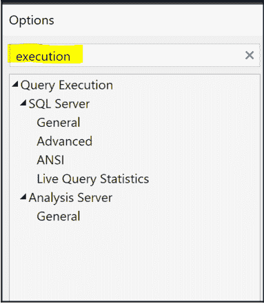

### 增强的滚动条

一个将更经常使用的进一步改进是 **T-SQL 编辑器** 选项卡中的增强滚动条。在以下截图中，我们可以看到一个正在编辑的 T-SQL 存储过程的示例：

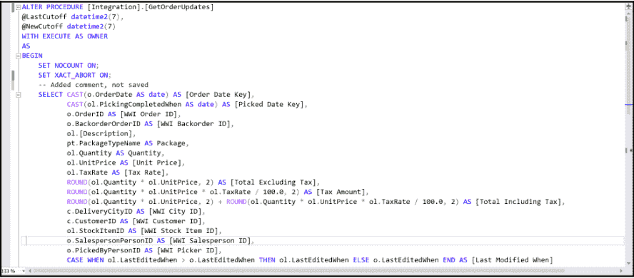

SQL Server Management Studio 滚动条增强

需要关注的主要点是：屏幕左侧的边距和 Management Studio 右侧的滚动条。此处的增强功能使我们能够轻松识别脚本窗口中的一些细节，即：
- **绿色块** 显示编辑器中对当前正在编辑的文件所做的更改已保存
- **黄色块** 显示尚未保存的更改
- **红色块** 显示代码无效或存在语法错误（必须启用原生 IntelliSense 才能使此功能工作）
- 滚动条上的 **蓝色标记** 显示光标的位置


这些细微的变化进一步证明了 Visual Studio 基础为我们提供了更多增强功能，使在 SSMS 中工作变得更轻松。知道代码在语法层面发生了哪些更改或存在缺陷，可以让我们在 SSMS 内部快速浏览代码。

## 执行计划比较

重构和改进代码性能是开发人员日常工作中的常见情况。能够识别某个查询重构是否有助于改进执行计划有时会很困难。为了帮助我们识别计划变化，SSMS 16.x 及更高版本现在提供了比较执行计划的选项。

通过将初始查询的执行计划和 T-SQL 保存为 .sqlplan 文件，我们就可以运行重新设计的查询并比较两个计划。在以下屏幕截图中，我们可以看到如何启动计划比较：

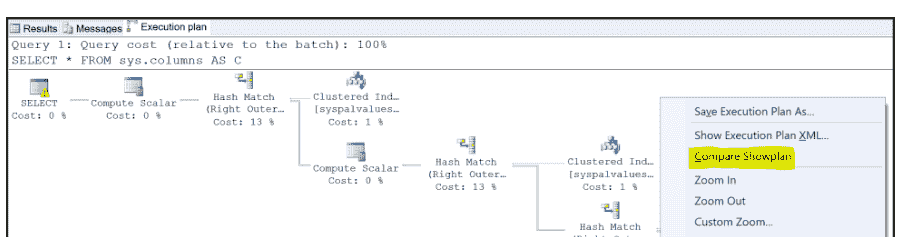

激活后，我们必须选择要用于比较会话的 `.sqlplan` 文件。两个执行计划会加载到 SSMS 中的单独 **Compare Showplan** 选项卡中，我们可以评估计划之间的差异或相似之处。在以下屏幕截图中，我们可以看到一次计划比较，其中两个计划之间只有细微差别：

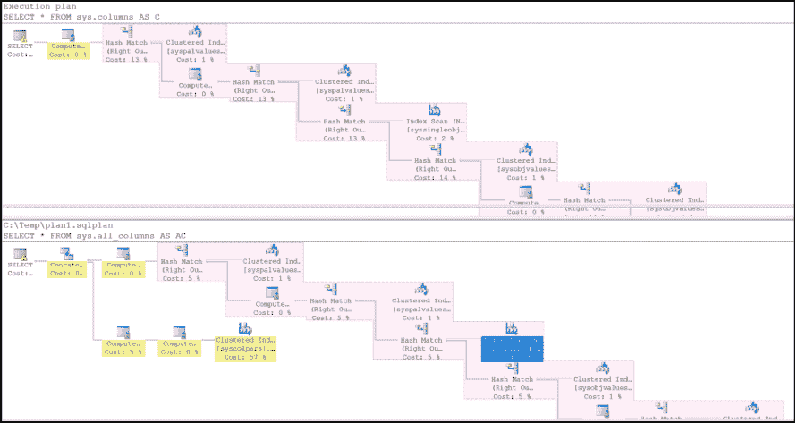

在前面的屏幕截图中，执行计划节点中相似的节点具有红色背景，而不同的节点具有黄色背景。

如果我们单击其中一个计划中的节点，比较计划中的匹配节点将被突出显示，我们就可以研究它们如何相似以及如何不同。

一旦我们选择了执行计划中的节点，我们将能够查看要比较的节点的属性，类似于以下所示的详细信息：

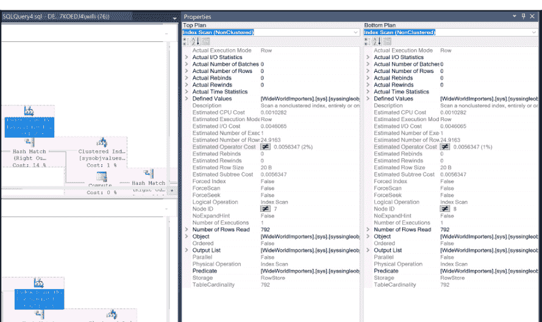

Showplan comparison—node properties

属性选项卡清楚地显示了节点的哪些部分不同。在前面的屏幕截图中，我们可以忽略下方的不等式，它表示节点 ID 不同；在查询计划略有变化的地方就会出现这种情况。本例中有趣的是 Estimated Operator Cost 属性，它显示存在差异。这个例子非常简单，差异也很小，但我们只需几次简单的点击就能识别出非常相似的计划中的差异。这种支持非常宝贵，节省了大量时间，尤其是在计划更大、更复杂的情况下。

## 实时查询统计

在计划比较功能的基础上，我们拥有开发人员最强大的功能之一。**Live Query Statistics (LQS)** 正如其名称所示——它为我们提供查询执行的实时视图，以便我们可以确切地看到数据如何在查询计划中流动。在之前的 SQL Server 和 SSMS 版本中，我们能够请求查询执行计划的静态图形表示。已经有多本书、博客文章、视频和培训研讨会为全球数千名开发人员和 DBA 设计和提供，旨在提高人们理解这些静态执行计划的能力。开发人员阅读和解释这些计划内容的能力很大程度上依赖于这些资源。有了 LQS，我们就多了一个工具，可以更轻松地识别 SQL Server 如何消费和处理我们提交给它的 T-SQL 查询。

LQS 中的 *special sauce* 在于我们得到的不是静态图形表示，而是执行的动画。执行计划在 SSMS 中显示，计划节点之间的箭头会移动以显示节点之间的数据流动。在以下屏幕截图中，我们可以看到如何在 SSMS 中为特定 **Query** 选项卡激活 LQS：

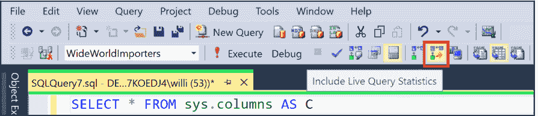

由于 LQS 显示的是动态图像，我们在书中处于明显劣势！然而，当我们激活 LQS 运行查询时，仍然可以看到 LQS 在运行时的示例，如以下屏幕截图所示：

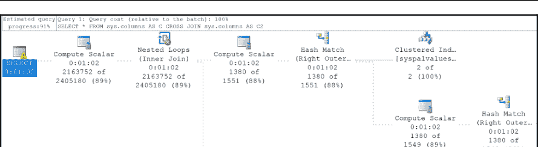

Live Query Statistics—query execution

在前面的屏幕截图中，我们可以看到我们熟悉的执行计划图像已被稍微扩展。我们现在可以看到一些额外的细节。从此图像的左上角开始，我们可以看到以百分比表示的估计查询进度。关于查询执行和统计的任何事情，SQL Server 总是在使用估计。估计基于表和索引统计，这是一个值得一整本书的主题！我们还会在每个仍在积极处理数据的节点下方看到执行时间显示。此外，每个节点下方都会显示还有多少行待处理（这些也基于统计的估计）。最后，我们看到连接每个节点的箭头；实线表示执行已完成，虚线（在执行期间也会移动）显示数据仍在流动和处理中。

你可以尝试运行前面屏幕截图中显示的相同查询，看看 LQS 的样子。这是一个针对 sys.objects 的长时间运行查询，以产生足够大的结果集，使 LQS 有时间捕获执行信息。以下代码显示了一个示例查询函数：

```
SELECT * FROM
SYS.OBJECTS AS o1
CROSS JOIN sys.objects AS o2
CROSS JOIN sys.objects AS o3
```

此示例查询应运行足够长的时间，以便 LQS 显示足够长的动画查询计划，以便理解 LQS 如何使查询计划更易于理解。还应清楚的是，LQS 只能为运行时间超过几秒的查询显示有用的动画，因为动画仅在查询持续时间内运行。

这种数据流动的动态显示使我们作为开发人员能够理解 SQL Server 如何处理我们的查询。我们能够更好地了解执行花费最多时间和资源的位置，以及我们可能需要考虑重写查询或应用不同索引以获得更好结果的位置。LQS 结合查询计划比较，将使我们作为开发人员能够设计更好的数据库解决方案，并更好地理解 SQL Server 如何处理我们的查询。特别是，SQL Server 必须等待执行计划中的某些节点完成，然后才能继续下一个节点。

然而，我们必须记住，运行 LQS 类似于运行跟踪，它需要一组特定的权限，并且还会消耗服务器资源。我们应该在开发阶段使用 LQS 处理查询，并在部署到生产环境之前尝试编写最优代码。因此，LQS 应主要用于您在测试环境中的开发工作，而不是在生产环境中使用。

## 导入平面文件向导

SSMS 的设计目的是让 DBA 和开发人员的常规任务更轻松。为许多不同任务构建了向导，以指导用户更快地找到解决方案。有一个领域仍然令人沮丧：导入平面文件（CSV 或 TXT 文件）这一简单任务。这一看似基本的功能因笨拙且令人恼火的导入和导出向导而变得复杂，该向导往往使导入数据的任务变得更加困难而不是更容易。

随着 SSMS 17.3 的到来，情况有所缓解！导入平面文件向导去除了将平面文件导入 SQL Server 时许多不必要的复杂性。向导可以通过右键单击所需数据库名称，然后在菜单 Tasks 下找到，如以下屏幕截图所示：

- 2. 向导的下一步提供了平面文件中前 50 行数据的预览。向导解析数据并显示文件中已识别的列，如以下屏幕截图所示：

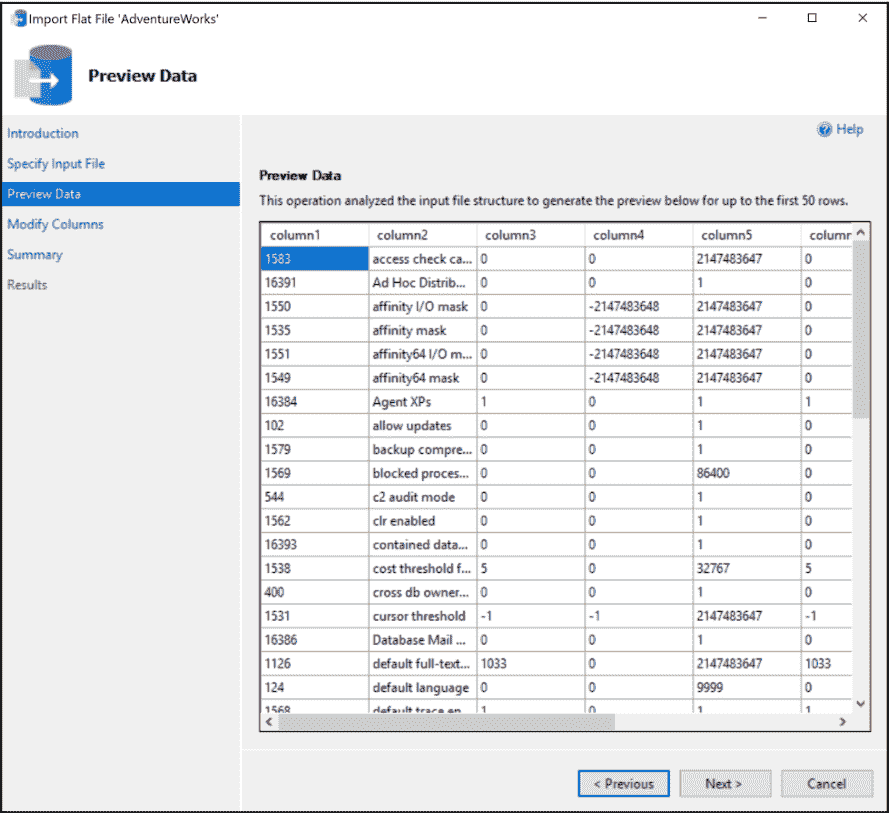

Import Flat File—data preview


3. 数据预览显示了向导如何解读行和列；如果此分析不正确，可以在向导的下一步中修改新目标表的架构，如下面的屏幕截图所示：

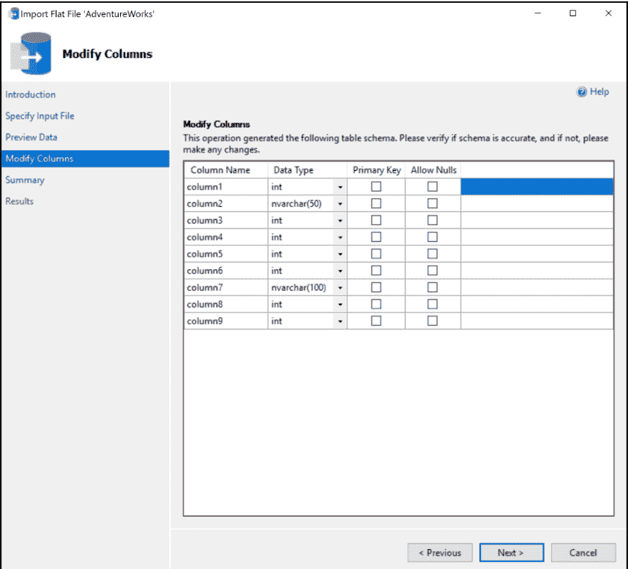

导入平面文件 — 修改列

启动漏洞扫描很简单。右键单击目标数据库，选择“任务”菜单，然后导航到“漏洞扫描”。可用选项包括运行新扫描或打开先前扫描的报表。运行扫描会将结果存储在用户定义的位置，但默认情况下会存储在用户的默认文档位置。下面的屏幕截图演示了此过程：

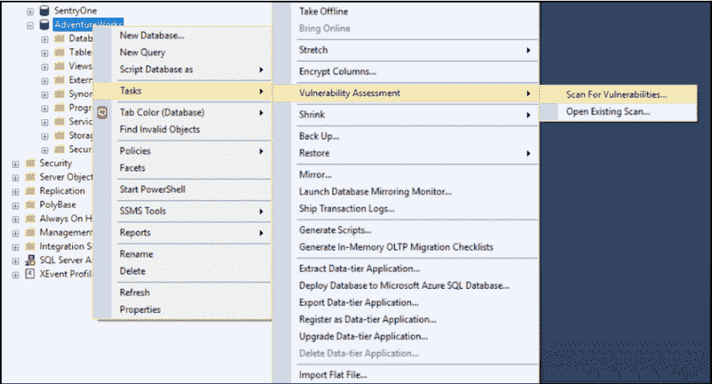

扫描完成后，SSMS 会自动打开生成的报表并将其显示在 SSMS 内部。在撰写本文时，尚无法以不同格式（例如 Word 或 Excel）自动导出结果。报表的基础是 JSON 文件，因此任何进一步的处理都需要等待 Microsoft 提供导出功能，或者需要您自行解析 JSON 文件。

SSMS 中显示的最终报表允许对可能发现的安全威胁进行进一步分析。在下面的屏幕截图中，我们可以看到对 AdventureWorks 数据库的示例扫描：

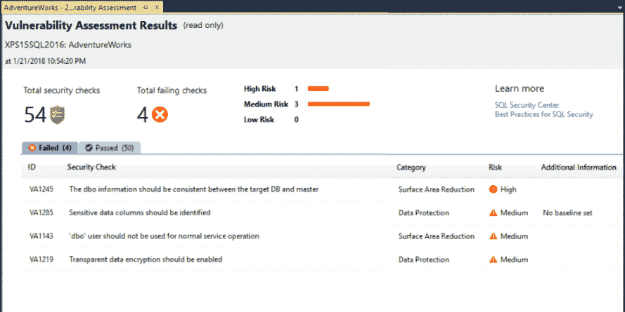

漏洞扫描结果

扫描结果显示该数据库已通过 50 项测试，并有 4 项未通过。单击其中一项测试，我们可以查看有关失败/通过的更多详细信息。

下面的屏幕截图显示了失败的检查项 VA1219 的详细信息，该检查项指出数据库应启用透明数据加密：

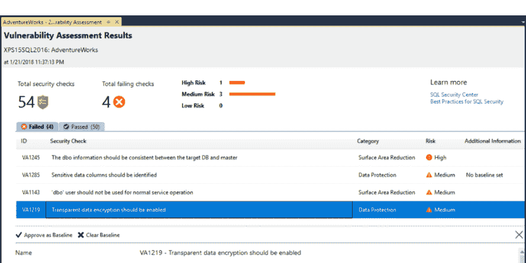

漏洞扫描 — TDE 检查失败

每项检查都附有一系列信息，包括针对被扫描数据库运行的查询。这使我们能够查看该检查对于我们的数据库/环境是否正确。

如果某项检查与数据库/环境无关，则可以单击“批准为基线”按钮。这将覆盖检查结果，以确保将来对此数据库进行的扫描会将已覆盖的检查视为通过而不是失败。

在将失败的 TDE 检查标记为可接受值后，对 AdventureWorks 数据库的第二次扫描显示我们获得了 51 次通过和 3 次失败。TDE 检查现在被列为通过的检查，附加信息被设置为自定义基线值。下面的屏幕截图说明了该基线：

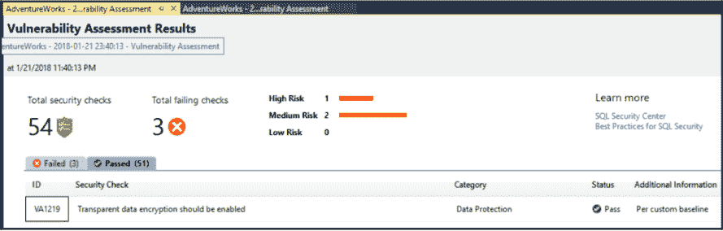

漏洞评估绝不是一个完美的工具，目前*仅涵盖*有限的一组场景。然而，它为评估数据库内部的安全威胁提供了一个良好的开端。该工具将继续接收更新（尤其是针对所检查规则的更新）。始终欢迎使用进一步的工具来帮助提高数据库系统的安全性。

## SQL Server 数据工具

与 SSMS 的安装一样，SQL Server 数据工具也作为单独下载提供。可以通过本章开头显示的 SQL Server 安装界面找到该工具。单击**安装 SQL Server 数据工具**将启动 Web 浏览器，将您定向到 SSDT 的**下载**页面。此**下载**页面提供最新的稳定版本以及下一版 SSDT 的最新候选发布版本（并附带候选版本不适合生产环境的常见警告）。SSDT 与 SSMS 一样附带相同的 Visual Studio 集成外壳，并且可以安装为独立工具。然而，SSDT 面向开发人员以及作为团队成员开发数据库解决方案相关的工作流。这包括源代码控制和项目部署打包的过程。考虑到这一点，也可以在安装了完整 Visual Studio 环境的计算机上安装 SSDT。这样做会将 SSDT 集成到 Visual Studio 中，并纳入数据库开发模板和工作流，从而使 Visual Studio 保持在开发环境中，而不是仅仅为数据库开发添加单独的环境。

如果已安装 Visual Studio，则可以从 Visual Studio 内部安装 SSDT 更新。要下载并安装此更新，请导航到“工具 | 扩展和更新”，并在“扩展和更新”模态窗口左侧选择“更新”节点，如下面的屏幕截图所示：

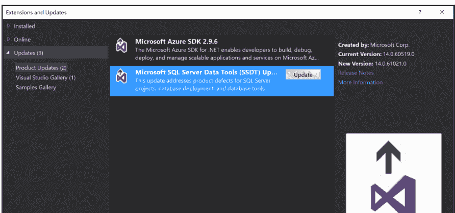

SSDT — 扩展和更新

安装后，SSDT（无论是作为独立工具安装还是集成到 Visual Studio 中）会提供四个独立项目模板，以帮助快速启动 SQL Server 项目的开发：

- **关系数据库**：该模板专为传统关系数据库开发而设计，支持 SQL Server 2005 到 2016 版本（尽管 SQL Server 2005 现在已弃用）。SSDT 还支持本地安装以及 Azure SQL 数据库项目（驻留在 Microsoft Azure 中的数据库即服务解决方案）。还可以为 Azure SQL 数据仓库（驻留在 Microsoft Azure 中的基于云的数据仓库解决方案）设计查询（但不能设计完整项目）。
- **Analysis Services 模型**：该模板旨在帮助设计和部署 Analysis Services 项目，支持 SQL Server 2008 到 2016 版本。
- **Reporting Services 报表**：该模板旨在帮助设计和部署 Reporting Services 项目，支持 SQL Server 2008 到 2016 版本。
- **Integration Services 包**：该模板旨在帮助设计和部署 Integration Services 项目，支持 SQL Server 2012 到 2016 版本。

模板选择决定了在创建项目时自动准备哪些文件和文件夹。选择**文件 | 新建项目**会显示如下屏幕截图所示的新项目对话框。项目类型导航树中有两个新增项。**商业智能**将**Analysis Services**、**Reporting Services**和**Integration Services**项目分组在一起。关系数据库项目类型位于 **SQL Server** 导航节点下，如下面的屏幕截图所示：

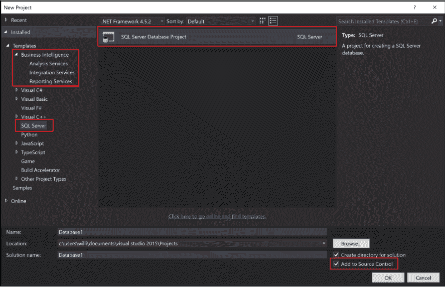

SSDT — 新项目对话框

如上面的屏幕截图所示，会创建一个项目文件夹，并且可以选择将项目添加到源代码控制系统。Visual Studio 提供原生访问源代码控制系统的 Visual Studio Team Services（Microsoft 提供的托管源代码控制系统）的选项，或者使用本地源代码控制系统（如 Git）的选项。此外，可以通过 Visual Studio 提供的广泛扩展库添加源代码控制系统，并且可以通过本节前面描述的**工具 | 扩展和更新**菜单访问这些系统。

对于以前使用过 Visual Studio 的任何开发人员来说，使用 SSDT 和上述模板应该都很熟悉。创建项目后，下一步是开始添加新项（表、视图、存储过程等）。该对话框会根据项目类型进行过滤，对于 SQL Server 数据库项目，我们可以选择创建从应用程序角色到 XML 架构集合的各种项。值得注意是能够创建 **SQL CLR 对象**（基于 C# 的公共语言运行时对象），这提供了创建更复杂计算的能力，而这些计算在 T-SQL 语言中是无法完成（或性能较差）的：

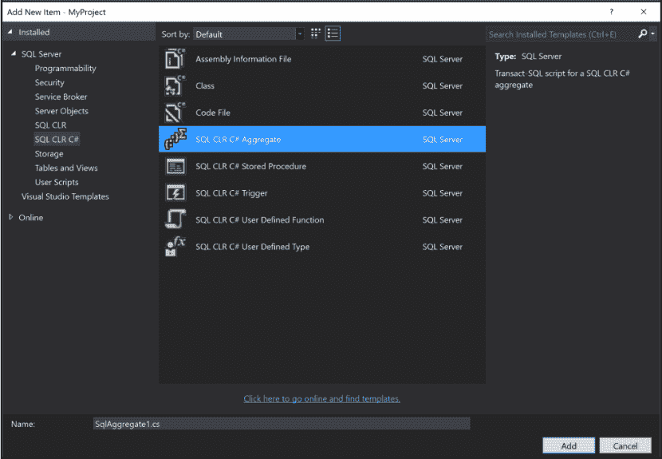


使用 SSDT 而非 SSMS 对开发人员而言的优势在于其对开发工作流程的关注以及程序中的集成：源代码控制集成、项目结构化和对象模板。这种以开发为中心的特性通过将源代码控制系统连接到构建系统以及将构建系统扩展为包含 **持续集成/部署 (CI/CD)** 的选项而得到进一步加强。自动化构建和 CI/CD 在过去十年中已在应用程序开发领域变得无处不在。数据库开发在这一领域一直仅获得有限的支持，因为数据库也会永久存储数据。现在应用程序开发环境已经成熟，将 CI/CD 引入数据库项目已成为现实。幸运的是，CI/CD 的基础早已为应用程序开发奠定，因此将 CI/CD 实施到数据库项目中的工作量大大减少。因此，SSDT 完全能够将 SQL Server 数据库项目集成到源代码控制系统中，并将这些项目扩展到自动化构建、测试和部署工作流程中。

目前 SQL Server 世界中涵盖 CI/CD 的选项非常丰富。TeamCity 持续集成和 Octopus Deploy 这两款工具已被证明与 SSDT 配合良好，能够为 SQL Server 项目的 CI/CD 提供顺畅的流程。


有关 SSDT 主题的更多信息，一个有趣且有用的网站是 Microsoft *SQL Server Data Tools Team Blog*，网址为 `https://blogs.msdn.microsoft.com/ssdt/`。

## 用于开发 R 和 Python 代码的工具

正如你可能已经知道的，SQL Server 2016 带来了对 R 语言的支持，而 SQL Server 2017 则增加了对 Python 语言的支持。当然，你需要一个用于 R 代码的开发工具。名为 **RStudio IDE** 的 IDE 工具的免费版本已在市场上存在相当长一段时间了。这可能是最受欢迎的 R 工具。此外，Microsoft 正在开发 **R Tools for Visual Studio (RTVS)**，这是一个 Visual Studio 的插件，使你能够在开发者使用 Microsoft 产品和语言时所熟悉的通用且知名的 IDE 中开发 R 代码。

在本节中，你将学习关于：
- RStudio IDE
- R Tools for Visual Studio
- 使用 Visual Studio 进行数据科学应用程序

### RStudio IDE

你用来编写和执行 R 代码的第一个工具是 **R Console**。控制台以大于号 (>) 的符号作为用户提示。在控制台中，你逐行编写命令，并通过按 *Enter* 键执行。你在控制台中具有有限的编辑功能。例如，你可以使用上、下箭头键检索缓冲区中的上一个或下一个命令。以下屏幕截图显示了控制台，其中执行了 demo ( ) 命令，该命令打开了一个包含演示包列表的资源管理器窗口。

由于 R 是一个功能包，你通过 q( ) 函数调用关闭 R Console。无论如何，你可能希望使用更美观、图形化的环境。因此，是时候介绍 RStudio IDE 了。以下屏幕截图显示了 R 控制台：

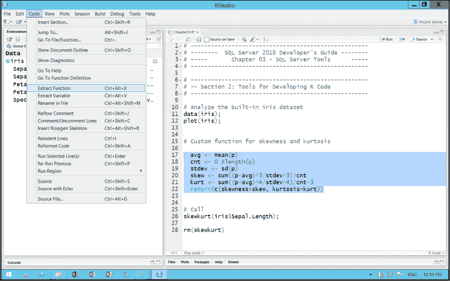

R Console

RStudio 是一家致力于通过其免费和付费产品帮助 R 社区的公司 (https://www.rstudio.com/)。他们最受欢迎的产品是 RStudio IDE，或者正如大多数 R 开发者所说的，只是 RStudio。RStudio 可用于开源和商业版，均适用于桌面计算机或服务器 https://www.rstudio.com/products/rstudio/。本节中描述的开源桌面版非常适合开始在 R 中开发。即使是这个版本也内置了大多数功能，可实现流畅高效的编码。本节将介绍该版本。

你可以从 RStudio 公司网站下载 RStudio IDE。IDE 支持 Windows、macOS 和 Linux。安装后，你可以通过桌面快捷方式打开它，该快捷方式指向 C:\Program Files\RStudio\bin\rstudio.exe 文件，如果你在安装期间使用了默认设置。

如果打开一个 R 脚本文件，RStudio 屏幕通常分为四个窗格，如下图所示。

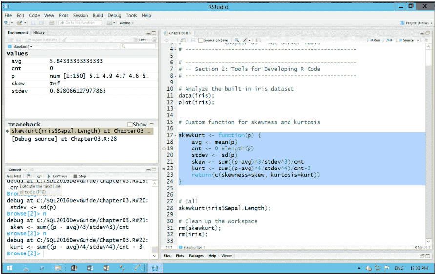

RStudio IDE

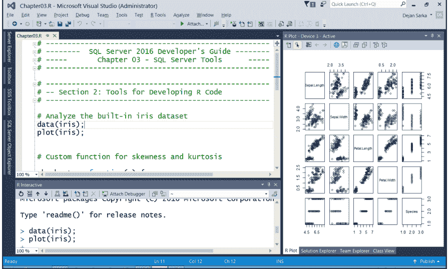

RStudio IDE 运行中

请注意，你可以从 Plots 窗格缩放绘图并以不同的图形格式保存它。

键盘快捷键 literally 有几十个。不可能全部记住。你通过使用它们来记住它们。尽管如此，在开始编写 R 代码之前，你不需要知道所有快捷键。你可以通过同时按下 Alt、Shift 和 K 键随时快速查看键盘快捷键参考。键盘 Shortcut Quick Reference 速查表会出现，如以下屏幕截图所示。你可以通过按 Esc 键关闭此速查表。

请注意，尽管详尽，但即使是这份速查表也不完整。在速查表的右上角，你可以看到指向更多快捷键的链接。最后，值得一提的是，你可以修改预定义的快捷键并将其替换为自己的快捷键。

你可以通过 RStudio IDE 窗口顶部的菜单访问许多键盘快捷键操作。例如，在 Tools 菜单中，你可以找到指向键盘快捷键速查表的链接。在 Help 菜单中，除了你期望的帮助选项外，你还可以找到指向各种速查表的链接，例如指向完整的 RStudio IDE 速查表的链接，这是一份可从 https://www.rstudio.com/wp-content/uploads/2016/01/rstudio-IDE-cheatsheet.pdf 在 RStudio 网站下载的 PDF 文档。以下屏幕截图说明了键盘快捷键速查表：

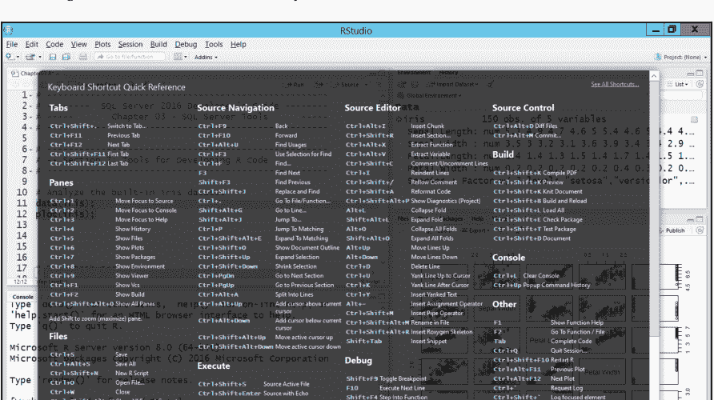

RStudio IDE 键盘快捷键速查表

使用 Panes 菜单，你可以更改窗格的默认布局。Code 菜单中有许多选项。例如，你可以从代码中提取一个函数。图 Extracting a function 显示了一个示例，其中 Source 窗格在 RStudio IDE 窗口右侧放大，以显示 Code 菜单中 Extract Function 选项的路径。突出显示的代码正在计算连续变量的第三和第四总体矩，即来自描述性统计的偏度和峰度。当你从代码中提取函数时，你需要提供函数名称，RStudio 会从代码中提取必要的参数。

以下屏幕截图显示了 RStudio IDE 中的调试会话。在窗口右侧的 Source 窗格中，你可以看到第 19 行附近的断点，靠近 `cnt <- 0` 代码。你还可以看到即将执行的行，在本例中为第 22 行，代码为 `kurt <- sum((p-avg)^4/stdev^4)/cnt-3`。在屏幕左下方的 Console 窗格中，你可以看到 **Next** 按钮处于高亮状态。此按钮执行代码的下一行。在屏幕中部左侧你可以看到 **Trackback** 窗格，在左上方可以看到 **Environment** 窗格。你可以看到变量 `cnt` 的值为 0，并且由于该变量在计算 `skewness` 时用作分母，skew 变量具有无限值：

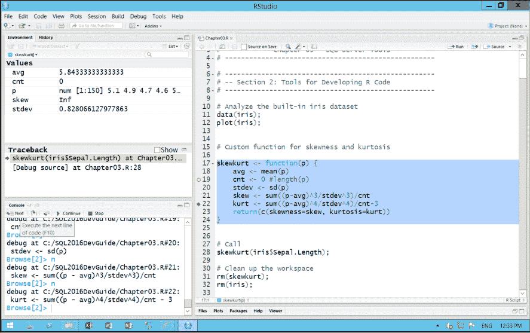

找到错误后，你可以从 **Debug** 菜单停止调试或使用 *Shift* 和 F8 键盘快捷键。修正代码并运行以测试它。

## R Tools for Visual Studio 2015

Microsoft 正在为那些习惯于在最受欢迎的 Microsoft IDE Visual Studio 中开发代码的开发者开发 RTVS。RTVS 有两个版本：作为 Visual Studio 2015 的免费下载，以及已包含在 Visual Studio 2017 中。你可以从 https://www.visualstudio.com/vs/rtvs/ 下载适用于 Visual Studio 2015 的 RTVS。本章下一节将介绍 Visual Studio 2017。

安装 RTVS 后，你像打开任何其他项目一样打开 Visual Studio。当然，由于 SSDT 不是单独的产品——它只是指向 Visual Studio IDE 的另一个快捷方式——你也可以打开 SSDT，并在其他常见的 Visual Studio 菜单旁边获得 R Tools 菜单。

使用 RTVS，你可以获得 RStudio IDE 的大多数有用的通用窗格。你可以获得 Source 窗格、Console 窗格——在 RTVS 中称为 R Interactive——以及 Plots 窗格。以下图显示了 RTVS 窗口，其中打开了 Source、R Interactive 和 Plots 窗格，显示了与本节前面图中 RStudio IDE 运行中所示的 iris 演示数据集变量相同的绘图：

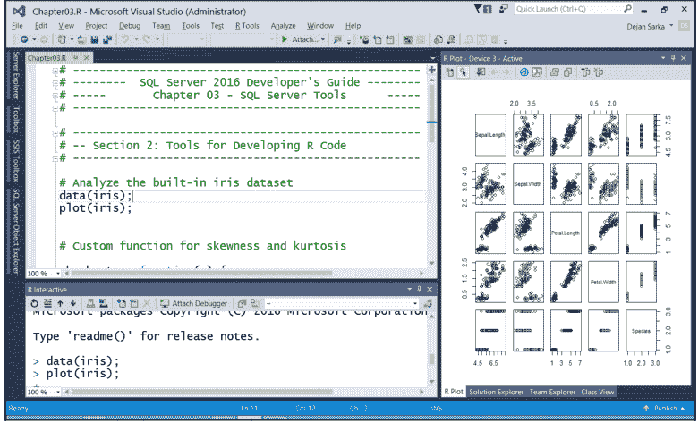

如果你熟悉 Visual Studio IDE，那么你可能想测试 RTVS。


# 为数据科学应用设置 Visual Studio 2017

这里介绍了 Visual Studio 2017。你可以使用 Professional 版或免费的 Community Edition（https://www.visualstudio.com/downloads/）来开发 Python 和 R 代码。

在安装 Visual Studio 2017 时，务必选择 Python 开发工作负载，然后选择数据科学和数据分析应用程序，如以下屏幕截图所示。这样将安装 Python 语言模板，包括数据科学模板，并安装 R Tools for Visual Studio 2017：

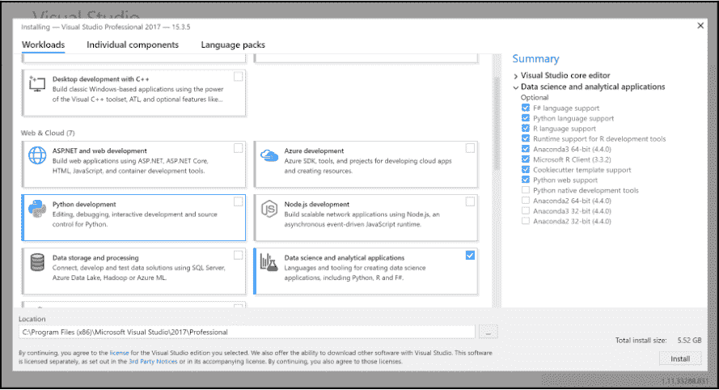

好了，你几乎准备就绪了。这里有一个小技巧。VS 2017 也会安装其自己的 Python 解释器。为了使用随 SQL Server 安装的可扩展版本，该版本可在 Database Engine 上下文中执行代码并包含 Microsoft 可扩展库，你需要设置一个额外的 Python 环境，指向可扩展版本的解释器。如果安装了 SQL Server 的默认实例，该可扩展解释器的路径为 `C:\Program Files\Microsoft SQL Server\MSSQL14.MSSQLSERVER\PYTHON_SERVICES\python.exe`。你可以在以下屏幕截图中看到如何设置此环境。请注意，由于 VS 2017 也安装了 Microsoft R Client，即包含 Microsoft 可扩展库的开放 R 引擎，因此开发 R 代码无需任何额外步骤：

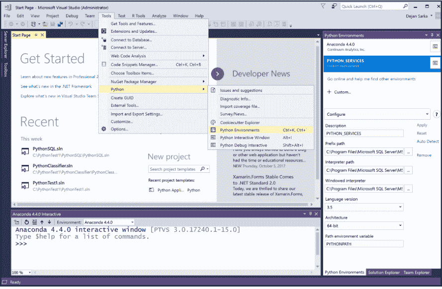

设置 Python 环境

就这样。你已准备好开始 Python 编程。只需新建一个项目并从 Python 文件夹中选择 **Python Application** 模板。你还可以探索 **Python Machine Learning** 模板，其中包括 **Classifier**、**Clustering** 和 **Regression** 项目。如果你选择了 **Python Application** 模板，你应该会打开第一个空的 Python 脚本，其默认名称与项目名称相同，默认扩展名为 `.py`，等待你编写和交互式执行 Python 代码。

## Summary

在本章中，我们回顾了 SQL Server 2017 开发者工具集中新增的内容。已进行了一些期待已久的改进，尤其是将 SQL Server Management Studio 与 SQL Server 本身的发布周期分离。SSMS 加速的发布周期带来了大量新功能和支持，将有助于开发者在日常使用 SQL Server 的工作中。

SSMS 的一些特色新增功能非常强大，将使我们作为开发者更高效。Live Query Statistics 为我们提供了查询实际处理方式的出色洞察，去除了在尝试重构或调优查询时猜测的部分。Vulnerability Assessment 工具应能更快地识别数据库中潜在的安全威胁。更安全的数据库意味着更安全的业务！

对于 SQL Server 开发者来说，有两个新的开发环境可用于开发 R 代码。当然，其中之一 RStudio IDE 在 R 开发者中是众所周知的。由于它被广泛使用，它很可能会是开发 R 代码的首选，也是 SQL Server 开发者的首选。尽管如此，如果你习惯并热爱 Visual Studio IDE，你可以尝试 R Tools for Visual Studio。

在简要介绍了随 SQL Server 2017 交付的工具之后，现在，是时候检查 SQL Server 2017 中的 JSON 支持了。
