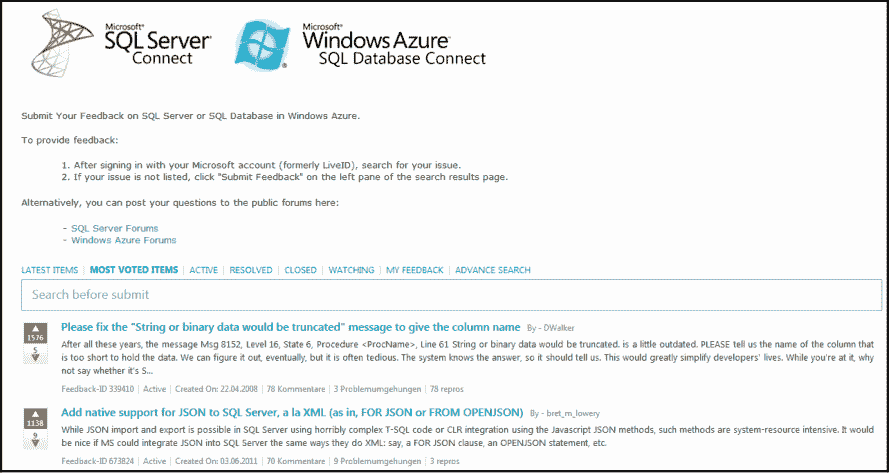
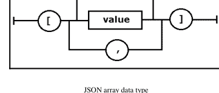
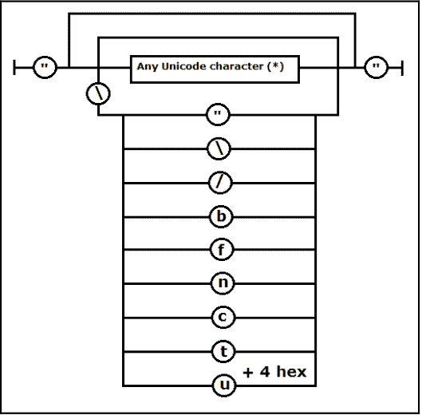
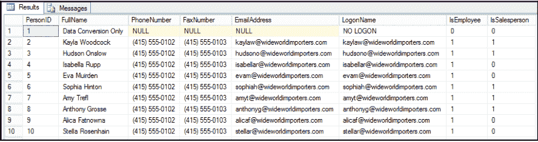
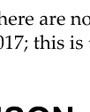
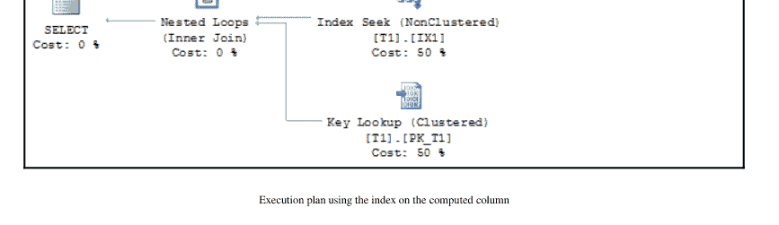
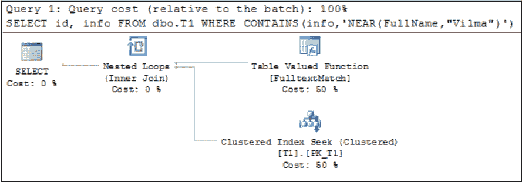
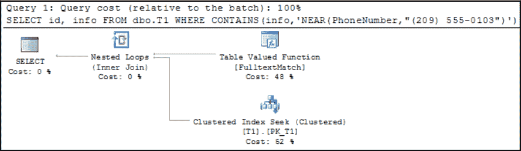

# 第 3 章：JSON Support in SQL Server
## JSON Support in SQL Server

在过去几年中，JSON 已确立为应用程序和服务之间数据交换的标准格式。XML 仍然是交换标准（并且将继续如此），但许多应用程序通过交换 JSON 数据而不是 XML 文档进行通信。因此，最重要的关系型数据库管理系统产品需要支持 JSON。

社区在两个发布周期后请求该功能，微软已在 SQL Server 2016 中实现了内置的 JSON 支持。支持不如 XML 那么全面，但对于大多数数据库和工作负载来说，它会相当不错。

本章探讨了 SQL Server 如何存储和处理 JSON 数据，并全面比较了 SQL Server 中 JSON 与 XML 的支持。

与 SQL Server 中的 JSON 数据相关的最重要操作已详细演示：

- Formatting and exporting JSON data from SQL Server
- Converting JSON data to a tabular format
- Importing JSON data to SQL Server
- Validating, querying, and modifying JSON data

最后，你将了解到由于缺少 JSON 数据类型和索引而导致的限制，并获得有关如何在这些限制下仍提高 JSON 查询性能的建议。

## Why JSON?

Microsoft Connect 网站是你可以留下对 Microsoft 产品反馈、建议和愿望的地方。SQL Server 最受欢迎的功能请求是 JSON 支持请求。它于 2011 年 6 月创建，截至撰写时（2017 年 10 月）已有 1,138 票。该请求仍处于开放状态，如以下屏幕截图所示，你将在本章后面看到为什么它仍然有意义保持活动状态：



社区成员用来证明该请求的论据如下：

- JSON 已是标准，应该得到支持，类似于 XML。
- 其他厂商支持它（Oracle、PostgreSQL 等）
- 由于缺乏 JSON 支持，我的客户希望从 SQL Server 迁移到支持 JSON 的其他数据库系统。

正如 vox populi（多数人的意见或信仰）一样，一些论据和给出的示例代表了开发和业务需求。有些则非常个人化，有时受热情驱使。但有一点他们都同意，并且几乎所有评论中都很常见：*一个严肃的关系型数据库管理系统应该对 JSON 有显著的支持*。该项目创建近五年后，微软在 SQL Server 2016 中添加了 JSON 支持。

当然，Microsoft Connect 网站上的投票数量并不是该功能的唯一原因。其他竞争对手（PostgreSQL、Oracle、DB2、MySQL）已经引入了 JSON 支持；其中一些，如 PostgreSQL，非常严谨和健壮。如果你还想成为一个受人尊敬的厂商，你需要提供 JSON 支持。

## What is JSON?

**JavaScript Object Notation (JSON)** 是应用程序和服务之间数据交换的开放标准格式。JSON 对象是人类可读的键值对列表。尽管其名称暗示了这一点，但 JSON 是语言无关的。它在 ECMA-404 标准中指定（http://www.ecma-international.org/publications/files/ECMA-ST/ECMA-404.pdf）。


> ECMA International 是一个成立于 1961 年的行业协会，致力于 **信息和通信技术 (ICT)** 和 **消费电子 (CE)** 的标准化。你可以在 https://www.ecma-international.org 找到更多关于它的信息。

JSON 非常简单且非常流行。它通常用于 AJAX 应用程序、配置、RESTful Web 服务、社交媒体应用以及 MongoDB 和 CouchDB 等 NoSQL 数据库管理系统。许多开发者更喜欢 JSON 而非 XML，因为他们认为 JSON 更简洁、更易读。

SQL 中的 JSON 支持在最新的 SQL 标准——SQL:2016 中定义。该标准描述了如何存储、发布和查询 JSON 数据，并定义了 SQL/JSON 数据模型和路径语言。规范文档（*ISO/IEC TR 19075-6:2017*）可在以下网页地址获得：https://www.iso.org/standard/67367.html。

## Why is it popular?

JSON 是一个简单的数据格式，但其简单性并不是使其成为 Web 服务和应用程序之间交换数据的领先标准唯一原因。它流行的最重要原因是 JSON 格式是许多编程语言的原生格式，例如 JavaScript。它们可以原生生成和消费 JSON 数据，而无需序列化。近年来软件开发中最大的问题之一是对象关系阻抗。JSON 数据格式灵活且自描述，允许你在不为数据定义严格模式的情况下有效使用它，而 XML 可能需要这样做。这允许快速集成数据。

## JSON versus XML

JSON 和 XML 都是简单、开放且可互操作的。由于 JSON 通常包含的数据更少，使用 JSON 时，网络中传输的数据更少。两种格式都可读；JSON 稍微更干净，因为它包含的文本更少。这是因为 JSON 支持的数据格式数量远少于 XML。

JSON 方便共享数据。JSON 中的数据存储在数组和对象中，而 XML 文档形成树结构。因此，使用 JSON 进行数据传输更容易且对许多编程语言原生：JavaScript、Python、Perl、Ruby 等。另一方面，XML 可以存储更多数据类型（JSON 甚至没有日期数据类型）；它可以包含照片、视频和其他二进制文件。XML 更健壮，更适合复杂文档。XML 还提供数据表示选项，而 JSON 只是传输数据，而不建议或定义如何显示它。

总体而言，JSON 更适合作为数据交换格式，而 XML 更方便作为文档交换格式。

## JSON objects

根据 ECMA 规范，JSON 文本是由 Unicode 代码点组成的令牌序列，符合 JSON 值语法。一个 JSON 值可以是：

- **Primitive:** 这是字符串、数字、true/false 或 null 值
- **Complex:** 这是对象或数组


## JSON 数组

JSON 数组是一个有序列表，包含零个或多个值，值之间用逗号分隔，并用方括号括起来。其结构如下图所示：



与 JSON 对象不同，这里值的顺序是重要的。值可以具有不同的数据类型。

以下字符串是符合 JSON 标准的数组：

```
["Benfica","Juventus","Rapid Vienna","Seattle Seahawks"]
["NTNK",3,"Käsekrainer","Sejo Kalac","political correctness",true,null]
```

## 基本 JSON 数据类型

JSON 被设计为轻量级的，只支持四种基本数据类型：

- **数字：** 这是一个双精度浮点数
- **字符串：** 用双引号括起来的 Unicode 文本
- **真/假：** 布尔值；必须用小写字母书写
- **空值：** 这表示一个空值

如你所见，没有日期数据类型。日期被表示为字符串并进行处理。JSON 字符串是由引号包裹的 Unicode 码点序列。除必须转义的字符外，所有字符都可以放在引号内。下表列出了根据此规范必须转义的字符及其符合 JSON 标准的表示：

## JSON 转义规则

| 特殊字符 | 符合 JSON 标准的字符 |
|---|---|
| 双引号 | \" |
| 斜杠 | \/ |

| 字符 | 转义序列 |
|---|---|
| 反斜杠 | `\\` |
| 退格 | `\b` |
| 换页 | `\f` |
| 换行 | `\n` |
| 回车 | `\r` |
| 制表符 | `\t` |

此外，所有字符代码在 0-31 范围内的控制字符也需要被转义。在 JSON 输出中，它们以下列格式表示：`u<code>`。因此，控制字符 `CHAR(0)` 被转义为 `u0000`，而 `CHAR(31)` 表示为 `u001f`。

JSON 字符串的结构如下图所示：



## SQL Server 2016 之前的 SQL Server 中的 JSON

在过去的 6-7 年里，JSON 已经成为一种公认且重要的数据交换格式。你在本章前面读到过，六年前就有人要求在 SQL Server 中提供 JSON 支持。由于 SQL Server 2016 之前并未提供这种支持，开发人员不得不实现自己的解决方案。他们必须使用 CLR 或 Transact-SQL 来处理和操作 SQL Server 中的 JSON 数据。本节将简要讨论一些解决方案。

### JSON4SQL

JSON4SQL 是一个基于 CLR 的商业解决方案（提供试用版）。它为 SQL Server 提供了一种快速、功能丰富的二进制 JSON 类型。JSON4SQL 以二进制格式存储 JSON，该格式移植自 PostgreSQL 数据库中使用的 JSONB 格式。它可在以下网址获得：`http://www.json4sql.com`。

### JSON.SQL

JSON.SQL 是一个基于 CLR 的 SQL Server JSON 序列化器/反序列化器，由 Bret Lowery 编写，可在以下地址获得：`http://www.sqlservercentral.com/articles/SQLCLR/74160/`。它使用了一个流行的 JSON 框架——Json.NET。

### 基于 Transact-SQL 的解决方案

还有一种完全基于 Transact-SQL 的解决方案，完全不使用 .NET 功能。它由 Phil Factor 编写，并在两篇文章中进行了描述：

- *在 SQL Server 中使用 JSON 字符串*：你可以在 `https://www.simple-talk.com/sql/t-sql-programming/consuming-json-strings-in-sql-server/` 找到这篇文章。
- *通过 TSQL 从 SQL Server 查询生成 JSON 文档*：该文章可在 `https://www.simple-talk.com/sql/t-sql-programming/producing-json-documents-from-sql-server-queries-via-tsql/` 获取。

由于它仅使用 Transact-SQL 处理文本，因此该解决方案性能不佳，但可用于处理小型或中型的 JSON 文档。

## 以 JSON 格式检索 SQL Server 数据

本节探讨 SQL Server 中的 JSON 支持，以一个非常常见的操作开始：将表格数据格式化为 JSON。在 SQL Server 2017 中，FOR JSON 子句可以与 SELECT 语句一起使用来实现这一目的。这类似于使用 FOR XML 扩展将关系数据格式化为 XML。

当你使用 FOR JSON 子句时，可以在两种模式之间进行选择：

- **FOR JSON AUTO**：JSON 输出将根据 SELECT 语句的结构自动格式化。
- **FOR JSON PATH**：JSON 输出将根据你显式定义的结构进行格式化。使用 JSON PATH，你可以创建更复杂的输出（嵌套对象和属性）。

在两种模式下，SQL Server 都会提取 SELECT 语句定义的关系数据，将 SQL Server 数据类型转换为适当的 JSON 类型，实现转义规则，最后根据显式或隐式定义的格式化规则来格式化输出。

## FOR JSON AUTO

当你希望让 SQL Server 为你格式化查询结果时，请使用 FOR JSON AUTO。当你指定此模式时，JSON 格式由 SELECT 语句的编写方式控制。

FOR JSON AUTO 需要表；没有数据库表或视图，你就不能使用它。例如，以下查询将失败：

```
SELECT GETDATE() AS today FOR JSON AUTO;
```

以下是错误消息：

```
Msg 13600, Level 16, State 1, Line 13
FOR JSON AUTO requires at least one table for generating JSON objects. Use
FOR JSON PATH or add a FROM clause with a table name.
```

为了演示 SQL Server 如何自动生成 JSON 数据，请使用 WideWorldImporters SQL Server 2017 示例数据库。考虑以下查询，它返回 Application.People 表中的前三行：

```
USE WideWorldImporters;
SELECT TOP (3) PersonID, FullName, EmailAddress, PhoneNumber
FROM Application.People ORDER BY PersonID ASC;
```

以下是表格格式的结果：

| PersonID | FullName | EmailAddress | PhoneNumber |
|----------|----------|--------------|-------------|
| 1 | Data Conversion Only | NULL | NULL |
| 2 | Kayla Woodcock | kaylaw@wideworldimporters.com | (415) 555-0102 |
| 3 | Hudson Onslow | hudsono@wideworldimporters.com | (415) 555-0102 |

首先，你将回忆起 SQL Server 如何自动将此数据转换为 XML。要生成 XML，你可以使用 FOR JSON AUTO 扩展：

```
SELECT TOP (3) PersonID, FullName, EmailAddress, PhoneNumber
FROM Application.People ORDER BY PersonID ASC FOR XML AUTO;
```

以下是先前查询生成的 XML 片段：

```
<Application.People PersonID="1" FullName="Data Conversion Only" />
<Application.People PersonID="2" FullName="Kayla Woodcock" EmailAddress="kaylaw@wideworldimporters.com" PhoneNumber="(415) 555-0102" />
<Application.People PersonID="3" FullName="Hudson Onslow" EmailAddress="hudsono@wideworldimporters.com" PhoneNumber="(415) 555-0102" />
```

与此类似，将结果转换为 JSON 格式的最简单方法是将 FOR JSON AUTO 扩展放在查询末尾：

```
SELECT TOP (3) PersonID, FullName, EmailAddress, PhoneNumber
FROM Application.People ORDER BY PersonID ASC FOR JSON AUTO;
```

结果是一个自动格式化的 JSON 文本。默认情况下，它是一个包含对象的 JSON 数组：

```
[{"PersonID":1,"FullName":"Data Conversion Only"},{"PersonID":2,"FullName":"Kayla Woodcock","EmailAddress":"kaylaw@wideworldimporters.com","PhoneNumber":"(415) 555-0102"},{"PersonID":3,"FullName":"Hudson Onslow","EmailAddress":"hudsono@wideworldimporters.com","PhoneNumber":"(415) 555-0102"}]
```

如你所见，在 **SQL Server Management Studio (SSMS)** 中，JSON 结果被生成为单行。从人类可读的角度来看，这很难跟进和观察。因此，你将需要一个 JSON 格式化器。在本书中，SSMS 生成的 JSON 输出是使用 `https://jsonformatter.curiousconcept.com` 上提供的 JSON 格式化器和验证器进行格式化的。经过额外格式化后，前面的结果看起来更好：

```
[
  {
    "PersonID":1,
    "FullName":"Data Conversion Only"
  },
  {
    "PersonID":2,
    "FullName":"Kayla Woodcock",
    "EmailAddress":"kaylaw@wideworldimporters.com",
    "PhoneNumber":"(415) 555-0102"
  },
  {
    "PersonID":3,
    "FullName":"Hudson Onslow",
    "EmailAddress":"hudsono@wideworldimporters.com",
    "PhoneNumber":"(415) 555-0102"
  }
]
```

如你所见，对于原始结果集中的每一行，都会生成一个具有扁平属性结构的 JSON 对象。与 XML 相比，你看到的文本更少，因为表名不会出现在 JSON 输出中。

当你将 JSON 与使用 `ELEMENTS` 选项（而非默认的 `RAW`）生成的 XML 进行比较时，大小差异非常显著。


为了说明这一点，你可以使用以下代码；它比较 Sales.Orders 表中所有行的 XML 和 JSON 生成输出的数据长度（以字节为单位）：

```
USE WideWorldImporters;
SELECT
    DATALENGTH(CAST((SELECT * FROM Sales.Orders FOR XML AUTO) AS NVARCHAR(MAX))) AS xml_raw_size,  DATALENGTH(CAST((SELECT * FROM Sales.Orders FOR XML AUTO,  ELEMENTS) AS NVARCHAR(MAX))) AS xml_elements_size,  DATALENGTH(CAST((SELECT * FROM Sales.Orders FOR JSON AUTO) AS  NVARCHAR(MAX))) AS json_size;
```

上述查询生成以下结果：

| xml_raw_size | xml_elements_size | json_size |
|---|---|---|
| 49161702 | 81161852 | 49149364 |

你可以看到，当列表示为 XML 元素时，XML 表示的数据比 JSON 表示大约大 65%。当列表示为 XML 属性时，JSON 和 XML 输出的大小大致相同。

FOR JSON AUTO 扩展创建具有单级属性的扁平结构。如果你对自动创建的输出不满意，并希望创建更复杂的结构，则应使用 FOR JSON PATH 扩展。

## FOR JSON PATH

为了完全控制 JSON 输出的格式，你需要在 FOR JSON 子句中指定 PATH 选项。PATH 模式允许你创建包装器对象并嵌套复杂属性。结果格式化为 JSON 对象数组。

FOR JSON PATH 子句将使用列别名或列名来确定 JSON 输出中的键名。如果别名包含点，FOR JSON PATH 子句将创建一个嵌套对象。

假设你想要更好地控制上一小节中由 FOR JSON AUTO 生成的输出，并且不用扁平属性列表，而是希望将 EmailAddress 和 PhoneNumbers 表示为名为 Contact 的新属性的嵌套属性。以下是 PersonID 属性值为 2 时所需的输出：

```
{
    "PersonID":2,
    "FullName":"Kayla Woodcock",
    "Contact":
```

```
{
    "EmailAddress":"kaylaw@wideworldimporters.com",
    "PhoneNumber":"(415) 555-0102"
}
```

要实现这一点，只需为需要嵌套的列添加别名。在别名中，必须使用点语法，该语法定义了属性的 JSON 路径。以下是实现上述请求的代码：

```
SELECT TOP (3) PersonID, FullName,
EmailAddress AS 'Contact.Email', PhoneNumber AS 'Contact.Phone'
FROM Application.People ORDER BY PersonID ASC FOR JSON PATH;
```

以下是预期结果：

```
[
  {
    "PersonID":1,
    "FullName":"Data Conversion Only"
  },
  {
    "PersonID":2,
    "FullName":"Kayla Woodcock",
    "Contact":{
      "Email":"kaylaw@wideworldimporters.com",
      "Phone":"(415) 555-0102"
    }
  },
  {
    "PersonID":3,
    "FullName":"Hudson Onslow",
    "Contact":{
      "Email":"hudsono@wideworldimporters.com",
      "Phone":"(415) 555-0102"
    }
  }
]
```

默认情况下，输出中不包含 null 值，正如你在第一个数组元素中看到的那样；它不包含 Contact 属性。

FOR JSON PATH 不需要数据库表。以下语句在 AUTO 模式下不允许，但在 PATH 模式下有效：

```
SELECT GETDATE() AS today FOR JSON PATH;
```

返回：

```
[{"today":"2017-08-26T09:13:32.007"}]
```

如果在查询中引用多个表，则结果表示为扁平列表，然后 FOR JSON PATH 使用其别名嵌套每个列。JSON PATH 允许你控制生成的 JSON 数据并创建嵌套文档。

## FOR JSON 其他选项

在 FOR JSON 子句的两种模式中，你都可以指定其他选项来控制输出。以下选项可用：

- 添加根节点：此选项允许你向 JSON 输出添加顶级元素。
- 包含 null 值：此选项允许你在 JSON 输出中包含 null 值（默认情况下不显示）。
- 移除数组包装器：使用此选项，你可以将 JSON 输出格式化为单个对象。

### 向 JSON 输出添加根节点

通过在 FOR JSON 查询中指定 ROOT 选项，你可以向 JSON 输出添加一个顶级元素。以下代码展示了这一点：

```
SELECT TOP (3) PersonID, FullName, EmailAddress, PhoneNumber
FROM Application.People ORDER BY PersonID ASC FOR JSON AUTO,
ROOT('Persons');
```

结果如下：

```
{
  "Persons": [
    {
      "PersonID":1,
      "FullName":"Data Conversion Only"
```
```
},
{
    "PersonID":2,
    "FullName":"Kayla Woodcock",
    "EmailAddress":"kaylaw@wideworldimporters.com",
    "PhoneNumber":"(415) 555-0102"
},
{
    "PersonID":3,
    "FullName":"Hudson Onslow",
    "EmailAddress":"hudsono@wideworldimporters.com",
    "PhoneNumber":"(415) 555-0102"
}
]
}
```

通过指定根元素，你就将外部数组转换为了名为 `Persons` 的单个复杂属性。

### 在 JSON 输出中包含 NULL 值

如前面的示例所示，如果列值为 NULL，JSON 输出不会将列映射到 JSON 属性。要在 JSON 输出中包含 null 值，可以指定 INCLUDE_NULL_VALUES 选项。让我们将其应用于初始示例：

```
SELECT TOP (3) PersonID, FullName, EmailAddress, PhoneNumber
FROM Application.People ORDER BY PersonID ASC FOR JSON AUTO,
INCLUDE_NULL_VALUES;
```

让我们观察结果：

```
[
    {
        "PersonID":1,
        "FullName":"Data Conversion Only",
        "EmailAddress":null,
        "PhoneNumber":null
    },
    {
        "PersonID":2,
        "FullName":"Kayla Woodcock",
        "EmailAddress":"kaylaw@wideworldimporters.com",
        "PhoneNumber":"(415) 555-0102"
    },
    {
        "PersonID":3,
        "FullName":"Hudson Onslow",
```
```json
"EmailAddress":"hudsono@wideworldimporters.com",
"PhoneNumber":"(415) 555-0102"
}
]
```

现在每个元素都列出了所有属性，即使它们没有值。此选项类似于在 FOR XML AUTO 情况下与 ELEMENTS 指令一起使用的 XSINIL 选项。

### 将 JSON 输出格式化为单个对象

默认的 JSON 输出用方括号括起来，这意味着输出是一个数组。如果要将其格式化为单个对象而不是数组，请使用 WITHOUT_ARRAY_WRAPPER 选项。

即使查询只返回一行，SQL Server 默认也会将其格式化为 JSON 数组，如下例所示：

```sql
SELECT PersonID, FullName, EmailAddress, PhoneNumber
FROM Application.People WHERE PersonID = 2 FOR JSON AUTO;
```

虽然只返回一行，但输出仍然是一个数组（包含单个元素）：

```json
[
  {
    "PersonID":2,
    "FullName":"Kayla Woodcock",
    "EmailAddress":"kayla@wideworldimporters.com",
    "PhoneNumber":"(415) 555-0102"
  }
]
```

要返回单个对象而不是数组，可以指定 WITHOUT_ARRAY_WRAPPER 选项：

```sql
SELECT PersonID, FullName, EmailAddress, PhoneNumber
FROM Application.People WHERE PersonID = 2 FOR JSON AUTO,
WITHOUT_ARRAY_WRAPPER;
```

这样会添加一个顶级元素，经过此更改，JSON 输出应该是有效的。请在输出中查看：

```
Msg 13620, Level 16, State 1, Line 113
ROOT option and WITHOUT_ARRAY_WRAPPER option cannot be used together in FOR JSON. Remove one of these options.
```

真令人失望！你不能组合这两个选项！因此，请谨慎使用此选项；请注意，JSON 可能是无效的。

## 转换数据类型

如前所述，JSON 与 SQL Server 的数据类型不同。因此，当从关系数据生成 JSON 文本时，会执行数据类型转换。FOR JSON 子句使用以下映射将 SQL Server 数据类型转换为 JSON 输出中的 JSON 类型：

### SQL Server 与 JSON 数据类型之间的转换

| SQL Server 数据类型 | JSON 数据类型 |
|---|---|
| Char, Varchar, Nchar, Nvarchar, Text, Ntext, Date, DateTime, DateTime2, DateTimeOffset, Time, UniqueIdentifier, Smallmoney, Money, XML, HierarchyId, Sql_Variant | string |
| Tinyint, Smallint, Int, Bigint, Decimal, Float, Numeric | number |
| Bit | true or false |
| Binary, Varbinary, Image, Rowversion, Timestamp | encoded string (BASE 64) |

不支持以下数据类型：geography、geometry 和基于 CLR 的用户定义数据类型。因此，如果表格数据包含上述数据类型的列，则无法生成 JSON 输出。例如，以下查询将失败：

```
SELECT * FROM Application.Cities FOR JSON AUTO;
```


## 转义字符

使用 `FOR JSON` 子句生成 JSON 时，自动执行的另一项操作是根据 JSON 的转义规则对文本列中的特殊字符进行转义。规则已在本书前面章节的 *原始 JSON 数据类型* 部分中详细解释。

## 将 JSON 数据转换为表格格式

如今，JSON 已成为数据表示和交换的公认格式。然而，大多数现有数据仍存储在关系数据库中，你需要将它们组合起来以便一起处理和操作。为了将 JSON 与关系数据结合或将其导入关系表，你需要将 JSON 数据映射到表格数据，即将其转换为表格格式。在 SQL Server 2016 中，你可以使用 `OPENJSON` 函数来实现：

- `OPENJSON` 是一个新添加的 `rowset` 函数。`rowset` 函数是表值函数，返回一个可像表或视图一样使用的对象。就像 `OPENXML` 为 XML 文档提供 rowset 视图一样，`OPENJSON` 为 JSON 数据提供 rowset 视图。`OPENJSON` 函数将 JSON 对象和属性分别转换为表行和列。
- 它接受两个输入参数：
  - **Expression：** Unicode 格式的 JSON 文本。
  - **Path：** 这是可选参数。它是一个 JSON 路径表达式，你可以用它来指定输入表达式的一个片段。

该函数返回一个具有默认或用户定义模式的表。

要使用 OPENJSON 函数，数据库必须处于兼容级别 130。如果不是，你将收到以下错误：

```
Msg 208, Level 16, State 1, Line 78
Invalid object name 'OPENJSON'.
```

如前所述，返回的表可以具有隐式（默认）模式或由用户定义的显式模式。在接下来的两个部分中，将更详细地探讨这两种模式。

### 使用默认模式的 OPENJSON

当你不为返回结果指定模式时，OPENJSON 函数返回一个包含三列的表：

- **Key**：这是 JSON 属性的名称或 JSON 元素的索引。该列的数据类型为 nvarchar，长度为 4,000，排序规则为 Latin1_General_BIN2，且列不允许空值。
- **Value**：这是由 key 列定义的属性或索引的值。该列的数据类型为 nvarchar (max)，它继承自输入 JSON 文本的排序规则，且允许空值。
- **Type**：值的 JSON 数据类型。该列的数据类型为 tinyint。下表列出了该列的可能值及其相应描述：

### OPENJSON 对 JSON 数据类型的映射

| Type 列值 | JSON 数据类型 |
|---|---|
| 0 | null |
| 1 | string |
| 2 | number |
| 3 | true/false |
| 4 | array |
| 5 | object |

OPENJSON 只返回一个表；因此仅返回第一级属性作为行。它为每个 JSON 属性或数组元素返回一行。为了演示 OPENJSON 函数提供的不同结果，使用以下关于英国乐队 Pink Floyd 的专辑 Wish You Were Here 的信息作为 JSON 数据。你将把 JSON 数据作为输入字符串提供，并在不指定可选路径参数的情况下调用该函数：

```
DECLARE @json NVARCHAR(MAX) = N'{
"Album":"Wish You Were Here",
"Year":1975,
"IsVinyl":true,
"Songs":[{"Title":"Shine On You Crazy Diamond","Authors":"Gilmour, Waters, Wright"},
{"Title":"Have a Cigar","Authors":"Waters"},
{"Title":"Welcome to the Machine","Authors":"Waters"},
{"Title":"Wish You Were Here","Authors":"Gilmour, Waters"}],
"Members":{"Guitar":"David Gilmour","Bass Guitar":"Roger Waters","Keyboard":"Richard Wright","Drums":"Nick Mason"}
};
SELECT * FROM OPENJSON(@json);
```

该函数已在没有路径表达式的情况下被调用；只是为了将整个 JSON 文档转换为表格格式。以下是此操作的输出：

| key | value | type |
|---|---|---|
| Album | Wish You Were Here | 1 |
| Year | 1975 | 2 |
| IsVinyl | true | 3 |
| Songs | [{"Title":"Shine On You Crazy Diamond","Writers":"Gilmour, Waters, Wright" ... ] | 4 |
| Members | {"Guitar":"David Gilmour","Bass Guitar":"Roger Waters","Keyboard":"Richard Wright","Drums":"Nick Mason"} | 5 |

正如你所见，生成了五行（每个 JSON 属性一行），属性名称显示在 key 列中，其值显示在 value 列中。

输入的 JSON 表达式必须格式良好；否则会发生错误。在以下代码中，Year 属性的起始双引号被有意省略：

```
DECLARE @json NVARCHAR(500) = '{
"Album":"Wish You Were Here",
Year":1975,
"IsVinyl":true
}';
SELECT * FROM OPENJSON(@json);
```

当然，优化器不会原谅这个小错误，其反应非常保守：

```
Msg 13609, Level 16, State 4, Line 23
JSON text is not properly formatted. Unexpected character 'Y' is found at position 34.
```

如前所述并已演示，使用 OPENJSON 函数仅返回第一级属性。要返回 JSON 文档中复杂值（数组和对象）内的属性，你需要指定路径参数。在此示例中，假设你想从初始的 Wish You Were Here JSON 字符串中返回 Songs 片段：

```
DECLARE @json NVARCHAR(MAX) = N'{
"Album":"Wish You Were Here",
"Year":1975,
"IsVinyl":true,
"Songs":[{"Title":"Shine On You Crazy Diamond","Authors":"Gilmour, Waters, Wright"},
{"Title":"Have a Cigar","Authors":"Waters"},
{"Title":"Welcome to the Machine","Authors":"Waters"},
{"Title":"Wish You Were Here","Authors":"Gilmour, Waters"}],
"Members":{"Guitar":"David Gilmour","Bass Guitar":"Roger Waters","Keyboard":"Richard Wright","Drums":"Nick Mason"}
}';
SELECT * FROM OPENJSON(@json, '$.Songs');
```

$ 路径表达式表示上下文项，而 $.Songs 指的是 Songs 属性，实际上从 JSON 文档中提取了该片段。文档的其余部分必须有效；否则无法评估路径表达式。

以下是结果：

| key | value | type |
| --- | --- | --- |
| 0 | {"Title":"Shine On You Crazy Diamond","Writers":"Gilmour, Waters, Wright"} | 5 |
| 1 | {"Title":"Have a Cigar","Writers":"Waters"} | 5 |
| 2 | {"Title":"Welcome to the Machine","Writers":"Waters"} | 5 |
| 3 | {"Title":"Wish You Were Here","Writers":"Gilmour, Waters"} | 5 |

你可以看到四个条目，对应于 JSON 数组中代表该专辑歌曲的四个元素。由于它们包含对象，其值仍以 JSON 格式保存在 value 列中。

当你对 Members 属性执行相同操作时，你会得到一个漂亮的属性名称和值的列表：

```
DECLARE @json NVARCHAR(MAX) = N'{
"Album":"Wish You Were Here",
"Year":1975,
"IsVinyl":true,
"Songs":[{"Title":"Shine On You Crazy Diamond","Authors":"Gilmour, Waters, Wright"},
{"Title":"Have a Cigar","Authors":"Waters"},
{"Title":"Welcome to the Machine","Authors":"Waters"},
{"Title":"Wish You Were Here","Authors":"Gilmour, Waters"}],
"Members":{"Guitar":"David Gilmour","Bass Guitar":"Roger Waters","Keyboard":"Richard Wright","Drums":"Nick Mason"}
}';
SELECT * FROM OPENJSON(@json, '$.Members');
```

以下是结果：

| key | value | type |
|---|---|---|
| Guitar | David Gilmour | 1 |
| Bass Guitar | Roger Waters | 1 |
| Keyboard | Richard Wright | 1 |
| Drums | Nick Mason | 1 |

请注意，此次返回的类型为 1（string），而在前一个示例中为 5（object）。

如果 JSON 文本格式不正确，该函数会返回错误。为了演示这一点，初始字符串已被略微更改：Drums 元素（值 Nick Mason）的起始双引号被省略。因此，该字符串不是有效的 JSON。针对此类字符串调用 OPENJSON 函数：

```
DECLARE @json NVARCHAR(MAX) = N'{
"Album":"Wish You Were Here",
"Members":{"Guitar":"David Gilmour","Bass Guitar":"Roger Waters","Keyboard":"Richard Wright","Drums":Nick Mason, "Vocal":"Syd Barrett"}
}';
SELECT * FROM OPENJSON (@json,'$.Members');
```


以下是结果：

```
Msg 13609, Level 16, State 4, Line 15
JSON text is not properly formatted. Unexpected character 'N' is found at position 417
```

| key | value | type |
|---|---|---|
| Guitar | David Gilmour | 1 |
| Bass Guitar | Roger Waters | 1 |
| Keyboard | Richard Wright | 1 |

你可以看到一条错误消息，但同时也返回了表。该表包含三行，因为复杂 Member 属性的前三个属性符合 JSON 规范。取而代之的是第四行生成了一条错误消息，并且第五行也没有显示，尽管它格式良好。

如果 JSON 路径表达式指向一个标量值或不存在的属性会怎样？在默认的 JSON 路径模式（lax）下，查询将返回一个空表；并且当你指定 strict 模式时，除了空表之外，还会显示一条错误消息（会引发批处理级异常），如下例所示：

```
DECLARE @json NVARCHAR(MAX) = N'{
"Album":"Wish you Were Here",
"Year":1975,
"IsVinyl":true,
"Songs":[{"Title":"Shine On You Crazy Diamond","Writers":"Gilmour, Waters, Wright"},
{"Title":"Have a Cigar","Writers":"Waters"},
{"Title":"Welcome to the Machine","Writers":"Waters"},
{"Title":"Wish You Were Here","Writers":"Gilmour, Waters"}],
"Members":{"Guitar":"David Gilmour","Bass Guitar":"Roger Waters", "Keyboard":"Richard Wright", "Drums":"Nick Mason"}
}';
SELECT * FROM OPENJSON(@json, N'$.Members.Guitar');
SELECT * FROM OPENJSON(@json, N'$.Movies');
```

两个查询都返回一个空表：

| key | value | type |

使用 strict 选项的相同调用会产生错误消息：

```
SELECT * FROM OPENJSON(@json, N'strict $.Members.Guitar');
```

前一个查询的结果是第一个错误消息：

```
Msg 13611, Level 16, State 1, Line 12
Value referenced by JSON path is not an array or object and cannot be opened with OPENJSON
```

前一个示例中的第二个查询：

```
SELECT * FROM OPENJSON(@json, N'strict $.Movies');
```

前一个查询的结果是第二个错误消息：

```
Msg 13608, Level 16, State 3, Line 13
Property cannot be found on the specified JSON path.
```

你可以使用 OPENJSON，不仅可以将 JSON 数据转换为表格格式，还可以实现一些非 JSON 相关任务。

## 处理逗号分隔列表的值

以下代码示例演示了如何使用 OPENJSON 行集函数返回以逗号分隔列表提供的 ID 的订单详细信息：

```
USE WideWorldImporters;
DECLARE @orderIds AS VARCHAR(100) = '1,3,7,8,9,11';
SELECT o.OrderID, o.CustomerID, o.OrderDate
FROM Sales.Orders o
INNER JOIN (SELECT value FROM OPENJSON('[' + @orderIds + ']') ) x ON x.value= o.OrderID;
```

以下是前一个查询生成的订单列表：

| OrderID | CustomerID | OrderDate |
|---------|------------|-----------|
| 1 | 832 | 2013-01-01 |
| 3 | 105 | 2013-01-01 |
| 7 | 575 | 2013-01-01 |
| 8 | 964 | 2013-01-01 |
| 9 | 77 | 2013-01-01 |
| 11 | 586 | 2013-01-01 |

在此示例中，输入参数用方括号括起来以创建正确的 JSON 文本，并且在不带路径参数的情况下调用 OPENJSON 函数。OPENJSON 为 JSON 数组中的每个元素创建一行，这正是你所需要的。

## 返回两个表行之间的差异

另一个可以使用 `OPENJSON` 的示例是返回表中两个行之间的差异。例如，当你将不同环境的应用程序设置放在数据库表中时，你可能需要知道两个环境之间的设置有何不同。你可以通过比较每列中的值来实现此任务，但如果表有很多列，这可能会很麻烦且容易出错。

以下示例返回 SQL Server 2017 实例中 **master** 和 **model** 数据库的数据库设置差异：

```
SELECT
    mst.[key],
    mst.[value] AS mst_val,
    mdl.[value] AS mdl_val
FROM OPENJSON ((SELECT * FROM sys.databases WHERE database_id = 1 FOR JSON
AUTO, WITHOUT_ARRAY_WRAPPER)) mst
INNER JOIN OPENJSON((SELECT * FROM sys.databases WHERE database_id = 3 FOR
JSON AUTO, WITHOUT_ARRAY_WRAPPER)) mdl
ON mst.[key] = mdl.[key] AND mst.[value] <> mdl.[value]
```

以下是这两个数据库的值不同的列列表。

| key | mst_val | mdl_val |
|---|---|---|
| name | master | model |
| database_id | 1 | 3 |
| snapshot_isolation_state | 1 | 0 |
| snapshot_isolation_state_desc | ON | OFF |
| recovery_model | 3 | 1 |
| recovery_model_desc | SIMPLE | FULL |
| is_db_chaining_on | true | false |
| target_recovery_time_in_seconds | 0 | 60 |

这非常方便且高效；你不需要知道或编写很多带有列名的 OR 语句。例如，在此示例中使用的系统视图（`sys.databases`）中有 78 列，在关系型 Transact-SQL 语句中，你需要在 `WHERE` 子句中全部包含它们。

## 带显式模式的 OPENJSON

如果需要在默认提供的格式上获得更多控制，你可以显式指定自己的模式。该函数仍然会返回一个表，但列由你定义。要指定结果表模式，请使用 `OPENJSON` 函数的 `WITH` 子句。以下是带显式模式的 `OPENJSON` 函数的语法：

```
```sql
OPENJSON( jsonExpression [ , path ] )
[
    WITH (
        column_name data_type [ column_path ] [ AS JSON ]
        [ , column_name data_type [ column_path ] [ AS JSON ] ]
        [ , . . . n ]
    )
]
```
```

使用 `WITH` 子句时，你需要指定至少一列。对于每列，你可以指定以下属性：

- `column_name`：这是输出列的名称。
- `data_type`：这是输出列的数据类型。
- `column_path`：这是使用 JSON 路径表达式指定的输出列的值（它可以是 JSON 属性或数组元素的 value）；此参数是可选的。
- `AS JSON`：使用此选项指定列路径中引用的属性表示对象或数组；此参数是可选的。

理解函数工作原理的最佳方法是查看示例。以下代码显示了如何将 JSON 属性提取为列，并将其值作为 JSON 原始数据类型的行：

```
```sql
DECLARE @json NVARCHAR(MAX) = N'{
  "Album":"Wish You Were Here",
  "Year":1975,
  "IsVinyl":true,
  "Songs":[{"Title":"Shine On You Crazy Diamond","Writers":"Gilmour, Waters, Wright"},
    {"Title":"Have a Cigar","Writers":"Waters"},
    {"Title":"Welcome to the Machine","Writers":"Waters"},
    {"Title":"Wish You Were Here","Writers":"Gilmour, Waters"}],
  "Members":{"Guitar":"David Gilmour","Bass Guitar":"Roger Waters","Keyboard":"Richard Wright","Drums":"Nick Mason"}
}';
SELECT * FROM OPENJSON(@json)
WITH
```

```
(
    AlbumName NVARCHAR(50) '$.Album',
    AlbumYear SMALLINT '$.Year',
    IsVinyl    BIT '$.IsVinyl'
);
```

前一个操作的结果是一个由 WITH 语句定义的表：

| AlbumName | AlbumYear | IsVinyl |
|---|---|---|
| Wish You Were Here | 1975 | 1 |

你可以添加第四列来显示乐队成员。以下是代码：

```
SELECT * FROM OPENJSON(@json)
WITH
(
    AlbumName NVARCHAR(50) '$.Album',
    AlbumYear SMALLINT '$.Year',
    IsVinyl   BIT '$.IsVinyl',
    Members   VARCHAR(200) '$.Members'
);
```

以下是结果表：

| AlbumName | AlbumYear | IsVinyl | Members |
|---|---|---|---|
| Wish You Were Here | 1975 | 1 | NULL |

结果可能出乎意料，但 Members 属性的值是一个对象，因此函数返回 NULL，因为 JSON 路径处于默认的 lax 模式。如果指定了 strict 模式，返回的表将为空并且会引发错误。要解决此问题并显示 Members 属性的值，你需要使用 AS JSON 选项告知 SQL Server 期望的数据已正确格式化为 JSON，如以下代码所示：

```
SELECT * FROM OPENJSON(@json)
WITH
(
    AlbumName NVARCHAR(50) '$.Album',
    AlbumYear SMALLINT '$.Year',
    IsVinyl   BIT '$.IsVinyl',
    Members   VARCHAR(MAX) '$.Members' AS JSON
);
```


现在它应返回预期结果，但实际返回了一个错误：

```
Msg 13618, Level 16, State 1, Line 70
AS JSON option can be specified only for column of nvarchar(max) type in WITH clause.
```

正如错误消息明确指出的，AS JSON 选项要求列具有 nvarchar(max) 数据类型。最后，这里是能够正常工作并返回预期结果的代码：

```
SELECT * FROM OPENJSON(@json)
WITH
(
    AlbumName NVARCHAR(50) '$.Album',
    AlbumYear SMALLINT '$.Year',
    IsVinyl BIT '$.IsVinyl',
    Members NVARCHAR(MAX) '$.Members' AS JSON
);
```

| AlbumName | AlbumYear | IsVinyl | Members |
|-----------|-----------|---------|---------|
| Wish You Were Here | 1975 | 1 | {"Guitar":"David Gilmour","Bass Guitar":"Roger Waters","Keyboard":"Richard Wright","Drums":"Nick Mason"} |

要合并来自不同级别的属性值并将其转换为表格格式，您需要多次调用 OPENJSON 函数。以下示例列出了所有歌曲和作者，并显示了相应的专辑名称：

```
DECLARE @json NVARCHAR(MAX) = N'{
"Album":"Wish You Were Here",
"Year":1975,
"IsVinyl":true,
"Songs":[{"Title":"Shine On You Crazy Diamond","Writers":"Gilmour, Waters, Wright"},
{"Title":"Have a Cigar","Writers":"Waters"},
{"Title":"Welcome to the Machine","Writers":"Waters"},
{"Title":"Wish You Were Here","Writers":"Gilmour, Waters"}],
"Members":{"Guitar":"David Gilmour","Bass Guitar":"Roger Waters","Keyboard":"Richard Wright","Drums":"Nick Mason"}
}';
SELECT s.SongTitle, s.SongAuthors, a.AlbumName FROM OPENJSON(@json)
WITH
(
    AlbumName NVARCHAR(50) '$.Album',
    AlbumYear SMALLINT '$.Year',
    IsVinyl BIT '$.IsVinyl',
    Songs NVARCHAR(MAX) '$.Songs' AS JSON,
    Members NVARCHAR(MAX) '$.Members' AS JSON
) a
CROSS APPLY OPENJSON(Songs)
WITH
(
    SongTitle NVARCHAR(200) '$.Title',
    SongAuthors NVARCHAR(200) '$.Writers'
)s;
```

这次结果符合预期。没有隐藏的陷阱！以下是结果：

| SongTitle | SongAuthors | AlbumName |
|-----------|-------------|-----------|
| Shine On You Crazy Diamond | Gilmour, Waters, Wright | Wish You Were Here |
| Have a Cigar | Waters | Wish You Were Here |
| Welcome to the Machine | Waters | Wish You Were Here |
| Wish You Were Here | Gilmour, Waters | Wish You Were Here |

## 从文件中导入 JSON 数据

在 SQL Server 2016 中，从文件导入 JSON 数据并将其转换为表格格式非常简单。要从文件系统（本地磁盘或网络位置）将数据导入 SQL Server，可以使用 OPENROWSET (BULK) 函数。它只是将整个文件内容作为单个文本值导入。

为了演示这一点，请运用上一节的知识，为 JSON 文件生成内容。使用以下查询从 Application.People 表创建 JSON 数据：

```
USE WideWorldImporters;
SELECT PersonID, FullName, PhoneNumber, FaxNumber, EmailAddress, LogonName, IsEmployee, IsSalesperson FROM Application.People FOR JSON AUTO;
```

然后，将生成的 JSON 文本保存到 C:\Temp 目录下名为 app.people.json 的文件中。现在，将此 JSON 文件导入 SQL Server。

最后，下面的代码示例演示了如何导入 JSON 文件并使用用户定义的架构以表格格式呈现其内容：

```sql
SELECT PersonID, FullName, PhoneNumber, FaxNumber, EmailAddress, LogonName,
IsEmployee, IsSalesperson
FROM OPENROWSET (BULK 'C:\Temp\app.people.json', SINGLE_CLOB) as j
CROSS APPLY OPENJSON(BulkColumn)
WITH
(
    PersonID INT '$.PersonID',
    FullName NVARCHAR(50) '$.FullName',
    PhoneNumber NVARCHAR(20) '$.PhoneNumber',
    FaxNumber NVARCHAR(20) '$.FaxNumber',
    EmailAddress NVARCHAR(256) '$.EmailAddress',
    LogonName NVARCHAR(50) '$.LogonName',
    IsEmployee BIT '$.IsEmployee',
    IsSalesperson BIT '$.IsSalesperson'
);
```

以下截图显示了此导入过程的结果：



如预期的那样，该结构与针对 `Application.People` 表执行简单 `SELECT` 语句所生成的结构完全相同。

## SQL Server 2017 中的 JSON 存储

自从 SQL Server 2005 引入 XML 支持以来，原生 XML 数据类型也已实现。SQL Server 2016 引入了对 JSON 的内置支持，但与 XML 不同，没有原生 JSON 数据类型。以下是微软团队给出的不引入新数据类型的原因：

- **迁移**：在 SQL Server 2016 之前，开发人员就已经需要处理 JSON 数据。
- **跨功能兼容性**：`nvarchar` 数据类型在所有 SQL Server 组件中都受支持，因此 JSON 也将在所有地方受支持（内存优化表、时态表和行级安全性）。
- **客户端支持**：即使引入了新数据类型，大多数客户端工具在 SQL Server 之外仍会将其表示为字符串。

他们还指出，如果你认为 PostgreSQL 的 JSON 二进制格式，或压缩格式（如 zip 压缩的 JSON 文本）是更好的选择，你可以在 UDT 中解析 JSON 文本，将其作为 JSONB 存储在 CLR UDT 的二进制属性中，并创建可以使用该格式属性的成员方法。你可以在 https://blogs.msdn.microsoft.com/jocapc/2015/05/16/json-support-in-sql-server-2016 找到关于他们决定的更多详细信息。

部分 SQL Server 社区成员曾期望 SQL Server 2017 版本中提供原生数据类型，但原生 JSON 数据类型仍然没有提供。

尽管上述论点有道理，但原生 JSON 数据类型会更好，尤其是从性能角度来看。然而，这需要更多的开发工作和时间，而且新功能的发布周期也更短，你在评判该功能时也应考虑到这一点。如果有了原生数据类型，SQL Server 中的 JSON 支持才算完整，但内置支持也是一个值得尊敬的实现，而且这是一个非常有用的功能。

由于没有 JSON 数据类型，JSON 数据以文本形式存储在 `NVARCHAR` 列中。你可以使用新增的 `COMPRESS` 函数来压缩 JSON 数据并将其转换为二进制格式。

## 验证 JSON 数据

要验证 JSON，可以使用 ISJSON 函数。这是一个标量函数，用于检查输入字符串是否为有效的 JSON 数据。该函数有一个输入参数：

- `string`：这是任何字符串数据类型的表达式，但 `text` 和 `ntext` 除外。

该函数的返回类型是 `int`，但只可能有三个值：

- `1`，如果输入字符串符合 JSON 规范
- `0`，如果输入字符串不是有效的 JSON 数据
- `NULL`，如果输入表达式为 NULL

以下语句检查输入变量是否为有效的 JSON：

```
SELECT
    ISJSON ('test'),
    ISJSON (''),
    ISJSON ('{}'),
    ISJSON ('{"a"}'),
    ISJSON ('{"a":1}'),
    ISJSON ('{"a":1}')
```

输出如下：

|   |   |   |   |   |   |
|---|---|---|---|---|---|
| 0 | 0 | 1 | 0 | 1 | 1 |

ISJSON 不检查同一层级的键的唯一性。因此，以下 JSON 数据是有效的：

```
SELECT ISJSON ('{"id":1, "id":"a"}') AS is_json;
```

它返回：

| is_json |
|---------|
| 1       |

由于没有 JSON 数据类型，数据必须以文本形式存储，因此 ISJSON 函数在文本保存到数据库表之前进行数据验证非常重要。为了确保文本列只存储符合 JSON 的数据，可以在检查约束中使用 ISJSON 函数。以下代码创建了一个带有 JSON 列和相应检查约束的示例表：

```sql
USE WideWorldImporters;
DROP TABLE IF EXISTS dbo.Users;
CREATE TABLE dbo.Users(
id INT IDENTITY(1,1) NOT NULL,
username NVARCHAR(50) NOT NULL,
user_settings NVARCHAR(MAX) NULL CONSTRAINT CK_user_settings CHECK
(ISJSON(user_settings) = 1),
CONSTRAINT PK_Users PRIMARY KEY CLUSTERED (id ASC)
);
```

要测试该约束，你必须在表中插入两行。第一条 INSERT 语句包含格式良好的 JSON 文本，而第二条中最后一个属性的值被省略了，因此该 JSON 文本是无效的。现在，执行这些语句：

```sql
INSERT INTO dbo.Users(username, user_settings) VALUES(N'vasilije', '{"team" : ["Rapid", "Bayern"], "hobby" : ["soccer", "gaming"], "color" : "green"}');

INSERT INTO dbo.Users(username, user_settings) VALUES(N'mila', '{"team" : "Liverpool", "hobby" }');
```

第一条语句已成功执行，但第二条语句如预期生成了以下错误消息：

```text
Msg 547, Level 16, State 0, Line 12
The INSERT statement conflicted with the CHECK constraint
"CK_user_settings". The conflict occurred in database "WideWorldImporters",
table "dbo.Users", column 'user_settings'.
The statement has been terminated.
```

确保你已经删除了本练习中使用的表：

```sql
USE WideWorldImporters;
DROP TABLE IF EXISTS dbo.Users;
```


## 从 JSON 文本中提取值

如本章前面所述，JSON 具有四种基本类型（字符串、数字、布尔值和 null）和两种复杂（结构）类型：对象和数组。SQL Server 2016 提供了两个函数来从 JSON 文本中提取值：

-   `JSON_VALUE`：用于提取基本数据类型的值。
-   `JSON_QUERY`：用于提取 JSON 片段或获取复杂值（对象或数组）。

### JSON_VALUE

`JSON_VALUE` 函数从 JSON 字符串中提取标量值。它接受两个输入参数：

-   **表达式：** 这是 Unicode 格式的 JSON 文本。
-   **路径：** 这是一个可选参数；它是一个 JSON 路径表达式，可用于指定输入表达式中的某个片段。

该函数的返回类型为 `nvarchar(4000)`，与输入表达式具有相同的排序规则。如果提取的值超过 4,000 个字符，则在路径为宽松模式（lax mode）时函数返回 NULL，在严格模式（strict mode）时返回错误消息。

如果表达式或路径无效，`JSON_VALUE` 函数会返回错误，说明 JSON 文本格式不正确。

以下示例展示了 `JSON_VALUE` 函数的实际用法。它用于返回属性和数组元素的值：

```
DECLARE @json NVARCHAR(MAX) = N'{
"Album":"Wish You Were Here",
"Year":1975,
"IsVinyl":true,
"Members":["Gilmour","Waters","Wright","Mason"]
}';
SELECT
    JSON_VALUE(@json, '$.Album') AS album,
    JSON_VALUE(@json, '$.Year') AS yr,
    JSON_VALUE(@json, '$.IsVinyl') AS isVinyl,
    JSON_VALUE(@json, '$.Members[0]') AS member1;
```

以下是上述查询的结果：

| album | yr | isVinyl | member1 |
|---|---|---|---|
| Wish You Were Here | 1975 | true | Gilmour |

请注意，所有返回的值都是字符串；如前所述，返回值的数据类型是 nvarchar。

该函数的目的是提取标量值。因此，如果 JSON 路径指定的是数组或对象，它将无法工作。以下使用前一个示例中 JSON 字符串的调用将返回 NULL 值：

```
DECLARE @json NVARCHAR(MAX) = N'{
"Album":"Wish You Were Here",
"Year":1975,
"IsVinyl":true,
"Members":["Gilmour","Waters","Wright","Mason"]
}';
SELECT
    JSON_VALUE(@json, '$.Members') AS member;
```

JSON 路径 $.members 指定了一个数组，而该函数期望的是标量值。即使路径表达式指定的属性不存在，也会返回 NULL 值。如前所述，JSON 路径表达式有两种模式：宽松模式和严格模式。在默认的宽松模式下，错误会被抑制，函数返回 NULL 值或空表；而在严格模式下，任何意外或不存在的路径都会引发批处理级异常。如果使用严格模式的 JSON 路径执行同样的调用，则最终会出错：

```
SELECT
    JSON_VALUE(@json, 'strict $.Members') AS member;
```

以下是错误消息：

```
Msg 13623, Level 16, State 1, Line 75
Scalar value cannot be found in the specified JSON path.
```

如果 JSON 属性值或字符串元素的长度超过 4,000，函数将返回 NULL。下一个示例通过使用两个超长字符串作为两个属性的值来演示这一点。第一个有 4,000 个字符，第二个多一个字符：

```
DECLARE @json NVARCHAR(MAX) = CONCAT('{"name":"', REPLICATE('A',4000), '"}');
DECLARE @json4001 NVARCHAR(MAX) = CONCAT('{"name":"', REPLICATE('A',4001), '"}')
SELECT
    JSON_VALUE(@json, '$.name') AS name4000,
    JSON_VALUE(@json4001, '$.name') AS name4001;
```

简化结果如下：

```
Name4000              name4001
--------------------   ---------
AAAAAAAAAAAAAAAA...   NULL
```

可以看到，4,001 对 JSON_VALUE 来说太长了，函数返回 NULL。如果在前一个示例中指定 strict，函数将返回错误：

```
DECLARE @json4001 NVARCHAR(MAX) = CONCAT('{"name":"', REPLICATE('A',4001), '"}')
SELECT
    JSON_VALUE(@json4001, ' strict $.name') AS name4001;
```

以下是错误消息：

```
Msg 13625, Level 16, State 1, Line 65
String value in the specified JSON path would be truncated.
```

这是关于 JSON 路径模式的函数行为的典型变化。宽松模式通常会返回 NULL 并且不会中断代码，而严格模式会引发批处理级异常。

JSON_VALUE 可以在 SELECT、WHERE 和 ORDER BY 子句中使用。在以下示例中，它被用在了这三个子句中：

```
SELECT
    PersonID,
    JSON_VALUE(UserPreferences, '$.timeZone') AS TimeZone,
    JSON_VALUE(UserPreferences, '$.table.pageLength') AS PageLength
FROM Application.People
WHERE JSON_VALUE(UserPreferences, '$.dateFormat') = 'yy-mm-dd'
    AND JSON_VALUE(UserPreferences, '$.theme') = 'blitzer'
ORDER BY JSON_VALUE(UserPreferences, '$.theme'), PersonID;
```

SQL Server 2016 中 JSON_VALUE 函数的一个重要限制是不允许将变量作为第二个参数（JSON 路径）。例如，以下代码在 SQL Server 2016 中将无法工作：

```
DECLARE @jsonPath NVARCHAR(10) = N'$.Album';
DECLARE @json NVARCHAR(200) = N'{
"Album":"Wish You Were Here",
"Year":1975
}';
SELECT
    JSON_VALUE(@json, @jsonPath) AS album;
```

该查询会失败，并出现以下错误消息：

```
Msg 13610, Level 16, State 1, Line 137
The argument 2 of the "JSON_VALUE or JSON_QUERY" must be a string literal
```

这是一个重大的限制；你必须预先提供静态的 JSON 路径，并且无法动态添加或更改它。幸运的是，此限制已在 SQL Server 2017 中移除，前面的代码在 SQL Server 2017 中会提供以下结果：

```
album
--------------------
Wish You Were Here
```



在 SQL Server 2017 中，即使数据库仍处于兼容模式 130（对应 SQL Server 2016），你也可以为 JSON_VALUE 函数的两个参数使用变量。

SQL Server 2016 和 2017 中的 JSON 实现之间没有太多差异；这是最重要的一项。

### JSON_QUERY

JSON_QUERY 函数根据指定的 JSON 路径从输入的 JSON 字符串中提取 JSON 片段。它返回一个 JSON 对象或数组，因此其输出符合 JSON 格式。该函数与 JSON_VALUE 函数互补。

JSON_QUERY 始终返回符合 JSON 的文本。因此，如果你想向 SQL Server 表明该字符串是 JSON 格式化的，就应该使用此函数将其包裹起来。

该函数有两个输入参数：

-   **表达式：** 这是包含 JSON 文本的变量或列。
-   **路径：** 这是指定要提取的对象或数组的 JSON 路径。此参数是可选的。如果未指定，将返回整个输入字符串。

如果输入字符串定义为 (n)varchar(max)，则函数的返回类型为 nvarchar(max)；否则为 nvarchar(4000)。如前所述，该函数始终返回符合 JSON 的字符串。

如果表达式或路径无效，JSON_QUERY 会返回错误消息，指出 JSON 文本或 JSON 路径格式不正确。

在以下不言自明的示例中，演示了如何将此函数用于不同的 JSON 路径表达式：

```
DECLARE @json NVARCHAR(MAX) = N'{
"Album":"Wish You Were Here",
"Year":1975,
"IsVinyl":true,
"Songs":[{"Title":"Shine On You Crazy Diamond","Writers":"Gilmour, Waters, Wright"},
{"Title":"Have a Cigar","Writers":"Waters"},
{"Title":"Welcome to the Machine","Writers":"Waters"},
{"Title":"Wish You Were Here","Writers":"Gilmour, Waters"}],
"Members":{"Guitar":"David Gilmour","Bass Guitar":"Roger Waters","Keyboard":"Richard Wright","Drums":"Nick Mason"}
}';
--get Songs JSON fragment (array)
SELECT JSON_QUERY(@json,'$.Songs');
--get Members JSON fragment (object)
SELECT JSON_QUERY(@json,'$.Members');
--get fourth Song JSON fragment (object)
SELECT JSON_QUERY(@json,'$.Songs[3]');
```

以下是这些调用的结果：

```
[{"Title":"Shine On You Crazy Diamond","Writers":"Gilmour, Waters, Wright"},
{"Title":"Have a Cigar","Writers":"Waters"},
{"Title":"Welcome to the Machine","Writers":"Waters"},
{"Title":"Wish You Were Here","Writers":"Gilmour, Waters"}]
```


{"Guitar":"David Gilmour","Bass Guitar":"Roger Waters","Keyboard":"Richard Wright","Drums":"Nick Mason"}
{"Title":"Wish You Were Here","Writers":"Gilmour, Waters"}

您可以看到返回的值是JSON对象和数组。但是，如果您指定的值不是数组或对象，该函数在宽松模式下返回NULL，在严格模式下返回错误：

```
--get property value (number)
SELECT JSON_QUERY(@json,'$.Year');
--get property value (string)
SELECT JSON_QUERY(@json,'$.Songs[1].Title');
--get value for non-existing property
SELECT JSON_QUERY(@json,'$.Studios');
```

这三个调用都返回NULL，而严格模式会引发批处理级异常：

```
SELECT JSON_QUERY(@json,'strict $.Year');
/*Result:
Msg 13624, Level 16, State 1, Line 54
Object or array cannot be found in the specified JSON path.
*/
--get value for non-existing property
SELECT JSON_QUERY(@json,'strict $.Studios');
/*Result:
Msg 13608, Level 16, State 5, Line 60
Property cannot be found on the specified JSON path
*/
```

您还可以使用JSON_QUERY来确保表列中JSON数据的完整性。例如，以下检查约束确保People表中的所有人在CustomFields列有值时，该列中的OtherLanguages属性也存在：

```
USE WideWorldImporters;
ALTER TABLE Application.People
ADD CONSTRAINT CHK_OtherLanguagesRequired
CHECK (JSON_QUERY(CustomFields, '$.OtherLanguages') IS NOT NULL OR
CustomFields IS NULL);
```

JSON_QUERY函数在SQL Server 2016中对于路径参数的限制与JSON_VALUE相同；只允许使用字面量。在SQL Server 2017中，您也可以使用变量。

## 修改JSON数据

有时您可能需要仅更新JSON数据的一部分。在SQL Server 2016中，您可以使用JSON_MODIFY函数修改JSON数据。它允许您：

- 更新现有属性的值
- 向现有数组添加新元素
- 插入新属性及其值
- 根据模式和所提供值的组合删除属性

该函数接受三个必需输入参数：

- **Expression**：这是包含JSON文本的变量或列名。
- **Path**：这是JSON路径表达式，带有可选的append修饰符。
- **new_value**：这是路径表达式中所指定属性的新值。

JSON_MODIFY函数返回更新后的JSON字符串。在接下来的小节中，您将看到此函数的实际应用。

### 添加新的JSON属性

在以下代码示例中，您添加一个名为IsVinyl的新属性，其值为true：

```
DECLARE @json NVARCHAR(MAX) = N'{
"Album":"Wish You Were Here",
"Year":1975
}';
PRINT JSON_MODIFY(@json, '$.IsVinyl', CAST(1 AS BIT));
```

您需要将值显式转换为BIT数据类型；否则，它将被双引号包围并被解释为字符串。以下是修改的结果：

```
{
"Album":"Wish You Were Here",
"Year":1975,
"IsVinyl":true
}
```

请注意，JSON路径表达式处于默认的宽松模式。如果指定严格模式，该函数将返回错误：

```
DECLARE @json NVARCHAR(MAX) = N'{
"Album":"Wish You Were Here",
"Year":1975
}';
PRINT JSON_MODIFY(@json, 'strict $.IsVinyl', CAST(1 AS BIT));
```

严格模式始终期望JSON路径表达式指定的属性存在。如果不存在，则返回以下错误消息：

```
Msg 13608, Level 16, State 2, Line 34
Property cannot be found on the specified JSON path.
```

请注意，当您添加的值已经是JSON格式时。在下一个示例中，假设您想要添加一个名为Members的新属性，并且已经准备好了整个JSON数组：

```
DECLARE @json NVARCHAR(MAX) = N'{
"Album":"Wish You Were Here",
"Year":1975,
"IsVinyl":true
}';
DECLARE @members NVARCHAR(500) = N'["Gilmour","Waters","Wright","Mason"]';
PRINT JSON_MODIFY(@json, '$.Members', @members);
```

一个新的Members属性已添加到输入的JSON数据中，但我们的JSON格式值被解释为文本，因此所有特殊字符都被转义。以下是修改后的输入字符串：

```
{
"Album":"Wish You Were Here",
"Year":1975,
"IsVinyl":true,
"Members":"[\"Gilmour\",\"Waters\",\"Wright\",\"Mason\"]"
}
```

为了避免对JSON格式文本进行转义，您需要告诉函数该文本已经是JSON，不应执行转义。您可以通过使用JSON_QUERY函数包装新值来实现这一点：

```
DECLARE @json NVARCHAR(MAX) = N'{
"Album":"Wish You Were Here",
"Year":1975,
"IsVinyl":true
}';
```

您可以看到，如果路径指定的属性存在，宽松模式和严格模式之间没有区别。

以下示例演示如何更新JSON文本中数组元素的值。假设您想将Members数组的第一个元素（Gilmour）替换为值（Barrett）：

```
DECLARE @json NVARCHAR(MAX) = N'{
"Album":"Wish You Were Here",
"Year":1975,
"Members":["Gilmour","Waters","Wright","Mason"]
}';
PRINT JSON_MODIFY(@json, '$.Members[0]', 'Barrett');
```

以下是预期结果：

```
{
"Album":"Wish You Were Here",
"Year":1975,
"Members":["Barrett","Waters","Wright","Mason"]
}
```

如果想向数组添加新元素，必须使用append。在以下示例中，您只需在Members数组中添加另一个元素：

```
DECLARE @json NVARCHAR(MAX) = N'{
"Album":"Wish You Were Here",
"Year":1975,
"Members":["Gilmour","Waters","Wright","Mason"]
}';
PRINT JSON_MODIFY(@json, 'append $.Members', 'Barrett');
```

结果如下：

```
{
"Album":"Wish You Were Here",
"Year":1975,
"Members":["Gilmour","Waters","Wright","Mason","Barrett"]
}
```

如果指定的索引超出范围或数组不存在，您将得到：

- **严格模式：** 这会显示错误消息且不返回任何值（批处理级异常）。
- **宽松模式：** 这不会显示错误；返回原始输入字符串。

要将JSON属性的值更新为NULL，必须在严格模式下使用JSON路径。使用以下代码将输入JSON字符串中的Year属性更新为NULL值：

```
DECLARE @json NVARCHAR(MAX) = N'{
"Album":"Wish You Were Here",
"Year":1975,
"Members":["Gilmour","Waters","Wright","Mason"]
}';
PRINT JSON_MODIFY(@json, 'strict $.Year', NULL);
```

输出如下。

```
{
"Album":"Wish You Were Here",
"Year":null,
"Members":["Gilmour","Waters","Wright","Mason"]
}
```

### 删除JSON属性

要从输入JSON字符串中删除属性，必须在宽松模式下使用JSON路径表达式。您将重复前面的代码，但这次使用宽松模式：

```
DECLARE @json NVARCHAR(MAX) = N'{
"Album":"Wish You Were Here",
"Year":1975,
"Members":["Gilmour","Waters","Wright","Mason"]
}';
PRINT JSON_MODIFY(@json, '$.Year', NULL);
```

当您观察此操作的结果时，可以看到Year属性不再存在：

```
{
"Album":"Wish You Were Here",
"Members":["Gilmour","Waters","Wright","Mason"]
}
```

通过这种方法，您只能删除属性及其值。您不能删除数组元素。以下代码不会从JSON数组属性Members中删除Waters元素；它实际上会将其更新为NULL：

```
DECLARE @json NVARCHAR(MAX) = N'{
"Album":"Wish You Were Here",
"Year":1975,
```

该计划显示执行了聚集索引扫描；SQL Server无法以高效方式在JSON列中搜索全名。

为了提高查询性能，您可以使用与WHERE子句中相同的表达式创建计算列，然后在其上使用非聚集索引：

```
ALTER TABLE dbo.T1 ADD FullName AS JSON_VALUE(info, '$.FullName');
CREATE INDEX IX1 ON dbo.T1(FullName);
```

当您再次执行相同的查询时，执行计划发生了变化：

```
SELECT id, info
FROM dbo.T1
WHERE JSON_VALUE(info,'$.FullName') = 'Vilma Niva';
```

新创建的索引被使用，该计划更加高效，如下图所示：



使用计算列上索引的执行计划

当然，这只适用于特定的JSON路径，在这种情况下仅适用于FullName属性。对于其他属性，您需要在其上创建额外的计算列和索引。对于XML索引，所有节点和值都被覆盖；它们与特定值无关。

JSON索引的一个重要特性是它们感知排序规则。JSON_VALUE函数的结果是一个文本值，它从输入表达式继承其排序规则。因此，索引中的值使用源列中定义的排序规则进行排序。

通过在计算列上使用索引，您可以提高常用查询的性能。


## 全文索引

JSON 数据在 SQL Server 中以文本形式存储，其优势之一就是可以使用全文搜索功能。如前一节所示，使用计算列只能索引一个属性。若要索引所有 JSON 属性（实际上是模拟这一效果），可以使用全文索引。

为了演示全文搜索如何提升 JSON 查询性能，首先需要创建一个全文目录，并在本节前面创建的示例表中建立索引：

```sql
USE WideWorldImporters;
CREATE FULLTEXT CATALOG ftc AS DEFAULT;
CREATE FULLTEXT INDEX ON dbo.T1(info) KEY INDEX PK_T1 ON ftc;
```

现在，创建全文索引后，可以执行 JSON 查询，检查它们是否能利用全文索引的优势。你需要使用 CONTAINS 谓词，它可以识别一个词靠近另一个词的行。查询如下：

```sql
SELECT id, info
FROM dbo.T1
WHERE CONTAINS(info,'NEAR(FullName,"Vilma")');
```

如下截图所示，该查询的执行计划清楚地表明全文索引对此查询很有帮助：



为了确保同一个索引也能提升搜索其他 JSON 属性（而不仅仅是 `FullName`，就像计算列上索引的情况）的 JSON 查询性能，让我们执行另一个搜索 `PhoneNumber` 属性的查询：

```sql
SELECT id, info
FROM dbo.T1
WHERE CONTAINS(info,'NEAR(PhoneNumber,"(209) 555-0103")');
```

如下截图所示，该查询的执行计划与上一个查询相同：



同一个索引覆盖了这两个查询。遗憾的是，`CONTAINS` 谓词中不支持 JSON 路径表达式，你只能搜索属性值，但这总比扫描整个表要好。

在 SQL Server 中，你可以存储和处理少量到中等数量的 JSON 数据，因为 JSON 函数支持良好，性能也可接受。然而，如果你的 JSON 文档很大，并且需要广泛搜索它们，则应使用 NoSQL 解决方案，例如 DocumentDB。

确保你已删除本练习中使用的表：

```sql
USE WideWorldImporters;
DROP TABLE IF EXISTS dbo.T1;
```

## 总结

本章探讨了 SQL Server 2017 中的 JSON 支持。它不像 XML 那样健壮和深入——没有原生数据类型，也没有优化存储，因此无法创建 JSON 索引来提升性能。也就是说，我们讨论的是内置 JSON 支持，而非原生支持。

然而，即使只是内置支持，在 SQL Server 中集成 JSON 数据也是简单方便的。对于大多数 JSON 数据处理场景，其性能都是可以接受的。对于存储在大型数据库表中的大型 JSON 文档，使用 DocumentDB 或其他基于 NoSQL 的解决方案更为合适。

在本章中，你了解到 SQL Server 2017 提供了内置的 JSON 数据支持；与 XML 不同，它没有原生数据类型。你使用了 `FOR JSON` 扩展将表格格式的数据生成 JSON，并通过 `OPENJSON` 行集函数将 JSON 数据转换为表格格式。你学习了如何使用函数解析、查询和修改 JSON 数据，以及如何通过计算列上的索引和全文索引来提高 JSON 数据处理性能。你还了解了 SQL Server 2017 中 JSON 实现的局限性。

在下一章中，你将遇到另一个很有前途的 SQL Server 功能——*拉伸数据库*。
