## 拉伸数据库

**拉伸数据库（Stretch Database，简称 Stretch DB）** 是 SQL Server 2016 中引入的一项功能，允许你将数据或部分数据透明且安全地从本地数据库迁移到云端（Microsoft Azure）。你只需标记要迁移的表，数据移动就会透明且安全地完成。该功能旨在让企业将旧的或不常使用的数据存储在云端。企业只需在本地存储数据并只处理活动数据，从而降低成本并更有效地利用资源。这项功能很出色，也很有前景，但有许多限制降低了它的实用性。

在本章中，我们将讨论以下要点：

- Stretch DB 架构
- 如何启用 Stretch DB
- 如何选择要迁移的表或表的一部分
- 管理和排查 Stretch DB 问题
- 在什么情况下应使用 Stretch DB

### Stretch DB 架构

为本地部署的 SQL Server 2017 数据库启用 `Stretch Database` 时，SQL Server 会自动在 Microsoft Azure SQL 数据库中创建一个新的拉伸数据库，作为该数据库的外部源和远程端点。

当你查询数据库时，SQL Server 数据库引擎会根据数据所在位置，在本地或远程数据库上运行查询。默认情况下，针对启用了拉伸功能的表的查询会同时返回本地和远程数据。这对数据库用户完全透明。这意味着你可以使用 `Stretch Database`，而无需修改查询、存储过程或应用程序中的 Transact-SQL 代码。你可以拉伸整个表或部分表数据。数据迁移以异步和透明的方式完成。此外，拉伸数据库还能确保迁移过程中若发生故障，不会丢失任何数据。它还有重试逻辑来处理迁移过程中可能出现的连接问题。下图展示了 `Stretch Database` 的架构：

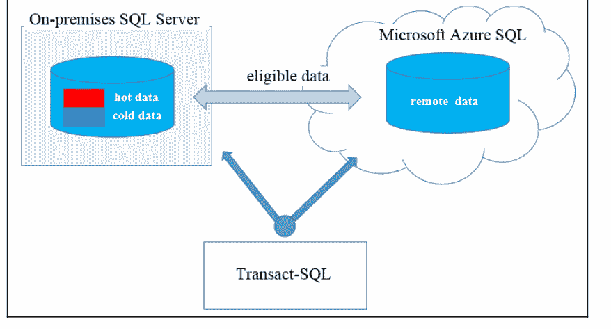

Stretch DB 架构

数据可以处于三个阶段：

- **本地数据**：本地数据是表中保留在本地实例中的数据。这通常是经常使用或热数据。
- **暂存（符合条件的数据）**：符合条件的数据是标记为待迁移但尚未迁移的数据。
- **远程数据**：远程数据是已迁移的数据。这些数据驻留在 Microsoft Azure SQL 数据库中，且很少使用。

拉伸数据库不支持拉伸到另一个 SQL Server 实例。你只能将 SQL Server 数据库拉伸到 Azure SQL 数据库。

## 这适合你吗？

当 SQL Server 2016 RTM 发布时，有一个名为拉伸数据库顾问（Stretch Database Advisor）的工具。该工具可用于识别适合使用 Stretch DB 功能的数据库和表。它是 SQL Server 2016 升级顾问的一个组件，通过使用它，你还可以识别阻止使用该功能的约束和阻塞问题。

然而，该工具已被移除，并由 Microsoft 数据迁移助手（Data Migration Assistant）取代。但我为什么要提到这个已被弃用的工具呢？拉伸数据库顾问会检查数据库中的所有表，并生成一份报告，显示每个表的拉伸能力。我曾用它检查 Microsoft 示例 SQL Server 数据库 AdventureWorks 中的哪些表准备好进行拉伸。结果非常令人失望：在这个 Microsoft 官方 SQL Server 示例数据库中，没有任何一个表被该工具标记为建议且准备好进行拉伸！不过，正如你将在本章后面看到的那样，此功能并非为所有表设计，而是为特殊表设计的。

数据迁移助手没有针对 Stretch DB 建议的独立功能。它会分析你的数据库，通过检测可能影响新数据库版本功能的兼容性问题，帮助你将其升级到新的 SQL Server 版本或 Azure SQL 数据库。它还会为目标环境推荐性能和可靠性改进。在数据迁移助手中，Stretch DB 只是存储改进之一。你可以从 https://www.microsoft.com/en-us/download/details.aspx?id=53595 下载数据迁移助手 v3.4。


## 使用数据迁移助手

在本节中，你将使用*数据迁移助手*来了解将数据库迁移到 SQL Server 2017 或 Azure SQL Database 时应该预期的情况。这是一个独立程序，你可以通过执行默认安装目录`C:\Program Files\Microsoft Data Migration Assistant`中的`DMA.exe`文件来运行它。启动该工具时，你应该会看到一个介绍屏幕，如下面的截图所示：

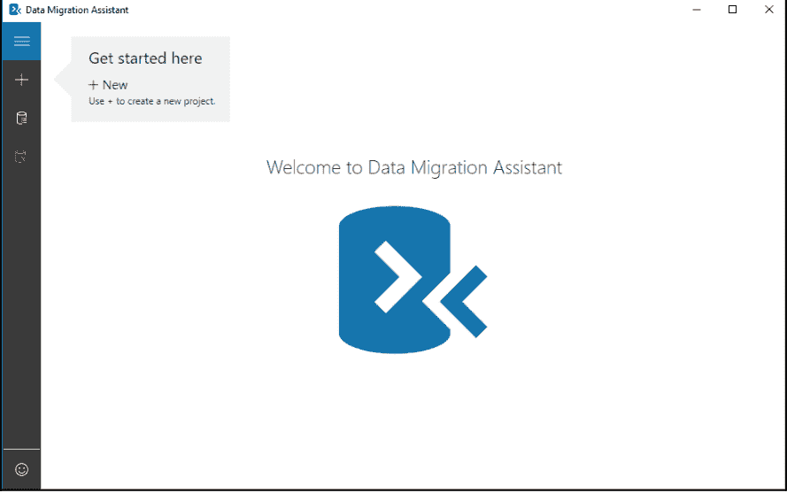

完成后，单击“创建”按钮，你将看到下一个屏幕，类似于下面的截图所示：

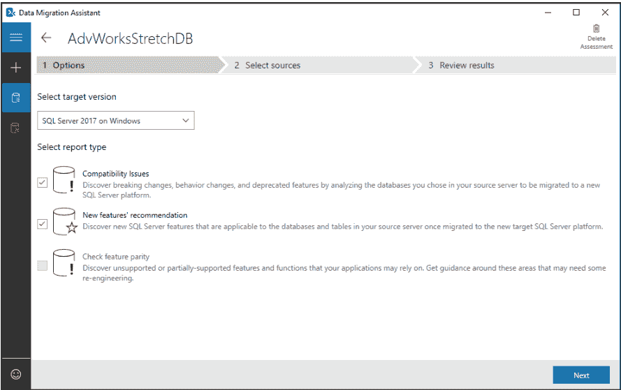

数据迁移助手——选择目标版本

在此屏幕上，你可以选择目标 SQL Server 版本。在下拉列表中，自 2012 年起的所有版本都可用；当然，你应该选择 Windows 上的 SQL Server 2017。除此之外，你还可以选择报告类型。这次你将选择“新功能建议”，因为你想要查看数据迁移助手为你推荐哪些新功能，而不是潜在兼容性问题。

然后你需要单击“下一步”按钮，连接到 SQL Server 2014 实例，并选择所需的数据库。在本示例中，我选择了已还原的 Microsoft 以前的标准示例数据库 AdventureWorks 和 AdventureWorksDW。如果你没有这两个数据库，可以选择任何其他数据库，但最终很可能会得到不同的结果。

建立与 SQL Server 2014 实例的连接后，你需要选择应由*数据迁移助手*分析的数据库。如前所述，选择`AdventureWorks2014`和`AdventureWorksDW2014`数据库。你应该会看到如下所示的屏幕：

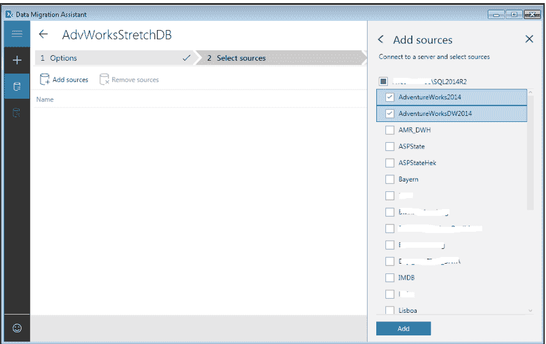

数据迁移助手 - 选择要分析的数据库

当你单击**添加**按钮时，所选数据库将添加到源集合中。你将看到另一个屏幕，可以在其中通过单击**开始评估**按钮来启动评估：

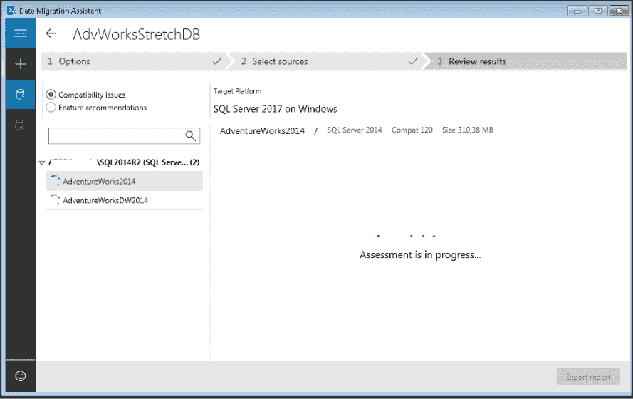

分析所需时间不到一分钟，下图显示了针对 AdventureWorks2014 数据库的分析结果：

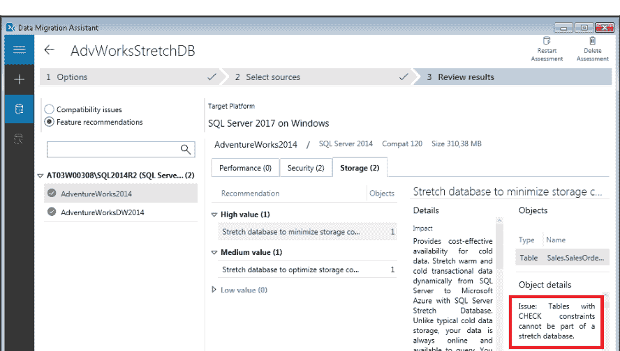

数据迁移助手——查看 AdventureWorks2014 数据库的结果

在左侧的单选按钮中，你需要选择“功能建议”选项。与 Stretch DB 相关的建议位于“存储”选项卡下。对于 AdventureWorks2014 数据库，有两个表被列为可从 Stretch DB 功能中受益的表：Sales.SalesOrderDetail 和 Production.TransactionHistory。

然而，这两个表都具有阻止使用`Stretch DB`的属性，因此你可以得出结论：此功能与`AdventureWorks2014`数据库无关。对`AdventureWorksDW2014`的分析结果看起来稍好一些，如下面的截图所示：

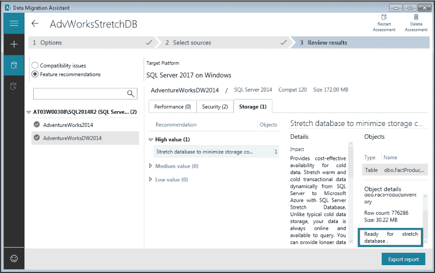

数据迁移助手——查看 AdventureWorksDW2014 数据库的结果

数据迁移助手发现了一个可以使用`Stretch DB`功能的表（`dbo.FactProductInventory`）。报告中未提及其他表——仅涉及两个选定数据库中的三个表。此时，我需要再次提及，尽管这些示例数据库有一些非常简单的表，只有几行数据，但即使对于它们，你也不能使用`Stretch DB`功能。在数据仓库数据库中，表似乎更易于拉伸，但根据该工具的判断，很难找到符合拉伸条件的表。

`Stretch Database`将为你的数据仓库数据库带来好处，尤其是对于占用空间且很少使用的历史数据。另一方面，由于你的 OLTP 系统所拥有的表限制，此功能可能不适用于你的 OLTP 系统。现在，终于可以详细看看这些限制是什么了。

FileTable 和 FILESTREAM 表经常出现在新 SQL Server 功能的限制列表中。使用更改数据捕获或更改跟踪功能的表也是如此。它们与许多其他功能不兼容，因为它们针对特定的用例。因此，看到它们出现在此列表中我并不感到惊讶。全文索引和索引视图也阻止 Stretch DB 的使用。根据我的经验，在我工作过或作为顾问参与过的公司中，少于 10% 的表属于这些类别。根据所有这些限制，我会说 Stretch DB 的潜力略有降低，但并非显著。然而，最重要的限制是一个表不能通过外键被引用。这是数据库完整性的实现，许多表都有且应该有外键引用。因此，这是对 Stretch DB 使用的严重限制，并显著减少了可拉伸的潜在表数量。

> 你不应为了使用 Stretch DB 功能而禁用外键关系！我绝不会建议为了获得性能或存储收益而移除任何实现数据完整性的数据库对象或属性。

然而，这仅仅是开始；更多限制将在下一小节中介绍。

### 列限制

即使你的表没有违反前面限制表中的约束，它仍然远未满足拉伸的条件。以下表列的属性和特性不支持 Stretch DB 功能：

- 不支持的数据类型：已弃用的大数据类型（`text`、`ntext` 和 `image`）、XML、`timestamp`、`sql_variant`、空间数据类型（geometry 和 geography）、`hierarchyId`、用户定义的 CLR 数据类型
- 计算列
- 默认约束
- 检查约束

让我们对列表中的项目重复类似的关于 Stretch DB 潜力降低的分析。我认为微软对已弃用的数据类型采取了平衡的方法；它们没有被移除以防止遗留代码中的破坏性更改，但所有新功能都不支持它们。这是完全正确的，不应将其视为限制。

其他不支持的数据类型很少使用，并不构成巨大的限制。


在最近版本中，几乎所有 SQL Server 功能的限制列表中都可以找到用户定义的 CLR 数据类型。这也是它们不那么流行或常用的原因之一。

然而，此列表中最重要的是，Stretch Database 中的表列不能具有默认约束或检查约束。这是一个巨大的限制，显著降低了 Stretch DB 功能的使用率和重要性！

此外，如前所述，你不应为了启用 Stretch DB 而移除为实施数据库完整性而创建的数据库对象。默认约束和外键是`AdventureWorks2014`数据库中没有单个表准备好进行拉伸的原因。

### 支持 Stretch 的表的限制

如果你的表通过了这些限制并且你已启用其进行拉伸，则应注意以下额外约束：

- 对于包含已迁移数据的 Azure 表中的`UNIQUE`约束和`PRIMARY KEY`约束，不强制实施唯一性。
- 在支持 Stretch 的表中或包含支持 Stretch 的表的视图中，你无法`UPDATE`或`DELETE`已迁移的行或符合迁移条件的行。
- 你无法在链接服务器上向支持 Stretch 的表中`INSERT`行。
- 你无法为包含支持 Stretch 的表的视图创建索引。
- SQL Server 索引上的筛选器不会传播到远程表。

这些限制并不意外；数据中 Azure 部分会自动管理，应防止直接访问和更改。因此，这些限制是可以接受的，尤其是与前面各节中列出的所有限制相比。


## Stretch Database 的使用场景

由于存在诸多限制，为 Stretch DB 找到合适的用例并非易事。你需要的是没有约束、数据类型稀少、不与其他表关联，也不使用某些特殊 SQL Server 功能的表。到哪里去找呢？作为潜在的拉伸（stretching）候选者，你应该考虑历史数据表、审计表和日志表。

## 历史数据的存档

历史数据或审计数据通常由数据库系统自动生成，不需要约束来保证数据完整性。此外，这类数据通常是大型数据集。因此，历史数据和审计数据可以作为使用 Stretch DB 功能的候选者。SQL Server 2016 引入了对系统版本控制时态表的支持。它们实现为一对表：当前表和历史表。历史表的要求之一是不能有任何约束。因此，用于系统版本控制时态表中的历史表是拉伸的理想候选者。时态表将在第 5 章“时态表”中介绍。

## 日志表的存档

有时，开发人员决定将应用程序和服务日志信息存储在数据库表中。这类表通常没有约束，因为写入日志必须尽可能快。它们也是使用 Stretch DB 功能的可能候选者。

## 测试 Azure SQL 数据库

考虑是否使用云或将数据完全迁移到云的中小型公司可以使用 Stretch DB 来开始使用 Azure SQL 数据库。他们可以学习 Azure 中的数据管理并积累经验，然后决定是否需要将更多甚至全部数据委托给云。

## 启用 Stretch Database

在您选择需要拉伸的表之前，需要在实例级别启用该功能。与许多其他新功能一样，默认情况下它是禁用的。要启用它，需要执行以下语句：

```
EXEC sys.sp_configure N'remote data archive', '1';
RECONFIGURE;
GO
```

实际上，您必须允许远程数据存档；并没有“启用 Stretch Database”选项。无论如何，在实例级别启用后，您可以选择一个数据库并在数据库级别启用该功能。

### 在数据库级别启用 Stretch Database

如果该功能已在实例级别启用，并且您具有足够的数据库权限（db_owner 或 CONTROL DATABASE），则下一步是在数据库级别启用 Stretch DB。当然，在启用之前，您需要拥有有效的 Azure 帐户和订阅。您还需要创建和配置防火墙规则，以允许您的 Azure 数据库与本地服务器通信。在本节中，您将为新数据库启用 Stretch DB 功能。使用以下代码创建名为 Mila 的数据库：

```
DROP DATABASE IF EXISTS Mila; --Ensure that you create a new, empty database
GO
CREATE DATABASE Mila;
GO
```

由于数据库是新建的，且没有表，因此它不违反上一节列出的限制。您可以通过向导或使用 Transact-SQL 在数据库级别启用 Stretch Database 功能。

## 使用向导启用 Stretch Database

您可以使用 **Enable Database for Stretch** 向导为 Stretch Database 配置数据库。要启动它，您需要在 **SQL Server Management Studio (SSMS)** 中右键单击新创建的 Mila 数据库，然后在右键上下文菜单中依次选择 **Tasks | Stretch | Enable**。启动向导后，您应该看到以下屏幕：

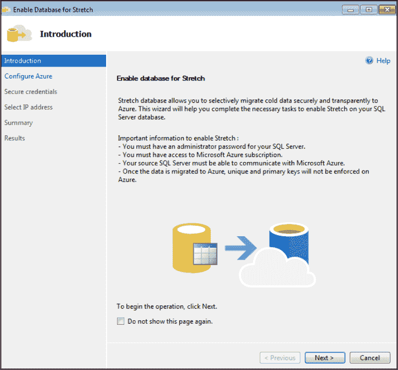

您会看到一个介绍屏幕，描述您可以通过 Stretch Database 功能实现什么，以及需要使用它们需要什么。由于您的数据库没有表，向导的第二个部分是 **Configure Azure**。系统会要求您输入 Azure 凭据并连接到 Azure：

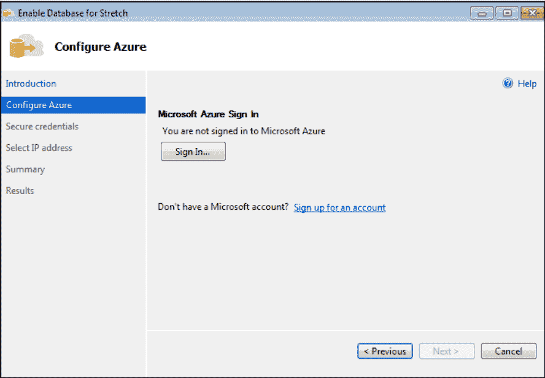

登录 Azure 后，您应该选择您的 Azure 订阅之一和适当的 Azure 区域。按如下方式创建新服务器或选择现有 Azure 服务器：

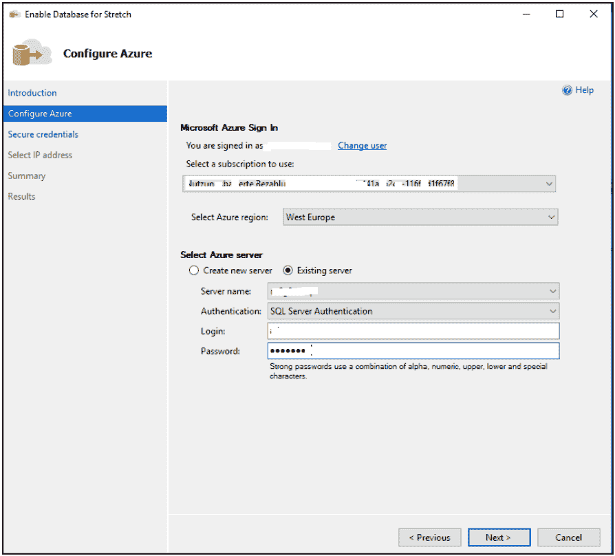

Enable Database for Search Wizard——登录 Azure 并选择订阅和服务器

向导的下一部分是 **Secure credentials**。该向导允许您创建数据库主密钥（如果您的数据库没有的话），以保护存储在 SQL Server 数据库中的数据库凭据和连接信息。以下屏幕是您可以创建数据库主密钥的位置：

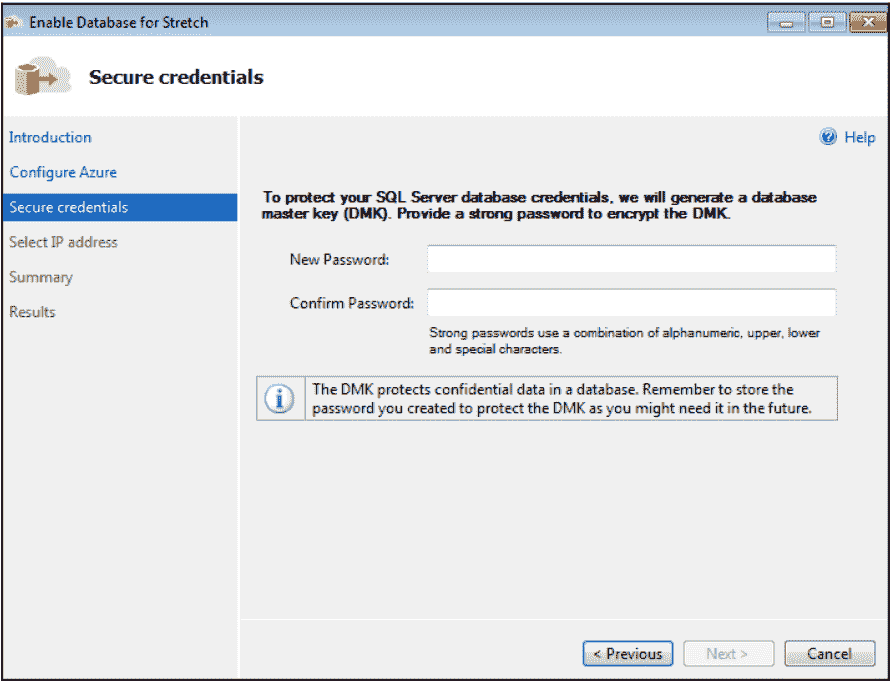

Enable Database for Search Wizard——安全凭据

如前所述，您需要创建 Azure 防火墙规则，以允许您的 Azure SQL 数据库与本地 SQL Server 数据库通信。您可以使用“启用数据库以进行 Stretch”向导的“选择 IP 地址”页面来定义 IP 地址范围：

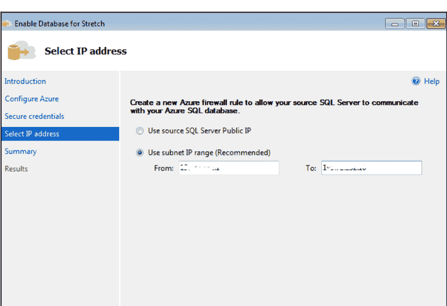

Enable Database for Search Wizard——选择 IP 地址

向导流程即将完成。下一个屏幕是 Summary，它显示您已经选择和输入的内容，同时还提供了 Stretch DB 设置的估计价格。以下截图显示了 Summary 屏幕：

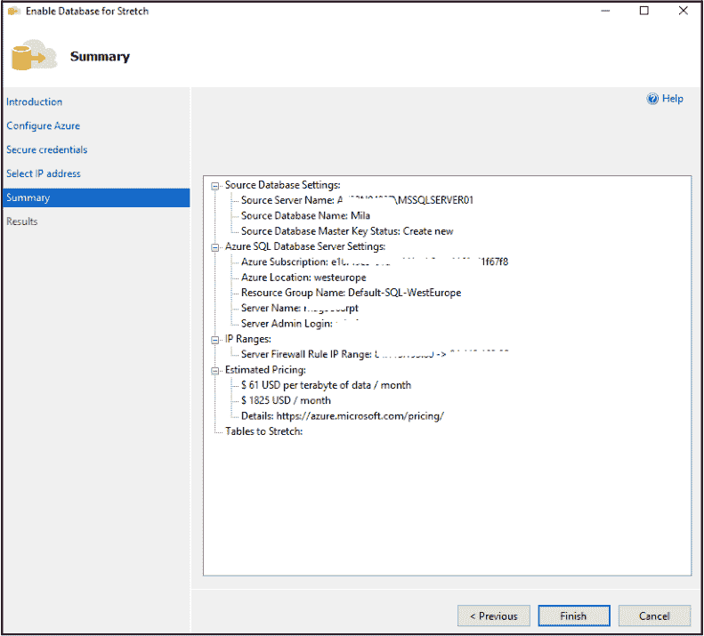

如您所见，**Summary** 屏幕向您提供了一条非常重要的信息：启用 Stretch DB 功能的估计价格。摘要报告中的 **估算定价** 部分有点奇怪：它显示两个价格：每月每 TB 61 美元和每月 1,825 美元。如果您为没有表的数据库启用 Stretch DB，您每月至少需要支付 1,825 美元！对于一个空数据库来说，这似乎一点也不便宜。然而，该部分还有第三条信息——指向 Microsoft Azure 定价页面的链接——您可以在那里找到更多定价详情。定价将在本章后面的 *SQL Server Stretch Database 定价* 一节中介绍。目前，只要知道如果您在此之前从云中移除数据库，就不需要支付整月费用，这就足够了。最短计费周期为 1 小时。

然而，这一点并不是立即清楚的，即使您只是想尝试或玩玩这个功能，以了解它是如何工作的或探索它，您也需要为此付费，或者申请试用订阅（这涉及提供信用卡详细信息）。我原本期望有一个功能有限但不复杂、无需强制注册和付款信息的试用版，这样我就可以检查和了解该功能。Stretch DB 作为一个新的、有前景的功能，应该易于试用。现在是时候单击 **Finish** 按钮，指示向导执行启用 Stretch DB 功能过程的最后一步了。在最后一个向导操作完成后，Stretch 数据库将在 Azure 中创建。您可以使用 SSMS 来查看操作是否成功。当您选择数据库 `Mila` 时，您会在数据库名称旁边看到一个不同的图标：

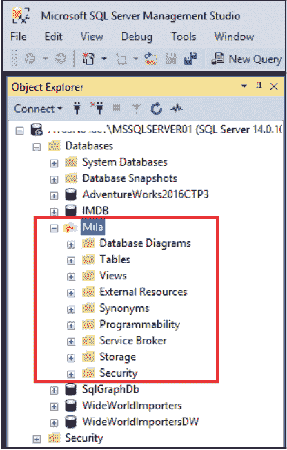

启用 Stretch DB 功能后在 SSMS 中的数据库

为示例数据库启用该功能后，您不应期望有任何变化，因为其中没有表。您将在本章后面创建一个表并继续尝试拉伸。

## 使用 Transact-SQL 启用 Stretch Database

您只能通过 Transact-SQL 启用 `Stretch DB` 功能。如您在前一节中所见，要启用 `Stretch DB`，您需要创建并保护本地数据库与 Azure 服务器之间的通信基础设施。因此，您需要完成以下三项任务：

- 1. 创建数据库主密钥以保护服务器凭据
- 2. 创建数据库凭据
- 3. 定义 Azure 服务器

以下代码为示例数据库 `Mila` 创建数据库主密钥：

```
USE Mila;
CREATE MASTER KEY ENCRYPTION BY PASSWORD='<very secure password>'; --you
need to put your password here
```

接下来，我们创建一个凭据。这是连接到外部资源所需的已保存身份验证信息。您只需要为一个数据库创建凭据；因此，您应该创建一个数据库范围的凭据：

```
CREATE DATABASE SCOPED CREDENTIAL MilaStretchCredential
WITH
IDENTITY = 'Vasilije',
SECRET = '<very secure password>'; --you need to put your password here
```

现在，您终于可以通过 `ALTER DATABASE` 语句启用 Stretch DB 功能了。您需要设置 `REMOTE_DATA_ARCHIVE` 并定义两个参数：Azure 服务器和刚刚创建的数据库范围凭据。以下是可用于为数据库 `Mila` 启用 Stretch DB 功能的代码：

```
ALTER DATABASE Mila
    SET REMOTE_DATA_ARCHIVE = ON
        (
            SERVER = '<address of your Azure server>',
            CREDENTIAL = [MilaStretchCredential]
        );
```


通过此操作，您已创建了本地数据库与将保存拉伸数据的 Azure 服务器之间通信所需的基础设施。请注意，此操作可能需要几分钟时间。当我执行该命令时，花费了超过三分钟：

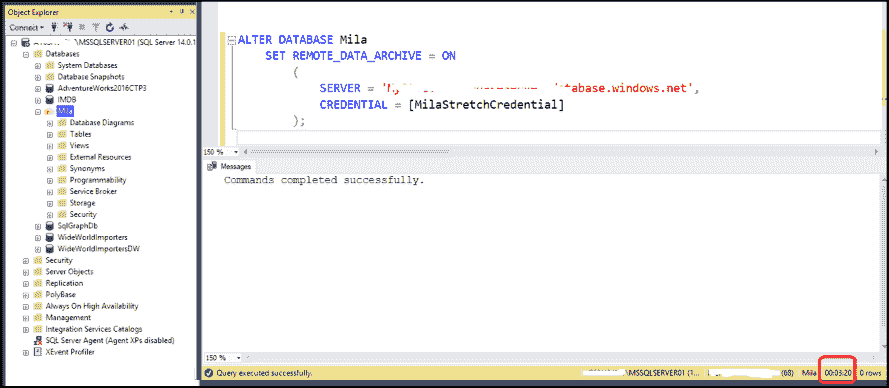

下一步也是最后一步是选择并启用用于拉伸的表。

## 为表启用 Stretch Database

要为表启用 Stretch DB，您也可以在向导和 Transact-SQL 之间进行选择。您可以迁移整个表或仅迁移表的部分。如果您的冷数据存储在单独的表中，您可以迁移整个表；否则您必须指定一个筛选函数来定义应迁移哪些行。要为表启用 Stretch DB 功能，您必须是 `db_owner` 角色的成员。在本节中，您将在 Mila 数据库中创建一个新表，用几行数据填充它，并启用其拉伸功能。使用以下代码创建并填充该表：

```sql
USE Mila;
CREATE TABLE dbo.T1(
    id INT NOT NULL,
    c1 VARCHAR(20) NOT NULL,
    c2 DATETIME NOT NULL,
    CONSTRAINT PK_T1 PRIMARY KEY CLUSTERED (id)
);
GO
INSERT INTO dbo.T1 (id, c1, c2) VALUES
    (1, 'Benfica Lisbon','20180115'),
    (2, 'Manchester United','20180202'),
    (3, 'Rapid Vienna','20180128'),
    (4, 'Juventus Torino','20180225'),
    (5, 'Red Star Belgrade','20180225');
```

在下一节中，您将为 T1 表启用并使用 Stretch DB 功能。假设您希望将 c2 列中的值早于 *2018 年 2 月 1 日* 的所有行从该表移动到云端。

### 使用向导为表启用 Stretch DB

您可以使用 **Enable Table for Stretch** 向导创建启用了 Stretch DB 功能的新表，或为现有表启用该功能。要启动它，您需要在 SSMS 中导航到数据库 Mila 下的 T1 表。然后，右键单击后，您需要分别选择 **Tasks/Stretch/Enable** 选项。您应该会看到以下屏幕截图：

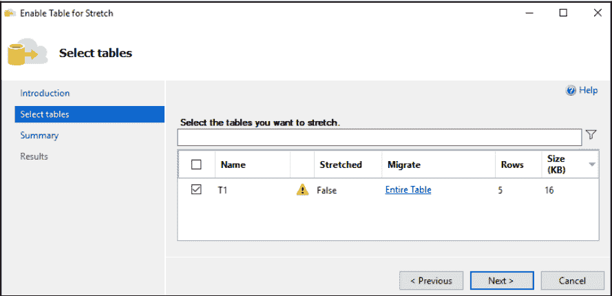

正如您所见，由于 T1 符合前面各节中讨论的 Stretch DB 要求，因此可以将其选为拉伸。您可以选择迁移整个表或（通过单击链接 Entire Table）仅迁移其一部分。当您单击该链接时，您会看到此屏幕：

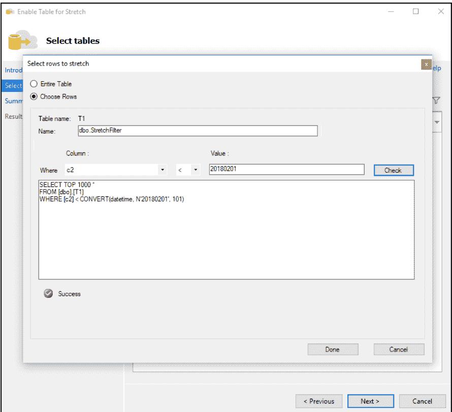

Enable Table for Stretch Wizard—Select rows to stretch

您会看到一个查询生成器，可帮助您编写正确的筛选函数。筛选函数用于定义哪些行需要迁移到云端。在此示例中，您将返回 T1 表中 c2 列的值小于 2018/02/01 的所有行。

然而，开发人员认为查询生成器有点笨拙，大多数人更喜欢使用 Transact-SQL 进行工作。在下一节中，您将看到如何使用 Transact-SQL 配置 Stretch DB。

### 使用 Transact-SQL 为表启用 Stretch Database

为了支持表拉伸，SQL Server 2016 中的 CREATE 和 ALTER TABLE 语句已得到扩展。以下是支持 Stretch DB 功能的 ALTER TABLE 语句的语法扩展：

```
<stretch_configuration> ::= {
    SET (
        REMOTE_DATA_ARCHIVE
        {
            = ON ( <table_stretch_options> )
            | = OFF_WITHOUT_DATA_RECOVERY ( MIGRATION_STATE = PAUSED )
            | ( <table_stretch_options> [, ...n] )
        }
    )
}
<table_stretch_options> ::= {
    [ FILTER_PREDICATE = { null | table_predicate_function } , ]
    MIGRATION_STATE = { OUTBOUND | INBOUND | PAUSED }
}
```

您可以指定以下选项来启用 Stretch DB：

- REMOTE_DATA_ARCHIVE 是必需的，可以具有以下值：ON、OFF_WITHOUT_DATA_RECOVERY 或无值。
- MIGRATION_STATE 也是强制性的，可以具有以下值之一：OUTBOUND、INBOUND 或 PAUSED。
- FILTER_PREDICATE 是可选的，用于定义需要迁移的数据部分。如果未指定，则整个表将被移动。

如果您的表同时包含热数据和冷数据，您可以指定筛选谓词来选择应迁移的行。筛选谓词是一个内联表值函数。其参数是拉伸表列的标识符。至少需要一个参数。以下是函数语法：

```sql
CREATE FUNCTION dbo.fn_stretchpredicate(@column1 datatype1, @column2 datatype2 [, ...n])
RETURNS TABLE
WITH SCHEMABINDING
AS
RETURN  SELECT 1 AS is_eligible
        WHERE <predicate>
```

该函数返回非空结果集或不返回结果集。在第一种情况下，该行有资格迁移，否则它仍保留在本地系统。


> 请注意，该函数使用 `SCHEMABINDING` 选项定义，以防止筛选函数使用的列被删除或更改。

`<predicate>` 可以由一个条件组成，也可以由多个用 AND 逻辑运算符连接的条件组成：

```
<predicate> ::= <condition> [ AND <condition> ] [ ...n ]
```

每个条件又可以由一个原始条件组成，也可以由多个用 OR 逻辑运算符连接的原始条件组成。您不能使用子查询或非确定性函数。有关限制的详细列表，请访问 SQL Server Books Online 中的此页面：`https://msdn.microsoft.com/en-us/library/mt613432.aspx`。

以下代码示例展示了如何为数据库 Mila 中的 T1 表启用 Stretch DB 功能：

```sql
CREATE FUNCTION dbo.StretchFilter(@col DATETIME)
RETURNS TABLE
WITH SCHEMABINDING
AS
        RETURN SELECT 1 AS is_eligible WHERE @col < CONVERT(DATETIME,
'01.02.2018', 104);
GO
ALTER TABLE dbo.T1
    SET (
```

### 具有滑动窗口的筛选谓词

如前所述，您不能在筛选谓词中调用非确定性函数。如果您例如想迁移所有早于 1 个月前的行（日期列的值早于 1 个月），您不能简单地在筛选函数中使用 DATEADD 函数，因为 DATEADD 是一个非确定性函数。

在前面的示例中，您创建了筛选函数以迁移所有早于 2016 年 6 月 1 日的行。假设您想将所有早于 1 个月前的行发送到云端。由于该函数必须是确定性的，并且由于它是用 SCHEMABINDING 属性定义的，因此您无法更改现有函数，您需要使用文字日期创建新函数。例如，在 8 月 1 日，您需要一个指示系统迁移早于 7 月 1 日的行 的函数：

```sql
CREATE FUNCTION dbo.StretchFilter20180301(@col DATETIME)
RETURNS TABLE
WITH SCHEMABINDING
AS
    RETURN SELECT 1 AS is_eligible
WHERE @col < CONVERT(DATETIME, '01.03.2018', 104);
```

现在您可以将新创建的函数分配给 T1 表：

```sql
ALTER TABLE dbo.T1
SET (REMOTE_DATA_ARCHIVE = ON
    (FILTER_PREDICATE = dbo.StretchFilter20180301(c2), MIGRATION_STATE =
OUTBOUND ));
```

最后，您应该删除旧的筛选函数：

```sql
DROP FUNCTION IF EXISTS dbo.StretchFilter;
```

## 查询 Stretch 数据库

当您查询 Stretch 数据库时，SQL Server 数据库引擎会根据数据位置在本地或远程数据库上运行查询。这对数据库用户来说是完全透明的。当您运行返回本地和远程数据的查询时，您可以在执行计划中看到 Remote Query 运算符。以下查询返回 Stretch T1 表中的所有行：

```sql
USE Mila;
SELECT * FROM dbo.T1;
```

如预期，它返回五行：

| id | c1 | c2 |
|---:|---|---|
| 2 | Manchester United | 2018-02-02 00:00:00.000 |
| 4 | Juventus Torino | 2018-02-25 00:00:00.000 |
| 5 | Red Star Belgrade | 2018-02-25 00:00:00.000 |
| 1 | Benfica Lisbon | 2018-01-15 00:00:00.000 |
| 3 | Rapid Vienna | 2018-01-28 00:00:00.000 |

您肯定更感兴趣的是执行计划的外观：

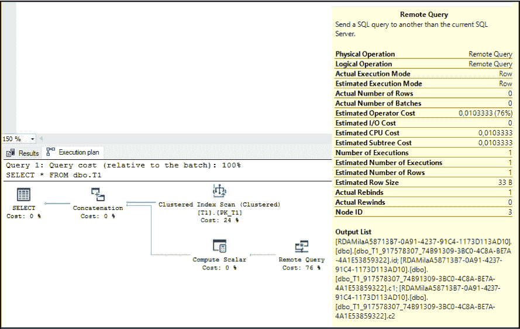

您可以看到 `Remote Query` 运算符与 Azure 数据库一起操作，并且其输出与从本地 SQL Server 实例收集数据的聚集索引扫描的输出进行了连接。请注意，`Remote Query` 运算符的属性窗口已被缩短，仅显示相关上下文信息。


SQL Server 在仅返回本地行时做什么？为检查此情况，运行以下代码：

```sql
SELECT * FROM dbo.T1 WHERE c2 >= '20180201';
```

查询按预期返回三行：

| id | c1 | c2 |
|---:|---|---|
| 2 | Manchester United | 2018-02-02 00:00:00.000 |
| 4 | Juventus Torino | 2018-02-25 00:00:00.000 |
| 5 | Red Star Belgrade | 2018-02-25 00:00:00.000 |

执行计划如下所示：

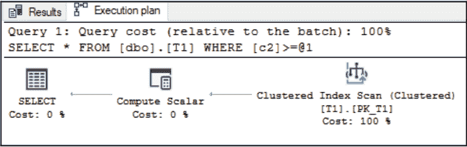

计划看起来不错；它仅检查本地数据库，并且没有连接到 Azure。最后，你将检查一个逻辑上仅返回远程数据的查询的计划。以下是查询：

```sql
SELECT * FROM dbo.T1 WHERE c2 < '20180201';
```

你将再次得到预期的结果：

| id | c1 | c2 |
|---:|---|---|
| 1 | Benfica Lisbon | 2018-01-15 00:00:00.000 |
| 3 | Rapid Vienna | 2018-01-28 00:00:00.000 |

以下是执行计划：

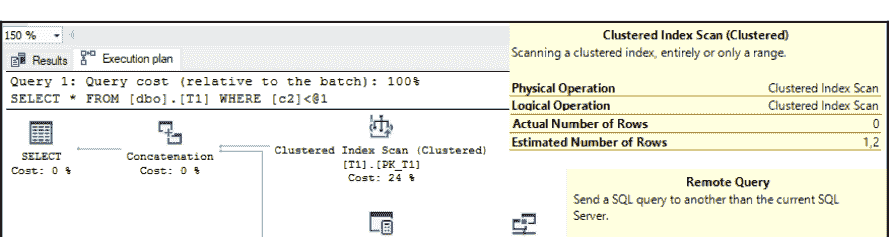

返回仅远程数据的伸展表查询的执行计划

你可能没有预料到这里有两个运算符，只有 Remote Query 应该显示。然而，即使返回的数据仅存在于 Azure SQL 数据库中，也应使用这两个运算符，因为数据可能处于合格状态，这意味着它尚未迁移到 Azure！

查询伸展表非常简单；你无需更改查询中的任何内容。关于伸展数据库最重要的事情之一是，整个执行对用户是透明的，并且在处理伸展表时你无需更改代码。

然而，你不应忘记，启用 Stretch DB 可能会在你的伸展表中暂停主键约束；在包含迁移数据的 Azure 表中，UNIQUE 约束和 PRIMARY KEY 约束的唯一性不会被强制执行。

## 查询和更新远程数据

如前所述，带有伸展功能的表的查询默认返回本地和远程数据。你可以通过使用系统存储过程 sys.sp_rda_set_query_mode 来管理查询范围，以指定是否针对当前伸展数据库及其表查询返回本地和远程数据或仅本地数据。以下模式可用：

- LOCAL_AND_REMOTE（针对伸展表的查询返回本地和远程数据）。这是默认模式。
- LOCAL_ONLY（针对伸展表的查询仅返回本地数据）。
- DISABLED（不允许针对伸展表的查询）。

当你指定针对伸展数据库的查询范围时，这将应用于所有用户的所有查询。然而，对于管理员（`db_owner` 组的成员）而言，在单个查询级别上还有其他选项。作为管理员，你可以在 `SELECT` 语句中添加查询提示 `WITH ( REMOTE_DATA_ARCHIVE_OVERRIDE = value )` 来指定数据位置。选项 `REMOTE_DATA_ARCHIVE_OVERRIDE` 可以具有以下值之一：

- LOCAL_ONLY（查询仅返回本地数据）
- REMOTE_ONLY（查询仅返回远程数据）
- STAGE_ONLY（查询返回合格数据）

以下代码返回 `T1` 表的合格数据：

```
USE Mila;
SELECT * FROM dbo.T1 WITH (REMOTE_DATA_ARCHIVE_OVERRIDE = STAGE_ONLY);
```

以下是输出：

| id | c1 | c2 | batchID--917578307 |
|---:|---|---:|---|
| 1 | Benfica Lisbon | 2018-01-15 00:00:00.000 | 1 |
| 3 | Rapid Vienna | 2018-01-28 00:00:00.000 | 1 |

运行此代码以返回已迁移到 Azure 的 `T1` 表数据：

```
SELECT * FROM dbo.T1 WITH (REMOTE_DATA_ARCHIVE_OVERRIDE = REMOTE_ONLY);
```

以下是输出：

| id | c1 | c2 | batchID--917578307 |
|---:|---|---:|---|
| 1 | Benfica Lisbon | 2018-01-15 00:00:00.000 | 1 |
| 3 | Rapid Vienna | 2018-01-28 00:00:00.000 | 1 |

最后，此代码返回本地数据库服务器中 `T1` 表中的数据：

```
SELECT * FROM dbo.T1 WITH (REMOTE_DATA_ARCHIVE_OVERRIDE = LOCAL_ONLY);
```

正如你所料，返回了三行：

| id | c1 | c2 |
|---|---|---|
| 2 | Manchester United | 2018-02-02 00:00:00.000 |
| 4 | Juventus Torino | 2018-02-25 00:00:00.000 |
| 5 | Red Star Belgrade | 2018-02-25 00:00:00.000 |

默认情况下，你不能更新或删除伸展表中可迁移的行或已迁移的行。当你必须修复问题时，`db_owner` 角色的成员可以通过添加前述提示运行 UPDATE 或 DELETE 操作，并且将能够更新所有位置的数据。

## SQL Server Stretch Database 定价

你可以在 https://azure.microsoft.com/en-us/pricing/details/sql-server-stretch-database/ 页面上查看价格详情。Stretch Database 将计算和存储分开计费。计算使用量由 **Database Stretch Unit (DSU)** 表示，客户可以随时按需上下扩展性能/DSU 水平。此处给出的价格在 2018 年 2 月 28 日有效：

| Performance level (DSU) | Price in $ per month |
|---:|---:|
| 100 | 1,825 |
| 200 | 3,650 |
| 300 | 5,475 |
| 400 | 7,300 |
| 500 | 9,125 |
| 600 | 10,950 |
| 1,000 | 18,250 |
| 1,200 | 21,900 |
| 1,500 | 27,375 |
| 2,000 | 36,500 |

数据库大小限制为 240 TB。月度价格估算基于每月 730 小时且 DSU 水平恒定。Stretch DB 在除印度南部、中国北部、巴西南部、北美中部、印度西部、澳大利亚、日本和美国政府以外的所有区域均已普遍可用。

数据存储按 $0.16/GB/月收费。数据存储包括你的 Stretch DB 大小和备份快照。所有 Stretch 数据库均有 7 天的增量备份快照。

你也可以使用 Azure 定价计算器来估算计划的 Azure 活动的费用。它可在 `https://azure.microsoft.com/en-us/pricing/calculator/?service=sql-server-stretch-database` 获取。你可以选择 Azure 区域并指定时间段、数据存储和 DSU，如以下屏幕截图所示：

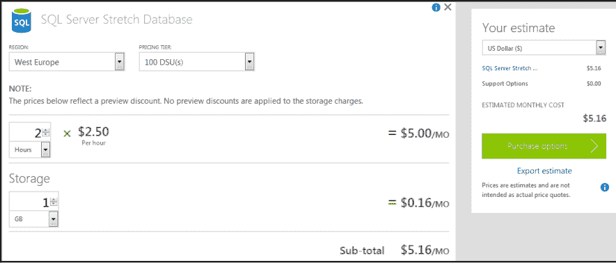

此屏幕显示了当你在一个数据小于 **1 GB** 且使用 **100 DSU(s)** 的数据库中使用 Azure 数据库在 **Western Europe** 中使用 Stretch DB 功能两小时时，你将支付的价格。

也可以免费试用该功能。你可以在 `https://azure.microsoft.com/en-us/free/` 申请。当你这样做时，你会看到此屏幕：

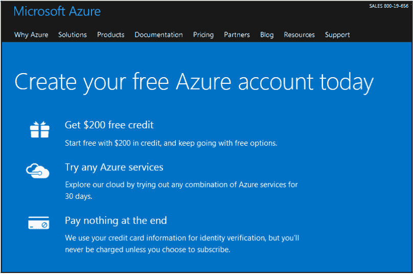

能够免费试用新功能是件好事，但在这种情况下，你还必须提供付款信息，这可能会减少尝试该功能的开发人员数量。

## Stretch DB 管理和故障排除

要监控伸展数据库和数据迁移，你可以使用 *Stretch Database Monitor* 功能、`sys.remote_data_archive_databases` 和 `sys.remote_data_archive_tables` 目录视图，以及 `sys.dm_db_rda_migration_status` 动态管理视图。

## 监控 Stretch 数据库

要监控伸展数据库和数据迁移，请使用 *Stretch Database Monitor* 功能。它是 SQL Server Management Studio 的一部分，当你选择数据库然后选择 **Tasks/Stretch/Monitor** 时打开它：

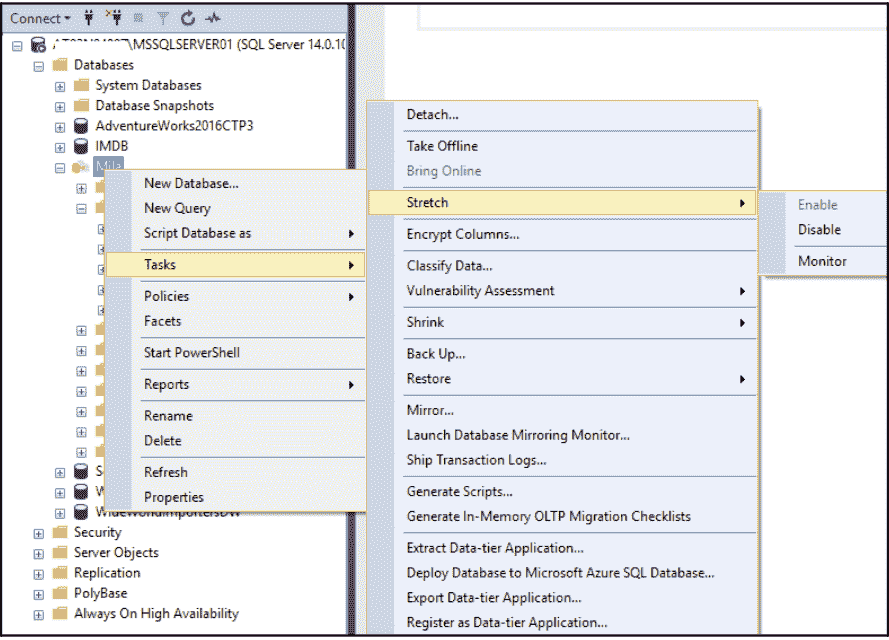

在 SSMS 中打开 Stretch Database Monitor

监视器的顶部部分显示有关伸展 SQL Server 数据库和远程 Azure 数据库的一般信息，而数据库中每个伸展表的迁移状态显示在屏幕的底部部分：

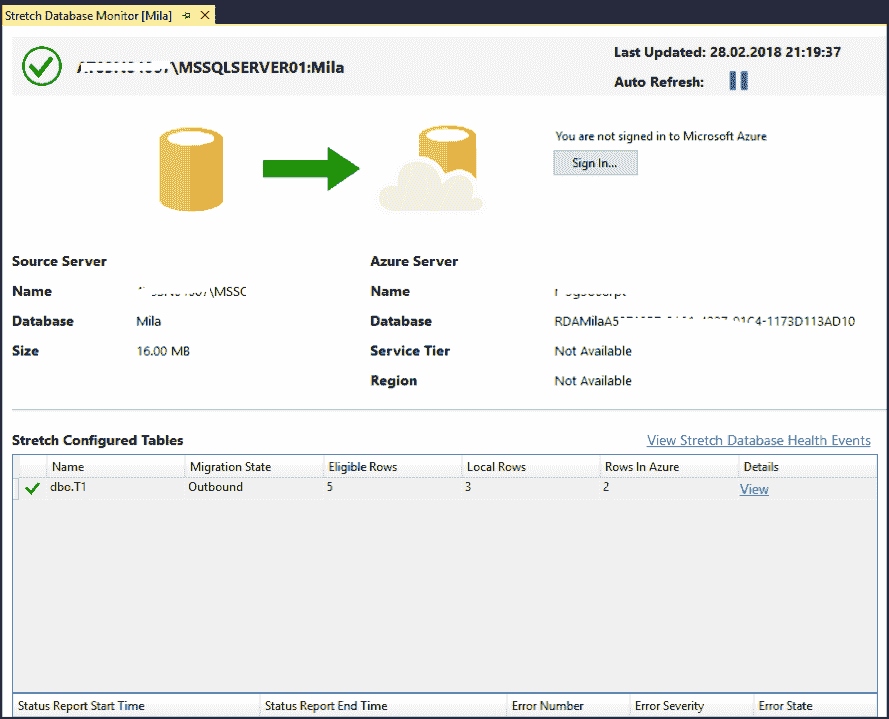


你还可以使用动态管理视图 `sys.dm_db_rda_migration_status` 来检查已迁移数据的状态（已迁移了多少批数据和行数据）。它为 SQL Server 本地实例上每个启用 Stretch 的表的每批迁移数据包含一行。以下是执行该视图生成的結果：

```
```sql
USE Mila;
SELECT * FROM sys.dm_db_rda_migration_status;
```
```

|   | table_id | database_id | migrated_rows | start_time_utc | end_time_utc | error_number | error_severity | error_state |
|---|---:|---:|---:|---|---|---|---|---|
| 1 | 917578307 | 8 | 0 | 2018-02-28 20:08:48.000 | 2018-02-28 20:09:21.110 | NULL | NULL | NULL |
| 2 | 917578307 | 8 | 0 | 2018-02-28 20:09:28.010 | 2018-02-28 20:09:28.010 | NULL | NULL | NULL |
| 3 | 917578307 | 8 | 0 | 2018-02-28 20:09:28.010 | 2018-02-28 20:09:38.407 | 1205 | 13 | 55 |
| 4 | 917578307 | 8 | 0 | 2018-02-28 20:10:09.407 | 2018-02-28 20:10:14.560 | NULL | NULL | NULL |
| 5 | 917578307 | 8 | 0 | 2018-02-28 20:10:28.027 | 2018-02-28 20:10:28.027 | NULL | NULL | NULL |
| 6 | 917578307 | 8 | 2 | 2018-02-28 20:10:28.027 | 2018-02-28 20:10:51.653 | NULL | NULL | NULL |
| 7 | 917578307 | 8 | 0 | 2018-02-28 20:10:51.653 | 2018-02-28 20:10:52.287 | NULL | NULL | NULL |
| 8 | 917578307 | 8 | 0 | 2018-02-28 20:11:03.033 | 2018-02-28 20:11:03.033 | NULL | NULL | NULL |
| 9 | 917578307 | 8 | 0 | 2018-02-28 20:11:03.033 | 2018-02-28 20:11:20.920 | NULL | NULL | NULL |
| 10 | 917578307 | 8 | 0 | 2018-02-28 20:11:38.040 | 2018-02-28 20:11:38.040 | NULL | NULL | NULL |
| 11 | 917578307 | 8 | 0 | 2018-02-28 20:11:38.040 | 2018-02-28 20:11:53.830 | NULL | NULL | NULL |
| 12 | 917578307 | 8 | 0 | 2018-02-28 20:12:13.050 | 2018-02-28 20:12:13.050 | NULL | NULL | NULL |

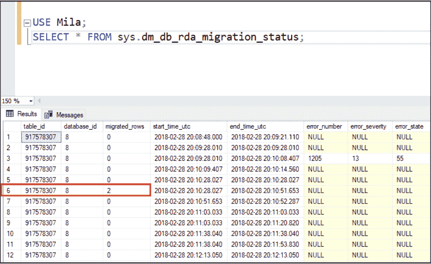

`sys.remote_data_archive_databases` 和 `sys.remote_data_archive_tables` 目录视图提供有关表级和数据库级迁移状态的信息。

此查询提供归档数据库信息：

```
```sql
USE Mila;
SELECT * FROM sys.remote_data_archive_databases;
```
```

以下是输出结果：

| remote_database_id | remote_database_name | data_source_id | federated_service_account |
|--------------------|----------------------|----------------|---------------------------|
| 65536 | RDA\MilaA58713B7-0A91-4237-91C4-1173D113AD10 | 65536 | 0 |

通过使用以下命令，你可以获取 Azure 端归档表的信息：

```
USE Mila;
SELECT * FROM sys.remote_data_archive_tables;
```

以下是输出结果：

| object_id | remote_database_id | remote_table_name | filter_predicate |
|-----------|--------------------|-------------------|------------------|
| 917578307 | 65536 | dbo_T1_917578307_74B91309-3B... | ([dbo].[StretchFilter]([c2])) |
| migration_direction | migration_direction_desc | is_migration_paused | is_reconciled |
|---------------------|--------------------------|---------------------|----------------|
| 0 | OUTBOUND | 0 | 1 |

最后，要查看 Stretch 启用的表在 Azure 中使用多少空间，请运行以下语句：

```
USE Mila;
EXEC sp_spaceused 'dbo.T1', 'true', 'REMOTE_ONLY';
```

以下是此命令的结果：

| name | rows | reserved | data | index_size | unused |
|------|------|----------|------|------------|--------|
| dbo.T1 | 2 | 288 KB | 16 KB | 48 KB | 224 KB |

在下一节中，你将看到如何暂停或禁用 Stretch DB 功能。

## 暂停和恢复数据迁移

要暂停表的數據迁移，请在 SSMS 中选择该表，然后选择选项 Stretch | Pause。你也可以使用以下 Transact-SQL 命令实现相同效果；它暂时中断 T1 表的数据迁移：

```
USE Mila;
ALTER TABLE dbo.T1 SET (REMOTE_DATA_ARCHIVE (MIGRATION_STATE = PAUSED));
```

要恢复表的數據迁移，请在 SSMS 中选择该表，然后选择 Stretch/Resume 选项，或编写与以下类似的 Transact-SQL 代码：

```
USE Mila;
ALTER TABLE dbo.T1 SET (REMOTE_DATA_ARCHIVE (MIGRATION_STATE = OUTBOUND));
```

要检查迁移是否处于活动状态或已暂停，可以在 SQL Server Management Studio 中打开 Stretch Database Monitor 并检查 Migration State 的值，或检查系统目录视图 sys.remote_data_archive_tables 中标志 is_migration_paused 的值。

## 禁用 Stretch Database

禁用数据库和表的 Stretch DB 功能会立即停止数据迁移，并且查询不再包含远程数据。你可以将已迁移的数据复制回本地系统，也可以将其保留在 Azure 中。与启用 Stretch Database 类似，你可以使用 SSMS 和 Transact-SQL 禁用它。要为数据库禁用 Stretch DB，你必须先为参与 Stretch 的表禁用它。否则，你会收到错误提示，要求先禁用 Stretch 表。

## 使用 SSMS 禁用表的 Stretch Database

要为表禁用 Stretch DB，你需要在 SQL Server Management Studio 中选择它；右键单击它，然后选择选项 Stretch。然后，转到以下选项之一：

- **Disable | Bring data back from Azure** 将表的远程数据复制到本地系统，然后禁用 Stretch DB 功能
- **Disable | Leave data in Azure** 立即禁用 Stretch DB 功能，而不将其传回本地系统（数据保留在 Azure 中）

请注意，第一个选项包括数据传输成本！当你选择第二个选项时，你没有传输成本，但数据仍保留在 Azure 中，你仍需为存储付费。你可以通过 Azure 管理门户将其删除：

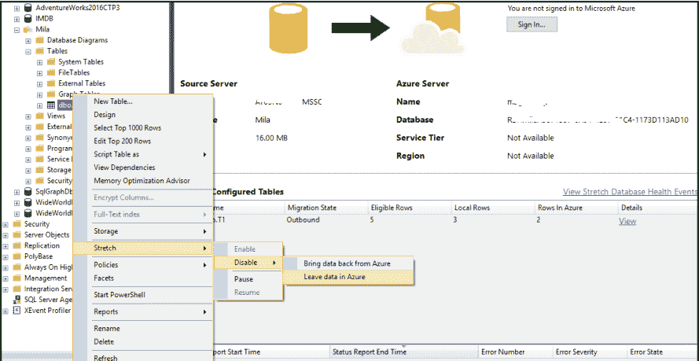

在 SSMS 中为表禁用 Stretch

在为 T1 表禁用 Stretch DB 功能后，你可以看到以下屏幕截图：

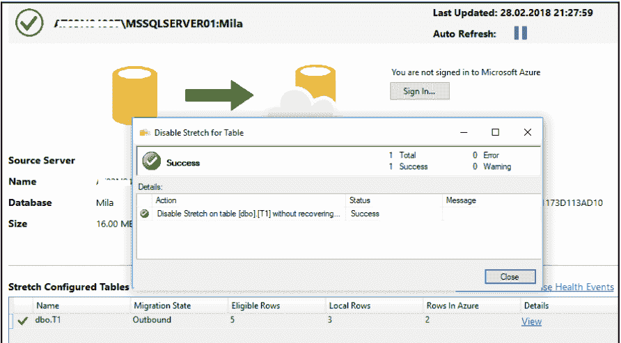

## 使用 Transact-SQL 禁用表的 Stretch Database

你可以使用 Transact-SQL 执行相同的操作。以下代码示例指示 SQL Server 为 Stretch 表 T1 禁用 Stretch DB，但首先将已迁移的数据传输到本地数据库：

```
USE Mila;
ALTER TABLE dbo.T1 SET (REMOTE_DATA_ARCHIVE (MIGRATION_STATE = INBOUND));
```

如果你不需要已迁移的数据（或想要避免数据传输成本），请使用以下代码：

```
USE Mila;
ALTER TABLE dbo.T1 SET (REMOTE_DATA_ARCHIVE = OFF_WITHOUT_DATA_RECOVERY
(MIGRATION_STATE = PAUSED));
```

## 禁用数据库的 Stretch Database

在为数据库中的所有 Stretch 表禁用 Stretch DB 后，你可以为数据库禁用它。你可以通过在 SSMS 中选择数据库并在数据库上下文菜单中选择 Task/Stretch/Disable 选项来完成此操作。

或者，你也可以使用 Transact-SQL 实现相同效果：

```
ALTER DATABASE Mila SET (REMOTE_DATA_ARCHIVE = OFF_WITHOUT_DATA_RECOVERY
(MIGRATION_STATE = PAUSED));
```

你可以使用以下查询检查操作是否成功：

```
SELECT * FROM sys.remote_data_archive_tables;
```

你应该得到此查询的空集作为结果。如 Stretch 表所述，禁用 Stretch DB 不会远程删除数据库。你需要使用 Azure 管理门户将其删除。

## 备份和还原 Stretch 启用的数据库

由于你已将数据库的一部分委托给远程 Azure 实例，当你执行数据库备份时，只会备份本地和符合条件的数据；远程数据由 Azure 服务负责。默认情况下，Azure 至少每 8 小时自动创建一次存储快照并保留七天，以便你可以将数据还原到某个时间点（默认 21 个点）。你可以使用系统存储过程 sys.sp_rda_set_rpo_duration 更改此行为并增加小时数或备份频率。由于 Azure 服务不是免费的，这可能会产生额外成本。


可以预见，若要远程还原数据库，必须先登录 Azure 门户。以下截图展示了如何使用 Azure 门户将实时 Azure 数据库还原到更早的时间点：

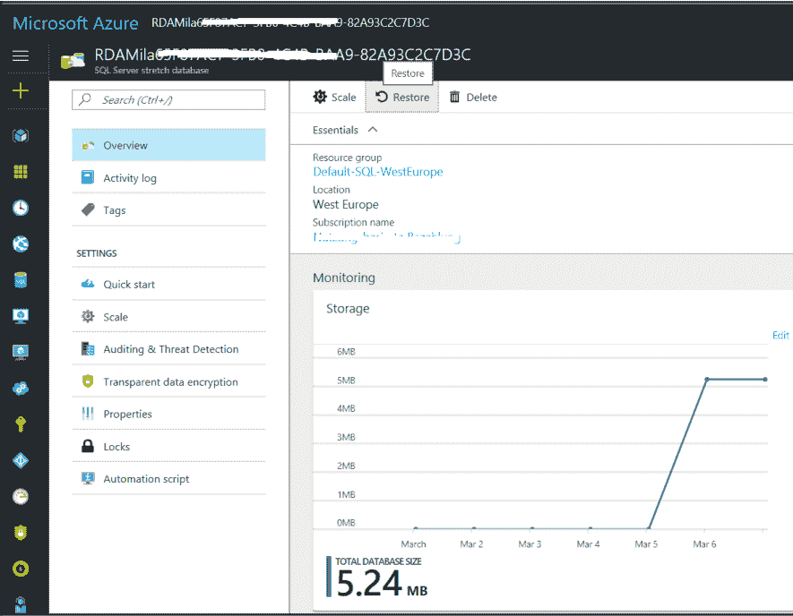

将 Azure 数据库还原到更早的时间点

要将 Azure 数据库还原到更早的时间点，需要执行以下步骤：

- 1. 登录 Azure 门户。
- 2. 在屏幕左侧，选择 **浏览**，然后选择 **SQL 数据库**。
- 3. 导航到你的数据库并选中它。
- 4. 在数据库边栏选项卡的顶部，点击 **还原**。
- 5. 指定新的 **数据库名称**，选择`还原点`，然后点击 **创建**。
- 6. 数据库还原过程将开始，可以通过 **通知** 进行监控。

还原本地 SQL Server 数据库后，必须运行 `sys.sp_rda_reauthorize_db` 存储过程，以重新建立已启用 Stretch 的 SQL Server 数据库与远程 Azure 数据库之间的连接。如果使用不同名称或在不同的区域还原 Azure 数据库，也需要执行同样的操作。你还可以在删除数据库后的 7 天内还原已删除的数据库。Azure 上的 *SQL Server Stretch Database 服务* 会在删除数据库之前获取数据库快照，并将其保留七天。

### 总结

`Stretch DB` 允许将历史数据或不常用的数据动态且透明地迁移至 Microsoft Azure。数据始终可用且在线，你无需更改解决方案中的查询；SQL Server 负责管理数据的位置，并整合来自本地服务器和远程 Azure 位置的数据检索。因此，你可以将冷数据完全委托给 Azure，并降低本地解决方案在冷数据存储和可用性方面的存储、维护和实施成本。然而，使用 Stretch DB 存在许多限制，大多数 OLTP 表无法扩展到云端——至少无法在不修改架构和约束的情况下进行。Stretch Database 为包含很少使用的历史数据的表带来最大效益。你可以计算 Azure 数据库中数据存储和查询的价格，并决定是否受益于使用 `Stretch DB` 功能。

在下一章中，你将学习 SQL Server 2017 中的时态数据支持。
