# 第 5 章：时态表

为业务应用提供服务的数据库通常需要支持时态数据。例如，假设与供应商的合同仅在有限时间内有效。它可能从某个特定时间点开始生效，或者在特定的时间间隔内有效——从开始时间点到结束时间点。此外，你通常需要审计一个或多个表中的所有更改。你可能还需要能够显示特定时间点的状态，或显示在特定时间段内对表所做的所有更改。从数据完整性的角度来看，你可能需要实施许多额外的时态特定约束。

本章介绍时态问题，讨论手动解决方案，并展示 SQL Server 2016 和 2017 中的内置功能，包括以下内容：

- 定义时态数据
- 在 2016 版本之前于 SQL Server 中使用时态数据
- 时态数据实施的历史
- SQL Server 2016 和 2017 中的系统版本控制表
- SQL Server 2017 中仍缺少哪些时态支持？

### 什么是时态数据？

在具有时态支持的表中，表头表示一个谓词，该谓词至少有一个时间参数，用于表示谓词其余部分何时有效；因此，完整的谓词是一个**带时间戳的谓词**。行表示带时间戳的命题，行的有效时间周期使用两个属性之一来表达：since（用于**半时态**数据）或 during（用于**全时态**数据）；后一个属性通常用两个值表示，即 from 和 to。下表显示了一个示例性 `Suppliers` 表的原始版本和两个额外的带时间戳版本：

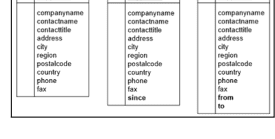

从原始表头中，你可以读取一个谓词，该谓词表示具有标识符 `supplierid`、名为 `companyname`、联系人 `contactname` 等的供应商目前是我们的供应商，或目前处于合同期内。你可以假设该供应商永远是我们的供应商。`Suppliers_Since` 表头使用时间参数修改了此谓词；具有标识符 `supplierid`、名为 `companyname`、联系人 `contactname` 等的供应商自某个特定时间点起处于合同期内。在 `Suppliers_FromTo` 表中，表头使用更具体的时间属性修改了此谓词；具有 ID `supplierid`、名为 `companyname`、联系人 `contactname` 等的供应商在从某个特定时间点到另一个时间点的期间内（是、曾是或将根据当前时间而定）处于合同期内。

无需实施半时态表。你可以简单地使用最大可能的日期和时间作为 *to* 时间点。因此，本章其余部分仅关注全时态数据。

在本节中，你将了解：

- 时态表的类型
- 时态数据代数
- 时态约束
- 2016 版本之前于 SQL Server 中的时态数据实施
- 时态查询的优化

### 时态表的类型

你可能已经注意到本章开头引言部分提到了两类时态问题。第一种是命题的**有效时间**——表中带时间戳的行所表示的命题实际为真的时间段。例如，与供应商的合同仅在时间点 1 到时间点 2 期间有效。这种有效时间对人而言有意义，对业务也有意义。有效时间也称为**应用时间**或**人工时间**。同一实体可以有多个有效周期。例如，前述从时间点 1 到时间点 2 有效的合同可能从时间点 7 到时间点 9 也有效。

第二种时态问题是**事务时间**。前面提到的合同行在时间点 1 插入，并且是数据库所知道的唯一事实版本，直到有人更改它，甚至直到时间的尽头。当该行在时间点 2 被更新时，原始行在数据库中被认定为在时间点 1 到时间点 2 期间为真。同一命题的新行被插入，其有效时间从时间点 2 到数据库的时间尽头。事务时间也称为**系统时间**或**数据库时间**。

**数据库管理系统（DBMS）** 可以且应该自动维护事务时间。系统必须确保每次更新都插入新行，并更改原始行中的事务有效周期。系统还需要允许查询当前和历史数据，并显示任何特定时间点的状态。事务时间没有太多额外问题。系统必须确保数据库时间段的开始时间早于结束时间，并且同一实体的两行中的两个时间段不重叠。数据库系统必须在单个时间点知道单一事实。最后，数据库不关心未来。当前行的数据库时间结束实际上就是时间的尽头。数据库时间仅涉及当前和过去的状态。

实施应用时间可能要复杂得多。当然，你的有效时间周期可能在未来结束甚至在未来开始。DBMS 无法自动处理未来时间，例如检查它们是否正确。因此，你需要处理所有需要的约束。DBMS 只能通过实施能够感知时间的对象（例如声明性约束）来帮助你。例如，从产品到供应商表的外键确保每个产品都有一个供应商，该外键可以扩展为不仅检查产品的供应商是否存在，还要检查在检查外键的时间点该供应商是否为有效供应商。

到目前为止，我一直在谈论时间，好像它由离散的时间点组成；我使用*时间点*这个术语，好像它代表一个单一的、不可分割的、无限小的时间点。当然，时间是连续的。然而，在通用语言中，我们将时间视为由离散的点组成。我们以天、小时和其他时间单位来讨论；我们使用的粒度取决于我们谈论的内容。我们谈论的时间点实际上是时间间隔；一天是 24 小时的间隔，一小时是 60 分钟的间隔，以此类推。

那么系统和应用时间间隔的时间点粒度级别是多少？对于系统时间，决定很简单：使用系统支持的最低粒度级别。在 SQL Server 中，使用 `datetime2` 数据类型，你可以支持 100 纳秒的粒度。对于应用时间，粒度取决于业务问题。例如，对于与供应商的合同，天级别可能很有效。对于测量某人使用服务（例如移动电话服务）的时间间隔，秒的粒度可能更合适。这看起来非常复杂。但是，你可以为应用时间制定一个通用解决方案。你可以将时间点转换为整数，然后使用一个查找表来提供上下文——为整数时间点提供含义。

当然，你也可以同时实施应用时间和系统版本控制表。此类表被称为**双时态表**。

### Allen 的区间代数

三十多年前，关系模型中的时态数据理论开始发展。我将定义相当多的有用布尔运算符，以及一些作用于区间并返回区间的运算符。这些运算符被称为 **Allen 运算符**，以 J. F. Allen 的名字命名，他在 1983 年关于时间区间的研究论文中定义了许多这样的运算符。所有这些运算符至今仍被视为有效和必要。DBMS 可以通过直接实现这些运算符来帮助你处理应用时间。


首先让我介绍我将使用的记号。我将处理两个区间，分别记为 *i₁* 和 *i₂*。第一个区间的起始时间点是 *b₁*，结束是 *e₁*；第二个区间的起始时间点是 *b₂*，结束是 *e₂*。艾伦的**布尔运算符**定义如下表所示：

| 名称 | 符号 | 定义 |
|---|---|---|
| 等于 | (*i₁ = i₂*) | (*b₁ = b₂*) 且 (*e₁ = e₂*) |
| 之前 | (*i₁ before i₂*) | (*e₁ < b₂*) |
| 之后 | (*i₁ after i₂*) | (*i₂ before i₁*) |
| 包含 | (*i₁ ⊇ i₂*) | (*b₁ ≤ b₂*) 且 (*e₁ ≥ e₂*) |
| 真包含 | (*i₁ ⊃ i₂*) | (*i₁ ⊃ i₂*) 且 (*i₁ ≠ i₂*) |
| 相遇 | (*i₁ meets i₂*) | (*b₂ = e₁ + 1*) 或 (*b₁ = e₂ + 1*) |
| 重叠 | (*i₁ overlaps i₂*) | (*b₁ ≤ e₂*) 且 (*b₂ ≤ e₁*) |
| 合并 | (*i₁ merges i₂*) | (*i₁ overlaps i₂*) 或 (*i₁ meets i₂*) |
| 开始 | (*i₁ begins i₂*) | (*b₁ = b₂*) 且 (*e₁ ≤ e₂*) |
| 结束 | (*i₁ ends i₂*) | (*e₁ = e₂*) 且 (*b₁ ≥ b₂*) |

除了布尔运算符之外，艾伦的三个运算符接受区间作为输入参数并返回一个区间。这些运算符构成了简单的**区间代数**。请注意，这些运算符与您可能已经熟悉的关系运算符同名：`Union`、`Intersect` 和 `Minus`。然而，它们的行为与关系运算符并不完全一样。

一般来说，使用三个区间运算符中的任何一个，如果操作结果将导致时间点集合为空，或导致无法用一个区间描述的集合，则该运算符应返回 `NULL`。仅当两个区间相遇或重叠时，两个区间的并集才有意义。仅当区间重叠时，交集才有意义。`Minus` 区间运算符仅在某些情况下才有意义。例如，(3:10) Minus (5:7) 返回 `NULL`，因为结果无法用一个区间描述。

下表总结了区间代数中运算符的定义：

| 名称 | 符号 | 定义 |
|---|---|---|
| 并集 | $(i_1 \text{ union } i_2)$ | $(Min(b_1, b_2) : Max(e_1, e_2))$，当 $(i_1 \text{ merges } i_2)$；否则为 NULL |
| 交集 | $(i_1 \text{ intersect } i_2)$ | $(Max(b_1, b_2) : Min(e_1, e_2))$，当 $(i_1 \text{ overlaps } i_2)$；否则为 NULL |
| 差集 | $(i_1 \text{ minus } i_2)$ | $(b_1 : Min(b_2 - 1, e_1))$，当 $(b_1 < b_2)$ 且 $(e_1 \le e_2)$；$(Max(e_2 + 1, b_1) : e_1)$，当 $(b_1 \ge b_2)$ 且 $(e_1 > e_2)$；否则为 NULL |

下图以图形方式展示了区间代数运算符：

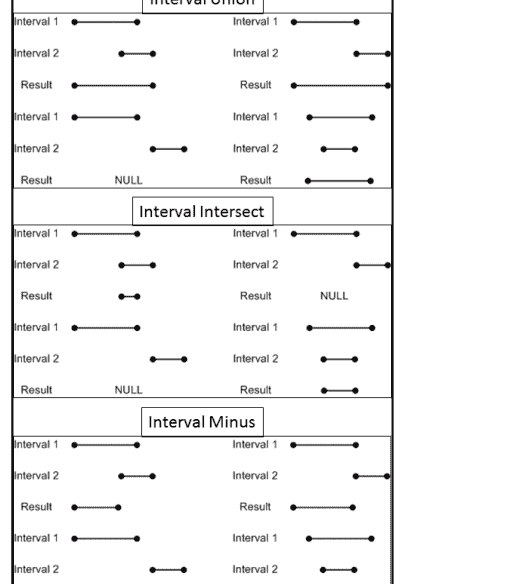

## 时间约束

根据您正在解决的业务问题，您可能需要实现许多时间约束。请记住，对于应用程序时间，SQL Server 并没有提供太多帮助。您需要在代码中实现这些约束，并在可能的情况下使用 SQL Server 的声明性约束。但是，大多数约束需要通过自定义代码来实现，要么在触发器或存储过程中，要么甚至在应用程序代码中。

想象一下 Suppliers 表示例。一个供应商可以在表中出现多次，因为同一个供应商可能在多个时间段内分别存在合同。例如，在带有简化表头 Suppliers (supplierid, companyname, from, to) 的关系中，您可能会有如下两个元组：

```text
{2, Supplier VHQZD, d05, d07}
{2, Supplier VHQZD, d12, d27}
```

以下是您可能需要实现的一些可能约束：

- *结束* 不应小于 *开始*
- 同一供应商的两个合同不应具有重叠的时间间隔
- 同一供应商的两个合同不应具有相邻的时间间隔
- 任何供应商在任何时间点都不能同时拥有两个不同的合同
- 在供应商不在合同期内的时间点，不应有该供应商的供应

您可能还会发现更多约束。无论如何，SQL Server 2016 仅支持系统版本控制表。要维护应用程序的有效时间，您需要自行开发代码。

## 2016 年之前 SQL Server 中的时态数据

如前所述，在 2016 之前的 SQL Server 版本中，您需要自行处理时态数据。即使在 SQL Server 2016 中，您仍然需要处理人工时间或应用程序时间。以下代码演示了如何创建一个表，该表使用 b 和 e 列表示有效性区间，其中区间的开始和结束表示为整数。该表填充了来自 WideWorldImporters.Sales.OrderLines 表的演示数据：

```sql
USE tempdb;
GO
SELECT OrderLineID AS id,
```

```text
StockItemID * (OrderLineID % 5 + 1) AS b,
LastEditedBy + StockItemID * (OrderLineID % 5 + 1) AS e
INTO dbo.Intervals
FROM WideWorldImporters.Sales.OrderLines;
-- 231412 rows
GO
ALTER TABLE dbo.Intervals ADD CONSTRAINT PK_Intervals PRIMARY KEY(id);
CREATE INDEX idx_b ON dbo.Intervals(b) INCLUDE(e);
CREATE INDEX idx_e ON dbo.Intervals(e) INCLUDE(b);
GO
```

另请注意所创建的索引。这两个索引非常适合按区间的开始或结束进行搜索。您可以使用以下代码检查所有区间的最小开始和最大结束：

```sql
SELECT MIN(b), MAX(e)
FROM dbo.Intervals;
```

您可以在结果中看到，最小开始时间点为 1，最大结束时间点为 1155。现在您需要为这些区间赋予一些时间上下文。在本例中，一个时间点代表一天。以下代码创建了一个日期查找表并向其中填充数据。请注意，起始日期是 2014 年 7 月 1 日：

```sql
CREATE TABLE dbo.DateNums
(n INT NOT NULL PRIMARY KEY,
 d DATE NOT NULL);
GO
DECLARE @i AS INT = 1,
 @d AS DATE = '20140701';
WHILE @i <= 1200
BEGIN
INSERT INTO dbo.DateNums
(n, d)
SELECT @i, @d;
SET @i += 1;
SET @d = DATEADD(day,1,@d);
END;
GO
```

现在您可以将 `dbo.Intervals` 表与 `dbo.DateNums` 表连接两次，以便为表示区间开始和结束的整数提供上下文：

```sql
SELECT i.id,
    i.b, d1.d AS dateB,
    i.e, d2.d AS dateE
FROM dbo.Intervals AS i
    INNER JOIN dbo.DateNums AS d1
        ON i.b = d1.n
    INNER JOIN dbo.DateNums AS d2
        ON i.e = d2.n
ORDER BY i.id;
```

上一次查询的简要结果如下：

| id | b   | dateB      | e   | dateE      |
|----|-----|------------|-----|------------|
| 1  | 328 | 2015-05-24 | 332 | 2015-05-28 |
| 2  | 201 | 2015-01-17 | 204 | 2015-01-20 |
| 3  | 200 | 2015-01-16 | 203 | 2015-01-19 |

现在您可以看到哪个整数代表哪一天。

## 优化时态查询

时态查询的问题在于，从表中读取数据时，SQL Server 只能使用一个索引，成功地从一侧仅消除不可能是结果的行，然后扫描其余数据。例如，您需要查找表中与给定区间重叠的所有区间。请记住，当第一个区间的开始小于或等于第二个区间的结束，且第二个区间的开始小于或等于第一个区间的结束时，两个区间重叠，用数学表达式表示就是 $(b_1 \le e_2)\ AND\ (b_2 \le e_1)$。

以下查询搜索与区间 $(10, 30)$ 重叠的所有区间。注意，第二个条件 $(b_2 \le e_1)$ 被改写为 $(e_1 \ge b_2)$ 以便于阅读（表中区间的开始和结束始终位于条件的左侧）。给定或搜索的区间位于表中所有区间时间线的起始处：

```sql
SET STATISTICS IO ON;
DECLARE @b AS INT = 10,
    @e AS INT = 30;
SELECT id, b, e
FROM dbo.Intervals
```

有一种解决方案可以使用单个索引从搜索区间的两侧消除行。下图展示了这一逻辑：

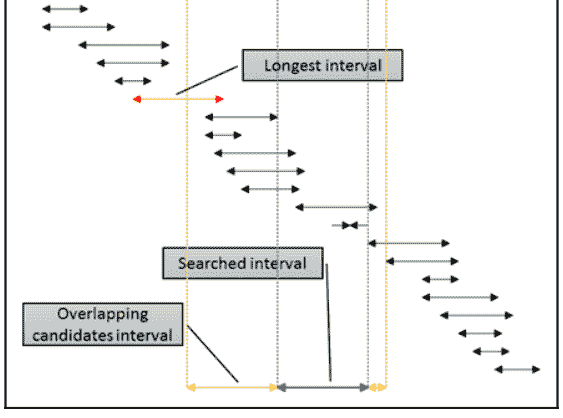

优化时态查询

图中的区间按下边界排序，表示 SQL Server 对 idx_b 索引的使用情况。从给定（搜索）区间的右侧消除区间很简单：只需消除所有开始处比给定区间结束至少大一个单位（更靠右）的区间。您可以在图中用最右侧的虚线标出的边界看到这一点。然而，从左侧消除则更为复杂。为了使用相同的索引（即用于从左侧消除的 idx_b 索引），我需要在查询的 WHERE 子句中使用表中区间的开始。我必须向左侧移动，远离给定（搜索）区间的开始，至少移动表中最长区间的长度，图中用标注标示。在左侧黄色线之前开始的区间不可能与给定的（蓝色/深灰色）区间重叠。

既然我已经知道最长区间的长度是 20，我可以用一种相当简单的方式编写增强查询：

```sql
DECLARE @b AS INT = 570,
    @e AS INT = 590;
DECLARE @max AS INT = 20;
SELECT id, b, e
```


```
FROM dbo.Intervals
WHERE b <= @e AND b >= @b - @max
  AND e >= @b AND e <= @e + @max
OPTION (RECOMPILE);
```

该查询与上一个查询检索相同的行，但仅需 20 次逻辑读取。如果你检查执行计划，可以看到使用了 idx_b，其查找谓词为：

Seek Keys[1]: Start: [tempdb].[dbo].[Intervals].b >= Scalar Operator((550)), End: [tempdb].[dbo].[Intervals].b <= Scalar Operator((590))

该谓词成功地从时间线的两端消除了行，然后使用残差谓词 [tempdb].[dbo].[Intervals].[e]>= (570) AND [tempdb].[dbo].[Intervals].[e]<=(610) 从非常有限的局部扫描中选择行。

当然，也可以反过来考虑，以覆盖 idx_e 索引更有用的情形。使用该索引时，从左侧排除非常简单——排除所有在给定区间开始时间之前至少一个单位结束的区间。而这一次，从右侧排除则更复杂——表中区间的结束时间不能超过给定区间的结束时间加上表中所有区间的最大长度。


> 请注意，这种性能是表中特定数据的结果。

区间的最大长度为 20。这样，SQL Server 就能非常高效地从两侧排除区间。但是，如果表中只有一个长区间，代码的效率就会低得多，因为 SQL Server 无法从某一侧（左侧或右侧，取决于使用哪个索引）排除大量行。无论如何，在现实生活中，区间长度通常变化不大，因此这种优化技术可能非常有用，尤其是因为它很简单。

完成本节中的时态查询后，你可以使用以下代码清理 tempdb 数据库：

```
DROP TABLE dbo.DateNums;
DROP TABLE dbo.Intervals;
```

## SQL:2011 中的时态功能

时态数据支持在 SQL:2011——ANSI 标准中引入。早期的标准版本也曾尝试定义这种支持，但没有成功（1995 年的 TSQL2 扩展）。这些尝试并未被广泛接受，供应商也没有实施它们。

SQL:2011 标准提出，关系数据库管理系统应支持时态数据。非常重要的一点是，SQL:2011 没有引入新的数据类型来支持时态数据，而是引入了时段（period）概念。

时段是表的一个属性，由两个日期类型的表列定义，分别表示开始时间和结束时间。其定义如下：

- 时段必须有一个名称。
- 结束时间必须大于开始时间。
- 它采用闭开时段模型。开始时间包含在时段内，结束时间不包含在内。

SQL:2011 标准认识到时态数据支持的两个维度：

- 应用程序时间表或有效时间表
- 系统时间表或事务时间表

**应用程序时间时段表**旨在满足应用程序的需求，这些应用程序需捕获数据在现实世界中被认为有效的时段。此类应用程序的典型示例是保险应用程序，在该应用程序中，有必要跟踪特定客户在任何给定时间点有效的具体保单详细信息。

**系统版本控制表**旨在满足那些必须出于业务原因、法律原因或两者兼有而维护准确的数据更改历史的应用程序的需求。此类应用程序的典型示例是银行应用程序，在该应用程序中，有必要保留客户账户信息的先前状态，以便向客户提供其账户的详细历史记录。此外，还有很多示例表明，某些机构被法律要求保存指定时长的历史数据，以满足监管和合规性要求。

**双时态表**是同时实现应用程序时间和系统版本化时间支持的表。

标准发布后，许多供应商都推出了时态表的实现：

- **IDM DB2 10** 添加了对时态表的完整支持（包括应用程序时间和系统版本化）。
- **Oracle** 实现了一项名为 **Flashback Data Archive（FDA）** 的功能。它会自动跟踪数据库中数据的所有更改，并维护历史数据存档。Oracle 12c 引入了有效时间时态支持。
- **PostgreSQL** 并不原生支持时态表，但有近似时态表的实现。
- **Teradata** 基于 TSQL2 规范实现了有效时间和事务时间表类型。

所有这些实现很可能影响了微软在 SQL Server 2016 中实现时态表的决定。

## SQL Server 2017 中的系统版本化时态表

SQL Server 2016 引入了对系统版本化时态表的支持。遗憾的是，应用程序时间表既未在此版本中实现，也未在 SQL Server 2017 中实现。系统版本化时态表提供了内置支持，能够提供表中存储数据在任意时间点的信息，而不仅仅是当前时刻正确的数据。它们是根据 ANSI SQL:2011 标准中的规范并附带一些扩展实现的。

## 时态表在 SQL Server 2017 中的工作原理

在 SQL Server 2017 中，系统版本化时态表实现为一对表：包含实际数据的当前表，以及仅存储历史条目的历史表。当前表和历史表都有许多限制。以下是你在使用系统版本化时态表的当前表时必须考虑的限制和注意事项：

- 必须定义主键
- 必须使用两个 `DATETIME2` 列定义一个 `PERIOD FOR SYSTEM_TIME`
- 不能是 `FILETABLE`，也不能包含 `FILESTREAM` 数据类型
- `INSERT`、`UPDATE` 和 `MERGE` 语句不能引用或修改时段列；开始列始终设置为系统时间，结束列设置为最大日期值
- 不允许使用 `INSTEAD OF` 触发器
- 不支持 `TRUNCATE TABLE`

历史表的限制列表要长得多，并带来了许多额外的限制。以下限制适用于系统版本化时态表的历史表：

- 不能定义约束（主键、外键、检查、表或列约束）。只允许默认列约束。
- 不能修改历史表中的数据。
- 既不能 `ALTER` 也不能 `DROP` 历史表。
- 它必须与当前表具有相同的架构（列名、数据类型、序号位置）。
- 不能被定义为当前表。
- 不能是 `FILETABLE`，也不能包含 `FILESTREAM` 数据类型。
- 不允许使用触发器（既不允许 `INSTEAD OF` 也不允许 `AFTER`）。
- 不支持变更数据捕获和变更数据跟踪。

有关使用时态表的注意事项和限制的更多信息，请参阅 https://msdn.microsoft.com/en-us/library/mt604468.aspx。

这个列表可能看起来冗长且令人沮丧，但所有这些限制都是为了保护历史表中的数据一致性和准确性。然而，尽管你不能更改逻辑属性，你仍然可以执行与历史表物理实现相关的操作：可以在行存储和列存储表存储之间切换，可以为聚集索引选择列，也可以创建额外的非聚集索引。

## 创建时态表

为了支持创建时态表，扩展了 Transact-SQL 的 `CREATE TABLE` 和 `ALTER TABLE` 语句。


最后，第四部分是将 SYSTEM_VERSIONING 属性设置为 ON。当您执行前面的代码时，实际上是在指示 SQL Server 自动为 dbo.Product 时态表创建一个历史表。该表将创建在相同的架构（dbo）中，名称遵循以下命名约定：

```
MSSQL_TemporalHistoryFor_<current_temporal_table_object_id>_[suffix].
```

后缀是可选的，仅当表名的第一部分不唯一时才会添加。以下屏幕截图显示了当您打开 SQL Server Management Studio (SSMS) 并找到 dbo.Product 表时所看到的内容：

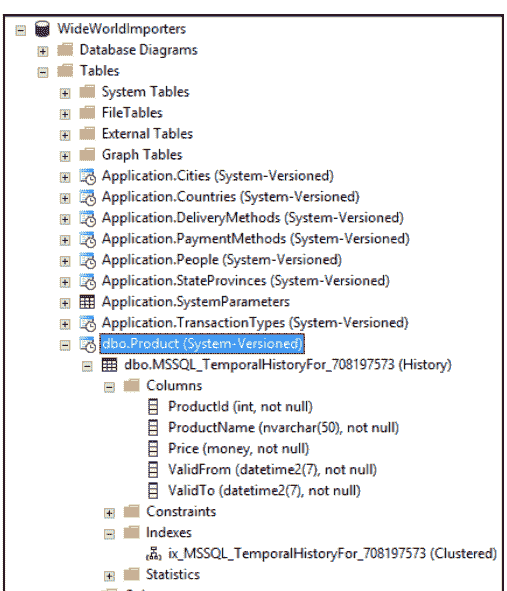

SQL Server Management Studio 中的时态表

您可以看到所有时态表都有一个表示时态的小时钟图标。在表名下方，您可以看到其历史表。请注意，两个表中的列是相同的（列名、数据类型、精度、是否可为空），但历史表没有约束（主键）。

周期列必须使用 DATETIME2 数据类型。如果您尝试使用 DATETIME 数据类型定义它们，将会出现错误。SQL:2011 标准没有指定数据类型精度，因此 SQL Server 2017 中的系统版本控制时态表并非严格按标准实现。当您将现有的时态解决方案迁移到使用 SQL Server 2017 中新时态表的解决方案时，这一点非常重要。通常，您一直在使用的列是 DATETIME 数据类型，您必须将其数据类型扩展为 DATETIME2。

您还可以指定历史表的名称，并让 SQL Server 以与前面所述相同的属性创建它。使用以下代码创建具有用户定义历史表名称的时态表：

```
USE WideWorldImporters;
CREATE TABLE dbo.Product2
(
    ProductId INT NOT NULL CONSTRAINT PK_Product2 PRIMARY KEY,
    ProductName NVARCHAR(50) NOT NULL,
    Price MONEY NOT NULL,
    ValidFrom DATETIME2 GENERATED ALWAYS AS ROW START NOT NULL,
    ValidTo DATETIME2 GENERATED ALWAYS AS ROW END NOT NULL,
    PERIOD FOR SYSTEM_TIME (ValidFrom, ValidTo)
)
WITH (SYSTEM_VERSIONING = ON (HISTORY_TABLE = dbo.ProductHistory2));
```

自动创建的历史表使用什么存储类型？默认情况下，它是一个行存储表，并在周期列上建有聚集索引。如果可以启用压缩（没有 SPARSE 或 (B)LOB 列），则该表会使用 PAGE 压缩。要查明历史表的存储类型，请使用以下代码：

```
SELECT temporal_type_desc, p.data_compression_desc
FROM sys.tables t
INNER JOIN sys.partitions p ON t.object_id = p.object_id
WHERE name = 'ProductHistory2';
```

上述查询的结果显示已应用 PAGE 压缩：

| temporal_type_desc | data_compression_desc |
|--------------------|-----------------------|
| HISTORY_TABLE      | PAGE                  |

您还可以看到历史表有一个聚集索引。以下代码提取索引名称以及索引中使用的列：

```
SELECT i.name, i.type_desc, c.name, ic.index_column_id
FROM sys.indexes i
INNER JOIN sys.index_columns ic on ic.object_id = i.object_id
INNER JOIN sys.columns c on c.object_id = i.object_id AND ic.column_id = c.column_id
WHERE OBJECT_NAME(i.object_id) = 'ProductHistory2';
```

此查询的输出显示，自动创建的历史表在周期列上有一个聚集索引，名称格式为 ix_<历史表名>：

| name | type_desc | name | index_column_id |
|-------------------|------------|----------|----------------|
| ix_ProductHistory2 | CLUSTERED | ValidFrom | 1 |
| ix_ProductHistory2 | CLUSTERED | ValidTo | 2 |

当您只想使用日期作为条件查询历史表时，这个索引是一个不错的选择。但是，当您想要浏览某个项的历史记录时，这个索引就不合适了。

如果历史表的预定义实现（行存储和聚集索引中的周期列）不符合您对历史数据的要求，您可以创建自己的历史表。当然，您需要遵守本章开头列出的所有约束和限制。以下代码首先创建一个历史表，然后创建一个时态表，最后将历史表分配给它。请注意，为了继续执行代码，您需要删除本章第一个示例中创建的时态表：

```
USE WideWorldImporters;
ALTER TABLE dbo.Product SET (SYSTEM_VERSIONING = OFF);
ALTER TABLE dbo.Product DROP PERIOD FOR SYSTEM_TIME;
DROP TABLE IF EXISTS dbo.Product;
DROP TABLE IF EXISTS dbo.ProductHistory;
GO
CREATE TABLE dbo.ProductHistory
(
    ProductId INT NOT NULL,
    ProductName NVARCHAR(50) NOT NULL,
    Price MONEY NOT NULL,
    ValidFrom DATETIME2 NOT NULL,
    ValidTo DATETIME2 NOT NULL
);
CREATE CLUSTERED COLUMNSTORE INDEX IX_ProductHistory ON dbo.ProductHistory;
CREATE NONCLUSTERED INDEX IX_ProductHistory_NC ON
dbo.ProductHistory (ProductId, ValidFrom, ValidTo);
GO
CREATE TABLE dbo.Product
(
    ProductId INT NOT NULL CONSTRAINT PK_Product PRIMARY KEY,
    ProductName NVARCHAR(50) NOT NULL,
    Price MONEY NOT NULL,
    ValidFrom DATETIME2 GENERATED ALWAYS AS ROW START NOT NULL,
    ValidTo DATETIME2 GENERATED ALWAYS AS ROW END NOT NULL,
    PERIOD FOR SYSTEM_TIME (ValidFrom, ValidTo)
)
WITH (SYSTEM_VERSIONING = ON (HISTORY_TABLE = dbo.ProductHistory));
```

您将在本章后面更详细地了解如何更改和删除系统版本控制的表。在这里，您应该关注这样一个事实：您可以创建自己的历史表，并在其上建立聚集列存储索引。以下屏幕截图显示了当您查看 SSMS 并找到已创建的时态表时所看到的内容：

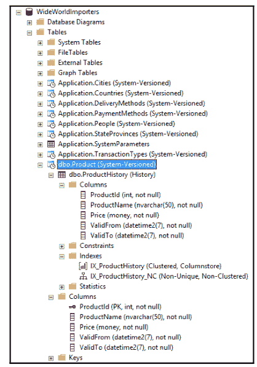

您可以看到，由您创建的表充当历史表，并具有聚集列存储索引。

## 将周期列作为隐藏属性

周期列用于支持数据的时态性，没有业务逻辑价值。通过使用 HIDDEN 子句，您可以隐藏新的 PERIOD 列，以避免影响未设计为处理新列的现有应用程序。以下代码将创建两个时态表，一个使用默认值（可见的周期列），另一个使用隐藏的周期列：

```
CREATE TABLE dbo.T1(
    Id INT NOT NULL CONSTRAINT PK_T1 PRIMARY KEY,
    Col1 INT NOT NULL,
    ValidFrom DATETIME2 GENERATED ALWAYS AS ROW START NOT NULL,
    ValidTo DATETIME2 GENERATED ALWAYS AS ROW END NOT NULL,
    PERIOD FOR SYSTEM_TIME (ValidFrom, ValidTo)
)
WITH (SYSTEM_VERSIONING = ON (HISTORY_TABLE = dbo.T1_Hist));
GO
INSERT INTO dbo.T1(Id, Col1) VALUES(1, 1);
GO
CREATE TABLE dbo.T2(
    Id INT NOT NULL CONSTRAINT PK_T2 PRIMARY KEY,
    Col1 INT NOT NULL,
    ValidFrom DATETIME2 GENERATED ALWAYS AS ROW START HIDDEN NOT NULL,
    ValidTo DATETIME2 GENERATED ALWAYS AS ROW END HIDDEN NOT NULL,
    PERIOD FOR SYSTEM_TIME (ValidFrom, ValidTo)
)
WITH (SYSTEM_VERSIONING = ON (HISTORY_TABLE = dbo.T2_Hist));
GO
INSERT INTO dbo.T2(Id, Col1) VALUES(1, 1);
GO
```

当您查询两个表时，可以看到第二个表的周期列没有被列出：

```
SELECT * FROM dbo.T1;
SELECT * FROM dbo.T2;
```

结果如下：

```
Id  Col1        ValidFrom                 ValidTo
--- ------ -------------------------- --------------------------
1   1         2017-12-14 23:05:44.2068702 9999-12-31 23:59:59.9999999
```

```
Id      Col1
------  --------
1       1
```

如您所见，即使您在查询中使用 *，周期列也不会显示。因此，您可以透明地在表上实现时态功能，并且可以确保现有代码仍然有效。当然，如果您显式指定周期列的名称，它们将会显示在结果集中。

> 在此，我需要表达对另一种实现的担忧，这种实现处理的是 SELECT * 的场景。我可以理解供应商不想引入可能破坏客户现有应用程序的功能，但另一方面，当新功能和解决方案不反对不良开发习惯时，您也不能期望开发人员停止使用 SELECT *。

隐藏属性使您可以将普通表转换为时态表，而无需担心应用程序中的重大更改。

## 将非时态表转换为时态表

在 SQL Server 2017 中，您可以从头创建时态表，也可以更改现有表并为其添加属性，使其转换为系统版本控制的时态表。您需要做的就是添加周期列，在它们上定义 SYSTEM_TIME 周期，然后设置时态属性。例如，在本节中，您将把 AdventureWorks2017 数据库中的 Department 表转换为时态表。以下屏幕截图显示了该表的内容：


由于现有的时间数据实现将被 SQL Server 2017 的 temporal 表所取代，`ModifiedDate` 列不再必要，可以删除。此外，你必须使用两个 ALTER 语句；第一个语句定义周期列和周期，而第二个语句将 `SYSTEM_VERSIONING` 属性设置为 ON 并定义系统将创建的历史表名称。

你应该注意，你需要为两个列提供默认值，因为它们必须是不可空的。你甚至可以为第一个周期列的默认值使用过去的日期值（如前面的代码示例所示，其中值设置为被删除列的值）；然而，你不能设置未来值。最后，周期日期列使用 `HIDDEN` 属性定义，以确保现有代码不会出现破坏性变更。


在 Enterprise Edition 中，添加带默认约束的不可空列是一个元数据操作；在所有其他版本中，这意味着一个物理操作，需要分配空间来更新所有表行以添加新列。对于大型表，这可能需要很长时间，并且要注意，在此操作期间，表会被锁定。

```
UPDATE HumanResources.Department SET Name='Political Correctness' WHERE DepartmentID = 2;
SELECT * FROM HumanResources.Department WHERE DepartmentID = 2;
SELECT * FROM HumanResources.DepartmentHistory;
```

第一个表仅显示新值，而第二个表显示之前的值，并带有适当的系统视角的有效日期（出于简洁，日期的时间部分被缩短）：

| DepartmentID | Name                  | GroupName                   |
|---|---|---|
| 2 | Political Correctness | Research and Development |

| DepartmentID | Name       | GroupName                 | ValidFrom  | ValidTo   |
|---|---|---|---|---|
| 2 | Tool Design | Research and Development | 2008-04-30 | 2017-12-15 |

正如你所见，将时间功能添加到现有的非时间表中非常容易和直接。它是透明的；你的所有查询和命令都可以在不更改的情况下工作。

## 将现有时间解决方案迁移到系统版本化表

很可能，你过去不得不处理历史数据。由于之前的 SQL Server 版本中没有开箱即用的功能，你不得不创建自定义的时间数据解决方案。现在该功能可用了，你可能会考虑将其用于现有的时间解决方案。你在本章前面看到过，你可以定义自己的历史表。因此，你也可以使用现有的且已填充的历史表。如果你想将现有的解决方案转换为在 SQL Server 2017 中使用系统版本化 temporal 表，但同时使用相同的表，你必须准备两个表，使其满足 temporal 表的所有要求。为此，你将再次使用 AdventureWorks2017 数据库，并使用该数据库中存在的表来创建当前表和历史表。使用以下代码创建并填充表：

```
USE WideWorldImporters;
CREATE TABLE dbo.ProductListPrice
(
    ProductID INT NOT NULL CONSTRAINT PK_ProductListPrice PRIMARY KEY,
    ListPrice MONEY NOT NULL,
);
INSERT INTO dbo.ProductListPrice(ProductID,ListPrice)
SELECT ProductID,ListPrice FROM AdventureWorks2017.Production.Product;
GO
CREATE TABLE dbo.ProductListPriceHistory
(
    ProductID INT NOT NULL,
    ListPrice MONEY NOT NULL,
    StartDate DATETIME NOT NULL,
    EndDate DATETIME NULL,
    CONSTRAINT PK_ProductListPriceHistory PRIMARY KEY CLUSTERED
    (
        ProductID ASC,
        StartDate ASC
    )
);
INSERT INTO
dbo.ProductListPriceHistory(ProductID,ListPrice,StartDate,EndDate)
SELECT ProductID, ListPrice, StartDate, EndDate FROM
AdventureWorks2017.Production.ProductListPriceHistory;
```

考虑在两个表中产品 ID 为 707 的行：

```
SELECT * FROM dbo.ProductListPrice WHERE ProductID = 707;
SELECT * FROM dbo.ProductListPriceHistory WHERE ProductID = 707;
```

以下是当前表和历史表中的行：

| ProductID | ListPrice |
|-----------|-----------|
| 707       | 34.99     |

| ProductID | ListPrice | StartDate | EndDate |
|-----------|-----------|-----------|---------|
| 707       | 33.6442   | 2011-05-31 00:00:00.000 | 2012-05-29 00:00:00.000 |
| 707       | 33.6442   | 2012-05-30 00:00:00.000 | 2013-05-29 00:00:00.000 |
| 707       | 34.99     | 2013-05-30 00:00:00.000 | NULL |

假设这些数据是由你的时间数据解决方案产生的，并且你想改用 SQL Server 2017 中的系统版本化 temporal 表，但也使用相同的表。你必须做的第一件事是使两个表中的列保持一致。由于当前表没有日期列，你需要添加两个周期列并定义周期。列应与历史表中的对应列具有相同的名称。以下是创建当前表中 temporal 基础设施的代码：

```
ALTER TABLE dbo.ProductListPrice
ADD StartDate DATETIME2 GENERATED ALWAYS AS ROW START HIDDEN NOT NULL
CONSTRAINT DF_StartDate1 DEFAULT '20170101 00:00:00.0000000',
    EndDate DATETIME2 GENERATED ALWAYS AS ROW END HIDDEN NOT NULL CONSTRAINT DF_EndDate1 DEFAULT '99991231 23:59:59.9999999',
    PERIOD FOR SYSTEM_TIME (StartDate, EndDate);
GO
```

下一步与历史表相关。正如示例数据所示，你当前的解决方案允许历史表中存在间隙，并且还包含当前值且结束日期未定义。如本章前面所述，历史表仅包含历史数据，历史条目之间没有间隙（新的开始日期等于之前的结束日期）。以下是你必须在 dbo.ProductListPriceHistory 表中实施的步骤，以便使其作为 SQL Server 2017 中系统版本化 temporal 表的历史表：

- 更新不可空的 EndDate 列，以消除前面描述的历史值之间的间隙并支持开闭区间
- 更新 EndDate 列为空的所有行，使其等于当前表中行的 StartDate
- 删除主键约束
- 将两个日期列 StartDate 和 EndDate 的数据类型更改为 DATETIME2

以下是实现所有这些请求的的代码：

```
--remove gaps
UPDATE dbo.ProductListPriceHistory SET EndDate = DATEADD(day,1,EndDate);
--update EndDate to StartDate of the actual record
UPDATE dbo.ProductListPriceHistory SET EndDate = (SELECT MAX(StartDate) FROM dbo.ProductListPrice) WHERE EndDate IS NULL;
--remove constraints
ALTER TABLE dbo.ProductListPriceHistory DROP CONSTRAINT PK_ProductListPriceHistory;
--change data type to DATETIME2
ALTER TABLE dbo.ProductListPriceHistory ALTER COLUMN StartDate DATETIME2 NOT NULL;
ALTER TABLE dbo.ProductListPriceHistory ALTER COLUMN EndDate DATETIME2 NOT NULL;
```

现在，两个表都已准备好作为 SQL Server 2017 中的系统版本化 temporal 表：

```
ALTER TABLE dbo.ProductListPrice SET (SYSTEM_VERSIONING = ON (HISTORY_TABLE = dbo.ProductListPriceHistory, DATA_CONSISTENCY_CHECK = ON));
```

命令已成功执行，dbo.ProductListPriceHistory 表现在是一个系统版本化 temporal 表。请注意，使用了 DATA_CONSISTENCY_CHECK = ON 选项，以检查历史表中的所有行在时间数据方面是否有效（没有间隙且结束日期不早于开始日期）。现在，你可以使用 UPDATE 语句检查新功能。你将通过将 ID 为 707 的产品价格更改为 50 来更新价格，然后检查两个表中的行：

```
UPDATE dbo.ProductListPrice SET ListPrice = 50 WHERE ProductID = 707;
SELECT * FROM dbo.ProductListPrice WHERE ProductID = 707;
SELECT * FROM dbo.ProductListPriceHistory WHERE ProductID = 707;
```


以下是该产品在两个表中的行：

| ProductID | ListPrice |
|-----------|-----------|
| 707       | 50.00     |

| ProductID | ListPrice | StartDate                    | EndDate                      |
|-----------|-----------|------------------------------|------------------------------|
| 707       | 33.6442   | 2011-05-31 00:00:00.0000000 | 2012-05-30 00:00:00.0000000 |
| 707       | 33.6442   | 2012-05-30 00:00:00.0000000 | 2013-05-30 00:00:00.0000000 |
| 707       | 34.99     | 2013-05-30 00:00:00.0000000 | 2017-12-12 21:21:08.4382496 |
| 707       | 34.99     | 2017-12-12 21:21:08.4382496 | 2017-12-12 21:21:08.4382496 |

您可以看到历史表中还有一行（与之前的结果相比）。当然，当您尝试这些示例时，`StartDate` 和 `EndDate` 列的值会不同，因为它们由系统管理。


> AdventureWorks 一直是使用最广泛的 SQL Server 示例数据库之一。在引入 WideWorldImporters 数据库之后，AdventureWorks 在 SQL Server 2016 RTM 中不再受支持，但它在 SQL Server 2017 中回归了。你可以从 https://github.com/Microsoft/sql-server-samples/releases/tag/adventureworks 下载。

如您所见，将现有解决方案迁移到 SQL Server 2017 中的系统版本化时态表并不复杂，但也不是一步就能完成的。您应该考虑到，很可能需要花费一些时间将数据类型更新为 `DATETIME2`。不过，通过使用系统版本化时态表功能，您的历史表将完全且自动地受到保护，除系统外任何人均无法更改。这是一个出色的开箱即用的数据一致性改进。

## 修改时态表

您可以使用 `ALTER TABLE` 语句对系统版本化时态表执行架构更改。当您使用它来添加新数据类型、更改数据类型或删除现有列时，系统会自动对当前表和历史表执行该操作。但是，其中一些操作不只是元数据操作；有些更改会更新整张表。

要对此进行验证，请运行以下代码，以创建（并通过示例数据填充）上一节中的时态表：

```sql
USE tempdb;
CREATE TABLE dbo.Product
(
    ProductId INT NOT NULL CONSTRAINT PK_Product PRIMARY KEY,
    ProductName NVARCHAR(50) NOT NULL,
    Price MONEY NOT NULL,
    ValidFrom DATETIME2 GENERATED ALWAYS AS ROW START NOT NULL,
    ValidTo DATETIME2 GENERATED ALWAYS AS ROW END NOT NULL,
    PERIOD FOR SYSTEM_TIME (ValidFrom, ValidTo)
)
WITH (SYSTEM_VERSIONING = ON (HISTORY_TABLE = dbo.ProductHistory));
GO
INSERT INTO dbo.Product (ProductId,ProductName,Price)
SELECT message_id,'PROD' + CAST(message_id AS NVARCHAR), severity FROM
sys.messages WHERE language_id = 1033;
```

现在，您将向该时态表中添加三个新列：

- 一个名为 `Color` 的列，允许 NULL 值
- 一个名为 `Category` 的列，该列的值必须为非 NULL
- 一个名为 `Description` 的**大型对象 (LOB)** 列

但在添加这些列之前，您将创建一个**扩展事件 (XE)** 会话，以跟踪向时态表添加新列时底层发生的情况。使用以下代码创建并启动 XE 会话：

```sql
CREATE EVENT SESSION AlteringTemporalTable ON SERVER
    ADD EVENT sqlserver.sp_statement_starting(
        WHERE (sqlserver.database_id = 2)),
    ADD EVENT sqlserver.sp_statement_completed(
        WHERE (sqlserver.database_id = 2)),
    ADD EVENT sqlserver.sql_statement_starting(
        WHERE (sqlserver.database_id = 2)),
    ADD EVENT sqlserver.sql_statement_completed(
        WHERE (sqlserver.database_id = 2))
    ADD TARGET package0.event_file (SET filename = N'AlteringTemporalTable')
WITH (MAX_DISPATCH_LATENCY = 1 SECONDS)
GO
ALTER EVENT SESSION AlteringTemporalTable ON SERVER STATE = start;
GO
```

现在，您可以执行以下三个 `ALTER` 语句，分别对应前面描述的新列：

```sql
ALTER TABLE dbo.Product ADD Color NVARCHAR(15);
ALTER TABLE dbo.Product ADD Category SMALLINT NOT NULL CONSTRAINT DF_Category DEFAULT 1;
ALTER TABLE dbo.Product ADD Description NVARCHAR(MAX) NOT NULL CONSTRAINT DF_Description DEFAULT N'N/A';
```

XE 会话收集的内容如下所示：

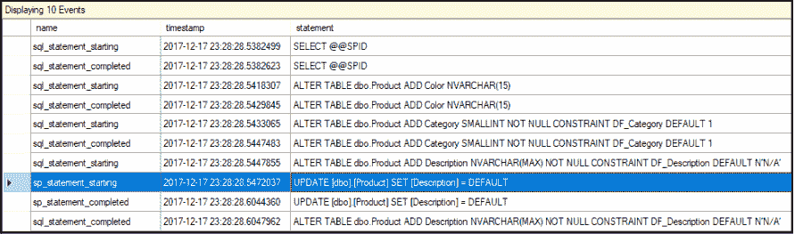

这清楚地表明，前两个 `ALTER` 语句无需额外操作即可执行。但是，添加 LOB 列会触发对所有行的更新，并使用默认值作为离线操作。

第一条语句添加了一个接受 NULL 值的列，因此该操作会立即完成。

当您添加非空列时，情况有所不同，如第二条语句所示。首先，您需要提供默认约束，以确保所有行在该列中都有值。此操作仅在 Enterprise 和 Developer 版本中为联机（元数据操作）。在所有其他版本中，当前表和历史表中的所有行都将被更新，以添加具有相应值的额外列。

但是，添加 LOB 或 BLOB 列会导致所有 SQL Server 版本中的当前表和历史表发生大量更新！此操作将在内部更新两个表中的所有行。对于大表，这可能需要很长时间，并且在此期间，两个表都会被锁定。

如果您需要对 `ALTER` 语句不支持的时态表执行架构更改，则必须将其 `SYSTEM_VERSIONING` 属性设置为 false，将表转换为非时态表，执行更改，然后再转换回时态表。以下代码演示了如何将标识列 `ProductNumber` 和稀疏列 `Size` 添加到时态表 `dbo.Product` 中：

```sql
ALTER TABLE dbo.ProductHistory REBUILD PARTITION = ALL WITH
(DATA_COMPRESSION=NONE);
GO
BEGIN TRAN
ALTER TABLE dbo.Product SET (SYSTEM_VERSIONING = OFF);
ALTER TABLE dbo.Product ADD Size NVARCHAR(5) SPARSE;
ALTER TABLE dbo.ProductHistory ADD Size NVARCHAR(5) SPARSE;
ALTER TABLE dbo.Product ADD ProductNumber INT IDENTITY (1,1);
ALTER TABLE dbo.ProductHistory ADD ProductNumber INT NOT NULL DEFAULT 0;
ALTER TABLE dbo.Product SET (SYSTEM_VERSIONING = ON (HISTORY_TABLE = dbo.ProductHistory));
COMMIT;
```

要执行 `ALTER TABLE` 操作，您需要对当前表和历史表具有 `CONTROL` 权限。在更改期间，两个表都会使用架构锁锁定。

## 删除时态表

您不能删除系统版本化时态表。当前表和历史表都会受到保护，直到当前表的 `SYSTEM_VERSIONING` 属性设置为 `OFF`。当您将其设置为 `OFF` 时，两个表都会自动变为非时态表，并且彼此完全独立。因此，您可以根据自己的权限对它们执行所有允许的操作。如果您确实想将时态表转换为非时态表，还可以删除时间段。以下代码将 `Product` 表转换为非时态表，并删除已定义的 `SYSTEM_TIME` 时间段：

```sql
ALTER TABLE dbo.Product SET (SYSTEM_VERSIONING = OFF);
ALTER TABLE dbo.Product DROP PERIOD FOR SYSTEM_TIME;
```

请注意，时间段列 `ValidFrom` 和 `ValidTo` 仍保留在表中，并会由系统进一步更新。但是，当当前表中的数据发生更改时，历史表不会被更新。

当前表的状态如下：

| ProductId | ProductName | Price | ValidFrom | ValidTo |
|-----------|-------------|-------|-----------|---------|
| 1         | Fog         | 150   | 12.11.2017 | 31.12.9999 |

历史表的状态如下：

| ProductId | ProductName | Price | ValidFrom | ValidTo |
|-----------|-------------|-------|-----------|---------|


请注意，为清晰起见，ValidFrom 和 ValidTo 列中的日期以短格式显示；它们的实际值是 DATETIME2 数据类型。

如您所见，向时态表执行 INSERT 后，会发生以下转换：

- **当前表**：已添加一行，其中包含 INSERT 语句中的属性，时间段开始日期列设置为系统日期，时间段结束日期列设置为 DATETIME2 数据类型的最大值
- **历史表**：完全不受影响

## 在时态表中更新数据

现在，假设产品的价格已更改为 200，并且此更改于 2017 年 11 月 28 日输入到数据库中。以下是此操作的代码：

```sql
UPDATE dbo.Product SET Price = 200.00 WHERE ProductId = 1;-- on 28th November
```

执行上述语句后，当前表的状态如下：

| ProductId | ProductName | Price | ValidFrom | ValidTo |
|-----------|-------------|-------|-----------|---------|
| 1         | Fog         | 200   | 28.11.2017 | 31.12.9999 |

执行上述语句后，历史表的状态如下：

| ProductId | ProductName | Price | ValidFrom | ValidTo |
|-----------|-------------|-------|-----------|---------|
| 1         | Fog         | 150   | 12.11.2017 | 28.11.2017 |


再次注意，`ValidFrom` 和 `ValidTo` 列中的值以简短格式显示以提高清晰度。历史表中 `ValidTo` 列中的值与当前表中 `ValidFrom` 值相同；没有间隙。


开始和结束时间段列以 UTC 时区存储时间！

现在，假设你在第二天将价格降至 180。以下是此操作的代码：

```sql
UPDATE dbo.Product SET Price = 180.00 WHERE ProductId = 1; -- on 29th November
```

执行前述语句后，当前表的状态如下：

| ProductId | ProductName | Price | ValidFrom | ValidTo |
|---|---|---|---|---|
| 1 | Fog | 180 | 29.11.2017 | 31.12.9999 |

执行前述语句后，历史表的状态如下：

| ProductId | ProductName | Price | ValidFrom | ValidTo |
|---|---|---|---|---|
| 1 | Fog | 150 | 12.11.2017 | 28.11.2017 |
| 1 | Fog | 200 | 28.11.2017 | 29.11.2017 |

你可以看到历史表中又有一条记录，表明价格 200 有效期为一天。如果你在 11 月 30 日再次执行相同的语句会怎样？没有实际变化；业务逻辑属性未发生变化，但这对时间表意味着什么？以下是此操作的代码：

```sql
UPDATE dbo.Product SET Price = 180.00 WHERE ProductId = 1; -- on 30th November
```

执行前述语句后，当前表的状态如下：

| ProductId | ProductName | Price | ValidFrom | ValidTo |
|---|---|---|---|---|
| 1 | Fog | 180 | 30.11.2017 | 31.12.9999 |

执行前述语句后，历史表的状态如下：

| ProductId | ProductName | Price | ValidFrom | ValidTo |
|---|---|---|---|---|
| 1 | Fog | 150 | 12.11.2017 | 28.11.2017 |
| 1 | Fog | 200 | 28.11.2017 | 29.11.2017 |
| 1 | Fog | 180 | 29.11.2017 | 30.11.2017 |

正如你在历史表中看到的，即使当前表中属性没有实际变化，也会创建历史表中的条目，并且会更新时间段日期列。


你可以将此视为一个错误，但尽管没有属性被更改，如果你使用时间表进行审计，你可能希望在主表中看到所有数据操作尝试。

以下是时间表中单行 UPDATE 如何影响当前表和历史表：

- **当前表**：当前表中的值更新为 `UPDATE` 语句提供的值，时间段开始日期列设置为系统日期，时间段结束日期列设置为 `DATETIME2` 数据类型的最大值。
- **历史表**：更新前的当前表中的行被复制到历史表中，并且仅将时间段结束日期列设置为系统日期。

你还可以看到历史表中行的日期没有间隙。甚至可能出现重复；历史表没有约束来防止它们！因此，可能存在具有相同时间段列值的同一行的多条记录。而且，时间段列中的值甚至可能相同！唯一强制执行的约束是，表示时间段结束日期列的日期不能早于表示时间段开始日期的日期（因此，可以保证 `ValidFrom <= ValidTo`）。

## 在时间表中删除数据

你最终将从当前表中删除该行以演示 DELETE 语句如何影响时间表。以下是此操作的代码：

```sql
DELETE FROM dbo.Product WHERE ProductId = 1; -- on 15th December
```

执行前述语句后，当前表的状态如下：

| ProductId | ProductName | Price | ValidFrom | ValidTo |
|---|---|---|---|---|

执行前述语句后，历史表的状态如下：

| ProductId | ProductName | Price | ValidFrom | ValidTo |
|---|---|---|---|---|
| 1 | Fog | 150 | 12.11.2017 | 28.11.2017 |
| 1 | Fog | 200 | 28.11.2017 | 29.11.2017 |
| 1 | Fog | 180 | 29.11.2017 | 30.11.2017 |
| 1 | Fog | 180 | 30.11.2017 | 15.12.2017 |

正如你所预期的那样，当前表中没有行，但历史表中又添加了一行。针对时间表中的单行执行 DELETE 语句后：

- **当前表：** 该行已被删除。
- **历史表：** 删除前的当前表中的行被复制到历史表中，并且仅将时间段结束日期列设置为系统日期。

利用这个机会清理本节中创建的时间表：

```sql
ALTER TABLE dbo.Product SET (SYSTEM_VERSIONING = OFF);
ALTER TABLE dbo.Product DROP PERIOD FOR SYSTEM_TIME;
DROP TABLE IF EXISTS dbo.Product;
DROP TABLE IF EXISTS dbo.ProductHistory;
```

## 查询 SQL Server 2017 中的时间数据

系统版本化表主要用于跟踪历史数据更改。对系统版本化表的查询通常倾向于检索在给定时间点或在任意两个给定时间点之间的表内容。

正如你所见，Microsoft 已根据 SQL:2011 标准实现它们，这意味着存在两个物理表：一个包含实际数据的表和一个历史表。为了简化对时间表的查询，SQL:2011 标准引入了一个新的 SQL 子句 `FOR SYSTEM_TIME`。此外，还添加了一些新的时间特定子子句。SQL Server 2017 不仅实现了这些扩展，还添加了另外两个扩展。以下是你可以在 SQL Server 2017 中用于查询时间数据的完整子句和扩展列表：

- `FOR SYSTEM_TIME AS OF`
- `FOR SYSTEM_TIME FROM TO`
- `FOR SYSTEM_TIME BETWEEN AND`
- `FOR SYSTEM_TIME CONTAINED_IN`
- `FOR SYSTEM_TIME ALL`

### 在特定时间点检索时间数据

当你想要检索在给定时间点有效的历史数据时，结果集可能同时包含实际数据和历史数据。例如，以下查询将返回 `WideWorldImporters` 示例数据库中 `Application.People` 时间表中在 2013 年 5 月 20 日上午 8 点有效的所有行：

```sql
SELECT PersonID, FullName, OtherLanguages, ValidFrom, ValidTo
FROM Application.People WHERE ValidFrom <= '20130520 08:00:00' AND ValidTo
> '20130520 08:00:00'
UNION ALL
SELECT PersonID, FullName, OtherLanguages, ValidFrom, ValidTo
FROM Application.People_Archive WHERE ValidFrom <= '20130520 08:00:00' AND
ValidTo > '20130520 08:00:00';
```

查询返回 1,060 行。对于单个人员，只返回一行：实际行或历史行之一。行是有效的，如果其开始日期早于或等于给定日期且其结束日期大于给定日期。

可以使用带有 `AS OF` 子子句的新的 `FOR SYSTEM_TIME` 子句来简化前面的查询。以下是使用时间 Transact-SQL 扩展的相同查询：

```sql
SELECT PersonID, FullName, OtherLanguages, ValidFrom, ValidTo
FROM Application.People FOR SYSTEM_TIME AS OF '20130520 08:00:00';
```

当然，它返回相同的结果集，并且执行计划相同，如以下屏幕截图所示：

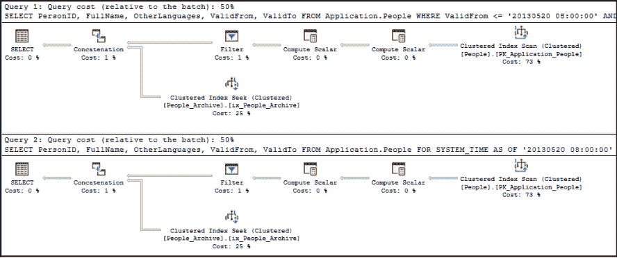

在内部，查询处理器会触及两个表并检索数据，但使用时间扩展的查询看起来更简单。

针对时间表的点查询的特殊情况是指定当前日期作为时间点的查询。以下查询返回同一时间表的实际数据：

```sql
DECLARE @Now AS DATETIME = SYSUTCDATETIME();
SELECT PersonID, FullName, OtherLanguages, ValidFrom, ValidTo
FROM Application.People FOR SYSTEM_TIME AS OF @Now;
```

前一个查询在逻辑上等同于以下查询：

```sql
SELECT PersonID, FullName, OtherLanguages, ValidFrom, ValidTo
FROM Application.People;
```


然而，当你查看执行第一个查询的执行计划（见下图）时，两个表都被处理了，而非时态查询只需要从当前表中检索数据：

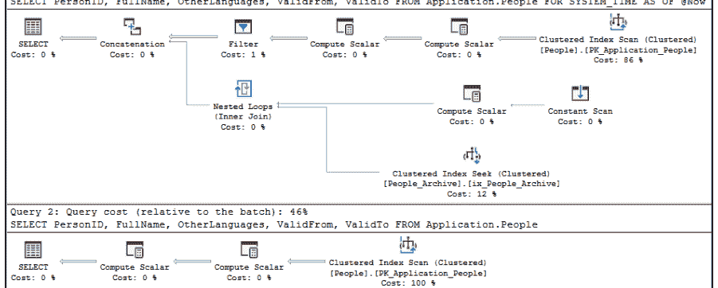

比较检索实际数据的时态和非时态查询的执行计划

因此，你不应该使用带有 FOR SYSTEM_TIME AS 子句的时态查询来返回当前表的数据。

## 从特定时间段检索时态数据

你可以使用新的 FOR SYSTEM_TIME 子句来检索在两个时间点之间有效或曾经有效的时态数据。这些查询通常用于获取随时间推移特定行的更改。要实现这一点，你可以使用 SQL:2011 标准中规定的两种子句之一：

- `FROM...TO` 返回所有在给定时间段开始之前或开始时开始，并在时间段结束之后结束的数据（闭开区间）
- `BETWEEN...AND` 返回所有在给定时间段开始之前或开始时开始，并在时间段结束之后或结束时结束的数据（闭闭区间）

正如你所见，这两个子句之间的唯一区别在于如何解释开始日期位于给定时间段右侧的数据：BETWEEN 包含此数据，FROM...TO 不包含。

以下查询演示了这两个子句的使用及其之间的差异：

```sql
--example using FROM/TO
SELECT PersonID, FullName, OtherLanguages, ValidFrom, ValidTo
FROM Application.People FOR SYSTEM_TIME FROM '2016-03-20 08:00:00' TO
'2016-05-31 23:14:00' WHERE PersonID = 7;

--example using BETWEEN
SELECT PersonID, FullName, OtherLanguages, ValidFrom, ValidTo
FROM Application.People FOR SYSTEM_TIME BETWEEN '2016-03-20 08:00:01' AND
'2016-05-31 23:14:00' WHERE PersonID = 7;
```

以下是前述查询生成的结果集：

| PersonID | FullName | OtherLanguages | ValidFrom | ValidTo |
|---|---|---|---|---|
| 7 | Amy Trefl | NULL | 2016-03-20 08:00 | 2016-05-31 23:13 |
| 7 | Amy Trefl | ["Slovak", "Spanish", "Polish"] | 2016-05-31 23:13 | 2016-05-31 23:14 |

| PersonID | FullName | OtherLanguages | ValidFrom | ValidTo |
|---|---|---|---|---|
| 7 | Amy Trefl | ["Slovak", "Spanish", "Polish"] | 2016-05-31 23:14 | 9999-12-31 23:59 |
| 7 | Amy Trefl | NULL | 2016-03-20 08:00 | 2016-05-31 23:13 |
| 7 | Amy Trefl | ["Slovak", "Spanish", "Polish"] | 2016-05-31 23:13 | 2016-05-31 23:14 |

正如你所见，第二个查询返回三行，因为它包含了开始日期等于给定时间段右边界值的行。

这两个子句返回与指定时间段重叠的行版本。如果需要返回在指定时间段边界内存在的行，则需要使用另一个扩展 CONTAINED IN。该扩展（Allen 算子的实现之一）未在 SQL:2011 标准中定义；它在 SQL Server 2017 中实现。

当使用 CONTAINED IN 子句时，开始或结束时间位于给定区间之外的行将不会成为结果集的一部分。当你在前面的示例中用它替换子句 BETWEEN 时，只有整个生命周期属于给定区间的行才会保留：

```sql
SELECT PersonID, FullName, OtherLanguages, ValidFrom, ValidTo
FROM Application.People FOR SYSTEM_TIME CONTAINED IN ('2016-03-20 08:00:01','2016-05-31 23:14:00') WHERE PersonID = 7;
```

与使用 BETWEEN 的三行，或使用 FROM...TO 子句的两行相比，这次只返回一行：

| PersonID | FullName | OtherLanguages | ValidFrom | ValidTo |
|----------|----------|----------------|-----------|---------|
| 7 | Amy Trefl | ["Slovak","Spanish","Polish"] | 2016-05-31 23:13 | 2016-05-31 23:14 |

尽管该扩展不是标准，但其在 SQL Server 2017 中的实现是受欢迎的；它涵盖了一个合理且并不罕见的用例，并简化了基于时态表的数据库解决方案的开发。

## 检索所有时态数据

由于时态数据被分离到两个表中，要获取所有时态数据，你需要组合来自两个表的数据，但 SQL:2011 标准中并未为此目的定义子句。然而，SQL Server 团队引入了扩展（子句）ALL 来简化此类查询。

这里有一个时态查询，返回 ID 为 7 的人的实际和历史数据：

```sql
SELECT PersonID, FullName, OtherLanguages, ValidFrom, ValidTo FROM Application.People FOR SYSTEM_TIME ALL WHERE PersonID = 7;
```

查询返回 14 行，因为有 13 行历史记录和实际表中的一个条目。这里是逻辑等价的、标准的但稍微复杂一些的查询：

```sql
SELECT PersonID, FullName, OtherLanguages, ValidFrom, ValidTo FROM Application.People WHERE PersonID = 7
UNION ALL
SELECT PersonID, FullName, OtherLanguages, ValidFrom, ValidTo FROM Application.People_Archive WHERE PersonID = 7;
```

该子句的唯一目的是简化对时态表的查询。

```sql
GO
CREATE TABLE dbo.T1_Hist(
    Id INT NOT NULL,
    C1 INT,
    Vf DATETIME2 NOT NULL,
    Vt DATETIME2 NOT NULL
)
GO
--populate tables
INSERT INTO dbo.T1_Hist(Id, C1, Vf, Vt) VALUES
(1,1,'20171201','20171210'),
(1,2,'20171210','20171215');
GO
INSERT INTO dbo.T1 (Id, C1, Vf, Vt) VALUES
(1,3,'20171215','99991231 23:59:59.9999999');
GO
```

脚本执行后两个表的内容如下：

| Id | C1 | Vf | Vt |
|----|----|----|----|
| 1 | 3 | 2017-12-15 00:00:00.0000000 | 9999-12-31 23:59:59.9999999 |

| Id | C1 | Vf | Vt |
|----|----|----|----|
| 1 | 1 | 2017-12-01 00:00:00.0000000 | 2017-12-10 00:00:00.0000000 |
| 1 | 2 | 2017-12-10 00:00:00.0000000 | 2017-12-15 00:00:00.0000000 |

ID 为 1 的行的 C1 列的实际值为 3，并且有两个历史值。你现在将把 T1 表转换为时态表，并因此定义一个保留策略，规定历史条目应仅保留一天。以下是适当的代码：

```sql
ALTER TABLE dbo.T1 ADD PERIOD FOR SYSTEM_TIME (Vf, Vt);
GO
ALTER TABLE dbo.T1 SET
(
    SYSTEM_VERSIONING = ON
    (
        HISTORY_TABLE = dbo.T1_Hist,
        HISTORY_RETENTION_PERIOD = 3 DAYS
    )
);
```

你需要使用两个语句来实现此任务：第一个用于向表添加时间段，第二个将表转换为具有 3 天保留策略的时态表。然而，当你执行查询时，你将看到以下消息：

```text
Msg 13765, Level 16, State 1, Line 31
Setting finite retention period failed on system-versioned temporal table 'WideWorldImporters.dbo.T1' because the history table 'WideWorldImporters.dbo.T1_Hist' does not contain required clustered index. Consider creating a clustered columnstore or B-tree index starting with the column that matches end of SYSTEM_TIME period, on the history table.
```

历史表必须在表示时间段结束的列上具有行聚集索引，否则无法工作。使用此代码创建索引并再次运行之前的代码：

```sql
CREATE CLUSTERED INDEX IX_CL_T1_Hist ON dbo.T1_Hist (Vt, Vf);
GO
ALTER TABLE dbo.T1 SET
(
    SYSTEM_VERSIONING = ON
    (
        HISTORY_TABLE = dbo.T1_Hist,
        HISTORY_RETENTION_PERIOD = 3 DAYS
    )
);
```

执行成功。本节写于 12 月 17 日，因此后续操作的结果将根据此日期显示。在此示例中，有两个历史记录，其结束时间段日期为 10.12. 和 15.12.。根据保留策略，只应显示一行作为历史行。要检查这一点，请使用以下查询：

```sql
SELECT * FROM dbo.T1 FOR SYSTEM_TIME ALL;
```

查询返回以下结果：

| Id | C1 | Vf | Vt |
|----|----|----|----|
| 1 | 3 | 2017-12-15 00:00:00.000000 | 9999-12-31 23:59:59.9999999 |
| 1 | 2 | 2017-12-10 00:00:00.000000 | 2017-12-15 00:00:00.0000000 |


未满足保留策略的行已从结果集中删除。查询的执行计划显示在以下屏幕截图中：

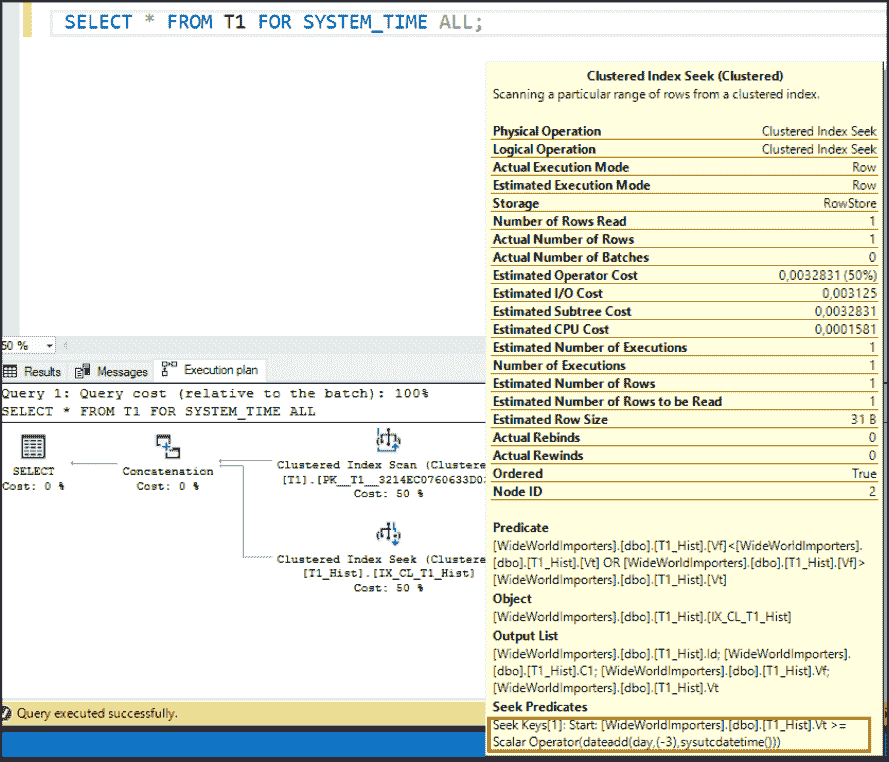

当你查看执行计划时，可以看到保留策略过滤器是自动应用的。因此，比三天更早的历史行会被从结果集中移除，结果集中包含一个实际行和一个历史行。符合以下条件的行不会显示：

```
Vt < DATEADD (Day, -3, SYSUTCDATETIME ());
```

然而，当你直接查询历史表时，仍然可以看到所有行：

```
SELECT * FROM dbo.T1
UNION ALL
SELECT * FROM dbo.T1_Hist;
```

查询返回以下结果：

| Id | C1 | Vf | Vt |
| --- | ----- | ----------------------------- | ----------------------------- |
| 1 | 3 | 2017-12-15 00:00:00.0000000 | 9999-12-31 23:59:59.9999999 |
| 1 | 1 | 2017-12-01 00:00:00.0000000 | 2017-12-10 00:00:00.0000000 |
| 1 | 2 | 2017-12-10 00:00:00.0000000 | 2017-12-15 00:00:00.0000000 |

这不是你期望的结果！SQL Server 如何删除已过期的行？匹配行的识别及其从历史表中的删除是透明进行的，与系统调度和运行的后台任务同时发生。由于已过期的行可以在任何时间点以任意顺序被删除，因此你应使用上一节所示的用于查询时间数据的 Transact-SQL 扩展。

在此示例中，你在保留策略中使用了三天。此信息存储在 sys.tables 目录中。运行以下查询以检查 T1 表的保留策略设置：

```
SELECT temporal_type_desc, history_retention_period,
history_retention_period_unit
FROM sys.tables WHERE name = 'T1';
```

前一个查询返回此结果集：

| temporal_type_desc | history_retention_period | history_retention_period_unit |
| ------------------- | ------------------------- | ----------------------------- |
| SYSTEM_VERSIONED_TEMPORAL_TABLE | 3 | 3 |

结果中的第二个 3 代表天数。如果你包含其他表，可以看到 WideWorldImporters 数据库中的所有时间表在该列中的值均为 -1，这意味着时间表的保留期未定义，因此历史行将永久保留。以下是 SQL Server 2017 保留策略中可以定义的可能保留期单位列表：

+   - -1: INFINITE
+   - 3: DAY
+   - 4: WEEK
+   - 5: MONTH
+   - 6: YEAR

历史保留策略很好，可以让你管理和控制数据大小。然而，目前你只能使用一个标准来定义已过期行：期间结束。如果某些行的历史条目很多，而大多数其他行的历史条目很少，这并无帮助。最好能选择额外的标准，例如行数或表大小。你也不能定义已过期数据将被移动到何处；目前它只是被清理掉。

## 自定义历史数据保留

不幸的是，你无法配置历史表以根据用户定义的保留策略自动将数据移动到其他表或存储库。这意味着你必须手动实现这种数据保留。这并不复杂，但也不是一个简单的操作。我期望它作为实现的一部分，并且如果在下一个 SQL Server 版本中未提供，我会感到失望。如前所述，你可以使用其他 SQL Server 功能来实现历史表的保留：

+   - **Stretch databases** 允许你透明地将历史数据的整个部分移动到 Azure。
+   - **Partitioning** 历史表允许你通过实现滑动窗口方法轻松截断最旧的历史数据。
+   - **Custom Cleanup** 不需要任何其他功能。你使用 Transact-SQL 脚本来将时间表转换为非时间表，删除旧数据，然后将表转换回时间表。


你可以在 Books Online 的以下地址找到有关数据保留的更多详细信息：https://docs.microsoft.com/en-us/sql/relational-databases/tables/manage-retention-of-historical-data-in-system-versioned-temporal-tables。

## 历史表实现

如“创建时间表”一节所述，你可以预先创建历史表，或让 SQL Server 为你创建。在前一种情况下，创建的表是按期间列建立聚集索引的行存储表。如果当前表不包含阻止使用数据压缩的数据类型，则表将使用 PAGE 压缩创建。如果使用期间列作为过滤条件查询历史表，此物理实现是可以接受的。然而，如果你的时间查询通常查找单个行的历史记录，这就不是一个好的实现。为了检查自动创建的历史表的潜在性能问题，使用以下代码创建并填充一个示例时间表：

```
CREATE TABLE dbo.Mila
(
    Id INT NOT NULL IDENTITY (1,1) PRIMARY KEY CLUSTERED,
    C1 INT NOT NULL,
    C2 NVARCHAR(4000) NULL
)
GO
INSERT INTO dbo.Mila(C1, C2)  SELECT message_id, text FROM sys.messages
WHERE language_id = 1033;
GO 50

ALTER TABLE dbo.Mila
ADD ValidFrom DATETIME2 GENERATED ALWAYS AS ROW START NOT NULL CONSTRAINT DF_Mila_ValidFrom DEFAULT '20170101',
    ValidTo DATETIME2 GENERATED ALWAYS AS ROW END NOT NULL CONSTRAINT DF_Mila_ValidTo DEFAULT '99991231 23:59:59.9999999',
    PERIOD FOR SYSTEM_TIME (ValidFrom, ValidTo);
GO
ALTER TABLE dbo.Mila SET (SYSTEM_VERSIONING = ON (HISTORY_TABLE = dbo.Mila_History));
GO
```

如你所见，INSERT 语句重复了 50 次，因此示例表有大量行（661,150 行）。此时，历史表为空；所有行仅在当前表中。要为当前表中的每一行创建一条历史行，并为 ID 为 1 的行额外创建一条历史行，使用以下命令：

```
UPDATE dbo.Mila SET C1 = C1 + 1;
UPDATE dbo.Mila SET C1 = 44 WHERE Id = 1;
```

现在，假设你想检查 ID 为 1 的行在过去某个时间点的状态。确保查询统计参数已打开：

```
SET STATISTICS IO ON;
SET STATISTICS TIME ON;
SELECT * FROM dbo.Mila FOR SYSTEM_TIME AS OF '20170505 08:00:00' WHERE Id = 1;
```

此查询返回一行：

| Id | C1 | C2 | ValidFrom | ValidTo |
|---:|---:|---|---|---|
| 1 | 21 | Warning:Fatal error %d occurred | 2017-01-01 00:00 | 2017-12-13 16:57 |

然而，最有趣的是检查执行参数。查询的执行计划如下所示：

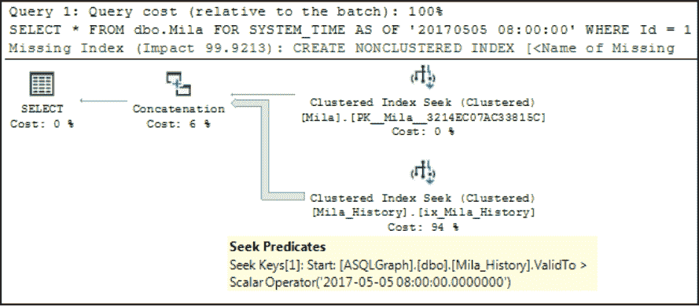

你可以看到计划中的 **Index Seek** 操作符，但计划效率不高，因为它使用 `ValidTo` 列作为过滤条件。观察执行参数：

```
SQL Server Execution Times:
   CPU time = 0 ms,  elapsed time = 0 ms.
SQL Server parse and compile time:
   CPU time = 0 ms,  elapsed time = 0 ms.

Table 'Mila_History'. Scan count 1, logical reads 10583, physical reads 0,
```

```
read-ahead reads 0, lob logical reads 0, lob physical reads 0, lob read-ahead reads 0.
Table 'Mila'. Scan count 0, logical reads 3, physical reads 0, read-ahead reads 0, lob logical reads 0, lob physical reads 0, lob read-ahead reads 0.
```

```
SQL Server Execution Times:
    CPU time = 188 ms,   elapsed time = 193 ms.
SQL Server parse and compile time:
    CPU time = 0 ms, elapsed time = 0 ms.
```

```
SQL Server Execution Times:
    CPU time = 0 ms,   elapsed time = 0 ms.
```

返回单行的查询耗时近 200 毫秒，SQL Server 必须读取超过 10,000 页才能生成此行！由于你已在过滤条件中使用了 Id 列，很明显你需要一个以该列为前导列的索引：

```
CREATE CLUSTERED INDEX ix_Mila_History ON dbo.Mila_History(Id, ValidTo, ValidFrom) WITH DROP_EXISTING;
```

当你再次执行相同的查询时，可以看到如下所示的执行计划：

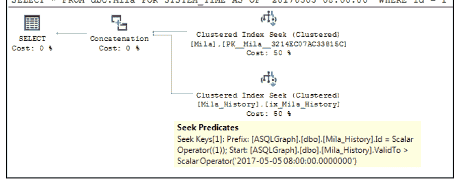

对历史表使用自定义索引的执行计划


我进行了一个简单测试：在将表转换为临时表之前和之后，分别更新表中不同数量的行。下图显示了此测试的结果。对于少量行（<1000），锁定、计算和将数据插入历史表会使更新速度降低50%。更新临时表中的50,000行所花费的时间大约是对同一张表（以非临时表方式实现）执行相同操作的8倍：

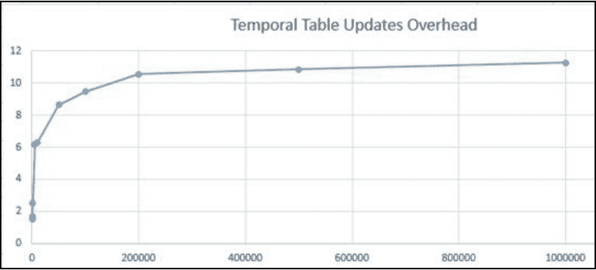

最后，对于大规模更新（>100K行），临时表的更新时间比非临时表慢10倍。

## 与内存优化表一起使用的临时表

系统版本控制的临时表也支持内存优化表。你可以为内存优化表指定或让SQL Server创建一个历史表。历史表必须是磁盘表，但这正是你所需要的；频繁使用（热）的数据保留在内存中，而冷数据可以驻留在磁盘表中。通过这种方法，你可以利用内存优化表提供的所有优势（高事务吞吐量、无锁并发），将其历史数据保存在基于磁盘的表中，并仅为活动数据集保留内存。下图显示了系统版本控制的内存优化表的架构。该图取自https://msdn.microsoft.com/en-us/library/mt590207.aspx的联机丛书页面：

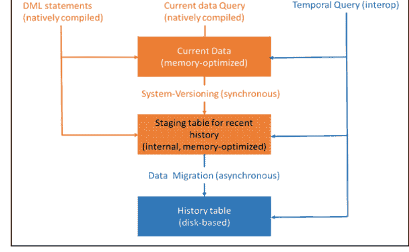

带内存优化表架构的系统版本控制的临时表（来源：SQL Server联机丛书）

如你所见，系统版本控制的临时表由三张表实现：

- **当前表** 是一张内存优化表，支持所有本机编译操作
- **近期历史表** 是一张内部内存优化表，同步处理当前表中的更改，并允许从本机编译代码中执行DML
- **历史表** 是一张磁盘表，包含当前表中的更改，并异步管理它们

历史数据是近期历史表和历史表中数据的并集。一条历史行要么位于暂存内存表中，要么位于磁盘表中；它不可能同时存在于两张表中。以下代码示例创建了一个新的内存优化临时表：

```
USE WideWorldImporters;
CREATE TABLE dbo.Product
(
    ProductId INT NOT NULL PRIMARY KEY NONCLUSTERED,
    ProductName NVARCHAR(50) NOT NULL,
    Price MONEY NOT NULL,
    ValidFrom DATETIME2 GENERATED ALWAYS AS ROW START HIDDEN NOT NULL,
    ValidTo DATETIME2 GENERATED ALWAYS AS ROW END HIDDEN NOT NULL,
    PERIOD FOR SYSTEM_TIME (ValidFrom, ValidTo)
)
WITH (MEMORY_OPTIMIZED = ON, DURABILITY = SCHEMA_AND_DATA,
SYSTEM_VERSIONING = ON (HISTORY_TABLE = dbo.ProductHistory));
```

执行此查询后，你会看到历史表是一张内存优化表。

```
SELECT CONCAT(SCHEMA_NAME(schema_id), '.', name) AS table_name,
is_memory_optimized, temporal_type_desc FROM sys.tables WHERE name IN ('Product', 'ProductHistory');
```

上述查询的结果如下：

| table_name | is_memory_optimized | temporal_type_desc |
|----------------|---------------------|--------------------|
| dbo.Product | 1 | SYSTEM_VERSIONED_TEMPORAL_TABLE |
| dbo.ProductHistory | 0 | HISTORY_TABLE |

现在，例如，你可以使用前面的过程添加两行并更新其中一行：

```
EXEC dbo.SaveProduct 1, N'Home Jersey Benfica', 89.95;
EXEC dbo.SaveProduct 2, N'Away Jersey Juventus', 89.95;
EXEC dbo.SaveProduct 1, N'Home Jersey Benfica', 79.95;
```

在内部，一切都完美运行；当前表和历史表都会被更新。以下是当前表和历史表中的结果数据集：

| ProductId | ProductName | Price |
|-----------|-------------|-------|
| 2 | Away Jersey Juventus | 89.95 |
| 1 | Home Jersey Benfica | 79.95 |

| ProductId | ProductName | Price | ValidFrom | ValidTo |
|-----------|-------------|-------|-----------|---------|
| 1 | Home Jersey Benfica | 89.95 | 2017-12-17 20:25:50 | 2017-12-17 20:25:51 |

历史数据的查询实际上处于SNAPSHOT隔离级别下，并且始终返回内存暂存缓冲区与基于磁盘的表之间的并集，且没有重复项。由于临时查询（使用FOR SYSTEM_TIME子句的查询）会涉及内存优化表和磁盘表，因此它们只能在互操作模式下使用；它们不能在本机编译存储过程中使用。

异步数据刷新任务会定期将内部内存优化暂存表中的数据移动到基于磁盘的历史表中。这种数据刷新机制的目标是将内部内存缓冲区保持在与其父对象内存消耗相比低于10%的水平。

当你向现有的非临时表添加系统版本控制时，预计更新和删除操作的性能会受到影响，因为历史表会自动更新。每次更新和删除都会记录在内部内存优化的历史表中，因此如果你的工作负载使用这两类操作，你可能会遇到意外的内存消耗。

## SQL Server 2017中缺少什么？

SQL Server 2016是第一个对临时数据提供一些内置支持的SQL Server版本。然而，即使在SQL Server 2017版本中，支持仍然相当基础。SQL Server 2016和2017仅支持系统版本控制的表。你在本章开头已经看到，应用程序版本控制的表，当然还有双时态表，会给临时问题增加更多复杂性。不幸的是，为了处理应用程序有效时间，你需要开发自己的解决方案，包括自行实现所有约束，并在此基础上强制实施数据完整性。此外，你还需要自行处理临时查询的优化。

在SQL Server 2017中，你可以定义历史行的保留期。因此，你不必像在SQL Server 2016中那样自行清理历史数据。尽管如此，如果能够定义希望保留的历史行的绝对最大数量，以及每行最大版本数，那将非常有用。这样，你就可以防止某些行频繁更新占据历史表的大部分空间，从而淹没那些不常更新的行的历史记录。

如果你熟悉分析应用程序和数据仓库，你可能会认为系统版本控制的临时表可以在分析场景中帮助你。然而，正如你将在下一节中了解到的（该节简要介绍数据仓库和缓慢变化维度问题），分析应用程序通常具有不同的粒度要求，而系统版本控制的临时表在此方面并无帮助。

## SQL Server 2016和2017的临时表与数据仓库

出于分析目的，**数据仓库**已经发展演变。数据仓库支持历史数据。你不应将数据仓库的历史数据与本章的主题——临时数据混淆。在数据仓库中，历史数据仅指过去已归档的非临时数据；典型的数据仓库保存5到10年的数据以供分析之用。数据仓库不适合业务应用程序，因为数据仓库通常没有约束。

数据仓库有一个简化的数据模型，由多个星型模式组成。你可以在下图中看到典型的星型模式：

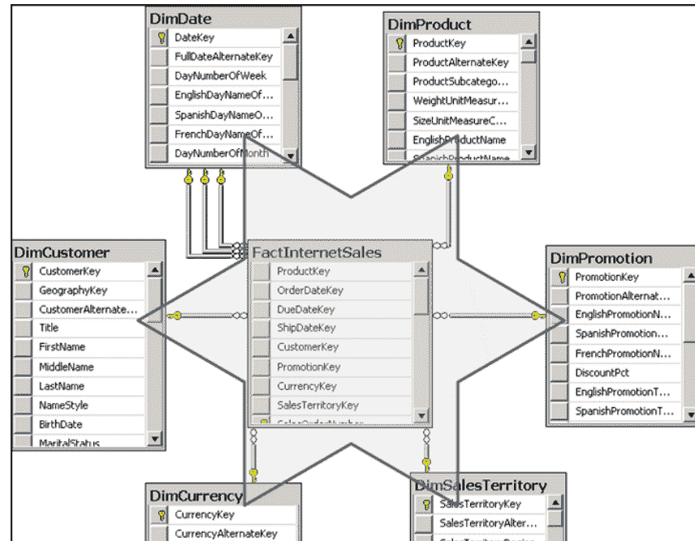

星型模式

一个模式覆盖一个业务领域。它由一张中心表（称为事实表）和多张周边表（称为维度表）组成。事实表始终位于每个关系的多端，与每个维度表相关联。星型模式是故意反规范化的。事实表包含度量，而维度表为这些度量提供上下文。共享维度表将数据仓库中的星型模式连接起来。


初看之下，SQL Server 系统版本化表似乎是使用类型 2 实现时解决 SCD 问题的方法。然而，这通常并非如此。在数据仓库中，大多数时候你需要实现混合方案：对某些属性使用类型 1，对其他属性使用类型 2。系统版本化表中的时间点粒度为 100 纳秒；在数据仓库中，典型的粒度为 1 天。在源系统中，同一个实体，如客户，可能一天内会被更新多次。你可以在同一天内为同一个实体拥有多条历史行。因此，在将数据从事务数据库传输到数据仓库时，你需要小心地传输每天的最后状态。下面的查询说明了这个问题：

```
USE WideWorldImporters;
SELECT PersonID, FullName,
    ValidFrom, ValidTo
FROM Application.People
    FOR SYSTEM_TIME ALL
WHERE IsEmployee = 1
    AND PersonID = 14;
```

在 WideWorldImporters 数据库中，Application.People 是一个系统版本化表。之前的查询返回了名为 Lily Code 的员工的所有行。以下是简化的结果：

| PersonID | FullName | ValidFrom | ValidTo |
| 14 | Lily Code | 2016-05-31 23:14:00.0000000 | 9999-12-31 23:59:59.9999999 |
| 14 | Lily Code | 2013-01-01 00:00:00.0000000 | 2013-01-01 08:00:00.0000000 |
| 14 | Lily Code | 2013-01-01 08:00:00.0000000 | 2013-01-19 08:00:00.0000000 |
| 14 | Lily Code | 2013-01-19 08:00:00.0000000 | 2013-02-14 08:00:00.0000000 |

你可以看到，这个人在单一天内有多行。例如，Lily 的两行 ValidTo 日期（仅日期部分）等于 2013-01-01。你需要仅选择每个员工每天的最后一行。这是通过以下查询完成的。你可以运行它并检查结果：

```
WITH PersonCTE AS
(
SELECT PersonID, FullName,
    CAST(ValidFrom AS DATE) AS ValidFrom,
    CAST(ValidTo AS DATE) AS ValidTo,
    ROW_NUMBER() OVER(PARTITION BY PersonID, CAST(ValidFrom AS Date)
        ORDER BY ValidFrom DESC) AS rn
FROM Application.People
    FOR SYSTEM_TIME ALL
```

聚集列存储索引可以具有更好的压缩。你将学习这些聚集和非聚集列存储索引如何压缩数据并提高查询性能。你还可以将列式索引与常规 B 树索引结合使用。此外，你将学习如何在聚集列存储索引中更新数据，特别是如何高效地插入新数据。最后，本章介绍了一种方法，使用列式索引与常规 B 树索引一起实现操作分析的解决方案。

本章将涵盖以下要点：

- SQL Server 中的数据压缩
- 用于分析查询的索引
- 用于分析查询的 T-SQL 支持
- 列式存储基础
- 非聚集列存储索引
- 使用聚集列存储索引
- 为具有 CCI 的表创建常规 B 树索引
- 发现对具有 CCI 的表的主键和外键的支持
- 发现批处理模式带来的额外性能改进
- 列存储索引查询性能
- 用于实时操作分析的列存储
- 列存储索引的数据加载

## SQL Server 中的分析查询

在 SQL Server 中支持分析应用程序与支持事务应用程序大不相同。用于报表查询的典型模式是星型模式。在星型模式中，有一个中心表称为 **事实表** 和多个周围表称为 **维度**。事实表始终位于与每个维度关系的多的那一侧。支持分析查询并使用星型模式设计的数据库称为 **数据仓库 (DW)**。详细处理数据仓库设计超出了本书的范围。尽管如此，仍有大量文献可供参考。快速入门，你可以阅读数据仓库概念 MSDN 博客，地址为

```
https://blogs.msdn.microsoft.com/syedab/2010/06/01/data-warehouse-concepts/.
```

WideWorldImportersDW 演示数据库实现了多个星型模式。下面的屏幕截图显示了此数据库中支持销售分析查询的表子集：

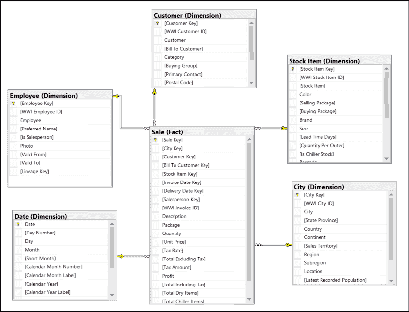

典型的分析查询需要海量数据，例如两年的销售数据，然后进行聚合。因此，索引查找相当罕见。大多数时候，你需要使用与事务环境中不同的技术来优化 IO 读取次数，在事务环境中，你大多有选择性查询，这些查询从索引查找中获益良多。列存储索引是 SQL Server 中分析查询的最新且可能是最重要的优化。然而，在深入列式存储之前，你应该熟悉其他优化数据仓库场景的技术和可能性。你在本节和即将到来的部分中学到的所有内容都将帮助你理解列存储索引的需求和实现。你将学习以下内容：

- 连接类型
- 位图过滤哈希连接
- 用于分析查询的 B 树索引
- 过滤的非聚集索引
- 表分区
- 索引视图
- 行压缩
- 页面压缩
- 适当的查询技术

## 连接和索引

SQL Server 通过一组物理运算符执行查询。由于这些运算符遍历行集，它们也称为迭代器。有不同的连接运算符，因为在执行连接时，SQL Server 使用不同的算法。SQL Server 支持三种基本算法：嵌套循环连接、合并连接和哈希连接。

嵌套循环算法是一个非常简单且在许多情况下高效的算法。SQL Server 使用一个表作为外循环，通常是行数最少的表。对于外输入中的每一行，SQL Server 在第二个表即内表中查找匹配行。SQL Server 使用连接条件来查找匹配行。连接可以是非等值连接，意味着等号运算符不需要是连接谓词的一部分。如果内表没有支持索引来执行查找，那么 SQL Server 将为外输入的每一行扫描内输入。这不是一个高效的场景。嵌套循环连接在 SQL Server 可以在内输入中执行索引查找时是高效的。

合并连接是一种非常高效的连接算法。然而，它也有其自身的局限性。它至少需要一个等值连接谓词，并且两侧的输入都已排序。这意味着合并连接应由连接中涉及的两个表上的索引支持。此外，如果一个输入远小于另一个，则嵌套循环连接可能比合并连接更高效。

在一对一或一对多场景中，合并连接只扫描两侧的输入一次。它首先在两侧找到第一行。如果未到达输入的末尾，合并连接检查连接谓词以确定行是否匹配。如果行匹配，则将它们添加到输出。然后算法检查另一侧的下一行并将它们添加到输出，直到它们匹配谓词。如果输入的行不匹配，则算法从值较低的一侧读取下一行。它从该侧读取并将行与另一侧的行进行比较，直到值大于另一侧的值。然后继续从另一侧读取，依此类推。在多对多场景中，合并连接算法使用工作表将一侧输入的行放在一边，以便在从另一输入接收重复匹配行时重复使用。

如果没有任何输入由索引支持并且使用了等值连接谓词，则哈希连接算法可能是最有效的。它使用一种名为哈希表的搜索结构。这不是你可以构建的搜索结构，就像用于索引的平衡树。SQL Server 内部构建哈希表。它使用 **哈希函数** 将较小输入的行拆分为 **桶**。这是构建阶段。SQL Server 使用较小的输入来构建哈希表，因为 SQL Server 希望将哈希表保留在内存中。如果它需要溢出到 tempdb 磁盘上，则算法可能会变得更慢。哈希函数创建大致大小相等的桶。

在哈希表构建完成后，SQL Server 对另一输入的每一行应用哈希函数。它检查行适合哪个桶。然后扫描该桶中的所有行。此阶段称为 **探测阶段**。

哈希连接是在创建完全平衡的树索引然后使用不同的连接算法和对另一输入的每一行执行一次输入一侧的完整扫描之间的一种妥协。至少在第一阶段，使用了适当桶的查找。你可能会认为哈希连接算法效率不高。在单线程模式下，它通常比由现有索引支持的合并和嵌套循环连接算法慢，这是真的。


然而，SQL Server 可以预先拆分探针输入的行。它可以将候选匹配特定哈希桶的行过滤下推到存储引擎。这种哈希连接的优化称为 **位图过滤哈希连接**。它通常用于数据仓库场景，在这种场景中，查询的输入可能很大且可能不受索引支持。此外，SQL Server 可以并行化查询执行并在多个线程中执行部分连接。在数据仓库场景中，并发用户数量很少的情况并不少见，因此 SQL Server 可以并行执行查询。虽然常规哈希连接也可以并行执行，但位图过滤哈希连接更高效，因为 SQL Server 可以使用位图从连接中涉及的较大表中提前消除连接中未使用的行。

在位图过滤哈希连接中，SQL Server 首先创建维度表中一组值的位图表示，以便预先过滤事实表中要连接的行。位图过滤器是一个由 *m* 位组成的位数组。最初，所有位都设置为 0。然后 SQL Server 定义 *k* 个不同的哈希函数。每个函数将某些集合元素映射到 *m* 个位置之一，并具有均匀的随机分布。哈希函数 *k* 的数量必须小于数组 *m* 中的位数。SQL Server 将维度键的值馈送到 *k* 个哈希函数中的每一个，以获取 *k* 个数组位置。它将这些位置上的所有位都设置为 1。然后 SQL Server 测试事实表中的外键。要测试某个元素是否在集合中，SQL Server 将其馈送到 *k* 个哈希函数中的每一个以获取 *k* 个数组位置。如果这些位置上的任何一位为 0，则该元素不在集合中。如果全部为 1，则该元素可能在集合中，也可能是在插入其他元素时位被设置为 1。以下图示显示了位图过滤过程：

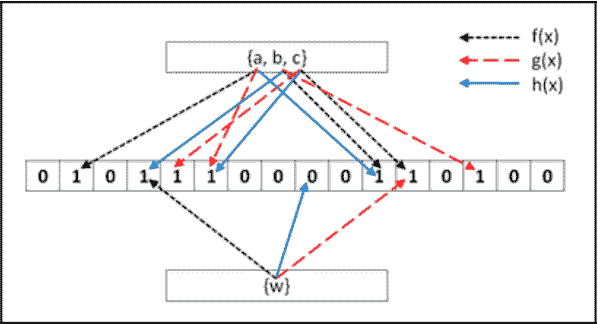

在前面的图中，位数组的长度 m 为 16。哈希函数 k 的数量为 3。当用集合 {a, b, c} 中的值馈送哈希函数时，该集合代表维度键，SQL Server 将位置 2、4、5、6、11、12 和 14 处的位设置为 1（从 1 开始编号位置）。然后 SQL Server 用较小集合底部的值 w {w} 馈送相同的哈希函数，该集合代表事实表中的键。函数将位置 4、9 和 12 处的位设置为 1。然而，位置 9 处的位设置为 0。因此，值 w 不在集合 {a, b, c} 中。


如果值 w 的所有位都设置为 1，则可能意味着值 w 在集合 {a, b, v} 中，也可能是巧合。

位图过滤器会返回所谓的假阳性。它们永远不会返回假阴性。这意味着当你声明探针值可能在集合中时，你仍然需要扫描集合并将其与集合中的每个值进行比较。位图过滤器返回的假阳性值越多，其效率就越低。请注意，如果事实表中探针侧的值已排序，则很容易避免大多数假阳性。

以下查询从本节前面介绍的表中读取数据并实现星型模式优化的位图过滤哈希连接：

```
USE WideWorldImportersDW;
SELECT cu.[Customer Key] AS CustomerKey, cu.Customer,
    ci.[City Key] AS CityKey, ci.City,
    ci.[State Province] AS StateProvince, ci.[Sales Territory] AS SalesTerritory,
    d.Date, d.[Calendar Month Label] AS CalendarMonth,
    d.[Calendar Year] AS CalendarYear,
    s.[Stock Item Key] AS StockItemKey, s.[Stock Item] AS Product, s.Color,
    e.[Employee Key] AS EmployeeKey, e.Employee,
    f.Quantity, f.[Total Excluding Tax] AS TotalAmount, f.Profit
FROM Fact.Sale AS f
    INNER JOIN Dimension.Customer AS cu
        ON f.[Customer Key] = cu.[Customer Key]
    INNER JOIN Dimension.City AS ci
        ON f.[City Key] = ci.[City Key]
    INNER JOIN Dimension.[Stock Item] AS s
        ON f.[Stock Item Key] = s.[Stock Item Key]
    INNER JOIN Dimension.Employee AS e
        ON f.[Salesperson Key] = e.[Employee Key]
    INNER JOIN Dimension.Date AS d
        ON f.[Delivery Date Key] = d.Date;
```

以下图示显示了执行计划的一部分。请注意，您可以根据 SQL Server 执行此查询时可用的资源差异获得不同的执行计划。您可以看到 Bitmap Create 操作符，它使用来自维度日期表的值进行馈送。事实表的过滤在 Hash Match 操作符中完成：

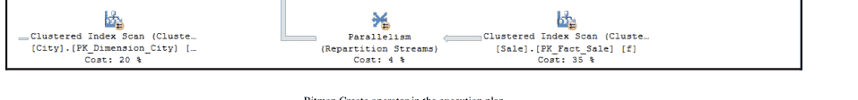

## 聚簇索引的好处

SQL Server 将表存储为堆或平衡树（B-tree）。如果您创建聚簇索引，表将作为 B-tree 存储。作为一般最佳实践，您应该使用聚簇索引存储每个表，因为将表存储为 B-tree 有许多优势，如下所列：

- 您可以使用 ALTER INDEX 命令使用 REBUILD 或 REORGANIZE 选项控制表碎片。
- 聚簇索引对于范围查询很有用，因为数据在键上逻辑排序。
- 您可以通过在不同的文件组上重新创建聚簇索引将表移动到另一个文件组。您不必像移动堆那样删除表。
- 聚簇键是所有非聚簇索引的一部分。如果表存储为堆，则行标识符存储在非聚簇索引中。短整型聚簇键比行标识符短，因此使非聚簇索引更高效。
- 您不能在查询中引用行标识符，但聚簇键通常是查询的一部分。这提高了覆盖查询的概率。覆盖查询是从一个或多个非聚簇索引读取所有数据而不访问基表的查询。这意味着读取更少，磁盘 IO 更少。

当聚簇键较短时，聚簇索引特别高效。创建具有长键的聚簇索引会使所有非聚簇索引效率降低。此外，聚簇键应该是唯一的。如果不是唯一，SQL Server 会通过向重复键添加一个 4 字节的顺序数字 **uniqueifier** 来使其唯一。uniqueifier 成为聚簇键的一部分，并在每个非聚簇索引中重复。这使键更长，所有索引效率更低。聚簇键如果不断递增则很有用。有了不断递增的键，即使表已包含数据，只要表没有额外的非聚簇索引，仍然可以进行最小日志记录的批量插入。

数据仓库代理键通常是聚簇索引的理想选择。因为是你定义它们，所以你可以尽可能高效地定义它们。使用带自动编号选项的整数。主键约束默认创建聚簇索引。此外，聚簇索引对于 **部分扫描** 非常有用。请记住，分析查询通常涉及大量数据，因此很少使用查找。但是，您可以通过查找找到第一个值，然后执行部分扫描，直到达到查询结果所需的最后一个值。许多分析查询使用日期过滤器；因此，日期列上的聚簇键可能非常适合此类查询。

您需要决定是优化表以进行数据加载还是查询。然而，通过分区，您可以同时获得两者——在没有不断递增列的聚簇键的情况下进行高效的数据加载，以及通过部分扫描进行更高效的查询。为了展示部分扫描的效率，让我们首先使用以下查询创建一个作为堆组织的新表：

```
```sql
SELECT 1 * 1000000 + f.[Sale Key] AS SaleKey,
    cu.[Customer Key] AS CustomerKey, cu.Customer,
    ci.[City Key] AS CityKey, ci.City,
    f.[Delivery Date Key] AS DateKey,
    s.[Stock Item Key] AS StockItemKey, s.[Stock Item] AS Product,
    f.Quantity, f.[Total Excluding Tax] AS TotalAmount, f.Profit
INTO dbo.FactTest
FROM Fact.Sale AS f
    INNER JOIN Dimension.Customer AS cu
        ON f.[Customer Key] = cu.[Customer Key]
    INNER JOIN Dimension.City AS ci
        ON f.[City Key] = ci.[City Key]
    INNER JOIN Dimension.[Stock Item] AS s
        ON f.[Stock Item Key] = s.[Stock Item Key]
    INNER JOIN Dimension.Date AS d
        ON f.[Delivery Date Key] = d.Date;
```
```


现在你可以在以下两个查询中打开 `STATISTICS IO` 来显示逻辑读数的数量：

```sql
SET STATISTICS IO ON;
-- All rows
SELECT *
FROM dbo.FactTest;
-- Date range
SELECT *
FROM dbo.FactTest
WHERE DateKey BETWEEN '20130201' AND '20130331';
SET STATISTICS IO OFF;
```

SQL Server 使用 Table Scan 操作符来执行这两个查询。对于两者，即使第二个查询在交付日期列上使用了过滤器，SQL Server 也执行了 5,893 次逻辑 IO。

请注意，本章中每个查询的逻辑 IO 结果可能会略有不同。然而，你应该能够注意到哪个查询更高效，哪个查询效率较低。

现在让我们在交付日期列上创建一个聚集索引：

```sql
CREATE CLUSTERED INDEX CL_FactTest_DateKey
ON dbo.FactTest (DateKey);
GO
```

如果执行相同的两个查询，对于第一个查询，使用聚集索引扫描操作符大约得到 6,091 次读取，而对于第二个查询，使用聚集索引查找操作符得到 253 次逻辑读取，该操作符找到查询所需的第一个值，然后执行部分扫描。

## 利用表分区

如果可以执行增量加载，那么加载即使非常大的事实表也不是问题。然而，这意味着源中的数据永远不应被更新或删除；数据只能被插入。对于 LOB 应用程序来说这种情况很少见。此外，即使你有执行增量加载的可能性，你也应该有一个参数化的提取、转换、加载（ETL）过程，以便你可以重新加载在早期加载中已加载的数据部分。源系统可能会出现问题，这意味着你将不得不重新加载历史数据。这种重新加载将要求你从 DW 中删除部分数据。

除非执行最小日志记录删除，否则删除大量事实表部分可能会花费太多时间。最小日志记录删除操作可以使用 `TRUNCATE TABLE` 命令完成；然而，在 SQL Server 的早期版本中，该命令会删除表中的所有数据，而删除所有数据通常是不可接受的。更常见的是，你只需要删除数据的一部分。借助 SQL Server 2016 和 2017，截断变得稍微容易一些，因为你可以截断一个或多个分区。

插入大量数据也可能花费太多时间。你可以执行最小日志记录插入，但正如你所知，最小日志记录插入有一些限制。其中其他限制之一是，表必须为空、没有索引，或者仅使用在不断增加（或不断减少）的键上的聚集索引，以便所有插入都发生在索引的一端。

你可以通过对表进行分区来解决所有这些问题。你可以使用分区表获得更好的查询性能，因为你可以将分区创建在不同驱动器上的不同文件组中，从而并行化读取。此外，SQL Server 查询优化器可以执行早期分区消除，因此 SQL Server 甚至不会触及查询结果集排除的数据分区。你还可以对文件组子集执行维护过程，从而对分区子集执行维护。这样，你也可以加快常规维护任务。分区有很多好处。

尽管你可以对任何属性进行表分区，但在数据仓库场景中按日期分区是最常见的。你可以使用任何时间间隔作为分区。取决于你的需求，间隔可以是一天、一个月、一年或任何其他间隔。

除了分区表之外，你还可以分区索引。如果索引与基本表以相同方式分区，则称为对齐索引。分区表和索引概念包括以下内容：

- **分区函数**：这是一个对象，通过使用特定列的值将行映射到分区。该函数使用的列称为**分区列**。分区函数执行逻辑映射。
- **分区方案**：分区方案将分区映射到文件组。分区方案执行物理映射。
- **对齐索引**：这是建立在与基本表相同的分区方案上的索引。如果所有索引都与其基本表对齐，则切换分区仅是元数据操作，因此非常快。列存储索引必须与其基本表对齐。不对齐的索引当然是与基本表分区方式不同的索引。
- **分区切换**：这是一个将数据块从一个表或分区切换到另一个表或分区的过程。你使用 `ALTER TABLE` T-SQL 命令切换数据。你可以执行以下类型的切换：
  - 将所有数据从非分区表重新分配到分区表的空现有分区。
  - 将分区表的分区切换到另一个分区表的分区。
  - 将分区表的一个分区中的所有数据重新分配到现有的空非分区表。
- **分区消除**：这是一个查询优化器过程，其中 SQL Server 仅访问满足查询过滤器所需的分区。

有关表和索引分区的更多信息，请参阅 MSDN *Partitioned Tables and Indexes* 文章 https://msdn.microsoft.com/en-us/library/ms190787.aspx。

## 分析场景中的非聚集索引

如前所述，DW 查询通常涉及大量数据的扫描和聚合。非常选择性的查找对于 DW 的报告来说并不常见。因此，非聚集索引通常对 DW 查询帮助不大。然而，这并不意味着你不应该在 DW 中创建任何非聚集索引。

维度的一个属性不是非聚集索引键的好候选。属性用于透视并且通常只包含少数不同的值。因此，基于属性值进行过滤的查询通常选择性不高。在维度属性上创建非聚集索引不是良好实践。

DW 报告可以参数化。例如，DW 报告可以根据最终用户的参数选择显示所有客户的销售情况或仅单个客户的销售情况。对于单个客户报告，用户将通过选择该客户的名称来选择客户。客户名称具有选择性，这意味着当按客户名称过滤时，你只检索少量行。公司名称例如通常是唯一的，因此通过按公司名称过滤，你通常只检索一行。对于此类报告，在名称列或列上创建非聚集索引可能会带来更好的性能。

你可以创建筛选的非聚集索引。筛选索引仅跨列值子集，因此适用于表行子集。当某些列值很少出现而其他值经常出现时，筛选非聚集索引很有用。在这种情况下，你只会对罕见值创建筛选索引。SQL Server 对罕见值使用此索引进行查找，但对频繁值执行扫描。筛选非聚集索引不仅对名称列和成员属性有用，对维度的属性，甚至事实表的外键也很有用。例如，在我们的演示事实表中，客户 ID 等于 378 的客户只有 242 行。你可以执行以下代码来显示即使你只选择该客户的数据，SQL Server 也会执行完全扫描：

```sql
SET STATISTICS IO ON;
-- All rows
SELECT *
FROM dbo.FactTest;
-- Customer 378 only
SELECT *
FROM dbo.FactTest
WHERE CustomerKey = 378;
SET STATISTICS IO OFF;
```

两个查询都需要 6,091 次逻辑读取。现在你可以向表中添加一个筛选的非聚集索引：

```sql
CREATE INDEX NCLF_FactTest_C378
    ON dbo.FactTest(CustomerKey)
    WHERE CustomerKey = 378;
GO
```

如果再次执行相同的两个查询，第二个查询的 IO 会少得多。在我的情况下，它需要 752 次逻辑读取，并使用索引查找和键查找操作符。

你可以使用以下代码在不再需要时删除筛选索引：

```sql
DROP INDEX NCLF_FactTest_C378
    ON dbo.FactTest;
GO
```


## 使用索引视图

通过永久存储聚合和联接后的数据，可以优化那些聚合数据并执行多次联接的查询。例如，你可以创建一个包含联接和聚合数据的新表，然后在 ETL 过程中维护该表。

但是，为联接和聚合数据额外建表并非最佳实践，因为使用这些表意味着你必须修改报表中使用的查询。幸运的是，还有另一种存储联接和聚合表的方式。你可以创建一个使用查询联接并聚合数据的视图，然后在该视图上创建聚集索引，从而得到索引视图。通过索引，你实际上是在物化视图；也就是说，你在物理上存储该视图被查询时返回的数据。在 SQL Server Enterprise 或 Developer 版本中，SQL Server 查询优化器会自动使用索引视图，而无需修改查询。SQL Server 也会自动维护索引视图。不过，为了加快数据加载速度，你可以在加载之前删除或禁用索引，然后在加载之后重新创建或重新生成索引。

例如，请注意以下查询，它聚合了测试事实表中的数据：

```sql
SET STATISTICS IO ON;
SELECT StockItemKey,
SUM(TotalAmount) AS Sales,
COUNT_BIG(*) AS NumberOfRows
FROM dbo.FactTest
GROUP BY StockItemKey;
SET STATISTICS IO OFF;
```

在我这里，这个查询使用了 6,685 次逻辑 I/O。它对事实表使用了聚集索引扫描运算符来检索整个数据集。现在，让我们用相同的查询作为视图定义来创建视图：

```sql
CREATE VIEW dbo.SalesByProduct
WITH SCHEMABINDING AS
SELECT StockItemKey,
SUM(TotalAmount) AS Sales,
COUNT_BIG(*) AS NumberOfRows
FROM dbo.FactTest
GROUP BY StockItemKey;
GO
```

索引视图有很多限制。其中之一是，如果要对视图创建索引，就必须使用 SCHEMABINDING 选项来创建视图，如前面的代码所示。现在，让我们为视图创建索引：

```sql
CREATE UNIQUE CLUSTERED INDEX CLU_SalesByProduct
ON dbo.SalesByProduct (StockItemKey);
GO
```

尝试再次执行创建视图之前的最后一个查询。请务必注意，该查询引用的是基表，而不是视图。这一次，查询只需要四次逻辑读。如果检查执行计划，你应该会看到 SQL Server 对索引视图使用了聚集索引扫描运算符。如果索引视图没有被自动使用，请检查你所使用的 SQL Server 版本。测试完成后，你可以使用以下代码删除视图：

```sql
DROP VIEW dbo.SalesByProduct;
GO
```

## 数据压缩与查询技术

SQL Server 支持数据压缩。数据压缩可以减小数据库的大小，这有助于提高查询性能，因为对压缩数据的查询会从磁盘读取更少的页，从而使用更少的 I/O。但是，数据压缩在更新时需要额外的 CPU 资源，因为更新前必须解压数据，更新后必须压缩数据。因此，数据压缩适用于数据仓库场景，在这些场景中，数据大多被读取，只是偶尔更新。

SQL Server 支持三种压缩实现方式：

- **行压缩**：行压缩通过以可变长度格式存储固定数据类型列来减少元数据开销。这包括字符串和数值数据。行压缩对 CPU 资源的影响很小，通常也适用于 OLTP 应用。

- **页压缩**：页压缩包含行压缩，但还增加了前缀压缩和字典压缩。**前缀压缩**将单个列中重复的值前缀存储在一个紧随页头之后的特殊压缩信息结构中，并用对相应前缀的引用代替重复的前缀值。**字典压缩**将页中任意位置的重复值存储在压缩信息区域。字典压缩不限于单个列。

- **Unicode 压缩**：在 SQL Server 中，Unicode 字符平均占用两个字节。Unicode 压缩为实际不需要两个字节的 Unicode 字符改用单字节存储。根据排序规则的不同，Unicode 压缩最多可以节省 Unicode 字符串原本所需空间的 50%。Unicode 压缩开销非常低，并且在你应用行压缩或页压缩时会自动应用。

在数据仓库中，你能从数据压缩中获益良多。外键在事实表中常常被重复多次。在名称列、成员属性和特性中包含 Unicode 字符串的大型维度可以从 Unicode 压缩中受益。

下图说明了字典压缩：

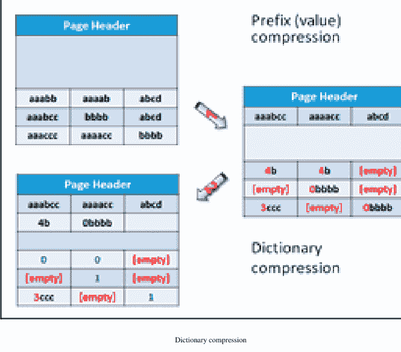

字典压缩

从图中可以看出，字典压缩从前缀压缩开始（对应第一个箭头）。在紧随页头之后的页面压缩信息空间中，可以找到为每一列存储的前缀。看左上角的单元格，第一行第一列的值是 aaabb。该列的下一个值是 aaabcc。该列在用于前缀压缩信息的行的第一列中存储了一个前缀值 aaabcc。左上角单元格不再存储原始值，而是存储 4b。这意味着使用该列前缀中的四个字符，再加上字母 b，即可还原原始值。第一列第二行的值为空，因为该列的前缀等于该位置的整个原始值。前缀压缩后，第一列最后一行的值是 3ccc，这意味着要获得原始值，需要从列前缀中取前三个字符并加上字符串 ccc，从而得到 aaaccc，这当然等于原始值。也可以检查另外两列的前缀压缩。

前缀压缩之后，应用字典压缩（对应该字典压缩插图中的第二个箭头）。它会检查所有列中的所有字符串，以查找公共子字符串。例如，应用前缀压缩后，第一行前两列的值是 4b。SQL Server 将此值存储在字典压缩信息区域中，作为该区域的第一个值，索引为 0。在单元格中，只存储索引值 0，而不是值 4b。对于 0bbbb 值也是如此，你可以在应用前缀压缩后的第二行第二列和第三行第三列中找到它。该值被存储在字典压缩信息区域的第二个位置，索引为 1；单元格中留下的是值 1。

你可能会想，为什么需要前缀压缩。对于字符串来说，前缀只是另一种子字符串，因此字典压缩也可以覆盖前缀。然而，前缀压缩也可以用于非字符串数据类型。例如，与其在原始数据中存储整数 900、901、902、903 和 904，不如存储一个前缀 900，并在原始单元格中留下值 0、1、2、3 和 4。

现在，来测试一下 SQL Server 压缩。首先，检查测试事实表所占用的空间：

```sql
EXEC sys.sp_spaceused N'dbo.FactTest', @updateusage = N'TRUE';
GO
```

结果如下：

| 名称 | 行数 | 保留大小 | 数据大小 | 索引大小 | 未使用大小 |
|------|------|----------|------|------------|--------|
| dbo.FactTest | 227981 | 49672 KB | 48528 KB | 200 KB | 944 KB |

下面的代码对表启用行压缩，并再次检查已用空间：

```sql
ALTER TABLE dbo.FactTest
  REBUILD WITH (DATA_COMPRESSION = ROW);
EXEC sys.sp_spaceused N'dbo.FactTest', @updateusage = N'TRUE';
```

这次的结果如下：

| 名称 | 行数 | 保留大小 | 数据大小 | 索引大小 | 未使用大小 |
|------|------|----------|------|------------|--------|
| dbo.FactTest | 227981 | 25864 KB | 24944 KB | 80 KB | 840 KB |

可以看到，节省了大量空间。接下来再看看页压缩：

```sql
ALTER TABLE dbo.FactTest
  REBUILD WITH (DATA_COMPRESSION = PAGE);
EXEC sys.sp_spaceused N'dbo.FactTest', @updateusage = N'TRUE';
```

现在表占用的空间更少了，如以下结果所示：

| 名称 | 行数 | 保留大小 | 数据大小 | 索引大小 | 未使用大小 |
|------|------|----------|------|------------|--------|
| dbo.FactTest | 227981 | 18888 KB | 18048 KB | 80 KB | 760 KB |

如果这些空间节省让你印象深刻，那就等着看列存储压缩吧！不管怎样，在继续之前，你可以使用以下代码移除测试事实表上的压缩：

```sql
ALTER TABLE dbo.FactTest
  REBUILD WITH (DATA_COMPRESSION = NONE);
```

在继续介绍支持分析的其他 SQL Server 功能之前，我想先解释另一种压缩算法，因为列存储压缩也会用到这种算法。该算法称为 LZ77 压缩。它由亚伯拉罕·兰佩尔（Abraham Lempel）和雅各布·齐夫（Jacob Ziv）于 1977 年发表；算法名称取自两位作者姓氏的首字母加上发表年份。该算法使用滑动窗口字典编码，也就是说，它用字典编码对输入流的各个块进行编码。该过程的步骤如下：

1. 将编码位置设置为输入流的起始位置


2. 在窗口中为前瞻缓冲区查找最长匹配
3. 如果找到匹配，则输出指针 P，并将编码位置（以及窗口）向前移动 L 个字节
4. 如果未找到匹配，则输出空指针和前瞻缓冲区中的第一个字节，并将编码位置（以及窗口）向前移动一个字节
5. 如果前瞻缓冲区不为空，则返回步骤 2

下图通过一个示例说明了这一过程：

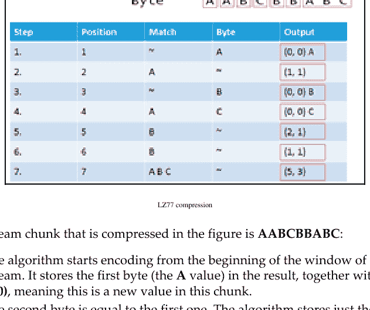

LZ77 压缩

图中被压缩的输入流块是 AABCBBABC：

- 算法从输入流窗口的起始位置开始编码。它将第一个字节（即 A 值）与指针 (0,0) 一起存储到结果中，表示这是该块中的一个新值。
- 第二个字节与第一个字节相同。算法只将指针 (1,1) 存储到输出中。这意味着，要重建这个值，你需要向后移动一个字节并读取一个字节。
- 接下来的两个值 B 和 C 都是新值，它们与指针 (0,0) 一起存储到输出中。
- 随后 B 值重复。因此存储指针 (2,1)，意思是需要向后移动两个字节并读取一个字节才能找到这个值。
- 接着 **B** 值再次重复。这次，你需要向后移动一个字节并读取一个字节来获得该值，因此该值被替换为指针 **(1,1)**。你可以看到，当你向后移动并读取值时，得到的是另一个指针。这样就形成了一个指针链。
- 最后，在流中找到了子字符串 **ABC**。这个子字符串同样可以在第 2 到第 4 个位置找到。因此，要重建这个子字符串，你需要向后移动五个字节并读取 3 个字节，指针 **(5,3)** 被存储在压缩输出中。

## 编写高效的查询

在结束本节之前，我还需要说明：如果你编写了低效的查询，那么 SQL Server 提供的任何连接、压缩算法或其他功能都无法帮到你。典型的数据仓库查询中有一个很好的例子就是涉及运行总计的查询。你可以使用非等值自连接来执行这类查询，而这正是低效查询的一个绝佳示例。下面的代码通过自连接，按销售键对利润进行排序并计算运行总计。该代码同时度量执行查询所需的 I/O 和时间。请注意，该查询首先使用一个 CTE（公用表表达式）从事实表中选择 12,000 行。非等值自连接是一种二次方算法；当行数翻倍时，所需时间会变为原来的四倍。你可以尝试不同的行数来验证这一点：

```sql
SET STATISTICS IO ON;
SET STATISTICS TIME ON;
WITH SalesCTE AS
(
SELECT [Sale Key] AS SaleKey, Profit
FROM Fact.Sale
WHERE [Sale Key] <= 12000
)
SELECT S1.SaleKey,
  MIN(S1.Profit) AS CurrentProfit,
  SUM(S2.Profit) AS RunningTotal
FROM SalesCTE AS S1
  INNER JOIN SalesCTE AS S2
    ON S1.SaleKey >= S2.SaleKey
GROUP BY S1.SaleKey
ORDER BY S1.SaleKey;
SET STATISTICS IO OFF;
SET STATISTICS TIME OFF;
```

对于 12,000 行数据，该查询在工作表中需要 817,584 次逻辑读取。工作表是自连接右侧测试事实表的临时表示；除此之外，事实表左侧的表示还需要超过 3,000 次逻辑读取。在我的计算机上，执行这个查询花费了超过 12 秒（已用时间），CPU 时间超过 72 秒，因为该查询使用了并行执行计划。如果是 6,000 行数据，该查询所需的 I/O 和时间大约只有原来的四分之一。

你可以使用窗口聚合函数非常高效地计算运行总计。下面的示例展示了重写后的查询。新查询使用的是窗口聚合函数：

```sql
SET STATISTICS IO ON;
SET STATISTICS TIME ON;
WITH SalesCTE AS
(
SELECT [Sale Key] AS SaleKey, Profit
FROM Fact.Sale
WHERE [Sale Key] <= 12000
)
SELECT SaleKey,
    Profit AS CurrentProfit,
    SUM(Profit)
        OVER(ORDER BY SaleKey
            ROWS BETWEEN UNBOUNDED PRECEDING
                AND CURRENT ROW) AS RunningTotal
FROM SalesCTE
ORDER BY SaleKey;
SET STATISTICS IO OFF;
SET STATISTICS TIME OFF;
```

这次，查询在事实表中使用了 331 次读取，工作表中使用了 0（零）次读取，已用时间 0.15 秒，CPU 时间 0.02 秒。SQL Server 甚至都懒得去寻找并行计划。

### 列存储与批处理

20 世纪 80 年代，多位研究人员开始思考**列存储**。其核心思想是，**关系数据库管理系统（RDBMS）**并不需要完全按照我们理解和操作数据的方式来存储数据。在关系模型中，元组代表一个实体，并作为表的一行存储，而表是实体集。传统上，数据库管理系统逐行存储实体。然而，只要客户端应用程序能取回行，我们并不在乎 RDBMS 如何存储数据。

这实际上是关系模型的主要前提之一——我们在逻辑层面上操作数据，而逻辑层面独立于物理存储的物理层面。然而，直到大约 2000 年，创建列存储的首次尝试才真正出现。SQL Server 首先在 2012 版本中加入了列存储。

列存储具有高度压缩性。更高的压缩率意味着更多的 CPU 使用，因为数据在你需要处理时必须解压缩，而在存储时必须重新压缩。此外，SQL Server 在处理数据时必须将列转换回行，而在存储数据时则反之。再加上并行化的查询执行，CPU 很快就会成为瓶颈。在事务型应用程序中，CPU 很少成为瓶颈。然而，分析型应用程序有着不同的需求。SQL Server 通过引入**批处理**来解决 CPU 问题。

在本节中，你将了解 SQL Server 列存储和批处理，包括以下内容：

- SQL Server 如何创建列存储
- 列存储压缩
- 非聚集列存储索引
- 聚集列存储索引
- SQL Server 不同版本中列存储的限制
- 批处理
- SQL Server 不同版本中批处理的限制

### 列存储与压缩

逐列存储数据（而不是逐行存储）使你能够以排序的方式存储每一列。假设每一列都已完全排序，那么对于每一次等值连接，都可以使用合并连接算法。如你所知，这是一种非常高效的算法。此外，对于已排序的数据，你还能免费获得一种额外的压缩方式——**游程编码（RLE）**压缩。

下图以图形方式说明了这一思想：

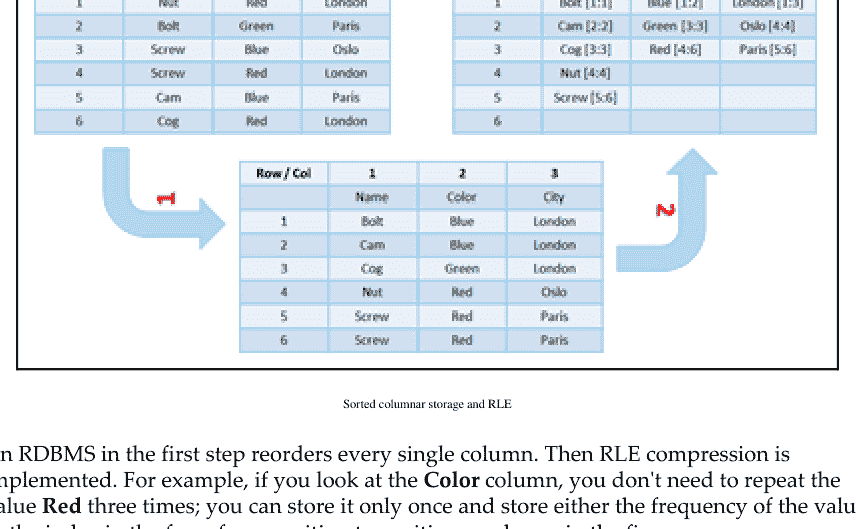

第一步，RDBMS 对每一列进行重新排序。然后应用 RLE 压缩。例如，查看 Color 列，你不需要将 Red 值重复三次；只需存储一次，并按照图中所示，存储该值的频率，或者以“从位置到位置”的形式存储索引。

请注意，SQL Server 并不实施完全排序。对每一列都进行完全排序代价实在太高。创建这样的存储会耗费太多时间和资源。SQL Server 使用其获得专利的行重排算法，该算法在一次数据遍历中，以最优方式重排行，从而尽可能对所有列进行排序。这意味着 SQL Server 不会对任何列进行完全排序，但所有列至少会部分排序。因此，SQL Server 并不以合并连接算法为目标，而是优先使用哈希连接算法。部分排序仍然可以优化位图过滤器的使用，因为与随机排列的值相比，位图过滤器返回的误报更少。RLE 压缩仍然可以大幅减小数据的大小。


在图中，顶部的表是行重建表。你从左上角开始重建行。对于第一行第一列的值，取底部列式存储表中左上角的值，在本例中该值为 **Bolt**。在行重建表的第一个单元格中，有一个指向该表中第二列行号的指针。此外，它还是列式存储表中第二列值的索引。在图中，该值为 **3**。这意味着你需要在列式存储表的第二列中查找索引为 **3** 的值，即 **Green**。在行重建表中，你在第二列第三行读取值 **5**。你将此值用作列式存储表中第三列值的索引，在示例中为 **Paris**。在行重建表中，你读取值 **1**。由于这是表中的最后一列，该值用于循环冗余校验，检查你是否能正确回到行重建过程的起点。行 **Bolt, Green, and Paris**，即来自前一图原始表的第二行，已成功重建。

如前所述，SQL Server 如何重建行并未公开。尽管如此，你可以体会到这是一个相当密集的过程。你也可以想象原始数据的变化。仅对原始值进行一次小更新就可能导致行重建表的完全重建。这将过于昂贵。这就是为什么一旦创建，列式存储实际上是只读的。在 SQL Server 2014 和 2016 中，列存储索引是可更新的；然而，SQL Server 不会在线更新列式存储。SQL Server 使用额外的行存储来处理更新。你将在本章后面学习更多细节。

## 列式存储创建过程

SQL Server 开始创建列式存储时，首先将数据拆分为 **rowgroups**。每个 rowgroup 的最大行数为 1,048,576。这里的想法是，像哈希连接算法将数据拆分为桶然后对数据的一部分执行较小的连接一样，耗时的行重排是在更小的数据集上完成的。SQL Server 在每个组中分别执行行重排。然后 SQL Server 对每一列进行编码和压缩。每个 rowgroup 中每一列的数据称为 **segment**。SQL Server 将段存储在数据库文件中的 blobs 中。因此，SQL Server 利用现有的存储来存储列式存储。

下图显示了该过程：

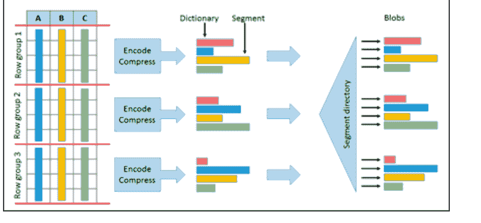

SQL Server 如何创建列式存储

SQL Server 实现不同的压缩算法：

- SQL Server 执行位打包。位打包类似于行压缩，只是推进了一层。不是存储表示该值所需的最小字节数，SQL Server 存储表示该值所需的最小位数。例如，对于行压缩，如果该值是整数，你会得到一个字节而不是四个字节来表示值 5。对于位打包，SQL Server 只用三个位（101）存储该值。
- 然后 SQL Server 使用值编码和字典编码将值编码为整数。值编码类似于页面压缩中的前缀编码，字典编码也是如此。因此，压缩的这一部分使用了页面压缩的思想。然而，列式存储的字典效率更高，因为它们是基于比页面压缩中字典更多的值构建的。对于页面压缩，你会为每个 8 KB 页面获得一个单独的字典。对于列式存储，你会为每个 rowgroup 获得一个字典，外加一个覆盖所有 rowgroup 的全局字典。
- 由于部分排序，游程长度编码算法也被使用。
- 最后，SQL Server 还可以使用 LZ77 算法压缩列式数据。

除 LZ77 之外的所有这些压缩算法在你创建列存储索引时都会自动实现。这称为 `COLUMNSTORE` 压缩。你必须手动打开 LZ77 压缩才能获得所谓的 `COLUMNSTORE_ARCHIVE` 压缩。

有了所有这些压缩算法的实现，你可以预期与原始未压缩的行存储相比至少有 10 倍的压缩。在现实中，你可以获得更好的压缩水平，尤其是在你也使用 LZ77 算法实现归档压缩时。

然而，压缩并不是大扫描的唯一优势。由于每一列都是单独存储的，SQL Server 只能检索查询所引用的列。这就像拥有一个覆盖非聚集索引一样。每个段还与其关联额外的元数据。此元数据包括段中的最小值和最大值。SQL Server 查询优化器可以使用此元数据进行早期段消除，就像 SQL Server 可以在表分区时进行早期分区消除一样。最后，你可以将分区与列存储索引结合起来以维护非常大的表。

## SQL Server 中列式存储的发展

SQL Server 在 2012 版本中引入了列式存储。仅支持 NCCI。这意味着你仍然需要原始行存储，无论是作为堆还是作为 **聚集索引 (CI)**。还有许多其他限制，包括以下内容：

- 仅非聚集列存储索引
- 每表一个
- 必须分区对齐
- 表变为只读（允许分区切换）
- 不支持的类型
  - 大于 18 位的小数
  - Binary, Image, CLR（包括 Spatial, HierarchyId）
  - (N)Varchar(max), XML, Text, Ntext
  - Uniqueidentifier, Rowversion, SQL_Variant
  - 大于 8 字节的日期/时间类型

SQL Server 2014 引入了 **聚集列存储索引 (CCI)**。这意味着原始行存储不再存在；CCI 是你唯一需要的存储。就像在常规聚集索引中一样，SQL Server 需要标识聚集列存储索引中的每一行。请注意，SQL Server 2014 不支持对列式存储的约束。因此，SQL Server 2014 添加了一个 **bookmark**，即 rowgroup 内部的唯一元组 ID，以简单的序列号存储。SQL Server 2014 对列式存储有许多不支持的数据类型，包括以下内容：

- Varbinary(MAX), Image, CLR（包括 Spatial, HierarchyId）
- (N)Varchar(max), XML, Text, Ntext
- Rowversion, SQL_Variant

SQL Server 2014 还优化了列存储索引的构建。例如，SQL Server 2012 使用固定数量的线程来构建索引。该数量是预先估计的。如果由于某种原因，操作系统在 SQL Server 构建列存储索引时从 SQL Server 取走了一些线程，构建可能会失败。在 SQL Server 2014 中，并行度或线程数可以在 SQL Server 构建列存储索引时动态调整。

SQL 2014 中的 CCI 是可更新的。然而，其列式存储是不可变的。下图解释了更新过程：

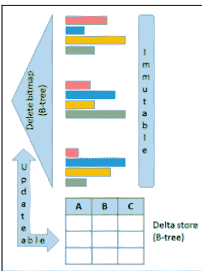

SQL Server 如何更新列式存储

数据修改实现如下：

- **Insert:** 新行插入到 delta store 中
- **Delete:** 如果要删除的行在列存储 row group 中，则将其 row ID 的记录插入到存储删除位图的 B-tree 中；如果它在 delta store 中，则该行将被简单删除
- **Update:** 拆分为删除和插入
- **Merge:** 拆分为删除、插入和更新

delta store 可以是打开或关闭的。当创建新的 delta store 时，它是打开的。在打开的 delta store 中插入一个 rowgroup 的最大行数后，SQL Server 将此 delta store 的状态更改为关闭。如果你记得，这意味着略多于一百万行。然后，一个名为 tuple-mover 的后台进程将关闭的 delta store 转换为列段。此过程默认每五分钟启动一次。你可以使用 ALTER INDEX ... REORGANIZE 或 ALTER INDEX ... REBUILD 命令手动运行它。


非批量（ trickle ）插入进入打开的 delta store。批量插入最多 102,400 行；较小的插入进入打开的 delta store，而较大的插入直接进入列段。更多的 delta store 意味着压缩率更低。因此，在使用批量插入时，你应该尝试优化批次，使其包含接近 1,000,000 行。你也可以偶尔重建索引。

SQL Server 2016 为列存储索引带来了许多额外功能。版本 2016 中最重要的功能包括以下内容：

- CCI 支持额外的 NCI（B-tree）索引
- CCI 通过 NCI 支持主键和外键约束
- CCI 支持快照和已提交读快照隔离级别
- NCCI 在堆或 B-tree 上可更新且可过滤
- 内存表上的列存储索引
- 在 CREATE TABLE 语句中创建表时定义
- 必须包含所有列和所有行（不可过滤）
- NCI 索引可以被过滤

与 2016 版本相比，SQL Server 2017 对列式存储只做了小的改进：

- 你可以在线构建和重建 NCCIs
- CCIs 现在支持 LOB 列：VARCHAR(MAX)、NVARCHAR(MAX) 和 VARBINARY(MAX)

## 批处理

使用列式存储时，CPU 可能成为瓶颈。SQL Server 通过 **批处理模式** 解决了这些问题。在批处理模式下，SQL Server 以批处理方式处理数据，而不是一次处理一行。批处理大致代表约 900 行数据。批处理中的每一列都以向量的形式存储在单独的内存区域中，这意味着批处理模式是基于向量的。批处理模式每批仅用一次元数据中断处理器，而行模式处理则是每行中断一次，这大大降低了 CPU 负担。这意味着批处理模式将元数据访问成本分摊到批处理中的 900 行上。

批处理模式与列式存储是正交的。这意味着 SQL Server 可以将其与许多不同的运算符一起使用，无论数据是存储在行存储还是列存储中。然而，批处理模式在与列式存储结合使用时效果最佳。DML 操作，如插入、更新或删除，以行模式工作。当然，SQL Server 可以在一个查询中混合批处理和行模式运算符。

SQL Server 在 2012 版本中也引入了批处理模式。该版本中的批处理模式运算符包括以下内容：

- Filter
- Project
- Scan
- Local hash（partial）聚合
- Hash inner join
- Batch hash table build，但仅限内存中，不支持溢出
- 位图过滤器仅限于单列，数据类型以 64 位整数表示

在 SQL Server 2014 中，添加了以下批处理模式运算符：

- 所有连接类型
- Union all
- 标量聚合
- 溢出支持
- 复杂位图过滤器，支持所有数据类型

SQL Server 2016 对批处理模式处理做了以下改进：

- 单线程查询
- Sort 运算符
- 多个不同计数操作
- 左反半连接运算符
- 窗口聚合函数
- 窗口分析函数
- 字符串谓词和聚合下推到存储引擎
- 对非聚集索引的索引查找进行行级锁定，以及对列存储的完整表扫描进行行组级锁定

最后，SQL Server 2017 对批处理模式处理增加了两个改进：

- 批处理模式自适应连接
- 批处理模式内存授予反馈

下表总结了 SQL Server 2012 至 2017 版本中列式存储和批处理模式处理最重要的功能和限制：

| Columnstore Index/Batch Mode Feature | SQL 2012 | SQL 2014 | SQL 2016 | SQL 2017 |
|---|---|---|---|---|
| Batch execution for multi-threaded queries | yes | yes | yes | yes |
| Batch execution for single-threaded queries |  |  | yes | yes |
| Batch mode adaptive joins |  |  |  | yes |
| Batch mode memory grant feedback |  |  |  | yes |
| Archival compression |  | yes | yes | yes |
| Snapshot isolation and read-committed snapshot isolation |  |  | yes | yes |
| Specify CI when creating a table |  |  | yes | yes |
| AlwaysOn supports CIs | yes | yes | yes | yes |
| AlwaysOn readable secondary supports read-only NCCI | yes | yes | yes | yes |
| AlwaysOn readable secondary supports updateable CIs |  |  | yes | yes |
| Read-only NCCI on heap or B-tree | yes | yes | yes | yes |
| Updateable NCCI on heap or B-tree |  |  | yes | yes |
| NCCI online build and rebuild |  |  |  | yes |
| B-tree indexes allowed on a table that has a NCCI | yes | yes | yes | yes |
| Updateable CCI |  | yes | yes | yes |
| CCI LOB columns support |  |  |  | yes |
| B-tree index on a CCI |  |  | yes | yes |
| CCI on a memory-optimized table |  |  | yes | yes |
| Filtered NCCI |  |  | yes | yes |

你可以通过分析执行计划中运算符的属性来检查 SQL Server 是否对运算符使用行模式或批处理模式。在检查批处理模式之前，以下代码将测试事实表中的行数增加了九倍：

```
DECLARE @i AS INT = 1;
WHILE @i < 10
BEGIN
SET @i += 1;
INSERT INTO dbo.FactTest
(SaleKey, CustomerKey,
Customer, CityKey, City,
DateKey, StockItemKey,
Product, Quantity,
TotalAmount, Profit)
SELECT @i * 1000000 + f.[Sale Key] AS SaleKey,
cu.[Customer Key] AS CustomerKey, cu.Customer,
ci.[City Key] AS CityKey, ci.City,
f.[Delivery Date Key] AS DateKey,
s.[Stock Item Key] AS StockItemKey, s.[Stock Item] AS Product,
f.Quantity, f.[Total Excluding Tax] AS TotalAmount, f.Profit
FROM Fact.Sale AS f
INNER JOIN Dimension.Customer AS cu
ON f.[Customer Key] = cu.[Customer Key]
INNER JOIN Dimension.City AS ci
ON f.[City Key] = ci.[City Key]
INNER JOIN Dimension.[Stock Item] AS s
ON f.[Stock Item Key] = s.[Stock Item Key]
INNER JOIN Dimension.Date AS d
ON f.[Delivery Date Key] = d.Date;
END;
```

让我们检查一下现在这个表使用了多少空间：

```
EXEC sys.sp_spaceused N'dbo.FactTest', @updateusage = N'TRUE';
GO
```

结果如下：

| Name | rows | reserved | data | index_size | unused |
|------------|--------|------------|------------|--------------|----------|
| dbo.FactTest | 2279810 | 502152 KB | 498528 KB | 2072 KB | 1552 KB |

现在让我们开始查询这个表。在执行以下查询之前，请确保打开实际执行计划：

```sql
SELECT f.StockItemKey,
    SUM(f.TotalAmount) AS Sales
FROM dbo.FactTest AS f
WHERE f.StockItemKey < 30
GROUP BY f.StockItemKey
ORDER BY f.StockItemKey;
```

你可以将鼠标悬停在任何运算符上。例如，以下屏幕截图显示了 Hash Match（Partial Aggregate）运算符的详细信息：

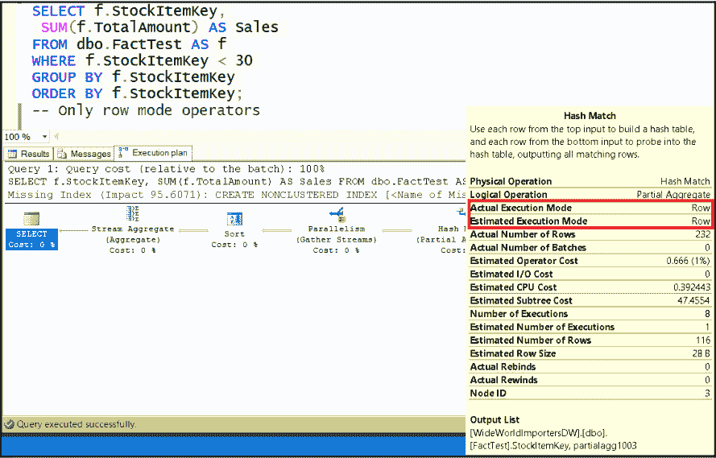

你可以看到 SQL Server 使用了行模式处理。如前所述，批处理模式并非严格绑定到列式存储；然而，随着你使用列式存储，SQL Server 使用它的可能性会更大。以下代码创建了一个过滤的非聚集列存储索引。它实际上是空的：

```sql
CREATE NONCLUSTERED COLUMNSTORE INDEX NCCI_FactTest
ON dbo.FactTest
    (SaleKey, CustomerKey,
     Customer, CityKey, City,
     DateKey, StockItemKey,
     Product, Quantity,
     TotalAmount, Profit)
WHERE SaleKey = 0;
GO
```

现在，再次执行相同的查询。如以下屏幕截图所示，这次 Hash Match（Partial Aggregate）运算符使用了批处理模式：

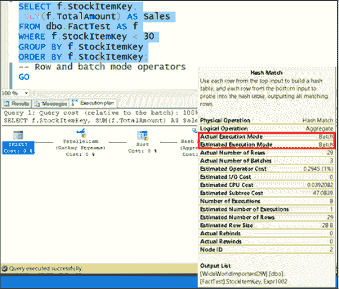

下一个查询涉及多个连接；我们称之为复杂查询：

```
SELECT f.SaleKey,
    f.CustomerKey, f.Customer, cu.[Buying Group],
    f.CityKey, f.City, ci.Country,
    f.DateKey, d.[Calendar Year],
    f.StockItemKey, f.Product,
    f.Quantity, f.TotalAmount, f.Profit
FROM dbo.FactTest AS f
    INNER JOIN Dimension.Customer AS cu
        ON f.CustomerKey = cu.[Customer Key]
    INNER JOIN Dimension.City AS ci
        ON f.CityKey = ci.[City Key]
    INNER JOIN Dimension.[Stock Item] AS s
        ON f.StockItemKey = s.[Stock Item Key]
    INNER JOIN Dimension.Date AS d
        ON f.DateKey = d.Date;
```

这次，SQL Server 创建了一个更复杂的执行计划，但 SQL Server 使用了完整的聚集索引扫描来读取测试事实表中的数据。SQL Server 在此表中使用了 62,575 次逻辑读取。

第三个测试查询非常具有选择性——它只选择客户 378 的行。如果记得的话，该客户在事实表中只有 242 行。我们称第三个查询为点查询：

```
SELECT CustomerKey, Profit
FROM dbo.FactTest
WHERE CustomerKey = 378;
SET STATISTICS IO OFF;
```

查询再次执行了完整的聚集索引扫描，并且有 63,601 次逻辑读取。


## 测试非聚集列存储索引

以下代码在事实表上创建 NCCI，这次没有过滤器，因此所有数据都包含在 NCCI 中：

```
```sql
CREATE NONCLUSTERED COLUMNSTORE INDEX NCCI_FactTest
ON dbo.FactTest
(SaleKey, CustomerKey,
 Customer, CityKey, City,
 DateKey, StockItemKey,
 Product, Quantity,
 TotalAmount, Profit);
GO
```
```

那么现在测试事实表使用了多少空间？让我们用以下代码再次检查：

```
```sql
EXEC sys.sp_spaceused N'dbo.FactTest', @updateusage = N'TRUE';
GO
```
```

| Name | rows | reserved | data | index_size | unused |
|---|---|---:|---:|---:|---:|
| dbo.FactTest | 2279810 | 529680 KB | 498528 KB | 29432 KB | 1720 KB |

注意这些数字。索引大小比数据大小小约 17 倍！而且请记住，在此之前报告的大小中也包含了聚集索引的非叶级别，因此实际压缩率甚至超过了 17 倍。这令人印象深刻。那么这对查询意味着什么？在测量查询改进之前，我想展示如何使用 SELECT 语句的 OPTION 子句中的特定选项忽略刚刚创建的 NCCI。所以这里有一个忽略 NCCI 的简单查询：

```
```sql
SET STATISTICS IO ON;
SELECT f.StockItemKey,
  SUM(f.TotalAmount) AS Sales
FROM dbo.FactTest AS f
WHERE f.StockItemKey < 30
GROUP BY f.StockItemKey
ORDER BY f.StockItemKey
OPTION (ignore_nonclustered_columnstore_index);
```
```

由于忽略了 NCCI，查询仍然执行了完整的聚集索引扫描，共 63,301 次逻辑读取。然而，你可以从执行计划中看到，这次使用了行模式运算符，如以下屏幕截图所示：

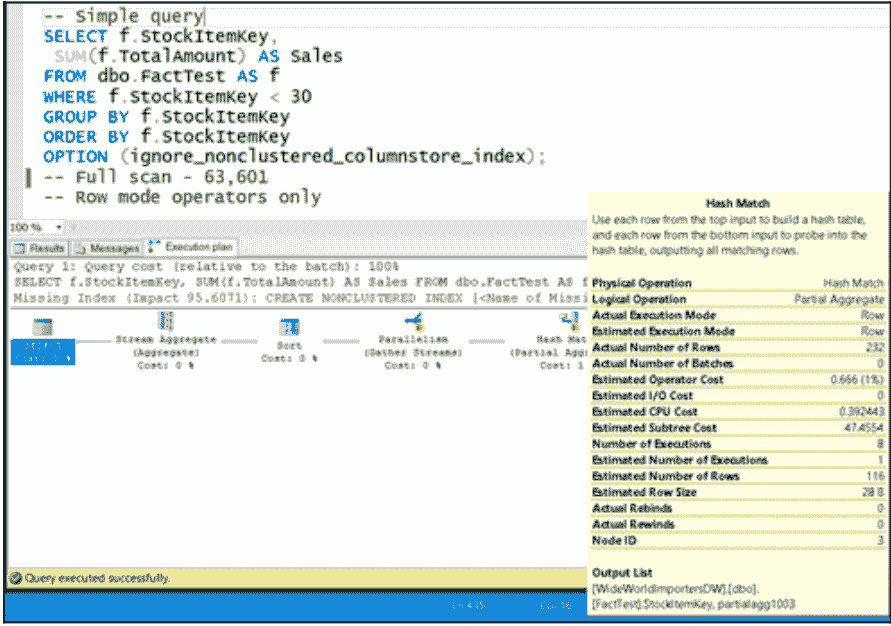

Row mode processing operators

这与 SQL Server 为 NCCI 为空时相同查询使用的执行计划不同，当时 SQL Server 使用了批处理模式运算符。忽略选项确实意味着 SQL Server 完全忽略 NCCI。你可以检查这对另外两个查询，复杂查询和点查询也是如此。你也可以使用复杂和点查询检查忽略 NCCI 时的执行计划：

```
-- Complex query
SELECT f.SaleKey,
    f.CustomerKey, f.Customer, cu.[Buying Group],
    f.CityKey, f.City, ci.Country,
    f.DateKey, d.[Calendar Year],
    f.StockItemKey, f.Product,
    f.Quantity, f.TotalAmount, f.Profit
FROM dbo.FactTest AS f
    INNER JOIN Dimension.Customer AS cu
        ON f.CustomerKey = cu.[Customer Key]
    INNER JOIN Dimension.City AS ci
        ON f.CityKey = ci.[City Key]
    INNER JOIN Dimension.[Stock Item] AS s
        ON f.StockItemKey = s.[Stock Item Key]
    INNER JOIN Dimension.Date AS d
        ON f.DateKey = d.Date
OPTION (ignore_nonclustered_columnstore_index);
-- Point query
SELECT CustomerKey, Profit
FROM dbo.FactTest
WHERE CustomerKey = 378
OPTION (ignore_nonclustered_columnstore_index);
SET STATISTICS IO OFF;
```

对于这两个查询，SQL Server 对事实表执行了全表扫描，在该表中有约 63,000 次逻辑读取。现在让我们终于看看查询如何从 NCCI 中受益。第一个查询再次是简单查询：

```
SET STATISTICS IO ON;
SELECT f.StockItemKey,
    SUM(f.TotalAmount) AS Sales
FROM dbo.FactTest AS f
WHERE f.StockItemKey < 30
GROUP BY f.StockItemKey
ORDER BY f.StockItemKey;
```

如以下屏幕截图所示，使用了列存储索引扫描，并且只读取了四个段，共 2,001 次 LOB 读取。请记住，列存储索引在 SQL Server 中以 blob 的形式存储。将此与忽略 NCCI 时的逻辑读取次数进行比较。你也可以自行检查是否使用了批处理模式运算符：

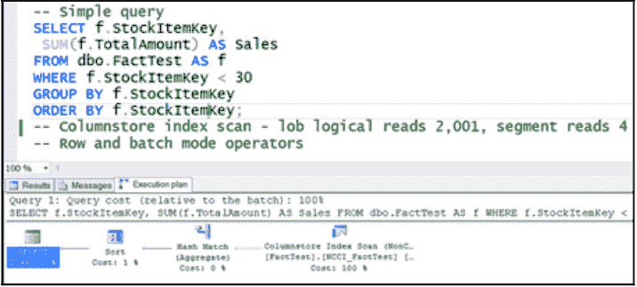

Row mode processing operators

你可以使用 `sys.column_store_segments` 目录视图通过以下查询检查 NCCI 总共占用了多少个段：

```
```sql
SELECT ROW_NUMBER()
       OVER (ORDER BY s.column_id, s.segment_id) AS rn,
       COL_NAME(p.object_id, s.column_id) AS column_name,
       s.segment_id, s.row_count,
       s.min_data_id, s.max_data_id,
       s.on_disk_size AS disk_size
FROM sys.column_store_segments AS s
INNER JOIN sys.partitions AS p
       ON s.hobt_id = p.hobt_id
INNER JOIN sys.indexes AS i
       ON p.object_id = i.object_id
WHERE i.name = N'NCCI_FactTest'
ORDER BY s.column_id, s.segment_id;
```
```

这是该查询的简略结果：

| rn | column_name | segment_id | row_count | min_data_id | max_data_id | disk_size |
| --- | --- | --- | --- | --- | --- | --- |
| 1 | SaleKey | 0 | 1048576 | 1000001 | 10106307 | 4194888 |
| 2 | SaleKey | 1 | 336457 | 1001951 | 10185925 | 1346560 |
| 3 | SaleKey | 2 | 441851 | 1106610 | 10227981 | 1768336 |
| 4 | SaleKey | 3 | 452926 | 1001228 | 10213964 | 1812656 |
| 5 | CustomerKey | 0 | 1048576 | 0 | 402 | 773392 |
| ... | ... | ... | ... | ... | ... | ... |
| 44 | Profit | 3 | 452926 | -64500 | 920000 | 25624 |
| 45 | NULL | 0 | 1048576 | 0 | 3539 | 1678312 |
| ... | ... | ... | ... | ... | ... | ... |
| 48 | NULL | 3 | 452926 | 0 | 3879 | 725640 |

使用的段总数为 48。SQL Server 创建了四个行组，然后在每个行组内为每列创建一个段，外加每个行组的行组字典一个段。你还可以看到每个段使用的行数和磁盘空间。此外，min_data_id 和 max_data_id 列指向每个段中的最小值和最大值。SQL Server 查询优化器使用此信息进行早期段消除。

你也可以执行另外两个查询：

```
-- Complex query
SELECT f.SaleKey,
    f.CustomerKey, f.Customer, cu.[Buying Group],
    f.CityKey, f.City, ci.Country,
    f.DateKey, d.[Calendar Year],
    f.StockItemKey, f.Product,
    f.Quantity, f.TotalAmount, f.Profit
FROM dbo.FactTest AS f
    INNER JOIN Dimension.Customer AS cu
        ON f.CustomerKey = cu.[Customer Key]
    INNER JOIN Dimension.City AS ci
        ON f.CityKey = ci.[City Key]
    INNER JOIN Dimension.[Stock Item] AS s
        ON f.StockItemKey = s.[Stock Item Key]
    INNER JOIN Dimension.Date AS d
        ON f.DateKey = d.Date;
-- Point query
SELECT CustomerKey, Profit
FROM dbo.FactTest
WHERE CustomerKey = 378;
SET STATISTICS IO OFF;
```

对于复杂查询，LOB 读取次数为 7,128。对于点查询，LOB 读取次数为 2,351。在这两种情况下，都使用了列存储索引扫描来从事实表中读取数据。点查询使用的 LOB 读取次数少于复杂查询，因为查询引用了更少的列，SQL Server 只检索满足查询所需的列。尽管如此，点查询的结果并不令人兴奋。你应该能够使用 B-tree 非聚集索引，尤其是覆盖索引获得更少的 IO。

在我这里，复杂查询使用了串行计划。请注意，根据硬件资源和并发工作，你可能会得到不同的执行计划。SQL Server 在我的虚拟机中看到八个逻辑处理器，所以你可能期望一个并行计划。SQL Server 2016 相比之前的版本在并行计划的使用上更为保守。这对大多数查询更好。如果你确实需要获得并行执行计划，你可以更改兼容级别为版本 2014，如以下代码所示：

```
USE master;
GO
ALTER DATABASE WideWorldImportersDW SET COMPATIBILITY_LEVEL = 120;
GO
```

现在你可以再次尝试执行复杂查询：

```
USE WideWorldImportersDW;
SET STATISTICS IO ON;
SELECT f.SaleKey,
       f.CustomerKey, f.Customer, cu.[Buying Group],
       f.CityKey, f.City, ci.Country,
       f.DateKey, d.[Calendar Year],
       f.StockItemKey, f.Product,
       f.Quantity, f.TotalAmount, f.Profit
FROM dbo.FactTest AS f
    INNER JOIN Dimension.Customer AS cu
        ON f.CustomerKey = cu.[Customer Key]
    INNER JOIN Dimension.City AS ci
        ON f.CityKey = ci.[City Key]
    INNER JOIN Dimension.[Stock Item] AS s
        ON f.StockItemKey = s.[Stock Item Key]
    INNER JOIN Dimension.Date AS d
        ON f.DateKey = d.Date;
SET STATISTICS IO OFF;
```


这次，SQL Server 在我的电脑上使用了并行执行计划。在继续之前，将兼容级别重置为 2017：

```sql
USE master;
GO
ALTER DATABASE WideWorldImportersDW SET COMPATIBILITY_LEVEL = 140;
GO
```

## 操作性分析

实时操作性分析在 SQL Server 2016 和 2017 中已成为一种可行的选择，尤其是在将列式存储与内存表结合使用时。下面仅简要概述了操作性分析的两种可能解决方案——一种使用磁盘存储，另一种使用内存存储。

下图显示了使用磁盘表的操作性分析解决方案的架构：

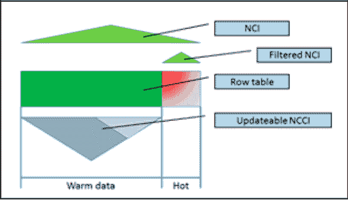

大多数数据变化不大（所谓的 **温数据**），甚至可能是历史的、不可变的数据（所谓的 **冷数据**）。对于这些温数据或冷数据，您可以使用经过筛选的非聚集列存储索引。对于 **热数据**——频繁更改的数据——您可以使用常规的经过筛选的非聚集索引。您也可以在整个表上使用额外的非聚集索引。表可以组织为堆或 B 树。

对于内存表，您可以实现略有不同的架构。您必须考虑到，内存表上的非聚集列存储索引不能被筛选。因此，它们必须同时覆盖温数据区域和热数据区域。然而，它们是可以更新的，并且内存更新比磁盘更新快得多。

您可以将列存储索引与其他内存索引类型结合使用，即哈希索引和非聚集索引。

内存操作性分析解决方案在下图中显示：

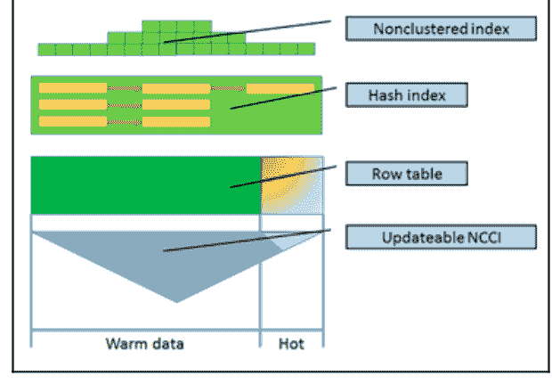

内存操作性分析

## 聚集列存储索引

在本章的最后几节中，您将学习如何管理 CCI。除优化查询性能外，您还将学习如何向 CCI 添加常规 B 树非聚集索引（NCI）并在主键或唯一约束代替使用它。在前几节中创建 NCCI 时，我们没有使用 LZ77 或归档压缩。在本节中，您将使用 CCI 使用它。总的来说，您将学习如何执行以下操作：

- 创建聚集列存储索引
- 使用归档压缩
- 向 CCI 添加 B 树 NCI

```
ON p.object_id = i.object_id
WHERE i.name = N'CCI_FactTest'
ORDER BY s.column_id, s.segment_id;
```

这次，段的数量为 44。CCI 不显示每个行组的字典段；它有一个全局字典，似乎覆盖了整个表。这对查询有何影响？

### 测试聚集列存储索引

再次，第一项测试是使用简单查询：

```
SET STATISTICS IO ON;
SELECT f.StockItemKey,
SUM(f.TotalAmount) AS Sales
FROM dbo.FactTest AS f
WHERE f.StockItemKey < 30
GROUP BY f.StockItemKey
ORDER BY f.StockItemKey;
```

从 IO 输出中，您可以看到 SQL Server 只使用了 82 次逻辑读取。这次，这真的令人印象深刻。请注意，执行计划再次使用了 Columnstore Index Scan 操作符，这次扫描 CCI 并仅选择满足查询的行组和段。您可以在以下屏幕截图中看到执行计划：

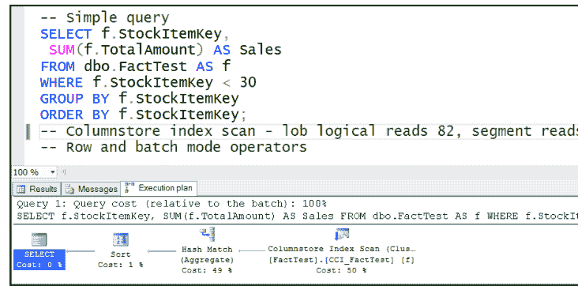

结果如下：

| Name | rows | reserved | data | index_size | unused |
| --- | --- | --- | --- | --- | --- |
| dbo.FactTest | 2279810 | 19528 KB | 19336 KB | 0 KB | 192 KB |

LZ77 算法增加了一些额外的压缩。将当前数据大小与初始数据大小 498,528 KB 进行比较；现在只有 19,336 KB。压缩率超过 25 倍！这真的令人印象深刻。当然，您会期望测试查询现在效率更高。例如，这里有一个简单查询：

```
SET STATISTICS IO ON;
SELECT f.StockItemKey,
SUM(f.TotalAmount) AS Sales
FROM dbo.FactTest AS f
WHERE f.StockItemKey < 30
GROUP BY f.StockItemKey
ORDER BY f.StockItemKey;
```

这次，SQL Server 只需要 23 次 LOB 逻辑读取。下一个要测试的查询是复杂查询：

```
SELECT f.SaleKey,
f.CustomerKey, f.Customer, cu.[Buying Group],
f.CityKey, f.City, ci.Country,
f.DateKey, d.[Calendar Year],
f.StockItemKey, f.Product,
f.Quantity, f.TotalAmount, f.Profit
FROM dbo.FactTest AS f
INNER JOIN Dimension.Customer AS cu
ON f.CustomerKey = cu.[Customer Key]
INNER JOIN Dimension.City AS ci
ON f.CityKey = ci.[City Key]
INNER JOIN Dimension.[Stock Item] AS s
ON f.StockItemKey = s.[Stock Item Key]
INNER JOIN Dimension.Date AS d
ON f.DateKey = d.Date;
```

这次，SQL Server 在测试事实表中需要 4,820 次 LOB 逻辑读取。对于扫描所有数据来说，这已经不能更好了。那点查询呢？：

```
SELECT CustomerKey, Profit
FROM dbo.FactTest
WHERE CustomerKey = 378;
```

这次，它使用了 410 次 LOB 逻辑读取。这个数字仍可改进。

## 添加 B 树索引和约束

仍有一个查询，即点查询，需要额外的优化。在 SQL Server 2016 和 2017 中，您可以在聚集列存储索引上创建常规的行存储 B 树非聚集索引，该表组织为列式存储。以下代码添加了一个包含列的非聚集索引，该索引将覆盖点查询：

```
CREATE NONCLUSTERED INDEX NCI_FactTest_CustomerKey
ON dbo.FactTest (CustomerKey)
INCLUDE (Profit);
GO
```

在执行查询之前，让我们检查演示事实表使用的空间：

```
EXEC sys.sp_spaceused N'dbo.FactTest', @updateusage = N'TRUE';
GO
```

结果如下：

| Name | rows | reserved | data | index_size | unused |
|------|------|----------|------|------------|--------|
| dbo.FactTest | 2279810 | 90256 KB | 19344 KB | 70192 KB | 720 KB |

您可以看到行存储使用的空间比列式存储多得多。然而，常规 NCI 对于查找非常高效。让我们测试查询，从简单查询开始：

```
SET STATISTICS IO ON;
SELECT f.StockItemKey,
SUM(f.TotalAmount) AS Sales
FROM dbo.FactTest AS f
WHERE f.StockItemKey < 30
GROUP BY f.StockItemKey
ORDER BY f.StockItemKey;
```

该查询仍需要 23 次 LOB 逻辑读取。如果您检查执行计划，您可以看到 SQL Server 仍在使用列存储索引扫描。当然，对于此查询，NCI 并没有多大用处。那复杂查询呢？：

```
SELECT f.SaleKey,
f.CustomerKey, f.Customer, cu.[Buying Group],
f.CityKey, f.City, ci.Country,
f.DateKey, d.[Calendar Year],
f.StockItemKey, f.Product,
f.Quantity, f.TotalAmount, f.Profit
FROM dbo.FactTest AS f
INNER JOIN Dimension.Customer AS cu
ON f.CustomerKey = cu.[Customer Key]
INNER JOIN Dimension.City AS ci
    ON f.CityKey = ci.[City Key]
INNER JOIN Dimension.[Stock Item] AS s
    ON f.StockItemKey = s.[Stock Item Key]
INNER JOIN Dimension.Date AS d
    ON f.DateKey = d.Date;
```

再次，SQL Server 在测试事实表中需要 4,820 次 LOB 逻辑读取。NCI 并未改进此查询；它已经得到优化。最后，让我们检查点查询：

```
SELECT CustomerKey, Profit
FROM dbo.FactTest
WHERE CustomerKey = 378;
SET STATISTICS IO OFF;
```

这次，查询只需要 13 次逻辑读取。SQL Server 查询优化器决定使用覆盖 NCI 索引，如以下屏幕截图所示，显示了本次执行的点查询的执行计划：

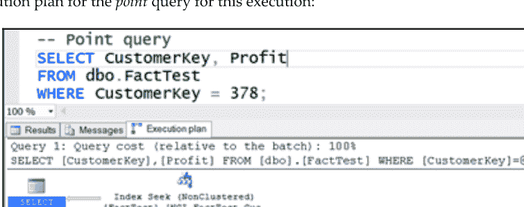

使用非聚集覆盖索引的点查询的执行计划

我们不再需要非聚集索引了，所以让我们将其删除：

```
DROP INDEX NCI_FactTest_CustomerKey
ON dbo.FactTest;
GO
```

您可以使用 sys.dm_db_column_store_row_group_physical_stats 动态管理视图（DMV）检查 CCI 的行组的物理状态，如以下查询所示：

```
SELECT OBJECT_NAME(object_id) AS table_name,
    row_group_id, state, state_desc,
    total_rows, deleted_rows
FROM sys.dm_db_column_store_row_group_physical_stats
WHERE object_id = OBJECT_ID(N'dbo.FactTest')
ORDER BY row_group_id;
```

以下是结果：

| table_name | row_group_id | state | state_desc | total_rows | deleted_rows |
|------------|--------------|-------|------------|------------|--------------|
| FactTest   | 0            | 3     | COMPRESSED | 1048576    | 0            |
| FactTest   | 1            | 3     | COMPRESSED | 343592     | 0            |
| FactTest   | 2            | 3     | COMPRESSED | 444768     | 0            |
| FactTest   | 3            | 3     | COMPRESSED | 442874     | 0            |

您可以看到所有行组都已关闭并压缩。

在 SQL 2016 和 2017 中，您还可以向 CCI 表添加主键和唯一约束。以下代码向测试事实表添加唯一约束。请注意，您无法添加主键约束，因为 SaleKey 列可为空：

```
ALTER TABLE dbo.FactTest
ADD CONSTRAINT U_SaleKey UNIQUE (SaleKey);
GO
```


你可以在对象资源管理器中检查，唯一约束借助唯一的行存储非聚集索引得到强制执行。下面的对象资源管理器窗口截图显示 SaleKey 列也是可空的：

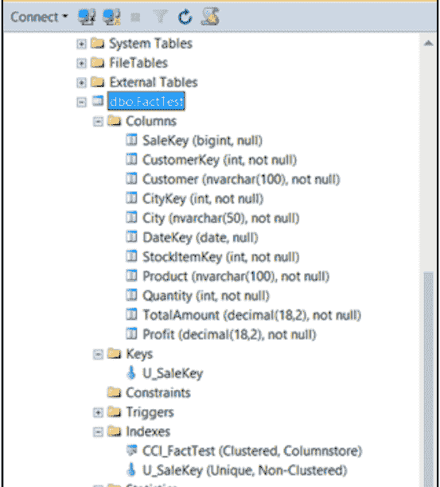

CCI 表上的唯一约束

让我们测试该约束。下面的命令尝试向已存在于表中的测试事实表中插入 75,993 行：

```
INSERT INTO dbo.FactTest
(SaleKey, CustomerKey,
Customer, CityKey, City,
DateKey, StockItemKey,
Product, Quantity,
TotalAmount, Profit)
SELECT 10 * 1000000 + f.[Sale Key] AS SaleKey,
    cu.[Customer Key] AS CustomerKey, cu.Customer,
    ci.[City Key] AS CityKey, ci.City,
    f.[Delivery Date Key] AS DateKey,
    s.[Stock Item Key] AS StockItemKey, s.[Stock Item] AS Product,
    f.Quantity, f.[Total Excluding Tax] AS TotalAmount, f.Profit
FROM Fact.Sale AS f
    INNER JOIN Dimension.Customer AS cu
        ON f.[Customer Key] = cu.[Customer Key]
    INNER JOIN Dimension.City AS ci
        ON f.[City Key] = ci.[City Key]
    INNER JOIN Dimension.[Stock Item] AS s
        ON f.[Stock Item Key] = s.[Stock Item Key]
    INNER JOIN Dimension.Date AS d
        ON f.[Delivery Date Key] = d.Date
WHERE f.[Sale Key] % 3 = 0;
```

如果执行该代码，你会得到错误 2627，违反唯一约束。让我们重新检查行组的状况：

```
SELECT OBJECT_NAME(object_id) AS table_name,
    row_group_id, state, state_desc,
    total_rows, deleted_rows
FROM sys.dm_db_column_store_row_group_physical_stats
WHERE object_id = OBJECT_ID(N'dbo.FactTest')
ORDER BY row_group_id;
```

这次，结果略有不同：

| table_name | row_group_id | state | state_desc | total_rows | deleted_rows |
|------------|--------------|-------|------------|------------|--------------|
| FactTest   | 0            | 3     | COMPRESSED | 1048576    | 0            |
| FactTest   | 1            | 3     | COMPRESSED | 343592     | 0            |
| FactTest   | 2            | 3     | COMPRESSED | 444768     | 0            |
| FactTest   | 3            | 3     | COMPRESSED | 442874     | 0            |
| FactTest   | 4            | 1     | OPEN       | 0          | 0            |

尽管插入被拒绝，SQL Server 并未关闭或删除增量存储。当然，这是有意义的，因为该存储很快可能对数据更新有用。你可以重建索引以清除该增量存储。下面的命令重建 CCI，这次不使用归档压缩：

```
ALTER INDEX CCI_FactTest
ON dbo.FactTest
REBUILD WITH (DATA_COMPRESSION = COLUMNSTORE);
GO
```

你可以再次检查行组的状态：

```sql
SELECT OBJECT_NAME(object_id) AS table_name,
  row_group_id, state, state_desc,
  total_rows, deleted_rows
FROM sys.dm_db_column_store_row_group_physical_stats
WHERE object_id = OBJECT_ID(N'dbo.FactTest')
ORDER BY row_group_id;
```

结果如下：

| table_name | row_group_id | state | state_desc | total_rows | deleted_rows |
|------------|--------------|-------|------------|------------|--------------|
| FactTest   | 0            | 3     | COMPRESSED | 1048576    | 0            |
| FactTest   | 1            | 3     | COMPRESSED | 343592     | 0            |
| FactTest   | 2            | 3     | COMPRESSED | 444768     | 0            |
| FactTest   | 3            | 3     | COMPRESSED | 442874     | 0            |


> 请注意，你在每个行组中行数的结果可能会略有不同。

## 更新聚集列存储索引

到目前为止，只测试了不成功的插入。当然，你也可以尝试插入一些有效数据。在此之前，让我们先删除约束，因为它对后续解释不是必需的：

```sql
ALTER TABLE dbo.FactTest
  DROP CONSTRAINT U_SaleKey;
GO
```

接下来，你可以插入一些有效的行。下面的语句向测试事实表插入 113,990 行。请注意，这超过了涓滴插入的 102,400 行限制；因此，你应该期望它被视为批量插入：

```sql
INSERT INTO dbo.FactTest
  (SaleKey, CustomerKey,
   Customer, CityKey, City,
   DateKey, StockItemKey,
   Product, Quantity,
   TotalAmount, Profit)
SELECT 11 * 1000000 + f.[Sale Key] AS SaleKey,
  cu.[Customer Key] AS CustomerKey, cu.Customer,
  ci.[City Key] AS CityKey, ci.City,
  f.[Delivery Date Key] AS DateKey,
  s.[Stock Item Key] AS StockItemKey, s.[Stock Item] AS Product,
  f.Quantity, f.[Total Excluding Tax] AS TotalAmount, f.Profit
FROM Fact.Sale AS f
INNER JOIN Dimension.Customer AS cu
    ON f.[Customer Key] = cu.[Customer Key]
INNER JOIN Dimension.City AS ci
    ON f.[City Key] = ci.[City Key]
INNER JOIN Dimension.[Stock Item] AS s
    ON f.[Stock Item Key] = s.[Stock Item Key]
INNER JOIN Dimension.Date AS d
    ON f.[Delivery Date Key] = d.Date
WHERE f.[Sale Key] % 2 = 0;
```

你可以通过再次检查行组来检查这是否是一次批量插入：

```
SELECT OBJECT_NAME(object_id) AS table_name,
    row_group_id, state, state_desc,
    total_rows, deleted_rows
FROM sys.dm_db_column_store_row_group_physical_stats
WHERE object_id = OBJECT_ID(N'dbo.FactTest')
ORDER BY row_group_id;
```

结果显示你只有压缩的行组：

| table_name | row_group_id | state | state_desc | total_rows | deleted_rows |
|------------|--------------|-------|------------|------------|--------------|
| FactTest   | 0            | 3     | COMPRESSED | 1048576    | 0            |
| FactTest   | 1            | 3     | COMPRESSED | 343592     | 0            |
| FactTest   | 2            | 3     | COMPRESSED | 444768     | 0            |
| FactTest   | 3            | 3     | COMPRESSED | 442874     | 0            |
| FactTest   | 4            | 3     | COMPRESSED | 113990     | 0            |

尽管所有行组都是压缩的，你会注意到最后的行组中的行数比其他行组少。如果能使用更多行、接近 1,000,000 行的批量插入会更高效。现在让我们尝试插入较少数量的行。这次，你也可以打开图形执行计划：

```
INSERT INTO dbo.FactTest
(SaleKey, CustomerKey,
Customer, CityKey, City,
DateKey, StockItemKey,
Product, Quantity,
TotalAmount, Profit)
SELECT 12 * 1000000 + f.[Sale Key] AS SaleKey,
    cu.[Customer Key] AS CustomerKey, cu.Customer,
    ci.[City Key] AS CityKey, ci.City,
    f.[Delivery Date Key] AS DateKey,
    s.[Stock Item Key] AS StockItemKey, s.[Stock Item] AS Product,
    f.Quantity, f.[Total Excluding Tax] AS TotalAmount, f.Profit
FROM Fact.Sale AS f
    INNER JOIN Dimension.Customer AS cu
        ON f.[Customer Key] = cu.[Customer Key]
    INNER JOIN Dimension.City AS ci
        ON f.[City Key] = ci.[City Key]
    INNER JOIN Dimension.[Stock Item] AS s
        ON f.[Stock Item Key] = s.[Stock Item Key]
    INNER JOIN Dimension.Date AS d
        ON f.[Delivery Date Key] = d.Date
WHERE f.[Sale Key] % 3 = 0;
```

在执行中，你可以看到插入是一个行模式操作。SQL Server 不会为 DDL 操作使用批处理模式运算符。下面的截图显示了执行计划的一部分，其中突出显示了列存储索引插入运算符，以显示使用了行模式处理：

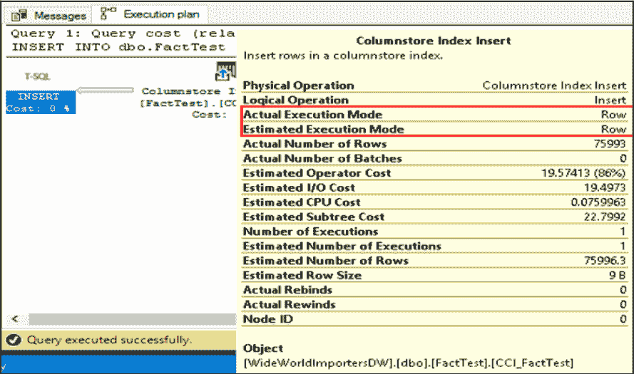

DDL 操作在 SQL Server 2016 中以行模式处理

在结束本章之前，请查看下表，总结了不同版本行存储和列存储所需的空间：

| Storage | Rows | Reserved | Data | Index |
|---|---:|---:|---:|---:|
| CI | 227,981 | 49,672 KB | 48,528 KB | 200 KB |
| CI row compression | 227,981 | 25,864 KB | 24,944 KB | 80 KB |
| CI page compression | 227,981 | 18,888 KB | 18,048 KB | 80 KB |
| CI (10 times more rows) | 2,279,810 | 502,152 KB | 498,528 KB | 2,072 KB |
| CI with NCCI | 2,279,810 | 529,680 KB | 498,528 KB | 29,432 KB |
| CCI | 2,279,810 | 23,560 KB | 23,392 KB | 0 KB |
| CCI archive compression | 2,279,810 | 19,528 KB | 19,336 KB | 0 KB |
| CCI archive compression and NCI | 2,279,810 | 90,256 KB | 19,344 KB | 70,192 KB |

## 总结

列存储为 SQL Server 带来了全新的可能性。你可以直接从数据仓库获得分析查询的闪电般性能，而无需特殊的分析数据库管理系统。本章首先描述了除列存储外支持 SQL Server 中分析查询的特性。你可以使用行或页数据压缩级别、位图过滤哈希连接、过滤索引、索引视图、窗口分析与聚合函数、表分区等。然而，列存储增加了额外的压缩和性能提升级别。你了解了列存储提供的出色压缩背后的算法。本章还包含大量代码，展示了如何创建和使用非聚集和聚集列存储索引，包括更新数据、创建约束以及添加额外的 B 树非聚集索引。


