## SSIS 2016 中的新增功能

本章将介绍以下操作指南：

- 创建 SSIS 目录
- 自定义日志记录
- Azure 任务和转换
- 增量包部署
- 多版本支持
- 错误列名
- 控制流模板

### 简介

SQL Server Integration Services 的 2016 版本是该软件的一次重大修订。但是，它不是对产品的完全重写，而更像是产品的演进。以下是自 SSIS 在 SQL Server 7.0（1998 年）中诞生以来的时间线：

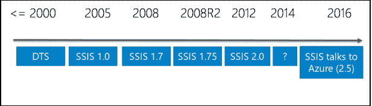

## 如何操作...

- 1. 我们首先在 SSMS 中创建 SSIS 目录。打开 SSMS 并连接到本地实例：

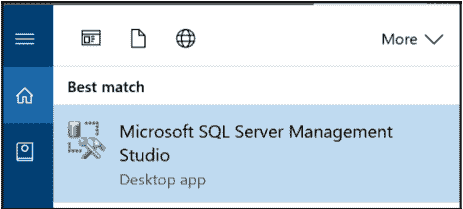

- 2. 在对象资源管理器中找到 Integration Services Catalogs 文件夹。

- 3. 右键单击它，然后选择选项“创建目录...”。

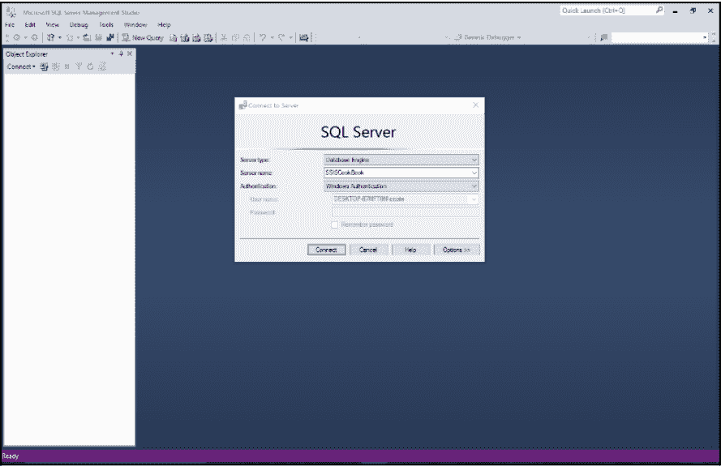

4. 如果**创建目录...**选项不可用（已禁用 - 灰色显示），则表示目录已经创建。即使该文件夹被称为 `Integration Services Catalogs`（复数），SQL Server 实例也只能创建一个 Integration Services 目录。将出现**创建目录**对话框：

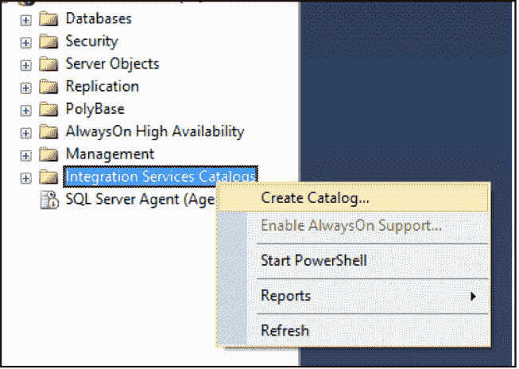

5. 必须启用 SQL Server CLR 才能创建目录。同时，勾选**在 SQL Server 启动时自动执行 Integration Services 存储过程**也是一种好的做法。这将创建一个清理 SSIS 目录表的作业。要启用该作业，必须启用并启动 SQL Server Agent。要启用 SQL Server Agent，请右键单击**SQL Server Agent**，然后从出现的上下文菜单中选择**启动**。

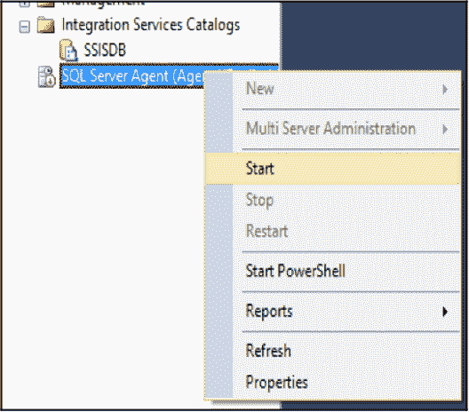

6. 出现一个确认屏幕，以确认我们想要启动该代理：

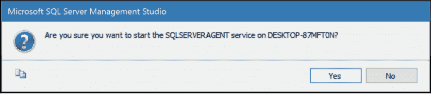

11. 要管理保留期，请在 SSMS 对象资源管理器中右键单击目录（SSISDB），然后从下拉菜单中选择**属性**。将出现以下窗口：

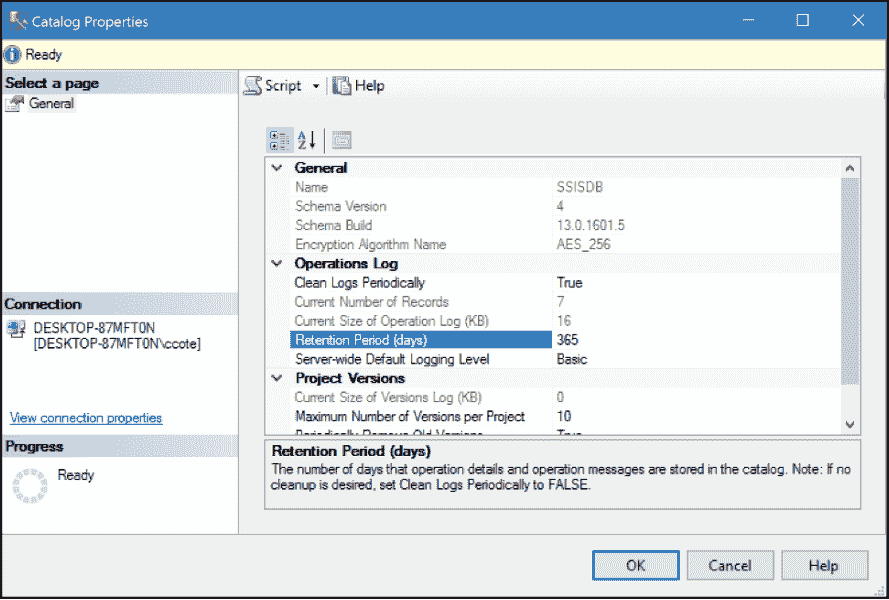

12. 现在你可以修改**保留期（天）**属性，如前面的截图所示。请注意，你还可以通过将**定期清理日志**设置为**False** 来停止清理日志的计划。

## 自定义日志记录

本节将讨论各种日志记录，以及我们如何根据日志信息的需求自定义日志记录。我们需要日志记录的原因是我们想要检索有关包执行的一些信息。

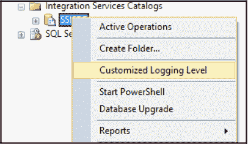

- 2. 出现以下界面。单击**创建**按钮以创建自定义日志记录级别：

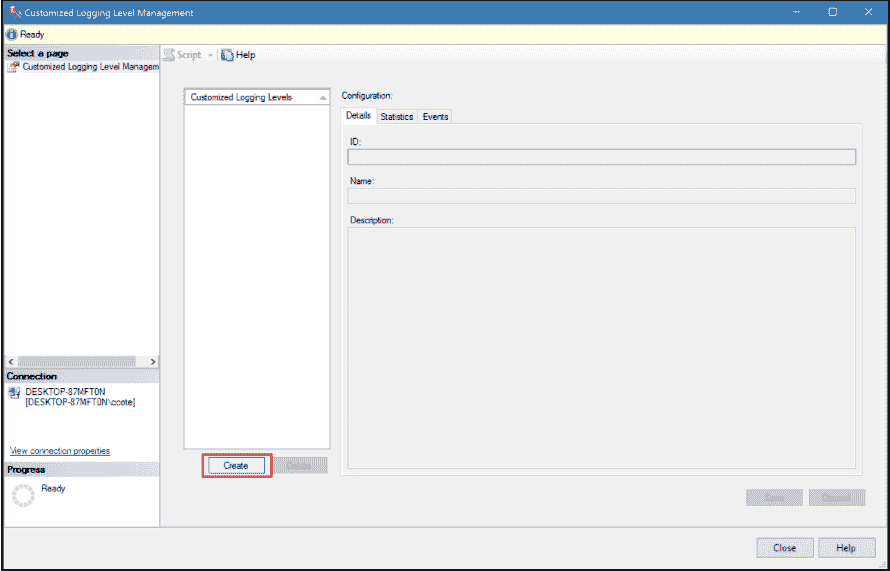

- 3. 出现**创建自定义日志记录级别**界面。按下图所示设置各种属性，但保持**从现有日志记录级别创建**为未勾选状态：

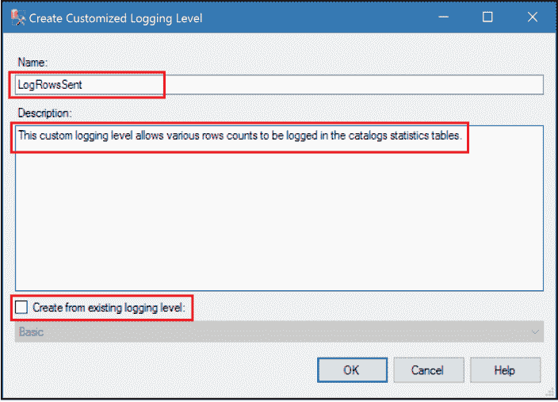

- 4. 在配置界面中，选择**组件数据量统计**，单击**保存**，然后**关闭**，如下方截图所示：

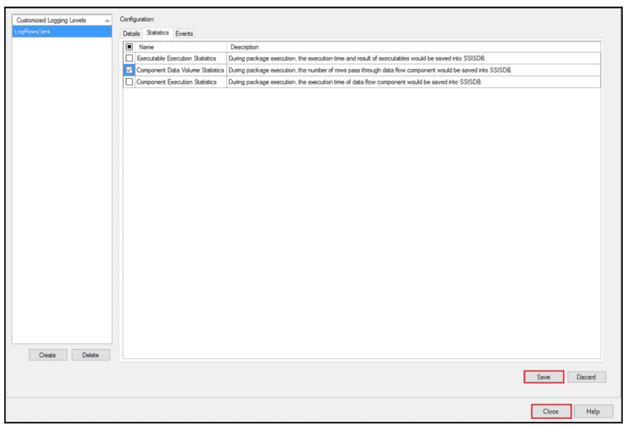

暂时就这样！我们已经创建了自定义日志记录级别。

## 工作原理...

在执行 SSIS 包时使用日志记录，会在 `internal` 架构中名为 `execution_data_statistics` 的 SSIS 目录表中创建条目。该表用于记录 SSIS 包中的数据移动统计信息。

我们从不使用 internal 架构中的表，因为它们被视为系统表。这就是我们改用视图 `[catalog].[execution_data_statistics]` 的原因。

## 更多内容...

在 SSMS 中创建我们的日志记录级别后，当我们的 SSIS 项目部署到 SSIS 目录时，我们就可以使用它。我们将在下一个操作指南*Azure 任务和转换*中这样做；我们将创建一个简单的 SSIS 包，在执行该包时将使用此日志记录级别。

## 创建数据库

本操作指南与本书中的许多其他操作指南一样，需要创建一个数据库。这可以通过使用 SQL Server Management Studio 来完成。启动 SSMS，连接到本地实例，然后右键单击数据库文件夹。从上下文菜单中选择“新建数据库...”。将出现以下窗口：

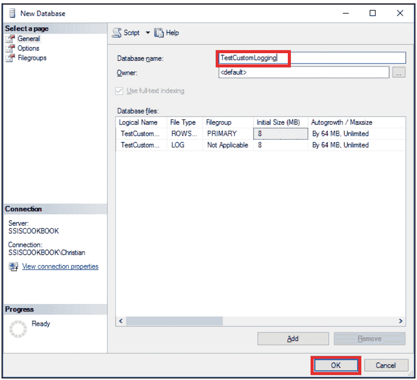

填写数据库名称，单击“确定”，因为我们不需要更改所有者和数据库文件信息。现在你应该能在 SSMS 的“数据库”文件夹下看到该数据库。我们现在准备好创建一个使用该数据库的 SSIS 包。

创建项目后，我们应该会看到一个名为 Package.dtsx 的包。右键单击它并选择“重命名”，如下方截图所示：

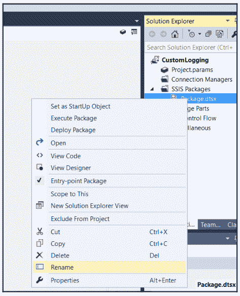

我们将其命名为 CustomLogging.dtsx。此时解决方案应如下图所示：

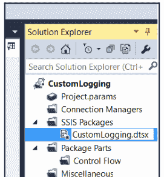

我们现在将在包中添加一个**数据流任务**。**数据流任务**是一个容器，允许我们进行数据转换。其工具箱包含丰富的数据转换工具。

从**SSIS 工具箱**中，将一个**数据流任务**拖到包的控制流中，如下方截图所示：

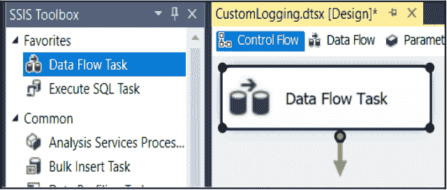

将**数据流任务**重命名为 `dft_dbo_CustomLogging`，如下方截图所示：

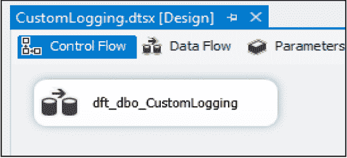

在下一章中，我们将介绍 SSIS 任务和转换的命名方式。

在接下来的几个步骤中，我们将开始自定义 SSIS 工具箱。双击 `dft_dbo_CustomLogging` **数据流任务**进入其中。

在整本书中，我们会经常自定义**SSIS 工具箱**以满足我们的需求。你会注意到工具箱具有以下部分：**收藏夹**、常用、Azure（这将在下一个操作指南中介绍）、**其他源**、**其他转换**和**其他目标**。

目前，我们移除源和目标助手，然后将**OLE DB 源**和目标添加到收藏夹转换中：

- 1. 在**SSIS 工具箱**中，向下滚动到**其他源**，右键单击**OLE DB 源**。从出现的上下文菜单中选择**移到收藏夹**。

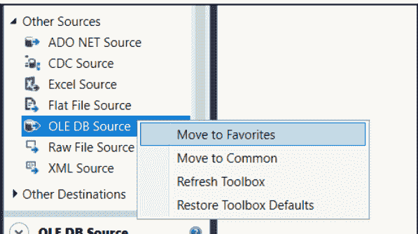


2. 接下来，再次向下滚动到**其他目标**，右键单击**OLE DB 目标**，然后选择**移到收藏夹**，如下图所示：

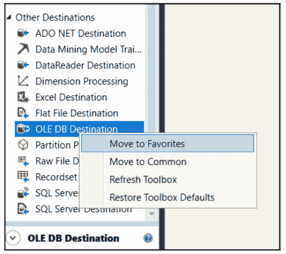

3. 现在向上滚动到顶部的**收藏夹**组。我们将从**收藏夹**中移除源助手和目标助手。如下面的截图所示，右键单击**目标助手**并选择**移到其他目标**。对**源助手**重复同样的操作：

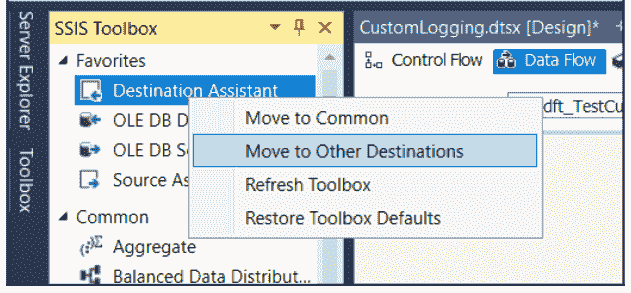

4. 对**源助手**重复同样的操作。我们将其移到**其他源**组。

5. 现在，我们准备创建一个连接管理器。我们将使用它来读取数据或向之前创建的 `TestCustomLogging` 数据库中插入数据。如下面的截图所示，右键单击**连接管理器**区域，在出现的菜单中选择**新建 OLE DB 连接**。

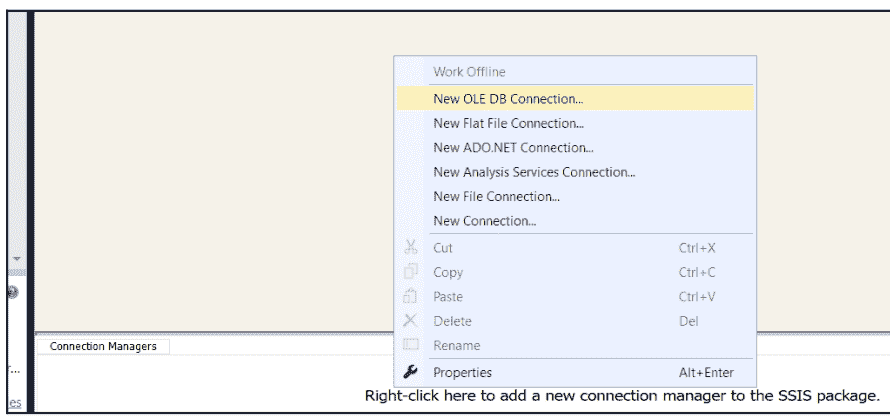

7. 返回到**配置 OLE DB 连接管理器**窗口，单击“确定”，如下图所示：

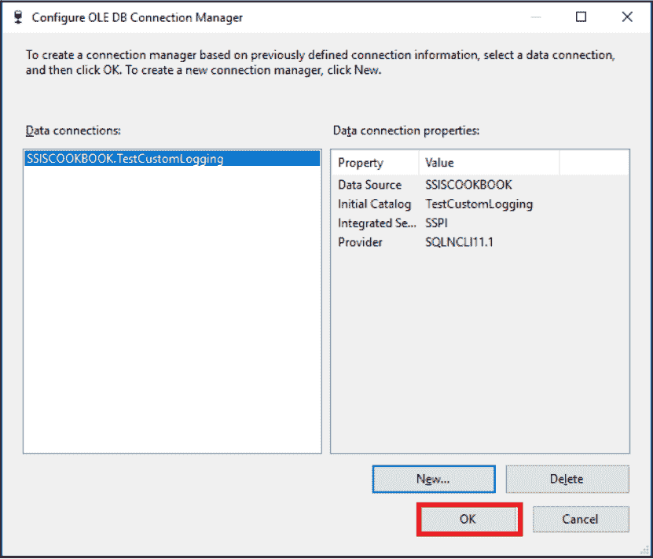

8. 现在，我们将重命名连接管理器。将新创建的连接管理器（`SSISCOOKBOOK.TestCustomLogging`）重命名为 `cmgr_TestCustomLogging`，如下图所示：

9. 现在，从 SSIS 工具箱的收藏夹部分，将一个 OLEDB 源拖放到**数据流**表面。如下图所示，将其重命名为 `ole_src_SELECT_1`。双击它打开**OLE DB 源编辑器**窗口。将**OLE DB 连接管理器**设置为 `cmgr_TestCustomLogging`，如图中所示。将**数据访问模式**设置为**SQL 命令**。

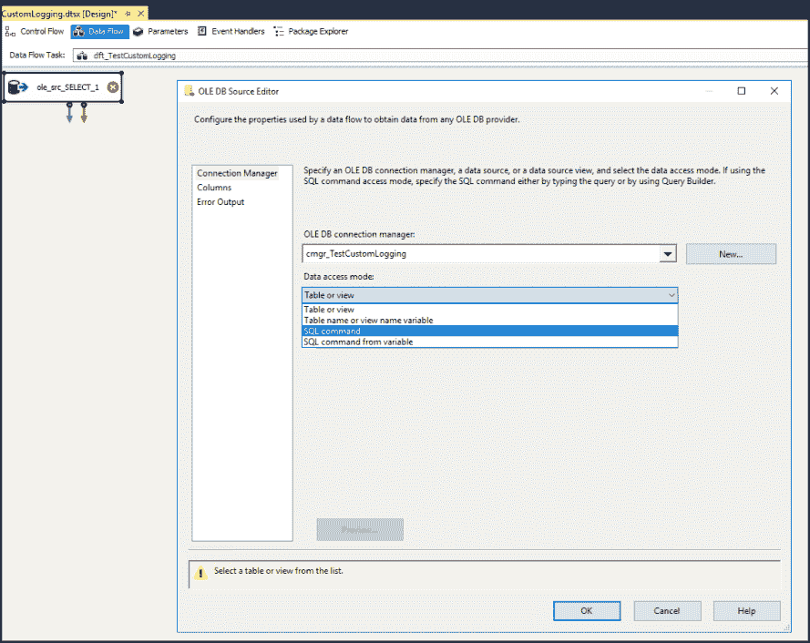

10. 现在，在命令文本中输入以下 SQL 命令，然后点击“确定”：

```
SELECT 1 AS LogID
UNION ALL
SELECT 2 AS LogID
```

11. 再次从 SSIS 工具箱的收藏夹部分，将一个 OLE DB 目标拖到数据流中。将源连接到目标，并将 OLE DB 目标重命名为 ole_dst_dbo_CustomLogging。双击它，指定 OLE DB 连接管理器属性，然后点击表或视图属性名称右侧的“新建”按钮。此时会出现“创建表”窗口。如下面的截图所示修改命令，然后点击“确定”：

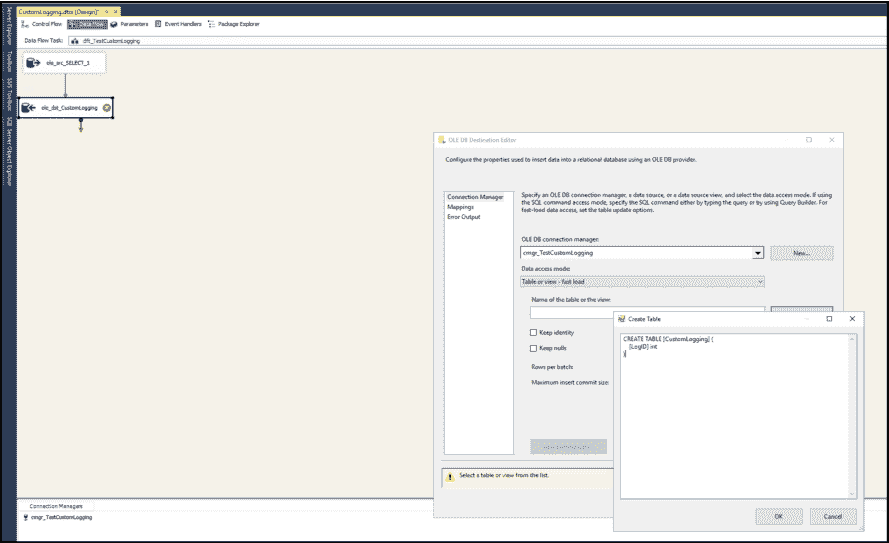

12. 单击**OLE DB 目标编辑器**左上角列表中的**映射**。您应该会看到与下面截图相同的屏幕：

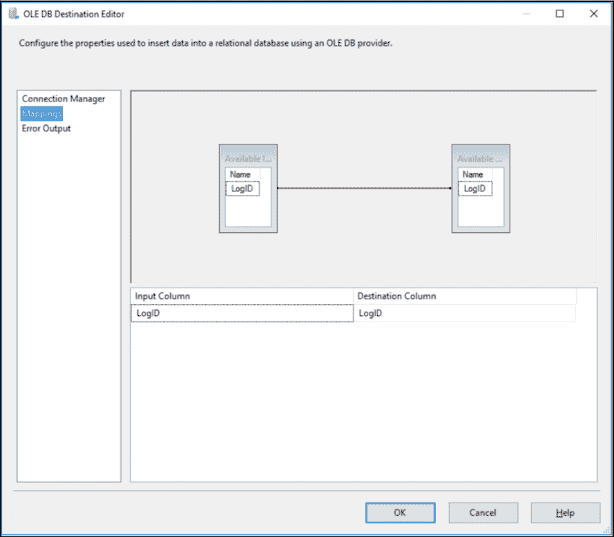

13. 单击**确定**关闭**OLE DB 目标编辑器**。

14. 现在，我们将引入**布局**工具栏。在本书中，我们将使用它来正确格式化包对象。在快速访问工具栏的空白区域右键单击，然后选择**布局**，如下面的截图所示：

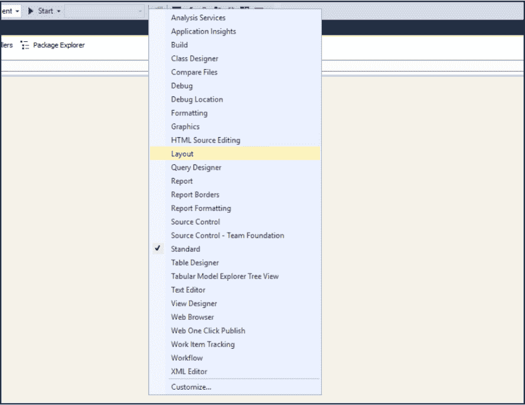

15. 现在，从“编辑”菜单中选择“全选”或按 Ctrl + A 选择整个数据流内容。在布局工具栏中，单击 \*（使宽度相同）按钮，如下面的截图所示：

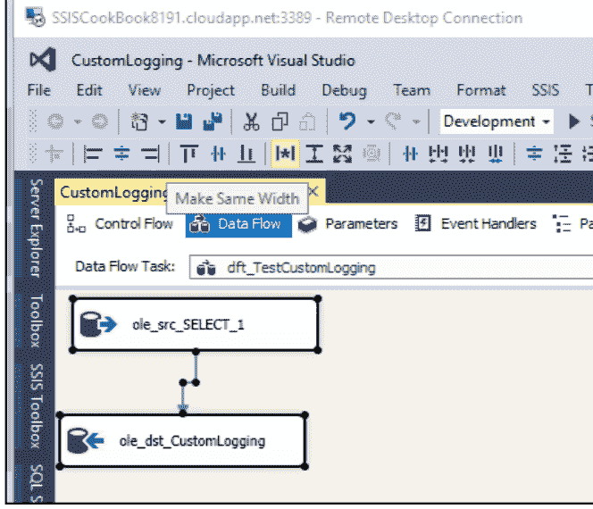

16. 从菜单中，选择“自动布局 | 关系图”。这将格式化数据流对象，如下面的截图所示：

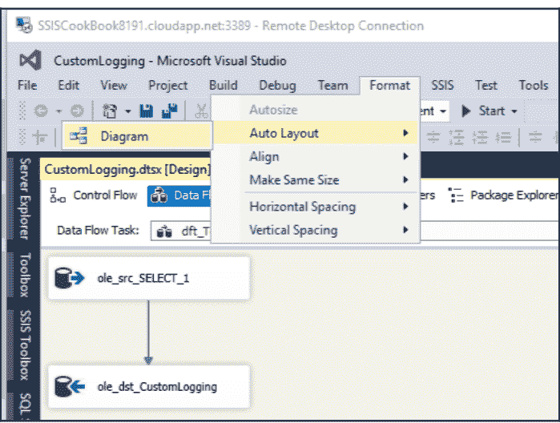

17. 现在，在数据流任务背景中任意位置右键单击，然后在出现的上下文菜单中选择“执行任务”。数据流应成功执行，如下所示。

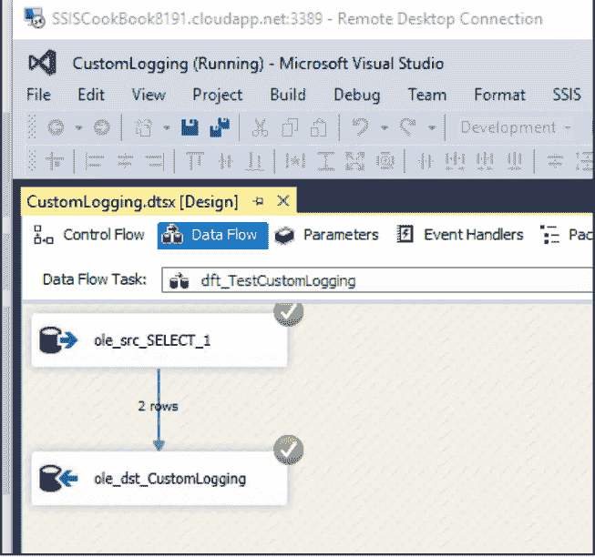

19. 第一页说明了向导执行的步骤。如果您想在将来部署项目或单个包时跳过此步骤，请勾选**不再显示此页面**，如下面的截图所示，我们将在本章后面看到这一点。

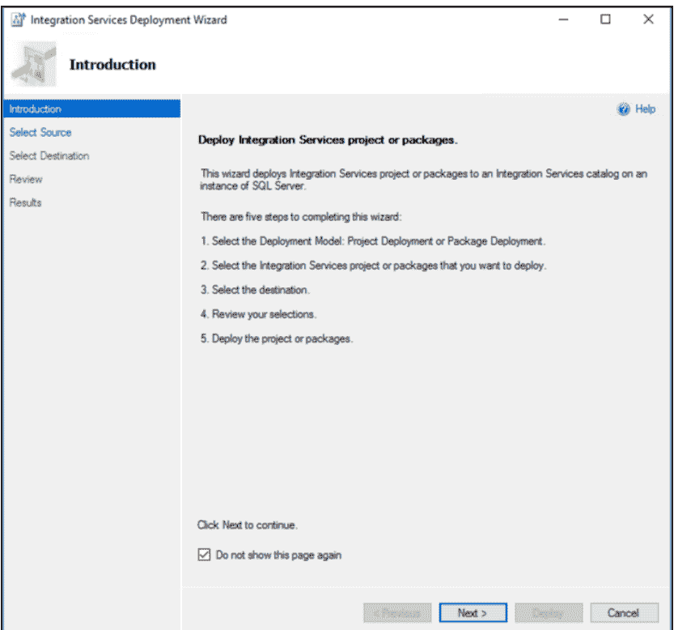

20. 向导现在要求选择 SSIS 目录和文件夹。由于目录中还没有任何文件夹，我们将创建一个名为 CustomLogging 的文件夹，如下面的截图所示：

- 1. 单击**浏览**按钮选择**服务器名称**。从列表中选择您的机器名称，然后点击**确定**。

21. 您的屏幕将如下图所示。再次点击**确定**关闭**浏览文件夹或项目**窗口。

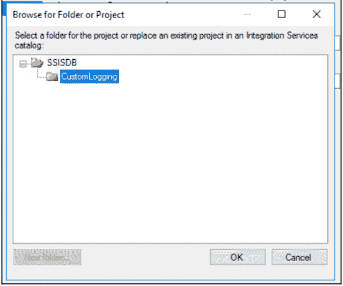

22. 返回到 Integration Services 部署向导，点击“下一步”按钮进入下一个部署步骤。您应该会看到一个类似于以下截图的窗口：

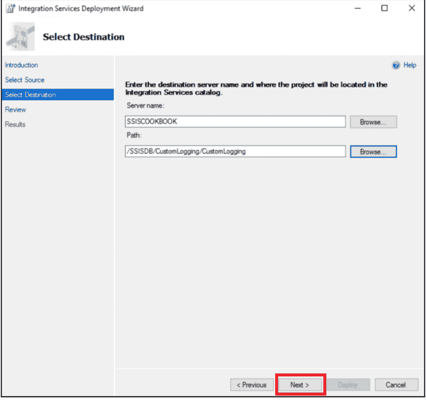

24. 如下面的截图所示，项目已部署到 SSIS 目录中。如果失败，点击“报告”按钮调查错误详细信息。每当发生部署错误时，您可以点击“上一步”进行更正。点击“关闭”终止部署向导。

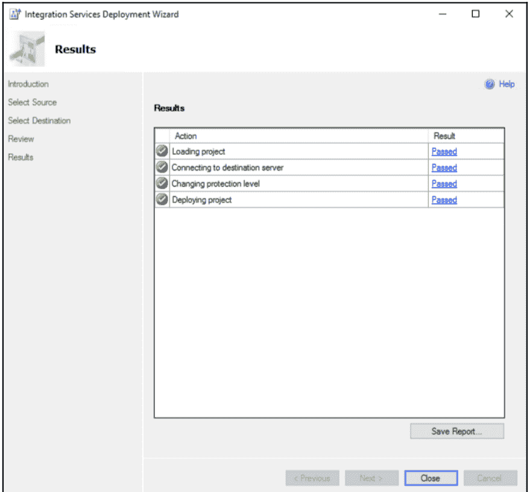

2. 当您展开 **SSISDB** 目录时，您会注意到有一个名为 `CustomLogging` 的文件夹；它是在本教程前面部署 SSIS 项目时创建的。

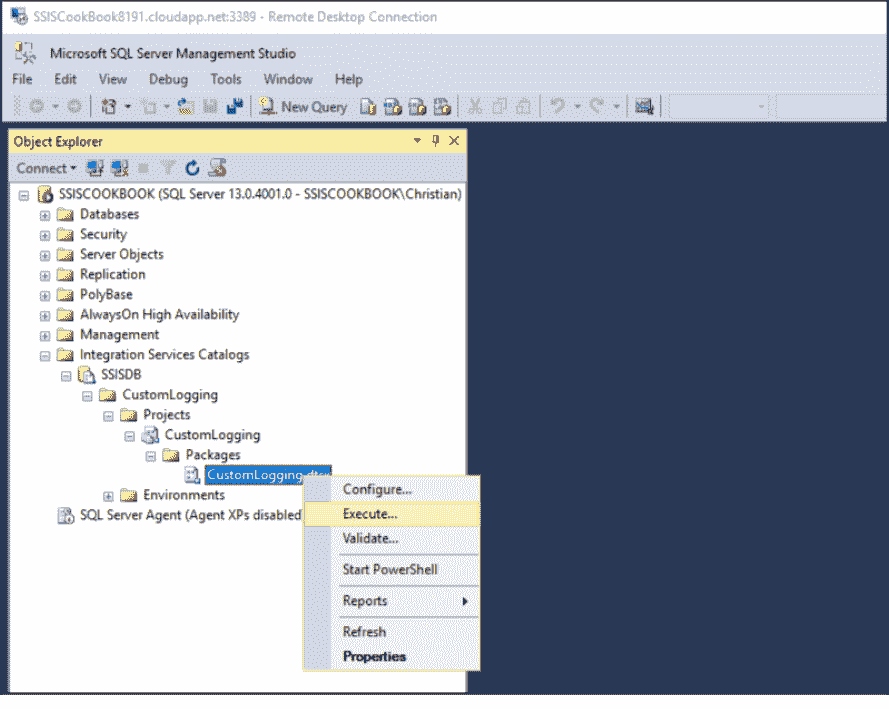

3. 单击**日志记录级别**属性旁边的下拉列表，选择**选择自定义日志记录级别...**，如下面的截图所示：

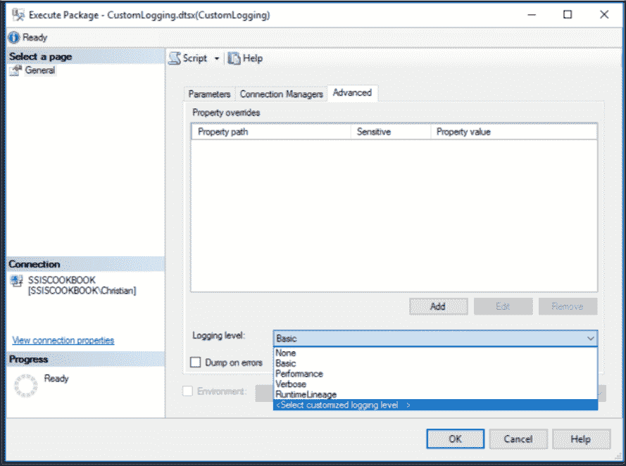

4. 确保我们的自定义日志记录级别 **CustomLogging** 已被选中，然后点击**确定**，如下面的截图所示：

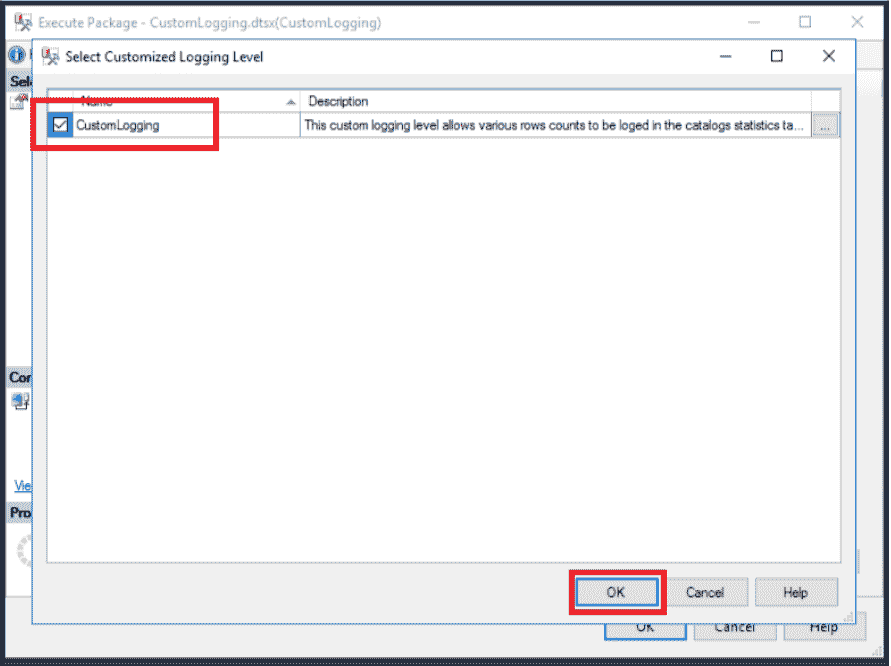

5. 确保**日志记录级别**属性设置为“自定义：CustomLogging”，然后点击**确定**关闭窗口并开始包执行，如下面的截图所示。

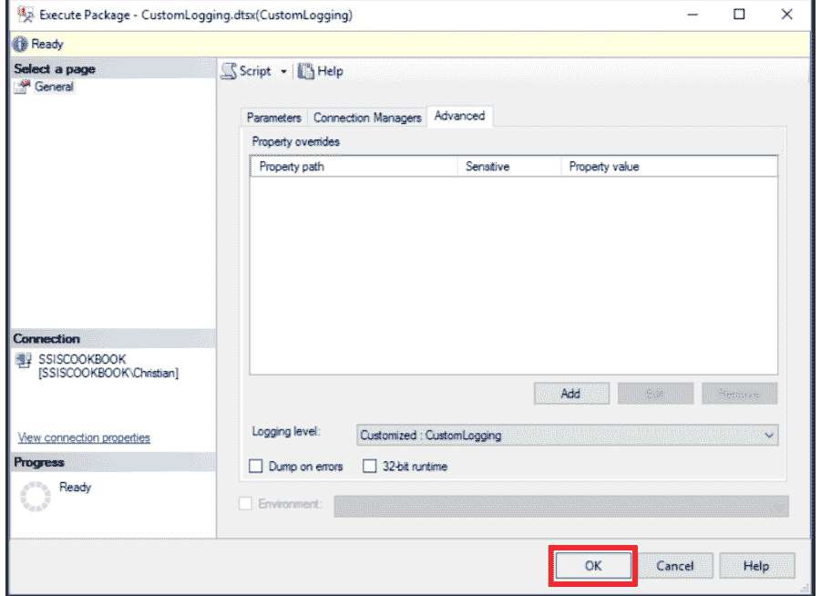

6. 出现以下屏幕。点击**是**查看执行报告。

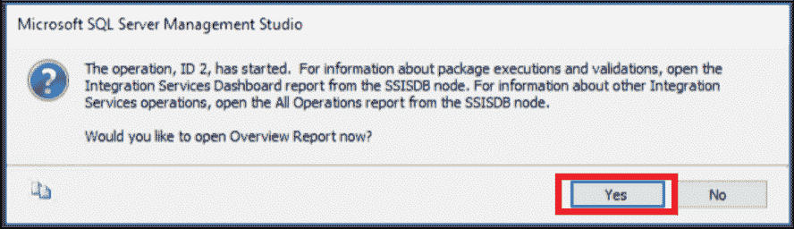

7. 执行报告显示包已正确执行，如下面的截图所示：

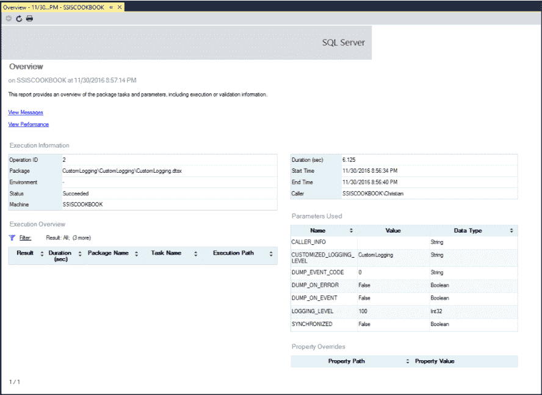

8. 在 SSMS 中点击**新建查询**，输入以下查询。点击**执行**或按 F5 执行查询。您应该会看到包读取并插入了两行数据。

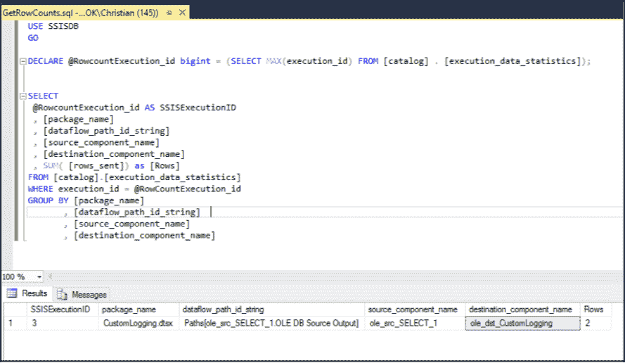

## 另请参阅

我们将在下一章讨论 SSIS 框架时进一步介绍日志记录。与此同时，本教程向您介绍了 SSIS 中的日志记录，但本书后面还有更多内容需要介绍。

## Azure 任务和转换

本节将指导您如何安装 Azure 功能包，该功能包将随之安装 Azure 控制流任务和数据流组件。Azure 生态系统在微软生态系统中正日益占据主导地位，而过去几年中 SSIS 也未曾掉队。

Azure 功能包并非 SSIS 2016 的专属功能。它也适用于 SSIS 2012 和 2014 版本。值得一提的是，它于 2015 年 7 月推出，比 SSIS 2016 发布早了几个月。

## 准备工作

本节假设您已经安装了 SQL Server Data Tools 2015。

## 操作步骤...

我们将启动 SQL Server Data Tools，并打开 `CustomLogging` 项目（如果尚未打开）：

- 1. 在 SSIS 工具箱中，滚动到 **Azure** 组。由于 Azure 工具未随 SSDT 一起安装，工具箱中的 **Azure** 组处于禁用状态。必须使用单独的安装程序下载这些工具。单击 **Azure** 组将其展开，然后点击**下载 Azure 功能包**，如下面的截图所示：

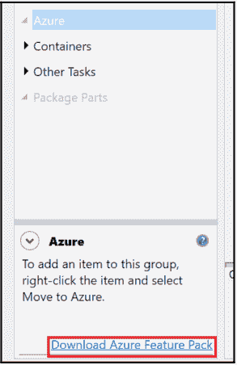


+   2. 你的默认浏览器打开，并且打开了 **Microsoft SQL Server 2016 Integration Services Feature Pack for Azure**。点击以下屏幕截图中所示的 **Download**：

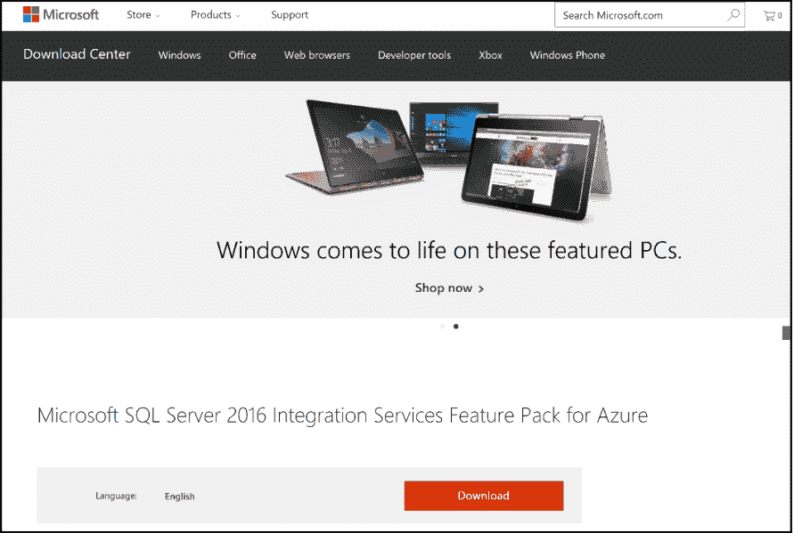

3. 从出现的弹出窗口中，选择 32 位和 64 位两个版本。32 位版本对于 SSIS 包开发是必要的，因为 SSDT 是一个 32 位程序。点击以下屏幕截图中所示的 Next：

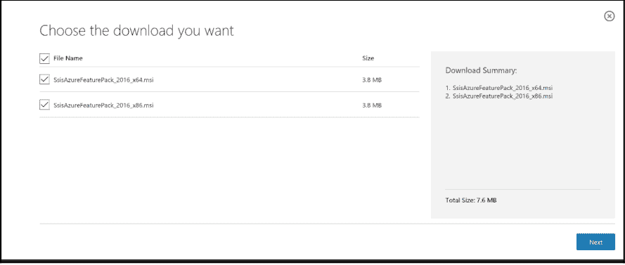

4. 如以下屏幕截图所示，文件正在下载中：

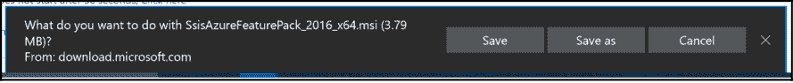

5. 下载完成后，运行其中一个已下载的安装程序。会出现以下屏幕。在本例中，正在安装 32 位（x86）版本。点击 Next 开始安装过程。

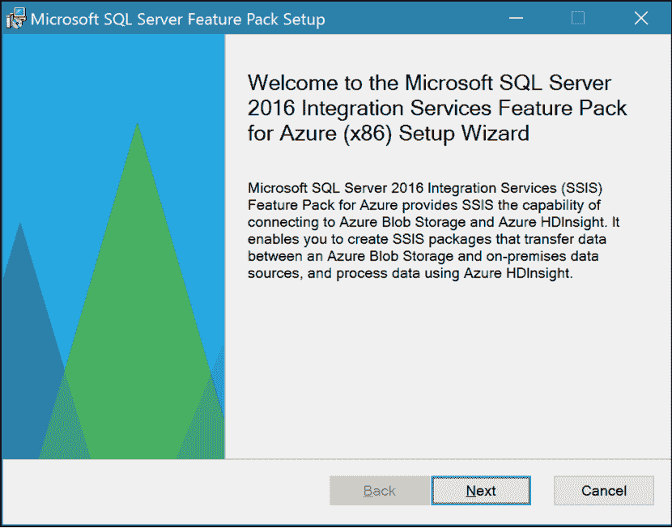

7. 安装完成后会出现以下屏幕。点击 **Finish** 关闭屏幕。

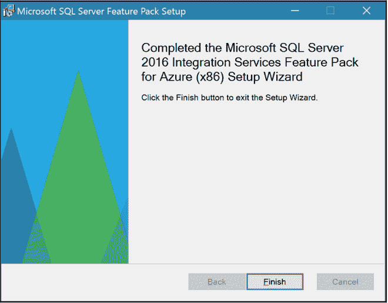

8. 使用 _Custom logging_ 中的前一个配方步骤下载的另一个功能包。

9. 如果 SSDT 已打开，请关闭它。重新启动 SSDT 并打开我们在另一个配方中创建的 **CustomLogging** 项目。在 SSIS 工具箱中的 **Azure** 组中，你现在应该可以看到 Azure 任务，如以下屏幕截图所示：

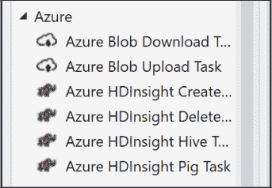

# See also

本书第 12 章 *On-Premises and Azure Big Data Integration* 包含有关 Azure 任务和转换的专门章节。它们将在其中用有用的示例进行更详细的解释。

# Incremental package deployment

在 SSIS 2012 之前，包需要一个一个地部署。我们通常会从源代码控制软件（如 **Team Foundation Server (TFS)**、Visual Source Safe、SVN 等）下载所有包。下载后，包会被移动到其目标位置。那时，部署包的人员可以选择覆盖或跳过现有包。通常，他们会覆盖所有包，因为他们使用的是源代码控制。

对于那些不使用源代码控制的人来说，他们在部署需要部署的内容方面拥有全部必要的灵活性。通常，他们会在文件共享上的某个位置备份所有包。他们选择部署什么的主要原因是因为他们对文件共享中包的一致性存有疑虑。他们只是不确定包的状态，因为他们使用手动流程来维护解决方案。源代码控制软件对此帮助很大。我们有比较源代码控制中提交的包之间的版本、以及何时和谁推送了包等可能性，还有其他好处。

引入 SSIS 2012 的 Project Deployment。唯一可行的部署方式是部署整个项目，从而部署其中的所有包。如果源代码控制已到位以管理包代码，这几乎不是问题。但，并非每个人都使用源代码控制，微软也意识到了这一点。随着 SSIS 2016，我们现在可以部署项目中的部分包。你不必部署整个项目。

# Getting ready

本配方假定你已创建并部署了 **CustomLogging** 配方。

# How to do it...

+   1. 在打开 **CustomLogging** 项目的情况下，右键单击 `CustomLogging.dtsx` 包并选择 **Copy**，如以下屏幕截图所示：

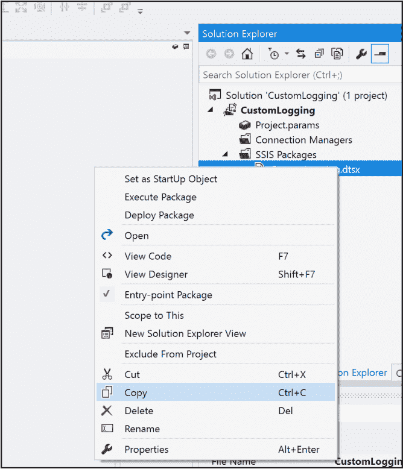

2. 现在，右键单击 SSIS Packages 文件夹并选择 Paste，如以下屏幕截图所示：

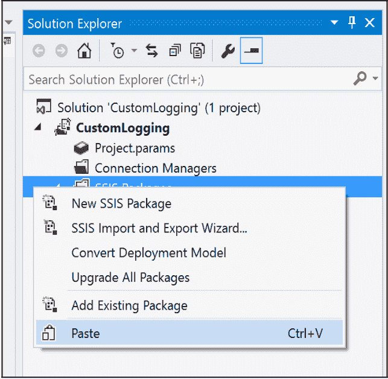

3. 创建了一个包的副本，并命名为 CustomLogging 1.dtsx，如以下屏幕截图所示：

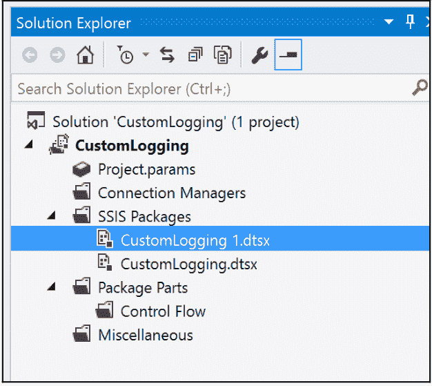

4. 右键单击新创建的包，`CustomLogging 1.dtsx`，并从菜单中 **select Deploy Package**，如以下屏幕截图所示：

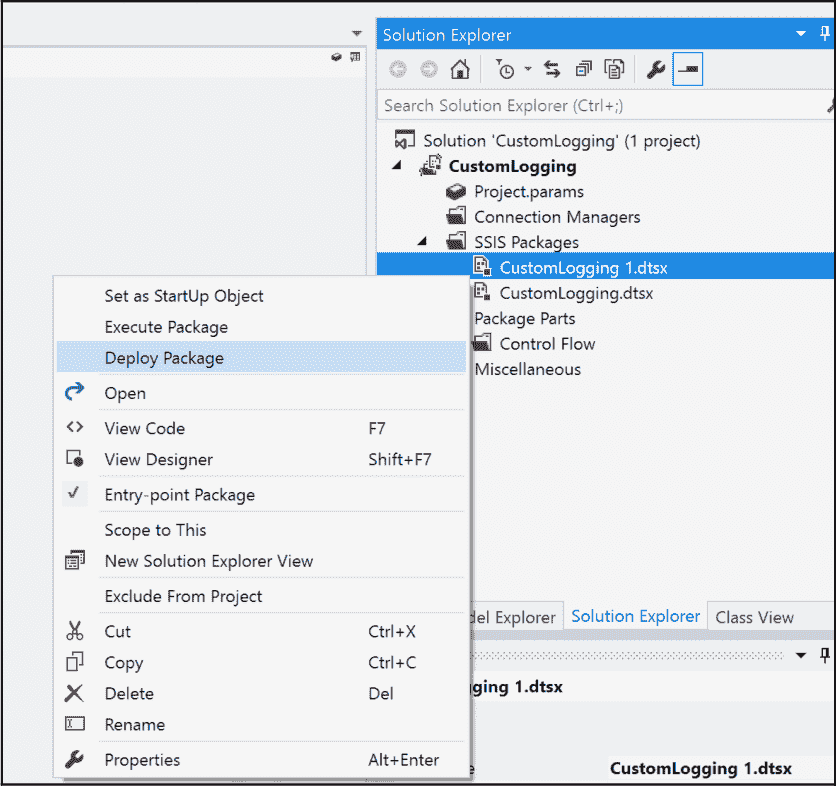

5. 如以下屏幕截图所示，服务器名称已自动选择，因为我们之前已将项目部署到那里。如有必要可以更改。Path 是部署的包将位于的位置；SSIS Catalog 中的 SSISDB/CustomLogging/CustomLogging 文件夹。点击 Next 进入下一步。

# Integration Services Deployment ...

# Select Destination

+   - Introduction
+   - Select Source
+   - Select Destination
+   - Review
+   - Results

输入目标服务器名称以及项目将在 Integration Services 目录中的位置。

Server name:
SSISCOOKBOOK
Path:
/SSISDB/CustomLogging/CustomLogging

包将被部署到所选项目。相同名称的包将被替换。

< Previous   Next >   Deploy   Cancel

6. 现在我们处于 **Review** 屏幕，如以下屏幕截图所示。


请注意，要部署的包是 `CustomLogging_1.dtsx`。它被标记为 **Package#1**，因为我们可能选择了多个包进行部署。点击 **Deploy** 继续部署。

7. 如果一切顺利，你应该会看到如下屏幕截图，意味着包已成功部署。点击 Close 关闭它。


8. 现在，转到 SSMS 并打开 SSIS Catalog，如以下屏幕截图所示。你会看到包已被部署。我们现在不会执行它，因为我们只想演示单包部署的工作方式。


# There's more...

单独部署包的能力仅在 SSIS 2016 中可用。如果我们尝试部署到 SSIS 较早版本（2012-2014）的 SSIS Catalog，部署将会失败。因此，为了重申这一点，SSDT 可以向你显示你可以部署单个包的选项，但你需要 SSIS 2016 才能使用它。

# Multiple version support

自诞生以来，SSIS 设计器从未支持向后兼容。例如，如果你使用 SSIS 2014 开发了一个包并尝试将其部署到 SSIS 2012 目录中，你将无法做到。更糟糕的是，如果你用用于 SSIS 2014 的 SSDT 打开一个用 SSIS 2012 开发的包，该包将被升级。当另一位开发人员尝试用用于 SSIS 2012 的 SSDT 打开它时，他/她将无法打开它。包已被升级，就这样。

使用 SSIS 2016，SSDT 具有以下增强功能：

+   - 向后兼容到 SSIS 2012 及之前的版本。
+   - 统一的 SSDT：正如我们稍后在书中会看到的，SSDT 也可以用于 BI 组件开发以及数据库开发。在 Visual Studio 2015 的 SSDT 之前，令人困惑的是我们使用的是 SSDT-BI 进行 BI 开发还是 SSDT-SQL 进行数据库开发。

# Getting ready

本配方假定你已在 SSDT 中创建了一个 SSIS 项目。我们将使用本章前一个配方中开发的 CustomLogging SSIS 项目。

# How to do it...

+   1. 在 SSDT 中打开 **CustomLogging** SSIS 项目后，右键单击该项目并选择 **Properties**，如以下屏幕截图所示：


+   2. **CustomLogging Property Pages** 对话框打开。选择 **Configuration Properties**，你会注意到 **TargetServerVersion** 属性附近有一个下拉列表。在我们的例子中，所选版本是 **SQL Server 2016**。你会注意到你可以选择之前的版本，如以下屏幕截图所示。点击 **OK** 关闭此窗口。


# There's more...

这个简单的配方向你展示了我们现在可以多么轻松地使用 Visual Studio 2015 的 SSDT 与之前的 SSIS 版本一起使用。如果你打开一个在 SQL Server 2012 或 2014 SSDT 版本中开发的现有 SSIS 项目，设计器（SSDT）将足够智能地选择正确的目标版本（2012 或 2014），而不会升级你的项目或包。


- 2. 从 SSIS 工具箱中拖放一个派生列转换到数据流上。将其连接到 `ole_src_SELECT_1`，并双击打开派生列转换。如下面的截图所示，执行以下操作：
  - **派生列名称：** DateToConvert
  - **派生列：** 将其保留为 <添加为新列>
  - **表达式：** 输入 1600-01-00。这不是有效日期；它将导致错误，而这正是我们想要的。

- 3. 完成后单击**确定**。


- 4. 将派生列重命名为 `der_AddDate`。

- 5. 现在，将一个数据转换转换拖放到数据流任务上。将其连接到之前创建的 `der_AddDate` 派生列，然后双击打开**数据转换转换编辑器**。按如下截图所示输入值：
  - **输入列：** 在“可用输入列”中勾选 **DateToConvert** 列。
  - **输出别名：** 将其改为 **DateConverted**。
  - **数据类型：** 从下拉列表中选择 **date [DT_DATE]**。

- 6. **数据转换转换编辑器**现在应如下面的截图所示。单击**配置错误输出...**按钮。


- 7. 你将看到一个类似下面截图的界面。默认情况下，**错误**和**截断**错误会导致组件失败。
  - 1. 选择两列，然后在靠近**将此值设置为**标签的单元格下拉列表中，选择**重定向行**。单击“应用”。
  - 2. 现在你应该看到两个列的值都已设置为**重定向行**。
  - 3. 单击**确定**关闭编辑器，并将该转换重命名为 `dcnv_DateConverted`。


- 8. 现在，从其他转换中拖一个审核转换到数据流任务上。以下步骤详细说明了下面截图中的操作：
  - 1. 将**数据转换错误输出**（红色路径或箭头）附加到它。
  - 2. 右键单击错误路径，并在出现的菜单中选择“启用数据查看器”。


正如我们在*自定义日志记录级别*方法中所做的那样，选择所有转换，然后在**布局**工具栏中点击**使宽度相同**。从**格式**菜单中，选择**自动布局 → 图表**，以正确格式化数据流任务对象。

- 9. 你的数据流任务现在应如下面的截图所示。现在，在数据流任务背景的任意位置右键单击，并从菜单中选择**执行任务**。


- 10. 你应该会看到一个数据查看器，如下面的截图所示：


其解释如下：

- **DateToConvert** 是我们尝试转换的列。
- 第二列是 **ErrorCode**，这是 SSIS 的内部代码。
- 第三列是 **ErrorColumn**，这是 SSIS 分配给数据流任务中所有列的沿袭 ID。
- **ErrorCode - 描述**列给出了错误原因。
- **ErrorColumn - 描述**为我们提供了转换失败的列（**DateConverted**）。

## 控制流模板

控制流模板是 SSIS 2016 新增的一项功能，在未来它一定会很有前途……目前，微软只是为某个看起来很有趣的东西奠定了基础。

如果说 SSIS 缺少什么，那就是在不编写 .NET 代码的情况下实现自定义组件的可重用性。在本书后面，我们将看到如何使用 .NET 实现自定义任务和转换，你会发现即使是一些简单的功能实现起来也很繁琐。假设我们要创建一个截断表任务；也就是说，一个专门用来清除表内容的任务。这个任务随后会出现在 SSIS 工具箱中，并可用于项目中的所有包。本方法正是我们将使用控制流模板实现的内容。

- 3. 如下面的截图所示，在左上角选择现有连接（本例中为 **SSISCOOKBOOK\TestCustomLogging**），或单击**新建...**创建一个新连接。完成后单击**确定**关闭**配置 OLE DB 连接管理器**窗口。


- 4. 双击 `sql_Truncate_dbo_CustomLogging` 任务，打开**执行 SQL 任务编辑器**。在 **SQL 语句**部分中设置属性如下：
  - **连接类型：OLE DB**，默认值
  - **连接：** 将其设置为上一步创建的连接管理器。
  - **SQL 源类型：** 保留默认值，**直接输入**，在 **SQL 语句**属性中输入以下 SQL DML 语句：

```sql
TRUNCATE TABLE [dbo].[CustomLogging];
```

这也显示在下面的截图中：


- 5. 保存并关闭 `Chapter2Part.dtsx` 包部件。

- 6. 现在，从解决方案资源管理器中打开 CustomLogging 包。如下面的截图所示，在 **SSIS 工具箱**的*包部件*部分中现在有一个新组件：即前面步骤中创建的 **Chapter2Part**。另外，请注意*包部件*部分下方的描述。这就是创建包部件时在**控制流**级别分配的描述。


- 7. 将一个 **Chapter2Part** 拖放到 *CustomLogging* 包的**控制流**上。现在，要使结果与下面的截图相同：


执行以下步骤：

- 1. 将其连接到 **dft_dbo_CustomLogging** 数据流任务。
- 2. 选择所有**控制流**组件。
- 3. 在**布局**工具栏中，单击“使大小相同”。
- 4. 从“格式”菜单中选择**自动布局关系图**，以正确对齐任务。
- 5. 执行包以确保包部件正常工作，完成后停止包执行。
- 6. 双击 **Chapter2Part** 查看其属性，如下面的截图所示。转到**连接管理器**选项卡。找到截图中高亮显示的 **ConnectionString** 属性。请注意，它的值是固定的。这是这些部件最大的限制；目前无法在运行时更改任何属性。我们不能像常规任务那样使用包配置或参数动态更改这些值。


所使用的源（操作）数据库是 AdventureWorksLT，一个历史悠久且广为人知的数据库。下图描述了我们将要使用的源数据库：


我们将从该数据库将数据插入到暂存区域，最后插入到数据仓库。暂存区域和数据仓库将在数据库中按架构分离，我们将使用 SSDT 管理该数据库。

下图展示了 AdventureWorksLTDW 数据库的暂存架构：

## AdventureWorksLTDW 暂存架构

并非所有表都会被复制到暂存区域；已识别出三个部分：

- **订单**：这些表包含订单信息以及日期相关信息。在数据仓库部分，这些部分都有各自的表。
- **客户**：这些表包含与客户及其地址相关的信息。在数据仓库中，这些表被分组。
- **产品**：这些表包含产品信息，例如型号、多语言描述等。与客户数据一样，这些表在数据仓库中也是分组的。


进入暂存区后，数据将被复制到星型模式数据库表示中。表位于同一数据库中，但具有单独的架构，称为 DW。以下图表显示了 DW 表：


数据仓库的目标是简化数据消费。大多数用户都能理解，并且数据被分类到代表最终用户将基于其进行分析的主题的区域（表）中。

客户信息已被重新分组到两个表中，`DimCustomer` 和 `DimAddress`。`DimAddress` 表与事实表有两个链接。这些关系代表了多个地址，在我们的案例中为两个：客户的账单地址和发货地址。

产品信息已被展平为一个维度：`DimProduct`。尽管基础模型允许产品描述有多种语言，但在维度中仅保留两种：法语和英语 - `EnglishDescription` 和 `FrenchDescription`。

订单表已合并为一个事实表：`FactOrders`。已添加 `DimTime` 维度以允许使用各种日期更好地查询订单：订单日期、发货日期和到期日期。`SalesOrderNumber` 和 `PurchaseOrderNumber` 被视为派生维度并保留在事实表中。我们没有足够的信息可以从这些列中派生，并且它们与事实紧密相关。

剩余的维度 `DimOrderProvenance` 在 AdventureWorksLT 操作数据库中没有来源。它已被添加并由 Master Data Services 管理，这是随 SQL Server 2016 Developer Edition 提供的另一项服务。我们将在本书后面讨论此服务和此维度。

在接下来的几个配方中，我们将部署这些数据库以及加载这些表的 ETL（SSIS 包）。

## 安装示例解决方案

本节将指导您部署示例解决方案中包含的数据库。

## 准备工作

本节假设您已下载解决方案文件。

## 如何操作...

- 1. 我们首先创建一个将保存解决方案文件的目录。在我们的案例中，我们创建了一个名为 `C:\Projects\SSISCookbook` 的文件夹，并在其中解压缩解决方案文件，如以下屏幕截图所示：


- 2. 现在，我们通过双击 `SSISCookBook` 解决方案文件打开解决方案，如前一屏幕截图所示突出显示。
- 3. 解决方案打开，您将看到其项目，如以下屏幕截图所示：


## 如何操作...

- 1. 在 SQL Server Data Tools（Visual Studio）中，右键单击 DB AdventureWorksLT 项目并选择 **Publish...**，如以下屏幕截图所示：


2. 出现以下屏幕；单击 **Edit...** 按钮以创建到本地 SQL Server 实例的连接字符串：


3. 如以下屏幕截图所示，单击 Browse 选项卡会弹出一个屏幕，我们可以在其中选择 SQL Server 实例位置。在我们的案例中，我们将选择 Local。展开 Local 标签并选择您的 SQL Server 实例，在我们的案例中为 SSISCOOKBOOK。Server Name 文本框将显示您选择的服务器。单击 OK 返回到上一个屏幕。


5. 返回到 Publish Database 屏幕，按如下方式填写文本框：

- - **Database name:** AdventureWorksLT
- - **Publish script name:** DB.AdventureWorksLT.sql

它也在以下屏幕截图所示：


6. 单击 Save Profile As... 按钮。

7. 我们将把这些设置保存为此数据库项目的发布配置文件。这将允许我们在未来重用它，而无需重复前面的步骤。按以下屏幕截图所示填写文件名。它将在项目中创建一个发布配置文件。如以下屏幕截图所示，将发布配置文件命名为 DB.AdventureWorksLT 并单击 Save。


8. 返回到 Publish Database 窗口，单击如以下屏幕截图所示的 Publish 按钮。Generate Script 选项用于在我们只想创建部署脚本而不立即部署数据库时使用。一个很好的例子是当我们创建一个脚本来交给负责数据库部署的 DBA 时。


9. **Data Tools Operations** 窗口打开并显示部署数据库时执行的步骤。您应该会看到与以下屏幕截图非常相似的内容：


10. 启动 **SQL Server Management Studio (SSMS)** 并在对象资源管理器中查找 `AdventureWorksLT` 数据库，如以下屏幕截图所示：


11. 右键单击任意表并选择 **Select Top 1000 Rows**，如以下屏幕截图所示：


此文件包含加载不同表的 INSERT 语句。您可以在以下屏幕截图中一窥其内容：


此 SQL 文件通过 SSDT 中的特殊脚本调用：部署后脚本。要创建它，我们只需在项目中添加一个脚本，如以下屏幕截图所示。当我们右键单击文件夹并选择 Add | New | Script 时会出现此对话框。


## 准备工作

本配方假设您有权访问本书提供的示例解决方案，并且您已阅读并执行了部署源数据库的所有步骤。

## 如何操作...

步骤基本上与部署源数据库时使用的步骤相似。由于我们之前已解释了大部分步骤，本配方将更简洁：

- 1. `DB.AdventureworksLTDW` 项目包含以下架构：
- - **Cube:** 这包含特定的数据库对象，主要是可被 SSAS 多维数据集使用的视图。
- - **dbo:** 这是默认架构。
- - **DW:** 此文件夹包含属于 DW 架构的数据库对象，即数据仓库星型模式对象。
- - **Scripts:** 这是一个保存预部署或部署后脚本以及实用脚本的文件夹。
- - **Staging:** 此文件夹包含由 `Staging` 架构使用的数据库对象。
- - **SystemLog:** 此文件夹包含由 SSIS 框架使用的数据库对象。我们将在本书后面的部分讨论它。

它也在以下屏幕截图所示：


2. 在解决方案中右键单击 DB.AdventureWorksLT DW 项目并选择 **Publish...** 如以下屏幕截图所示：


3. **Publish Database** 窗口出现。单击 **Load Profile...** 并从出现的 **Publish Settings** 窗口中选择 DB.AdventureWorks2016.publish.publish 发布配置文件。单击 **Open**，如以下屏幕截图所示：


4. 返回到 **Publish Database** 窗口，单击 **Publish** 以部署数据库，如以下屏幕截图所示：


5. 数据库开始部署。您可以在屏幕底部的 **Data Tools Operations** 窗口中看到其进度。它应如下屏幕截图所示：


6. 部署完成后，打开 SSMS，并在对象资源管理器中确认 AdventureWorksLTDW2016 已存在，如下面的截图所示：


7. 单击 + 号展开数据库。你将看到所有数据库对象均已成功发布，如下面的截图所示：


8. 与 AdventureWorksLT 数据库一样，有一些表中包含数据：维度表。有一个部署后脚本，它会调用另一个不在生成脚本中的脚本：DimensionsUnknownMembers.sql。此脚本包含 SQL INSERT 语句，每个表对应一条。这些 SQL 语句会在维度中插入一条记录：主键列的值为 -1，代码列的值为 N/A，较长文本条目的值为 Not available。它们被称为未知成员，我们将在本书后面介绍数据仓库加载的章节中讨论它们。

9. 如果右键单击某个维度表——它们都以 Dim 作为前缀。

## SSIS 项目

本节将重点介绍用于从不同位置移动数据的 SSIS 项目。解决方案中有多个 SSIS 项目：

- ETL.Staging：包含将数据从 AdventureWorksLT 传输到 AdventureWorksLTDW2016 中 Staging 架构的 SSIS 包
- ETL.DW：包含将数据从 Staging 架构传输并转换到 AdventureWorksLTDW2016 中 DW 架构的包

本部分的操作指南将解释这些包的结构，以及如何部署和运行它们，以将数据从源数据库加载到数据仓库中。

项目中有两种类型的 SSIS 包：

- 入口点包：这些包编排解决方案的提取、转换和加载（ETL）流程。正是在这些包中，其他包被调用，并决定它们的调用顺序。在解决方案中，每个项目只有一个入口点包。
- 常规（子）包：这些包执行 ETL 工作，即从源系统提取数据并将其加载到目标表中。每个目标表对应一个子包。例如，`StgAddress.dtsx` 包只会加载 `AdventureWorksLTDW2016.Staging.StgAddress` 表。这样做在入口点包中编排包时具有更好的灵活性。正如我们稍后将看到的，由于子包只执行一项任务，因此我们可以很好地利用并行性。此外，这使得包的命名更加直接：我们为它们指定与所加载目标表相同的名称。

该项目包含加载 `AdventureWorksLTDW2016` 数据库 `Staging` 架构的包。下面的截图显示了项目的结构：


在项目部署模式下，项目包含以下部分：

- `Project.params`：此项目工件包含由项目中任何包的调用程序或作业传递的参数。大多数情况下，项目连接管理器的连接字符串是其中的一部分。下面的截图显示了 `ETL.Staging` 项目参数的部分内容：


- `Connection Managers`：项目级连接管理器可供项目中的所有包使用。在 `ETL.Staging` 中，已创建以下项目连接管理器：
  - `cmgr_DW`：连接到 `AdventureWorksLTDW2016` 数据库
  - `cmgr_MDS_DB`：连接到 Master Data Services 数据库
  - `cmgr_Source`：连接到源数据库 `AdventureWorksLT`

这也可以在下面的截图中看到：


## 操作步骤

- 1. 在 SSDT 中，右键单击 `ETL.Staging` 项目，然后从上下文菜单中选择**部署**，如下面的截图所示：


- 2. 在 **Integration Services 部署向导**中，创建 `SSISCookBookSolution`，如下面的截图所示：


3. 单击两次 OK，以关闭“创建新文件夹”窗口和“在项目中浏览文件夹”窗口。确保路径名为 /SSISDB/SSISCookBookSolution/ETL.Staging，然后单击“下一步”，再单击“部署”以部署项目。

4. 部署完成后，返回 SSMS；我们将配置该项目。导航到该项目并右键单击它。如下面的截图所示，选择“配置”：


5. 如上面的截图所示，单击每个参数的省略号（...）按钮，并按如下方式设置属性：

- Cmgr_DW: Data Source=.;Initial Catalog=AdventureWorksLTDW2016;Provider=SQLNCLI11.1;Integrated Security=SSPI
- Cmgr_Source: Data Source=.;Initial Catalog=AdventureWorksLT;Provider=SQLNCLI11.1;Integrated Security=SSPI
- CycleID：无需更改
- EnvironmentName: Staging

6. 设置完成后，你应该会看到类似下面的截图。配置项目参数会将值存储在项目的目录视图 [SSISDB].[catalog].[object_parameters] 中。单击 OK 关闭窗口并返回 SSMS。


7. 仍然在 SSMS 对象资源管理器中，导航到 EP_Staging.dtsx 包。右键单击它，然后在出现的上下文菜单中选择“执行...”，如下面的截图所示：


## EP_Staging.dtsx 中的框架调用

本书本部分介绍 ETL 框架。此类框架的目的如下：

- 将执行统计信息存储在 SSIS 目录之外：尽管 Microsoft SSIS 团队一直在提升目录性能，但将所有执行数据保留在目录中会降低目录性能。
- 对齐数据，以便能够对执行数据进行一些分析。在这种情况下，可以将该框架视为 SSIS 包执行数据仓库。

下图是框架表的 ER 图。这些表存储在 `SystemLog` 架构中：


以下是表列表及其用途：

- `LoadApplications`：此表包含一个值：`SSISCookBook` 示例解决方案。此表的用途，与我们将要描述的 `Loads` 表相结合，是将多个 SSIS 执行分组到一个通用解决方案中。例如，在本书中，我们将有一个入口点包，它将调用 `ETL.Staging` 和 `ETL.DW` 两个项目的入口点包来执行。
- `Loads`：使用此表不是强制性的。此表的用途是将多个 SSIS 执行分组在一起，以了解执行所有相关项目花费了多少时间。它还可用于确定所有相关项目是否成功完成。
- `LoadExecutions`：此表包含与特定 SSIS 执行相关的信息。执行的开始和结束时间允许我们计算执行时间，而执行状态将告诉我们这次执行发生了什么。
- `ExecutionStatistics`：现在我们在 SSIS 包组件级别尽可能细致。此表包含 SSIS 包中每个组件的各种行数和/或执行时间。
- `ExecutionStatus`：此表根据产品文档显示 SSIS 执行状态：
  - `Execution created`
  - `Running`
  - `Cancelled`
  - `Failed`
  - `Pending`
  - `Ended unexpectedly`
  - `Succeeded`
  - `Stopping`
  - `Completed`
- `ExecutionRejects`：此表将保存在目标表中未能正确加载的行。`Code` 列可以包含错误代码以及业务键。这些行的值保存来自源的特定行的列值。我们将在本书后面讨论此表的用法。
- `ExecutionMessages`：此表主要用于保存包执行期间发生的各种警告和错误。


`ExecutionMessageTypes`：此表包含框架使用的可能消息类型：
- 错误
- 警告
- 信息

这些表已作为`ADventureWorks2016`数据库的一部分部署。它们与入口点包中的 **执行 SQL 任务** 所调用的存储过程一起使用。

这些存储过程位于`SystemLog`架构中。以下列表描述了用于加载这些存储过程的各种存储过程：

- `OpenLoad`：此过程在`SystemLog.Loads`表中插入一行，并将`LoadId`列值返回给调用程序（在本例中为入口点包）。新创建的行的状态设置为`Running`，`LoadStartDateTime`设置为执行代码所在机器的系统日期和时间。

- `CloseLoad`：此过程接受一个`LoadId`参数，并对`SystemLog.Loads`表执行以下更新：
  - 检查所有相关的`LoadExecutions`条目是否已成功运行。如果是，状态将从`Running`更改为`Success`。否则，状态将设置为`Failed`。
  - 在任何情况下，将`LoadEndDateTime`值设置为执行代码所在机器的系统日期和时间。

- `OpenLoadExecution`：此过程具有以下参数：
  - `@ServerExecutionId`：从调用方 SSIS 包发送的 SSIS 执行 ID。
  - `@LoadId`：`SystemLog.Loads`表的`LoadId`值。由于此值是可选的，该参数默认值为`-1`。

然后它在`SystemLog.LoadExecutions`表中插入一行，包含参数值和系统日期和时间。它还将插入行时分配的`LoadExecutionId`列值返回给调用程序（SSIS 入口点包）。

- `CloseLoadExecution`：这是最复杂的过程之一。它接收一个参数`@LoadExecutionId`并执行以下操作：
  - 它检索`@LoadExecutionId`值的`SSIExecutionId`列值的状态。
  - 它检索`SSIExecutionId`的各个包组件的行数，并将它们插入到`ExecutionStatistics`表中。
  - 它将`@ExecutionEndDatetime`列设置为系统日期和时间。
- `LogExecutionMessage`：此过程接收三个参数：`@LoadExecutionId`、`@ExecutionMessageType`和`@ExecutionMessage`。它只是向`SystemLog.ExecutionMessages`表中插入一行。
- `LogExecutionRejects`：此过程用于记录已被包执行拒绝的行。它有三个参数：`@LoadExecutionId`、`@RejectCode`和`@RowValues`。

这构成了 ETL 框架的基础。正如我们将在后续教程中看到的，我们将在入口点包中使用上述过程。

`Loads`、`ExecutionStatus`和`ExecutionMessageTypes`表有一些通过`ScriptPostDeployment`插入的预定义数据。

现在我们将框架过程调用插入`EP_Staging`包中。

## 准备工作

本教程假定你可以访问本书的配套解决方案。

## 操作步骤...

1. 打开解决方案后，展开`ETL.Staging` SSIS项目。选择`EP_Staging.dtsx`包并打开它。导航到**事件处理程序**选项卡，然后从下拉列表中选择`OnPreExecute`事件处理程序，如下图所示：


2. 如下图所示，单击超链接以创建`OnPreExecute`事件处理程序：


3. 如果查看**变量**窗格，你会注意到该包中有一个名为`LoadExecutionId`的变量。此变量将保存由`OpenLoadExecution`存储过程调用返回的值。从 SSIS 工具箱中，将一个**执行 SQL 任务**拖放到设计器表面，并将其命名为`sql_OpenLoadExecution`。

4. 双击 SQL 任务（或右键单击并选择**编辑**），然后在**常规**选项卡上设置以下属性：
   - **结果集：** 从下拉列表中选择`None`。这是默认值。
   - **连接：** 从下拉列表中选择`cmgr_DW`。
   - **SQL 语句：** 输入`EXECUTE [SystemLog].[OpenLoadExecution] ?,?,? OUTPUT`。`?`标记对应参数。我们将在本教程的下一步中设置它们。

5. 现在，单击**执行 SQL 任务编辑器**左侧列表中的**参数映射**选项卡，并添加以下参数：
   - 第一个参数：
     - **变量名称：** `System::ServerExecutionID`
     - **方向：** `Input`
     - **数据类型：** `Long`
     - **参数名称：** `0`
     - **参数大小：** `-1`
   - 第二个参数：
     - **变量名称：** `$Project::LoadId`
     - **方向：** `Input`
     - **数据类型：** `Long`
     - **参数名称：** `1`
     - **参数大小：** `-1`
   - 第三个参数：
     - **变量名称：** `SystemLog::LoadExecutionId`
     - **方向：** `Output`
     - **数据类型：** `Long`
     - **参数名称：** `2`
     - **参数大小：** `-1`

6. 现在，右键单击任务，并从出现的上下文菜单中选择**执行任务**。该任务应成功执行。

7. 在 SSMS 中，右键单击`SystemLog.LoadExecutions`表，并单击**选择前 1000 行**以查看数据。表中应该有一行。

8. 现在，让我们转到`OnPostExecute`事件处理程序。单击超链接以创建`OnPostExecute`事件处理程序，并将一个 SQL 任务拖放到其表面。在**常规**选项卡上分配以下属性：
   - **结果集：** 从下拉列表中选择 **None**。这是默认值。
   - **连接：** 从下拉列表中选择`cmgr_DW`。
   - **SQL 语句：** 再次，输入`EXECUTE [SystemLog].[CloseLoadExecution] ?`。`?`标记对应参数。在本例中，我们只有一个参数。

9. 现在，单击“执行 SQL 任务编辑器”左侧列表中的“参数映射”选项卡，并添加以下参数：
   - 第一个参数：
     - 变量名称：SystemLog::LoadExecutionId
     - 方向：Output
     - 数据类型：Long
     - 参数名称：0
     - 参数大小：-1

10. 就这样！所有框架对象都已为 ETL.Staging SSIS 项目设置完成！

## 更多内容...

SSIS 加载应用经常遇到的问题是没有预先构建执行统计和消息的收集机制。过去，在 SSIS 目录设施出现之前，开发人员需要在各种事件处理程序中添加大量元素，例如执行 SQL 任务，或者在每个子包中添加行计数和变量。这通常通过使用模板包（包含所有必要管线的包）来实现。然后，这些模板包被调整为执行加载数据所需的加载任务。当这些模板没有提前使用时，开发人员需要打开所有已开发的包并修改它们。对于拥有 50 多个包的中大型项目来说，这项任务非常繁琐，而且大多数时候都没有完成。

在 SSIS 入口点包中创建框架调用是收集行计数和执行消息的最简单方法，同时包正在执行。这里展示的框架既简单又高效。被调用（子）包中无需设置任何特殊内容即可记录执行信息。
