# 第 10 章：处理数据质量

## 处理数据质量

在本章中，我们将介绍以下内容：

- 使用 SSIS 进行数据剖析
- 创建 DQS 知识库
- 使用 DQS 进行数据清理
- 创建 MDS 模型
- 使用 DQS 进行匹配
- 使用 SSIS 模糊组件

## 简介

商业智能项目通常会揭示以前未发现的源数据质量问题。处理数据质量包括数据质量评估（或数据剖析）、数据清理以及长期保持高质量。

在 SSIS 中，“数据剖析任务”可帮助你发现不干净的数据。数据剖析任务与 SSIS 中的其他任务不同，因为它不打算通过计划操作反复运行。可以将 SSIS 视为该工具的包装器。你可以使用 SSIS 框架来配置和运行数据剖析任务，然后通过单独的数据剖析查看器观察结果。数据剖析任务的输出将用于帮助你开发和设计解决方案中的 ETL 和维度结构。你可能希望定期重新运行数据剖析任务以查看数据的变化情况，但你开发的包不会将任务包含在整体的定期 ETL 流程中。


你可以在本地准备自己的知识库，包括参考数据。当然，你也可以使用云端的参考数据。你可以通过Windows Azure Marketplace数据市场连接到参考数据提供商，也可以通过预定义接口直接连接到第三方参考数据提供商。

借助数据质量客户端应用程序，你可以管理知识库、执行清理、分析和匹配项目，以及管理DQS。SQL Server提供了两个工具来协助完成这些任务。你可以使用SSIS DQS清理转换在SSIS包的数据流中执行清理，这样无需数据质量客户端所需的交互即可进行批量清理。使用免费的 **主数据服务（MDS）** Microsoft Excel插件，你可以在Excel工作表中执行主数据匹配。要启用DQS/MDS集成，DQS组件必须与MDS一起安装。

许多公司或组织会定期进行数据清理。当你清理数据时，数据质量会提升到某个更高的水平。数据质量水平取决于投入清理工作的多少。随着时间的推移，数据质量会下降，你需要重复清理过程。如果你投入与上一次清理同等的精力，你可以期望达到与上次清理后相同的数据质量水平。然后数据质量会再次随时间下降，清理过程便周而复始。

数据质量服务的理念在于简化清理过程。虽然你需要投入的清理时间减少了，但你将达到越来越高的数据质量水平。在清理过程中，你会了解可能出现的错误类型，发现错误模式，找到正确值的域，等等。你不会丢弃这些知识。你会存储它们，并在下一次清理过程中利用它们自动查找和修正相同的问题。

主数据管理的理念（可以通过MDS实现）在于防止数据质量恶化。一旦达到特定的质量水平，MDS应用程序——连同定义好的策略、人员以及主数据管理流程——可以让你永久保持这一水平。

MDS应用程序有四个主要部分。在MDS数据库中，主数据与MDS系统对象一起存储。MDS系统对象包括系统表以及许多编程对象，如系统存储过程和函数。MDS服务为MDS解决方案执行业务逻辑和数据访问。主数据管理器是一个面向MDS用户和管理员的Web应用程序。此外，高级用户可以使用Master Data Services for Microsoft Excel插件。

下图展示了MDS架构：

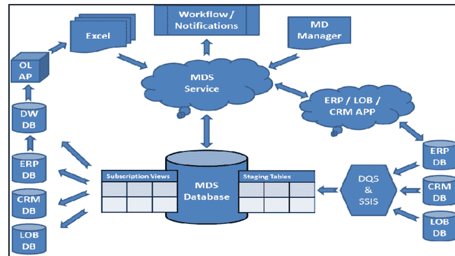

## 使用SSIS分析数据

此任务的目标是使用SSIS分析数据，以发现潜在的错误值。在本练习中，你将创建一个包含单个任务（数据配置文件任务）的SSIS包。然后，你将执行该包以分析一组数据。最后，你将使用数据配置文件查看器应用程序检查结果。

## 准备工作

对于本练习，你需要已安装AdventureWorkDW2014演示数据库。

## 操作步骤...

- 1. 打开 **SQL Server数据工具（SSDT）**，并使用Integration Services项目模板创建一个新项目。将解决方案放在`C:\SSIS2016Cookbook`文件夹中，并将项目命名为`Chapter10`。
- 2. 将默认包重命名为`DataProfiling.dtsx`。
- 3. 从SSIS工具箱中，将数据配置文件任务拖放到控制流工作区。
- 4. 双击该任务以打开 **数据配置文件任务编辑器**。
- 5. 在 **数据配置文件任务编辑器** 的 **常规** 页面中，为 **DestinationType** 属性的下拉列表选择 **FileConnection**。从 **Destination** 属性的下拉列表中选择 **新建文件连接**。在出现的文件连接管理器编辑器中，选择 **创建文件**，并输入`C:\SSIS2016Cookbook\DataProfiling.xml`。单击 **打开**，然后单击 **确定**。
- 6. 返回 **数据配置文件任务编辑器**，将 **OverwriteDestination** 属性设置为 **True**。你的 **数据配置文件任务编辑器** 应如下面的截图所示：

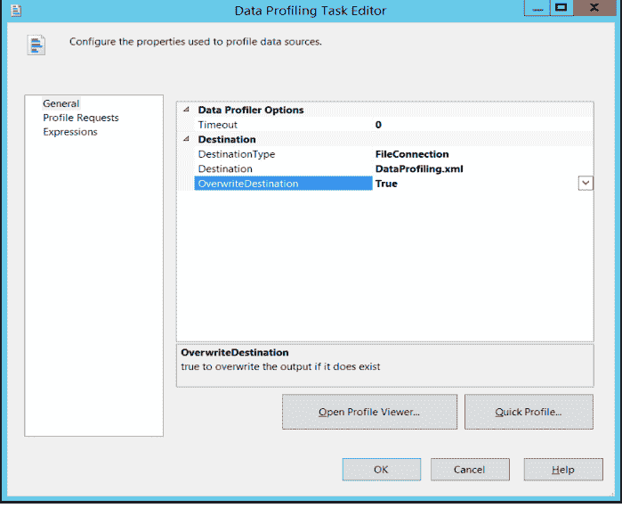

15. 你的“数据配置文件任务编辑器”窗口应类似于以下截图所示。单击“确定”关闭“数据配置文件任务编辑器”：

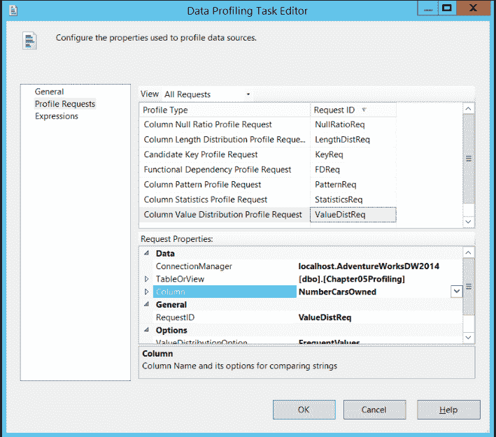

16. 保存包并在调试模式下执行它。执行完成后，退出调试模式。使用Visual Studio、记事本或Internet Explorer查看执行期间创建的XML文件。关闭SSDT。

17. 启动数据配置文件查看器。

18. 在“数据配置文件查看器”窗口中，单击左上角的“打开”按钮。

19. 导航到C:\SSIS2016Cookbook文件夹，并打开DataProfiling.xml文件。

20. 单击左侧窗格中的“候选键配置文件”选项。检查哪些列适合用作键（这些列的唯一值数量要多于该配置文件的阈值“百分比”属性）。

## 创建DQS知识库

DQS知识库是存储关于数据和清理知识的地方，目的是加快常规清理过程。在现实场景中，你会不断向知识库添加知识，从而随着时间的推移改进清理过程。在本食谱中，你将创建一个基本的DQS知识库。

## 准备工作

对于本食谱，你需要已安装DQS和数据质量客户端。请参考以下链接了解如何安装DQS组件：
https://docs.microsoft.com/en-us/sql/data-quality-services/install-windows/install-data-quality-services。

你还需要准备用于创建DQS知识库的数据。在SSMS中，执行以下代码：

```
USE AdventureWorksDW2014;
SELECT DISTINCT
City, StateProvinceName AS StateProvince,
EnglishCountryRegionName AS CountryRegion
INTO dbo.AWCitiesStatesCountries
FROM dbo.DimGeography;
GO
```

## 操作步骤...

- 1. 打开数据质量客户端应用程序，并连接到你的DQS实例。
- 2. 在“知识库管理”组中，单击“新建知识库”按钮。
- 3. 将数据库命名为AWCustomers。如果需要，可以添加描述。确保在“从以下位置创建知识库”下拉列表中选择了“无”选项。在屏幕右下角的“选择活动”列表中选择“知识发现”选项。单击“下一步”。
- 4. 在“知识库管理”屏幕的“映射”选项卡中，选择SQL Server作为数据源。选择AdventureWorksDW2014数据库和dbo.AWCitiesStatesCountries表。

5. 在“映射”部分，单击“创建域”按钮（“映射”网格上方按钮组中左起第三个按钮，标记为一个带黄色星星的圆圈）以创建一个域。

6. 在出现的对话框中，输入City作为域名，并使用String作为数据类型。确保选中“使用前导值”、“规范化字符串”和“禁用语法错误算法”选项，并且未选中“启用拼写检查器”选项。确保“将输出格式设置为”选项为“无”，且选择的语言为英语，如下面的截图所示。单击“确定”：

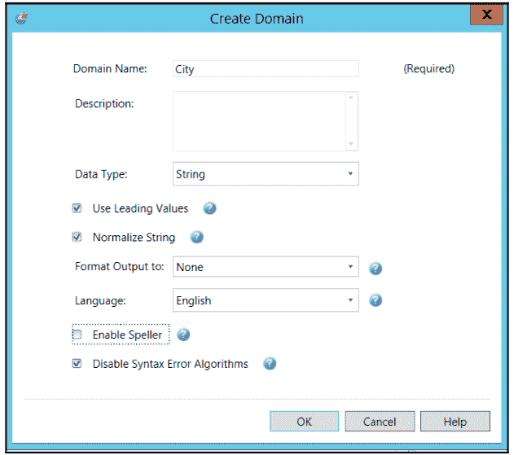

7. 再创建两个域，分别命名为State和Country，设置与第6步中City域相同。

8. 在“映射”网格中，从第一行的左列来源选择City列，并将其映射到网格第一行右列中的City域。

9. 重复第8步两次，以添加从StateProvince来源列到State域的映射，以及从CountryRegion来源列到Country域的映射。单击“下一步”。


+   10. 在 **发现** 选项卡上，点击 **开始** 按钮启动知识发现。等待过程结束，然后查看 **分析器** 部分中的所有信息。此部分提供数据的快速概况。完成查看分析器信息后，点击下一步。

+   11. 在 **管理域值** 选项卡上，确保左侧窗格中选中 **城市** 域。然后点击右侧窗格中网格上方的 **添加新域值** 按钮（网格上带小绿色加号的按钮）。

+   12. 在 `值` 单元格中输入 `Munich`。将类型更改为 **错误**（红色十字）。在 `更正为` 单元格中输入 `München`。按 *Enter* 键，注意数据会按字母顺序重新排列。


要输入 ü，请按住 *Alt* 键并在数字键盘上输入 0252 或 129。

+   13. 点击左侧窗格中的其他两个域，检查提取的值。然后点击 **完成**。在弹出的窗口中选择 **否**，因为你尚未准备好发布知识库。你将对域进行编辑。

+   14. 在数据质量客户端主屏幕上，点击 **知识库管理** 组中的 **打开知识库** 按钮。

+   15. 在左侧窗格的网格中，选择 `AWCustomers` 知识库。确保已选择 **域管理** 活动。点击 **下一步**。

+   16. 在 **域管理** 窗口中，确保左侧窗格中选中 `City` 域。点击右侧窗格中的 **域值** 选项卡。然后点击右侧窗格中网格上方的 **添加新域值** 按钮。

+   17. 在 `值` 单元格中输入 `Muenchen`。将类型更改为 **错误**（红色十字）。在 `更正为` 单元格中输入 `München`。按 *Enter* 键，注意数据会按字母顺序重新排列。

+   18. 在网格中找到 **München** 值。注意它现在成为另外两个同义词 `Munich` 和 `Muenchen` 的领先值。

+   19. 在左侧窗格中，点击 **创建域** 按钮。将域命名为 `StreetAddress`，并使用 **字符串** 作为数据类型。确保选中 **使用领先值**、**规范化字符串** 和 **禁用语法错误算法** 选项，且 **启用拼写检查器** 选项未被选中。还要确保 **输出格式** 选项设置为 **无**，所选语言为 **英语**。点击 **确定**。

+   20. 为 `StreetAddress` 域点击 **基于术语的关系** 选项卡。你将添加一个基于术语的关系，以更正域值中某个术语的所有出现。

+   21. 点击 **添加新关系** 按钮。在 `值` 单元格中输入 `Ct.`，在 `更正为` 单元格中输入 `Court`。按 *Enter*。**应用更改** 按钮应不可用，因为你还没有任何域值。

+   22. 添加一个名为 `BirthDate` 的新域。选择 **日期** 作为数据类型。使用领先值，但不要格式化输出。点击 **确定**。

+   23. 为 `BirthDate` 域点击 **域规则** 选项卡。在右侧窗格中，点击 **添加新域规则** 按钮。

+   24. 在规则网格中，在 `名称` 单元格中输入 `MinBirthDate`。

+   25. 在 **生成规则：MinBirthDate** 部分，确保在下拉条件列表中选择 **值大于** 选项。然后在文本框中输入 `1/1/1900` 并按 *Enter*。检查这是否已成功更改为 `1900年1月1日星期一`。

+   26. 添加一个新域 `Occupation`。使用 **字符串** 作为数据类型。确保选中 **使用领先值** 和 **规范化字符串** 选项。但这次 **启用拼写检查器** 应被选中，且取消选中 **禁用语法错误算法**。不要格式化输出，并使用英语。点击 **确定**。

+   27. 添加一个新域 `EmailAddress`。使用 **字符串** 作为数据类型。确保选中 **使用领先值**、**规范化字符串** 和 **禁用语法错误算法** 选项，且 **启用拼写检查器** 选项未被选中。不要格式化输出，并使用英语。点击 **确定**。

+   28. 为 `EmailAddress` 域点击 **域规则** 选项卡。添加一个名为 `EmailRegEx` 的新规则。

+   29. 在 **生成规则：EmailRegEx 条件** 下拉列表中选择 **值与正则表达式匹配** 选项。然后输入 `\p{L}+\d@ADVENTURE-WORKS\.COM` 作为表达式。点击文本框外部。

+   30. 点击 **向所选子句添加新条件** 按钮（**生成规则** 区域右上角最左侧的按钮）。

+   31. 选择 **OR** 运算符来连接条件。在 **生成规则：EmailRegEx 条件** 下拉列表中为第二个条件选择 **值与正则表达式匹配** 选项。然后输入 `\p{L}+\d@ADVENTURE-WORKS\.COM` 作为表达式。点击文本框外部。

本练习所需的正则表达式是在上一个配方中通过数据配置文件任务提取的。

32. 点击 **完成** 结束域管理。然后在弹出窗口中点击 **发布** 按钮。最后，在下一个弹出窗口中点击 **确定**。你的知识库现已准备好使用。

## 使用 DQS 进行数据清理

在本配方中，你将创建一个包含脏数据的视图，并使用 DQS 清理项目对其进行清理。你将使用上一个练习中准备的 DQS 知识库。

### 准备工作

本配方假设你已根据上一个配方构建了 DQS 知识库。此外，你需要提前准备一些演示数据。在 SSMS 中，使用以下查询准备数据：

```
USE DQS_STAGING_DATA;
SELECT C.CustomerKey,
C.FirstName + ' ' + C.LastName AS FullName,
C.AddressLine1 AS StreetAddress,
G.City, G.StateProvinceName AS StateProvince,
G.EnglishCountryRegionName AS CountryRegion,
C.EmailAddress, C.BirthDate,
C.EnglishOccupation AS Occupation
INTO dbo.CustomersCh05
FROM AdventureWorksDW2014.dbo.DimCustomer AS C
INNER JOIN AdventureWorksDW2014.dbo.DimGeography AS G
ON C.GeographyKey = G.GeographyKey
WHERE C.CustomerKey % 10 = 0;
GO
```

### 操作步骤...

-   1. 上一节准备的数据是干净的。对于 DQS 清理项目，使用以下代码添加两行包含错误数据的数据：

```
USE DQS_STAGING_DATA;
```

```
```sql
SELECT CustomerKey, FullName,
       StreetAddress, City,
       StateProvince, CountryRegion,
       EmailAddress, BirthDate,
       Occupation
INTO dbo.CustomersCh05DQS
FROM dbo.CustomersCh05
UNION
SELECT -11000,
       N'Jon Yang',
       N'3761 N. 14th St',       -- 错误城市
       N'Munich',                -- 错误州
       N'Kingsland',             -- 错误国家
       N'Austria',               -- 错误电子邮件
       N'jon24@adventure-works.com', -- 错误出生日期
       '18900224',               -- 错误职业
       'Professional'
UNION
SELECT -11100,
       N'Jacquelyn Suarez',
       N'7800 Corrinne Ct.',     -- 错误术语
       N'Muenchen',              -- 另一个错误城市
       N'Queensland',
       N'Australia',
       N'jacquelyn20@adventure-works.com',
       '19680206',
       'Professional';
GO
```
```

-   2. 如有必要，请打开数据质量客户端应用程序，并连接到你的 DQS 实例。
-   3. 在 **数据质量项目** 组中，点击 **新建数据质量项目** 按钮。
-   4. 将项目命名为 `AWCustomersCleansing`。使用你在上一个练习中创建的 AWCustomers 知识库。确保选中 **清理** 活动。点击 **下一步**。
-   5. **数据质量项目** 窗口将打开，**映射** 选项卡为活动选项卡。选择 **SQL Server** 作为数据源，选择 `DQS_STAGING_DATA` 数据库，并在 **表/视图** 下拉列表中选择 `dbo.CustomersCh05DQS` 表。
-   6. 在 **映射** 区域中，点击 **映射** 网格上方带小绿色加号的按钮两次，向 **映射** 网格添加两行。（默认提供五个映射，但你需要七个。）


7. 使用 Source Column 和 Domain 单元格中的下拉列表映射以下列和域：

| Column | Domain |
|---|---|
| BirthDate | BirthDate |
| StreetAddress | StreetAddress |
| City | City |
| StateProvince | State |
| CountryRegion | Country |
| EmailAddress | EmailAddress |
| Occupation | Occupation |

8. 下面的屏幕截图显示了列到域的正确映射。当映射正确时，单击 Next：

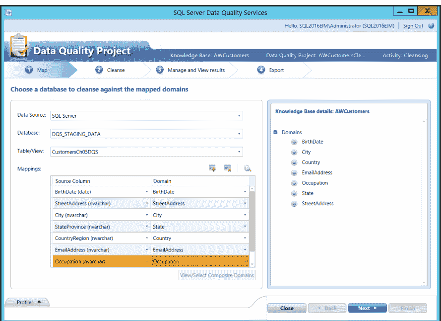

- 9. 在 **Cleanse** 选项卡上，单击 **Start**。等待计算机辅助清洗完成，然后查看分析结果。单击 **Next**。
- 10. 在 **Manage and View results** 选项卡上，逐个域检查结果。先从 `BirthDate` 域开始。应该有一个无效值。确保在左侧窗格中选择了 `BirthDate` 域，并在右侧窗格中单击 **Invalid** 选项卡。注意检测到的无效值。你可以在无效值网格的 **Correct to** 单元格中现在写入一个正确的值，但本练习中不需要此操作。请注意，所有正确的值都被建议为新的。
- 11. 在左侧窗格中选择 `StreetAddress` 域。应该有一个值被纠正。然而，由于只纠正了基于词项的关系（而不是整个值），因此它不会出现在已纠正的值中。它应该出现在新的值中。单击右侧窗格中的 **New** 选项卡。搜索值 `7800 Corrine Ct.` 并注意它已以 100% 的置信度纠正为 `7800 Corrinne Court`。
- 12. 清空 **Search Value** 文本框。在左侧窗格中选择 `State` 域。单击右侧窗格中的 **New** 选项卡。请注意，有一个值（`Kingsland`）被发现为新的。原始值（`Queensland`）的相似度阈值对于 DQS 自动纠正或甚至建议该值来说太低了。你可以手动纠正此值，但本练习中不需要。
- 13. 在左侧窗格中选择 `City` 域。应该有两个值被纠正。单击右侧窗格中的 **Corrected** 选项卡。注意对 `München` 的同义词（`Munich` 和 `Muenchen`）纠正为首选值（`München`）。还要注意，这两个纠正的置信度均为 100%。所有其他值已存在于 KB 中，因此 DQS 将它们标记为正确。
- 14. 在左侧窗格中选择 `Country` 域。应该有一个值被建议。单击右侧窗格中的 **Suggested** 选项卡。请注意，DQS 建议以 70% 的置信度将 `Austria` 替换为 `Australia`。你可以通过在网格中勾选 **Approve** 选项来批准单个值。但是，不要批准它，因为当然这是一个错误的建议。请注意，DQS 已将所有其他国家识别为正确。
- 15. 在左侧窗格中选择 `EmailAddress` 域。应该有一个值无效。单击右侧窗格中的 **Invalid** 选项卡。DQS 告诉你 `jon24#adventure-works.com` 电子邮件地址不符合 `EmailRegEx` 规则。请注意，所有其他值均标记为新。

- 16. 在左侧窗格中选择 **Occupation** 域。请注意所有值都是新的。单击右侧窗格中的 **New** 选项卡。请注意，值 `Professional` 用红色波浪线标记。这是因为你为 Occupation 域启用了拼写检查。在错误行的 **Correct to** 字段中输入 `Professional`。请注意，由于你手动纠正了该值，因此置信度设置为 100%。为该行选中 **Approve** 复选框。该行应消失并出现在已纠正的值中。单击 **Corrected** 选项卡。观察纠正后的值以及原因。单击 **Next**。
- 17. 在 **Export** 选项卡上，查看窗口左侧的输出数据预览。你可以将结果导出到 SQL Server 表中，然后纠正原始数据。但是，在本实验中你不需要导出结果。只需单击 **Finish**。
- 18. 关闭 SSMS 和 Data Quality Client 应用程序。

## 创建 MDS 模型

在本教程中，你将创建一个 MDS 模型，其中包含客户实体集所需的实体、属性和层次结构。然后你将填充实体并检查业务规则。

## 准备工作

为了测试本教程，你需要安装 MDS。请参考以下链接了解如何安装 MDS 组件：

`https://docs.microsoft.com/en-us/sql/master-data-services/install-windows/install-master-data-services`

## 如何操作...

- 1. 你需要打开 Master Data Manager 应用程序。打开你的网络浏览器，导航到你的 Master Data Manager 站点并登录。导航到主页。
- 2. 单击 **System Administration** 链接。
- 3. 在 **Manage Models** 页面，单击 **Add**。

4. 将模型命名为 AWCustomer。确保选中 Create entity with the same name as model 选项。保持 Description 文本框为空，并将 Log Retention 下拉列表保持为默认值 System Setting，如以下屏幕截图所示。单击 Save 按钮：

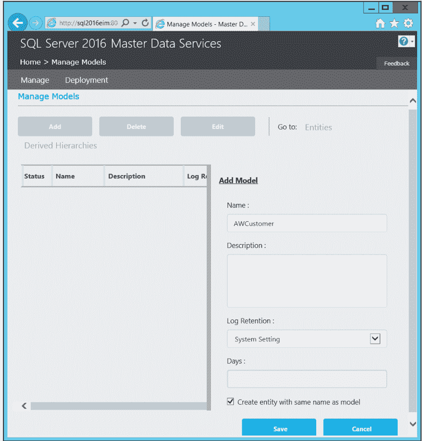

- 5. 在 **Manage Models** 页面，单击 **Go to** 部分中的 **Entities** 链接。
- 6. 在 **Manage Entities** 页面，单击 **Add** 按钮。将实体命名为 `StateProvince`。选中 **Create code values automatically** 选项。在 **Start with** 文本框中写入 1。确保选中 **Enable data compression** 复选框且未选中 **Approval Required**。单击 **Save** 按钮。
- 7. 单击页面左上角的 **Manage Entities** 链接。创建另一个实体 `CountryRegion`，其设置与上一步中创建的 `StateProvince` 相同。保存它。
- 8. 单击页面左上角的 **Manage Entities** 链接。在实体列表中单击 `StateProvince` 实体以突出显示它。单击 **Go to** 部分中的 **Attributes** 链接。
- 9. 请注意，已经创建了两个属性，即 `Name` 和 `Code` 属性。
- 10. 单击 **Add** 按钮。将新属性命名为 `CountryRegion`。使新属性基于域并使用 `CountryRegion` 实体作为域值。不要更改显示像素宽度且不要启用更改跟踪。保存该属性。
- 11. 开始编辑 `AWCustomer` 实体。在 **Entity** 下拉列表中选择它。添加一个基于域的叶成员属性 `StateProvince`。使用 `StateProvince` 实体作为可能值的域。不要启用更改跟踪。保存该属性。
- 12. 添加一个自由格式叶成员属性 `StreetAddress`。使用 **Text** 数据类型。将 `Display Width (Pixel)` 改为 200。不要启用更改跟踪。保存该属性。
- 13. 添加一个自由格式叶成员属性 `City`。使用 **Text** 数据类型。保持默认长度 100 和默认像素宽度 100。不要启用更改跟踪。保存该属性。
- 14. 添加一个自由格式叶成员属性 `EmailAddress`。使用 **Text** 数据类型。保持默认长度 100 和默认像素宽度 100。不要启用更改跟踪。保存该属性。
- 15. 添加一个自由格式叶成员属性 `MaritalStatus`。使用 **Text** 数据类型。将长度改为 1。将显示像素宽度改为 20。不要启用更改跟踪。保存该属性。
- 16. 添加一个自由格式叶成员属性 `BirthDate`。使用 **DateTime** 数据类型。使用默认像素宽度 100。使用 `yyyy/MM/dd` 输入掩码。不要启用更改跟踪。保存该属性。

- 17. 添加一个自由格式叶成员属性 YearlyIncome。使用 **Number** 数据类型，保留两位小数。使用默认像素宽度 100。使用 -#### 输入掩码。不要启用更改跟踪。保存该属性。
- 18. 导航到 **Manage Entities** 页面（**Home | AWCustomer Model | Manage Entities**）。选择 `AWCustomer` 实体。
- 19. 单击 **Attribute Groups** 链接。单击 **Add**。将组命名为 `Demography`。
- 20. 在 **Attributes** 部分，将 `MaritalStatus`、`BirthDate` 和 `YearlyIncome` 属性添加到此属性组中，如以下屏幕截图所示，然后保存属性组：

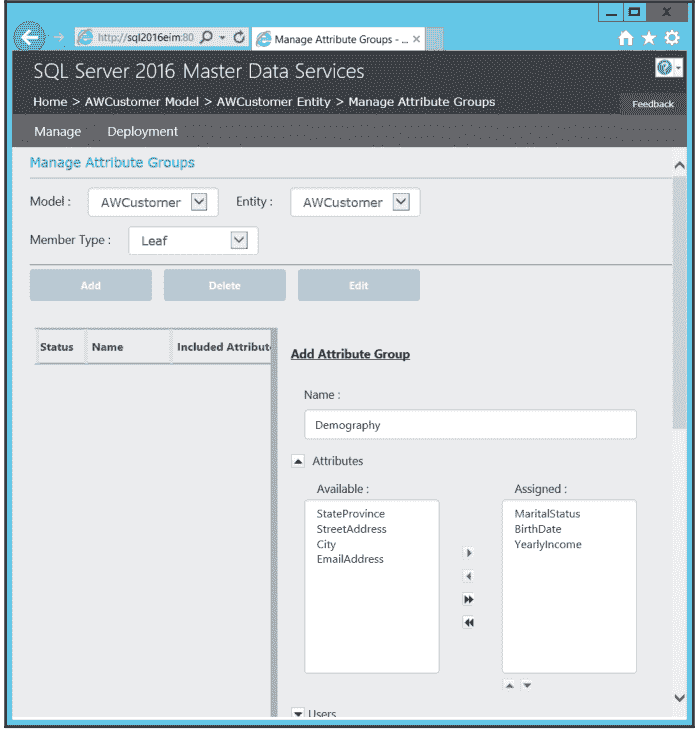


+   21. 导航到 **Manage Entities** 页面（**Home | AWCustomer Model | Manage Entities**）。选择 `AWCustomer` 实体。
+   22. 单击 **Business Rules** 链接。单击 **Add**。将规则命名为 `EmailAt`。
+   23. 在 **Add Business Rule** 弹出窗口中，单击 **Then** 部分中的 **Add** 链接。
+   24. 在 **Create Action** 弹出窗口中，在 **Attribute** 下拉列表中选择 `EmailAddress` 属性。
+   25. 在 **Operator** 下拉列表中，选择 **must contain the pattern** 操作符。
+   26. 在 **Must contain the pattern** 下拉列表中，选择 **Attribute value**。
+   27. 在 **Attribute value** 文本框中，写入 `@` 符号。确保你的 **Create Action** 弹出窗口看起来像以下屏幕截图中的那样，然后单击 **Save**：

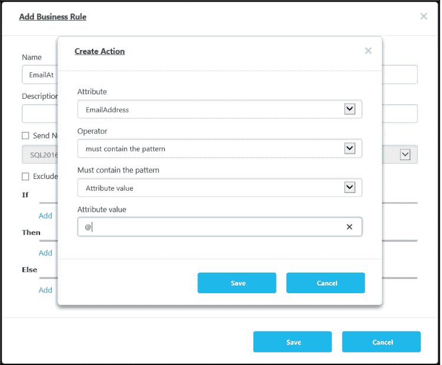

+   28. 在 **Add Business Rule** 窗口中，单击 **Save**。
+   29. 在 **Business Rules** 窗口中，单击 **Publish All** 按钮以激活所有业务规则。
+   30. 导航到主页。确保在 **Model** 下拉列表中选择了 `AWCustomer` 模型。然后单击 **Explorer**。
+   31. 单击屏幕左上角的 **Entities** 按钮，并选择 `CountryRegion` 实体。在编辑器中，单击 **Add Member** 按钮。
+   32. 在右侧的 **Details** 面板中，将 `Name` 字段的值输入为 `Australia`。注意 `Code` 字段的值会自动分配。单击 **OK**。
+   33. 添加另一个成员，将 `Name` 字段的值设为 `United States`。
+   34. 使用 **Entities** 按钮，选择 `StateProvince` 实体。在编辑器中，单击 **Add Member** 按钮。
+   35. 在 **Details** 面板中，将 `Name` 字段的值输入为 `Queensland`。注意 `Code` 字段的值会自动分配。在 `CountryRegion` 下拉列表中，选择 1 {Australia}。单击 **OK**。
+   36. 添加另一个成员，将 `Name` 字段的值设为 `Washington`。单击 `CountryRegion` 下拉列表右侧的按钮以打开另一个窗口，其中列出了 `CountryRegion` 实体的成员。检查 `United States` 成员的代码。返回编辑 `StateProvince` 实体的窗口并插入适当的 `CountryRegion` 代码。单击 **OK**。
+   37. 使用 **Entities** 按钮，选择 `AWCustomer` 实体。注意有两个视图：一个仅包含来自 `Demography` 属性组的属性，另一个包含所有属性。单击 **[All Attributes]** 选项卡以查看所有属性。你将基于 `AdventureWorksDW2014` 示例数据库中 `dbo.DimCustomer` 表中的两个客户添加两个成员，带有数据。在编辑器中，单击 **Add Member** 按钮。

43. 注意在显示所有客户的网格中，Lauren Walker 条目旁边有一个红色感叹号。将指针指向它并阅读消息。还要注意右侧 Details 面板中关于验证错误的提示，如以下屏幕截图所示：

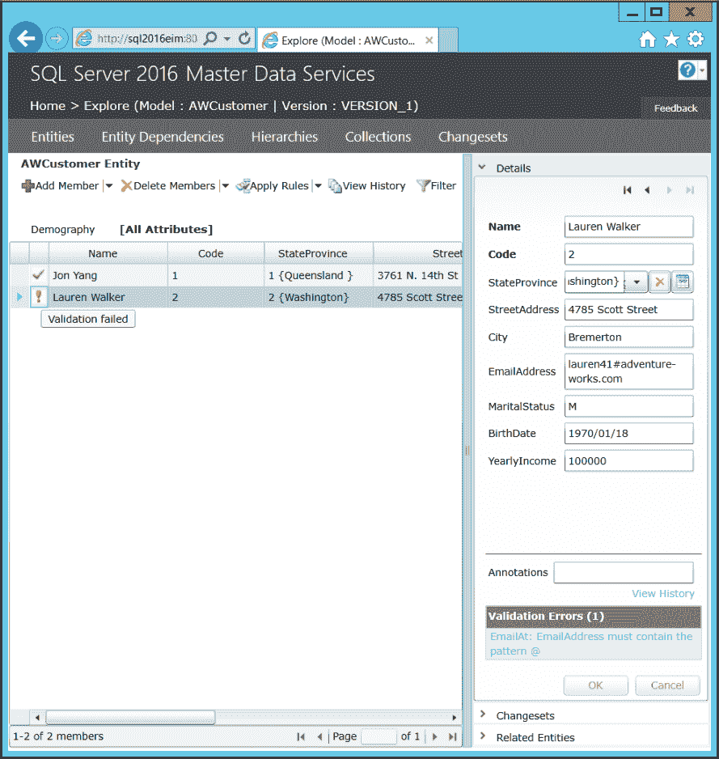

44. 在 **Details** 面板中，更正 `EmailAddress` 字段中的值并单击 **OK**。  
现在验证应该成功。

## Matching with DQS

通常，你需要在没有通用标识的情况下匹配实体。例如，你可能从两个不同的来源获取有关客户的数据。然后你需要基于属性的相似性进行匹配，例如姓名和地址。匹配是一项非常复杂的任务。在 SQL Server 中，DQS 是可以帮助你完成此任务的工具之一。

### Getting ready

为了测试 DQS 匹配，你需要准备一些数据。以下部分包含大量代码；因此，你可能希望使用本书配套内容中提供的代码。

首先，你需要准备一个包含干净数据的表。在 SSMS 中，执行以下代码：

```
```sql
-- Preparing the clean data table
USE DQS_STAGING_DATA;
CREATE TABLE dbo.CustomersClean
(
CustomerKey INT NOT NULL PRIMARY KEY,\
FullName NVARCHAR(200) NULL,
StreetAddress NVARCHAR(200) NULL
);
GO
-- Populating the clean data table
INSERT INTO dbo.CustomersClean
(CustomerKey, FullName, StreetAddress)
SELECT CustomerKey,
FirstName + ' ' + LastName AS FullName,
AddressLine1 AS StreetAddress
FROM AdventureWorksDW2014.dbo.DimCustomer
WHERE CustomerKey % 10 = 0;
GO
```
```

然后你为脏数据创建类似的表，并最初用干净数据填充它：

```
```sql
-- Creating and populating the table for dirty data
CREATE TABLE dbo.CustomersDirty
(
```

```
```sql
CustomerKey INT NOT NULL PRIMARY KEY,
FullName NVARCHAR(200) NULL,
StreetAddress NVARCHAR(200) NULL,
Updated INT NULL,
CleanCustomerKey INT NULL
);
GO
INSERT INTO dbo.CustomersDirty
(CustomerKey, FullName, StreetAddress, Updated)
SELECT CustomerKey * (-1) AS CustomerKey,
FirstName + ' ' + LastName AS FullName,
AddressLine1 AS StreetAddress,
0 AS Updated
FROM AdventureWorksDW2014.dbo.DimCustomer
WHERE CustomerKey % 10 = 0;
GO
```
```

下一步是最复杂的一步。你需要在脏数据表中进行随机更改。请注意，在此表中，原来的 CustomerKey 列乘以 −1，并且有一个干净 CustomerKey 的空间。这样，你将能够检查匹配的质量。尽管如此，以下代码在表中做了某种随机更改，模仿人为错误：

```
```sql
-- Making random changes in the dirty table
DECLARE @i AS INT = 0, @j AS INT = 0;
WHILE (@i < 3) -- loop more times for more changes
BEGIN
SET @i += 1;
SET @j = @i - 2; -- control here in which step you want to update
-- only already updated rows
WITH RandomNumbersCTE AS
(
SELECT CustomerKey
,RAND(CHECKSUM(NEWID())) % 1000000000 + CustomerKey AS RandomNumber1
,RAND(CHECKSUM(NEWID())) % 1000000000 + CustomerKey AS RandomNumber2
,RAND(CHECKSUM(NEWID())) % 1000000000 + CustomerKey AS RandomNumber3
,FullName, StreetAddress, Updated
FROM dbo.CustomersDirty
)
UPDATE RandomNumbersCTE SET
FullName = STUFF(FullName,
CAST(CEILING(RandomNumber1 * LEN(FullName)) AS INT), 1,
CHAR(CEILING(RandomNumber2 * 26) + 96))
,StreetAddress = STUFF(StreetAddress,
CAST(CEILING(RandomNumber1 * LEN(StreetAddress)) AS INT), 2, '')
,Updated = Updated + 1
WHERE RAND(CHECKSUM(NEWID())) % 1000000000 - CustomerKey < 0.17
```

```
```sql
AND Updated > @j;
WITH RandomNumbersCTE AS
(
SELECT CustomerKey
,RAND(CHECKSUM(NEWID())) % 1000000000 + CustomerKey AS RandomNumber1
,RAND(CHECKSUM(NEWID())) % 1000000000 + CustomerKey AS RandomNumber2
,RAND(CHECKSUM(NEWID())) % 1000000000 + CustomerKey AS RandomNumber3
,FullName, StreetAddress, Updated
FROM dbo.CustomersDirty
)
UPDATE RandomNumbersCTE SET
FullName = STUFF(FullName,
CAST(CEILING(RandomNumber1 * LEN(FullName)) AS INT), 0,
CHAR(CEILING(RandomNumber2 * 26) + 96))
,StreetAddress = STUFF(StreetAddress,
CAST(CEILING(RandomNumber1 * LEN(StreetAddress)) AS INT), 2,
CHAR(CEILING(RandomNumber2 * 26) + 96) +
CHAR(CEILING(RandomNumber3 * 26) + 96)), Updated = Updated + 1
WHERE RAND(CHECKSUM(NEWID())) % 1000000000 - CustomerKey) < 0.17
AND Updated > @j;
WITH RandomNumbersCTE AS
(
SELECT CustomerKey
,RAND(CHECKSUM(NEWID())) % 1000000000 + CustomerKey AS RandomNumber1
,RAND(CHECKSUM(NEWID())) % 1000000000 + CustomerKey AS RandomNumber2
,RAND(CHECKSUM(NEWID())) % 1000000000 + CustomerKey AS RandomNumber3
,FullName, StreetAddress, Updated
FROM dbo.CustomersDirty
)
UPDATE RandomNumbersCTE SET
FullName = STUFF(FullName,
CAST(CEILING(RandomNumber1 * LEN(FullName)) AS INT), 1, '')
,StreetAddress = STUFF(StreetAddress,
CAST(CEILING(RandomNumber1 * LEN(StreetAddress)) AS INT), 0,
CHAR(CEILING(RandomNumber2 * 26) + 96) +
CHAR(CEILING(RandomNumber3 * 26) + 96))
,Updated = Updated + 1
WHERE RAND(CHECKSUM(NEWID())) % 1000000000 - CustomerKey) < 0.16
AND Updated > @j;
END;
GO
```
```

你可以使用以下查询比较更改后的数据与原始数据：

```
SELECT C.FullName D.FullName C.StreetAddress D.StreetAddress, D.Updated
FROM dbo.CustomersClean AS C
INNER JOIN dbo.CustomersDirty AS D
ON C.CustomerKey = D.CustomerKey * (-1)
WHERE C.FullName <> D.FullName
OR C.StreetAddress <> D.StreetAddress
ORDER BY D.Updated DESC;
GO
```

应该有超过 700 行被更新。确切的数量每次执行都会变化。当作为本章示例执行代码时，我得到 756 行被更新。这意味着有 756 个客户需要与干净数据表进行匹配。

## How to do it...

+   1. 在 SSDT 中，打开本章第一个配方中的 Chapter10 解决方案。
+   2. 向解决方案添加一个新的包并将其重命名为 DataMatching.dtsx。
+   3. 创建一个新的包 OLE DB 连接管理器连接到你的本地 SQL Server 实例，DQS_STAGING_DATA 数据库。
+   4. 在包的控制流中，添加一个数据流任务。打开此任务的数据流编辑器。
+   5. 添加一个 OLE DB 源。将其重命名为 CustomersDirty。打开 OLE DB 源编辑器并选择 dbo.CustomersDirty 表作为源表。单击 Columns 选项卡以检查列。单击 OK 关闭编辑器。
+   6. 准备身份映射（或匹配）的下一步是执行精确匹配。将查找转换拖到工作区域并使用 OLE DB 源通过蓝色数据流路径连接它。将其命名为 Exact Matches 并双击它以打开其编辑器。


- 7. 在查找转换编辑器中，选择左侧窗格中的连接选项卡。使用 DQS_STAGING_DATA 数据库的连接管理器。选择 dbo.CustomersClean 表。单击列选项卡。

- 8. 将 FullName 和 StreetAddress 列从可用输入列拖到可用查找列表中的同名列上。在可用查找列表中选中 CustomerKey 列旁边的复选框。在编辑器底部网格中的查找操作字段中，选择替换 'CleanCustomerKey' 选项。重命名输出别名为 CleanCustomerKey，如以下屏幕截图所示：

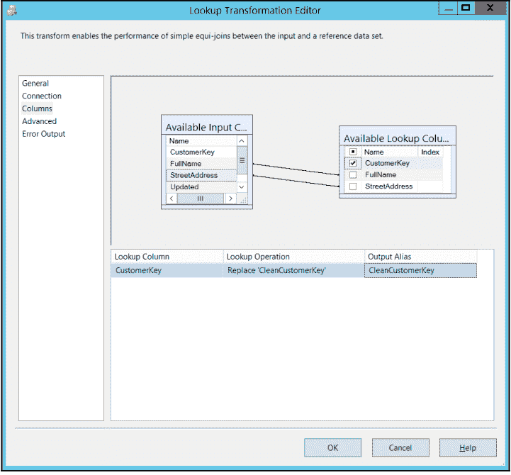

- 9. 单击 **General** 选项卡。在 **Specify how to handle rows with no matching entries** 下拉列表中，选择 **Redirect rows to no match output** 选项。单击 **OK** 关闭 **Lookup Transformation Editor**。
- 10. 将两个多播转换拖到工作区。第一个重命名为 `Match`，第二个重命名为 `NoMatch`。使用查找匹配输出将其与查找转换连接，使用查找不匹配输出将其与查找转换连接。你不需要为此配方多播数据。但是，你将在下一个配方中扩展包。
- 11. 在 SSMS 中，在 `DQS_STAGING_DATA` 数据库的 `dbo` 架构中创建一个新表，并命名为 `CustomersDirtyMatch`。使用以下代码：

```sql
CREATE TABLE dbo.CustomersDirtyMatch
(
    CustomerKey INT NOT NULL PRIMARY KEY,
    FullName NVARCHAR(200) NULL,
    StreetAddress NVARCHAR(200) NULL,
    Updated INT NULL,
    CleanCustomerKey INT NULL
);
```

- 12. 在 `dbo` 架构中添加另一个新表，并命名为 `CustomersDirtyNoMatch`。使用以下代码，该代码使用与上一个表相同的架构：

```sql
CREATE TABLE dbo.CustomersDirtyNoMatch
(
    CustomerKey INT NOT NULL PRIMARY KEY,
    FullName NVARCHAR(200) NULL,
    StreetAddress NVARCHAR(200) NULL,
    Updated INT NULL,
    CleanCustomerKey INT NULL
);
```

- 13. 在 SSDT 中的数据流中，添加一个新的 OLE DB 目标并重命名为 `CustomersDirtyMatch`。将其连接到匹配多播转换。双击它以打开编辑器。选择 `dbo.CustomersDirtyMatch` 表。单击 **Mappings** 选项卡以检查映射。单击 **OK**。
- 14. 添加一个新的 OLE DB 目标并重命名为 `CustomersDirtyNoMatch`。将其连接到不匹配多播转换。双击它以打开编辑器。选择 `dbo.CustomersDirtyNoMatch` 表。单击 **Mappings** 选项卡以检查映射。单击 **OK**。

- 15. 保存项目。以调试模式执行包。执行完成后，查看 `dbo.CustomersDirtyMatch` 和 `dbo.CustomersDirtyNoMatch` 表的内容。
- 16. 停止调试。不要退出 SSDT。
- 17. 在 SSMS 中，在 `DQS_STAGING_DATA` 数据库中，使用以下代码创建一个联合干净和脏客户数据的表：

```sql
SELECT CustomerKey, FullName, StreetAddress
INTO dbo.CustomersDQSMatch
FROM dbo.CustomersClean
UNION
SELECT CustomerKey, FullName, StreetAddress
FROM dbo.CustomersDirtyNoMatch;
```

- 18. 启动数据质量客户端并连接到你的 DQS 服务器。
- 19. 创建一个新的知识库。将其命名为 `AWCustomersMatching`。确保已选择 **Matching Policy** 活动。单击 **Next**。
- 20. 在 **Knowledge Base Management** 窗口中，在 **Map** 选项卡（第一个）上，选择 **SQL Server** 作为数据源。选择 `DQS_STAGING_DATA` 数据库和 `CustomersDQSMatch` 表。
- 21. 创建一个名为 `FullName` 的域。使用数据类型 **String**，并选中 **Use Leading Values**、**Normalize String** 和 **Disable Syntax Error Algorithms** 复选框。清除 **Enable Speller** 复选框。将 **Format Output to** 选项设置为 **None** 并选择 **English** 作为语言。单击 **OK**。
- 22. 创建另一个名为 `StreetAddress` 的域，其设置与 `FullName` 域相同。
- 23. 将 `FullName` 列映射到 `FullName` 域，并将 `StreetAddress` 列映射到 `StreetAddress` 域。

- 24. 创建一个新的复合域（单击左侧窗格中列/域映射网格上方从右数第二个图标）。对于匹配，通常使用复合域，它涵盖近似匹配涉及的所有列。将域命名为 `NameAddress` 并将 **Domain List** 列表框中的 `FullName` 和 `StreetAddress` 列添加到 **Domains in Composite Domains** 列表框中。单击 OK。你的屏幕应类似于以下屏幕截图所示。在确保域和映射正确后，单击 **Next**。

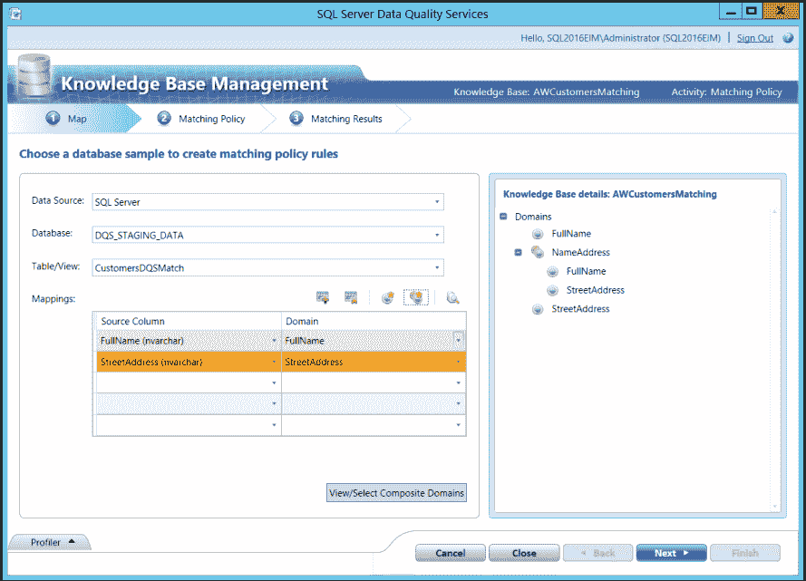

- 25. 在 **Matching Policy** 选项卡上，单击左侧窗格中的 **Create a matching rule** 按钮。在右侧的 **Rule Details** 窗格中，将规则名称更改为 `Composite100`。

- 26. 在右侧的 **Rule Editor** 区域中，单击右上角的 **Add a new domain element** 按钮。`NameAddress` 域应出现。向右滚动到 `Similarity` 列（保持值为 `Similar`）以显示 `Weight` 列。将 `NameAddress` 复合域的权重更改为 100%。你也可以通过要求一个域作为先决条件来开始对一个域进行精确匹配——例如，通过为 `FullName` 域选中 `Prerequisite` 列中的复选框来降低一次匹配的行数。然而，本配方中要匹配的客户数量并不太多，因此你不需要进一步减少匹配搜索空间。当你完成规则定义后，单击屏幕 **Matching Results** 部分中的 **Start** 以运行匹配策略。

- 27. 匹配策略运行完成后，查看结果。通过在 **Filter** 下拉列表中选择适当选项来按匹配或未匹配记录进行筛选。

- 28. 你应该测试多个规则。因此，创建一个新规则。将其命名为 `Name60Address40`。在 **Rule Editor** 部分中，单击 **Add a new domain element** 按钮。向右滚动到 `Similarity` 列（保持值为 `Similar`）以显示 `Weight` 列。将 `FullName` 域的权重更改为 60%，将 `StreetAddress` 域的权重更改为 40%。单击 **Start** 测试此规则。

- 29. 规则测试完成后，查看结果。双击几条匹配记录以获取记录的 **Matching Score Details** 窗口。检查名称和地址对分数的贡献程度。然后关闭窗口。查看完成后，单击 **Next**。

- 30. 在 **Matching Results** 窗口中，你可以一次检查所有相关规则。确保已选中 **Execute on previous data option**（位于 **Start** 按钮下方）。单击 **Start** 按钮。等待 DQS 完成处理，然后检查 **Profiler**、**Matching Rules** 和 **Matching Results**。在 **Matching Results** 中，双击几条匹配记录以显示 **Matching Score Details** 窗口，并检查使用了哪个规则。复合域的使用频率应高于单个域。

- 31. 查看完成后并关闭 **Matching Score Details** 窗口后，单击 **Finish**。然后在弹出窗口中单击 **Publish** 以发布 KB。发布后，在下一个弹出窗口中单击 **OK**。

- 32. 下一步是创建 DQS 匹配项目。单击数据质量客户端主屏幕中的 **New Data Quality Project** 按钮。

- 33. 将项目命名为 `AWCustomersMatchingProject`。选择 `AWCustomersMatching` KB。确保已选择 **Matching** 活动。单击 **Next**。

- 34. 在 **Knowledge Base Management** 窗口的 **Map** 选项卡（第一个）上，选择 **SQL Server** 作为数据源。选择 `DQS_STAGING_DATA` 数据库和 `CustomersDQSMatch` 表。注意，在实际项目中，你将在 KB 创建期间学习使用一个包含示例数据的单独表，并使用另一个表进行实际匹配。
- 35. 将 `FullName` 列映射到 `FullName` 域，将 `StreetAddress` 列映射到 `StreetAddress` 域，除非它们已被自动映射。单击 **Next**。
- 36. 在 **Matching** 选项卡上，单击 **Start**。等待匹配过程完成，然后查看结果。完成后，单击 **Next**。
- 37. 在 **Export** 页面，选择 **SQL Server** 作为目标类型并选择 `DQS_STAGING_DATA` 数据库。选中 **Matching Results** 和 **Survivorship Results** 两个复选框。将匹配结果导出到名为 `DQSMatchingResults` 的表，将幸存结果导出到名为 `DQSSurvivorshipResults` 的表。不要向表名添加架构名称；表将在 `dbo` 架构中创建。选择 **Most complete and longest record** 幸存规则。单击 **Export** 按钮。
- 38. 导出完成后，在 **Matching Export** 弹出窗口中单击 **Close**，然后单击 **Finish**。
- 39. 在 SSMS 中查看导出的结果。你可以快速看到幸存策略不够复杂，因为许多具有负 `CustomerKey` 值的客户被选为幸存者。你应该使用匹配结果并定义自己的幸存规则，或手动选择幸存者。
- 40. 关闭数据质量客户端。

## 使用 SSIS 模糊组件

SSIS 在数据流中包含两个非常复杂的匹配转换。模糊查找转换用于映射身份。模糊分组转换用于去重。两者都使用相同的算法来比较字符串和其他数据。

身份映射和去重实际上是同一个问题。例如，你可以将两个表中的所有数据联合到一个表中，然后进行去重。或者反过来，你可以将表与其自身连接，然后进行身份映射而不是去重。本配方展示了如何使用模糊查找转换进行身份映射。


## 准备就绪

本食谱假设你已经成功完成了之前的食谱。

## 操作步骤

- 1. 在 SSMS 中，在 `DQS_STAGING_DATA` 数据库的 `dbo` 架构下新建一个表，命名为 `dbo.FuzzyMatchingResults`。使用以下代码：
- 2. 切换到 SSDT。继续编辑 `DataMatching` 包。
- 3. 在“无匹配多播转换”下方添加一个“模糊查找转换”。将其重命名为 `FuzzyMatches`，并使用常规数据流路径将其连接到“无匹配多播转换”。双击该转换以打开其编辑器。
- 4. 在“引用表”选项卡中，选择要用于连接 `DQS_STAGING_DATA` 数据库的连接管理器，并选择 `dbo.CustomersClean` 表。不要存储新索引，也不使用现有索引。

```
CREATE TABLE dbo.FuzzyMatchingResults
(
    CustomerKey INT NOT NULL PRIMARY KEY,
    FullName NVARCHAR(200) NULL,
    StreetAddress NVARCHAR(200) NULL,
    Updated INT NULL,
    CleanCustomerKey INT NULL
);
```

当包首次执行该转换时，它会复制引用表，向新表添加一个整数数据类型的关键列，并在该关键列上生成索引。接下来，该转换在引用表的副本上生成一个称为“匹配索引”的索引。匹配索引存储对转换输入列中的值进行分词后的结果。然后，转换会在查找操作中使用这些分词。匹配索引是 SQL Server 数据库中的一张表。当包再次运行时，转换可以使用现有匹配索引或创建新索引。如果引用表是静态的，包可以避免在重复数据清理会话中重建索引这一可能代价高昂的过程。

- 5. 单击 **“列”** 选项卡。删除两个 `CustomerKey` 列之间的映射。清除 `CleanCustomerKey` 输入列旁边的复选框。选中 `CustomerKey` 查找列旁边的复选框。将此列的输出别名重命名为 `CleanCustomerKey`。你将用查找期间检索到的列替换原始列。映射应类似于以下截图所示：

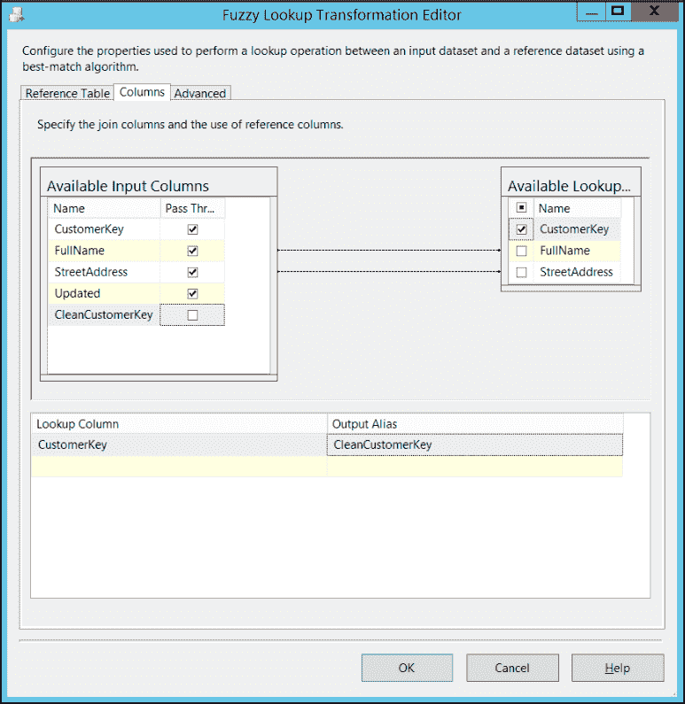

- 6. 单击 **“高级”** 选项卡。将 **“相似度阈值”** 提高到 0.50，以减少匹配搜索空间。如果相似度阈值为 0.00，则会导致完全交叉联接。单击 **“确定”**。
- 7. 将“联合全部转换”拖到“模糊查找转换”下方。将其连接到 `matchmulticast` 转换的一个输出和 `FuzzyMatches` 模糊查找转换的一个输出。这样可以将精确匹配和近似匹配合并到单个行集中。
- 8. 在“联合全部转换”下方拖放一个 OLE DB 目标。将其重命名为 `FuzzyMatchingResults`，并与“联合全部转换”连接。双击打开编辑器。
- 9. 连接到你的 `DQS_STAGING_DATA` 数据库，选择 `dbo.FuzzyMatchingResults` 表。单击 **“映射”** 选项卡。单击 **“确定”**。完成后的数据流如下图所示：

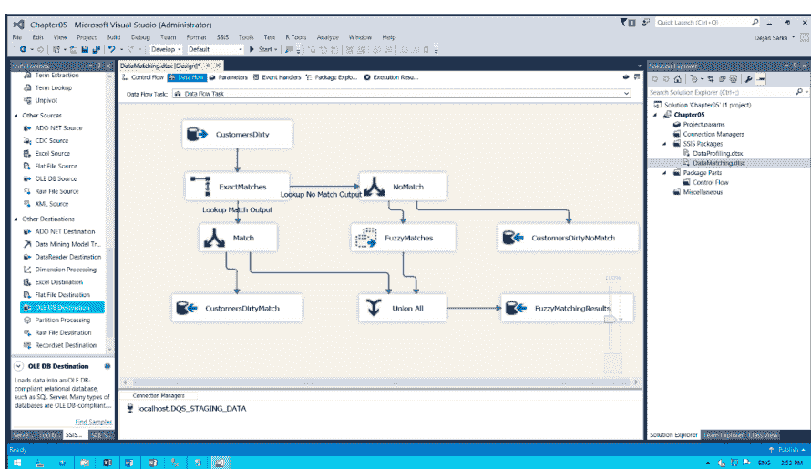

- 10. 你需要为包添加重启能力。你将截断所有目标表。单击 **“控制流”** 选项卡。将“执行 T-SQL 语句任务”拖动到“数据流任务”上方。使用从“执行 T-SQL 语句任务”到“数据流任务”的绿色优先约束连接这两个任务。“执行 T-SQL 语句任务”必须先成功完成，数据流任务才能启动。

- 11. 双击“执行 T-SQL 语句任务”。使用用于连接 `DQS_STAGING_DATA` 数据库的连接管理器。在 T-SQL 语句文本框中输入以下代码，然后点击 **“确定”**：

- 12. 保存解决方案。在调试模式下执行包以进行测试。在 SSMS 中查看模糊查找转换的结果。查找转换未找到匹配项的行，以及任何不正确的匹配。使用以下代码：

- 13. 你可以使用以下代码清理 `AdventureWorksDW2014` 和 `DQS_STAGING_DATA` 数据库：

- 14. 完成后，关闭 SSMS 和 SSDT。

```
```sql
TRUNCATE TABLE dbo.CustomersDirtyMatch;
TRUNCATE TABLE dbo.CustomersDirtyNoMatch;
TRUNCATE TABLE dbo.FuzzyMatchingResults;
```
```

```
```sql
-- 未匹配
SELECT * FROM FuzzyMatchingResults
WHERE CleanCustomerKey IS NULL;
-- 不正确的匹配
SELECT * FROM FuzzyMatchingResults
WHERE CleanCustomerKey <> CustomerKey * (-1);
```
```

```
```sql
USE AdventureWorksDW2014;
DROP TABLE IF EXISTS dbo.Chapter05Profiling;
DROP TABLE IF EXISTS dbo.AWCitiesStatesCountries;
USE DQS_STAGING_DATA;
DROP TABLE IF EXISTS dbo.CustomersCh05;
DROP TABLE IF EXISTS dbo.CustomersCh05DQS;
DROP TABLE IF EXISTS dbo.CustomersClean;
DROP TABLE IF EXISTS dbo.CustomersDirty;
DROP TABLE IF EXISTS dbo.CustomersDirtyMatch;
DROP TABLE IF EXISTS dbo.CustomersDirtyNoMatch;
DROP TABLE IF EXISTS dbo.CustomersDQSMAtch;
DROP TABLE IF EXISTS dbo.DQSMAtchingResults;
DROP TABLE IF EXISTS dbo.DQSSurvivorshipResults;
DROP TABLE IF EXISTS dbo.FuzzyMatchingResults;
```
```

脚本任务为你提供了自定义代码所需的完整基础设施，让你能专注于代码本身。你可以在代码中使用任何 .NET 类库和命名空间。此外，你还可以通过全局 **Dts 对象** 与所在的 SSIS 包进行交互。例如，Dts 对象暴露了包变量，你可以通过自定义代码读取和修改它们。

当你将脚本组件添加到数据流时，必须立刻做出第一个决定。你可以将脚本组件用作自定义数据源、目标或转换。将其添加到数据流时，系统会询问你正在创建哪种脚本组件类型。

确定了脚本组件类型后，设计脚本组件的下一步是配置其元数据。在元数据配置部分，使用脚本组件编辑器定义组件的属性，例如名称和使用的语言。你还需要在 `ReadOnlyVariables` 和 `ReadWriteVariables` 属性中列出脚本中将使用的 SSIS 包变量。请注意，变量名始终区分大小写。

脚本组件的元数据配置比脚本任务配置稍微复杂一些。你还需要定义组件的数据流缓冲区的输入和输出列。如果将脚本组件用作数据源，则只定义输出列。然后脚本组件负责创建数据流缓冲区。如果将组件用于转换，则必须配置输入和输出。如果用作数据目标，则只配置输入。你必须选择要在脚本中使用的输入缓冲区中的哪些列，以及要发送到输出缓冲区或数据目标的哪些列。

SSIS 组件的输出可以是 **同步的** 或 **异步的**，因此组件可以是非阻塞的或阻塞的。组件的每个输出都具有 `SynchronousInputID` 属性。如果此属性的值为 None，则输出是异步的，你可以完全重新定义它。此外，你还可以定义输出是否排序。如果 `SynchronousInputID` 属性的值是组件的输入 ID，则输出是同步的。你逐行处理输入，并且不能更改输出的输入行排序顺序。如果使用同步输出，还可以配置 `ExclusionGroup` 属性，以标识行到不同输出的重定向。例如，你可以将某些行重定向到常规输出，将某些行重定向到错误输出。

## 在 SSIS 脚本任务中使用变量

本任务的目标是教你如何在脚本任务中使用 SSIS 变量。你将学习两种方法：一种较复杂，一种较简单。在你的包中，通常使用后者。

### 准备就绪

本食谱没有特殊先决条件，当然，除了 SSIS 2016 之外。此外，你可以使用自己的文本文件进行测试，也可以使用本章代码随附的三个文本文件（`Ch11_03.txt`、`Ch11_08.txt` 和 `Ch11_10.txt`）。


为了方便阅读，本章所需的 VB 和 C# 代码片段在 `Chapter11.txt` 文件中提供。

## 操作步骤

- 1. 打开 SQL Server 数据工具（SSDT），使用 Integration Services 项目模板新建项目。将解决方案放在 `C:\SSIS2016Cookbook\Chapter11\Solution` 文件夹中，并将项目命名为 `AdventureWorksETL`。
- 2. 将默认包重命名为 `UsingVariables.dtsx`。
- 3. 创建一个数据类型为 `Int32`、默认值为 0 的 `intCounter` 变量。
- 4. 创建一个类型为 String、默认值为空白的 `strFile` 变量。**变量**窗口应如下所示：

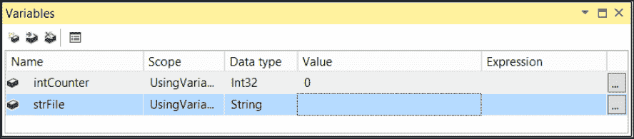

- 5. 在控制流中添加一个 `For Loop` 容器。将其重命名为 `LoopThreeTimes`。


+   6. 向控制流中添加一个 `Foreach Loop` 容器。将其重命名为 `GetFileNames`。
+   7. 使用 LoopThreeTimes 容器上的绿色（成功时）箭头，将 `GetFileNames` 容器与 `LoopThreeTimes` 容器连接起来。For Loop 容器必须成功完成后，Foreach Loop 容器才能开始执行。
+   8. 开始编辑 `LoopThreeTimes` 容器。设置以下属性：
+      - **InitExpression** 为 `@intCounter = 0`
+      - **EvalExpression** 为 `@intCounter < 3`
+      - **AssignExpression** 为 `@intCounter = @intCounter + 1`
+   9. 完成表达式设置后，单击“确定”。
+   10. 向 `LoopThreeTimes` 容器中添加一个 Script 任务。将其重命名为 `VariableDispenser`。你将使用 `Microsoft.SqlServer.Dts.Runtime` 命名空间中的 `VariableDispenser` 类来处理脚本中的变量。使用这个类，你可以在脚本期间对变量的锁定和解锁进行详细控制。在使用变量之前，你需要在脚本中锁定它们，无论是用于读取还是写入，因为 SSIS 执行是并行化的，其他线程可能同时想要使用相同的变量。
+   11. 双击 `VariableDispenser` 任务以打开“脚本任务编辑器”。将默认脚本语言更改为 Microsoft Visual Basic 2015。将 `ReadOnlyVariables` 和 `ReadWriteVariables` 属性保留为空。单击“编辑脚本”按钮。
+   12. 展开 **Imports** 区域。注意 `Microsoft.SqlServer.Dts.Runtime` 命名空间已经为你导入。
+   13. 找到 `Main()` 方法。将以下脚本放在 `Add your code here` 注释和 `Dts.TaskResult = ScriptResults.Success` 行之间：
+   14. 保存脚本并关闭 VSTA 环境。在“脚本任务编辑器”中单击“确定”以将其关闭。
+   15. 双击 `GetFileNames` 容器以打开编辑器。单击 **Collection** 选项卡。
+   16. 在 **Enumerator** 属性中指定 **Foreach File Enumerator**。

```
Dim vars As Variables = Nothing
Dts.VariableDispenser.LockForRead("intCounter")
Dts.VariableDispenser.GetVariables(vars)
MsgBox("Iteration: " & CStr(vars(0).Value))
```

+   17. 使用 C:\SSIS2016Cookbook\Chapter07\Files 文件夹（或者如果你已将提供的文本文件放在其他文件夹中，也可以使用任何你希望的文件夹）。本书的代码下载中提供了三个文本文件：Ch11_03.txt、Ch11_08.txt 和 Ch11_10.txt。
+   18. 在“文件”文本框中指定 Ch11*.txt 文件模式。仅检索文件名和扩展名。
+   19. 不要勾选“遍历子文件夹”复选框。以下截图显示了你的设置应该看起来的样子：

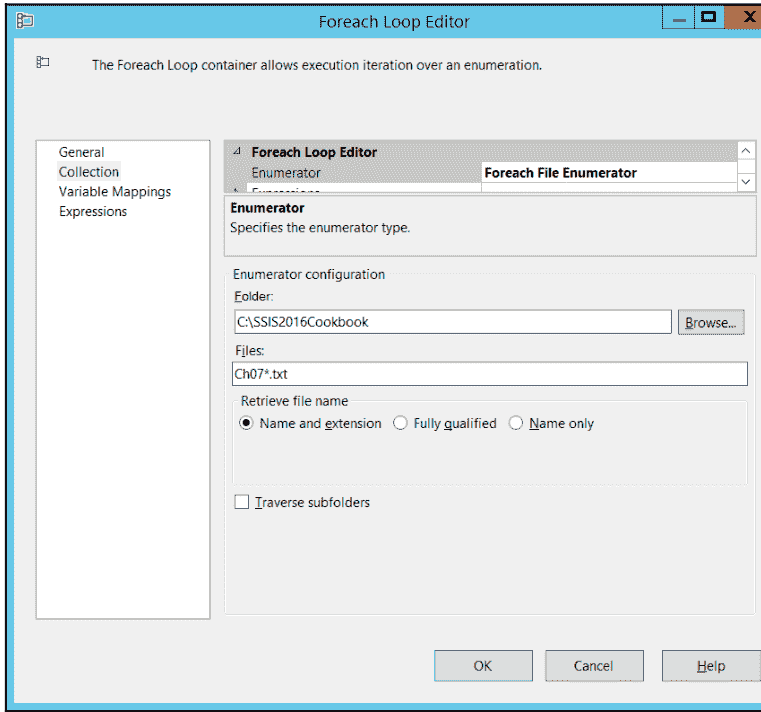

+   20. 单击“变量映射”选项卡。
+   21. 将 User::strFile 变量映射到索引 0。单击“确定”。

+   22. 将 **Script 任务** 拖到容器中。将其重命名为 `ReadOnlyVariables`。打开任务编辑器。
+   23. 在 **Script** 选项卡中，选择 **Microsoft Visual Basic 2015** 作为脚本语言。
+   24. 在 **ReadOnlyVariables** 属性中选择 **User::strFile** 变量。当你在这里定义变量时，它们会在整个脚本期间被锁定。锁定和解锁会自动进行。与 VariableDispenser 类相比，这是一种简单得多的锁定方式，尽管使用 VariableDispenser 类你可以获得更多控制权，或更细粒度的控制。
+   25. 单击 **Edit Script** 按钮。
+   26. 找到 `Main()` 方法。将以下脚本放在 `Add your code here` 注释和 `Dts.TaskResult = ScriptResults.Success` 行之间：
+   27. 保存脚本并关闭 VSTA 环境。在“脚本任务编辑器”中单击 **确定** 以将其关闭。
+   28. 执行包。注意你看到三次迭代和三个文件。保存解决方案，但如果你想继续下一个配方，请不要退出 SSDT。

```
MsgBox("File name: " & CStr(Dts.Variables("strFile").Value))
```

## 使用 Script 任务执行复杂的文件系统操作

在上一个配方中，你使用 Foreach Loop 容器的 Foreach File 枚举器按名称和扩展名检索了文件名。有时你需要更精确的过滤器。例如，你可能需要检索大于预定义值的文件。你可以使用 Script 任务获取满足自定义条件的文件名集合。

## 准备工作

除了 SSIS 2016 之外，本配方没有特殊先决条件。此外，你可以使用自己的文本文件进行测试，或者使用本章代码提供的三个文本文件（`Ch11_03.txt`、`Ch11_08.txt` 和 `Ch11_10.txt`）。请注意，`Ch11_03.txt` 文件的长度为 3 字节，`Ch11_08.txt` 文件为 8 字节，`Ch11_10.txt` 文件为 10 字节。

## 操作步骤...

+   1. 在 **文件资源管理器** 中，右键单击 `Ch11_08.txt` 文件并选择 **属性**，如下面的截图所示：

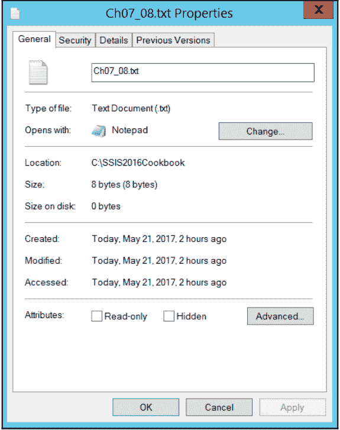

+   2. 注意文件大小为 8 字节。单击 **确定**。
+   3. 在 SSDT 中，向 `Chapter11` 项目添加一个新包。将其重命名为 `FileSizes.dtsx`。
+   4. 向包中添加两个变量：
+     - `intSize`，数据类型为 `Int64`，默认值为 5
+     - `objList`，数据类型为 `Object`，默认为 `System.Object`
+   5. 向控制流中添加一个新的 **Script 任务**。将其重命名为 `FilesBySize`。
+   6. 打开任务编辑器。这次使用 Microsoft Visual C# 2015 语言。将 `User::intSize` 变量添加到 `ReadOnlyVariables`，将 `User::objList` 变量添加到 `ReadWriteVariables` 集合。
+   7. 单击 **Edit Script**。
+   8. 展开 **Namespaces** 区域并添加以下两行：

```
using System.IO;
using System.Collections;
```

+   9. 在 `Main` 方法之前，添加以下常量和变量的声明：

```
private const string FILE_PATH = "C:\\SSIS2016Cookbook";
private const string FILE_FILTER = "Ch07*.txt";
long fileSizeLimit;
private ArrayList listForEnumerator;
```

+   10. 请注意，你可能需要适当更改 `FILE_PATH` 和 `FILE_FILTER` 常量。
+   11. 在 `Main` 方法中，添加以下代码，该代码从包变量 `intSize` 读取文件大小限制，声明一个数组来存储本地文件的名称，一个变量来存储文件大小，以及一个 `ArrayList`，它将保存满足你自定义条件的文件名。`Directory.GetFiles` 方法返回指定目录中文件的完整名称（包括路径）数组：

```
fileSizeLimit = (long) (Dts.Variables["intSize"].Value);
string[] localFiles;
long fileSize;
ArrayList listForEnumerator = new ArrayList();
localFiles = Directory.GetFiles(FILE_PATH, FILE_FILTER);
```

+   12. 添加以下代码，用符合条件的文件名填充 **ArrayList**：

```
foreach (string localFile in localFiles)
{
    FileInfo fi = new FileInfo(localFile);
    fileSize = fi.Length;
    if (fileSize >= fileSizeLimit)
    {
        listForEnumerator.Add(localFile);
    }
}
```

+   13. 最后，在 `Dts.TaskResult = (int)ScriptResults.Success;` 行之前，添加以下代码以显示匹配文件的数量并填充 `objList` 包变量：

```
MessageBox.Show("Matching files: " + listForEnumerator.Count,
"Results",
    MessageBoxButtons.OK, MessageBoxIcon.Information);
Dts.Variables["objList"].Value = listForEnumerator;
```

+   14. 保存代码并退出 VSTA 环境。同时退出“脚本任务编辑器”。
+   15. 向控制流中添加一个 **Foreach** 容器。使用 Script 任务上的绿色箭头将其与 FilesBySize Script 任务连接。将容器重命名为 `GetFileNameBySize`。打开容器编辑器。
+   16. 在 **Collection** 选项卡中，指定 **Foreach From Variable Enumerator**。使用 `User::objList` 变量。
+   17. 在 **Variable Mappings** 选项卡中，将 `User::objList` 变量映射到索引 0。单击 **确定** 以关闭编辑器。
+   18. 在容器内部添加一个 **Script 任务**。将其重命名为 `ShowFileNames`。打开“脚本任务编辑器”。
+   19. 使用 Microsoft Visual C# 2015 语言。将 `User::objList` 变量定义为只读变量。单击 **Edit Script**。
+   20. 在 `Main` 方法中添加以下代码行，以显示符合条件的文件名：

```
MessageBox.Show(Dts.Variables["objList"].Value.ToString());
```

+   21. 保存脚本并退出任务编辑器。
+   22. 运行包并观察结果。


## 使用脚本任务读取数据剖析XML结果

本节假设您已完成第10章“处理数据质量”中的第一个方法，并已获得数据剖析任务的结果。

在本节中，您将读取数据剖析任务生成的XML文件，并使用脚本任务读取提取的正则表达式，将其存储在包变量中。

### 准备工作

本节假设您手头有数据剖析任务的结果。


为了方便起见，本节所需的数据剖析任务结果已提供在`DataProfiling.xml`文件中。

### 操作步骤...

+   1. 在AdventureWorksETL项目中添加新包。将默认包重命名为RegExValidation.dtsx。
+   2. 创建两个包变量。命名为EmailRegEx1和EmailRegEx2。两个变量都使用String数据类型。
+   3. 将脚本任务拖到控制流中。重命名为ReadPatterns。
+   4. 打开此任务的编辑器。在脚本任务编辑器的“脚本”页面上，确保选择了Visual C#语言。将User::EmailRegEx1和User::EmailRegEx2变量添加到ReadOnlyVariables属性中，如下面的截图所示：

### 脚本任务编辑器

访问Microsoft Visual Studio Tools for Applications (VSTA)，使用Visual Basic 2015或Visual C# 2015编写脚本，并配置任务属性。

+   - 脚本
+   - 常规
+   - 表达式

| 脚本 |  |
|---|---|
| 脚本语言 | Microsoft Visual C# 2015 |
| 入口点 | Main |
| 只读变量 | User::EmailRegEx1,User::EmailRegEx2 |
| 读写变量 |  |

ScriptLanguage
指定脚本使用的编程语言。

编辑脚本...

+   5. 单击“编辑脚本”按钮。展开“命名空间”区域。使用以下代码添加System.Xml命名空间：`using System.Xml;`
+   6. 为ScriptMain类声明私有变量。这些私有变量将指向数据剖析任务结果XML文件、数据剖析任务结果的XML命名空间URI，以及XML文件中包含提取的正则表达式的两个节点。请在ScriptMain类定义之后、类的第一个帮助区域之前输入以下代码：

```
using System.Xml;
```

```
private string fileName = @" C:\SSIS2016Cookbook\Chapter07\Files \DataProfiling.xml";
private string profileNamespaceUri =
```

```
"http://schemas.microsoft.com/sqlserver/2008/DataDebugger//";
private string err1Path =
"/default:DataProfile/default:DataProfileOutput/default:Profiles" +
"/default:ColumnPatternProfile[default:Column[@Name='EmailAddress']]" +
"/default:TopRegexPatterns/default:PatternDistributionItem[1]
/default:RegexText/text()";
private string err2Path =
"/default:DataProfile/default:DataProfileOutput/default:Profiles" +
"/default:ColumnPatternProfile[default:Column[@Name='EmailAddress']]" +
"/default:TopRegexPatterns/default:PatternDistributionItem[2]
/default:RegexText/text()";
```

7. 上面的代码部分看起来不太美观。这是因为XML本身就不美观。
8. 修改类的Main方法。在`// TODO:...`注释之后、方法的最后一条命令`Dts.TaskResult =...`之前添加以下代码。

```
// Local variables
string profilePath;
XmlDocument profileOutput = new XmlDocument();
XmlNamespaceManager profileNSM;
XmlNode regExNode1;
XmlNode regExNode2;
// Open output file
profilePath = fileName;
profileOutput.Load(profilePath);
profileNSM = new XmlNamespaceManager(profileOutput.NameTable);
profileNSM.AddNamespace("default", profileNamespaceUri);
// Get regExNodes
regExNode1 = profileOutput.SelectSingleNode(err1Path, profileNSM);
regExNode2 = profileOutput.SelectSingleNode(err2Path, profileNSM);
// Assign variable values
Dts.Variables["User::EmailRegEx1"].Value = regExNode1.Value;
Dts.Variables["User::EmailRegEx2"].Value = regExNode2.Value;
// Show variable values
MessageBox.Show(Dts.Variables["User::EmailRegEx1"].Value.ToString());
MessageBox.Show(Dts.Variables["User::EmailRegEx2"].Value.ToString());
```

9. 请注意，此代码读取数据剖析结果，加载XML文件，然后将提取的正则表达式模式赋值给您刚刚创建的两个SSIS包变量。最后，代码在两个消息框中显示变量值。

+   10. 保存脚本并关闭VSTA环境。在脚本任务编辑器中，单击“确定”按钮关闭编辑器。
+   
+   11. 右键单击**读取模式**任务并执行它。检查两个消息框，其中显示数据剖析任务提取的两个正则表达式。在每个框中单击“确定”将其关闭。停止调试包。

## 使用脚本组件纠正数据

在本节中，您将在数据流中使用脚本组件作为转换来进行高级数据清理。您将读取一个Excel文件并执行自定义转换，以便使输出可供数据流中的进一步处理使用。

### 准备工作

为了测试本节内容，您需要准备一个Excel文件。文件中应有一个工作表，内容如下：

| 订单ID | 日期     | 产品 | 数量 |
|---|---|---|---|
| 1 | 20160915 | ABC | 1 |
|   |          | DEF | 5 |
|   |          | GHI | 3 |
| 2 | 20160916 | GHI | 2 |
|   |          | ABC | 4 |


为了方便起见，包含所需内容的Excel文件提供在`Ch07_Orders.xls`文件中。

请注意，表格表示带有订单明细的简单订单。但是，订单信息仅添加到第一个订单明细行。您的任务是为每一行添加适当的订单信息。

### 操作步骤...

+   1. 在AdventureWorksETL项目中添加新包。将其重命名为ProcessingExcel.dtsx。
+   2. 添加新的包级Excel连接管理器。将其重命名为Excel_Ch11_Orders。指向您的Excel文件路径并适当定义Excel版本，如下面的截图所示：
+   3. 在控制流中添加数据流任务。将其重命名为ProcessExcelOrders。打开“数据流”选项卡。
+   4. 添加Excel源。双击它以打开编辑器。
+   5. 使用“连接管理器”选项卡定义Excel连接管理器。指向您刚刚创建的Excel_Ch11_Orders连接管理器。使用“表或视图”数据访问模式。在Excel工作表下拉列表中选择Sheet1$。单击“预览”按钮预览文件内容，如下面的截图所示：

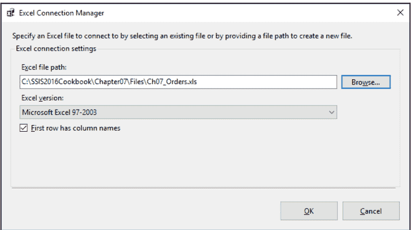

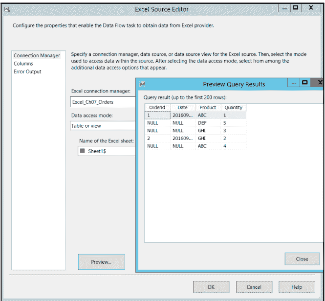

+   6. 您可以在数据预览弹出窗口中注意到，订单信息列除订单的第一个明细外均为NULL。预览完成后，单击“关闭”按钮。
+   7. 单击“列”选项卡检查列映射。然后，单击“确定”关闭数据源编辑器。
+   8. 在数据流中添加脚本组件。在“选择脚本组件类型”弹出窗口中，确保选中“转换”选项按钮。然后，单击“确定”。
+   9. 使用数据源中的蓝色箭头（常规数据流）连接脚本组件。
+   10. 双击脚本组件以打开编辑器。请注意，“脚本”选项卡比脚本任务的“脚本”选项卡更复杂。尽管如此，您可以轻松找到ScriptLanguage、ReadOnlyVariables和ReadWriteVariables属性。将它们全部保留默认值，这意味着您将使用Microsoft Visual C# 2015语言，并且脚本中不需要任何变量。

11. 单击“输入列”选项卡。在“可用输入列”表中，选择所有列。在窗口下部，检查输入列和输出别名之间的映射。不要更改任何输出别名。但是，将OrderId和Date列的使用类型更改为ReadWrite，如下面的截图所示：

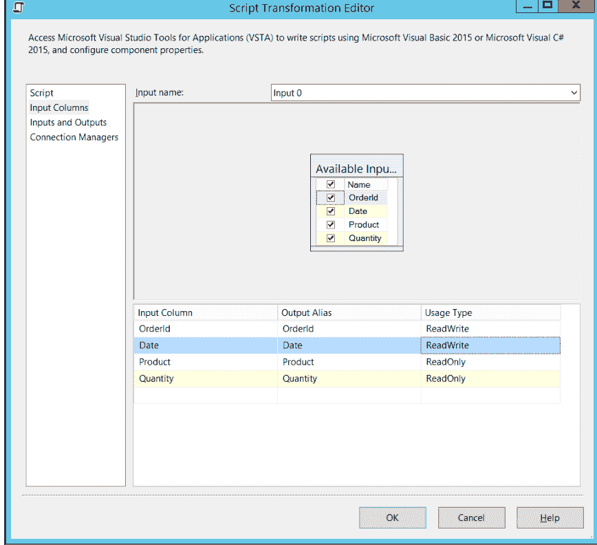


+   12. 正确设置列后，单击**脚本**选项卡，然后单击**编辑脚本**按钮打开VSTA环境。
+   13. 在脚本中，找到`Input0_ProcessInputRow`方法。在方法定义之前、注释之后添加以下两个变量，并包含该方法的摘要和参数说明：
+   14. 保存代码并退出VSTA环境。在脚本转换编辑器中，单击**确定**。
+   15. 向数据流中添加一个**多播**转换，并使用从脚本组件出来的蓝色箭头将其连接。该转换仅用作占位符，以便在脚本转换完成其工作后启用到数据查看器的连接。

```
Double MyDate;
Double MyOrderId;
Add the following code to the method:
// Check if OrderId column is null
if (Row.OrderId_IsNull)
{
    // if null then replace value with variable value
    Row.OrderId = MyOrderId;
}
else
{
    // if not null then replace variable value with column value
    MyOrderId = Row.OrderId;
}
// Check if Date column is null
if (Row.Date_IsNull)
{
    // if null then replace value with variable value
    Row.Date = MyDate;
}
else
{
    // if not null then replace variable value with column value
    MyDate = Row.Date;
}
```

16. 启用两个数据查看器，一个位于从源到脚本组件的路径上，另一个位于从脚本组件到多播转换的路径上。数据流应如下图所示：

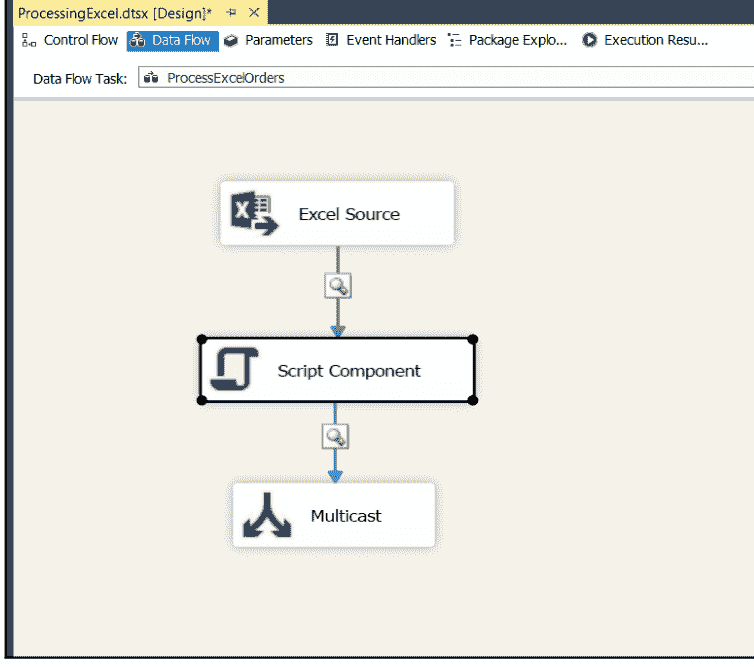

17. 请注意，根据您使用的Excel版本，您可能需要在运行包之前将项目的`Run64BitRuntime`属性改为False，如下图所示：

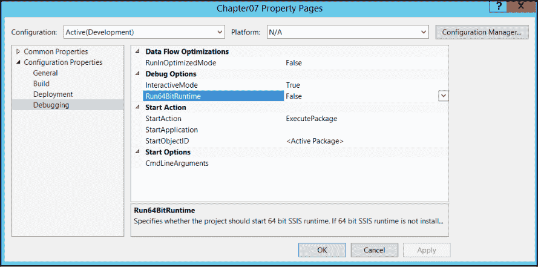

18. 保存包并运行。观察使用脚本组件纠正前后的数据。完成后，停止调试。

## 在脚本组件中使用正则表达式验证数据

在本食谱中，您将创建一个脚本组件，该组件将使用`DataProfiling.xml`文件中的正则表达式来验证从平面文件中提取的个人数据的电子邮件。

## 准备就绪

本食谱假设您已成功完成本章前面的*使用脚本任务读取数据配置文件XML结果*食谱。如果您尚未完成该食谱，只需完成该食谱的步骤1即可准备合适的SSIS包。

## 操作步骤...

+   1. 确保`RegExValidation.dtsx`包在控制流设计器中处于活动状态。
+   2. 在SSDT窗口底部的**连接管理器**窗格的空白画布中右键单击，然后从快捷菜单中选择**新建平面文件连接...**。
+   3. 使用**平面文件连接管理器编辑器**创建新的连接管理器，并在**常规**页面的连接管理器名称文本框中输入`PersonData`。
+   4. 要确定**文件名**属性，请单击**浏览...**，然后在`C:\SSIS2016Cookbook\Chapter11\Files\`文件夹中选择`Ch11_PersonData.csv`文件。
+   该文件应自动识别为Unicode文件；否则，请选中**浏览...**按钮下方的**Unicode**选项。
+   5. 保持其余属性不变，如下图所示：

6. 在**列**页面上，验证所有源列是否都已识别：Title、FirstName、MiddleName、LastName、Suffix和EmailAddress。

如果任何列缺失，请单击列列表下方的**重置列**。

7. 单击**确定**以完成配置。

+   15. 单击**确定**确认组件类型，然后将其名称更改为Validate Email。
+   16. 将常规数据路径从**Person Data**源连接到**Validate Email**转换。
+   17. 双击**Validate Email**转换以打开脚本任务编辑器。
+   18. 在脚本页面上，将**$Package::DataProfileName**包参数添加到**ReadOnlyVariables**集合中，并确保将Microsoft Visual C# 2015选为**ScriptLanguage**属性，如下图所示：

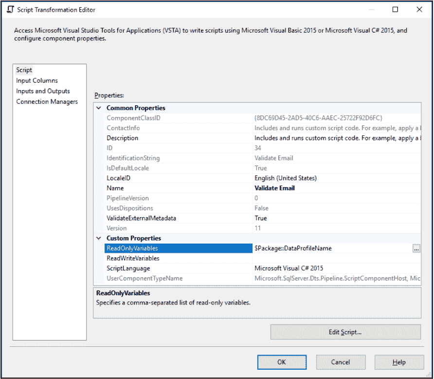

+   19. 在**输入列**页面上，确保所有输入列都已选中；其用法类型应为**只读**。
+   20. 在**输入和输出**页面的**输入和输出**列表中，选择**Input 0**输入，然后在编辑器右侧的属性窗格中，将其**名称**属性更改为`PersonDataInput`。
+   21. 选择**Output 0**输出，并将其名称更改为`PersonDataOutput`。
+   22. 在`PersonDataOutput`属性中，找到`SynchronousInputID`属性，并确保它引用`Validate Email.Inputs[PersonDataInput]`输入。
+   这意味着组件的输出是同步的。
+   23. 在**输入和输出**列表中展开`PersonDataOutput`，然后选择输出列节点。
+   24. 单击**添加列**以在输出中创建一列；使用以下设置进行配置：
+   属性 值
+   名称 IsValidEmail
+   数据类型 Boolean [DT_BOOL]
+   25. 单击**确定**以确认到目前为止的组件配置。
+   建议在创建脚本之前保存所有脚本组件设置，例如变量、输入、输出和其他连接管理器。
+   这样，如果脚本存在编辑期间无法解决的问题，则无需重新设置其余设置。
+   26. 再次打开**Validate Email**转换编辑器，然后在脚本页面上单击**编辑脚本...**以启动**Visual Studio for Applications (VSTA)** IDE。
+   27. 在组件定义开头的`Namespaces`区域中，向该区域添加以下引用：
+   using System.Collections.Generic;
+   using System.Text.RegularExpressions;
+   using System.Xml;


28. 在`ScriptMain`类定义中，添加以下常量和私有变量声明：

```
private const String DATA_PROFILE_NAMESPACE =
    "http://schemas.microsoft.com/sqlserver/2008/DataDebugger/";
private const String DATA_PROFILE_NAMESPACE_ALIAS = "dp";

private String _regexElementXPath =
    "/dp:DataProfile/dp:DataProfileOutput/dp:Profiles" +
    "/dp:ColumnPatternProfile[dp:Column[@Name='EmailAddress']]" +
    "/dp:TopRegexPatterns/dp:PatternDistributionItem/dp:RegexText/text()";

private List<String> _regexPatterns = new List<String>();
```

通常，变量定义位于类定义的开头，紧跟三个Help区域之后。

29. 在`ScriptMain`类定义的末尾（最后一个右花括号之前）放置以下函数定义：

```
private List<String> LoadRegularExpressions(String dataProfileName)
{
    List<String> result = new List<String>();
    XmlDocument dataProfile = new XmlDocument();
    dataProfile.Load(dataProfileName);
    XmlNamespaceManager dataProfileNS = new
    XmlNamespaceManager(dataProfile.NameTable);
    dataProfileNS.AddNamespace(DATA_PROFILE_NAMESPACE_ALIAS,
    DATA_PROFILE_NAMESPACE);

    foreach (XmlNode regexPatternElement in
    dataProfile.SelectNodes(_regexElementXPath, dataProfileNS))
    {
        String regexPattern = regexPatternElement.Value;
        if (!result.Contains(regexPattern))
        {
            result.Add(regexPattern);
        }
    }

    return result;
}
```

此函数从数据配置文件结果中提取所有相关的正则表达式模式，并将它们加载到一个变量中。

+   30. 在LoadRegularExpressions()函数之后，立即添加另一个函数：

```
private Boolean IsValidEmail(String emailAddress)
{
    Boolean result = false;
    if (!String.IsNullOrEmpty(emailAddress))
    {
        foreach (String regexPattern in _regexPatterns)
        {
            if (Regex.IsMatch(emailAddress, regexPattern, RegexOptions.IgnoreCase))
            {
                result = true;
                break;
            }
        }
    }
    return result;
}
```

此函数用所有可用的正则表达式测试提供的电子邮件地址，一旦匹配其中一个模式，就返回true；否则，返回false。

+   31. 找到PreExecute()方法，将以下命令添加到其定义中：

```
_regexPatterns.AddRange(this.LoadRegularExpressions(Variables.DataProfileName));
```

PreExecute()数据流组件方法在数据流执行开始时调用，此时尚未从上游管道获取行。由于整个数据流执行过程中将使用同一组正则表达式，因此只需要加载一次，而不是每行都加载。


+   32. 找到 `PersonDataInput_ProcessInputRow()` 方法，并在其定义中添加以下命令：
+   
+   ```csharp
+   Row.IsValidEmail = this.IsValidEmail(Row.EmailAddress);
+   ```
+   
+   需要对每一行调用 `IsValidEmail()` 函数，因为需要验证从源中提取的每个电子邮件地址。

+   33. 保存 VSTA 项目，并通过从“**生成**”菜单中选择“**生成**”命令来生成它。
+   
+   如果所有代码输入正确，生成应成功；否则，你需要按照“错误”窗格中的错误消息来解决问题。

+   34. 生成成功后，关闭 VSTA 窗口，返回 SSDT。

+   35. 在“脚本转换编辑器”中，单击“**确定**”，确认并保存组件脚本，然后保存包。

+   36. 从 SSIS 工具箱中，将一个“**条件拆分**”转换拖到数据流设计器中，并将其名称更改为 `Valid or Invalid Email`。

+   37. 将常规数据路径从“**验证电子邮件**”转换连接到“**条件拆分**”转换。

+   38. 双击新添加的转换，打开“**条件拆分转换编辑器**”。

+   39. 使用以下设置创建新输出：
+   
+   - **属性：** `Value`
+   - **输出名称：** `Valid Email`
+   - **条件：** `IsValidEmail`
+   
+   或者，为了减少输入，可以将 `IsValidEmail` 列从“**条件拆分转换编辑器**”左上角的“**列**”列表拖出。

40. 将默认输出名称更改为“无效电子邮件”。

请参考以下截图来验证你的设置：

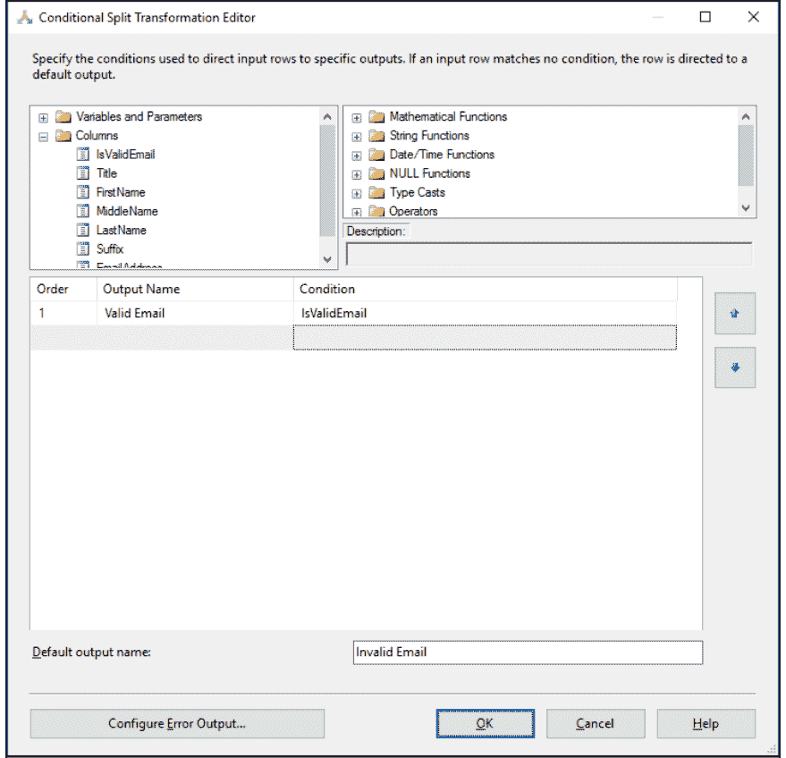

+   41. 单击“**确定**”完成配置。
+   42. 从 SSIS 工具箱中，将一个“**多播**”转换拖到数据流设计器中，并将常规数据路径从“**有效**或**无效电子邮件**”转换连接到它。
+   43. 当“**输入输出选择**”对话框提示时，在“**输出**”选择框中选择“**无效电子邮件**”，如下面的截图所示：

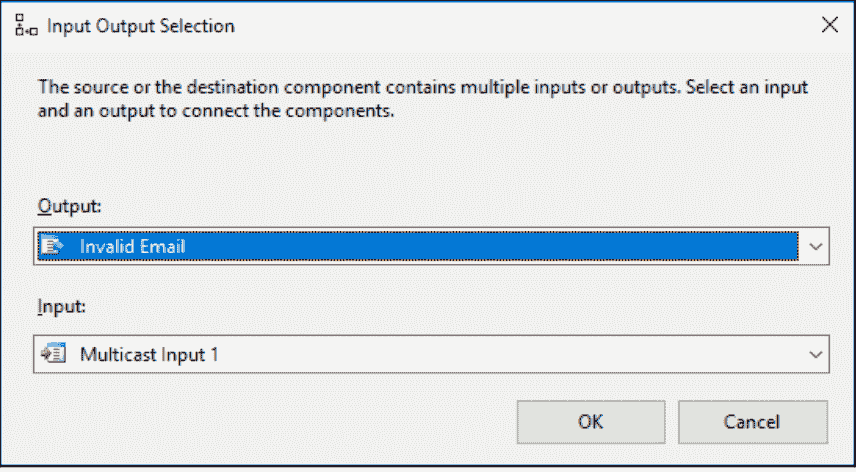

+   44. 单击“**确定**”确认选择。
+   45. 在“**无效电子邮件**”数据路径上启用“**数据查看器**”。
+   46. 保存包并在调试模式下执行。观察执行过程并检查放置在“**无效电子邮件**”数据路径中的行。
+   47. 停止调试模式执行；保持解决方案打开，因为下一个配方中需要用到它。

## 使用脚本组件作为源

在本配方中，你将使用脚本组件作为数据流源来创建自定义源。

你将连接到一个 Web 服务并从中检索数据，然后将数据放入数据流管道中。

### 操作步骤...

+   1. 向本章开头创建的“**AdventureWorksETL**”项目添加一个新的 SSIS 包。
+   2. 将新创建的包名称更改为 `CustomWebServiceSource.dtsx` 并保存。
+   3. 确保“**CustomWebServiceSource.dtsx**”包处于活动状态，然后使用以下设置创建一个新的包参数：
      - **属性：** `Value`
      - **名称：** `CountryName`
      - **数据类型：** `String`
      - **值：** `France`
+   4. 将一个“**数据流**”任务拖到控制流设计器中，并将其名称更改为“机场信息”。
+   5. 在数据流设计器中打开“**机场信息**”任务，并将一个“**脚本组件**”拖到数据流设计器中。
+   6. 在“**选择脚本组件类型**”对话框中，选择“**源**”，如下面的截图所示：

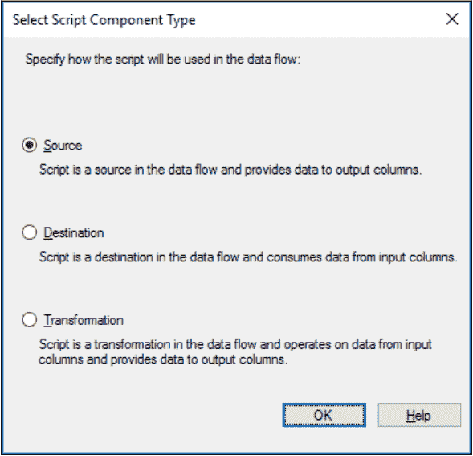

+   7. 单击“**确定**”确认选择。
+   8. 将脚本组件的名称更改为“按国家/地区的机场信息”。
+   9. 双击“**按国家/地区的机场信息**”源，打开脚本转换编辑器。
+   10. 在“**脚本**”页面上，将 `$Package::CountryName` 参数添加到 `ReadOnlyVariables` 集合中，并确保“**脚本语言**”属性选择的是 Microsoft Visual C# 2015。
+   11. 在“**输入和输出**”页面上，选择“**输出 0**”，并将其名称更改为 `AirportInfoOutput`。
+   12. 使用以下设置向输出的“列集合”中添加列：

```
Name DataType Length
Country Unicode string [DT_WSTR] 50
AirportName Unicode string [DT_WSTR] 50
AirportCode Unicode string [DT_WSTR] 3
RunwayLengthFeet four-byte signed integer [DT_I4] /
```

请参考以下截图来验证你的设置：

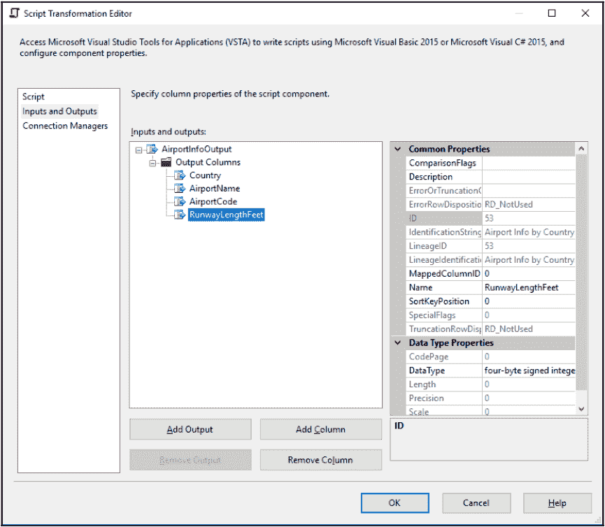

💡 **提示**

要确保每个新列都添加到列表的末尾，请在添加下一列之前单击“**输出列**”节点。

+   13. 单击“确定”确认配置。
+   14. 再次打开“**按国家/地区的机场信息**”转换编辑器，这次单击“**编辑脚本...**”以启动 VSTA。

+   15. 在“**解决方案资源管理器**”中，右键单击“**引用**”节点，并从快捷菜单中选择“**添加服务引用...**”，如下面的截图所示：

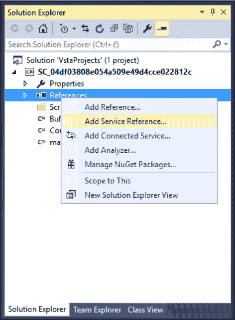

+   16. 在“**添加服务引用**”对话框中，单击对话框左下角的“**高级...**”。

+   17. 在“**服务引用设置**”对话框中，单击“**添加 Web 引用...**”以打开“**添加 Web 引用**”对话框。

+   18. 在“**URL**”文本框中输入以下 URL：

```
http://www.webservicex.net/airport.asmx?WSDL
```

+   19. 单击文本框右侧指向右方的箭头，以加载来自 Web 服务的信息。

20. 在“Web 引用名称”文本框中输入 AirportInfo。

请参考以下截图来验证你的设置：

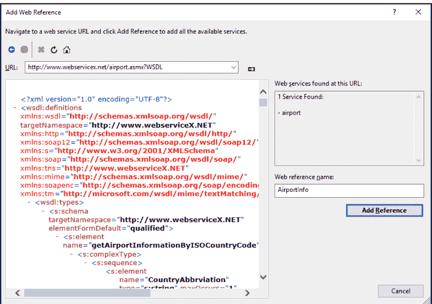

21. 单击“添加引用”以确认设置并创建引用。

22. 保存项目。

23. 在组件定义中，在代码开头找到“命名空间”区域，并展开它以列出现有引用。

24. 在最后一个 using 指令之后添加另一个 using 指令，然后开始输入项目名称（应与 SC_04df03808e054a509e49d4cce022812c 类似）；让 Visual Studio 的 IntelliSense 提示完整的命名空间，然后完成对 AirportInfo 命名空间的引用：

```
using SC_04df03808e054a509e49d4cce022812c.AirportInfo;
```

+   25. 此示例中的 `SC_04df03808e054a509e49d4cce022812c` 值用于 VSTA 项目的名称及其默认命名空间。当你向项目添加 Web 引用时，会自动创建代理类和函数，并将它们放置在项目的默认命名空间中。

+   26. 添加以下引用，因为稍后将需要用到它：

+   ```csharp
+   using System.Xml;
+   ```
+   
+   27. 从“**生成**”菜单中选择“**生成**”，以保存并生成项目。

+   28. 如果正确执行了前面的步骤，项目应能成功生成；否则，请检查“错误”窗格中报告的错误并进行必要的更正。

+       1. 如果自动生成的代码返回错误，请在“**解决方案资源管理器**”中右键单击 Web 引用，并从快捷菜单中选择“**删除**”，然后重新生成项目并重复步骤 14 到 21。

+   29. 将以下变量声明添加到组件定义的 `ScriptMain` 类中：

+   ```csharp
+   private String _countryName;
+   private String _airportXPath = @"/NewDataSet/Table";
+   private XmlNodeList _airportXmlNodes;
+   ```
+   
+   30. 将以下命令添加到 `PreExecute()` 方法中：

+   ```csharp
+   airport airportInfo = new airport();
+   String airportInfoByCountry =
+   airportInfo.GetAirportInformationByCountry(_countryName);
+   XmlDocument airportInfoByCountryXml = new XmlDocument();
+   airportInfoByCountryXml.LoadXml(airportInfoByCountry);
+   _airportXmlNodes = airportInfoByCountryXml.SelectNodes(_airportXPath);
+   ```
+   
+   31. 给定 Web 服务的 `GetAirportInformationByCountry` 函数会针对所提供的国家/地区名称返回机场列表及其属性。此函数每次数据流执行只需调用一次；因此，应将其放在 `PreExecute()` 方法中，该方法在数据流执行开始时仅调用一次。


- 32. 将以下命令添加到 `CreateNewOutputRows()` 方法中：

```
foreach (XmlNode airportXmlNode in _airportXmlNodes)
{
    AirportInfoOutputBuffer.AddRow();

    AirportInfoOutputBuffer.Country = _countryName;
    AirportInfoOutputBuffer.AirportName =
        airportXmlNode.SelectSingleNode("CityOrAirportName").InnerText;
    AirportInfoOutputBuffer.AirportCode =
        airportXmlNode.SelectSingleNode("AirportCode").InnerText;
    AirportInfoOutputBuffer.RunwayLengthFeet =
        Int32.Parse(airportXmlNode.SelectSingleNode("RunwayLengthFeet").InnerText);
}
```

此代码将读取从 Web 服务的 `GetAirportInformationByCountry()` 函数中检索到的所有项目，并将它们逐一放入组件的输出中。

- 33. 使用“**生成**”菜单中的“**生成**”命令来保存并生成组件项目。如有任何错误，请检查“**错误**”窗格并解决问题。
- 34. 项目成功生成后，关闭 VSTA 窗口并返回 SSDT。
- 35. 在“**脚本转换编辑器**”中，单击“**确定**”以完成“**按国家/地区机场信息**”源组件的配置。
- 36. 保存包。
- 37. 从 SSIS 工具箱中，将一个多播转换拖到数据流设计器中。
- 38. 将“**按国家/地区机场信息**”源组件中的常规数据路径连接到多播转换，并在该数据路径上启用数据查看器。
- 39. 保存，并以调试模式执行包。观察数据查看器中的行。
- 40. 停止调试模式执行；保持解决方案和包处于打开状态，因为后续操作指南中会用到它们。

## 工作原理...

“**按国家/地区机场信息**”源组件连接到一个可公开访问的 Web 服务，该服务提供不同国家/地区的机场信息。它会检索由 **CountryName** 包参数指定的国家/地区的机场列表。

另外，也可以通过**Foreach 循环**容器中填充的变量来提供国家/地区名称，这样同一数据流就可以针对多个国家/地区执行多次。

从 Web 服务检索到数据后，数据会放入一个变量中。当组件开始生成行时，从 Web 服务检索到的每个项目的特定属性会被放入下游管道。组件输出中的每一行代表从 Web 服务中检索到的一个实体。

## 使用脚本组件作为目标

在本操作指南中，你将使用脚本组件设计一个自定义数据流目标。

你将使用在 *使用脚本组件作为源* 操作指南中创建的源组件所检索到的数据，并将其以 JSON 格式导出一个或多个文件。

缩略词 JSON 代表 JavaScript Object Notation（JavaScript 对象表示法），这是一种开源格式，以人类可读的形式表示数据，也可以供自动化流程使用。

### 准备工作

在完成本操作指南之前，你需要先完成 *使用脚本组件作为源* 操作指南。

### 操作步骤...

- 1. 确保 `C:\SSIS2016Cookbook\Chapter11\Solution\` 文件夹中 `AdventureWorksETL` 解决方案的 `CustomWebServiceSource.dtsx` 包在控制流编辑器中处于活动状态。
- 2. 使用以下设置添加一个包参数：

| 属性 | 值 |
| --- | --- |
| 名称 | JSONFilePath |
| 数据类型 | String |
| 值 | C:\SSIS2016Cookbook\Chapter11\Files |

- 3. 使用以下设置添加另一个包参数：

| 属性 | 值 |
| --- | --- |
| 名称 | JSONFileNameFormat |
| 数据类型 | String |
| 值 | AirportInfo_{0:D3}.JSON |

- 4. 在数据流设计器中打开“**机场信息**”数据流。
- 5. 从 SSIS 工具箱中，将一个脚本组件拖到数据流设计器中。
- 6. 在“**选择脚本组件类型**”对话框中，选择“**目标**”，如下方屏幕截图所示：

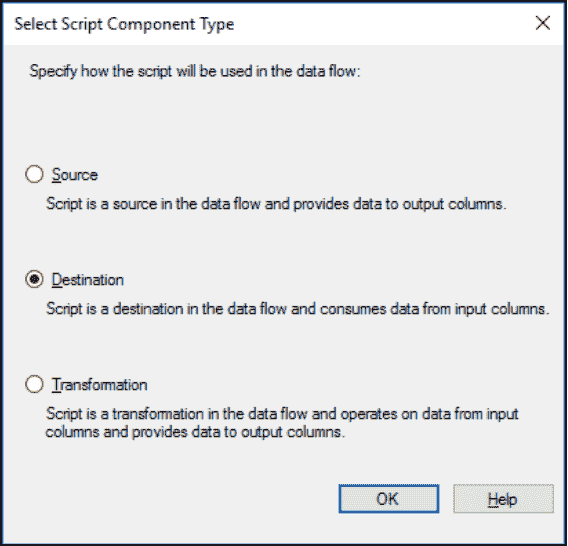

- 7. 单击“**确定**”确认选择。
- 17. 单击“**确定**”确认选择。
- 18. 在组件定义的开头，找到 `Namespaces` 区域并将其展开，以检查现有的命名空间引用。
- 19. 在现有引用下方添加以下引用：

```
using System.Web.Script.Serialization;
using System.Collections.Generic;
using System.IO;
```

`System.Web.Script.Serialization` 命名空间包含创建和使用 JSON 数据所需的功能。`System.IO` 命名空间提供访问 Windows 操作系统文件系统所需的功能。

- 20. 在 `ScriptMain` 类中，添加以下常量和变量声明：

```
private const Int32 JSON_MAX_ITEM_COUNT = 50;

private String _jsonFilePath;
private String _jsonFileNameFormat;
private Int32 _fileCounter = 0;

private JavaScriptSerializer _jsonSerializer =
    new JavaScriptSerializer();
```

- 21. 同样在 `ScriptMain` 类中，在现有代码的末尾（最后一个右花括号之前），添加以下类定义：

```
public class AirportInfo
{
    public String CountryName { get; set; }
    public String AirportName { get; set; }
    public String AirportCode { get; set; }
    public Int32 RunwayLengthFeet { get; set; }

    public AirportInfo()
    {
    }

    public AirportInfo(String countryName, String airportName,
        String airportCode, Int32 runwayLengthFeet)
    {
        this.CountryName = countryName;
        this.AirportName = airportName;
        this.AirportCode = airportCode;
        this.RunwayLengthFeet = runwayLengthFeet;
    }
}
```

此类用于在处理过程中存储管道数据，并为创建 JSON 文档的 `JavaScriptSerializer.Serialize()` 方法提供元数据。

除非显式标记为**public**，否则类成员默认都是**private**，因此对调用方*不可访问*。如果无法确定 JSON 文档所需的元数据，序列化*不会*失败，但最终生成的文档也不会包含任何在序列化期间无法确定元数据的数据。


- 22. 在 `AirportInfo` 类定义之前，放置用于将数据写入文件的函数定义：

```
private void WriteJSONFile(List<AirportInfo> airportInfo,
    Int32 fileCount)
{
    String airportInfoJSON = _jsonSerializer.Serialize(airportInfo);

    String jsonFileName = Path.Combine(_jsonFilePath,
        String.Format(_jsonFileNameFormat, fileCount));

    using (StreamWriter jsonStreamWriter = new
        StreamWriter(jsonFileName))
    {
        jsonStreamWriter.Write(airportInfoJSON);
        jsonStreamWriter.Flush();
    }
}
```

- 23. 在 `PreExecute()` 方法中添加以下变量赋值：

```
_jsonFilePath = Variables.JSONFilePath;
_jsonFileNameFormat = Variables.JSONFileNameFormat;
```

- 24. 删除 `JSONFileInput_ProcessInputRow` 方法，因为此组件不会以传统方式处理单个行。
- 31. 右键单击其中一个文件，使用“**打开方式**”命令在记事本中打开该文件。检查文件；文件内容应包含有关机场信息的 JSON 表示形式。
- 32. 返回 SSDT，停止调试模式执行，然后关闭 SSDT。

### 工作原理...

“**JSON 文件**”目标接收来自上游组件的行，将它们存储在一个变量中（每次 50 行），并将行集转换为 JSON 文档，然后将其加载到文件系统的一个文件中。

`JSONFileInput_ProcessInput` 方法包含处理传入管道数据所需的全部逻辑；它会创建最多包含 50 行的批次，这样生成的任何 JSON 文档都不会包含超过 50 个项目。

`WriteJSONFile` 函数使用 `JavaScriptSerializer` 类的 `Serialize()` 方法从行集创建 JSON 文档，而创建文档结构所需的元数据由 `AirportInfo` 类提供。


