# 12
本地部署与 Azure 大数据集成

本章将涵盖以下配方：

- Azure Blob 存储数据管理
- 安装 Hortonworks 集群
- 将数据复制到本地集群
- 使用 Hive - 创建数据库
- 使用 Hive 转换数据
- 在 Hadoop 与 Azure 之间传输数据
- 利用 HDInsight 大数据集群
- 使用 Pig Latin 管理数据
- 导入 Azure Blob 存储数据

## 引言

数据仓库架构师面临着集成多种类型数据的需求。云数据集成对于本地数据仓库来说可能是一个真正的挑战，原因如下：

- 数据源显然没有存储在本地，并且数据存储与 ETL 工具（如 SSIS）通常设计的数据差异很大。正如我们之前所见，开箱即用的 SSIS 工具箱具有仅处理本地数据的源、目标和转换工具。

5. 填写 **Storage account name** 文本框，如以下屏幕截图所示：

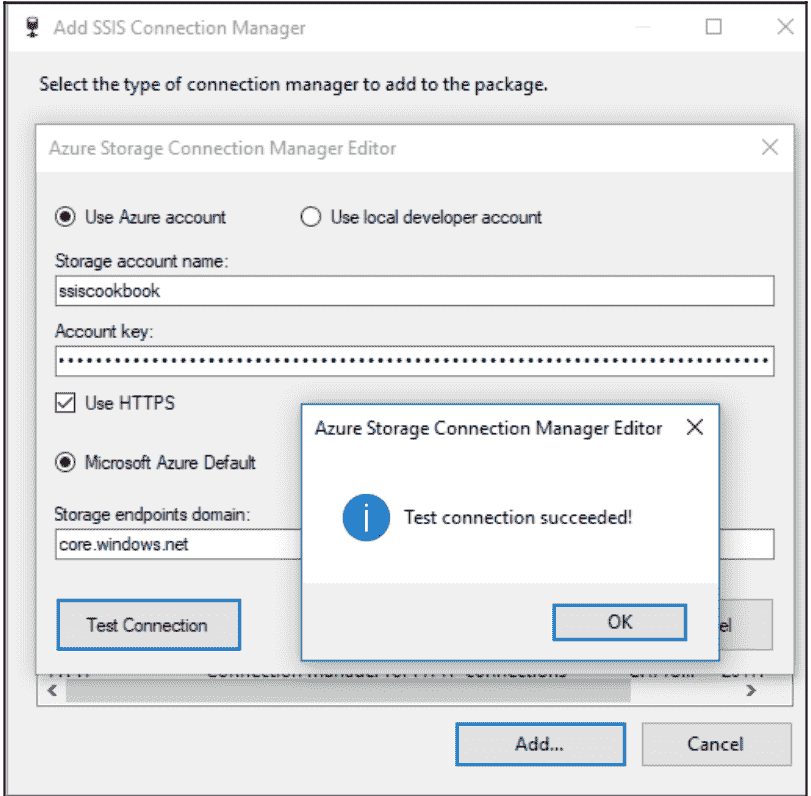

6. 重命名连接管理器 `cmgr_AzureStorage_ssiscookbook`。

7. 右键单击新创建的连接管理器并选择 **Convert to Project Connection**，如以下屏幕截图所示：

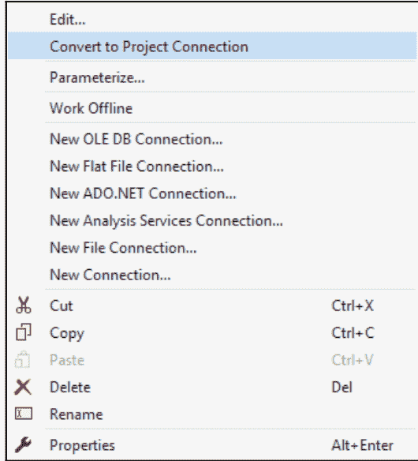

8. 参数化 `AccountKey`，如以下屏幕截图所示：

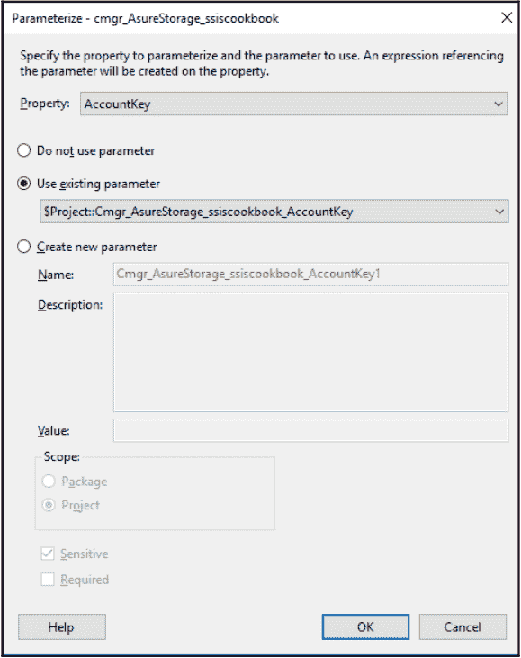

9. 复制并粘贴 Azure Blob 存储密钥到 `Cmgr_AzureStorage_ssiscookbook_AccountKey` 参数中。

10. 从 SSIS 工具箱-Azure 部分，拖放一个 Azure Blob 上传任务到控制流。将其属性设置如下：
    - 重命名任务 `abut_test`
    - 将 **Connection** 属性分配给我们之前创建的 `cmgr_AzureStorage_ssiscookbook` 连接管理器。
    - 在 C 盘上创建一个文件夹并命名为 `test`。
    - 复制任意文件；在我们的例子中，我们使用了一个名为 `ExtendedProperties.sql` 的文件。

- 将 **BlobContainer** 属性设置为 `test`。
- 将可选属性 **BlobDirectory** 设置为 `uploadfiletest/`。
- 将 **LocalDirectory** 设置为 `C:\test`。
- 保持其他属性不变。

如下屏幕截图所示：

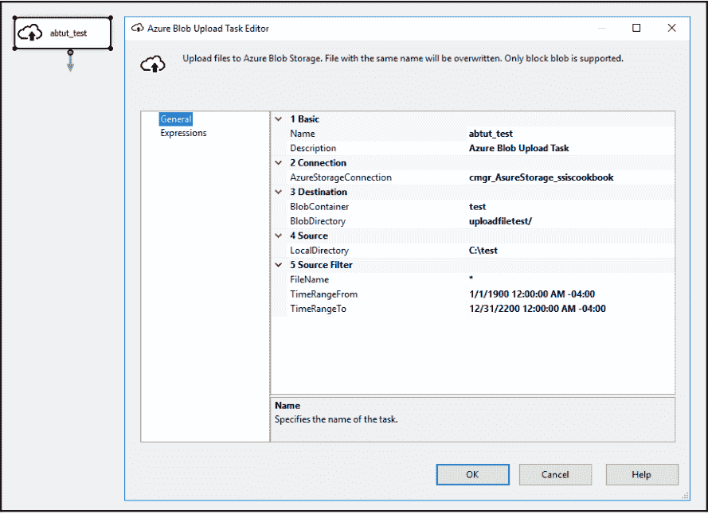

11. 现在，右键单击包以执行它。

12. 执行完成后，转到您的 Azure 存储帐户，您应该会看到文件已上传到那里，如以下屏幕截图所示：

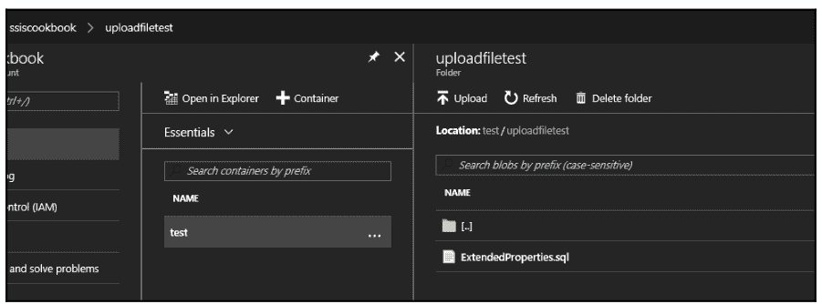

就这样。我们已成功使用 SSIS 将文件上传到 Blob 存储。我们刚刚做了一个 Hello world 测试。接下来的 Azure 配方将用更有用的文件填充此存储帐户。

## 安装 Hortonworks 集群

在之前的配方中，我们使用 Azure Blob 存储创建和管理文件。此配方将执行类似的操作，但这次使用的是本地 Hadoop 集群。

### 准备工作

本配方假设您可以在 PC 上下载和安装虚拟机。

### 如何操作...

1. 您需要为本配方下载并安装 Hortonworks 沙箱。前往 https://hortonworks.com/downloads/ 下载沙箱的 Docker 版本。您可以选择您想要的沙箱，如以下屏幕截图所示：

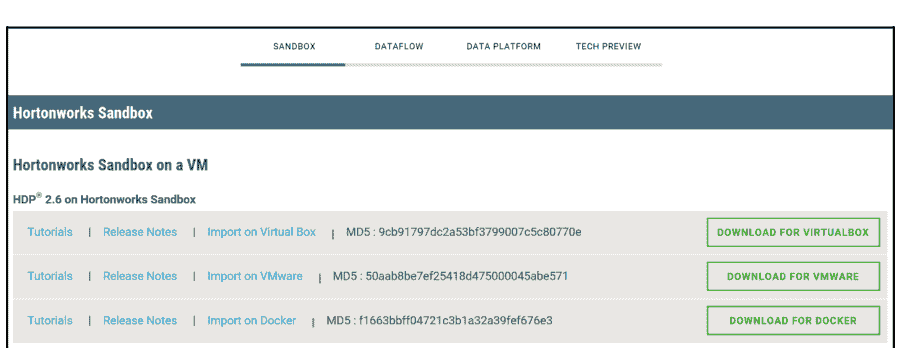

2. 下载您想要的 VM；在我们的例子中，我们使用了最后一个，DOWNLOAD FOR DOCKER。完成后，按照说明进行配置，并确保您已将以下条目添加到 %systemroot%\system32\drivers\etc\hosts 文件中：

```
127.0.0.1 sandbox.hortonworks.com
```

如下屏幕截图所示：

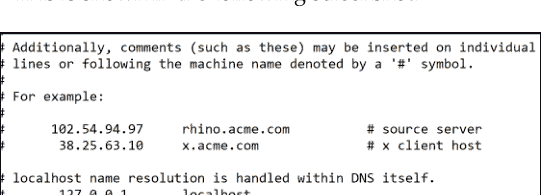

3. 打开浏览器并导航到 http://sandbox.hortonworks.com:8888。您的浏览器屏幕应如下屏幕截图所示：

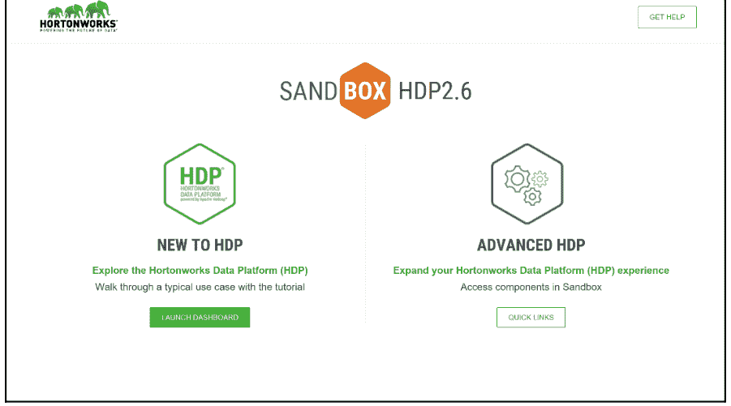

4. 点击 NEW TO HDP。Ambari 屏幕将出现。现在，点击更多图标，如以下屏幕截图所示，并选择 Files View：

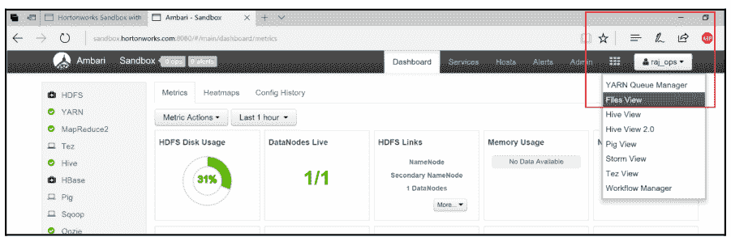

5. 出现以下屏幕。点击 **New Folder** 并输入 `SSISCookBook` 如以下屏幕截图所示。点击 **+Add** 按钮添加文件夹：

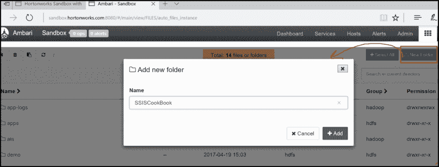

就这样！我们现在可以使用 SSIS 与本地集群进行交互。

## 将数据复制到本地集群

在本配方中，我们将添加一个包，该包将本地数据复制到本地集群。

### 准备工作

本配方假设您有权访问本地集群，并且已从上一个配方中创建了一个文件夹来保存其中的文件。

### 如何操作...

1. 在解决方案资源管理器中，打开（展开）`ETL.DW` 项目并右键单击它以添加新包。将其命名为 `FactOrdersToHDPCluster.dtsx`。

16. Hadoop 连接管理器编辑器打开。设置属性如以下屏幕截图所示。确保连接有效，然后点击 OK 关闭窗口。

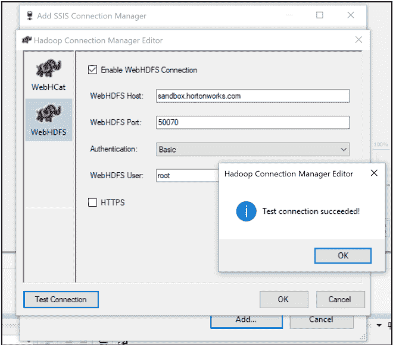

17. 从 SSIS 工具箱拖放一个 HDFS File Destination 到数据流任务上。将其连接到 der_LoadExecutionId 派生列。将其命名为 hdfs_dst_FactOrders。双击 OK 并设置属性如下：
   - 在 Hadoop Connection Manager 中选择 cmgr_Hadoop_Sandbox
   - 将 File path 设置为 /SSISCookBook/Import/FactOrders.txt
   - 从左侧窗格选择映射以设置源和目标列之间的映射

18. 点击 **OK** 关闭 HDFS File Destination Editor。

19. 现在，如往常一样，确保转换的大小相同并且正确对齐。您的数据流任务应如下屏幕截图所示：

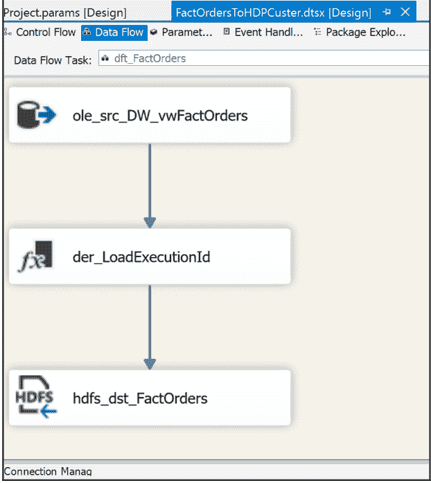

20. 现在我们可以运行包。完成后，我们可以看到集群中在 /SSISCookBook/Import/ 文件夹下创建了一个文件，如以下屏幕截图所示。转到 Ambari | Files View 并浏览到 SSISCookBook/Import 文件夹。您可以打开文件，如以下屏幕截图所示：

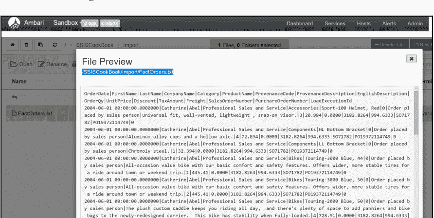

就这样！我们已成功将数据从 SQL Server 传输到 Hortonworks 沙箱集群上的 HDFS，其操作系统和文件系统与 Windows 完全不同。我们将在后续配方中继续使用该文件。

## 使用 Hive – 创建数据库

Hive 是 Hadoop 中用于与大量数据交互的语言之一。它非常容易学习，因为它使用 SQL 命令。本配方将向您展示我们如何使用 Hive 转换来自我们源的数据。虽然我们文件中的数据只有 542 行，但我们仍然可以使用它来学习 Hadoop 服务调用。

在本配方中，我们将在 Hive 中创建一个数据库。

### 准备工作

本配方假设您有权访问本地或 Azure 上的 Hortonworks 沙箱。它还假设您已执行上一个配方。

### 如何操作...

1. 打开 Ambari 并导航到 `http://Sandbox.Hortonworks.com:8080`。使用 `raj_ops` 作为用户名和密码登录。
2. 点击工具栏中 `raj_ops` 附近的更多图标（九宫格按钮）并选择 **Hive View 2.0**，如以下屏幕截图所示：

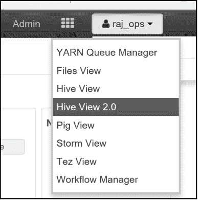

4. 刷新浏览器并点击 **Browse**，如以下屏幕截图所示。数据库已创建。

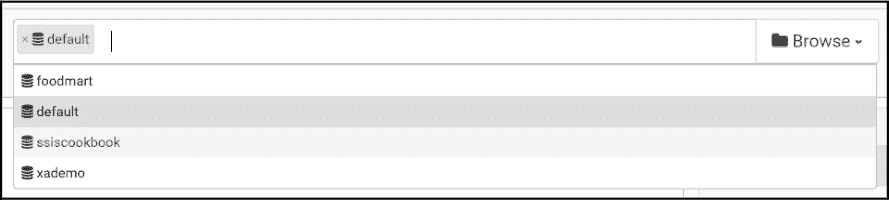

### 了解更多...

第一步已完成；我们已创建数据库。我们将在下一个配方中与数据进行交互。

## 使用 Hive 转换数据

数据现在已在集群的 HDFS 中。我们现在将使用 SQL 脚本转换它。我们使用的程序是 Hive。该程序使用 SQL 语句与数据交互。

对于大多数 Hadoop 程序（Hive、Pig、Sparks 等），源是只读的。这意味着我们无法修改我们在上一个配方中传输的文件中的数据。某些语言如 HBase 允许我们修改源数据。不过，对于我们的目的，我们将使用 Hadoop 生态系统中的知名程序 Hive。

### 准备工作

本配方假设您有权访问 Hortonworks 集群，并且已按照上一个配方将数据传输到其中。

### 如何操作...

1. 如果尚未完成，打开上一个配方中创建的包，`FactOrdersToHDPCluster.dtsx`。
2. 添加一个 Hadoop Hive 任务并将其重命名为 `hht_HDPDWHiveTable`。


3. 双击打开 Hadoop Hive 任务编辑器，如以下屏幕截图所示：

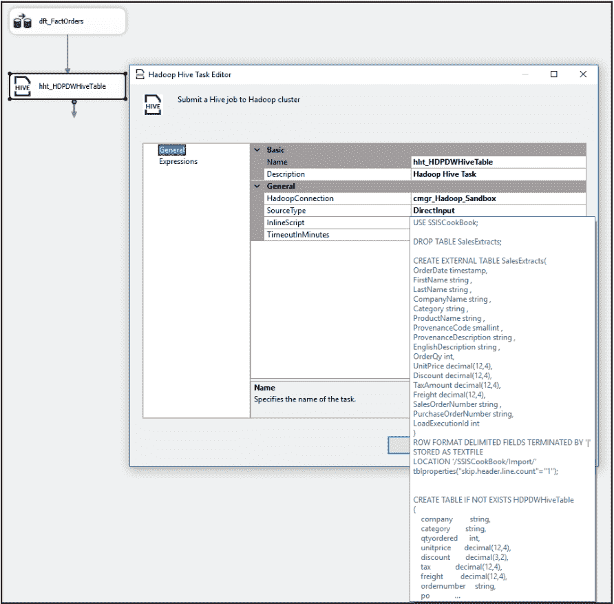

## 在 Hadoop 与 Azure 之间传输数据

现在我们已经通过本地 Hadoop Hive 创建了一些数据，我们将把这些数据传输到 Azure 上的云存储中。然后，我们将使用 Hadoop Pig Latin 对其进行几次转换。完成后，我们会将数据传输到 `AdventureWorksLT DW2016` 数据库的暂存架构中的本地表。

在本教程中，我们将把本地 Hortonworks 集群处理过的数据复制到 Azure Blob 存储中。数据复制完成后，我们就可以使用 Azure 计算资源对其进行转换，正如我们在以下教程中会看到的那样。

## 准备工作

本教程假定您已按照上一教程所述在 Azure 中创建了存储空间。

## 操作方法...

- 1. 打开 `ETL.Staging SSIS` 项目并向其中添加一个新包。将其重命名为 `StgAggregateSalesFromCloud.dtsx`。
- 2. 添加一个名为 `cmgr_Hadoop_Sandbox` 的 Hadoop 连接管理器，像我们在上一教程中所做的那样。
- 3. 添加另一个连接管理器，它将连接到 Azure 存储，如本章中之前教程中所做的 `cmgr_AzureStorage_ssiscookbook`。
- 4. 在控制流中添加一个 **Foreach Loop** 容器并将其重命名为 `felc_HDP_Export`。

- 5. 双击打开 **Foreach Loop** 编辑器。设置 **Collection** 属性，如以下屏幕截图所示：

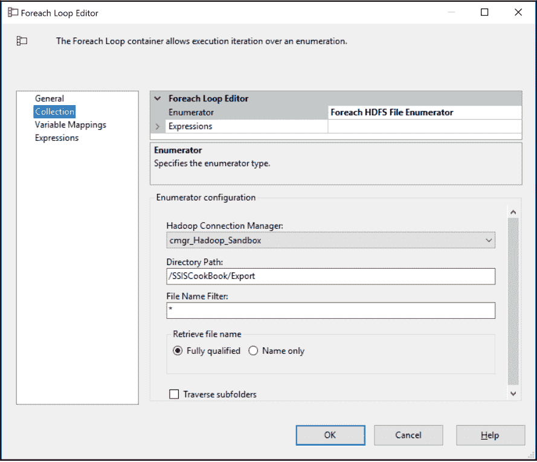

- 6. 点击 **Variable Mappings**，在包级别创建一个新变量，并将其命名为 `HDPFileNamePath`，如以下屏幕截图所示：

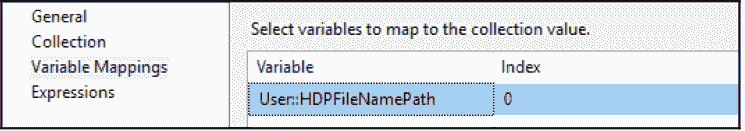

- 7. 点击 **OK** 关闭 **Foreach Loop** 编辑器。
- 8. 转到 **Variables** 面板并将 `HDPFileNamePath` 的值设置为 `/SSISCookBook/Export/000000_0`。
- 9. 从 SSIS 工具箱中拖放一个 HDFS 文件源到 `felc_HDP_Export` Foreach Loop 容器中。将其重命名为 `hfs_src_SSISCookBook_Export`。
- 10. 在数据流任务背景中任意位置点击，然后转到 **Properties** 面板（或按 F4 显示）。向下滚动到 **Expressions** 并点击省略号 (...) 按钮。
- 11. 从下拉列表中，点击 `hfs_src_SSISCookBook_Export.FilePath` 表达式右侧的省略号按钮。填写 **Expression Builder**，如以下屏幕截图所示。点击 OK 关闭 **Expression Builder**：

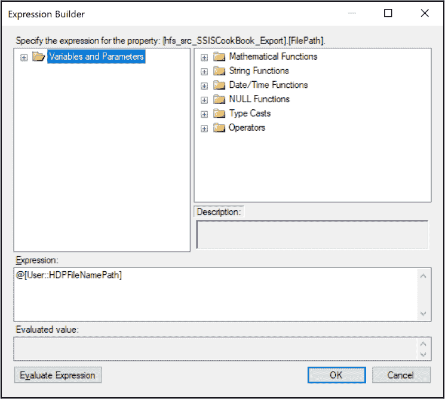

- 12. 关闭并重新打开包以强制表达式被考虑。
- 13. 双击打开 **HDF File Source** 编辑器并分配以下内容：
  - **Hadoop Connection Manager：** 从下拉列表中选择 `cmgr_Hadoop_Sandbox`。
  - **File Path：** 应为 `/SSISCookBook/Export/000000_0`。这是我们之前设置的变量表达式的值。
  - **File format：** 保留默认值 `Text`。
  - **Column delimiter character：** 使用竖线 (`|`)。

14. 点击 **Columns** 选项卡并在编辑器左侧设置列并重命名它们，如以下屏幕截图所示。完成后，点击 **OK** 关闭 **HDFS File Source Editor**：

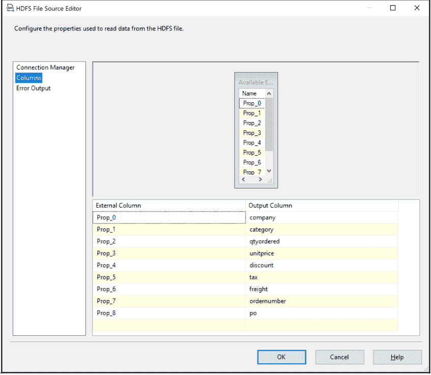

15. 在数据流任务中添加一个 **Derived Column** 并将其链接到 `hfs_src_SSISCookBook_Export.FilePath`。将其重命名为 `der_LoadExecutionId`。打开 **Derived Column Editor** 并添加一个名为 `LoadExecutionId` 的列。将值设置为 **Package::LoadExecutionId** 包参数。

19. 最终的数据流任务应如下图所示：

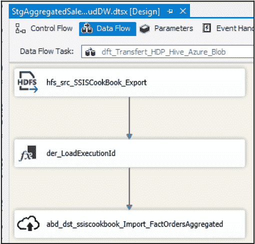

20. 执行数据流任务。完成后，转到 Azure 门户（portal.azure.com），进入您的 HDInsight 集群 | 存储帐户 | Blob 服务，并点击 Import Blob。您应该会看到与以下屏幕截图类似的画面：

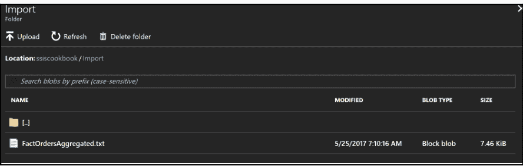

3. 您的连接管理器应如下图所示：

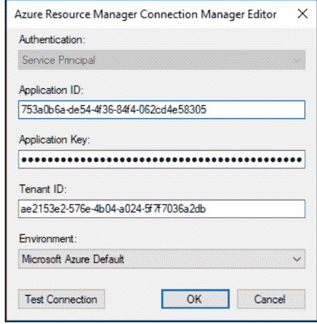

4. 从 SSIS 工具箱拖放一个 Azure Create Cluster 任务到控制流上，并将其附加到 felc_HDP_Export Foreach Loop 容器。重命名任务 acc_ssiscookbook for Azure Create Cluster 为 ssiscookbook。

5. 双击打开 Azure HDInsight Create Cluster 编辑器。按以下屏幕截图所示填写属性。对于 SubscriptionId，使用您的 Azure 订阅 ID。位置取决于您创建存储帐户的位置。为避免额外费用，您应将集群创建在与存储帐户相同的区域：

7. 现在我们来测试集群创建是否有效。右键点击任务并选择 Execute Task。集群创建开始。此任务可能需要几分钟才能完成。在我们的案例中，最长需要 15 分钟。

8. 完成后，打开一个 bash 终端。我们将使用随 Windows 10 提供的终端。转到 Azure 门户并查找已创建的 HDInsight 集群。在概览中，有一个使用 SSH 连接的选项。点击它并复制 SSH 命令。将其粘贴到 bash 终端中。它应包含类似以下命令：

```
ssh User@yourcluster-ssh.azurehdinsight.net
```

它也在以下屏幕截图中显示：

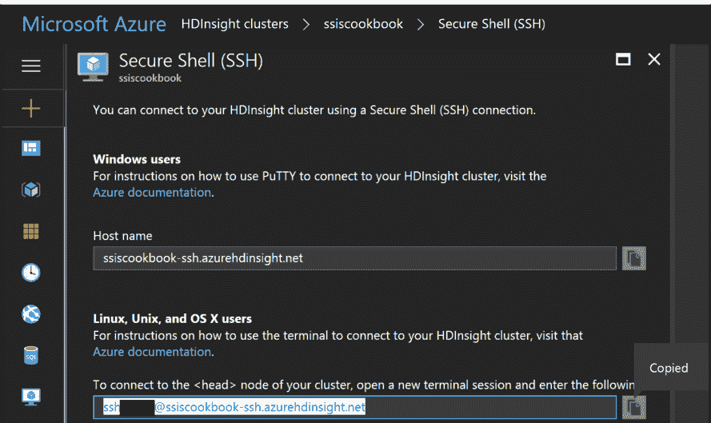

9. 接下来，我们将添加一个任务以在完成后删除集群。从 SSIS 工具箱拖放一个 Azure HDInsight Delete Cluster Task 到控制流上。将其重命名为 adc_ssiscookbook。双击并按以下屏幕截图所示设置属性：

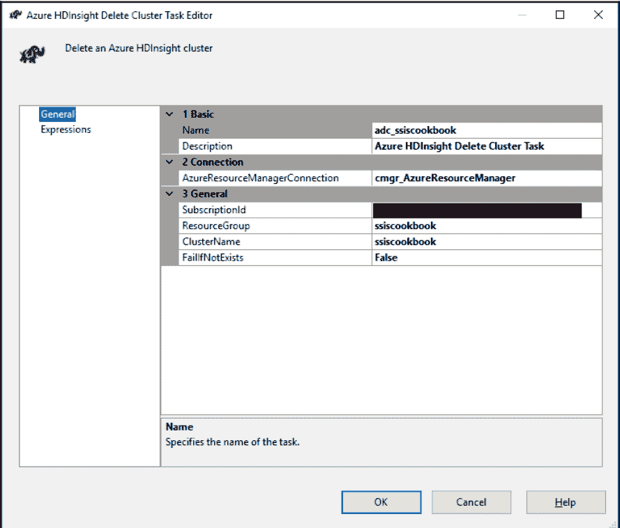

10. 点击 **OK** 关闭 `adc_ssiscookbook` 任务。右键点击它并从出现的上下文菜单中选择 **Execute Task**。成功执行后，转到 Azure 门户并验证集群已被删除。

## 还有更多...

就这样！我们现在可以根据需要创建和删除集群。以下教程将展示如何使用集群与 Pig。

## 使用 Pig Latin 管理数据

Pig Latin 是大数据集群中可用的程序之一。该程序的目的是运行可以接受任何类型数据的脚本。“Pig can eat everything”，正如创建者的格言所说。

本教程仅用于向您展示如何调用一个简单的 Pig 脚本。不进行任何转换。脚本的目的是向您展示如何使用 SSIS 中的 Azure Pig 任务。

## 准备工作

本教程假定您已成功创建了一个 HDInsight 集群。

## 操作方法...

- 1. 在 `StgAggregatedSales.dtsx` SSIS 包中，将一个 **Azure Pig Task** 拖放到控制流上。将其重命名为 `apt_AggregateData`。
- 2. 双击打开 **Azure HDInsight Pig Task Editor** 并按以下屏幕截图所示设置属性：

- 5. 右键点击 `apt_AggregateData` 并从出现的上下文菜单中选择 **Execute Task** 以运行脚本。
- 6. 成功完成后，转到 Azure 门户中的 Blob 存储以检查文件是否已创建。
- 7. 如果出现任何错误，请转到 `apt_AggregateData` 中指定的目录中的日志文件。
- 8. 您的包现在应如下图所示：

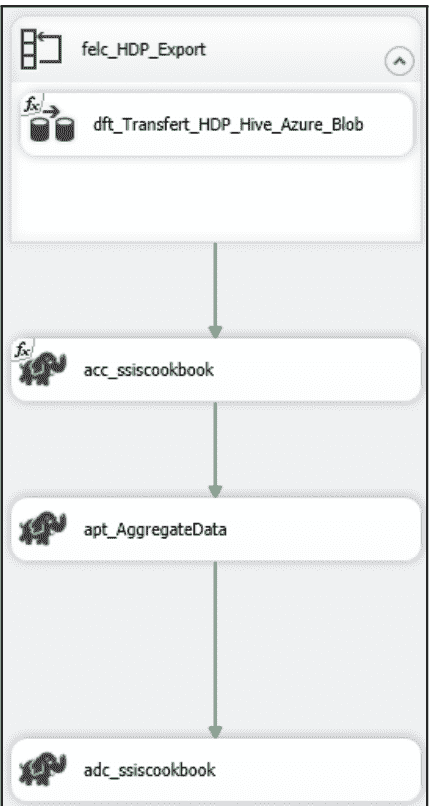

### 还有更多...

您会注意到数据未被修改，因为本教程的目的是展示如何从 SSIS 调用 Pig 脚本。

### 导入 Azure Blob 存储数据

到目前为止，我们已创建并删除了一个 HDInsight 集群，并使用 Azure Pig 任务调用了一个 Pig 脚本。本教程将演示如何从 Azure Blob 存储导入数据到暂存架构中的表。

### 准备工作

本教程假定您已完成上一教程。

### 操作方法...

- 1. 从 SSIS 工具箱拖放并 **Execute SQL Task** 到控制流上，并将其重命名为 `sql_truncate_Staging_StgCloudSales`。
- 2. 双击打开 **SQL Task Editor**。按如下设置属性并点击 OK：
  - **Connection：** `cmgr_DW`
  - **SQL Statement：** `TRUNCATE TABLE [Staging].[StgCloudSales];`
- 3. 从 SSIS 工具箱拖放一个 **Foreach Loop Container** 并将其重命名为 `feIC_StgCloudSales`。


4. 双击它以打开 **Foreach 循环编辑器**，并在 **集合**窗格中配置属性，如下面的屏幕截图所示：

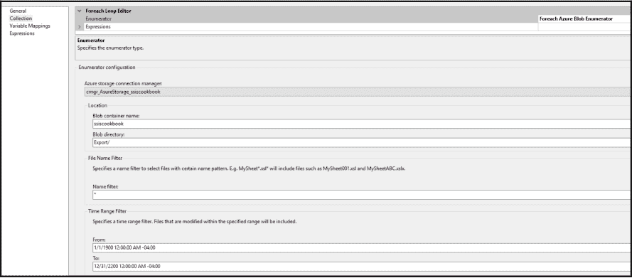

5. 现在转到 **变量映射**窗格，添加一个名为 `User::AzureAggregatedData` 的字符串变量。确保其作用域位于包级别。

6. 将一个 **数据流任务** 拖到 `felc_StgCloudSales` 中，并将其重命名为 `dft_StgCloudSales`。

7. 进入 **数据流任务**，从 SSIS 工具箱中拖出一个 **Azure Blob 源**。将其重命名为 `azure_blob_src_ExportBlob`。

8. 单击数据流背景的任意位置，转到 **属性**窗格。选择 **表达式**。单击省略号按钮（`...`），然后从列表中选择 `[azure_blob_src_ExportBlob].[Blob Name]`。将 `@[User::AzureAggregatedData]` 赋为值。

10. 将一个 **OLE DB 目标** 拖到 **数据流任务** 中，并将其重命名为 `ole_dst_Staging_StgCloudSales`。将其连接到 `azure_blob_src_ExportBlob`。

11. 双击它并设置属性，如下所示：

    - **OLE DB 连接管理器：** `c_mgr_DW`
    - **表或视图的名称：** `[Staging].[StgCloudSales]`

12. 进入 **映射**窗格，确保所有列都已映射。单击 **确定** 关闭编辑器。您的屏幕应类似于下面的屏幕截图：

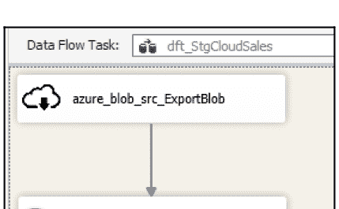

13. 返回控制流，右键单击 `felc_StgCloudSales`。从上下文菜单中选择 **执行** 以执行该容器。

14. 将 `felc_StgCloudSales` 连接到 `sql_truncate_Staging_StgCloudSales` 和 `apt_AggregateData` 任务。最终包应类似于下面的屏幕截图：

## Azure 数据工厂和 SSIS

Azure 中有一项服务，它能处理 Azure 数据，其能力与 SSIS 差不多。实际上，如果你的数据只在 Azure 中，你应该将这项服务与 SSIS 结合使用。

Azure 数据工厂（ADF）是一项使用 Azure 中各种可用服务来编排数据集成的服务。与 SSIS 类似，它可以将数据从一个位置移动到另一个位置。主要区别如下：

- SSIS 需要一台 Windows 机器才能运行。即使是复制数据，该服务也运行在 Windows 服务器上。ADF 不需要任何东西即可完成复制数据任务，因为该服务在 Azure 中运行。
- SSIS 内置了丰富的工具集来转换数据，即数据流任务。ADF 内置功能中没有任何能与它相媲美的东西。
- ADF 依赖计算服务（如 HDInsight 集群）来运行 Hive 和 Pig 脚本以转换数据。
- SSIS 可以即时转换数据，无需离开包，也不一定需要暂存数据。它可以立即将数据转换并加载到目标。ADF 会调用一个服务来转换数据，但该服务可能无法直接将数据加载到目标。

例如，我们需要从 Oracle 加载数据，进行转换并加载到 SQL Server。SSIS 可以在一个包中完成这一切。ADF 则必须将数据复制到中间存储，调用服务来转换数据，最后再加载到目标。SSIS 2016 服务运行在基于 Windows 操作系统的机器上；ADF 运行在 Azure 中，无需考虑操作系统。

通常，如果你的企业数据大部分位于 Azure 生态系统中，并且你几乎不使用本地数据，那么使用 ADF 是有意义的。在这种情况下，你很可能正在使用 ADF 和/或 T-SQL 来执行 ETL，无论是存储过程还是 DML 语句。

但是，如果你的企业数据主要位于本地，并且其中一部分位于 Azure 中，那么使用 SSIS 更有意义。如果你使用的是本地大数据集群，正如你在本章前面所看到的，同样如此。SSIS 现在拥有大量连接器，可以利用本地以及 Azure 中的大数据集群。

自定义组件最常见的用途是自定义转换，这些转换要么提供内置组件未提供的操作，要么将一系列转换封装到单个转换中。在后一种情况下，你也可以使用多个内置转换来实现这些操作，但你更希望通过将它们实现为单个组件来降低数据流的复杂性。

脚本任务和组件的更多细节将在第 11 章“释放 SSIS 脚本任务和组件的威力”中讨论。在这两种情况下，自定义代码都嵌入在 SSIS 包定义中；你可以在包开发期间创建和修改它，并且它随包一起部署。

在使用自定义任务或组件时，自定义代码在单独的 Visual Studio 项目中开发。你应该为每个自定义任务或组件创建单独的程序集；这样你就可以在不重新部署任何使用它们的包的情况下，独立于任何其他自定义任务或组件来开发、修改和部署它们。

要决定是使用脚本，还是设计自定义任务或组件，可以使用以下规则：如果任务或组件的完整逻辑可以封装到单个脚本中，并且同一个脚本不需要在多个包中使用，则使用脚本。否则，建议你考虑使用自定义任务或组件，尤其是在需要在大量包中实现相同自定义逻辑的情况下。

## 设计自定义任务

要设计自定义控制流任务，你需要基于 Visual Studio 的类库模板创建一个 .NET 程序集；任务的定义必须放在一个类中，该类派生自 `Microsoft.SqlServer.Dts.Runtime` 命名空间（位于 `Microsoft.SqlServer.ManagedDTS.dll` 程序集中）的 `Task` 基类。该类还需要实现 `DtsTaskAttribute`，该属性用于将类标识为 SSIS 任务，并在 SSIS 控制流中实现自定义任务时提供基本属性。

可选地，你可以为自定义任务提供自定义图形用户界面，该界面将在 SSIS 包开发期间配置任务时用作任务编辑器。如果未提供自定义编辑器，则可以使用内置的高级编辑器来编辑自定义任务。

任务基类提供了两个需要重写的方法，你需要在这两个方法中提供自定义代码，用于：

- 验证任务的配置。每当任务设置更改时，SSIS 控制流设计器都会自动调用此方法，并允许你与 SSIS 包开发人员沟通，帮助他们理解任务的配置，并在任务可以使用之前正确配置它。
- 你还需要提供执行任务所需的逻辑。此方法将在运行时调用，当包执行到达控制流序列中的任务时调用。此方法还允许访问各种 SSIS 包资源：
  - 可以读取或写入 SSIS 变量。
  - 可以使用包可访问的连接来连接到各种数据源。
  - 自定义任务可以将日志条目发送到事件日志。
  - 建议你在自定义任务中实现事件，这样它的性能可以在设计时由 SSDT 捕获，并在部署了实现该任务的包之后由 SSIS 服务器捕获。
  - 在自定义任务中，你还可以检测操作是否参与事务，并在连接到数据源时使用此信息。

上述两个方法都返回一个 `DTSExecResult` 值，指定验证或执行的结果；这会将每个方法的结果传达给 SSIS 包开发人员以及 SSIS 执行引擎。`DTSExecResult` 枚举支持以下值：

- Success 用于指定验证或执行已成功完成。
- Failure 指定验证或执行已失败。通常，在失败的情况下，任务应返回更多事件，以向 SSIS 包开发人员或部署环境的管理员提供有关失败的更多信息。
- Completion 可用于执行，当 Success 或 Failure 都不是相关结果或不够具体时。例如，如果任务成功完成工作，则返回 Success；如果失败，则返回 Failure；但如果没有执行任何工作，即使配置正常，任务也可能返回 Completion，以传达既非成功也非失败的特定结果。


`Canceled` 用于向 SSIS 执行引擎报告执行已被中断；例如，在执行过程中甚至尚未达到可以被解释为其他三种结果之一的位置时。

通常，在 `Validate()` 方法中只应使用 `Success` 和 `Failure`。

若要部署自定义任务（无论是部署到用于 SSIS 包开发的开发工作站，还是部署到将要使用的环境中），都需要将包含该任务的程序集复制到以下文件夹：

- `%ProgramFiles%\Microsoft SQL Server\130\DTS\Tasks` - 用于程序集的 64 位版本
- `%ProgramFiles(x86)%\Microsoft SQL Server\130\DTS\Tasks` - 用于程序集的 32 位版本

如果程序集与平台无关，则文件需要复制到这两个文件夹中。

程序集及其引用的所有程序集还必须在**全局程序集缓存（GAC）**中注册。要在 SSIS 开发工作站上注册程序集，可以使用 `gacutil.exe` 命令行实用工具（它随 Visual Studio 一起安装）；但在生产服务器上，`gacutil.exe` 可能不可用。您也可以使用适当的 Windows PowerShell 脚本执行注册。

在本节中，您将开发一个自定义任务，将其部署到开发工作站，并在 SSIS 包中使用它。

此自定义任务将使用一个外部库，使您能够在 SSIS 中使用 (SSH FTP) 执行 FTP 任务。


为了方便您使用，本章所需的 C# 代码片段在 `Chapter13.txt` 文件中提供。

## 准备工作

在开始之前，您需要从 `https://winscp.net/` 网站安装 `WinSCP` 类库；WinSCP 是一个免费工具，您可以根据自由软件基金会发布的 GNU 通用公共许可条款（`https://www.gnu.org/licenses/gpl.html`）在自己的解决方案中使用它。

请查看 WinSCP GNU 许可，网址为 https://winscp.net/eng/docs/license。

要在您的工作站上安装和注册外部库，请执行以下步骤：

- 1. 从 https://winscp.net/eng/download.php 下载 **安装包** 5.9.5 版，或 WinSCP 的 .NET **程序集/COM 库**。
- 2. 我们建议您使用安装包，它会将应用程序和必要的程序集安装到本章示例所期望的文件夹中。
- 3. 如果您决定使用安装包，请运行它，然后按照安装向导中的说明完成安装。
- 4. 如果您只想下载程序集，请下载存档文件，然后将其解压到 C:\Program Files (x86)\WinSCP\ 文件夹中。
- 5. 在安装成功完成后，或者将文件放入指定文件夹后，使用 Windows 资源管理器导航到 C:\SSIS2016Cookbook\Chapter13\Scripts 文件夹。
- 6. 找到 Chapter13_GAC_WinSCPnet.bat 命令文件，并在记事本中打开它。
- 7. 检查该文件，然后关闭它。
- 8. 在 Windows 资源管理器中，右键单击命令文件，然后从快捷菜单中选择 **以管理员身份运行...**。
- 9. 在**用户帐户控制**对话框中，单击**确定**以允许执行。
- 10. 执行完成后，按任意键关闭命令提示符窗口。

现在您可以开始设计自定义任务了。

## 操作步骤...

- 1. 启动 Visual Studio 2015 并创建一个新项目。
- 2. 在**新建项目**对话框中，确保选择了 **.NET Framework 4.5.2**，然后在**模板\Visual C#**下选择**类库**模板。使用 `SSISCustomTasks` 作为项目名称，将其放在 `C:\SSIS2016Cookbook\Chapter13\Starter` 文件夹中，勾选**为解决方案创建目录**，并使用 `SSISCustomization` 作为解决方案名称。参考以下截图以验证您的设置：

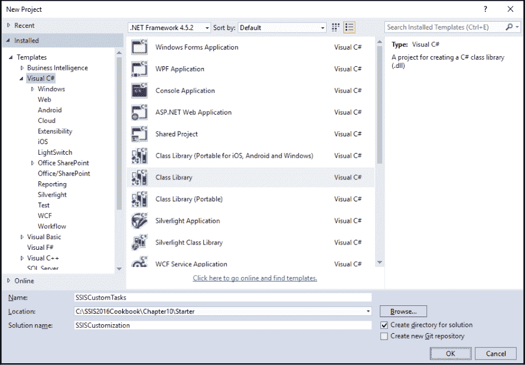

- 3. 单击“确定”确认配置并创建解决方案。
- 4. 在**解决方案资源管理器**中，右键单击新创建的 `SSISCustomTasks` 项目，然后从快捷菜单中选择**属性**，打开 `SSISCustomTasks` 属性窗格。
- 5. 在**应用程序**页面上，将默认命名空间值更改为 `SSIS2016Cookbook`。
- 6. 在**签名**页面上，勾选**为程序集签名**，然后在**选择强名称密钥文件**选择框中选择**<浏览...>**。
- 7. 在**选择文件**对话框中，导航到 `C:\SSIS2016Cookbook\Chapter13\Scripts` 文件夹，并选择 `SSIS2016Cookbook.snk` 强名称密钥文件，如下面的截图所示：

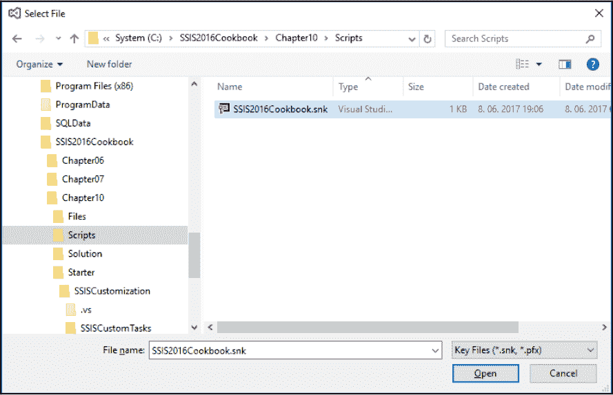

- 8. 单击**打开**以确认选择。
- 9. 保存解决方案，然后关闭项目属性窗格。
- 10. 在 `Class1.cs` 设计器窗格中，将类的命名空间更改为 `SSIS2016Cookbook`，并将 `Class1` 名称更改为 `SecureFTP`。
- 11. 在**解决方案资源管理器**中，将 `Class1.cs` 文件名更改为 `SecureFTP.cs`，然后保存解决方案。
- 12. 在**解决方案资源管理器**中，右键单击**引用**，然后从快捷菜单中选择**添加引用...**，打开**引用管理器**对话框。
- 13. 在**程序集 / 扩展**下，勾选 `Microsoft.SqlServer.Dts.Design`、`Microsoft.SqlServer.ManagedDTS` 和 **WinSCPnet** 程序集，如下面的截图所示：

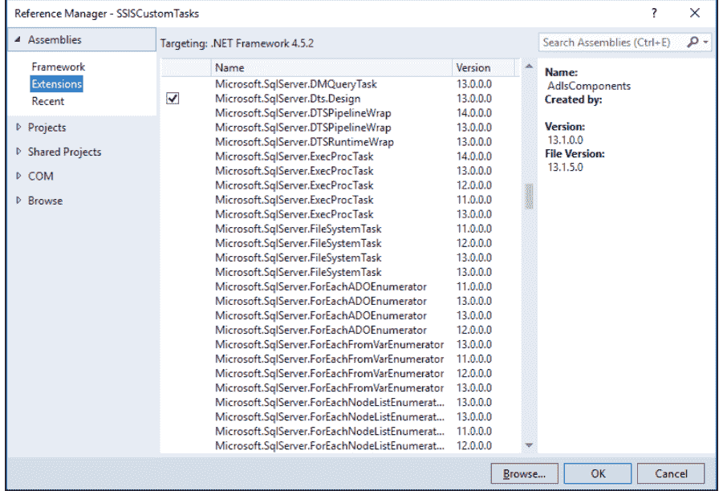

14. 单击“确定”确认选择。

15. 在 SecureFTP.cs 文件中，在源代码顶部，将现有的所有命名空间引用替换为以下内容：

```
using System;
using Microsoft.SqlServer.Dts.Runtime;
using WinSCP;
```

16. SecureFTP 类必须派生自 Microsoft.SqlServer.Dts.Runtime.Task 基类，并且还必须实现 DtsTaskAttribute：

```
[DtsTaskAttribute(
    Description = "Perform FTP operations securely, by using SSH.",
    DisplayName = "Secure FTP Task"
)]
public class SecureFTP : Task
{
    ...
}
```

Microsoft.SqlServer.Dts.Runtime.Task 基类提供了任何 SSIS 控制流任务所需的功能，DtsTaskAttribute 允许您配置自定义任务的一些主要属性。它们共同使程序集中的类能够被识别为 SSIS 任务，进而可以在 SSIS 包中使用它。

17. 向 SecureFTP 类添加以下私有常量：

```
private const String TASK_NAME = "Secure FTP Task";
private const String FtpProtocolName_MISSING_MESAGE = "FtpProtocolName has not been set.";
private const String FtpHostName_MISSING_MESAGE = "FtpHostName has not been set.";
private const String FtpUserName_MISSING_MESAGE = "FtpUserName has not been set.";
private const String FtpPassword_MISSING_MESAGE = "FtpPassword has not been set.";
private const String FtpSshHostKeyFingerprint_MISSING_MESAGE = "FtpSshHostKeyFingerprint has not been set.";
private const String FtpOperationName_MISSING_MESAGE = "FtpOperationName has not been set.";
private const String FtpLocalPath_MISSING_MESAGE = "FtpLocalPath has not been set.";
```

```
private const String FtpRemotePath_MISSING_MESSAGE = "FtpRemotePath has not been set.";
private const String REMOVE_ENABLED_MESSAGE = "FtpRemove is set to TRUE, which means that the file is going to be removed from the source.";
private const String SESSION_OPEN_MESSAGE = "Session opened succesfully.";
private const String REMOTE_DIRECTORY_MISSING_MESSAGE_PATTERN = "The specified remote [{0}] directory is missing.\r\nIt will be created.";
private const String REMOTE_DIRECTORY_CREATED_MESSAGE_PATTERN = "The specified remote [{0}] directory has been created.";
private const String REMOTE_FILES_MISSING_MESSAGE_PATTERN = "The specified remote file(s) [{0}] cannot be found.";
private const String EXCEPTION_MESSAGE_PATTERN = "An error has occurred:\r\n\r\n{0}";
private const String UNKNOWN_EXCEPTION_MESSAGE = "(No other information available.)";
```

这些常量将由自定义任务的方法使用，以便在配置任务时向 SSIS 包开发人员传达任务状态信息。

18. 创建 SecureFTP 类的以下公共成员：

```
public String FtpProtocolName { get; set; }
public String FtpHostName { get; set; }
public Int32 FtpPortNumber { get; set; }
public String FtpUserName { get; set; }
public String FtpPassword { get; set; }
public String FtpSshHostKeyFingerprint { get; set; }
public String FtpOperationName { get; set; }
public String FtpLocalPath { get; set; }
public String FtpRemotePath { get; set; }
public Boolean FtpRemove { get; set; }
```

SecureFTP 类的这些公共成员将在 SSDT 中作为任务属性访问，并将允许 SSIS 包开发人员配置自定义任务；在 SSDT 中，这些值可以以字面值形式提供，也可以通过表达式提供。


- 19. 将以下枚举添加到类定义中：

```csharp
public enum OperationMode
{
    GetFiles,
    PutFiles
}
```

该枚举列出了**安全 FTP 任务**支持的操作模式；其中两种模式使用本示例中的代码实现：`GetFiles` 从指定的 FTP 站点接收文件，`PutFiles` 将文件发送到指定的 FTP 站点。当然，枚举本身并不包含执行这些操作所需的完整编程逻辑。


你可以通过实现 WinSCP 库中提供的其他函数来扩展其范围。关于该库的更多信息，请访问 `https://winscp.net/eng/docs/start`。

- 20. 将以下私有函数添加到 `SecureFTP` 类中：

```csharp
private Session EstablishSession()
{
    Session winScpSession = new Session();

    Protocol ftpProtocol = (Protocol)Enum.Parse(typeof(Protocol),
    this.FtpProtocolName);

    SessionOptions winScpSessionOptions = new SessionOptions
    {
        Protocol = ftpProtocol,
        HostName = this.FtpHostName,
        PortNumber = this.FtpPortNumber,
        UserName = this.FtpUserName,
        Password = this.FtpPassword,
        SshHostKeyFingerprint = this.FtpSshHostKeyFingerprint
    };

    winScpSession.Open(winScpSessionOptions);

    return winScpSession;
}
```

此函数创建 `WinSCP Session` 类的一个实例；它连接到 FTP 服务器，建立适当的安全上下文，并允许对远程站点执行这些操作。

```csharp
Boolean fireAgain = false;

try
{
    // Verify the connection.
    using (Session winScpSession = this.EstablishSession())
    {
        componentEvents.FireInformation(0, TASK_NAME,
            SESSION_OPEN_MESSAGE, String.Empty, 0, ref fireAgain);

        // Verify the remote resources.
        OperationMode operation =
            (OperationMode)Enum.Parse(typeof(OperationMode),
            this.FtpOperationName);
        switch (operation)
        {
            case OperationMode.PutFiles:
                Boolean remoteDirectoryExists =
                    winScpSession.FileExists(this.FtpRemotePath);
                if (!remoteDirectoryExists)
                {
                    componentEvents.FireInformation(0, TASK_NAME,
                        String.Format(REMOTE_DIRECTORY_MISSING_MESSAGE_PATTERN,
                        this.FtpRemotePath), String.Empty, 0, ref fireAgain);
                }
                break;
            case OperationMode.GetFiles:
            default:
                Boolean remoteFileExists =
                    winScpSession.FileExists(this.FtpRemotePath);
                if (!remoteFileExists)
                {
                    componentEvents.FireInformation(0, TASK_NAME,
                        String.Format(REMOTE_FILES_MISSING_MESSAGE_PATTERN,
                        this.FtpRemotePath), String.Empty, 0, ref fireAgain);
                }
                break;
        }
    }

    return DTSExecResult.Success;
}
catch (Exception exc)
{
    String exceptionMessage = exc != null ? exc.Message :
        UNKNOWN_EXCEPTION_MESSAGE;
    componentEvents.FireError(0, TASK_NAME,
        String.Format(EXCEPTION_MESSAGE_PATTERN, exceptionMessage),
        String.Empty, 0);
    return DTSExecResult.Failure;
}
```

每当使用该任务的 SSIS 包被验证或执行时，都会用到 `Validate()` 方法；它将报告任何不正确或缺失的设置，并通知调用方 WinSCP 库返回的任何异常。此方法还会调用在第 21 步中创建的 `ValidateProperties()` 方法。

- 24. 在 `Validate()` 方法定义下方留出更多空间，然后再次输入 override 指令；这次选择要重写的 `Execute()` 方法，并用以下代码替换其默认定义：

```csharp
Boolean fireAgain = false;

try
{
    // Create a new FTP session.
    using (Session winScpSession = this.EstablishSession())
    {
        componentEvents.FireInformation(0, TASK_NAME, SESSION_OPEN_MESSAGE, String.Empty, 0, ref fireAgain);

        // Determine the operation mode.
        OperationMode operation =
            (OperationMode)Enum.Parse(typeof(OperationMode), this.FtpOperationName);
        switch (operation)
        {
            case OperationMode.PutFiles:
                // When uploading files, make sure that the destination directory exists.
                Boolean remoteDirectoryExists =
                    winScpSession.FileExists(this.FtpRemotePath);
                if (!remoteDirectoryExists)
                {
                    winScpSession.CreateDirectory(this.FtpRemotePath);
                    componentEvents.FireInformation(0, TASK_NAME, String.Format(REMOTE_DIRECTORY_CREATED_MESSAGE_PATTERN, this.FtpRemotePath), String.Empty, 0, ref fireAgain);
                }
                winScpSession.PutFiles(this.FtpLocalPath, this.FtpRemotePath, this.FtpRemove);
                break;
            case OperationMode.GetFiles:
            default:
                winScpSession.GetFiles(this.FtpRemotePath, this.FtpLocalPath, this.FtpRemove);
                break;
        }
    }

    return DTSExecResult.Success;
}
catch (Exception exc)
{
    String exceptionMessage = exc == null ?
        UNKNOWN_EXCEPTION_MESSAGE : exc.Message;
    componentEvents.FireError(0, TASK_NAME,
        String.Format(EXCEPTION_MESSAGE_PATTERN, exceptionMessage),
        String.Empty, 0);
    return DTSExecResult.Failure;
}
```

- 25. 保存类文件并生成 SSISCustomTasks 项目。如果正确遵循了上述说明，生成应该成功。如果生成失败，请检查“错误列表”窗格，查看是否发生任何错误，并逐一调查和解决每个错误。

- 26. 在 Visual Studio 工具栏中，选择“解决方案配置”选择框中的 **Release**，如下面的截图所示：

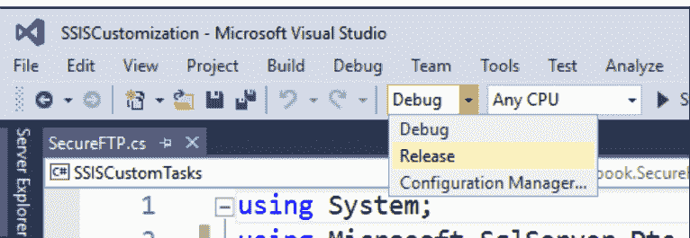

- 27. 再次生成 SSISCustomTasks 项目。相关文件现在已创建在 release 文件夹中，可以部署了。

- 28. 使用 Windows 资源管理器在 `C:\SSIS2016Cookbook\Chapter13\Starter\` 文件夹中找到 `Chapter13_Deploy_CustomTask.bat` 命令文件。

- 29. 以管理员身份运行该命令文件。这会将自定义任务程序集复制到相应的文件夹，并在 Windows GAC、SSDT（设计时）和 SSIS 运行时（运行时）中注册这些程序集；这需要将相关程序集注册到 GAC 中。

- 30. 在 SSDT 中，打开位于 `C:\SSIS2016Cookbook\Chapter13\Starter\AdventureWorksETL\` 文件夹中的 `AdventureWorksETL.sln` 解决方案。

- 31. 在控制流设计器中打开 `SecureFtpTask.dtsx` SSIS 包。

- 32. 检查包属性和变量；此包包含配置你在本示例前面创建的**安全 FTP 任务**所需的大部分信息。

- 33. 确保控制流设计器处于活动状态，并检查 **SSIS 工具箱**。**安全 FTP 任务**应列在**常用**部分。如果找不到该任务，请右键单击 **SSIS 工具箱**，然后在快捷菜单中选择 **刷新工具箱**。如果这样没有帮助，请关闭 SSDT 并重新打开解决方案。如果仍然不行，请关闭 SSDT，并重复步骤 26 到 33。

- 34. 从 **SSIS 工具箱**中，将**安全 FTP 任务**拖到控制流设计器中，并将其名称改为 **下载文件**。

- 35. 双击该任务以打开其编辑器；应弹出以下警告：

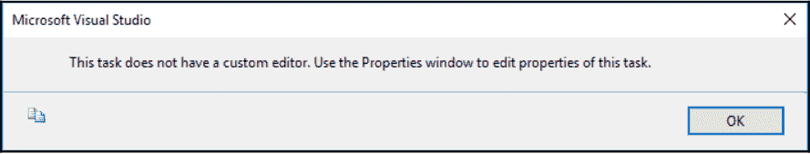

你没有为自定义任务设计自定义编辑器；因此，要使用该任务，需要在**属性**窗格中配置其属性。

- 36. 在控制流中选中**安全 FTP 任务**时，请在**属性**窗格中检查其属性。除了基本任务属性之外，你在第 18 步中创建的 `SecureFTP` 类的所有公共成员都应列在**杂项**部分中。

- 37. 找到**表达式**集合，单击其文本框，然后单击最右侧的省略号图标，启动**属性表达式编辑器**。

- 38. 在**属性表达式编辑器**的**属性**列中，选择 `FtpHostName` 属性。

- 39. 单击同一行最右侧的省略号图标，打开**表达式生成器**对话框。


40. 在**表达式生成器**中，将 `$Package::HostName` 参数拖到**表达式**文本框，然后点击**计算**以验证表达式，如下面的截图所示：

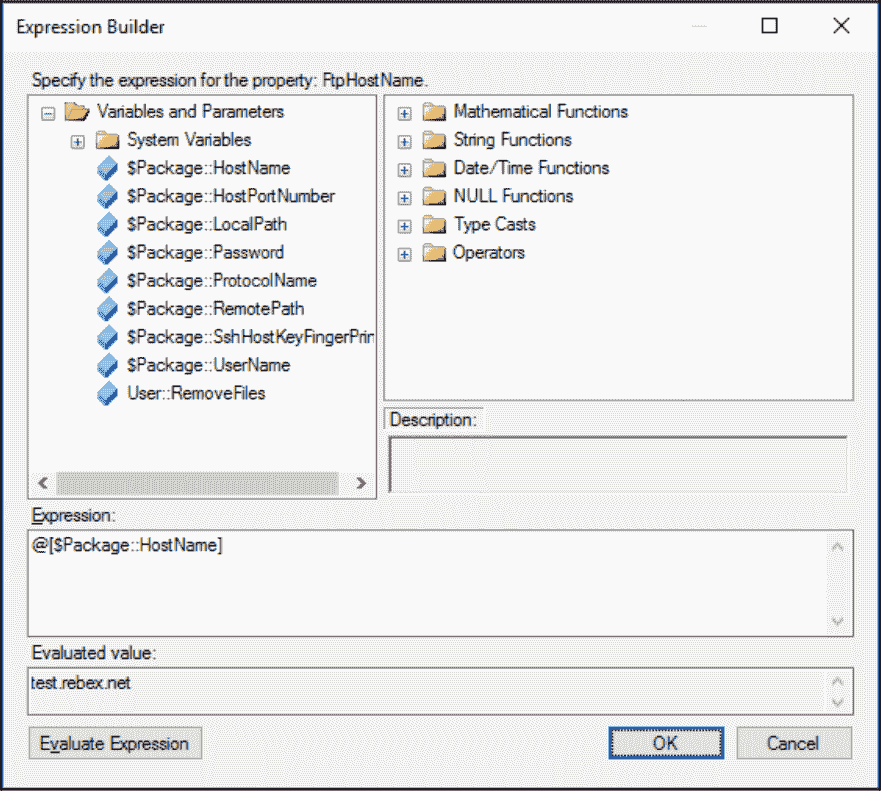

41. 点击**确定**以确认表达式。

42. 对其余属性重复步骤 38 至 41；使用以下设置：

| 属性 | 参数或变量 |
|---|---|
| `FtpLocalPath` | `$Package::LocalPath` |
| `FtpPassword` | `$Package::Password` |
| `FtpPortNumber` | `$Package::HostPortNumber` |
| `FtpProtocolName` | `$Package::ProtocolName` |
| `FtpRemotePath` | `$Package::RemotePath` |
| `FtpRemove` | `User::RemoveFiles` |
| `FtpSshHostKeyFingerprint` | `$Package::SshHostKeyFingerprint` |
| `FtpUserName` | `$Package::UserName` |

使用以下截图验证你的设置：

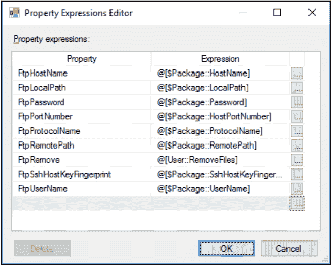

43. 点击**确定**以确认属性表达式。

44. 在**安全 FTP 任务属性**窗格中，找到 **FtpOperationName** 属性，并将其值设置为 `GetFiles`（不要引号）。

45. 保存包。

46. 使用 Windows 资源管理器导航到 `C:\SSIS2016Cookbook\Chapter13\Files` 文件夹；该文件夹中应该不含任何文件。

47. 在 SSDT 中，以调试模式执行 `SecureFtpTask.dtsx` SSIS 包。观察它的执行情况，并检查**进度**窗格中的消息。

48. 停止执行并切回 Windows 资源管理器。该文件夹现在应包含 18 个 PNG 文件和 `Readme.txt` 文件。

49. 关闭 `AdventureWorksETL.sln` 解决方案。

> 此示例中使用的公共 FTP 站点托管在 `test.rebex.net` 上；该站点为了 FTP 测试目的暴露了一个具有只读权限的文件夹。该站点支持多种文件传输协议，并且文件夹中有几个文件可用于测试。
>
> 由于文件访问仅限于只读，该站点不能用于上传文件。因此，为了测试 `PutFiles` 操作模式，你需要连接到另一个站点——例如，创建你自己的 FTP 服务器。你可以在 Rebex 公司网站上找到更多信息，网址为 `http://www.rebex.net/`。

## 工作原理...

在你的自定义任务**安全 FTP 任务**中，你在 `Validate()` 和 `Execute()` 方法中实现了自定义逻辑。你将执行文件传输操作所需的设置作为 `SecureFTP` 类的公共成员公开。

`Microsoft.SqlServer.Dts.Runtime.Task` 基类允许该任务在 SSIS 控制流中使用，其公共属性可从 SSDT 访问，自定义编程逻辑允许该任务通过验证并执行。

如果配置正确，该任务既可以从 FTP 站点下载文件，也可以将文件上传到 FTP 站点。

当你在 `SecureFtpTask.dtsx` SSIS 包中使用该任务时，你无法使用自定义编辑器对其进行配置，因为本指南未涉及此类编辑器的设计。但是，你可以通过直接访问其属性来配置该任务。

为使自定义组件在 SSIS 包中可用且可配置，必须提供以下设计时方法：

-   当组件被拖放到数据流设计器中时，将调用 `ProvideComponentProperties()` 方法。在此方法中，你提供组件的输入和/或输出的配置、其自定义属性，以及为了让组件准备就绪以进行设计时配置而必须设置的任何其他设置。
-   `Validate()` 方法用于验证组件及其设置；每次 SSIS 包开发人员在数据流开发期间确认（或尝试确认）设置时，都会调用该方法。因此，该方法也为你（组件开发人员）提供了一种与包开发人员沟通并帮助他们正确配置组件的方式。使用 `FireError()`、`FireWarning()` 和 `FireInformation()` 方法，通过适当的错误消息或警告通知包开发人员任何缺失或不正确的设置。
-   当根据验证结果需要重置和重新初始化组件的元数据时，将调用 `ReinitializeMetaData()` 方法。

以下运行时方法用于提供自定义组件的主要编程逻辑：

-   `PrepareForExecute()` 方法用于确定在从任何上游组件接收行之前需要设置的任何设置的值，并用于处理需要在行放入管道之前执行且能够执行的任何处理。执行此方法时，尚无可用的其他连接。
-   `AcquireConnections()` 和 `ReleaseConnections()` 方法用于管理组件所需且不由组件的任何输入提供的任何附加数据源的连接。使用前者建立与外部数据源的连接，使用后者释放这些连接。`AcquireConnections()` 在验证期间以及执行开始时被调用，而 `ReleaseConnections()` 在验证结束时以及执行结束时被调用。
-   当调用 `PreExecute()` 方法时，行已在管道中可用，任何外部连接也已就绪，这意味着该方法可用于确定任何依赖于管道数据或外部数据源数据的设置。如果从任何外部源获取的数据可以被缓存（例如，因为其大小允许完全放入内存），那么当你需要提前关闭外部连接以节省资源时，此方法也是 `ReleaseConnections()` 方法的一个很好的替代方案。
-   `PrimeOutput()` 方法用于源组件以及使用异步输出的转换中；它允许这些输出开始消费数据。如果组件实现多个输出，该方法必须能够准备好每一个输出——行只能放入已准备好的输出中。在源组件中，这是主要的数据处理方法。
-   `ProcessInput()` 方法代表转换组件和目标组件中的主要数据处理方法；它用于消费从上游组件接收的数据。
-   当前缓冲区中的行需要使用 `while` 循环并借助 `PipelineBuffer` 实例的 `NextRow()` 方法来消费。

在 SSIS 数据流中，数据被放入一个或多个缓冲区；因此，`ProcessInput()` 方法可能会被多次调用。此外，根据数据流的复杂性和资源的可用性，SSIS 执行引擎还可以并行执行数据流组件。

为了确保所有上游行都已被消费，并正确完成任何异步输出的处理，你还需要借助 `PipelineBuffer` 实例的 `EndOfRows()` 方法检查是否还有更多缓冲区可用。此检查需要在收到给定缓冲区实例的所有行之后进行。

所有输入缓冲区被消费后，同步输出将自动关闭，但异步输出必须显式关闭。当不再有行要放入任何异步输出时，你必须通过调用输出 `PipelineBuffer` 实例的 `SetEndOfRowset()` 方法来声明这一点。

如果组件使用多个输入，则它还必须能够处理每个输入。

-   `PostExecute()` 和 `Cleanup()` 方法在数据流执行结束时被调用；前者在所有管道数据被消费后立即调用，后者最后调用。你应该使用它们来为任何可写变量赋值，并完成任何未完成的操作。
-   `ReleaseConnections()` 方法在 `PostExecute()` 方法之后被调用；因此，在 `PostExecute()` 方法中，你可能仍能访问执行到此时尚未释放的任何外部数据源。
-   使用 `Cleanup()` 方法释放数据流中使用的任何剩余资源，以便干净地退出执行。这也是最后一个可以进行变量赋值的地方。

要部署自定义组件——无论是部署到 SSIS 包开发所用的开发工作站，还是部署到将使用它的环境——都需要将包含该组件的程序集复制到以下文件夹：

-   `%ProgramFiles%\Microsoft SQL Server\130\DTS\PipelineComponents` - 用于程序集的 64 位版本
-   `%ProgramFiles (x86)%\Microsoft SQL Server\130\DTS\PipelineComponents` - 用于程序集的 32 位版本

如果程序集与平台无关，则需要将该文件复制到两个文件夹。

该程序集及其引用的所有程序集还必须在 GAC 中注册。若要在 SSIS 开发工作站上注册程序集，可以使用 `gacutil.exe` 命令行实用工具（它随 Visual Studio 一起安装）；但是，在生产服务器上可能没有 `gacutil.exe`。你也可以使用适当的 Windows PowerShell 脚本执行注册。

在本指南中，你将把第 11 章*释放 SSIS 脚本任务和组件的威力*中开发的脚本转换的逻辑移植到自定义转换中，将其部署到开发工作站，并在 SSIS 包中使用它。


## 如何操作...

- 1. 在 Visual Studio 2015 中，打开你在上一节 *Designing a custom task* 中创建的 `SSISCustomization.sln` 解决方案；它应位于 `C:\SSIS2016Cookbook\Chapter13\Starter\SSISCustomization\` 文件夹中。如果未遵循上一节，请执行步骤 1 至 3 来创建解决方案。
- 2. 在 **Solution Explorer** 中，右键单击 **Solution** 节点，并从快捷菜单中选择 **Add New Project...** 以添加新项目。
- 3. 在 **Add New Project** 对话框中，选择位于 Visual C# 模板组中的 **Class Library** 模板；使用 `SSISCustomComponents` 作为项目名称。参考以下屏幕截图以验证你的设置：

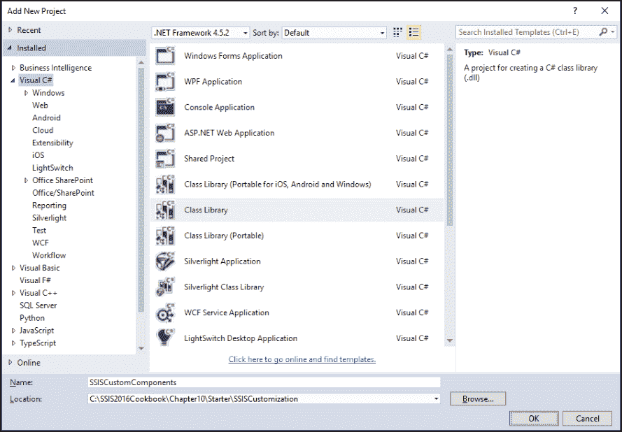

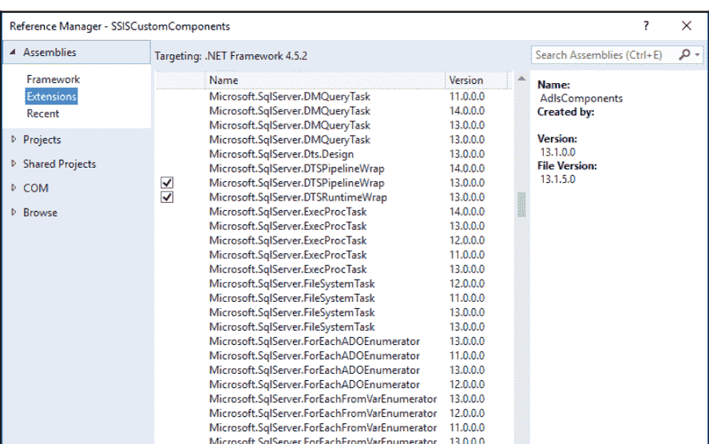

如果有多个版本的相同程序集可用，请确保仅选中版本 13.0.0.0。

- 15. 单击 **OK** 以确认选择。
- 16. 在 **Solution Explorer** 中，确保 **References** 节点已展开。

17. 选择 Microsoft.SqlServer.DTSPipelineWrap 节点，定位到程序集属性中的 Embed Interop Types 设置，并确保将其设置为 False，如以下屏幕截图所示：

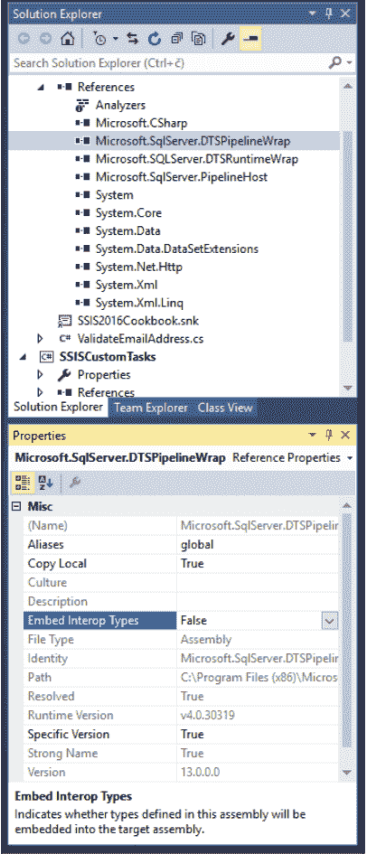

- 18. 对 `Microsoft.SQLServer.DTSRuntimeWrap` 程序集执行相同的操作。
- 19. 保存项目。
- 20. 确保 `ValidateEmail.cs` 已在设计器中打开，并用以下引用替换定义顶部现有的程序集引用列表：

```
using Microsoft.SqlServer.Dts.Pipeline;
using Microsoft.SqlServer.Dts.Pipeline.Wrapper;
using Microsoft.SqlServer.Dts.Runtime.Wrapper;
using System;
using System.Collections.Generic;
using System.IO;
using System.Linq;
using System.Text;
using System.Text.RegularExpressions;
using System.Xml;
```

这些引用提供了开发完整的 SSIS 组件以及执行其操作所需的功能。

- 21. 修改 `ValidateEmail` 类定义，使其派生自 `Microsoft.SqlServer.Dts.Pipeline.PipelineComponent` 基类，并实现 `DtsPipelineComponent` 属性：

```
[DtsPipelineComponent
    (
    ComponentType = ComponentType.Transform,
    DisplayName = "Validate Email",
    Description = "Validates email addresses using the
corresponding rule in a data profile file.",
    NoEditor = false
    )]
public class ValidateEmail : PipelineComponent
{
}
```

基类提供了每个 SSIS 组件在设计时和运行时需要实现的功能，而 `DtsPipelineComponent` 属性允许该类被识别为 SSIS 组件——在设计时和运行时均可。

22. 向 `ValidateEmail` 类定义添加以下私有常量声明：

```
private const String DATA_PROFILE_FILE_NAME_PROPERTY_NAME = "Data Profile File Name";
private const String DATA_PROFILE_FILE_NAME_PROPERTY_DESCRIPTION = "Data profile file name (fully qualified).";
private const String DATA_PROFILE_COLUMN_NAME_PROPERTY_NAME = "Data Profile Column Name";
private const String DATA_PROFILE_COLUMN_NAME_PROPERTY_DESCRIPTION = "The name of the columns in data profile.";
private const String INPUT_NAME = "ValidateEmailInput";
private const String INPUT_COLUMN_NAME = "Input Column Name";
private const String INPUT_COLUMN_DESCRIPTION = "The name of the column to be validated.";
private const String OUTPUT_NAME = "ValidateEmailOutput";
private const String IS_VALID_COLUMN_NAME = "IsValidEmail";
private const String IS_VALID_COLUMN_DESCRIPTION = "True, if the value of the selected column is a valid email address; otherwise, False.";
private const String IS_INTERNAL_OBJECT_PROPERTY_NAME = "isInternal";

private const String TOO_MANY_INPUTS_MESSAGE = "Only a single input is supported.";
private const String TOO_MANY_OUTPUTS_MESSAGE = "Only a single output is supported.";
private const String DEFAULT_OUTPUT_MUST_EXIST_MESSAGE = "The built-in synchronous output cannot be removed.";
private const String USER_DEFINED_COLUMNS_NOT_SUPPORTED = "User-defined columns are not supported.";
private const String DEFAULT_COLUMNS_MUST_EXIST = "Built-in output columns cannot be removed";
private const String DATA_PROFILE_FILE_NOT_FOUND_MESSAGE_PATTERN = "The file [{0}] could not be located.";
private const String DATA_PROFILE_FILE_FOUND_MESSAGE_PATTERN = "The file [{0}] exists.";
private const String REGEX_PATTERNS_LOADED_MESSAGE_PATTERN = "{0} Regular Expression patterns loaded.";
private const String DATA_PROFILE_COLUMN_NOT_FOUND_MESSAGE_PATTERN = "The file [{0}] does not contain a column named [{1}].";
private const String REGEX_PATTERNS_NOT_FOUND_MESSAGE_PATTERN = "The file [{0}] does not contain any Regular Expressions patterns data for a column named [{1}].";
private const String INPUT_COLUMN_NOT_SET_MESSAGE = "The input column has not been set.";
private const String INPUT_COLUMN_NOT_FOUND_MESSAGE_PATTERN = "An input column named [{0}] cannot be found.";
```

```
private const String INPUT_COLUMN_FOUND_MESSAGE_PATTERN = "The input column named [{0}] was found.";
private const String INPUT_COLUMN_DATATYPE_NOT_SUPPORTED_MESSAGE_PATTERN = "The data type [{0}] of the selected input column [{1}] is not supported.\r\nPlease, use a column with a supported data type: DT_NTEXT, DT_TEXT, DT_STR, or DT_WSTR.";
```

```
private const String DATA_PROFILE_NAMESPACE = "http://schemas.microsoft.com/sqlserver/2008/DataDebugger/";
private const String DATA_PROFILE_NAMESPACE_ALIAS = "dp";
```

```
private const String DATA_PROFILE_COLUMN_XPATH_PATTERN = "/dp:DataProfile/dp:DataProfileOutput/dp:Profiles" + "/dp:ColumnPatternProfile[dp:Column[@Name='{0}']]";
```

```
private const String REGEX_ELEMENT_XPATH_PATTERN = DATA_PROFILE_COLUMN_XPATH_PATTERN + "/dp:TopRegexPatterns/dp:PatternDistributionItem/dp:RegexText/text()";
```

对象名称和描述在这些常量中定义，以及用于向 SSIS 包开发人员传达组件当前状态的所有消息。

23. 向 ValidateEmail 类添加以下私有变量：

```
private String _dataProfileFileName;
private String _dataProfileColumnName;
private String _emailAddressInputColumnName;
private List<String> _regexPatterns = new List<String>();
```

这些变量允许组件的主要设置一次性设置，并在验证和执行期间根据需要重复使用。

24. 在 ValidateEmail 类定义的底部，添加以下私有函数：

```
private Boolean DataProfileColumnExists(String dataProfileName, String columnName)
{
    Boolean result = true;
    XmlDocument dataProfile = new XmlDocument();
    dataProfile.Load(dataProfileName);
    XmlNamespaceManager dataProfileNSM = new XmlNamespaceManager(dataProfile.NameTable);
```

```
dataProfileNSM.AddNamespace(DATA_PROFILE_NAMESPACE_ALIAS,
DATA_PROFILE_NAMESPACE);

String regexElementXPath =
String.Format(DATA_PROFILE_COLUMN_XPATH_PATTERN, columnName);
XmlNode dataProfileColumn =
dataProfile.SelectSingleNode(regexElementXPath, dataProfileNSM);
if (dataProfileColumn == null)
{
    result = false;
}

return result;
}
```

25. 此函数检查数据配置文件是否包含有关指定列的配置文件信息：

```
private List<String> LoadRegularExpressions(String dataProfileName,
String columnName)
{
    List<String> result = new List<String>();

    if (!String.IsNullOrEmpty(dataProfileName) &&
        !String.IsNullOrEmpty(columnName))
    {
        XmlDocument dataProfile = new XmlDocument();
        dataProfile.Load(dataProfileName);
        XmlNamespaceManager dataProfileNSM = new
XmlNamespaceManager(dataProfile.NameTable);
        dataProfileNSM.AddNamespace(DATA_PROFILE_NAMESPACE_ALIAS,
DATA_PROFILE_NAMESPACE);

        String regexElementXPath =
String.Format(REGEX_ELEMENT_XPATH_PATTERN, columnName);
        foreach (XmlNode regexPatternElement in
dataProfile.SelectNodes(regexElementXPath, dataProfileNSM))
        {
            String regexPattern = regexPatternElement.Value;
            if (!result.Contains(regexPattern))
            {
                result.Add(regexPattern);
            }
        }
    }

    return result;
}
```


- **26.** 此函数从数据配置文件中提取指定列的正则表达式模式，可用于验证列值：

```csharp
private void ResolveComponentCustomProperties()
{
    _dataProfileFileName =
        ComponentMetaData.CustomPropertyCollection[DATA_PROFILE_FILE_NAME_PROPERTY_NAME].Value.ToString();
    if (VariableDispenser.Contains(_dataProfileFileName))
    {
        IDTSVariables100 variables = null;
        VariableDispenser.LockOneForRead(_dataProfileFileName, ref variables);
        _dataProfileFileName = (String)variables[0].Value;
    }

    _dataProfileColumnName =
        ComponentMetaData.CustomPropertyCollection[DATA_PROFILE_COLUMN_NAME_PROPERTY_NAME].Value.ToString();
    if (VariableDispenser.Contains(_dataProfileColumnName))
    {
        IDTSVariables100 variables = null;
        VariableDispenser.LockOneForRead(_dataProfileColumnName, ref variables);
        _dataProfileColumnName = (String)variables[0].Value;
    }

    _regexPatterns.Clear();
    _regexPatterns =
        this.LoadRegularExpressions(_dataProfileFileName, _dataProfileColumnName);

    _emailAddressInputColumnName =
        ComponentMetaData.InputCollection[INPUT_NAME].CustomPropertyCollection[INPUT_COLUMN_NAME].Value.ToString();
}
```

此最后一个私有函数读取由 SSIS 包开发人员配置的组件属性，并将其存储在私有变量中以供以后使用。该函数在包验证时和执行时被调用。

请注意 `_dataProfileFileName` 和 `_dataProfileColumnName` 变量的赋值；如果自定义属性包含变量或参数的名称，则实际值将从相应的变量或参数中检索；否则，使用字面值。

- **27.** 在你刚刚添加的函数之前立即添加以下私有函数，该函数将用于验证电子邮件地址：

```csharp
private Boolean IsValidEmail(String emailAddress)
{
    Boolean result = false;

    if (!String.IsNullOrEmpty(emailAddress))
    {
        foreach (String regexPattern in _regexPatterns)
        {
            if (Regex.IsMatch(emailAddress, regexPattern,
                    RegexOptions.IgnoreCase))
            {
                result = true;
                break;
            }
        }
    }

    return result;
}
```

此组件中的 `IsValidEmail()` 函数与第 11 章 *Unleash the Power of SSIS Script Tasks and Components* 中 *Validating data using regular expressions in a script component* 配方中使用的函数相同。与 `ValidateEmail` 类其余代码相比，它可能显得微不足道；需要大量编程逻辑才能使自定义组件在设计时和运行时正确行为。

- **28.** 在私有变量声明下方留出一些空间并开始输入 `override` 指令；从建议的 `Microsoft.SqlServer.Dts.Pipeline.PipelineComponent` 基类可重写方法列表中，选择 `ProvideComponentProperties()` 并用以下代码替换其默认定义：

```csharp
base.ProvideComponentProperties();

// Data Profile File name
IDTSCustomProperty100 dataProfileFileName =
    ComponentMetaData.CustomPropertyCollection.New();
dataProfileFileName.Name = DATA_PROFILE_FILE_NAME_PROPERTY_NAME;
dataProfileFileName.Description =
    DATA_PROFILE_FILE_NAME_PROPERTY_DESCRIPTION;
dataProfileFileName.State = DTSPersistState.PS_PERSISTASCDATA;
dataProfileFileName.TypeConverter =
    typeof(String).AssemblyQualifiedName;
dataProfileFileName.Value = String.Empty;

// Data Profile Column name
IDTSCustomProperty100 dataProfileColumnName =
    ComponentMetaData.CustomPropertyCollection.New();
dataProfileColumnName.Name =
    DATA_PROFILE_COLUMN_NAME_PROPERTY_NAME;
dataProfileColumnName.Description =
    DATA_PROFILE_COLUMN_NAME_PROPERTY_DESCRIPTION;
dataProfileColumnName.State = DTSPersistState.PS_DEFAULT;
dataProfileColumnName.TypeConverter =
    typeof(String).AssemblyQualifiedName;
dataProfileColumnName.Value = String.Empty;

// Input
IDTSInput100 input = ComponentMetaData.InputCollection[0];
input.Name = INPUT_NAME;
// Input Column Name
IDTSCustomProperty100 inputColumnName =
    input.CustomPropertyCollection.New();
inputColumnName.Name = INPUT_COLUMN_NAME;
inputColumnName.Description = INPUT_COLUMN_DESCRIPTION;
inputColumnName.State = DTSPersistState.PS_DEFAULT;
inputColumnName.TypeConverter =
    typeof(String).AssemblyQualifiedName;
inputColumnName.Value = String.Empty;

IDTSCustomProperty100 isInternal;
// Synchronous Output
IDTSOutput100 output = ComponentMetaData.OutputCollection[0];
output.Name = OUTPUT_NAME;
output.SynchronousInputID =
    ComponentMetaData.InputCollection[0].ID;
isInternal = output.CustomPropertyCollection.New();
isInternal.Name = IS_INTERNAL_OBJECT_PROPERTY_NAME;
isInternal.State = DTSPersistState.PS_DEFAULT;
isInternal.TypeConverter = typeof(Boolean).AssemblyQualifiedName;
isInternal.Value = true;
// Output column
IDTSOutputColumn100 isValidEmailColumn =
    output.OutputColumnCollection.New();
isValidEmailColumn.Name = IS_VALID_COLUMN_NAME;
isValidEmailColumn.Description = IS_VALID_COLUMN_DESCRIPTION;
isValidEmailColumn.SetDataTypeProperties(DataType.DT_BOOL, 0, 0, 0, 0);
isInternal = isValidEmailColumn.CustomPropertyCollection.New();
isInternal.Name = IS_INTERNAL_OBJECT_PROPERTY_NAME;
isInternal.State = DTSPersistState.PS_DEFAULT;
isInternal.TypeConverter = typeof(Boolean).AssemblyQualifiedName;
isInternal.Value = true;
```

组件由 `ProvideComponentProperties()` 方法定义——其自定义属性、输入和输出。该方法在 SSIS 包开发期间将组件放置在数据流设计器中时被调用。

- **29.** 在你刚刚创建的 `ProvideComponentProperties()` 方法定义下方创建更多空间，并再次开始输入 override 指令；这次选择要重写的 `Validate()` 方法，并用以下命令替换其默认定义：

```csharp
Boolean isCanceled = false;
Boolean fireAgain = false;

// Only one input is supported.
if (ComponentMetaData.InputCollection.Count > 1)
{
    ComponentMetaData.FireError(0, ComponentMetaData.Name,
        TOO_MANY_INPUTS_MESSAGE, String.Empty, 0, out isCanceled);
    return DTSValidationStatus.VS_ISCORRUPT;
}

// Only one output is supported.
if (ComponentMetaData.OutputCollection.Count > 1)
{
    ComponentMetaData.FireError(0, ComponentMetaData.Name,
        TOO_MANY_OUTPUTS_MESSAGE, String.Empty, 0, out isCanceled);
    return DTSValidationStatus.VS_ISCORRUPT;
}

this.ResolveComponentCustomProperties();

// Data profile file must exist.
if (!File.Exists(_dataProfileFileName))
{
    ComponentMetaData.FireError(0, ComponentMetaData.Name,
        String.Format(DATA_PROFILE_FILE_NOT_FOUND_MESSAGE_PATTERN,
        _dataProfileFileName), String.Empty, 0, out isCanceled);
    return DTSValidationStatus.VS_ISBROKEN;
}
else
{
    ComponentMetaData.FireInformation(0, ComponentMetaData.Name,
        String.Format(DATA_PROFILE_FILE_FOUND_MESSAGE_PATTERN,
        _dataProfileFileName), String.Empty, 0, ref fireAgain);

    // Data profile file must contain at least one Regular
    // Expressions pattern for the specified column name.
    Int32 regexPatternCount = _regexPatterns.Count();
    if (regexPatternCount > 0)
    {
        ComponentMetaData.FireInformation(0,
            ComponentMetaData.Name,
            String.Format(REGEX_PATTERNS_LOADED_MESSAGE_PATTERN,
            regexPatternCount), String.Empty, 0, ref fireAgain);
    }
    else
    {
        if (!this.DataProfileColumnExists(_dataProfileFileName,
            _dataProfileColumnName))
        {
            ComponentMetaData.FireWarning(0,
                ComponentMetaData.Name,
                String.Format(DATA_PROFILE_COLUMN_NOT_FOUND_MESSAGE_PATTERN,
                _dataProfileFileName, _dataProfileColumnName), String.Empty, 0);
            return DTSValidationStatus.VS_ISBROKEN;
        }
        else
        {
            ComponentMetaData.FireWarning(0,
                ComponentMetaData.Name,
                String.Format(REGEX_PATTERNS_NOT_FOUND_MESSAGE_PATTERN,
                _dataProfileFileName, _dataProfileColumnName), String.Empty, 0);
            return DTSValidationStatus.VS_ISBROKEN;
        }
    }
}

// The input column must exist and must be of a supported data
// type.
if (String.IsNullOrEmpty(_emailAddressInputColumnName))
{
    ComponentMetaData.FireError(0, ComponentMetaData.Name,
        INPUT_COLUMN_NOT_SET_MESSAGE, String.Empty, 0, out isCanceled);
    return DTSValidationStatus.VS_ISBROKEN;
}
```


```
}
else
{
    IDTSInputColumn100 inputColumn =
ComponentMetaData.InputCollection[INPUT_NAME].InputColumnCollection
[_emailAddressInputColumnName];
    if (inputColumn == null)
    {
        ComponentMetaData.FireError(0, ComponentMetaData.Name,
String.Format(INPUT_COLUMN_NOT_FOUND_MESSAGE_PATTERN,
inputColumn.Name), String.Empty, 0, out isCanceled);
        return DTSValidationStatus.VS_ISBROKEN;
    }
    else
    {
        ComponentMetaData.FireInformation(0,
ComponentMetaData.Name,
String.Format(INPUT_COLUMN_FOUND_MESSAGE_PATTERN,
inputColumn.Name), String.Empty, 0, ref fireAgain);

        if (inputColumn.DataType != DataType.DT_NTEXT &&
            inputColumn.DataType != DataType.DT_TEXT &&
            inputColumn.DataType != DataType.DT_STR &&
            inputColumn.DataType != DataType.DT_WSTR)
        {
            ComponentMetaData.FireError(0, ComponentMetaData.Name,
String.Format(INPUT_COLUMN_DATATYPE_NOT_SUPPORTED_MESSAGE_PATTERN,
inputColumn.DataType.ToString(), inputColumn.Name), String.Empty,
0, out isCanceled);
            return DTSValidationStatus.VS_ISBROKEN;
        }
    }
}
return base.Validate();
```

每当包在 SSDT 中加载时、SSIS 开发人员在执行开始时确认组件配置时，以及显式验证已部署的包时，都会对组件进行验证。

### 30. 为了指导 SSIS 包开发人员，并防止他们无意中破坏组件的配置，请在 ValidateEmail 类定义中添加以下重写：

```
public override IDTSInput100 InsertInput(DTSInsertPlacement
insertPlacement, Int32 inputID)
{
    // Only one input is supported.
```
```
throw new NotSupportedException(TOO_MANY_INPUTS_MESSAGE);
}
```

此方法将阻止 SSIS 开发人员创建任何额外的输入：

```
public override IDTSOutput100 InsertOutput(DTSInsertPlacement insertPlacement, Int32 outputID)
{
    // Only one output is supported.
    throw new NotSupportedException(TOO_MANY_OUTPUTS_MESSAGE);
}
```

此方法将阻止 SSIS 开发人员创建任何额外的输出：

```
public override IDTSOutputColumn100 InsertOutputColumnAt(Int32 outputID, Int32 outputColumnIndex, String name, String description)
{
    // No additional Output Columns can be added.
    throw new NotSupportedException(USER_DEFINED_COLUMNS_NOT_SUPPORTED);
}
```

此方法将阻止 SSIS 开发人员向默认输出添加任何额外的列：

```
public override void DeleteOutput(Int32 outputID)
{
    // The built-in output cannot be removed.
    Boolean isInternal =
    (Boolean)(ComponentMetaData.OutputCollection.GetObjectByID(outputID).CustomPropertyCollection[IS_INTERNAL_OBJECT_PROPERTY_NAME].Value);
    if (isInternal)
    {
        throw new InvalidOperationException(DEFAULT_OUTPUT_MUST_EXIST_MESSAGE);
    }
    else
    {
        base.DeleteOutput(outputID);
    }
}
```

此方法将阻止 SSIS 开发人员删除默认输出；它允许他们删除其他输出，但这只是理论上的，因为添加输出已经被前面的 `InsertOutput()` 方法重写所阻止：

```
public override void DeleteOutputColumn(Int32 outputID, Int32 outputColumnID)
{
    // Built-in output columns cannot be removed.
    Boolean isInternal =
    (Boolean)(ComponentMetaData.OutputCollection.GetObjectByID(outputID).OutputColumnCollection.GetObjectByID(outputColumnID).CustomPropertyCollection[IS_INTERNAL_OBJECT_PROPERTY_NAME].Value);
    if (isInternal)
    {
        throw new InvalidOperationException(DEFAULT_COLUMNS_MUST_EXIST);
    }
    else
    {
        base.DeleteOutputColumn(outputID, outputColumnID);
    }
}
```

这最后一个重写将阻止 SSIS 开发人员删除内置输出列。理论上，它允许他们删除用户自定义列；然而，重写的 `InsertOutputColumnAt()` 方法从根本上阻止了这些列的添加。

- 31. 使用与步骤 26 和 27 相同的技术，重写 `PreExecute()` 基类方法，并使用以下代码作为其定义：

```
base.PreExecute();

this.ResolveComponentCustomProperties();
```

处理管道数据所需的所有设置都在 `PreExecute()` 方法中确定。

- 32. 接下来，重写 `ProcessInput()` 方法，并用以下命令替换其默认定义：

```
IDTSInput100 input =
ComponentMetaData.InputCollection.GetObjectByID(inputID);
Int32 emailAddressInputColumnId =
input.InputColumnCollection[_emailAddressInputColumnName].ID;
IDTSInputColumn100 emailAddressInputColumn =
input.InputColumnCollection.GetObjectByID(emailAddressInputColumnId);
Int32 emailAddressInputColumnIndex =
input.InputColumnCollection.GetObjectIndexByID(emailAddressInputColumnId);

IDTSOutput100 output =
ComponentMetaData.OutputCollection[OUTPUT_NAME];
Int32 isValidColumnId =
output.OutputColumnCollection[IS_VALID_COLUMN_NAME].ID;
IDTSOutputColumn100 isValidColumn =
output.OutputColumnCollection.GetObjectByID(isValidColumnId);
Int32 isValidColumnIndex =
BufferManager.FindColumnByLineageID(input.Buffer,
isValidColumn.LineageID);

while (buffer.NextRow())
{
    String emailAddress;
    switch (emailAddressInputColumn.DataType)
    {
        case DataType.DT_NTEXT:
            emailAddress =
Encoding.Unicode.GetString(buffer.GetBlobData(emailAddressInputColumnIndex, 0,
(Int32)buffer.GetBlobLength(emailAddressInputColumnIndex)));
            break;
        case DataType.DT_TEXT:
            emailAddress =
Encoding.GetEncoding(emailAddressInputColumn.CodePage).GetString(buffer.GetBlobData(emailAddressInputColumnIndex, 0,
emailAddressInputColumn.Length));
            break;
```

```
```csharp
default:
    emailAddress =
        buffer.GetString(emailAddressInputColumnIndex);
        break;
}

buffer.SetBoolean(isValidColumnIndex,
    this.IsValidEmail(emailAddress));
}
```
```

列值验证在 `ProcessInput()` 方法中执行。根据输入列数据类型从指定列检索数据——`DT_TEXT` 和 `DT_NTEXT` 大型对象（LOB）数据类型需要特殊处理，而 `DT_STR` 和 `DT_WSTR` 中的数据可以简单地使用 `GetString()` 方法读取。

- 33. 在重写的 `PostExecute()` 方法中，使用以下命令：
- 
-       `_regexPatterns.Clear();`
- 
-       `base.PostExecute();`
- 
- 处理完行后，`PostExecute()` 方法释放资源；它清除正则表达式集合，因为不再需要它。

- 34. 保存解决方案，并从**生成**菜单中选择**生成 SSISCustomComponents**命令来生成项目——首先使用**Debug**，然后再次使用**Release**解决方案配置。如果你正确遵循了前面的说明，项目应能成功生成。如果出现任何错误，请检查**错误列表**窗格中的消息并做出适当更正。

- 35. 使用 Windows 资源管理器导航到 `C:\SSIS2016Cookbook\Chapter13\Starter` 文件夹，找到 `Chapter10_Deploy_CustomComponent.bat` 命令文件。

- 36. 以管理员身份执行该命令文件，观察**命令提示符**窗口中返回的消息，最后按任意键完成部署。

- 37. 在 SSDT 中，打开位于 `C:\SSIS2016Cookbook\Chapter13\Starter\AdventureWorksETL\` 文件夹中的 `AdventureWorksETL.sln` 解决方案。

- 38. 在控制流中打开 `RegExValidation.dtsx` 包；该包基于你在第 11 章*释放 SSIS 脚本任务和组件的威力*中的*在脚本组件中使用正则表达式验证数据*所创建的类似同名包。

- 39. 在数据流设计器中打开**验证人员数据**任务。

- 40. 从 SSIS 工具箱中，将**验证电子邮件**转换拖到数据流设计器中；它应位于**常用**部分。如果 SSIS 工具箱中没有**验证电子邮件**转换，请右键单击工具箱，然后从快捷菜单中选择**刷新工具箱**。如果这没有帮助，请关闭 SSDT，然后重新打开 `AdventureWorksETL.sln` 解决方案。如果仍然无法解决问题，请返回打开 `SSISCustomization.sln` 的 Visual Studio 实例，并重复步骤 32 到 34 重新部署程序集。

- 41. 将常规数据路径从**人员数据**源组件连接到**验证电子邮件**转换。

- 42. 双击**验证电子邮件**转换，打开 **Validate Email 的高级编辑器**。

- 43. 在**组件属性**页面上，使用以下设置配置组件的自定义属性：

| 属性 | 值 |
|---|---|
| Data Profile Column Name | `EmailAddress` |
| Data Profile File Name | `$Package::DataProfileName` |


请参考以下屏幕截图以验证您的设置：

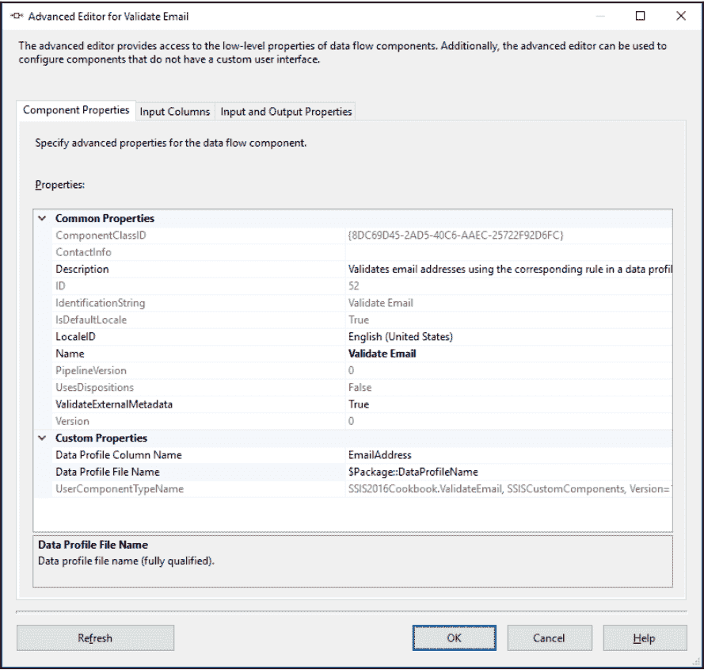

- 44. 在“输入列”页面上，确保所有输入列都被选中；保持其使用类型设置为 READONLY。

- 46. 单击 **OK** 以确认配置。如果您正确遵循了之前的说明，不应报告任何验证错误。如果组件出现错误（以红色 **X** 标记），或如果有任何警告（以感叹号标记），请检查 **Error List** 窗格，调查每条消息并相应地解决它们。
- 47. 在数据流设计器中，将常规数据路径从 **Validate Email** 转换连接到 **Valid or Invalid Email** 转换。
- 48. 确保从 **Valid or Invalid Email** 转换到 **Multicast** 组件的常规数据路径上启用了 **Data Viewer**。
- 49. 保存 `RegExValidation.dtsx` 包，然后以调试模式执行它。应从源文件提取 107 行，并且 **Invalid Email Data Viewer** 中应列出七行。
- 50. 停止调试模式执行，并关闭 **AdventureWorksETL.sln** 解决方案。

### How it works...

要创建自定义数据流组件，您需要创建一个派生自 `Microsoft.SqlServer.Dts.Pipeline.PipelineComponent` 基类的类，该基类提供了在设计时配置组件以及在运行时执行操作所需的功能。通过实现 `DtsPipelineComponent` 属性，您允许该类在设计时被 SSDT 识别为 SSIS 组件，并在运行时被 SSIS 执行引擎识别。

通过重写 `ProvideComponentProperties()` 基类方法，您建立了组件的基本元素：输入、输出以及其中用于保存转换结果的输出列。您定义了自定义属性（组件的两个属性和输入的一个属性），SSIS 包开发人员可以使用这些属性来配置组件。

通过重写 `Validate()` 方法以及一些额外的设计时方法，您实现了所有必要的检查，以指导 SSIS 包开发人员正确完成配置。

您使用 `PreExecute()` 方法来准备组件的执行——即从您在第 10 章 *Dealing with Data Quality* 中为 **Data Profile Column Name** 自定义属性指定的列创建的数据配置文件中加载电子邮件地址验证规则。您使用 `PostExecute()` 方法在执行完成后释放这些资源。

然而，转换的主要部分是在 `ProcessInput()` 方法中实现的，其中从上游管道接收到的每一行都会被验证：从 `Input Column Name` 自定义输入属性指定的列中读取数据，并根据数据配置文件中的正则表达式模式进行验证。然后将验证结果放置在 `IsValidEmail` 输出列中，供数据流中的下游组件使用。

## Managing custom component versions

随着时间的推移，您可能需要对自定义组件进行更改，例如因为您需要优化或重构代码、实现新功能或替换外部程序集。只要组件的接口（其自定义属性以及输入和输出）在后续版本中保持不变，您只需将新版本部署到目标环境中，并在 GAC 中注册它，下次包在 SSDT 中执行或编辑时就会使用组件的新版本。您甚至不必修改其版本号。

但是，如果更改影响了组件的接口——例如，如果您需要添加、删除或修改其任何自定义属性——您需要使组件可升级。此升级会自动执行——在设计时或运行时——通过调用 `Microsoft.SqlServer.Dts.Pipeline.PipelineComponent` 基类的特殊设计时方法，即 `PerformUpgrade()` 方法。当 SSIS 包正在设计时，SSDT 会自动调用该方法，或当 SSIS 包正在执行时，SSIS 执行引擎会调用该方法，前提是组件的 `DtsPipelineComponent` 属性的 `CurrentVersion` 属性已设置。

您在组件的后续版本中使用 `PerformUpgrade()` 方法，对早期版本组件的属性进行必要的更改，例如添加早期版本中不可用的属性、删除不再使用的属性，或修改早期版本组件的现有属性，以便后续组件可以使用它。

在本教程中，您将创建组件的第二个版本，该组件在本书本章前面 *Designing a custom transformation* 教程中创建。新版本将使用额外的自定义参数，并允许初始版本自动升级。

### Getting ready

在使用本教程之前，您需要按照本书本章前面 *Designing a custom transformation* 教程中所述设计自定义组件。

或者，您可以使用位于 `C:\SSIS2016Cookbook\Chapter10\Solution\SSISCustomization\` 文件夹中的 `SSISCustomization.sln` 解决方案的 **SSISCustomComponents** 项目。

### How to do it...

- 1. 打开您在本书本章前面 *Designing a custom transformation* 教程中创建的 `SSISCustomization.sln` 解决方案。
- 2. 在 `SSISCustomComponents` 项目中，找到 `ValidateEmail.cs` 文件并在设计器中打开它。
- 3. 修改 `ValidateEmail` 类的 `DtsPipelineComponent` 属性，并添加 `CurrentVersion` 属性，如以下示例所示：

```csharp
[DtsPipelineComponent
    (
    ComponentType = ComponentType.Transform,
    DisplayName = "Validate Email",
    Description = "Validates email addresses using the corresponding rule in a data profile file.",
    NoEditor = false,
    CurrentVersion = 2
    )]
```

不要忘记在 `NoEditor` 属性声明后加上逗号！当设置 `CurrentVersion` 属性时，SSDT 在设计时和 SSIS 执行引擎在运行时将调用 `PerformUpgrade()` 基类方法，并尝试将 SSIS 包中使用的早期版本组件升级到当前在 GAC 中注册的版本。

- 4. 将以下私有常量声明添加到当前常量列表的末尾：

```csharp
private const String REGEX_OPTIONS_PROPERTY_NAME = "Regular Expressions Options";
private const String REGEX_OPTIONS_PROPERTY_DESCRIPTION = "The Regular Expressions options to be used in email address validation.";
private const Int64 REGEX_OPTIONS_UPGRADE_VALUE = 513;
private const String REGEX_OPTIONS_UNKNOWN_MESSAGE_PATTERN = "The value of {0} does not represent a valid RegexOptions value.";
```

这些常量包含组件版本二所需的一些设置：对象名称、描述和消息。

- 5. 还需要另一个私有变量；将其放在现有变量旁边：

```csharp
private Int64 _regexOptionsNumber;
```

- 6. 修改 `ProvideComponentProperties()` 方法，并添加以下新的自定义属性声明：

```csharp
// Regular Expressions Options
IDTSCustomProperty100 regularExpressionsOptions = ComponentMetaData.CustomPropertyCollection.New();
regularExpressionsOptions.Name = REGEX_OPTIONS_PROPERTY_NAME;
regularExpressionsOptions.Description = REGEX_OPTIONS_PROPERTY_DESCRIPTION;
regularExpressionsOptions.State = DTSPersistState.PS_DEFAULT;
regularExpressionsOptions.TypeConverter = typeof(Int64).AssemblyQualifiedName;
regularExpressionsOptions.Value = (Int64)0;
```

此属性将允许 SSIS 包开发人员不仅指定要使用哪些正则表达式模式以及针对哪个列，还指定用于匹配的正则表达式选项。


7. 在 `Validate()` 方法的定义末尾（`return` 命令之前）添加以下测试，以扩展该方法：

```csharp
try
{
    RegexOptions regexOptions = (RegexOptions)_regexOptionsNumber;
    Regex regex = new Regex(@".", regexOptions);
}
catch (ArgumentOutOfRangeException)
{
    ComponentMetaData.FireError(0, ComponentMetaData.Name,
    String.Format(REGEX_OPTIONS_UNKNOWN_MESSAGE_PATTERN,
    _regexOptionsNumber.ToString()), String.Empty, 0, out isCanceled);
    return DTSValidationStatus.VS_ISBROKEN;
}
```

8. 通过在其定义中添加以下变量赋值来扩展 `ResolveComponentCustomProperties()` 私有函数：

```csharp
_regexOptionsNumber =
(Int64)(ComponentMetaData.CustomPropertyCollection[REGEX_OPTIONS_PROPERTY_NAME].Value);
```

9. 在 `IsValidEmail()` 私有函数中，修改对 `Regex.IsMatch()` 方法的调用，以便将正则表达式选项动态传递给它，如以下示例所示：

```csharp
if (Regex.IsMatch(emailAddress, regexPattern,
(RegexOptions)_regexOptionsNumber))
```

10. 在 `PostExecute()` 方法定义下方留出一些空间，然后开始键入覆盖指令；从可能的覆盖列表中选择 `PerformUpgrade()` 方法。使用以下代码替换该方法的默认定义：

```csharp
DtsPipelineComponentAttribute pipelineComponentAttribute =
(DtsPipelineComponentAttribute)Attribute.GetCustomAttribute(this.GetType(), typeof(DtsPipelineComponentAttribute), false);
Int32 componentLatestVersion =
pipelineComponentAttribute.CurrentVersion;

Int32 activeComponentVersion = ComponentMetaData.Version;
if (activeComponentVersion < componentLatestVersion)
{
    try
    {
        IDTSCustomProperty100 existingRegularExpressionsOptions =
ComponentMetaData.CustomPropertyCollection[REGEX_OPTIONS_PROPERTY_NAME];
    }
    catch (Exception)
    {
        IDTSCustomProperty100 regularExpressionsOptions = ComponentMetaData.CustomPropertyCollection.New();
        regularExpressionsOptions.Name = REGEX_OPTIONS_PROPERTY_NAME;
        regularExpressionsOptions.Description = REGEX_OPTIONS_PROPERTY_DESCRIPTION;
        regularExpressionsOptions.State = DTSPersistState.PS_DEFAULT;
        regularExpressionsOptions.TypeConverter = typeof(Int64).AssemblyQualifiedName;
        regularExpressionsOptions.Value = REGEX_OPTIONS_UPGRADE_VALUE;
    }
}

ComponentMetaData.Version = componentLatestVersion;
```

11. 保存项目并生成它——首先使用 **Debug** 解决方案配置，然后再次使用 **Release** 解决方案配置。如果出现任何错误，请在 **错误列表** 窗格中检查消息并进行适当的更正。

12. 使用 Windows 资源管理器导航到 `C:\SSIS2016Cookbook\Chapter13\Starter` 文件夹，并找到 `Chapter10_Deploy_CustomComponent.bat` 命令文件。

13. 以管理员身份执行该命令文件，观察 **命令提示符** 窗口中返回的消息，最后按任意键完成部署。

14. 在 SSDT 中，打开位于 `C:\SSIS2016Cookbook\Chapter13\Starter\AdventureWorksETL\` 文件夹中的 `AdventureWorksETL.sln` 解决方案。

15. 在控制流中打开 `RegExValidation.dtsx` 包，然后在数据流设计器中打开 **验证人员数据** 任务。如果尚未使用之前的配方，请按照 *设计自定义转换* 配方中的步骤 38 到 46 完成数据流；否则，**验证电子邮件** 转换应该已经就位。

16. 在“验证电子邮件”转换的高级编辑器中，在“自定义属性”下，新的“正则表达式选项”属性应该可用，其默认值为 513（该值表示不区分大小写、区域性不变的正则表达式匹配选项）。此值在升级期间应用。请参考以下截图来验证你的设置：

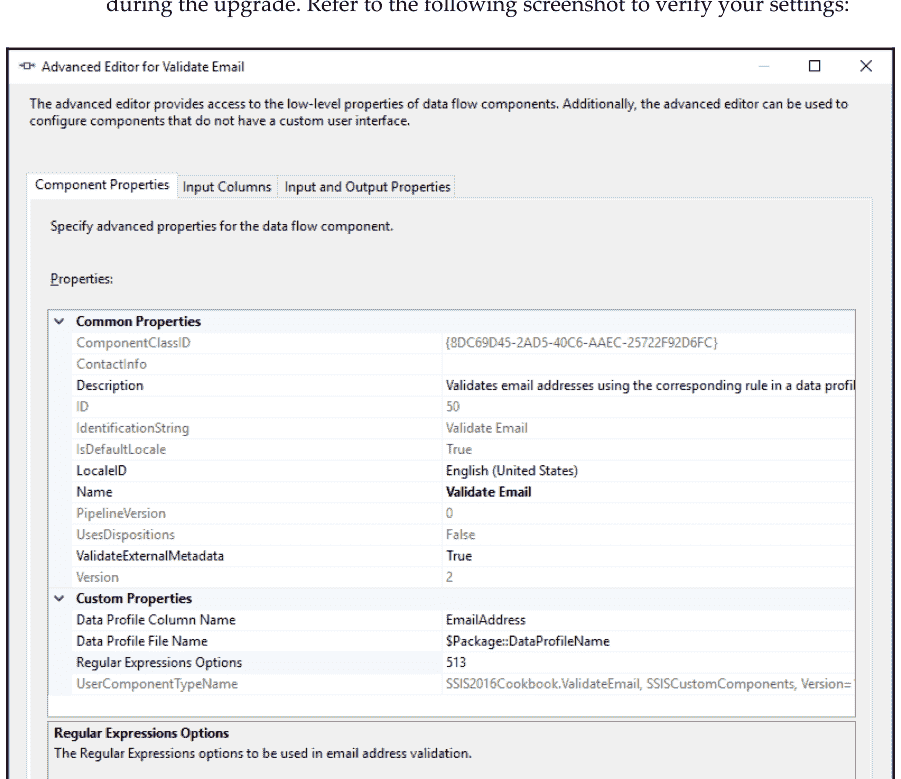

17. 单击 **确定** 以确认配置。

18. 保存包并在调试模式下执行它。在 107 个源行中，应有七个未通过 **EmailAddress** 列的验证。

19. 停止调试模式的执行。

20. 关闭 `AdventureWorksETL.sln` 和 `SSISCustomization.sln` 解决方案。

## 工作原理...

通过指定 `DtsPipelineComponent` 属性中自定义组件的版本号，可以标记组件的新版本；仅当公开的属性、输入和/或输出被修改时才需要新版本。

当然，设置新版本号不足以使已部署 SSIS 包中已在使用的组件早期版本得到相应升级。升级是通过覆盖 `PerformUpgrade()` 基类方法来执行的。在前面的示例中，添加了一个新的组件自定义属性。

升级后，组件的版本号也会更改为当前在 GAC 中注册的组件版本号。

当组件的新版本部署并注册后，任何使用该组件的 SSIS 包都会被升级，无论是下次在 SSDT 中编辑它，还是下次执行它。
