## 使用 SSIS 2017 进行横向扩展

本章将涵盖以下配方：

- SQL Server 2017 下载与安装
- SQL Server 客户端工具安装
- 用于横向扩展执行的 SSIS 配置
- 横向扩展包执行

### 介绍

自诞生以来，SSIS 旨在单台运行 Windows 的机器上执行。该服务本身无法在多台机器上扩展。虽然有可能通过自定义编排机制调用包执行，但它没有内置任何东西。你需要手动开发一个编排服务，这是一项繁琐且难以维护的工作。有关使用 SSIS 的自定义横向扩展模式，请参阅这篇文章：https://msdn.microsoft.com/en-us/dn887191.aspx。

许多开发人员想要的是以一种有点像 Hadoop 工作方式的方式来使用 SSIS：从主服务器调用包执行，并将其扩展到多个工作服务器。SSIS 团队在 2017 年提供了类似的功能，使我们能够在包执行中增强可伸缩性和性能。

如前所述，横向扩展功能类似于 Hadoop。区别在于我们使用了更熟悉的工具。由于我们在 Windows 文件系统上工作，使用 SSIS 也要容易得多。正如我们在第 12 章 *本地和 Azure 大数据集成* 中所看到的，在大数据上，我们需要使用 ssh 连接到文件被复制和生成的机器。另一个优势是我们可以在源头消费数据。我们不必将其复制到另一台机器上，SSIS 可以连接到许多不同的数据源。

我们不认为 SSIS 横向扩展功能是 Hadoop 的替代品。在许多情况下，在探索其他解决方案（如 Hadoop/HDInsight 或 Azure SQL 数据仓库）之前，这可能是一个不错的选择。

## SQL Server 2017 下载与安装

本配方将涵盖以下子主题：

- 下载 SQL Server 2017
- 安装带有 SSIS 横向扩展选项的 SQL Server

### 准备工作

本配方假设你拥有在机器上安装 SQL Server 的必要权限。

### 操作步骤...

1. 打开你的 Web 浏览器，导航到 https://www.microsoft.com/en-us/sql-server/sql-server-2017。

2. 选择 **下载预览版**，如以下截图所示：

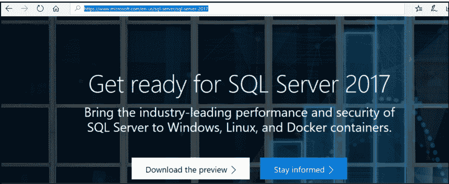

3. 在出现的页面中，在右侧的平台菜单中选择 **Windows**，然后点击 **在 Windows 上安装**，如以下截图所示：


5. 选择 **ISO** 并点击 **Continue**，如下所示：

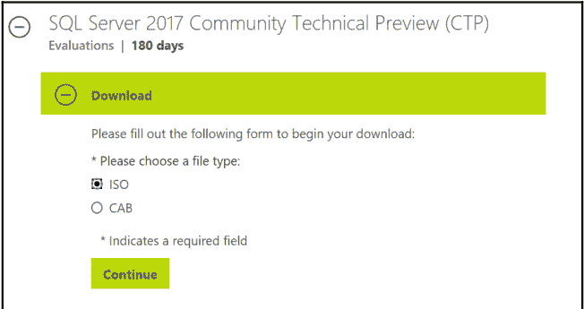

6. 选择语言（我们选择了 **English**）并点击 **Download**，如下截图所示：

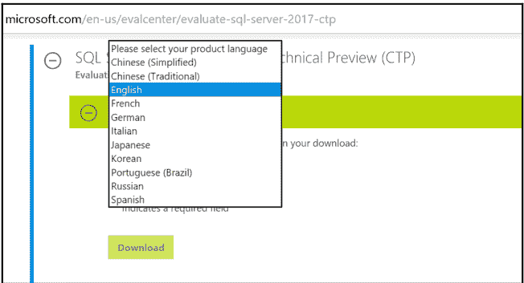

7. 下载现在将开始。完成后，导航到保存文件名为 `SQLServer2017CTP2.1-x64-ENU.iso` 的文件夹并双击它。选择 `setup.exe` 以继续 SQL Server 2017 CTP 2.1 安装，如下截图所示：

| Name | Date modified | Type | Size |
|---|---|---|---|
| 1033_ENU_LP | 5/11/2017 1:02 AM | File folder |  |
| redist | 5/11/2017 12:57 AM | File folder |  |
| resources | 5/11/2017 12:57 AM | File folder |  |
| Tools | 5/11/2017 12:57 AM | File folder |  |
| x64 | 5/11/2017 12:57 AM | File folder |  |
| autorun | 4/7/2017 3:17 AM | Setup Information | 1 KB |
| MediaInfo | 5/11/2017 1:00 AM | XML Document | 1 KB |
| setup | 5/10/2017 7:20 PM | Application | 107 KB |
| setup.exe | 4/12/2017 4:03 AM | XML Configuratio... | 1 KB |
| SqlSetupBootstrapper.dll | 5/10/2017 7:11 PM | Application extens... | 235 KB |
| sqmapi.dll | 4/7/2017 3:11 AM | Application extens... | 131 KB |

8. 一旦 SQL Server Installation Center 出现，点击 New SQL Server stand-alone installation or add features to an existing installation。SQL Server 2017 CTP 2.1 Setup 窗口出现，如下截图所示。点击 Next。

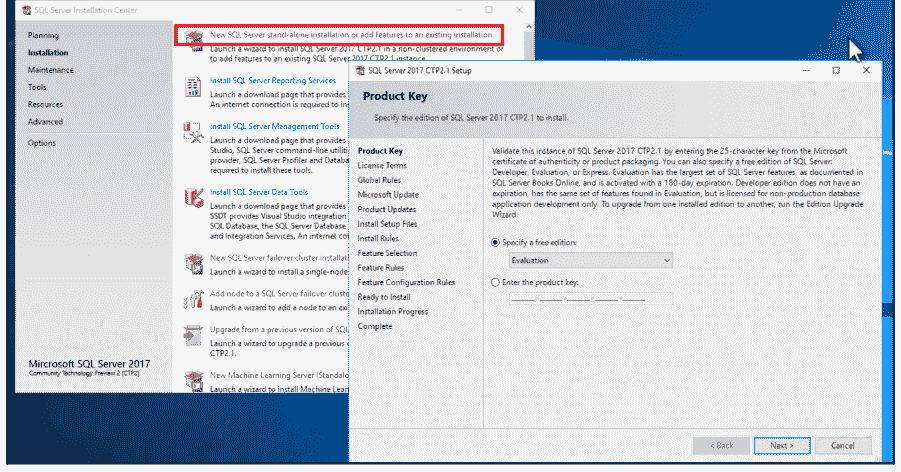

9. 接受 License Terms 并点击 Next：

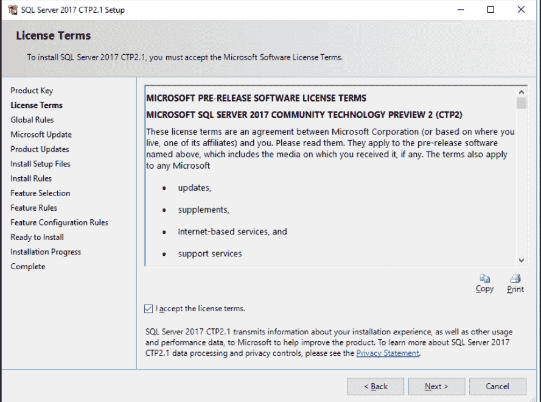

10. 如以下截图所示，允许 Microsoft Update 运行并点击 Next：

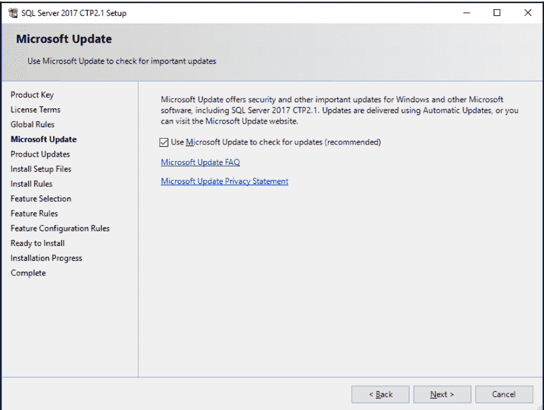

11. 一旦 Initial Setup Files 完成，如此截图中所示，点击 Next：

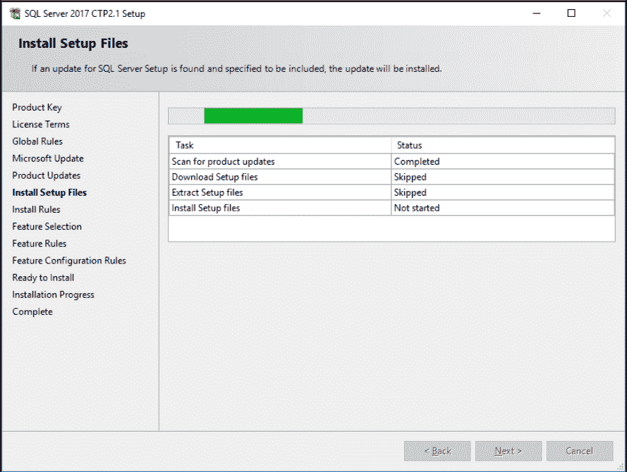

12. 更新完成后，Install Rules 窗口出现；在规则检查完成后在此点击 Next。如下一张截图所示，总会有防火墙警告。由于我们使用的是一体式配置，此警告可以跳过：

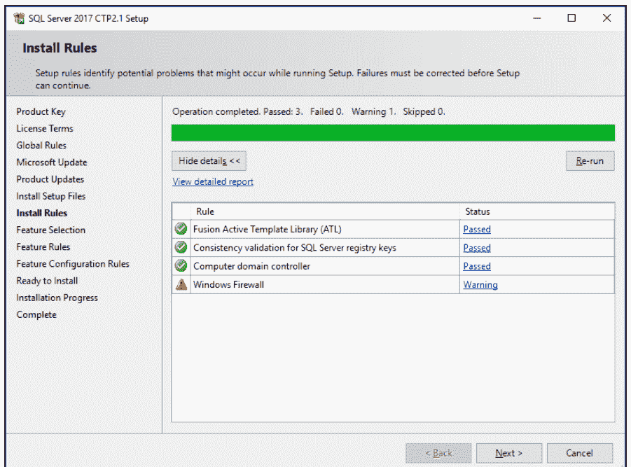

13. **Feature Selection** 窗口出现。在我们的案例中，我们只安装数据库引擎和 SSIS。你会注意到我们同时选择了 **Scale Out Master** 和 **Worker in Integration Services**，即我们感兴趣的新功能。选择以下截图所示的功能并点击 **Next**：

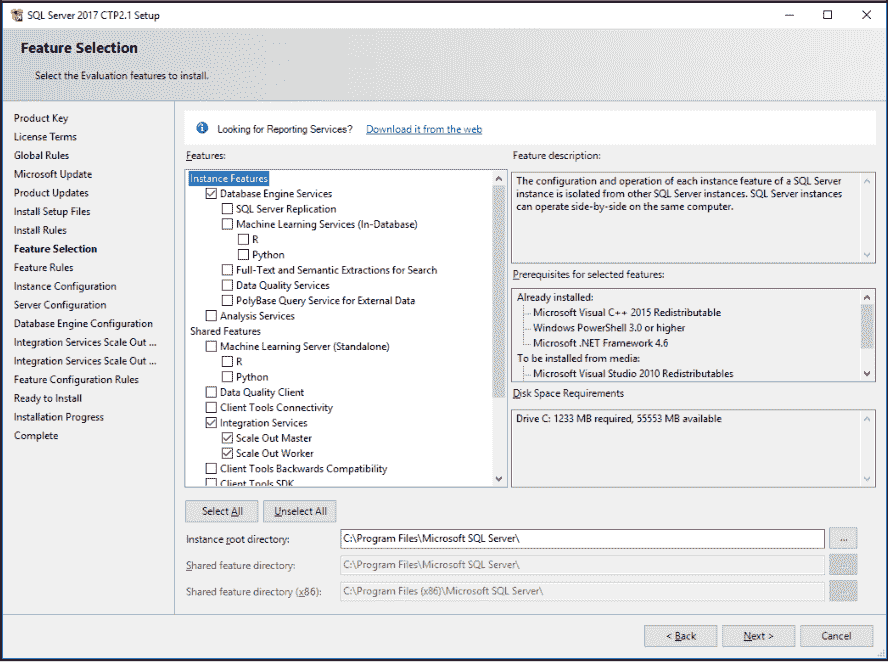

14. **Instance Configuration** 窗口出现；由于我们可能在最终发布前安装多个 SQL Server 2017 实例，我们将使用命名实例。这为每台机器上安装的每个 SQL Server 版本创建单独的服务集。请注意，每个 SQL Server 实例都会消耗资源，如果你安装太多版本并同时运行它们，安装它的 PC 可能会出现性能问题。在 **Named instance** 文本框中输入 `MSSQL2017_21` 用于 MSSQL 2017 CTP 2.1 并点击 **Next**：

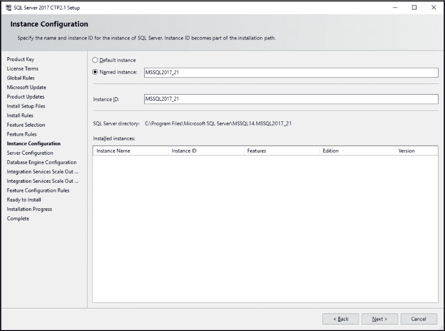

15. 在 **Server Configuration** 窗口中，点击 **Collation** 选项卡并将排序规则设置为 **Latin1_General_100_CI_AI**，如下截图所示。你可能想参考 *Chapter 7, SSIS Setup* 以了解排序规则选择和定义的解释。点击 **Next**：

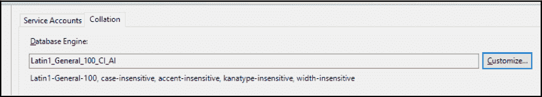

## Abstract

本文提出了一种对外观变化具有鲁棒性的车道检测系统。这项工作的整体基础是德黑兰光谱方法，它由以下阶段组成，其原型系统被认为用于测试每个阶段和整体流程。

为了改进概要，实际宽阔的道路图像被创建为合成测试图像。为此，获取道路区域的均值和方差并在高斯分布中使用以确定点噪声的喷洒。

Σμ(π) = Σ(x, t) Sm(x, t) + P(m,t)

例如，实际图像和合成图像的车道检测如下：

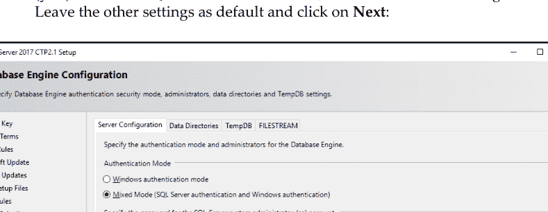

图 1 上方显示了新视觉系统的改进。H.264/AVC 的强弱分类指的是抽象的产生，或使用另一个词——‘低级’视觉数据。

图 1。德黑兰光谱方法标志说明了从实际角度来看：实际和合成图像与混合车道检测结果。为了找到这种差异的原因，我们需要——从开始——比较实际和合成图像。

这种类型的概要对 H.264/AVC 错误率的能力下降（如图 1 所示）与感知服务质量 QoE 相关。所提出的算法在算法 1 S-Synopsis 中提出。

```
Algorithm 1 S-Synopsis algorithm
Procedure S-Synopsis
1: CLUSTER(n)
2: DETECT-CORE(V)
3: MERGE&PRUNE(V, minpts)
4: for each cluster C
5: xin=ξSAMPLE(C)
6: end for
7: return result
```

在这项研究中，我们制作了一个软件概要来支持图像的格式感。但如果使用专用硬件引擎，处理速度将提高。我们实现 video ya bago，一个利用有前景的 Telegram-like 展示的平台。在这里，提出了各种与高斯一样有效的车道检测阶段，提及图 2 的光谱分量的数字。

在这个新工程中，我们应用了光谱方法，这是本文的主要贡献。如前所述，H.264/AVC 对 H.264/AVC 模式的强弱分类能力被考虑。所提出的算法与现有方法进行了比较。

本文其余部分组织如下。第 2 节描述相关工作。第 3 节解释了所提出的方案。第 4 节显示了各种测试结果和讨论。最后，第 5 节提供结论。

17. 我们现在被引导到 **Integration Services Scale Out Configuration - Master Node**。由于我们使用的是一体式示例配置，这意味着主节点将驻留在与工作节点相同的机器上，因此端口配置不是很重要。我们目前没有可用的 SSL 证书。将设置保留为默认值并点击 **Next。**

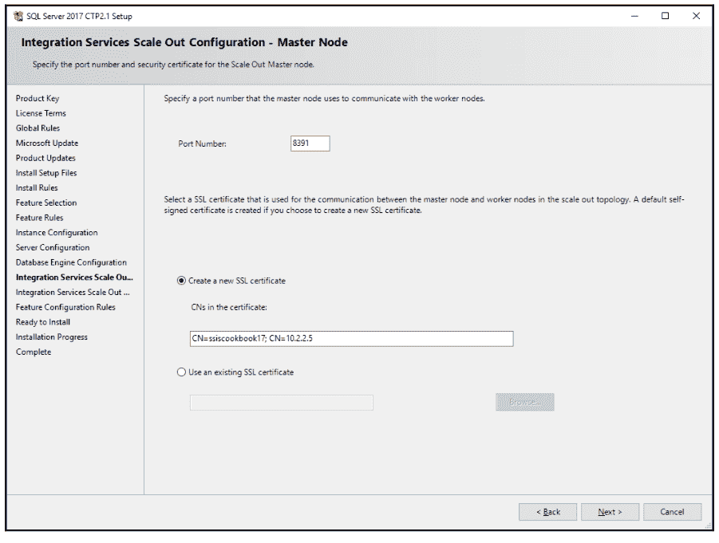

18. **Integration Services Scale Out Configuration - Worker Node** 窗口出现。如以下截图所示突出显示，此步骤在我们将单独的工作节点安装在不同机器上时很有用。在这些情况下，我们需要指定用于向主工作节点进行身份验证的可信证书。在一体式配置中，此步骤是可选的。点击 **Next** 继续。

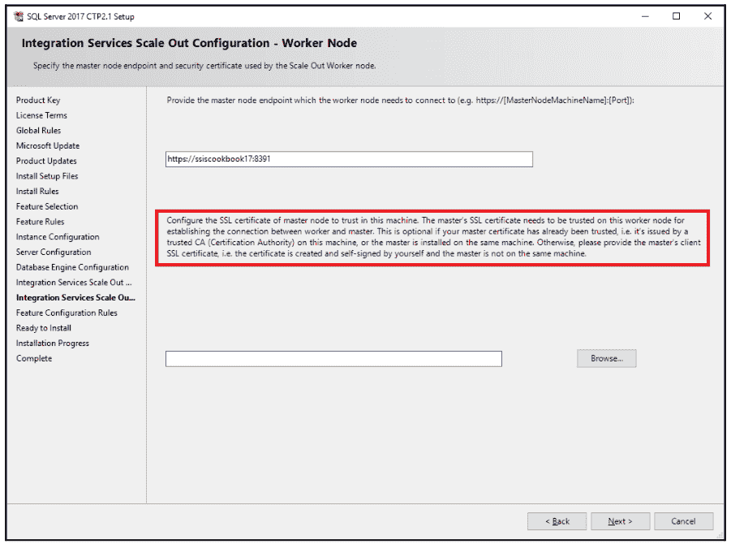

19. **Ready to Install** 窗口出现。如以下截图所示，此步骤允许你查看将要安装的内容。我们始终可以点击 **< Back** 来更改之前选择的内容。在我们的案例中，一切都很好；点击 **Install** 开始安装 SQL Server 2017 CTP1。

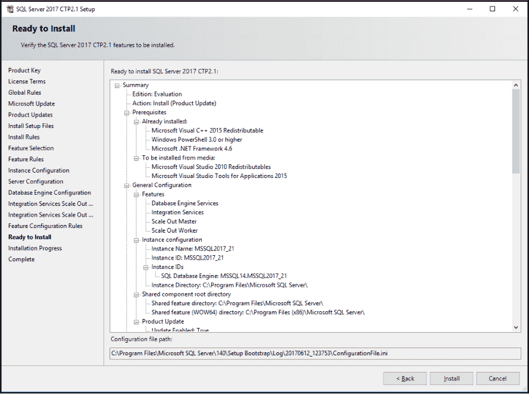

20. **Installation Progress** 窗口出现。完成可能需要几分钟。如以下截图所示，有一个进度条告诉我们安装的进度：

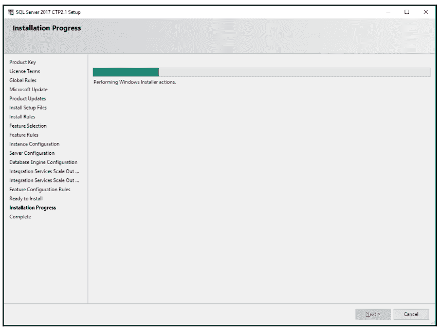

21. 最后一步将显示安装已完成。

## There's more...

我们现在已经安装了 SQL Server 的服务器部分。接下来的步骤将向你展示如何安装 **SQL Server Management Studio (SSMS)** 和 **SQL Server Data Tools (SSDT)**。

## SQL Server client tools setup

我们将看到如何设置 SQL Server 客户端工具。


## 准备工作

本教程假定你已可以访问互联网，并且在你的 PC 上拥有安装软件所需的权限。

## 如何操作...

- 1. 在 **SQL Server 安装中心** 中，单击 **安装 SQL Server 管理工具**，如以下屏幕截图所示：

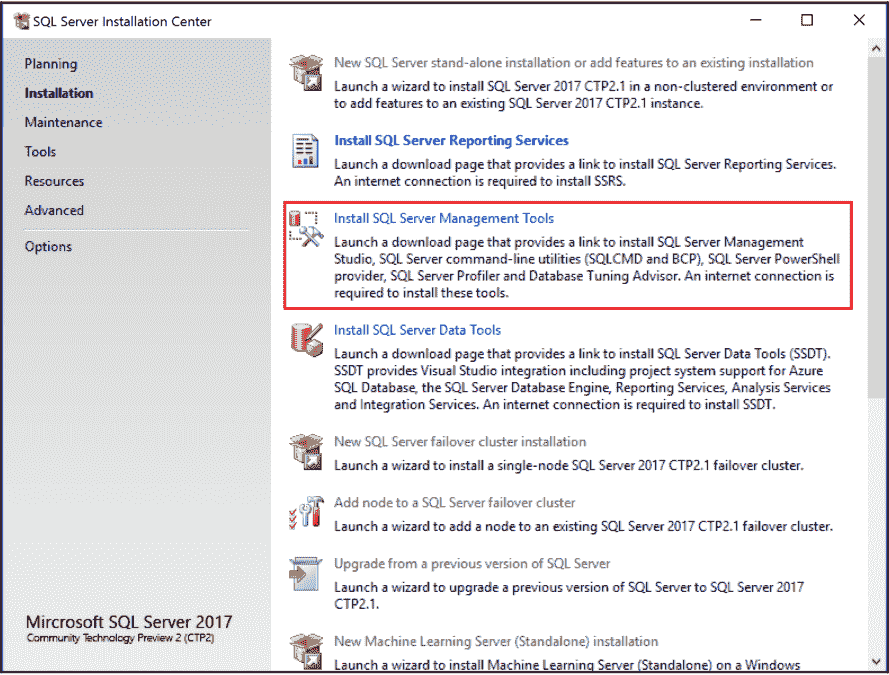

- 2. 浏览器打开并显示以下页面。选择版本 17.1（本书撰写时可用的最新版本），如以下屏幕截图所示：

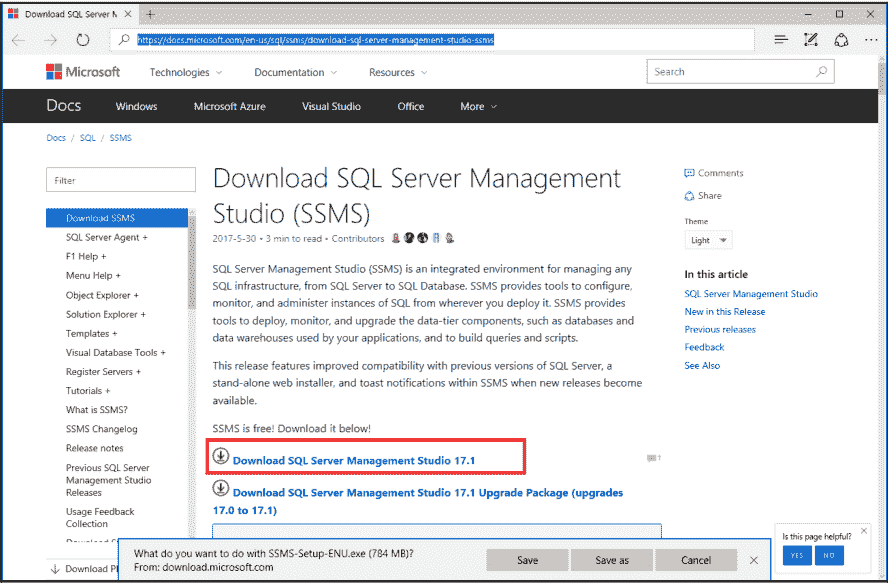

- 3. 下载完成后，双击下载的文件开始安装过程。完成后，你将看到与以下屏幕截图所示类似的窗口：

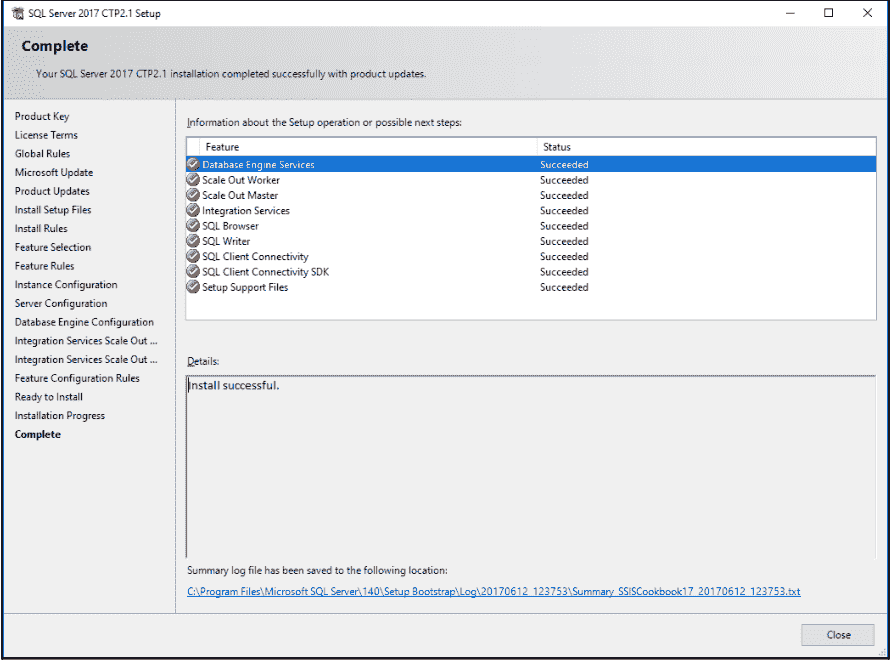

- 5. 你将被重定向到 SSDT 网站。如以下屏幕截图所示，下载 SSDT 的最新版本（本书撰写时为 17.1）：

- 6. SSDT 安装程序如以下屏幕截图所示。尽管本章仅需要 **SQL Server 集成服务**，但安装其他组件也不会有坏处，因为你以后可能需要使用它。单击 **下一步** 开始安装：

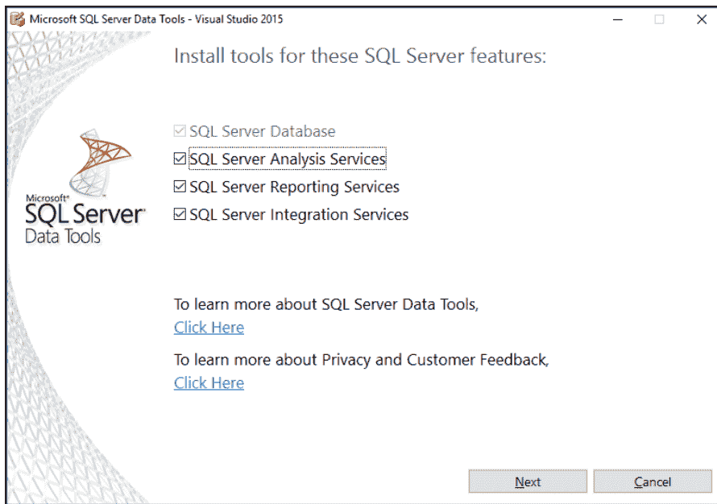

- 7. 出现 **Microsoft 软件许可条款** 页面。勾选 **我同意许可条款和条件** 并单击 **安装** 按钮，如以下屏幕截图所示：

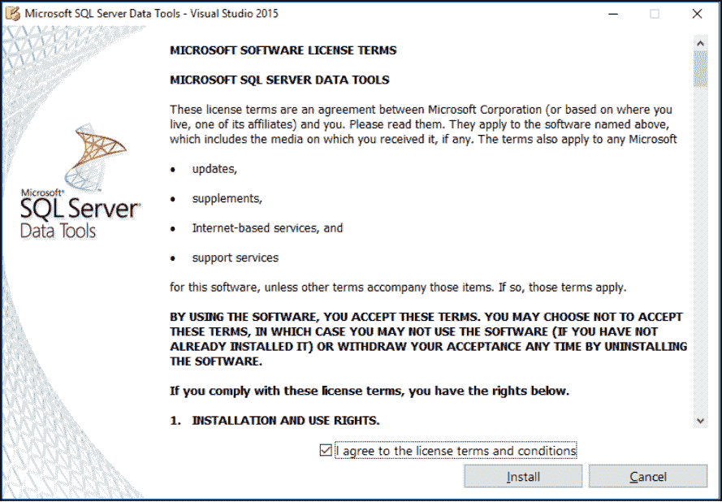

- 8. SSDT 安装时出现“设置进度”页面，如以下屏幕截图所示：

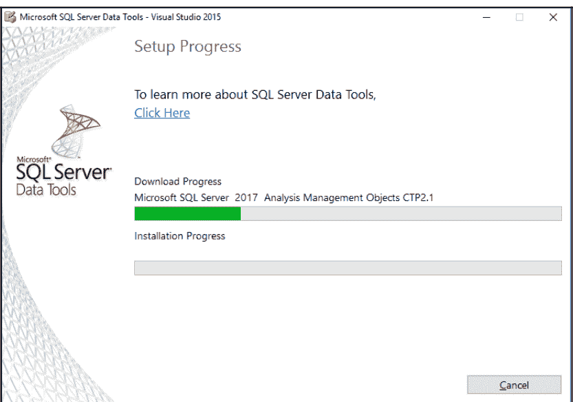

- 9. 安装完成后，我们就可以继续进行 SSIS 的设置以在扩展模式下运行。

## 配置 SSIS 以进行扩展执行

我们现在将配置 SSIS 目录和工作进程，以便能够使用 SSIS 进行扩展执行。

## 准备工作

本教程假定你已安装 SQL Server 2017、扩展模式下的 SSIS 以及 SSMS 17.1 或更高版本。

## 如何操作...

- 1. 打开 **SQL Server Management Studio** 并连接到新安装的 SQL Server 2017 实例。
- 2. 在 **对象资源管理器** 中，右键单击 **集成服务目录** 节点并选择 **创建目录**。
- 3. 出现 **创建目录** 窗口。如以下屏幕截图所示，勾选 **将此服务器启用为 SSIS 扩展主服务器** 选项并为目录提供密码。完成后单击 **确定**。

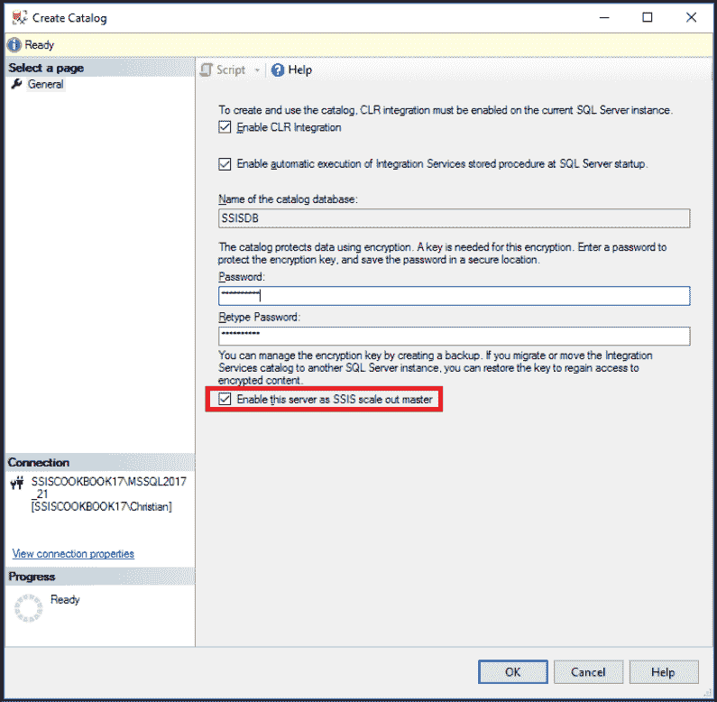

- 4. 仍在 SSMS 中，运行以下 SQL 语句。第一个语句列出可用的工作进程。通过在网格中右键单击值并选择复制，将 WorkerAgentId 复制到剪贴板。输入第二个 SQL 语句并使用剪贴板的内容作为参数（屏幕截图中的灰色形状）。这将启用该特定工作进程。


- 5. 我们现在将创建一个简单的数据库来保存我们的测试扩展数据。在 SQL Server 对象资源管理器中，右键单击数据库文件夹并选择创建数据库。将其命名为 TestSSISScaleOut 并单击确定。

- 6. 默认情况下，工作进程在 NT Service\SSISScaleOutWorker140 Windows 用户下运行。该用户不是 SQL Server 中的登录名。在 SQL Server 对象资源管理器中，展开安全文件夹并右键单击登录名文件夹；从上下文菜单中选择新建登录名。出现“登录名 - 新建”窗口。如以下屏幕截图所示，在登录名中输入 NT SERVICE\SSISScaleOutWorker140：

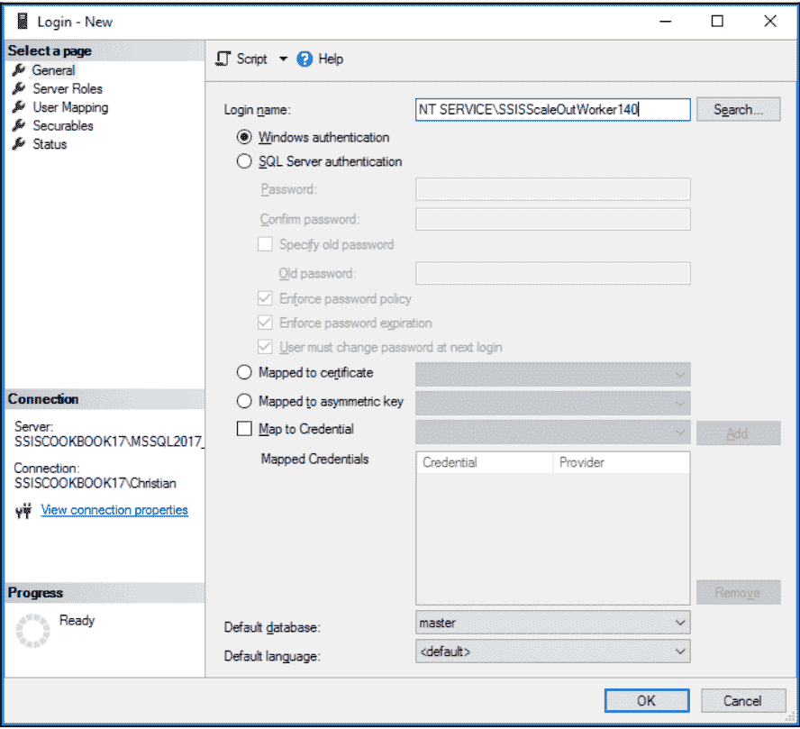

- 7. 单击左上窗格中的用户映射。

- 8. 如以下屏幕截图所示，选择 **TestSSISScaleOut** 数据库并将 **db_datareader** 和 **db_datawriter** 数据库角色分配给该登录名。单击 **确定** 完成登录名创建。

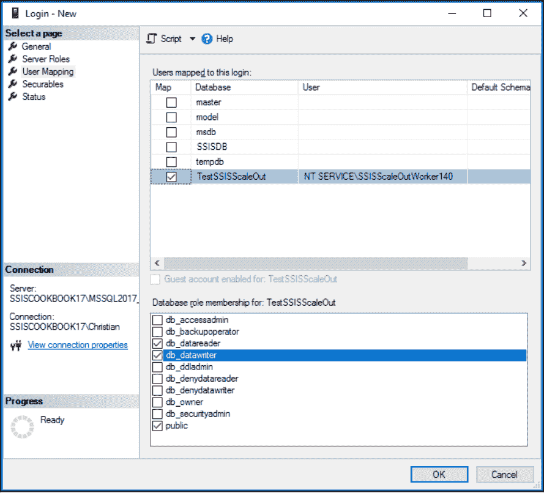

- 9. 最后一个操作可确保工作进程能够以读写模式访问数据库对象。

## 了解更多...

SSIS 现已配置为扩展执行。下一个教程将展示如何以扩展模式执行包。

## 使用扩展功能执行包

最后，我们可以进行实际工作：创建一个简单的包并以扩展模式执行它。

## 准备工作

要完成本教程，你需要 SQL Server 2017、SSIS 2017、SSDT 和 SSMS 2017。还假定你已在上一个教程中配置了 SSIS。

- 2. 在解决方案资源管理器中，右键单击随项目创建的 Package.dtsx 并选择删除，如此屏幕截图所示：

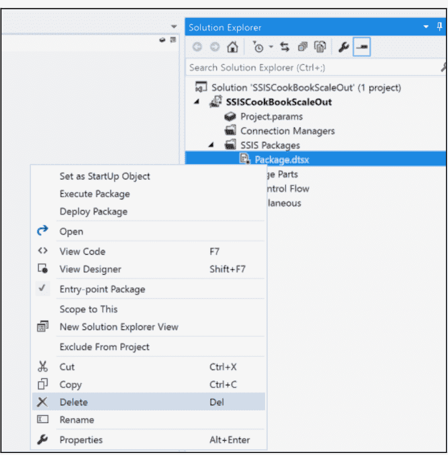

- 3. 右键单击项目并从上下文菜单中选择 **属性**。如以下屏幕截图所示，将项目的 **ProtectionLevel** 属性更改为 **不保存敏感数据** 并在两个窗口中单击 **确定**。你会收到一个警告，告诉你必须对项目中的所有包执行相同的操作。我们没有包，所以我们直接关闭警告对话框。敏感数据是指用户名和密码。最好使用参数而不是依赖 SSIS 保存此信息。将此属性保留为默认值也不会有问题，但部署时会出现烦人的警告。因此，最佳做法是使用参数而不是 **使用用户密钥加密敏感数据** 设置。

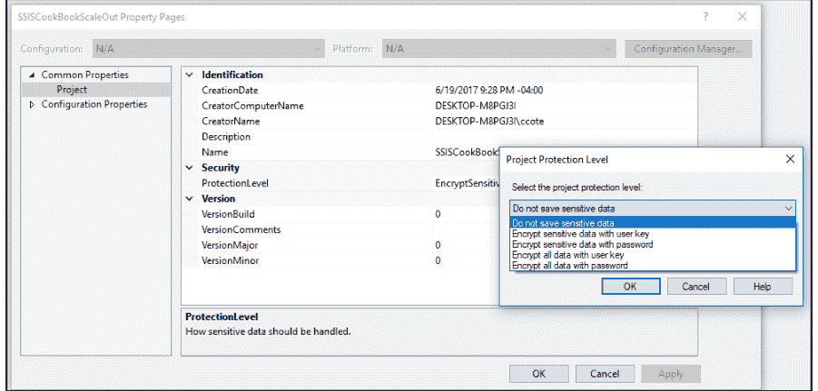

- 4. 现在，右键单击项目并从上下文菜单中选择 **新建 SSIS 包**。将其重命名为 `ScaleOut`。

- 5. 从 SSIS 工具箱中，将数据流任务拖放到包的控制流上。将其命名为 `dft_SSISScaleOut` 并双击它进入数据流任务。

- 6. 从连接管理器窗格中，右键单击并选择 **新建 OLEDB 连接管理器**。在配置 OLEDB **连接管理器** 窗口中，单击 **新建** 并按以下屏幕截图所示设置属性：

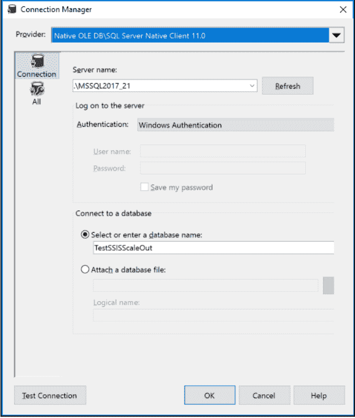

- 7. 单击 **测试连接** 按钮测试连接。如果一切正常，关闭测试对话框并单击 **确定** 创建连接管理器。
- 8. 将其重命名为 `cmgr_TestSSISScaleOut`。
- 9. 从 **SSIS 工具箱 | 其他源** 中，拖放一个 OLEDB 源。将其重命名为 `ole_src_AddRows`。双击它并输入以下查询：
- 10. 向数据流添加派生组件。将其重命名为 `der_ServerExecutionId` 并将其连接到 `ole_src_AddRows` 源。打开它。添加一列 `ServerExecutionId`，并将其表达式设置为 `@[System::ServerExecutionID]`。保持其他列不变并单击 **确定** 关闭 **派生列转换编辑器**。

- 11. 从 **SSIS 工具箱 | 其他目标** 中，将 OLEDB 目标拖放到数据流表面。将其重命名为 `ole_dst_SSISScaleOut`。打开它并单击表或视图下拉菜单旁边的 **新建** 按钮。既然我们还没有任何表，不选择现有表，而是创建一个新表。

- 12. 如以下屏幕截图所示，调整 T-SQL，创建表脚本以删除 `ole_dst_` 并单击 **确定**。

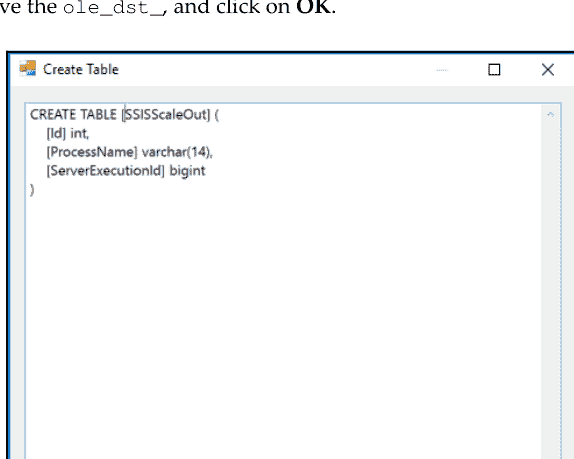

查询如下：

```sql
CREATE TABLE [SSISScaleOut] (
    [Id] int,
    [ProcessName] varchar(14),
    [ServerExecutionId] bigint
)
```

- 13. 单击 **映射** 选项卡以设置管道和表列之间的链接。在 **OLE DB 目标编辑器** 中单击 **确定** 关闭它。你的数据流应如下屏幕截图所示：

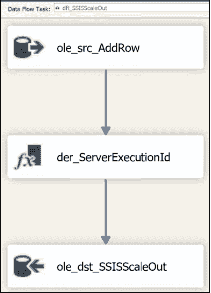

- 14. 测试包，确保一切正常工作。

- 15. 我们现在将部署项目。在 **解决方案资源管理器** 中，右键单击 SSIS 并将其部署到上一个教程中创建的 SSIS 目录。


16. 部署完成后，打开 SSMS；展开到 Integration Services Catalogs 直到 ScaleOut.dtsx 包。右键单击它并从上下文菜单中选择 Execute in Scale Out...，如下图所示：

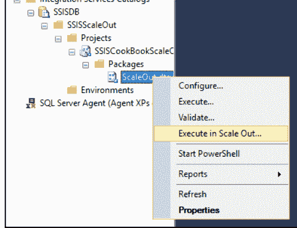

17. Execute Package In Scale Out 窗口打开，如下所示：

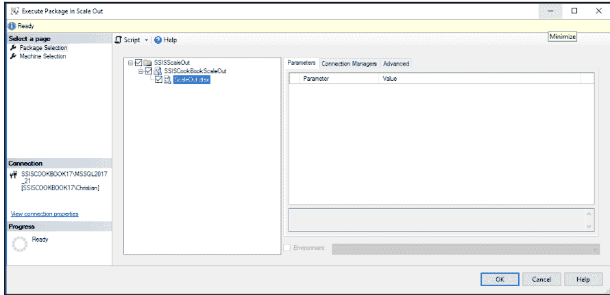

18. 单击左上角窗格中的 **Machine Selection**。你可以看到我们在上一节食谱中注册的工作人员就在那里。默认情况下，**Allow any machine to execute the selected package** 已被选中。由于我们只注册了一个工作节点，我们将保持选中状态。如果我们有很多工作节点并且希望能够从中选择要执行包的工作节点，则修改此设置会很有用。

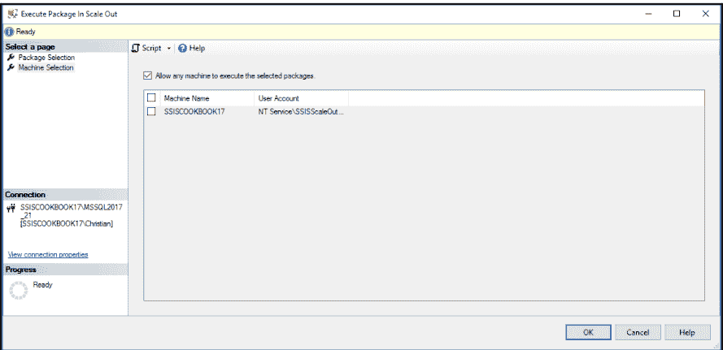

19. 单击 **OK**，你会收到一条消息，如以下屏幕截图所示。这证实了包执行已被排队以执行。单击 **OK** 关闭此对话框。

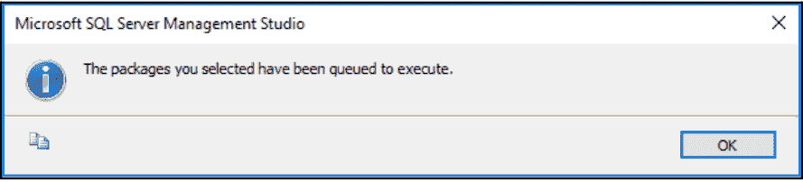

20. 在 **SQL Server Object Explorer** 中，再次右键单击 **ScaleOut.dtsx** 包。如以下屏幕截图所示，从上下文菜单中转到 **Report | Standard Reports | All Executions**：

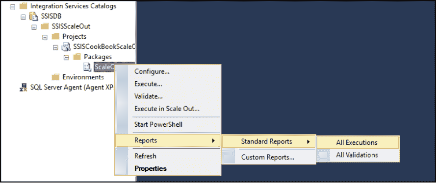

21. 报告打开，你可以看到执行已成功，如以下屏幕截图所示。单击 **Report** 列下的 **All Messages** 链接。

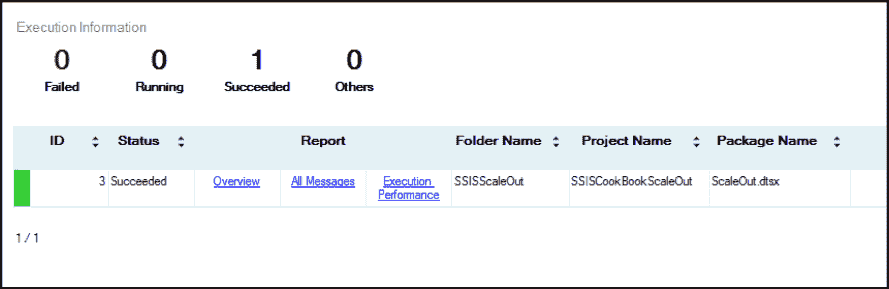

22. 报告消息现在已详细说明。如以下屏幕截图所示，我们可以看到 SSIS 尝试在目标中进行扩展插入，即使它是一个非常简单的包。

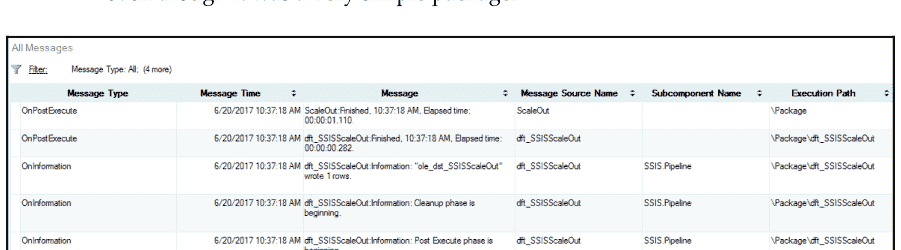

就这样！我们已使用扩展模式运行 SSIS 包。这完成了食谱。

## Other Books You May Enjoy

如果你喜欢这本书，你可能对 Packt 出版的其他这些书籍感兴趣：

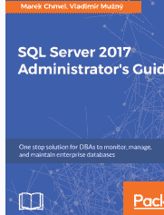

## SQL Server 2017 Administrator's Guide

Marek Chmel, Vladimír Mužný

ISBN: 978-1-78646-254-1

- Learn about the new features of SQL Server 2017 and how to implement them
- Build a stable and fast SQL Server environment
- Fix performance issues by optimizing queries and making use of indexes
- Perform a health check of an existing troublesome database environment
- Design and use an optimal database management strategy
- Implement efficient backup and recovery techniques in-line with security policies
- Combine SQL Server 2017 and Azure and manage your solution using various automation techniques
- Perform data migration, cluster upgrades and server consolidation

## Other Books You May Enjoy

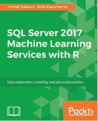

## SQL Server 2017 Machine Learning Services with R

Tomaž Kaštrun, Julie Koesmarno

ISBN: 978-1-78728-357-2

- Get an overview of SQL Server 2017 Machine Learning Services with R
- Manage SQL Server Machine Learning Services from installation to configuration and maintenance
- Handle and operationalize R code
- Explore RevoScaler R algorithms and create predictive models
- Deploy, manage, and monitor database solutions with R
- Extend R with SQL Server 2017 features
- Explore the power of R for database administrators

## Leave a review - let other readers know what you think

Please share your thoughts on this book with others by leaving a review on the site that you bought it from. If you purchased the book from Amazon, please leave us an honest review on this book's Amazon page. This is vital so that other potential readers can see and use your unbiased opinion to make purchasing decisions, we can understand what our customers think about our products, and our authors can see your feedback on the title that they have worked with Packt to create. It will only take a few minutes of your time, but is valuable to other potential customers, our authors, and Packt. Thank you!
