# 精通 Windows Server 2019：系统管理员安装、管理和部署 Windows Server 2019 新功能的完整指南，第三版


## 贡献者

## 关于作者

**Jordan Krause** 是一位拥有超过20年经验的IT专业人士，因其在微软服务器和网络技术方面的工作而获得了9次微软MVP奖。作为世界上最早的微软DirectAccess专家之一，他热衷于帮助公司找到实现远程劳动力最佳方式的方法。致力于持续学习，Jordan 持有 MCSE、MCSA 和 MCITP 企业管理员认证，并著有多本关于微软技术的书籍。Jordan 生活在美丽的西密歇根州（美国），但每天与世界各地的公司合作。

> 我如果没有我那位 wonderful 的妻子的支持，就没有能力、专注力或动力去从事这样一项写作项目。感谢你陪伴我度过所有那些凌晨5:00的开始，Laura！

## 关于审阅者

**Luka Manojlović** 担任IT基础设施解决方案的外部顾问、架构师和实施者。拥有超过20年在存储、网络、虚拟化和服务器方面的经验，Luka 仍然热情地应对他所从事的挑战和项目。

> *首先，我要感谢作者 Jordan Krause。阅读本书的撰写过程是一种愉快的体验。我认为它将帮助读者更好地理解 Windows Server 技术的神奇世界。我还要感谢 Packt 的工作人员，他们提供了出色的合作。*

我们还要感谢 **Aaron Guilmette** 和 **Dishan Francis** 对 *第3章，Active Directory* 的反馈。

## 前言

世界正在变化。当我妻子和我有了第一个孩子时，我记得很多人都告诉我们生活现在会飞快地过去。这就是那种每个人都听过，但没人相信的事情，直到他们突然意识到已经过去了 5...10...20 年，突然回头想着，“它去哪儿了？”

技术也是如此。计算机不断变化，不断改进。我在第一份 IT 工作中的第一台电脑运行的是 Windows 98。阅读本文的你们中有些人可能从未听说过 Windows 98，因为你们还没出生。哎呀。

今天进入技术劳动力市场与过去大不相同。如今，人们通常期望你了解所有关于当前本地基础设施的知识，例如 Windows 10、Windows Server 2019、交换和路由以及防火墙，甚至对安全风险、预防和补救有相当好的了解。除了当前系统之外，了解并拥有这些技术的先前版本经验非常有帮助，这样当你第一次遇到时就不会完全迷失。再加上 Azure 提供的快速增长的云选项，似乎每天都在变化，我想这一切可能会让人感到有点不知所措。

虽然世界各地的营销机器都在努力让每个人相信本地资源已成为过去，但这根本不是真的。大多数企业，尤其是大多数大型企业，未来几十年仍将继续运行本地服务器、存储和令人印象深刻的复杂网络。是什么驱动了世界大多数公司这些物理数据中心的计算能力？Windows Server。事实上，即使你全力采用云并在 Azure 中托管 100% 的服务资源，你仍然在使用 Windows Server 2019。它是支撑 Azure 的操作系统！

在过去几年里，我们都熟悉了软件定义计算，使用虚拟化技术将服务器工作负载转变为软件层。现在，微软正在以诸如软件定义网络、软件定义存储，甚至整个软件定义数据中心等新术语扩展这一概念。使这些成为可能的技术的允许我们大规模虚拟化和共享资源。

为了使我们的工作负载更灵活、更具云就绪性，微软正在采取重大措施缩小服务器计算平台并创建与这些服务器交互的新方式。人们更倾向于新的 Windows Server 运行更小、更高效、更安全的 Server Core 接口。此外，应用程序容器在过去几年中取得了巨大进步，而 Server 2019 允许我们将应用程序迁移到容器中，以隔离运行并大规模运行。我们还拥有用于管理服务器和网络的新集中管理工具，即全新更新的 Windows 管理中心。

我们将花一些时间一起探索这个服务器操作系统的最新版本的内部工作原理，它将在未来几年驱动和支持我们许多业务基础设施。Windows 服务器已主导我们的数据中心机架空间超过二十年。这种以 Windows Server 2019 形式出现的新迭代是否会延续这一趋势？

## 本书适合谁

任何对 Windows Server 2019 感兴趣或希望更广泛地了解以 Microsoft 为中心的数据中心的人都将从本书中受益。在选择适合此类书籍的内容时，一个重要的决定因素是确保任何具备计算机操作基础的人都可以拿起它并在自己的网络中使用。如果你已经精通 Microsoft 基础设施技术并使用过 Windows Server 的早期版本，那么有一些重点主题涉及 Server 2019 中全新且仅有的方面和部分。另一方面，如果你目前从事桌面支持工作，或是刚进入 IT 劳动力市场，本书的各页都经过精心编写，以确保你不仅了解 Server 2019 中的全新内容，还能全面了解其作为操作系统早期版本延续的核心功能，这些功能在 Microsoft 驱动的数据中心工作时仍然至关重要。


## 本书涵盖内容

第1章《开始使用 Windows Server 2019》为我们介绍了最新的服务器操作系统，并概述了其提供的全新技术和功能。我们还将花一点时间探索更新后的界面，以帮助那些尚未熟悉的人。

第2章《安装和[content]
## 本书不涵盖内容

第1章《开始使用 Windows Server 2019》为我们介绍了最新的服务器操作系统，并概述了其提供的全新技术和功能。我们还将花一点时间探索更新后的界面，以帮助那些尚未熟悉的人。

第2章《安装和管理 Windows Server 2019》直接进入了我们在使用 Server 2019 时必须做的第一件事：安装它！虽然这看起来是一项简单的任务，但在你进行自己的安装之前，需要理解许多版本和许可方面的变量。从这里开始，我们将进一步扩展微软的集中化管理理念，探讨如何可以在无需登录服务器的情况下管理和与服务器交互。

第3章《Active Directory》带我们进入 Windows Server 环境中最核心、最基本的作用。AD 是大多数企业基础设施内部许多不同类型数据的中央存储库，如果不了解用于与该目录交互的工具，你将无法对那些时髦的新服务器做太多工作。

第4章《DNS 和 DHCP》转向了几乎每个网络中存在的另外两个重要角色。DNS 和 DHCP 对于任何 IT 管理员来说都是必须理解的技术和概念，而且两者都是可以由 Windows Server 2019 提供的角色。我们将深入探讨两者。

第5章《组策略》展示了一个出色的策略引擎，可在任何 Active Directory 环境中使用，以为你的用户和工作站创建一个集中化管理位置。无论你对设置密码策略、配置系统锁定、自动映射网络驱动器，甚至分发软件感兴趣，组策略都是一个功能强大的工具，常常被低估。

第6章《Windows Server 2019 中的证书》进入了 Windows Server 中存在多年但我遇到的大多数服务器管理员都不熟悉的部分。随着我们推出新技术，证书变得越来越常见。我们将更仔细地查看证书。到本章结束时，你应该能够启动自己的 PKI 并免费开始签发证书！

第7章《使用 Windows Server 2019 进行网络》以对那个大而可怕的 IPv6 的介绍开始，然后继续构建工具箱，其中包含内置于 Windows Server 2019 中并可用于日常网络任务的项目。我们还将讨论构成软件定义网络的各个部分。

第8章《远程访问》查看了内置于 Windows Server 2019 中的不同远程访问技术。跟随我们探索 VPN、DirectAccess、Web Application Proxy 和新的 Always On VPN 提供的功能。

第9章《加固和安全》提供了对内置于 Windows Server 2019 中的安全和加密功能的见解。安全是各地的 CIO 的主要关注点，因此我们将探索开箱即用的保护机制。

第10章《Server Core》将我们带入不断缩小的无头服务器世界。Server Core 多年来一直默默无闻，但随着我们将基础设施带入更注重安全的思维方式，了解它变得至关重要。我们将确保你拥有使环境更安全、更高效所需的信息，同时降低服务器消耗的空间和资源量。

第11章《PowerShell》带我们进入新的蓝色命令行界面，以便我们能够习惯使用它，并学习它为何比命令提示符强大得多。PowerShell 正在迅速成为管理服务器不可或缺的工具，尤其是在你采用集中化管理和管理思维的情况下。

第12章《Windows Server 2019 中的冗余》查看了 Server 2019 中提供强大数据和计算冗余的一些平台。跟随我们讨论网络负载平衡、故障转移群集、Storage Spaces Direct，并构建我们自己的 Storage Replica 实例。

第13章《容器和 Nano Server》将 open source 和 Linux 术语纳入了一本微软书籍！应用程序容器正迅速成为托管现代、可扩展应用程序的新标准。学习如何使用 Windows Server 容器、Hyper-V 容器、Docker 和 Kubernetes 等工具开始增强你的 DevOps 故事。

第14章《Hyper-V》涵盖了每个服务器管理员都应该非常熟悉的主题。组织多年来一直在大量地将服务器迁移到虚拟机。我们将利用本章确保你了解该 hypervisor 的工作原理，并为你提供在需要时构建和管理它的资源。

第15章《故障排除 Windows Server 2019》提供了有关随 Windows Server 包含的工具和软件的信息，可用于排除常见问题。Server 2019 似乎是微软迄今为止最稳定、最可靠的服务器操作系统，但正如你们都知道的那样，没有什么是完美的，问题总会出现。在这里我们发现了 Resource Manager、Performance Monitor 和 System Insights 等工具，有助于保持服务器调优良好并正常运行。

## 如何充分利用本书

本书中讨论的每项技术都包含在 Windows Server 2019 中，或直接与其相关。如果你能拿到一台服务器硬件和 Server 2019 安装程序文件，你就能跟随并亲自尝试这些操作。我们将讨论和引用一些企业级技术，这些技术需要更严格的基础设施要求才能完全发挥作用，因此你可能需要等到在更全面的测试实验室或环境中工作时再实际测试这些项目，但概念都包含在这本书中。

我们还将讨论一些不包含在 Server 2019 本身中的项目，但用于扩展其功能和特性。其中一些项目有助于将我们连接到 Azure 云环境，而一些则由第三方提供，例如在你的 Server 2019 上使用 Docker 和 Kubernetes 来与应用程序容器交互。最终，你不需要使用这些工具来管理你的新 Windows Server 2019 环境，但它们确实促进了一些我认为你会想探索的很酷的事情。

## 下载彩色图片

我们还提供了一份 PDF 文件，其中包含本书中使用的屏幕截图/图表的彩色图片。你可以在此处下载：https://static.packt-cdn.com/downloads/9781801078313_ColorImages.pdf。

## 使用的约定

本书中使用了几种文本约定。

正文中的代码：表示正文中的代码词、数据库表名、文件夹名、文件名、文件扩展名、路径名、虚拟 URL、用户输入和 Twitter 句柄。例如：“在 DNS 中，我将创建一个别名记录，将 intranet 重定向到 web1。”

任何命令行输入或输出都写成如下形式：

```
Uninstall-WindowsFeature -Name Windows-Defender
```

粗体：表示新术语、重要词语或你在屏幕上看到的词语。例如，菜单或对话框中的词语在文本中以这种方式出现。这里有一个例子：“只需找到他的帐户应驻留的适当 OU，右键单击该 OU，然后导航到 新 | 用户。”

警告或重要提示以这种方式显示。

技巧以这种方式显示。

## 联系我们

我们非常欢迎读者的反馈。

一般反馈：发送电子邮件至 feedback@packtpub.com，并在邮件主题中提及本书的标题。如果你对本书的任何方面有疑问，请发送电子邮件至 questions@packtpub.com。

勘误：如果我们尽了最大努力确保内容的准确性，错误仍然会发生。如果你发现本书中的错误，我们将不胜感激你向我们报告。请访问 http://www.packtpub.com/submit-errata，选择你的书籍，单击勘误提交表单链接并输入详细信息。

盗版：如果你在互联网上发现我们作品的任何形式的非法副本，我们将不胜感激你提供位置地址或网站名称。请通过 copyright@packtpub.com 联系我们并附上材料链接。

如果你有兴趣成为作者：如果你在某个主题上有专业知识，并且有兴趣撰写或为一本书做出贡献，请访问 http://authors.packtpub.com。

## 评价

请留下评价。一旦你阅读并使用本书，为什么不在你购买的网站上留下评价呢？潜在读者可以查看并使用你的公正意见来做出购买决定，我们在 Packt 可以了解你对我们产品的看法，我们的作者可以看到你对他们书籍的反馈。谢谢！

有关 Packt 的更多信息，请访问 packtpub.com。


## 分享您的想法

在您阅读了 *精通 Windows Server 2019 第三版* 后，我们很想听听您的想法！请点击此处直接前往本书在亚马逊的评论页面并分享您的反馈。

您的评论对我们和技术社区都很重要，并将帮助我们确保提供优质的内容。

# 1 开始使用 Windows Server 2019

# 开始使用 Windows Server 2019

多年前，微软调整了其操作系统发布理念，使得最新的 Windows Server 操作系统始终与最新的 Windows 客户端操作系统结构非常相似。这已成为一段时间以来的趋势，Server 2008 R2 与 Windows 7 非常接近，Server 2012 感觉很像 Windows 8，而随 Windows 8.1 更新而来的许多可用性功能也包含在 Server 2012 R2 中。当然，这也延续到了 Server 2016 —— 使其看起来和感觉就像您登录到 Windows 10 工作站一样。

现在我们都熟悉并习惯了 Windows 10 界面，通常可以直接进入 Server 2016 界面并试用而没有任何问题。Windows Server 2019 在这条规则上再次没有例外，只是客户端操作系统的发布略有变化。现在，我们不再发布 Windows 的新版本（11、12、13 等），暂时只是坚持使用 Windows 10 并为其加上子版本号，表示该操作系统版本发布的日期。例如，Windows 10 版本 1703 于 2017 年 3 月左右发布。Windows 10 版本 1709 于 2017 年 9 月发布。

随后出现了 1803 和 1809 —— 尽管 1809 推迟了一点，直到 11 月左右才发布，这并非原计划。接着是 1903 和 1909，你开始看到一种模式浮现。然后我们进入 2020 年，突然 Windows 10 的春季版本被命名为 2004。嗯……2004 发音为 twenty-oh-four 表示 2020 年 4 月时听起来没问题，但当在纸上看到 2004 时，大多数人开始称其为 two-thousand four，这听起来相当老旧过时，你不觉得吗？我不能确定，但这或许是截至撰写时 Windows 10 最新发布版本以 20H2 命名的原因之一。总的来说，你可以看到微软目前的计划是每六个月左右继续发布 Windows 操作系统的新功能版本。然而，期望 IT 部门仅仅为了迁移到更新六个月的操作系统就搬迁所有服务器是不现实的；有时仅规划一次迁移就需要更长时间。

不过我有点超前了，因为我们将在本章后面、Windows Server 版本和许可部分讨论 Windows Server 的版本问题。这里的关键点是，Windows Server 2019 看起来和感觉就像在大约同一时间发布的最新 Windows 客户端操作系统 —— 即 Windows 10 1809。在开始讨论 Windows Server 的功能之前，在深入了解底层技术之前，先为操作系统本身的可用性和熟悉度建立一个基准非常重要。

让我们花几分钟时间探索这个最新 Windows Server 版本中可用的新图形界面和选项，以便在本章中涵盖以下主题：

- Windows Server 的用途
- 外面越来越多云了
- Windows Server 版本和许可
- 新功能和更新功能的概述
- 导航界面
- 使用更新的设置屏幕
- 任务管理器
- 任务视图

### Windows Server 的用途

问 Windows Server 的用途是个愚蠢的问题吗？我不这么认为。这是一个值得思考的好问题，尤其是在服务器和服务器工作负载的定义定期发生变化的现在。对于 Windows 客户端来说，这个问题的答案更简单。Windows 客户端机器是数据的请求者、消费者和贡献者。

这些数据从何处推送和拉取？是什么使客户端操作系统上运行的机制和应用程序能够与这些数据交互？是什么保护这些用户及其数据？这些问题的答案揭示了服务器的一般用途。它们存放、保护并提供数据供客户端消费。

如今业务围绕数据展开。我们的电子邮件、文档、数据库、客户名单 —— 我们开展业务所需的一切都是数据。这些数据对我们至关重要。服务器是我们用来构建我们信任数据驻留其上的框架的东西。

我们传统上以客户端-服务器接口的心态思考服务器。用户在其客户端计算机上打开一个程序，该程序联系服务器以检索某些内容，服务器按需响应。这个想法可以正确地应用于您与服务器进行的几乎每一次交易。当您的域加入计算机需要验证您作为用户的身份时，它会联系服务器上的 Active Directory 以验证您的凭据并获取身份验证令牌。当您需要通过名称联系资源时，您的计算机会询问 DNS 服务器如何到达那里。如果您需要打开一个文件，您会要求文件服务器将其发送给您。

服务器的设计目的是成为我们运营的大脑，而且通常是透明地做到这一点。近年来，已采取了很大进步，以确保资源始终可用且可访问，而无需员工进行培训或付出大量努力。过去，普通用户群体知道您的服务器名称以及如何联系它，因为这通常是他们获取所需信息所必需的。如果他们的映射驱动器消失了，众所周知每个人都知道如何通过计划 B 在文件资源管理器中输入 \\server\share 来到达那里。过去，普通企业通常只运行一台服务器，这使得这种情况成为可能。今天我们的服务器环境已大不相同，即使是小型企业也运行一个通常包含十几个或更多虚拟服务器的虚拟化主机，并且付出了很大努力以确保您的员工对该服务器基础设施一无所知或不在乎；他们只是期望它 100% 的时间正常工作。

在大多数组织中，需要许多不同的服务器来为员工提供他们所需的功能。Windows Server 中的每个服务都是作为角色提供，或作为角色的一部分提供。当您谈论需要新服务器或为特定任务配置新服务器时，您真正指的是将在该服务器上配置以完成工作的单个角色或多个角色。一台未安装任何角色的服务器是无用的，尽管根据机箱的不同可以成为一个极好的镇纸。3U SAN 设备可能重达 100 磅以上，即使在飓风中也能让您的办公桌保持整洁！

如果你把角色看作服务器的肉和土豆，那么我们接下来要讨论的内容就像是加盐加胡椒。除了您将在服务器上安装和配置的角色之外，Windows 还包含许多可以安装的功能，有时独立存在，但更常补充操作系统中的特定角色。功能可以补充并为基础操作系统添加功能，例如 Telnet 客户端。或者可以向服务器添加功能以增强现有角色，例如向已配备远程访问或 IIS 服务器添加网络负载平衡功能。Windows Server 内部角色和功能的组合使这块金属能够工作。

本书显然将重点关注以 Microsoft 为中心的架构。在这些环境中，Windows Server 操作系统是王者，并在技术的各个方面普遍存在。有 Windows Server 的替代方案和不同的产品可以为组织提供一些相同的功能，但在任何地方找到完全没有 Microsoft 架构痕迹的业务环境是相当罕见的。

Windows Server 包含大量技术，都封装在一个小小的安装光盘中。借助 Windows Server 2019，微软让我们跳出框框思考服务器的本质，并带来了我们将在这些页面中花费一些时间介绍的一些令人兴奋的新功能。诸如 PowerShell、Windows Admin Center、软件定义存储和软件定义网络之类的东西正在改变我们管理和规划计算环境的方式；对于成为或成为服务器管理员来说，这是一个令人兴奋的时代！

### 外面越来越多云了

外面有一个新术语，你可能甚至听说过……云。我当然是半开玩笑地说，如果在出版物中使用笑脸是合适的，我会在这里插入一个。虽然“云”这个词已经变成了一个经常被误用和不当谈论的流行语，但云基础设施的理念是极其强大的。


A cloud fabric is one that revolves around virtual resources — virtual machines, virtual disks, and even virtual networks. Being plugged into the cloud typically enables things like the ability to spin up new servers on a whim, or even the ability for particular services themselves to increase or decrease their needed resources automatically, based on utilization.
云结构是指围绕虚拟资源展开的——虚拟机、虚拟磁盘，甚至虚拟网络。接入云通常能实现诸如即兴启动新服务器的能力，甚至让特定服务能够根据使用情况自动增减所需资源。

Think of a simple e-commerce website where a consumer can go to order goods. Perhaps 75% of the year, they can operate this website on a single web server with limited resources, resulting in a fairly low cost of service. But, the other 25% of the year, maybe around the holiday seasons, utilization ramps way up, requiring much more computing power. Prior to the cloud mentality, this would mean that the company would need to size their environment to fit the maximum requirements all the time, in case it was ever needed. They would be paying for more servers and much more computing power than was needed for the majority of the year. With a cloud fabric, giving the website the ability to increase or decrease the number of servers it has at its disposal as needed, the total cost of such a website or service can be drastically decreased. This is a major driving factor of the cloud in business today.
想象一个简单的电子商务网站，消费者可以在上面订购商品。也许一年中有75%的时间，他们可以用一台资源有限的单台 Web 服务器运行该网站，从而获得相当低的服务成本。但其余25%的时间，比如在节假日季节，使用量会大幅上升，需要更多的计算能力。在云思维出现之前，这意味着公司需要始终按最大需求来规划环境，以防万一需要时可用。他们将为大多数年份不需要的更多服务器和更多计算能力付费。有了云结构，网站可以根据需要增减其可用的服务器数量，这样此类网站或服务的总成本可以大幅降低。这是当今企业采用云的主要驱动因素之一。

## The public cloud
## 公有云

Most of the time, when your neighbor Suzie Know-it-all talks to you about the cloud, she is simply talking about the internet. Well, more accurately, she is talking about some service that she uses, which she connects to by using the internet. For example, Office 365, Google Drive, OneDrive, Dropbox — these are all public cloud resources, as they store your data in the cloud. In reality, your data is just sitting on servers that you access via the internet, but you can't see those servers and you don't have to administer and maintain those servers, which is why it feels like magic and is then referred to as the cloud.
大多数时候，当你邻居苏茜·什么都知道跟你谈论云时，她其实只是在谈论互联网。更准确地说，她谈论的是她使用的一项服务，通过互联网连接。例如 Office 365、Google Drive、OneDrive、Dropbox——这些都是公有云资源，因为它们将你的数据存储在云中。实际上，你的数据只是存放在你通过互联网访问的服务器上，但你看不到这些服务器，也无需管理和维护它们，这就是为什么它感觉像魔法，然后被称为云。

To IT departments, the term cloud more often means one of the big three cloud hosting providers. Since this is a Microsoft-driven book, and since I truly feel this way anyway, Azure is top-notch in this category. Azure itself is another topic for another book (or many other books) but is a centralized cloud computing architecture that can host your data, your services, or even your entire network of servers.
对 IT 部门来说，云这个词更常指三大云托管提供商之一。由于这是一本以 Microsoft 为主导的书，而且我本来就这么认为，Azure 在这一类别中名列前茅。Azure 本身是另一本书（或多本书）的另一个主题，但它是一种集中式云计算架构，可以托管你的数据、服务，甚至整个服务器网络。

Moving your datacenter to Azure enables you to stop worrying or caring about server hardware, replacing hard drives, and much more. Rather than purchasing servers, unboxing them, racking them, installing Windows on them, and then setting up the roles you want configured, you simply click a few buttons to spin up new virtual servers that can be resized at any time for growth. You then pay ongoing op-ex costs for these servers — monthly or annual fees for running systems in the cloud — rather than the big cap-ex costs for server hardware in the first place.
将数据中心迁移到 Azure 使你无需再担心或关心服务器硬件、更换硬盘驱动器等。不再需要购买服务器、拆箱、上架、在其上安装 Windows，然后设置你想要配置的角色，你只需点击几个按钮即可启动可随时调整大小以实现增长的新虚拟服务器。然后你为这些服务器支付持续的运营支出成本——在云中运行系统的月费或年费——而不是一开始为服务器硬件支付的大额资本支出成本。

Other cloud providers with similar capabilities are numerous, but the big three are Azure, Amazon (AWS), and Google. As far as enterprise is concerned, Azure simply takes the cake and eats it too. I'm not sure that the others will ever be able to catch up with all of the changes and updates that Microsoft constantly makes to the Azure infrastructure.
具有类似功能的云提供商众多，但三大巨头是 Azure、Amazon（AWS）和 Google。就企业而言，Azure 完全称霸。我不确定其他厂商是否能赶上 Microsoft 对 Azure 基础设施不断进行的更改和更新。

## The private cloud
## 私有云

While most people working in the IT sector these days have a pretty good understanding of what it means to be part of a cloud service, and many are indeed doing so today, a term that is being pushed into enterprises everywhere and is still many times misunderstood is private cloud. At first, I took this to be a silly marketing ploy, a gross misuse of the term "cloud" to try and appeal to those hooked by buzzwords. Boy was I wrong. In the early days of private clouds, the technology wasn't quite ready to stand up to what was being advertised.
虽然当今 IT 行业的大多数人对成为云服务的一部分意味着什么有相当好的理解，而且许多人确实正在这样做，但一个被推向各大企业却仍常被误解的术语是私有云。起初，我认为这只是愚蠢的营销噱头，是对“云”一词的严重滥用，试图迎合那些被流行语吸引的人。我错了。在私有云的早期，技术还不足以支撑所宣传的功能。

Today, however, that story has changed. It is now entirely possible to take the same fabric that is running up in the true, public cloud, and install that fabric right inside your datacenter. This enables you to provide your company with cloud benefits such as the ability to spin resources up and down and to run everything virtualized, and to implement all of the neat tips and tricks of cloud environments, with all of the serving power and data storage remaining locally owned and secured by you. Trusting cloud storage companies to keep data safe and secure is absolutely one of the biggest blockers to implementation on the true public cloud, but, by installing your own private cloud, you get the best of both worlds, specifically stretchable compute environments with the security of knowing you still control and own all of your data.
然而，今天情况已经改变。现在完全可以将运行在真正的公有云中的相同结构安装到你自己的数据中心内部。这使你能够为公司提供云优势，例如能够动态增减资源并将所有内容虚拟化，以及实施云环境中的各种巧妙技巧，同时所有服务能力和数据存储仍由你本地拥有并受你保护。信任云存储公司来确保数据安全绝对是实施真正公有云的最大障碍之一，但通过安装自己的私有云，你可以获得两全其美的效果，具体来说就是具有可伸缩计算环境，同时还能确保你仍然控制和拥有所有数据。

This is not a book about clouds, public or private. I mention this to give a baseline for some of the items we will discuss in later chapters, and also to get your mouth watering a little bit to dig in and do a little reading yourself on cloud technology. You will see the Windows Server 2019 interface in many new ways with the cloud and will notice that so many of the underlying systems available in Server 2019 are similar to, if not the same as, those becoming available in Microsoft Azure.
这不是一本关于云、公有或私有的书。我提到这一点是为了为我们在后续章节中讨论的一些内容提供一个基础，同时也让你对云技术产生一点兴趣，自己去深入阅读。你将以许多新的方式看到云中的 Windows Server 2019 界面，并会注意到 Server 2019 中可用的许多底层系统与 Microsoft Azure 中出现的功能相似，甚至相同。

In these pages, we will not focus on the capabilities of Azure, but rather a more traditional sense of Windows Server that would be utilized on-premise. With the big push toward cloud technologies, it's easy to get caught with blinders on and think that everything and everyone is quickly running to the cloud for all of their technology needs, but it simply isn't true. Most companies will have the need for many on-premise servers for many years to come; in fact, many may never put full trust in the cloud and will forever maintain their own datacenters. These datacenters will have local servers that will require server administrators to manage them. That is where you come in.
在这些页面中，我们不会关注 Azure 的功能，而更侧重于更传统的 Windows Server 概念，即在本地部署使用。随着对云技术的强力推动，很容易戴着有色眼镜认为每个人和所有东西都迅速转向云来满足所有技术需求，但事实并非如此。大多数公司未来多年仍需要许多本地服务器；事实上，许多公司可能永远不会完全信任云，并将永远维护自己的数据中心。这些数据中心将拥有需要服务器管理员管理的本地服务器。这就是你的用武之地。

## Windows Server versions and licensing
## Windows Server 版本和许可

Anyone who has worked with the design or installation of a Windows Server in recent years is probably wondering which direction we are taking in this book. You see, there are different capability editions, different technical versions, plus different licensing models of Windows Server. Let's take a few minutes to cover those differences so that you can have a well-rounded knowledge of the different options, and so that we can define which portions we plan to discuss over the course of this book.
任何近年来从事 Windows Server 设计或安装工作的人可能都在想这本书将朝哪个方向发展。你看，Windows Server 有不同的功能版本、不同的技术版本，还有不同的许可模式。让我们花几分钟时间介绍这些差异，以便你对不同选项有全面的了解，并让我们可以确定在这本书中计划讨论的部分。

### Standard versus Datacenter
### 标准版与数据中心版

When installing the Windows Server 2019 operating system onto a piece of hardware, as you will experience in *Chapter 2, Installing and Managing Windows Server 2019*, you will have two different choices of server capability. The first is Server 2019 Standard, which is the default option and one that includes most of your traditional Windows Server roles. While I cannot give you details on pricing because that could potentially be different for every company depending on your agreements with Microsoft, Standard is the cheaper option and is used most commonly for installations of Windows Server 2019.
当你将 Windows Server 2019 操作系统安装到硬件上时，如你在 *第 2 章，安装和管理 Windows Server 2019* 中将体验到的，你将有两个不同的服务器功能选择。第一个是 Server 2019 Standard，它是默认选项，包含大多数传统的 Windows Server 角色。虽然我无法提供价格细节，因为这可能因公司与 Microsoft 的协议而异，但 Standard 是更便宜的选项，也是 Windows Server 2019 安装中最常用的。

Datacenter, on the other hand, is the luxury model. There are some roles and features within Windows Server 2019 that only work with the Datacenter version of the operating system, and they are not available in Standard. If ever you are looking for a new piece of Microsoft technology to serve a purpose in your environment, make sure to check the requirements to find out whether you will have to build a Datacenter server. Keep in mind that Datacenter can cost significantly more money than Standard, so you generally only use it in places where it is actually required. For example, if you are interested in hosting shielded VMs or working with Storage Spaces Direct, you will be required to run the Server 2019 Datacenter edition on the servers related to those technologies.
另一方面，Datacenter 是豪华版。Windows Server 2019 中有一些角色和功能仅适用于操作系统的 Datacenter 版本，在 Standard 中不可用。如果你正在寻找新的 Microsoft 技术来在环境中发挥作用，请务必检查要求，以确定是否需要构建 Datacenter 服务器。请记住，Datacenter 的成本可能比 Standard 高出很多，因此你通常只在确实需要的地方使用它。例如，如果你有兴趣托管受保护的 VM 或使用 Storage Spaces Direct，则需要在相关技术服务器上运行 Server 2019 Datacenter 版本。

One of the biggest functional differences between Standard and Datacenter that even small businesses may need to consider is the number of **virtual machines (VMs)** that they can host. Server 2019 Standard can only run two VMs on it at any given time, which is a pretty limiting factor if you are looking to build out a Hyper-V server. Datacenter allows you to run unlimited numbers of VMs, which makes it a no-brainer when building your virtualization host servers. For running Hyper-V, Datacenter is the way to go.
Standard 和 Datacenter 之间最大的功能差异之一，即使是小型企业也需要考虑的是它们可以托管的 **虚拟机 (VMs)** 数量。Server 2019 Standard 在任何给定时间只能运行两台 VM，如果你想构建 Hyper-V 服务器，这是一个相当大的限制因素。Datacenter 允许你运行无限数量的 VM，这使得在构建虚拟化主机服务器时成为不言而喻的选择。对于运行 Hyper-V，Datacenter 是首选。


运行容器基础设施也会影响你在 Windows Server 许可方面的决策。虽然你的主机容器服务器无论是 Windows Server Standard 还是 Datacenter 都可以运行无限数量的传统容器，如果你想进入全新的增强型 Hyper-V 隔离容器世界，规则也同样适用。运行 Windows Server Standard 的容器主机服务器最多只能运行两个 Hyper-V 容器，但将主机升级到 Windows Server Datacenter 即可恢复到无限类别。一种容易记住的方法是，每个 Hyper-V 容器本质上就是自己的 VM，因此在 Standard 操作系统中限制为两个，无论是讨论常规 VM 还是 Hyper-V 容器 VM。

## Three different interfaces

现在让我们讨论可以在 Windows Server 2019 机器上运行的不同占用空间和用户界面。可以使用三种 Windows Server 变体，适合你的取决于你所寻找的功能和安全性。

### Desktop Experience

这是全球 Windows Server 中最常见的选择。无论你是在构建 Windows Server 2019 Standard 还是 Datacenter，你都可以选择是否带图形用户界面运行 Windows Server。传统的外观和感觉以及点选式界面称为 Desktop Experience。这允许诸如通过 RDP 连接到服务器、拥有传统桌面、能够直接从已登录的服务器使用图形化 Server Manager 等操作，总的来说，如果你是服务器管理新手，这是最佳选择。

如果你熟悉在 Windows 10 内部的导航，那么你至少应该能够在运行 Desktop Experience 的 Windows Server 2019 中找到方向。这就是本书大部分内容将聚焦的 Windows Server 2019 版本，几乎所有的截图都将来自 Desktop Experience 环境。

### Server Core

正如我们在安装 Windows Server 2019 时会看到的，安装的默认选项不是 Desktop Experience。这意味着选择默认安装路径会将一个无头版本的 Windows Server 安装到你的机器上，最常见称为 Server Core。无头特性使 Server Core 比桌面版本更快更高效，这是有道理的，因为它不必运行所有额外代码，也不必消耗所有额外资源来启动和显示庞大的图形界面。

Windows Server 中你想做的几乎任何事情都可以在 Server Core 或 Desktop Experience 上完成，主要区别在于界面和安全性。要使用 Server Core，你必须非常熟悉命令行界面（即 PowerShell），并且还必须将远程服务器管理视为与服务器交互的可靠方式。我们将在 *Chapter 10, Server Core* 中更多地讨论 Server Core。

除了性能之外，Server Core 带来的最大好处是安全性。绝大多数试图攻击 Windows Server 的恶意软件都依赖于存在于 Desktop Experience GUI 中的项目。由于这些东西在 Server Core 中甚至根本没有运行——唉，即使你想也无法到达 *desktop*——对 Server Core 机器的攻击要少得多、成功率也低得多。

### Nano Server – now only for containers

确实存在第三种 Windows Server 2019 平台，称为 **Nano Server**。这是一个微小的 Windows Server 版本，像 Server Core 一样无头，但占用空间更小。上次我启动 Nano Server 时，完整操作系统消耗的数据不到 500 MB，这令人难以置信。

在 Server 2016 发布前后，Nano Server 似乎被讨论得更多，因为当时 Microsoft 正积极推进计划在 Nano Server 中包含大量角色，以便我们开始用 Nano 替换一些臃肿、过大日常服务器。过去你可以利用 Windows Server 安装介质（我想你仍可以用 Server 2016 安装介质做到）生成一个 VHDX 文件，让你启动进入 Nano Server 并试用，但那种 *Nano Server as an actual server* 的思维方式自此已被抛弃。

自 Windows Server 版本 1803 起（我们将在本章下一节讨论 *Server 1803* 是什么意思），Nano Server 已与容器使用绑定。事实上，启动 Nano Server 的唯一方式是将其作为 **container base OS image** 下载，然后在现有的容器主机服务器上启动该镜像。我们将在 *Chapter 13, Containers and Nano Server* 中更详细地讨论两者。如果你知道容器和现代应用程序是什么，并且有兴趣使用它们，那么学习有关 Nano Server 的所有知识将受益匪浅。如果你没有条件使用容器，你可能永远不会在环境中遇到 Nano Server。

## Licensing models – SAC and LTSC

关于如何设置 Windows Server 的另一个决策是你想要遵循哪种许可/支持模型和发布节奏。你可以走两条不同的路径。如果两者都需要，可以在一个环境中混合使用。

### Semi-Annual Channel (SAC)

如果你选择运行 Windows Server 的 SAC 版本，操作系统的命名约定会发生变化。与其称之为 Server 2019，你实际上运行的是 Windows Server 1803、1809、1903、1909 等等。它遵循与 Windows 10 相同的理念和发布节奏。这意味着这些新的 Windows Server SAC 版本的发布间隔比以往服务器都要短得多。SAC 通道计划每年接收两次主要版本——通常在春季和秋季。由于发布节奏快，SAC 版本的 Windows Server 支持时间仅为 18 个月。如果你使用 SAC，最好习惯在版本发布后不久就升级到最新版本。

如果一年更换两次服务器操作系统听起来令人望而生畏，你并不孤单。值得庆幸的是，Microsoft 认识到这一点，并意识到一般的服务器管理员群体不会将其用于日常服务器。相反，SAC 版本的 Windows Server 仅用于运行容器和容器化应用程序。在这个灵活的应用程序托管新世界中，应用程序以基础设施资源可按需启动或关闭的方式编写，容器是 DevOps 拼图中的非常重要的部分。如果你托管或构建这类应用程序，你几乎肯定会使用容器——现在或将来。当你发现自己处于研究和弄清容器的位置时，你可能会发现实现高性能容器环境的最佳方式是在 SAC 服务器版本上托管它。

> 需要注意的是，SAC 版本的 Windows Server 仅提供 Server Core 版本——这里找不到图形桌面界面！

### Long-Term Servicing Channel (LTSC)

你们中有些人可能认为 LTSC 是笔误，因为在过去几年中该模型称为 **Long-Term Servicing Branch (LTSB)**。虽然你可以使用任一名称，人们通常会知道你在说什么，但 LTSC 现在是正确的术语。

Windows Server 2019 是一个 LTSC 版本。本质上，LTSC 版本就是我们一直认为的传统 Windows Server 操作系统版本。Server 2008、Server 2008 R2、Server 2012、Server 2012 R2、Server 2016，现在的 Server 2019 都是 LTSC 版本。变化在于 LTSC 版本现在将包含更少 *wow, that's so awesome and brand new* 的东西，因为我们将通过 SAC 版本以更短期的方式看到并获得关于那些全新事物的提示并推出它们。因此，你的 SAC 版本大约每六个月发布一次，然后每两年到三年我们会体验到一个新的 LTSC 版本，它将所有这些更改汇总到一个新完整版本中，同时也授予你访问桌面体验图形界面的权限。

虽然 SAC 通常完全围绕 DevOps 和容器，LTSC 服务器则用于运行几乎所有其他内容。你不会想安装域控制器、证书服务器或文件服务器然后每六个月更换一次服务器。因此，对于这些场景，你总是会选择 LTSC。

同时请记住，大多数 Windows Server 管理员仍然使用 Desktop Experience 图形界面部署服务器，这意味着对于这些服务器用途，你只对 LTSC 感兴趣。SAC 版本的 Windows Server 不包含 Desktop Experience——SAC 仅专注于 Server Core，而 Server Core 没有 GUI。

使用 LTSC 版本的 Windows Server，你继续获得我们习惯的支持：五年主流支持，随后是五年可用的扩展支持。

在整本书中，我们将使用并积累 Windows Server 2019 – LTSC 版本的经验。

## Overview of new and updated features

Windows Server 操作系统的最新版本始终是其前身的演进。内部确实包含一些全新的技术，但现有技术被更新以包含新功能和功能的地方甚至更多。让我们花几分钟时间概述 Windows Server 2019 中存在的一些新功能。


## Windows 10 体验的延续

历史上，任何微软操作系统的全新发布都意味着学习一个略有变化的用户界面，有时甚至像 Windows 8 那样出现彻底全新且大改的界面。Server 2019 是这一规则的例外，后续版本很可能会延续这一做法。持续的 Windows 10 版本为我们提供了首次预览，即将存在于我们最新 LTSC 版本 Windows Server 上的同一图形平台。这一想法始于 Windows Server 2016 首次发布时。如今 Windows 10 更新在发布的同时仍基本保持相同的桌面界面，Server 2019 也是如此。以很多方面来看，登录和使用 Windows Server 2019 的体验与你在 Windows Server 2016 中的体验相同。即使如此，有些阅读本书的人从未体验过登录任何类型的服务器，因此我们肯定会仔细查看该界面，并学习一些在 Server 2019 中顺畅高效导航的技巧。

## Hyper-Converged Infrastructure

当你看到短语 **超融合基础设施 (HCI)** 时，重要的是要明白我们并不是在谈论服务器环境中存在的某种特定技术。相反，HCI 是多种不同技术的集合，这些技术可以协同工作并统一管理，目的都是为了创造一种有时被称为 **软件定义数据中心 (SDDC)** 的理念。具体来说，在微软的世界里，HCI 最常指的是在同一集群服务器上将 Hyper-V 和 **存储空间直通 (S2D)** 结合起来。将这些服务集群化，相较于将这些角色分别托管在各自独立的系统上，能够带来显著的速度和可靠性优势。

另一个属于或与软件定义数据中心相关的组件是 **软件定义网络 (SDN)**。正如计算虚拟化平台（如 Hyper-V）在 12 多年前彻底改变了服务器计算的面貌一样，我们现在能够将网络层从物理硬件中剥离出来，并将网络的设计和管理转变为虚拟化并由 Windows Server 平台管理的形式。

一个新可用的工具可以帮助配置、管理并维护集群以及 HCI 集群，那就是不断改进的 **Windows 管理中心 (WAC)**。WAC 可以作为一个中心枢纽来与你的超融合基础设施进行交互。

## Windows Admin Center

**Windows 管理中心** (WAC) 是我迄今为止见过的最酷的东西之一，它与 Server 2019 发布大致同期出现。这是一款免费工具，任何人都可以用来开始集中管理服务器基础设施。虽然它尚不能完全取代所有传统的 PowerShell、**远程桌面协议 (RDP)** 和 **Microsoft 管理控制台 (MMC)** 管理工具，但它能让你通过单一界面完成许多日常的服务器任务。

WAC 自发布以来不断更新和改进，现在可用于管理服务器、构建集群和 HCI 环境，并作为集中化管理工具，不仅适用于本地服务器，也适用于驻留在 Azure 中的服务器。在正式发布和命名之前，Windows 管理中心曾被称为 Project Honolulu，如果你遇到仍包含该名称的文本，请注意这一点。

我们将在 *第 2 章，安装和管理 Windows Server 2019* 中更详细地了解 Windows 管理中心。

## Windows Defender Advanced Threat Protection

如果你还没有阅读过关于 **高级威胁防护 (ATP)** 的内容，看到 Windows Defender 这个词可能会以为我只是在谈论现在内置于 Windows 客户端操作系统以及从 2016 年开始的 Windows Server 中的防病毒/反恶意软件功能。虽然 Windows Server 2019 确实自带内置防病毒软件，但 ATP 服务以及 Windows Defender 整体正变得越来越强大。

我们将在 *第 9 章，加固和安全* 中更深入地讨论它，但简要总结是，Windows Defender 高级威胁防护是一项基于云的服务，你可以将机器接入其中。ATP 的强大之处在于成千上万，甚至可能是数百万台设备都在提交数据并创建庞大的信息存储库，然后可利用 AI 和机器学习实时生成关于新威胁、病毒和入侵的全面数据。ATP 客户随后会在这些新威胁出现时获得保护的好处。这几乎就像众包的反威胁能力，而 Azure 处理所有后端处理。

## Banned passwords

Active Directory 多年来一直存储着我们的所有用户账户信息，包括密码。最近几个版本的 Windows Server 操作系统在 AD 方面并未包含太多更新或新功能，但微软现在正在其基于云的 Azure AD 环境中与许多客户合作，而新功能总是在云中不断开发。禁止密码就是其中之一。作为 Azure AD 的原生功能，它现在可以同步回你的本地域控制器服务器，使你能够创建一份用户以任何形式都不能使用的密码列表。例如，单词 *密码*。通过禁止 *密码* 作为密码，你实际上禁止了包含该单词的任何密码。例如，P@ssword、Password123!，或任何其他可能原本符合标准复杂性要求的类似变体。

## Soft restart

执行软重启的能力实际上是 Server 2016 的新功能，但它必须手动添加到 Server 2016 中，我认为几乎没有人真正开始使用它。我从未见过任何人发起过软重启，所以我认为它并不为人所知，我将在我们的功能列表中包含它。为了加快重启速度，有一个可选的重启开关称为 **软重启**，它现在已自动包含在 Server 2019 中。那么，什么是软重启？它是不进行硬件初始化的重启。

换句话说，它在不重启整台机器的情况下重启操作系统。它在重启期间通过向 shutdown 命令添加一个特殊开关来调用。有趣的是，在 Server 2016 中你也可以使用 PowerShell 中的 Restart-Computer cmdlet 调用软重启，但该选项似乎在 Server 2019 中已消失。因此，如果你想加快重启速度，就必须回到老式的命令提示符。请注意使用 shutdown 命令的以下内容：

```
shutdown /r /soft /t 0
```

这里 /r 表示重启，/soft 表示软重启，/t 0 表示重启前等待零秒。

## Integration with Linux

异端！我是在什么授权下在关于 Windows Server 的书中输入 Linux 这个词的？！历史上，企业计算环境要么运行 Windows，要么运行 Linux，或者两者都运行但之间有非常明确的分离。Windows Server 2019 模糊了这种分离的界限。我们现在能够在 Microsoft Hyper-V 中运行 Linux 虚拟机，甚至能够正确地与它们交互。你知道某些 Linux 操作系统实际上知道如何与鼠标交互吗？在此之前，当你尝试在 Windows Server 上运行基于 Linux 的虚拟机时，你几乎没有机会做到这一点，但我们现在在 Hyper-V 中实现了一些兼容性。

基于 Linux 的容器也可以在 Server 2019 上运行，这对于任何希望通过容器实现可扩展应用程序的人来说都是大事。

你甚至可以通过使用受保护虚拟机来加密 Linux 虚拟机，从而保护它们！

## SAC releases are shrinking!

我们已经了解到 Windows Server 的 LTSC 主要版本最多每隔几年才发布一次，但那些每半年一次的 SAC 版本有什么新内容？其中大多数增强都围绕容器展开，因为 Windows Server 2019 的 SAC 版本仅用于容器化用途，但有一个共同主题在几乎每次新发布中都回响——容器镜像在缩小！

虽然这看起来并不惊天动地，但如果你长期使用微软 Windows 产品并关注新版本，你会知道几乎每次更新版本的大小都在增长，而不是缩小。最小化容器镜像的占用空间是微软的优先事项，因为它们越小，你就能塞进服务器的越多，也就越高效！

例如，Windows Server 1903 的基础容器镜像在磁盘上为 5.1 GB，而 Windows Server 2004（再次，名字真疼）的镜像则节省了千兆字节，仅为 3.98 GB。


## 增强型防护虚拟机

如今许多公司的大部分服务器都以虚拟机形式运行。其中一个大问题是，今天的虚拟化主机平台存在一些固有的安全漏洞。其中一个漏洞就是对虚拟机硬盘文件的后门访问。任何拥有虚拟主机管理权限的人都可以非常轻松地查看、修改或破坏在该主机上运行的任何虚拟机。而且，这些修改几乎可以做到无法追踪。请查看 *第 14 章，Hyper-V*，了解创建 **防护虚拟机** 的新功能如何通过对这些 VHDX 文件实施全磁盘加密来堵上这一安全漏洞。

Server 2019 为防护 VM 领域带来了一些具体优势：我们现在可以通过防护来保护基于 Windows 和基于 Linux 的虚拟机，并且在尝试从受保护的主机服务器启动受保护的 VM 时，我们不再那么依赖于与 Host Guardian Service 的通信。我们将在 *第 14 章，Hyper-V* 中进一步讨论此问题。

## Azure Network Adapter

混合云——当你能把两个独立的流行词组合起来，创造出一个更大更强大的流行词时，不是很棒吗？混合云是 CIO 们梦想中的事物。我希望你知道我这是开玩笑的；混合云的理念极其强大，是实现云利用的桥梁。我们可以同时拥有本地服务器和托管在 Azure 上的服务器，并将其全部变成一个大家庭网络，让你能够从任何地方访问任何资源。

现在，已经有大量技术可以让你将本地网络接入 Azure 网络——例如站点到站点 VPN 和 Azure ExpressRoute 都是可以创建本地数据中心与 Azure 虚拟网络之间完整永久隧道的技术。然而，另一个选择总是有帮助的，尤其是对于那些不想承担搭建站点到站点 VPN 的复杂性，也不想承担 ExpressRoute 成本的小公司来说。

介绍 Azure Network Adapter。这一新功能允许你非常快速、轻松地为 Windows Server（甚至可以追溯到 2012 R2）添加一个虚拟网络适配器，然后将该虚拟 NIC 直接连接到你的 Azure 网络！此操作需要 Windows Admin Center；我们将在 *第 7 章，使用 Windows Server 2019 进行网络* 中更详细地查看。

## Always On VPN

用户讨厌启动 VPN 连接。我知道这一点，因为我每天都会听到这种反馈。手动连接到工作网络浪费了本可用于实际工作的宝贵时间。在 *第 8 章*、*远程访问* 中，我们将讨论 Windows Server 2019 中可用的不同远程访问技术。实际上有两种不同的技术可以实现完全自动连接到企业网络，用户无需手动操作即可建立这些连接。其中一种技术是 DirectAccess，自 Server 2008 R2 起就已存在。我们将详细介绍 DirectAccess，因为它仍然是一种可行且流行的连接选项，我们还将介绍自动化远程连接的最新版本——Always On VPN。

## System Insights

作为 Windows Server 管理员，你可能会经常收到相当模糊的请求，例如 *请弄清楚服务器出了什么问题*（当你实际上管理着 100 多台服务器时）或 *server22 今天早上又吐了，能修好吗？*

这些问题通常会在周一早上第一时间出现，在你的咖啡发挥魔力之前。虽然 *重启服务器！* 仍然是一个有效选项，并且通常可以暂时遏制奇怪的问题，但最好能进一步追踪问题，并在未来对这种行为何时再次发生有所预警。

为了创建围绕服务器问题的趋势，存储和分析历史数据是必要的。我们当然有事件日志，有时在大量手动搜索后它们可以讲述一个故事，但对于事件日志来说，拼凑碎片的工作由管理员来完成。事件日志在出现问题时也有快速填满的倾向，并会开始滚动删除最旧的日志以保持一定量的可用空间——这些日志可能对你的故障排除至关重要。

Windows Server 2019 中的新功能 **系统洞察** 是一种在服务器本地运行的预测分析引擎，它捕获有关服务器本身的信息并保留长达一年的历史数据，然后可通过 Windows Admin Center 或 PowerShell 进行转换和操作以查找模式和趋势。我们将在 *第 15 章*、*故障排除 Windows Server 2019* 中亲身体验 System Insights。

## Windows Server 2019 interface

不幸的是，微软在推出 Windows 8 和 Server 2012 时让很多人望而却步，并不是因为功能或可靠性不足，而是因为界面与之前相比截然不同。这几乎就像同时运行两个独立的操作系统。你拥有正常的桌面体验，我们在其中花费了 99.9% 的时间，但也有那么几个时刻，你发现自己需要访问全页 **开始** 菜单。更有可能的是，你不情愿地闯入了它。然而，你最终还是在那里，在那种全屏类似平板的界面中，在你 Server 2012 体验的剩余 0.01% 时间里，你感到困惑、困扰，并希望回到传统的桌面。我当然是纯粹基于经验在这里发言。你个人花费的时间比例可能有所不同，但根据我参与的对话，我并不是唯一持有这些观点的人。而我甚至还没有提到神奇的自动出现 **魅力栏**。一些不好的回忆最好留在大脑的深处。

Windows 8.1 和 Server 2012 R2 的重大更新带来了这些症状的令人欢迎的缓解。角落里再次出现了真正的 **开始** 按钮，你可以选择主要启动到正常的桌面模式。然而，如果你 ever 需要点击那个 **开始** 按钮，你会发现自己又回到了全页开始屏幕，我仍然发现几乎所有服务器管理员都竭尽全力避免这种情况。

好吧，结果微软倾听了，并在 Windows 10 和 Windows Server 2016 中带来了急需的缓解。虽然还没有完全回到 2008 年存在的传统 **开始** 菜单，但我们拥有在服务器平台上启动所需工具的旧方式和新方式的良好结合。

就图形界面而言，Windows Server 2019 与 Server 2016 大体上没有变化，因为客户端操作系统没有看到重大的界面更新。正如你所知，每个新的 Windows Server 版本都根据当时最新的 Windows 客户端操作系统的点按界面进行了更新，而这是在多年以来，客户端操作系统仍停留在同一版本——Windows 10 时发布新服务器操作系统的第一次。如果你习惯在 Windows 10 中导航，你将非常适合 Windows Server 2019。

对于任何刚开始在 Windows 中工作或只是想找一些技巧来入门的人来说，这一节是为你准备的。

## The updated Start menu

随着 Windows 10 子版本的发布，开始菜单发生了持续的小幅变化。总体而言，我认为许多变化都是对 Windows 8 混乱局面的倒退。我们现在回到了真正的开始按钮，它启动真正的开始菜单，而不会占据整个桌面。说实话，我个人几乎从不打开开始菜单，除了搜索我想要的应用程序或功能。我们很快就会详细介绍这一点。然而，当我打开开始菜单并查看它时，有几件不错的事情很突出：

- 服务器上安装的所有应用程序都列在这里，按字母顺序排列。这对于启动应用程序或快速检查特定应用程序或功能是否已安装在服务器上非常有用。
- 开始菜单的左侧包含几个用于快速访问项目的按钮。这里可能最有用的按钮是用于关闭或重新启动服务器的电源控制，以及启动系统设置的设置齿轮。
- 默认情况下，开始菜单的右侧显示一些更大的按钮，有时称为动态磁贴。将项目固定在此处显示可为你在服务器上经常启动的项目提供易于访问的位置，而较大的按钮在你通过触摸屏笔记本电脑或类似设备控制服务器时非常有用。


你可以在图 1.1 中看到这三种功能：

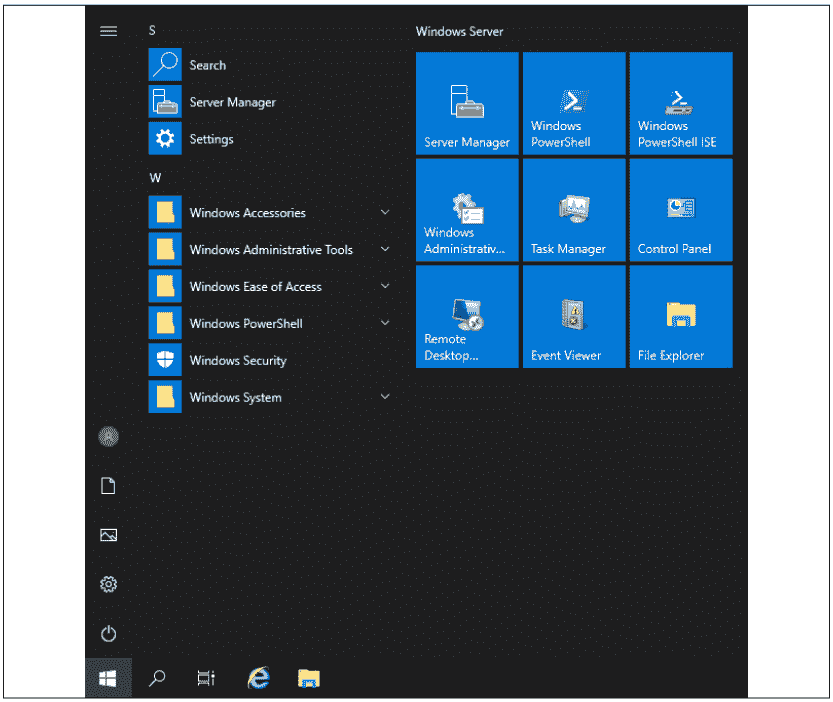

图 1.1：新的开始菜单

这真让人耳目一新。一个简单但实用的开始菜单，更重要的是，它在远程连接（如 RDP 或 Hyper-V 控制台）上加载速度很快。

## 快速管理员任务菜单

虽然拥有功能完善的开始菜单很不错，但作为一名服务器管理员，我在日常工作中很少需要访问传统菜单。这是因为我需要访问的许多项目都可以在快速管理员任务菜单中快速找到，该菜单只需右键单击开始按钮即可打开。该菜单自 Windows 8 发布以来就已提供给我们，但仍有许多 IT 专业人员不知道此功能。

该菜单已成为我与 Windows Server 操作系统交互的重要组成部分，希望对你也一样。右键单击开始按钮会显示即时快速链接，可执行诸如打开事件查看器、查看系统属性、检查设备管理器，甚至关闭或重新启动服务器等操作。在此上下文菜单中我最常用的两个功能是运行功能以及使用它快速启动 PowerShell 提示符。更棒的是，此菜单可以打开常规用户上下文的 PowerShell 提示符或提升/管理员 PowerShell 提示符。正确使用此菜单可以节省许多鼠标点击并缩短故障排除时间：

> 另外，此菜单也可以使用 WinKey + X 键盘快捷键调用！

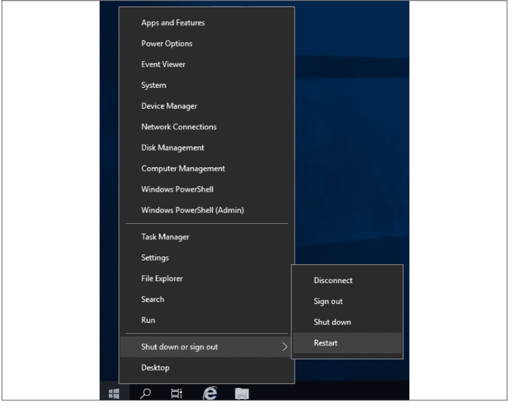

图 1.2：快速管理员任务菜单

虽然我认为在快速管理员任务菜单中列出 PowerShell 选项非常有益，但你可能仍然更喜欢使用命令提示符而不是 PowerShell。有一个简单的方法可以将快速管理员任务菜单中的 PowerShell 选项替换为命令提示符选项——包括常规用户上下文和管理员上下文。要进行此更改，请执行以下步骤：

- 1. 右键单击任务栏并选择任务栏设置。
- 2. 禁用该选项（默认情况下已启用），即在右键单击开始按钮或按 Windows 键+X 时在菜单中将命令提示符替换为 Windows PowerShell：


图 1.3：在菜单中将命令提示符替换为 Windows PowerShell

## 使用搜索功能

虽然隐藏在开始按钮后面的快速管理员任务菜单对于调用常见管理任务很有用，但在开始菜单中使用搜索功能是与 Windows Server 上的几乎任何内容交互的强大工具。根据谁为你的服务器安装了应用程序和角色，你可能在开始菜单中拥有也可能没有用于启动它们的快捷方式。你也可能在任务栏中拥有也可能没有桌面快捷方式或链接来打开这些程序。我发现经常很难找到可能需要调整的特定设置，以便让我们的服务器按我们想要的方式运行。控制面板在较新版本的 Windows 中正逐渐被更新的设置菜单取代，有时这会导致查找特定设置变得困难。开始菜单中的搜索栏可以缓解所有这些麻烦。只需单击开始按钮，或更简单地按下键盘上的 Windows 键（WinKey），你就可以开始输入想要打开的任何程序、设置或文档的名称。搜索栏将搜索本地服务器上的所有内容，并为你提供打开哪个应用程序、设置甚至文档的选项。

最基本的例子是，按下键盘上的 WinKey，然后输入 notepad 并按 Enter 键。你会看到久经考验的记事本立即为我们打开。我们无需在程序文件夹中任何地方导航即可找到并打开它。事实上，我们甚至不必触摸鼠标，这对像我这样喜欢尽可能通过键盘完成一切的人来说简直是音乐之声：


图 1.4：Windows 搜索

更好的例子是选择一些埋藏在 **设置** 或 **控制面板** 深处的东西。比如更改屏幕进入省电模式并自动关闭前的时长如何？传统的服务器管理员会打开 **控制面板**（如果他们能找到的话），可能导航到 **外观和个性化** 部分，因为其他地方看起来都不明显正确，但仍然找不到他们想要的东西。在摸索几分钟后，他们会开始认为微软完全忘记添加此设置了。但遗憾的是，这些电源设置只是被移到了一个新容器中，完全无法通过 **控制面板** 访问。我们将在本章稍后讨论新的 **设置** 屏幕，但就本例而言，你目前卡在找不到想要更改的设置这一点上。快速解决方案是什么？按你的 *WinKey* 打开 **开始** 菜单，然后输入 monitor（或 power，或与你要查找的设置相关的几乎任何其他内容）。你会在搜索菜单中显示的可用选项列表中看到一个名为 **选择关闭屏幕的时间** 的选项。单击它，你就找到了一直以来想要的设置：

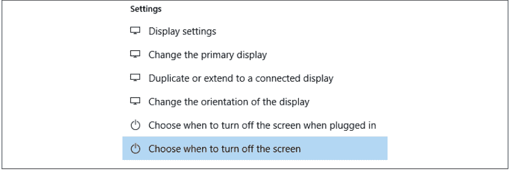

图 1.5：与屏幕相关的设置

你还会注意到，此搜索屏幕上的选项比你最初搜索的内容多得多。搜索为我提供了许多不同的项目，我都可以完成，所有这些都与我输入的单词 monitor 相关。我不知道有比使用开始菜单中的搜索栏更强大的方式来打开 Windows Server 2019 上的应用程序或设置。今天就试试吧！

## 将程序固定到任务栏

虽然 Windows Server 2019 提供了强大的搜索功能，使得启动难以找到的应用程序变得非常容易，但有时在传统的任务栏中让常用项目的快速快捷方式只需单击即可使用会更方便。无论你是通过手动浏览开始菜单找到特定应用程序，还是使用搜索功能调出想要的程序，你都可以简单地右键单击该程序并选择固定到任务栏，从而在屏幕底部的任务栏中为该应用程序放置一个永久快捷方式。完成此操作后，在未来登录到服务器会话时，你最喜欢和最常用的应用程序将只需单击即可等待你使用。正如你在图 1.6 中看到的，你还可以将程序固定到开始菜单，这当然是另一个可以定期从中启动它们的实用位置：

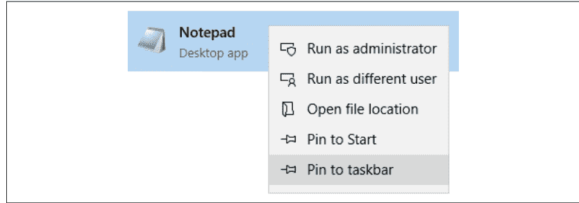

图 1.6：将程序固定到任务栏

许多读者已经非常熟悉将程序固定到任务栏的过程，所以让我们更进一步，展示当应用程序被固定时你可能不知道的额外功能。

## 右键单击的威力

我们都很熟悉在 Windows 操作系统的任何区域右键单击以执行更高级的功能。自从双按钮鼠标下线以来，右键单击时显示的小型上下文菜单就已存在。

我们经常右键单击以复制文本、复制文档、粘贴相同内容，或深入了解特定文件或文件夹的属性。许多日常任务都是通过该鼠标按钮完成的。我想指出的是，软件制造商，包括微软在内，已经在应用程序启动器本身中添加了更多右键功能，这使得将它们放在伸手可及的地方（如任务栏内）更具优势。

在任务栏中右键单击应用程序时提供的功能量取决于应用程序本身。例如，如果我右键单击命令提示符，我可以选择打开 **命令提示符**，或 **从任务栏取消固定**。非常简单。如果我再次右键单击命令提示符的较小的菜单选项，我可以执行相同的功能，但也可以进一步进入 **属性**，或 **以管理员身份运行**。因此，我深入得越深，获得的功能就越增强：

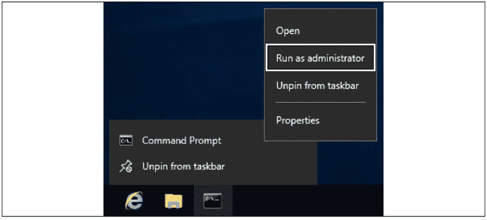

图 1.7：右键单击以管理员身份运行


使用其他程序时，你可能会找到更多结果。随着你对服务器的利用越多，这些右键上下文菜单中会出现的数据和选项也会越来越多。两个很好的例子是记事本和远程桌面客户端。在我的服务器上，我一直在处理一些文本配置文件，并且一直使用服务器跳转到其他服务器执行一些远程任务。我使用远程桌面客户端来完成此操作。现在，当我在任务栏中右键单击记事本时，我可以看到通往我最近处理过的文档的快速链接：


图 1.8：右键单击显示最近文档

当我右键单击我的 RDP 图标时，这里现在列出了我最近连接过的服务器的快速链接。我不知道你是否如此，但我每天都会 RDP 到很多不同的服务器。任务栏中为远程桌面客户端提供链接并自动跟踪我最近访问的服务器，绝对为我节省了时间和鼠标点击次数，让我能更高效地完成日常任务：

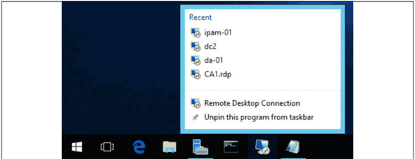

图 1.9：最近的 RDP 连接

这些右键功能已经存在于几个操作系统版本中了，所以这并不是新技术，但随着新版本的应用程序发布，它也在不断扩展。这也是一种我很少看到服务器管理员使用的功能，但也许他们应该开始使用它以提高工作效率，这就是我们在这里讨论它的原因。

在 Windows 10 和 Server 2019 平台中得到增强且在日常使用中非常有用的功能是打开文件资源管理器时默认呈现的 **快速访问** 视图。我们都知道并长期使用文件资源管理器，但通常当你想到达硬盘上的特定位置或特定文件时，需要经过多次鼠标点击才能到达目的地。Windows Server 2019 的 **快速访问** 视图会立即向我们显示从服务器上常用访问的最近文件和常用文件及文件夹。作为管理员，我们经常需要反复访问硬盘上的相同位置并打开相同的文件。如果 **文件资源管理器** 能将所有这些常见位置和文件链接集中在一个地方，不是很好吗？这正是 **快速访问** 所做的。

你可以在下面的屏幕截图中看到，打开文件资源管理器会为你提供快速链接，以便打开经常访问的文件夹以及最近文件的链接。像这样的功能可以真正节省时间，定期利用这些可用的小功能来提高效率，向同事和周围的人展示你对这一轮最新操作系统的真正熟悉和舒适程度：

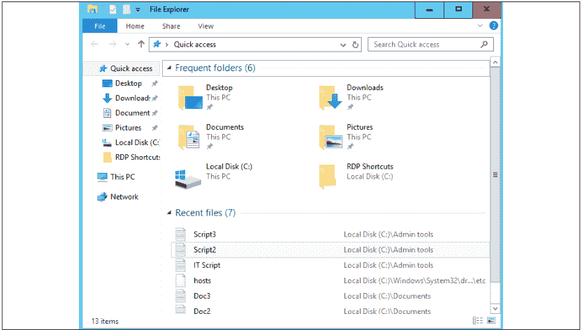

图 1.10：快速访问

你还会注意到在某些 **快速访问** 位置旁边的小图钉图标。你可以通过文件资源管理器轻松右键单击任何文件夹位置并选择 **固定到快速访问**，将其添加到你的 **快速访问** 菜单中，Windows 将在此 **快速访问** 部分内保持该固定位置，直到你选择取消固定为止。

## 使用更新的设置屏幕

如果你从事 IT 工作并且在客户端机器上使用 Windows 10 一段时间，那么可以肯定的是你已经偶然遇到了新的 **设置** 界面——也许是无意中，就像我第一次看到它时一样。我看到不少人第一次在尝试查看或配置 Windows 更新时碰到了 **设置** 界面。你看，Windows Server 2019 中的 **设置** 正如其名所示，是一个用于配置操作系统中各种设置的界面。这有什么难或令人困惑的呢？好吧，我们已经有一个用于 Windows 内所有设置的登陆平台，它已经存在了无数年。它叫做 **控制面板**。

Windows 内的 **设置** 菜单并不是一个全新的想法，但与 **控制面板** 相比看起来和感觉相当新。Windows Server 2012 和 2012 R2 存在一种半吊子的设置，据我所知，系统管理员几乎没有使用。我认为这是执行不佳造成的，因为 2012 年的 **设置** 菜单是通过 **Charms 栏** 访问并隐藏的，而大多数人都认为这是个糟糕的主意。我们不会花太多时间讨论过去的技术，但 Server 2012 中的 **Charms 栏** 是一个菜单，当你从屏幕右侧边缘向内滑动手指时就会出现。是的，你说得对，服务器通常没有触摸屏。至少我工作过的没有。所以，**Charms 栏** 也会在鼠标悬停在屏幕右上角附近时出现。它相当难以访问，却似乎总是在你不想要它出现时出现，比如当你试图点击桌面右侧附近的东西时，反而点击了突然凭空出现的 **Charms 栏** 中的某个东西。

我只提供这些背景信息是为了引出下一个观点。Windows 10 中的大部分用户界面，因此 Windows Server 2016 和 2019，也可以被视为从手指滑动和触摸屏领域迈出的一小步倒退。Windows 8 和 Server 2012 过于专注于大应用程序按钮和手指滑动，导致很多人迷失其中。它与我们以前见过的如此不同，在管理层面上使用起来也很困难。由于收到的反馈，Windows Server 2019 中的图形界面和用户控件，包括 **开始** 菜单和 **设置** 菜单，都介于 Server 2008 和 Server 2012 之间。这一步倒退是正确的，我到目前为止只听到对新用户界面的赞扬。

那么，回到 **设置** 菜单，如果你点击 **开始** 按钮，然后点击电源控件上方的小齿轮按钮，你就会看到这个新界面：

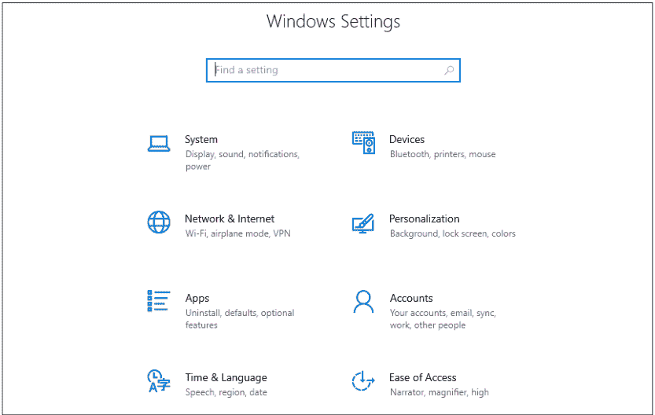

图 1.11：Windows 设置

在这个新的 **设置** 菜单中，你可以配置许多操作系统设置和组件。Windows 中的某些设置现在仅存在于此界面中，但许多设置仍然可以通过这里或传统的 **控制面板** 访问。目标似乎是在未来的版本中将所有配置都转移到新菜单中，但就目前而言，如果我们愿意，仍然可以通过传统方法管理大多数设置更改。我之前提到过 Windows 更新，这是一个很好的例子。传统上，我们会通过 **控制面板** 配置 Windows 更新设置，但它们现在已完全迁移到 Windows Server 2019 的新 **设置** 菜单中。在 **控制面板** 中搜索 Windows 更新，唯一的结果是你可以看到当前已安装的更新。但如果在新的 **设置** 菜单中搜索 Windows 更新，你会立即找到它。

> 请记住，你始终可以使用 Windows 搜索功能查找任何设置！按下你的 Win 键并输入 Windows Update，你将获得快速链接，直接进入相应的 **设置** 菜单。

目前，你必须结合使用 **控制面板** 和 **设置** 菜单来完成工作。有时会让人感到困惑。有时，你甚至会在 **设置** 菜单中点击某项，它会启动一个 **控制面板** 窗口！试试看。打开 **设置** 菜单并点击 **网络和 Internet**。在左侧列中点击 **以太网**。在这里，你可以看到网络适配器的状态，但你无法更改任何内容，例如更改 IP 地址。然后，你注意到 **更改适配器选项** 的链接。哦，是的，这听起来像是我想做的事情。点击 **更改适配器选项**，你就会直接进入具有 **控制面板** 外观和感觉的传统 **网络连接** 屏幕：

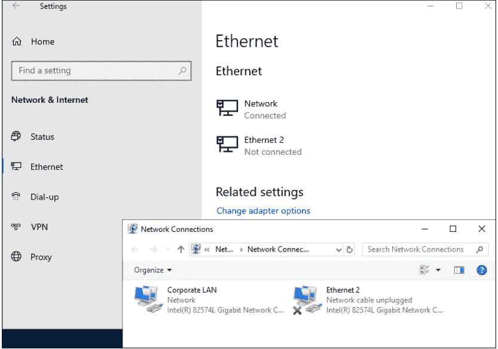

图 1.12：网络连接


## 做同一件事的两种方式

也可能令人困惑，直到你习惯了在其中导航，你有时可以在 **控制面板** 或 **设置** 菜单中完成相同的任务，但在每个界面中采取的过程可能在外观和感觉上大不相同。让我们通过亲手尝试在服务器上创建新用户账户来看看这一点，一次通过 **控制面板**，另一次通过 **设置**。

### 通过控制面板创建新用户

你可能对这个相当熟悉。打开 **控制面板** 并点击 **用户账户**。然后，点击 **用户账户** 标题。现在，点击链接 **管理另一个账户**。在此屏幕中，你可以选择 **添加用户账户**。点击它，你会得到一个对话框，在其中输入新用户的用户名和密码：

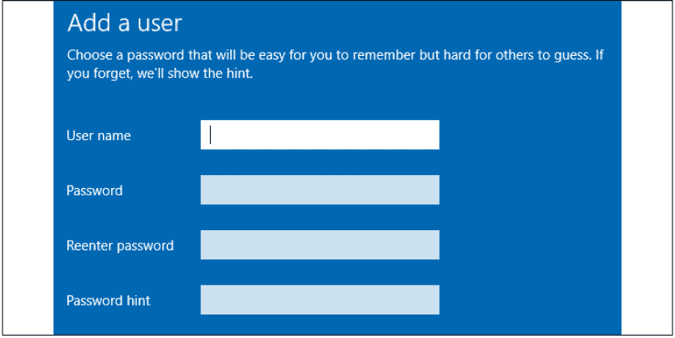

图 1.13：通过控制面板添加用户账户

### 通过设置菜单创建新用户

让我们试用一下这个更新的设置界面。打开设置菜单并点击账户。现在，在左侧列中点击其他用户。这里有一个选项可以将其他人添加到此电脑；继续点击它：

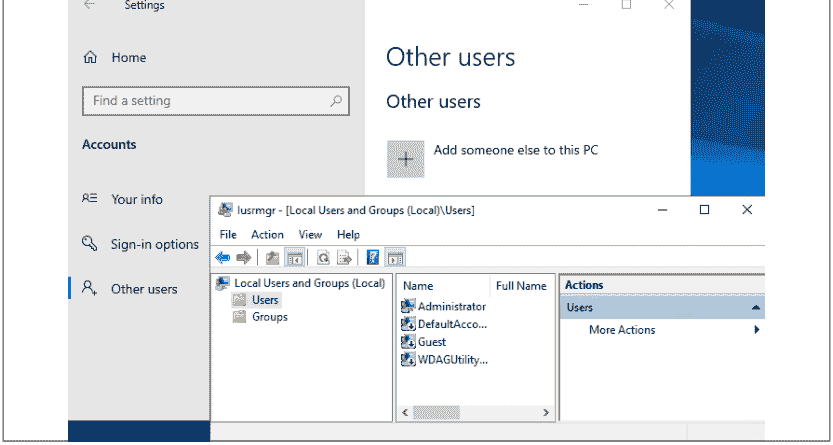

图 1.14：通过设置添加用户账户

这是什么？不幸的是，这不是我所期望的。令我惊讶的是，旧的控制面板用户账户启动了一个外观清新美观的界面，我可以在其中创建新用户账户。通过更新的设置控制台访问用户账户会把我带到旧的本地用户和组管理器。技术上，从这里我确实可以继续创建新用户账户，但似乎这里存在某种脱节。你自然会认为新的设置会启动更新、更漂亮的添加新用户账户的屏幕，但我们发现事实恰恰相反。

我们通过这个简单的示例演示了尝试通过两种不同的界面执行相同的功能，以展示有些项目可以在新的设置菜单上下文中执行并且必须在其中执行，但 Windows 中仍有许多功能需要通过我们传统的界面来完成。虽然控制面板继续存在，并且可能很长时间内都会存在，你应该开始在设置菜单中导航并弄清楚其中有什么可用内容，以便你可以开始构思两者的最佳组合来有效地管理你的服务器。

在我们开始习惯新的 **设置** 菜单的外观时，还有一件事需要指出：我们在服务器上配置的许多设置都是开/关类型的设置。我的意思是我们将某物设置为其中一个选项或另一个选项。历史上，这类配置是通过下拉菜单或单选按钮处理的。这很正常；这是预期的；这就是 Windows。现在，你会开始看到一些滑动条或滑块，允许你像开关灯一样打开或关闭设置。任何使用过任何智能手机设置界面的用户都知道我指的是什么。这种用户界面行为现在已进入完整的 Windows 操作系统，并且可能将长期存在。只是为了让你了解它在新的 **设置** 菜单上下文中的外观，这里是 **更新和安全** 设置中当前的 **Windows 更新** 设置页面的屏幕截图。

这是一个开/关滑块按钮的良好示例：

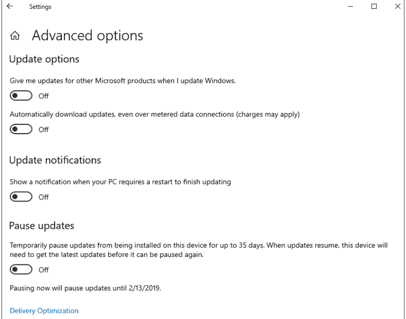

图 1.15：设置的高级选项

## 任务管理器

**任务管理器** 是一款自图形界面最初时期就存在于所有 Windows 操作系统中的工具，但多年来它已经发生了相当大的演变。Windows Server 2019 的目标之一是比以往任何版本的 Windows Server 更有用、更可靠。因此，只需将任务管理器完全移除，因为它以后根本不再需要，对吧？

当然我在开玩笑！虽然 Server 2019 希望能证明自己确实是微软迄今为止最稳定、最不需要维护的操作系统，但任务管理器仍然存在，并且仍将为世界各地的服务器管理员所需要。如果你有一段时间没有仔细查看任务管理器，它在过去几个版本中发生了显著变化。

**任务管理器** 通常仍可通过键盘上的 *Ctrl + Alt + Del* 然后点击 **任务管理器** 调出，或通过右键单击任务栏然后选择 **任务管理器**。你也可以使用快捷键 *Ctrl + Shift + Esc* 启动任务管理器，或在 **运行** 或 **搜索** 对话框中输入 *taskmgr*。你会首先注意到的是，在此默认视图中几乎没有信息，只有当前正在运行的应用程序的简单列表。这是一个有用的界面，可强制关闭可能卡住的应用程序，但除此之外用途不大。继续点击 **更多详细信息** 链接，你将开始看到此强大界面提供的真实信息。

我们立即注意到显示的信息比以往年份更用户友好，**应用** 和 **后台进程** 都以更直观的方式分类，并且同一应用程序的多个实例被合并以便于查看。这提供了对系统正在发生的事情的更快概览，同时仍可展开每个应用程序或进程以查看应用程序内运行的各个组件或窗口，如图 1.16 所示：

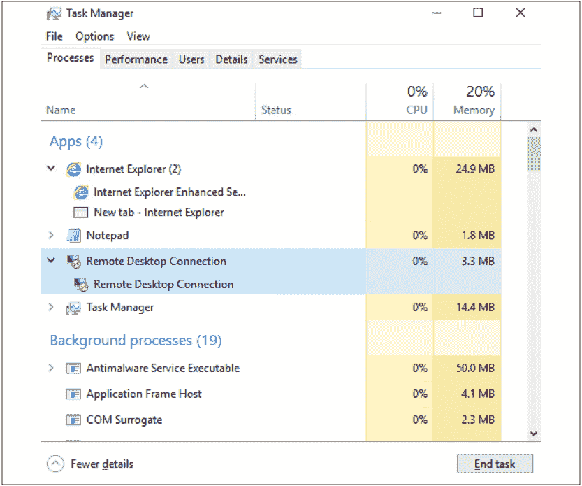

图 1.16：任务管理器：进程

请务必查看任务管理器内部的其他选项卡。用户选项卡会向我们显示当前已登录用户的列表以及他们的用户会话消耗的硬件资源量。例如，这是在远程桌面会话主机服务器上识别可能导致服务器变慢的个人的好方法。详细信息选项卡是进程选项卡的更传统视图，将许多相同的信息拆分出来，但采用了我们很久以前在操作系统版本中习惯看到的旧样式。然后，服务选项卡非常自解释；它显示服务器上当前安装的 Windows 服务、其状态以及根据需要启动或停止这些服务的能力，而无需单独打开服务控制台。

我跳过以便在此更具体提及的选项卡是 **性能** 选项卡。这是一个相当强大的选项卡。在其中，你可以快速监控 CPU、内存和以太网利用率。正如以下屏幕截图所示，我在这个特定虚拟机上并没有很好地规划资源，因为我的 CPU 几乎没有被使用，但我的系统内存几乎用完了：

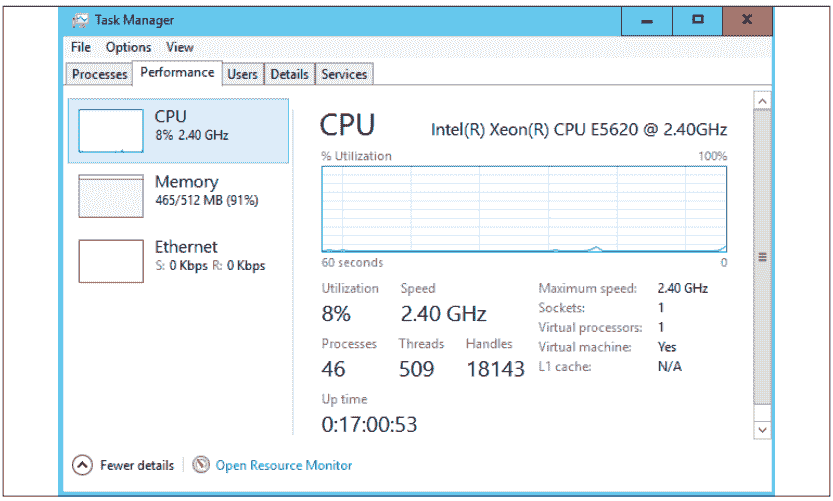

图 1.17：任务管理器：性能

> 此屏幕中提供的另一个有用信息是服务器运行时间。在排查问题时找到此信息可能至关重要，我看到管理员一次又一次地根据日志时间戳计算系统运行时间。使用 **任务管理器** 找到该信息要容易得多！

如果你有兴趣查看有关服务器性能的更深入数据，此 **任务管理器** 窗口底部有一个链接，可以 **打开资源监视器**。Server 2019 中提供的两种用于监控系统状态的技术，特别是硬件性能，是 **资源监视器** 和 **性能监视器**。务必打开这些工具并开始测试它们，因为它们可以在启动新服务器时提供故障排除信息和基本基线数据。然后可以将此基线与未来的测试数据进行比较，以便你可以监控安装在特定服务器上的新应用程序或服务对其资源消耗的影响。我们将在 *第15章，排查 Windows Server 2019* 中讨论这些额外的监控工具。

回到 **任务管理器**，还有一个小技巧我想测试一下。仍在 **性能** 选项卡内，继续右键单击你感兴趣的任何特定数据。我将右键单击窗口左侧附近的 **CPU** 信息。这会打开一个包含几个选项的对话框，其中我将点击 **摘要视图**。这会将之前占用我屏幕约一半空间的数据压缩到一个很小的窗口中，我可以将其移动到屏幕角落。这是一种在你浏览和操作服务器时始终将硬件利用率数据保留在屏幕上的好方法，以便在对系统进行更改时可以观察资源消耗的任何峰值或增加：


图 1.18：任务管理器：资源


## 任务视图

任务视图是 Windows 10 和 Windows Server 2016 起的新功能，已延续到 Server 2019。其概念与按住 Alt 键然后按 Tab 在当前正在运行的应用程序之间循环类似。如果从未尝试过，现在就按住键盘上的这两个键试试。根据你运行的 Windows 版本，屏幕可能看起来略有不同，但本质上信息是相同的。你可以看到当前所有打开的程序，并可通过多次按 Tab 按钮从左到右在它们之间循环。或者，使用 Alt + Shift + Tab 以相反顺序循环。当打开的窗口很多时，也许直接使用鼠标跳转到特定窗口会更方便：

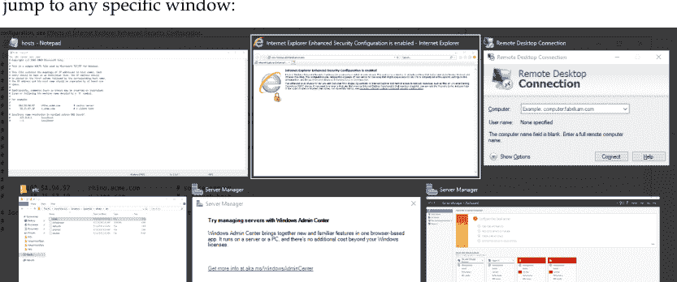

图 1.19：查看所有打开的窗口

与此相比，任务视图功能更强大，因为它增加了管理多个完整桌面窗口和应用程序的能力。例如，如果你在同一台服务器上同时进行两个不同的项目，而每个项目都需要同时打开许多不同的窗口，你就会花费大量时间在各种应用程序和窗口之间来回切换以找到所需内容。使用任务视图，你可以将第一个项目的全部打开窗口保留在第一个桌面上，并在第二个桌面上打开与第二个项目相关的所有窗口。然后，只需两次点击，就可以使用任务视图按钮轻松在不同桌面之间切换。默认情况下，任务视图是任务栏下方的按钮，位于开始按钮附近的搜索放大镜图标的右侧。现在点击它——它看起来像这样：


图 1.20：任务视图按钮

现在你会看到当前打开窗口的列表；这看起来与我们之前查看的 Alt + Tab 功能非常相似。不同之处在于左上角附近有一个标有“新建桌面”的小按钮。现在点击它：


图 1.21：创建第二个桌面

现在，你会看到可供使用的桌面 1 和桌面 2。你可以点击桌面 2 并打开一些新程序，甚至可以直接在此任务视图屏幕上将现有窗口拖放到不同桌面之间：

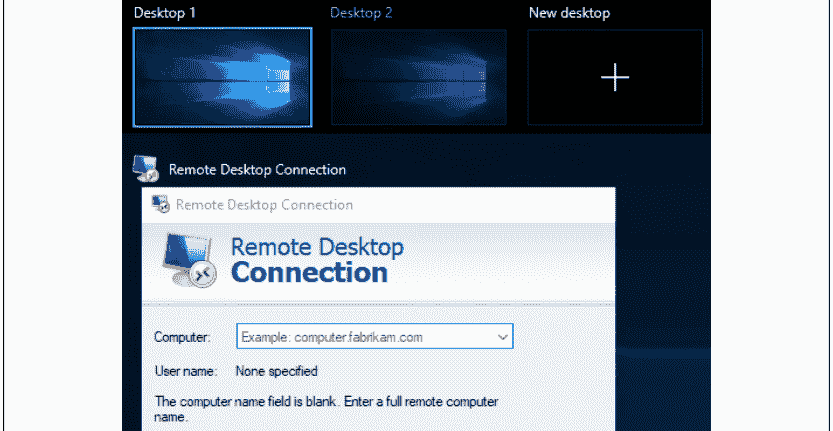

图 1.22：导航多个桌面

任务视图是利用同一服务器上的多个桌面保持井然有序和高效的好方法。我想这有点像运行双显示器，或三四个甚至更多，都来自单个物理显示器屏幕。


> 如果你想避免点击任务视图图标，按键盘上的 WinKey + Tab 也能达到同样的效果！

## 摘要

本章关于 Windows Server 2019 的第一章全部是关于熟悉并习惯在界面中导航。与 Server 2019 交互的方式多种多样，我们将在本书中讨论其中许多方式，但大多数服务器管理员将通过完整的图形界面与这个新操作系统交互，使用鼠标和键盘执行任务。如果你使用过之前的 Windows Server 操作系统版本，那么你用来驱动这个新平台的许多工具将与过去使用过的工具相同或至少相似。新操作系统应始终是其前身的演进，而不应完全全新。我认为这是在 Windows 8 和 Server 2012 发布时学到的教训。

在 Server 2019 中，我们在 Windows 早期版本的传统熟悉感与随着我们迈向基于 Windows 设备的未来而日益普及的圆角和触摸友好屏幕带来的新优势之间找到了一个很好的平衡。在下一章中，我们将探讨安装和管理 Windows Server 2019。

## 问题

- 1. 在 Windows Server 2019 中，如何通过两次鼠标点击启动提升权限的 PowerShell 提示符？
- 2. 打开 **快速管理员任务** 菜单的键盘组合是什么？
- 3. 微软的云服务提供的名称是什么？
- 4. Windows Server 2019 的两个许可版本是什么？
- 5. 在 Windows Server 2019 Standard 主机上可以运行多少个虚拟机？
- 6. Windows Server 2019 的哪种安装选项没有图形用户界面？
- 7. Windows Server 2019 最新版本的正确术语是 **长期服务分支 (LTSB)** 还是 **长期服务渠道 (LTSC)**？
- 8. 在 Windows Server 2019 上更改配置的正确工具是 **Windows 设置** 还是 **控制面板**？

# 2 安装和管理 Windows Server 2019

# 安装和管理 Windows Server 2019

现在我们已经查看了 Windows Server 2019 图形界面中的一些功能，我意识到你们中有些人可能会想 *读起来很棒，但我该如何真正开始自己动手尝试呢？* 读技术文章永远不如亲身体验，所以本章我们希望能付诸实践。本书最重要的目标之一是确保我们能让你 *使用* 该产品。只是罗列新功能和效率的事实固然好，但如果在现实生活中无法使用，最终毫无价值。那么，让我们让这块原始的服务器硬件为我们工作吧。

在本章中，我们将涵盖以下内容：

- 安装要求
- 安装 Windows Server 2019
- 安装角色和功能
- 集中管理和监控
- **Windows 管理中心 (WAC)**
- 使用 Sysprep 启用快速服务器部署

## 技术要求

在规划新服务器的构建时，你需要做出的许多决定都是许可类型的决定。*你打算在这台服务器上安装哪些角色？更常见的 Server 2019 Standard 版本能否胜任，还是我们需要 Datacenter 版本？从安全角度来看，Server Core 是否有益，还是我们需要完整的桌面体验？* 在 Hyper-V 服务器可以随时启动虚拟机的今天，我们往往对服务器硬件考虑不多，但仍有许多情况下物理设备将托管 Windows Server 2019 操作系统。在这些情况下，你需要了解这个新平台的要求，让我们花点时间列出这些具体要求。如果需要核对任何具体细节，这些信息在 Microsoft Docs 网站上有更详细的说明，但以下是汇总的最低系统要求 (https://docs.microsoft.com/en-us/windows-server/get-started-19/sys-reqs-19)：

- **CPU：** 支持多项功能的 1.4 GHz 64 位——NX、DEP、CMPXCHG16b、LAHF/SAHF、PrefetchW 和 SLAT。
- **RAM：** 最低 512 MB ECC 内存，或运行桌面体验的服务器推荐最低 2 GB。我可以告诉你，在内存远少于 2 GB 的情况下安装和运行桌面体验是可能的（例如在测试实验室中），但该服务器的性能不会达到应有的水平。
- **磁盘：** Server 2019 需要 **PCI Express (PCIe)** 存储适配器。ATA/PATA/IDE 不允许用作启动驱动器。最低存储空间要求为 32 GB，但桌面体验比 Server Core 消耗约多 4 GB 空间，请考虑这一点。

如果你只是想启动 Server 2019 并随意查看一下，这些算是最低规格。对于生产系统，请大幅提高这些数字。这里没有万能答案——你需要的规格取决于你期望在服务器上运行的工作负载。在构建新系统时，还应寻找一些额外的组件，这些组件对特定角色和功能是必需的。例如 UEFI 和 TPM 芯片正迅速成为主流，并在每次操作系统更新中被越来越多的服务使用。特别是，如果你对通过 BitLocker 进行安全保护或使用强证书或新的隔离虚拟机感兴趣，你需要确保你的系统包含 TPM 2.0 芯片。


## 安装 Windows Server 2019

一般来说，过去 15 年来微软操作系统的安装过程有了显著改善。我假设你们中的很多人作为 IT 专业人员，也是事实上的 *邻里电脑高手*，不断被朋友和家人要求修复或重建他们的电脑。如果你和我一样，这意味着你仍然偶尔会重建像 Windows XP 这样的操作系统。查看明亮的蓝色设置屏幕并找到带有 F8 键的键盘对这个过程至关重要。花费两个小时仅仅安装基础操作系统并将其更新到最高服务包级别是相当正常的。与之相比，安装像 Windows Server 2019 这样现代操作系统的速度和简易性几乎难以置信。

很可能大多数读者已经多次完成过这个过程，如果是这样，请随意跳过几页。但对于任何刚接触微软世界或刚接触 IT 的人，我想花上几页快速说明，确保你有开始的基础。没有在你的工具带上获得 **安装操作系统 101** 徽章，那台闪亮的服务器将成为一件有趣的墙面装饰品。

## 烧录该 ISO

你必须做的第一件事是获取一些安装介质。实现一台新服务器最直接的方法是从微软下载一个 .ISO 文件，将该 .ISO 烧录到 DVD 中，然后将该 DVD 插入以用于安装。由于网站链接和 URL 可能会随时间变化，获取用于安装的 .ISO 文件最可靠的方法是打开搜索引擎，例如 **Bing**，并输入 Download Windows Server 2019。一旦你进入官方微软下载页面，点击链接下载你的 .ISO 文件并将其保存到电脑的硬盘上。

获取 .ISO 文件使其成为可用的 DVD 的最棘手部分曾经是需要下载某种第三方工具才能在使其可启动的同时将其烧录到光盘上。如果你电脑上运行的是较旧的客户端操作系统，这可能仍然适用于你。我见过许多刚接触此过程的人将 .ISO 文件拖到光盘驱动器上并开始烧录光盘。这会创建一个带有 .ISO 文件的 DVD，但该 .ISO 仍然打包好且完全不可启动，因此该光盘对你的新服务器硬件来说毫无用处。幸运的是，较新版本的 Windows 客户端操作系统具有内置的 .ISO 文件处理功能，使得正确的烧录过程变得非常简单。

一旦你将 Windows Server 2019 安装的 .ISO 文件下载到电脑上，将一张新的 DVD 插入光盘驱动器并浏览到新文件。只需右键单击 .ISO 文件，然后选择菜单选项“刻录光盘映像”。这会启动一个简单的向导，将你的新 .ISO 文件正确提取并烧录到 DVD 上，使其成为新服务器的可启动安装介质，如图 2.1 所示：


图 2.1：烧录你的 .ISO 文件到 DVD

当你尝试下载 Windows Server 2019 并使用此 Windows 磁盘映像刻录实用程序与你从标准空白 DVD 堆中拿到的 DVD 一起使用时，很可能会收到以下错误消息：光盘映像文件太大，无法写入可记录光盘。

这不足为奇，因为我们的操作系统安装文件多年来一直在变大。我们现在已经达到了临界转折点，标准 Server 2019 ISO 安装程序大于标准 4.7 GB DVD 光盘。要将此 ISO 烧录到 DVD 上，你需要去商店找到一些可以处理更多数据的双层光盘。

## 创建可启动 USB 驱动器

DVD 可能很笨重且令人厌烦，现在它们对我们的目的来说也太小了。因此，在安装更新、更大的操作系统时，准备 USB 驱动器用于操作系统安装而不是依赖 DVD 变得很常见。

要做到这一点，你只需要一台 Windows 电脑、至少 8 GB 的 USB 驱动器以及互联网访问权限。你需要下载我们之前讨论过的相同 ISO，因为它包含 Server 2019 的所有安装文件。然后你还需要下载并安装某种可启动 USB 创建工具。有各种免费工具可用（Rufus 很受欢迎），但微软官方提供的工具称为 Windows 7 USB/DVD 下载工具。为什么它有这个包含“Windows 7”一词的奇怪名称？别问我。

但它确实有效，并且是为新操作系统安装准备可启动 USB 驱动器的快速、简单且免费的方法。我应该指出，此工具与 Windows 7 无关。它可以将任何 .ISO 文件变成可启动 USB 驱动器。该 ISO 可以是 Windows 10 或 Server 2019 ISO 文件，仍然可以正常工作。你也可以在 Windows 10 工作站上安装并运行 Windows 7 USB/DVD 下载工具而不会有任何问题。

一旦安装了 USB DVD 下载工具，启动应用程序并简单地完成 4 步向导。

> 此过程将擦除并格式化你的 USB 驱动器！确保其中没有存储任何重要内容！

你需要确定要让工具从中获取信息的 ISO，然后从下拉列表中选择你的 USB 驱动器。之后，只需点击“开始复制”按钮，此工具就会将你的 USB 驱动器变成能够安装整个 Windows Server 2019 操作系统的可启动驱动器，如图 2.2 所示：

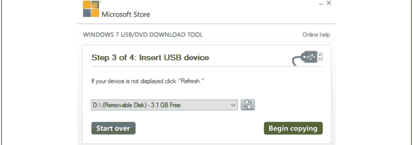

图 2.2：创建可启动 USB 驱动器

## 运行安装程序

现在将你新创建的 DVD 或可启动 USB 插入新服务器硬件。启动它，你最终会看到 Windows Server 2019 的安装向导。现在，这些向导中可供选择的选项其实并不多，所以我们不会在这里花费太多时间。大多数情况下，你只需点击“下一步”按钮以推进屏幕，但在途中会有几个特定的地方需要你做出决定。

在选择安装语言后，下一个屏幕看起来很简单。只有单个按钮写着 **立即安装**。是的，这就是你想要点击的，但我想让你注意屏幕左下角的文字。如果你曾经处于服务器无法启动并且你正在尝试运行一些恢复或诊断功能以解决该问题的境地，你可以点击 **修复你的计算机** 以启动到恢复控制台。但对于我们全新的服务器安装，请继续点击 **立即安装**，如图 2.3 所示：

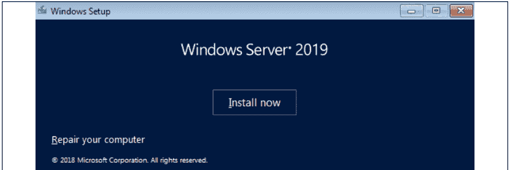

图 2.3：安装 Windows Server 2019

现在系统会要求你输入产品密钥以激活 Windows。如果你已有密钥，请现在输入。否则，如果你只是安装此版本来测试 Server 2019 并想在一段时间内以试用模式运行，你可以点击链接 **我没有产品密钥** 以跳过此屏幕。

下一个屏幕很有趣，也是你真正需要开始注意的第一个地方。你将看到 Windows Server 2019 的四个不同安装选项。有看起来像是“常规”安装程序的 Server 2019 Standard 以及 Server 2019 Datacenter，还有每个的第二个选项包含 **桌面体验** 字样。通常在微软安装程序世界中，连续点击每个选项的 **下一步** 会为你正在安装的内容提供最典型和最常见的安装路径。*并非如此。* 如果你只是通过点击 **下一步** 滑过此屏幕，你会发现自己最终安装的是 **服务器核心**。我们将在本书后面的章节中更多地讨论服务器核心，但现在我只说，如果你期望拥有一台看起来和感觉像我们在 *第 1 章，开始使用 Windows Server 2019* 中讨论的那样的服务器，这个默认选项不会带你到达那里。向导所说的这个“桌面体验”就是完整的 Windows Server 图形界面，你很可能在安装完成后期望看到它。因此，就我们这里的安装而言，我们希望使用全彩和鼠标与服务器交互，请决定你想要 Standard 还是 Datacenter 版本，但务必在点击 **下一步** 按钮之前选择包含 **桌面体验** 的选项，如图 2.4 所示：


## Windows 设置

选择要安装的操作系统

| 操作系统 | 架构 | 修改日期 |
|---|---|---|
| Windows Server 2019 Standard | x64 | 10/29/2018 |
| Windows Server 2019 Standard (Desktop Experience) | x64 | 10/29/2018 |
| Windows Server 2019 Datacenter | x64 | 10/29/2018 |
| Windows Server 2019 Datacenter (Desktop Experience) | x64 | 10/29/2018 |

描述：
此选项安装完整的 Windows 图形环境，会占用额外的驱动器空间。如果您想使用 Windows 桌面或有需要它的应用程序，则可能很有用。

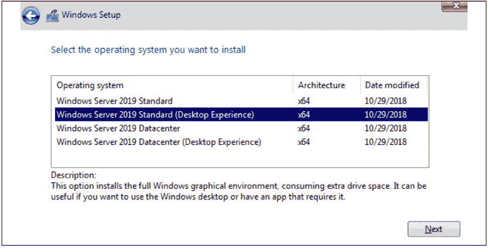

图 2.4：Windows Server 2019 安装选项

在 Windows Server 的某些早期版本中，我们可以在安装操作系统后在完整的桌面体验和 Server Core 之间来回迁移，反之亦然。在 Windows Server 2019 中这不起作用！在两种模式之间转换的能力已经消失，因此从一开始就妥善规划服务器变得更加重要。

下一屏幕会详细介绍您需要同意的许可条款，然后我们会进入另一个屏幕，其中顶部选项很可能不是您打算点击的选项。我理解为什么对于消费级 Windows 10 机器，升级功能被列在第一位，但历史上管理员对 Windows Server 进行原位升级的情况非常罕见。在一个升级后一切总是完美运行的理想世界里，这将是一个很好的方法。您可以让许多服务器都在执行各自的任务，每当发布新的操作系统时，您只需运行安装程序并升级它们即可。瞧——魔法！不幸的是，并非总是如此，我几乎从未见过服务器管理员愿意冒在现有生产服务器上进行原位升级的风险的风险。更常见的是，我们总是与当前正在运行的生产服务器并行构建全新的服务器。一旦新服务器配置完成并准备好承担其职责，那么，也只有在那时，实际的工作负载才会从旧服务器迁移到新服务器。在一个计划周密、精心雕琢的迁移过程中，一旦职责迁移完成，旧服务器就会被关闭并移走。

如果我们能够简单地将现有服务器升级到最新的操作系统，将会节省大量时间和规划。但这只有在您确信升级不会出现问题时才可行，而大多数时候我们并不准备承担这种风险。如果升级过程出现问题，您最终得到一台损坏的服务器，那么您将面临在业务关键的生产服务器上进行昂贵的修复和恢复过程。您很可能还要在夜间或周末工作。您是宁愿花时间规划一个精心制定的切换，还是在业务因无法工作而向您施压时恢复关键服务器？我的钱押在前者。

> 微软宣布，Windows Server 2019 安装程序处理从 Windows Server 2016 的升级，比历史上任何其他 Windows Server 原位升级路径都要好得多。现在我在野外做了不少这样的升级，我必须说我同意！从 2016 年之前的任何 Server 版本升级仍建议采用迁移和替换，准备一台全新的服务器并迁移工作负载，但如果您已经运行 Server 2016 并希望迁移到 Server 2019，原位升级现在成为真正的可能性。然而，仍有一些特定角色无法接受这种更改，并在此类升级后失败，因此 2016 到 2019 的原位升级在现实世界中是否可行……我想这取决于您……

现在回到手头的话题。在 Windows Server 世界中，我们很少触碰 **Upgrade** 选项。因此，请继续选择 **Custom: Install Windows only (advanced)** 选项，在这里我们将进入将此副本的 Windows Server 2019 干净安装到硬盘新位置的选项，如图 2.5 所示：

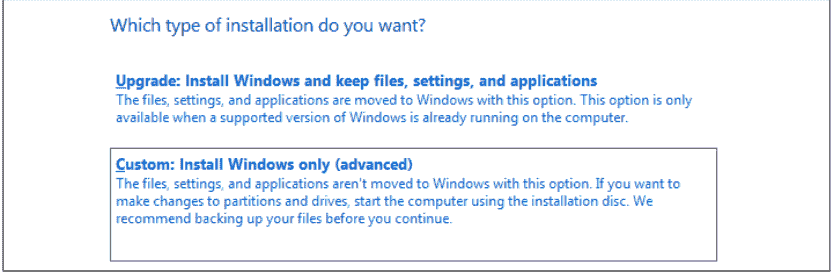

图 2.5：原位升级或自定义安装

现在我们决定要在哪里安装我们新的 Windows Server 2019 副本。在许多情况下，您只需在此处点击下一步，因为您的服务器只有一个硬盘驱动器，或者可能是一组磁盘的单个 RAID 阵列，在任何一种情况下，您都会看到一个可以安装操作系统的单个可用空间池。如果您在服务器上安装了多个硬盘驱动器，并且它们尚未以任何方式绑定在一起，那么您在这里会有多个选择来安装 Windows Server。这里只有一个从未使用过的单个硬盘驱动器连接，所以我可以简单地点击下一步继续。请注意，如果您的驱动器上有现有或旧数据，您可以在此处使用一些磁盘管理工具来格式化磁盘或删除单个分区。如果您使用的是需要特定驱动程序的专用磁盘，还有一个加载驱动程序按钮，您可以使用它将这些特殊驱动程序注入安装向导，以便查看此类磁盘。

此外，在此屏幕上需要注意的是，虽然有一个创建新磁盘分区的按钮，但您不必执行此操作即可继续。许多新管理员认为必须手动创建分区，以便 Windows 知道将文件安装到何处。恰恰相反，如果您选择未分配空间，如我在图 2.6 中所示，然后简单地点击下一步，安装程序将为您创建必要的分区：

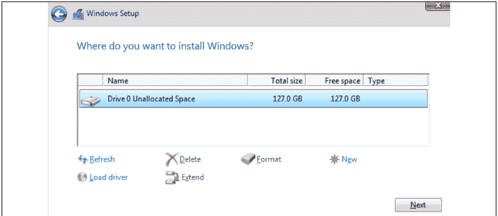

图 2.6：Windows 安装位置

就这样！您会看到服务器安装程序开始忙碌地复制文件、安装功能，并在硬盘上准备好一切。此安装程序部分会在几分钟内自行运行，下一次您需要与服务器交互时，将是在图形界面中，您可以在其中定义管理员密码。一旦您指定了密码，您将发现自己位于 Windows 桌面上。现在您真的准备好开始使用新的 Windows Server 2019 了。

## 安装角色和功能

安装操作系统可以说让您踏入服务器的大门，使用服务器作为服务器。然而，在这一点上，您实际上无法对服务器做任何有用的事情。在客户端桌面系统上，基本操作系统通常足以开始工作和消费数据。服务器的工作是首先提供这些数据，直到您告诉服务器其人生目的，基本操作系统中实际上并没有任何有用的事情发生。这就是我们需要利用 **roles** 和 **features** 的地方。Windows Server 2019 包含许多不同的角色选项。角色正如其名称所示：向服务器安装特定角色定义了该服务器在网络中的角色。换句话说，角色赋予服务器某种人生目的。另一方面，功能更像是您可以安装到服务器上的功能子集。功能可以补充特定角色或独立存在。Windows Server 2019 中有可用的技术组件默认未安装或未打开，因为这些功能并非在所有情况下都会使用。本书后面的所有内容都围绕角色和功能提供的功能展开。它们是 Windows 服务器的主食，而没有它们的安装，您的服务器只能成为很好的纸镇，而别无他用。由于我们不会在每一章中花时间介绍本章中使用的每个特定角色或功能的安装，让我们现在花点时间介绍管理员最常见的路径，以便将这些角色和功能安装到自己的服务器上。

### 使用向导安装角色

毫无疑问，角色和功能最常见的安装位置就在操作系统安装后即可使用的图形向导中。默认情况下，每次登录 Windows Server 2019 时都会自动启动一个名为 **Server Manager** 的工具。我们将在本章后面更详细地查看 Server Manager 本身，但就我们目前的目的而言，我们只需将其用作启动平台，以便到达我们的向导，该向导将指导我们完成在此新服务器上的第一个角色安装。

由于您刚刚登录到这台新服务器，您应该正盯着 Server Manager 仪表板。仪表板中间，您会看到一些可点击的链接，一个编号为一到五的快速入门操作项目列表。如果您尚未这样做，请通过第一个链接，即名为 **Configure this local server** 的链接，在此机器上实施您可能需要的任何本地服务器配置。


您可能希望具备的项目包括诸如服务器的永久主机名、IP地址等，如果您将此服务器加入现有域（我们将在 *第 3 章，Active Directory* 中讨论域），您通常会在服务器上实施任何新角色之前处理该过程。但就我们而言，我们更具体地关注角色安装本身，因此我们假设您已经配置了这些零碎的东西，以便服务器在网络上被识别并进行路由。

继续点击步骤 2，**添加角色和功能**。另一种启动相同向导的方法是点击 Server Manager 内部顶部栏中的 **管理** 菜单，然后从下拉列表中选择 **添加角色和功能**。选择任一链接都会将您带入我们的角色安装向导，如 *图 2.7* 所示：

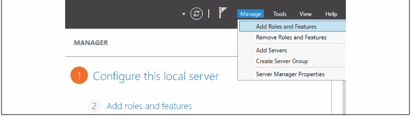

图 2.7：添加角色

您首先会进入一个关于安装角色的摘要屏幕。继续点击 **下一步** 跳过此屏幕。现在我们进入第一个选项，这是一个有趣的选项。我们首先被问到是否要继续进行 **基于角色或基于功能的安装**，这正是我们一直在讨论要做的事情。但这里的第二个选项 **远程桌面服务安装** 很重要需要注意。大多数人认为 Windows Server 的 **远程桌面服务 (RDS)** 组件只是我们在设置服务器时可以选择的另一个角色，与安装任何其他角色类似。虽然基本上是这样，但需要注意的是，RDS 在功能上与其他类型的角色如此不同，以至于进入任何 RDS 组件安装的入口路径会通过选择这里的第二个选项调用其自己的向导。因此，如果您曾经在寻找安装 RDS 的选项，而您因为习惯像我一样一直点击 **下一步** 而忽略了此屏幕，请记住您需要返回那里告诉向导您想要处理 RDS 组件，其余屏幕将相应调整。

目前，我正在搭建一个全是 Windows Server 2019 主机的新测试实验室，并且我仍然需要一个 **域控制器 (DC)** 来管理我的环境中的 Active Directory。在服务器上安装 Active Directory 之前，关键是我必须具备一些先决条件，因此我已经在新服务器上完成了这些项目。在 AD DS 角色安装之前我需要具备的项目有：分配静态 IP 地址，并确保我的 NIC 属性中的 DNS 服务器设置指向某个位置，即使只是指向此服务器自己的 IP 地址。我还需要确保服务器的主机名设置为最终名称，因为一旦将其转变为域控制器，就不支持更改主机名。我已经在服务器上完成了这些项目，因此我将继续通过角色安装向导，在此保留 **基于角色或基于功能的安装** 选项并点击 **下一步**，如 图 2.8 所示：

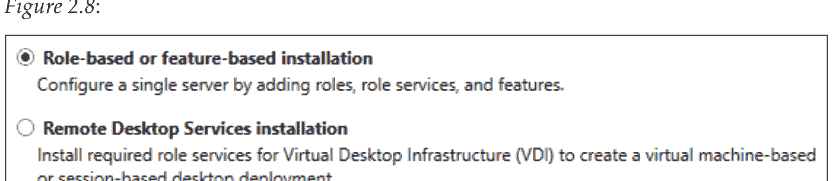

图 2.8：选择基于角色或基于功能的安装

我们的 **服务器选择** 屏幕非常强大。如果您以前进行过此过程，您可能已经忽略了此屏幕，只是点击 **下一步** 按钮以继续进行。但本质上，此屏幕是在询问您希望将此新角色或功能安装在哪里。默认情况下，每个服务器在此屏幕上只列出其自身，因此点击 **下一步** 继续进行很可能就是您要做的事情。但这里有几个不错的选项。首先，如果您的 Server Manager 知道网络中的其他服务器并且已配置为监控它们，您可以在此处选择将角色或功能远程安装到其他服务器之一。我们稍后会更深入地探讨此功能。此页面上的另一个功能是我没有看到很多人使用，即能够指定您希望将角色或功能安装到虚拟硬盘上。在当今时代，我们中的许多人主要使用虚拟服务器，而且您甚至不需要虚拟服务器正在运行就可以向其安装角色或功能！如果您从运行 Server Manager 的位置可以访问 .VHDX 文件，即硬盘文件，您可以选择此选项，这将允许您直接将新角色或功能注入该硬盘。但正如您浏览此屏幕时 99% 的情况一样，我们直接登录到我们打算安装角色的服务器，因此我们只需点击 **下一步**，如 *图 2.9* 所示：

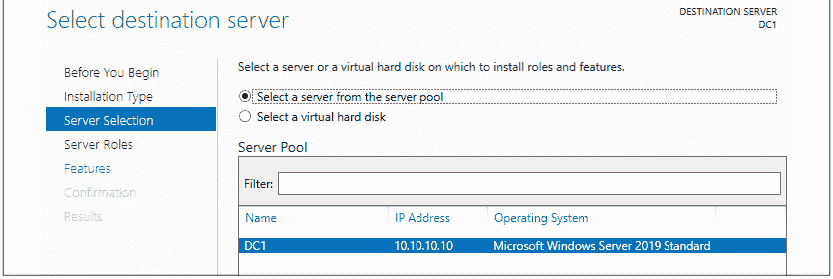

图 2.9：选择目标服务器

现在我们有了可供安装的角色列表。点击每个角色将为您提供该角色用途的简短描述，如果您有任何疑问，我们在接下来的几章中也会更详细地讨论核心基础设施组件，以便为您提供有关角色功能的更多信息。我们在这里要做的就是选中复选框并点击 **下一步** 即可将角色安装到新服务器上。由于这将是一个域控制器，我将选择 **Active Directory 域服务** 角色，并且我将多用途使用此服务器，使其同时成为 **DNS 服务器** 和 **DHCP 服务器**。对于这些角色，没有必要分别运行三次向导来安装所有这些角色；我只需在此全部选中，让向导一起运行安装程序即可。哎呀，当我点击第一个复选框时，我收到一个弹出消息，指出 **Active Directory 域服务** 角色需要一些额外的功能才能正常工作。这是正常行为，您会注意到您安装的许多角色都需要安装一些额外的组件或功能。您只需点击 **添加功能** 按钮，它将在安装过程中自动为您添加这些额外组件。示例显示在 图 2.10 中：

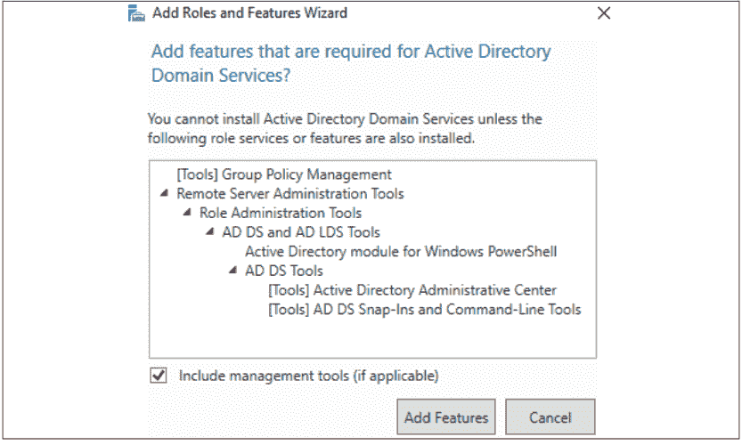

图 2.10：其他功能

现在我们已经选中了全部三个角色，是时候点击 **下一步** 了。而且，为了向所有读者明确说明，我并不需要在同一时间安装所有这些角色；它们彼此之间并不都依赖。看到这些角色全部安装在同一台服务器上是很常见的，但如果我愿意，我也可以将它们拆分到自己的服务器上。在更大的环境中，您可能会将 AD DS 和 DNS 一起安装，但您可能会选择将 DHCP 角色放在自己的服务器上，这完全没问题。

我正在配置此服务器以支持小型实验室环境，因此对我来说，将这些核心基础设施服务放在同一个盒子中是有意义的，如 图 2.11 所示：

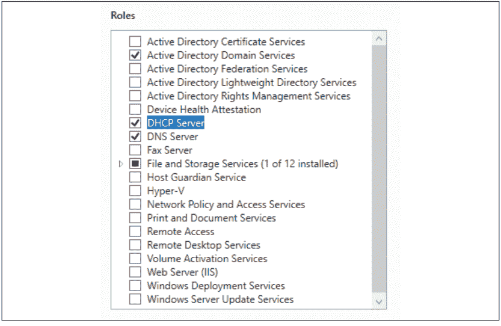

图 2.11：角色选择

点击 **下一步** 后，我们现在进入了可以向 Windows Server 2019 安装其他功能的页面。在某些情况下，您最初可能只打算添加特定功能，在这些情况下，您将完全绕过 **服务器角色** 屏幕，直接进入 **功能安装** 屏幕。就像角色安装屏幕一样，继续选中您想要安装的任何功能，然后再次点击 **下一步**。对于我们的新域控制器，我们目前不需要特别添加任何其他功能，因此我将完成向导，这将开始安装我们的新角色。

安装过程完成后，您可能或可能不会被提示重新启动服务器，这取决于您安装了哪些角色或功能以及它们是否需要重新启动。一旦您返回到 Server Manager 内部，您会注意到顶部附近现在出现了一个黄色感叹号提示。点击此处会显示有关可能需要进一步配置的消息，以便完成新角色的设置并使其在服务器上生效。AD DS、DNS 和 DHCP 的角色现已成功安装，但这些角色要发挥作用现在还需要一些额外的配置。例如，要完成将我的服务器转变为域控制器的过程，我需要运行提升过程来定义我的域，或指定我想要加入的现有域。在将 DHCP 投入使用之前，我还有一些未完成的工作需要处理：

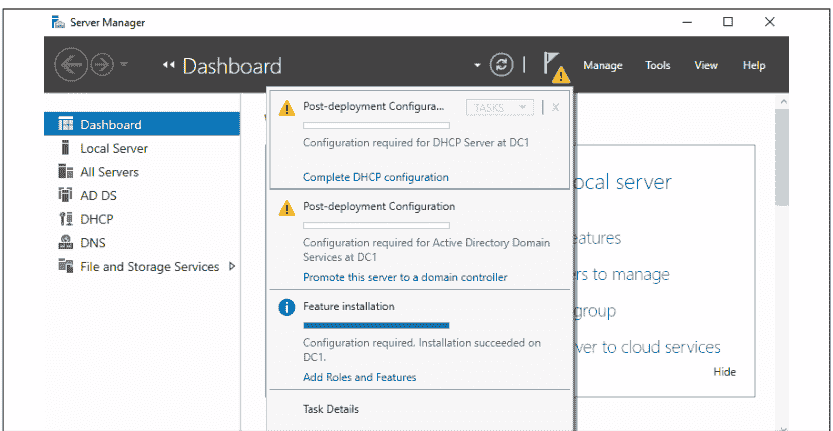

图 2.12：部署后配置

## 使用 PowerShell 安装功能

现在您已经看到了安装角色和功能的图形向导，您当然始终可以使用它们将这些组件部署到服务器上。但微软在创建 Windows Server 环境方面投入了大量精力，使得操作系统内的几乎任何内容都可以使用 PowerShell 进行操作，而添加角色和功能也包含在这些功能中。让我们看看我们可以使用哪些适当命令直接从 PowerShell 提示符操作服务器上的角色和功能。我们将查看可用的角色和功能列表，并发出命令在服务器上安装一个快速功能。


打开一个提升权限的 PowerShell 提示符，最简单的方法是通过右键单击“开始”按钮访问的快速管理员任务菜单。然后使用以下命令查看我们可以安装到服务器上的所有可用角色和功能。它还会显示其中哪些已安装：

```
Get-WindowsFeature
```

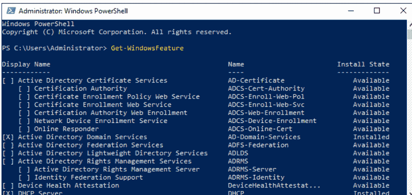

图 2.13：所有可用且已安装的角色和功能列表

我想在这台服务器上做的是安装 Telnet Client 功能。我经常使用 Telnet Client 来测试网络连接，因此在该机器上拥有它很有帮助。不幸的是，我的 PowerShell 窗口目前包含页和页的不同角色和功能，我不确定 Telnet Client 功能的确切名称以便安装它。因此，让我们再次运行 Get-WindowsFeature，但这次让我们在命令中使用一些额外的语法来减少显示的信息量。我只想查看以字母 TEL 开头的特性，如以下示例所示：

```
Get-WindowsFeature -Name TEL*
```

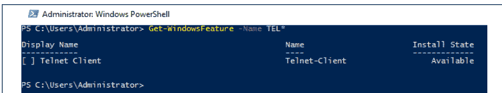

图 2.14：以字母 TEL 开头的特性列表

就是它！好的，现在我知道了特性的正确名称，让我们运行命令来安装它，如以下示例所示：

```
Add-WindowsFeature Telnet-Client
```

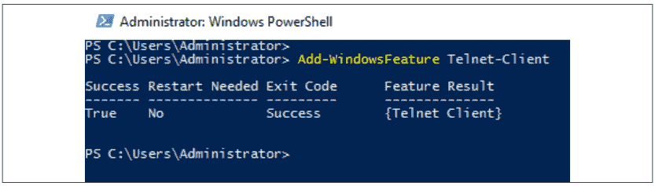

图 2.15：安装 Telnet 客户端

这里还有一件事要向你展示——还有一种方法可以操作 Get-WindowsFeature cmdlet，以便快速仅显示服务器上当前安装的角色和功能。输入 Get-WindowsFeature | Where Installed 会向我们呈现当前已安装组件的列表。如果我在我的域控制器上运行它，你可以看到我的 AD DS、DNS 和 DHCP 角色的各个部分和组件，以及我新安装的 Telnet Client 功能，如图 2.16 所示：

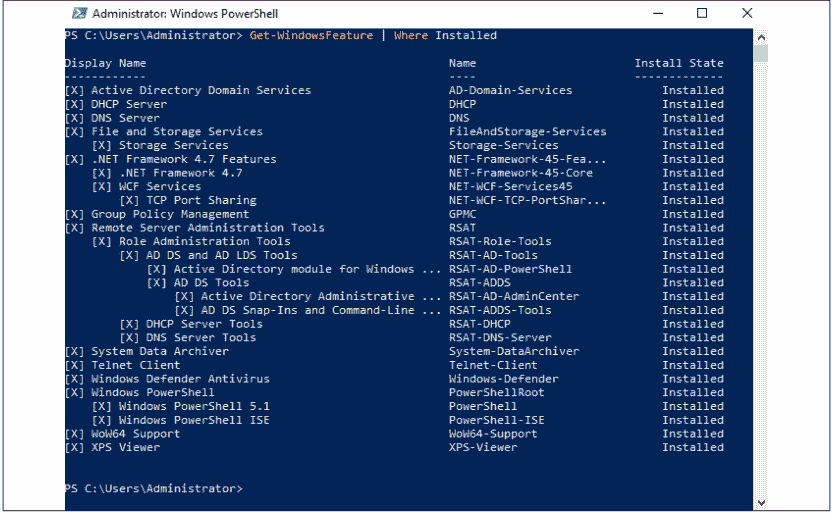

图 2.16：所有已安装组件的列表

## 集中化管理和监控

无论您是在安装新角色、运行备份和维护程序，还是排查和修复服务器，常识告诉我们首先要做的是直接登录到您需要操作的服务器。很久以前，这意味着走到服务器本身，使用直接连接到该硬件的键盘和鼠标登录。然后，在相当多年前，这变得麻烦，技术进步到我们有了 **远程桌面协议 (RDP)** 可用。我们很快就过渡到使用 RDP 远程登录服务器。尽管它已经存在多年，RDP 仍然是一个非常强大且安全的协议，使我们能够从办公桌的舒适环境中快速连接到服务器。而且，只要您拥有适当的网络拓扑和路由在 place，就可以在世界另一半的服务器上工作，就像坐在您隔壁隔间的那台一样。事实上，我最近读到采矿权正在外太空授予。谈谈您数据中心的同地部署！也许有一天我们将使用 RDP 连接到外太空的服务器。虽然这在我们有生之年可能有些牵强，但我每年有机会与数十家新公司合作，而且，虽然有一些其他工具可用于远程管理您的服务器基础设施，但 RDP 是我们 99% 人选择的平台。

为什么要谈论 RDP？因为你们可能每天都在使用它，我需要让你们知道 Windows Server 2019 包含了一些工具，使其在我们日常工作流程中变得不那么必要。服务器世界中集中化管理的理念在最近几次 Windows Server 操作系统发布中一直在增长。我们中的大多数人运行的服务器太多，每天检查所有服务器会消耗太多时间。我们需要一些工具来使我们的管理和监控，甚至配置流程更加高效，以便腾出时间用于更重要的项目。

## 服务器管理器

如果您最近使用过 Windows Server，您熟悉登录任何服务器后会自动在桌面上方弹出一个大窗口的想法。这个自动启动的程序是 **服务器管理器**。顾名思义，它在这里帮助您管理服务器。然而，根据我的经验，大多数服务器管理员并未利用服务器管理器。相反，他们会尽快关闭它，并在心里咒骂它，因为它在过去 10 年里每次服务器登录时都会弹出并烦扰他们。

别再这样做了！它在这里帮助你，我保证。图 2.17 显示了我新域控制器上服务器管理器的默认视图：

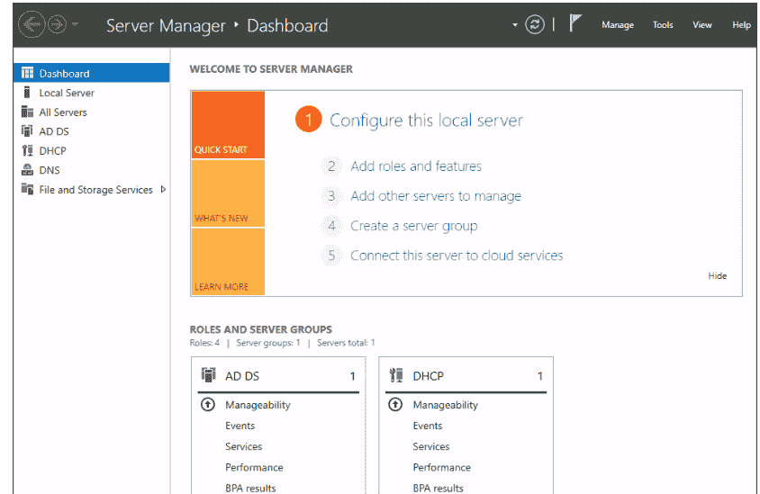

图 2.17：我域控制器上的服务器管理器

我喜欢它自动打开的原因是它让我快速了解服务器上当前安装了什么。查看左侧的列会显示已安装的角色列表以及可供管理的角色。单击这些角色中的每一个都会带您进入该角色的更具体的配置和选项。我在处理项目时经常在许多不同的服务器之间来回切换，保留服务器管理器打开可以让我快速核实我正在操作的是否是正确的服务器。底部的角色和服务器组部分也非常有趣。如果您正在阅读本书的印刷版，可能无法看到图片中的颜色，但这可以让您快速查看服务器上运行的服务是否正常运行。现在，我的 AD DS 和 DHCP 功能都正常运行，我可以看到它们上面有一条漂亮的绿色条。但如果这些角色中的任何一个出现问题，它将被标记为鲜红色，我可以单击这些角色标题下列出的任何链接来追踪问题所在。

在右上角附近，您会看到几个菜单，其中对我来说最有用的是 **工具** 菜单。单击它，您会看到在此服务器上启动的所有可用 **管理工具** 的列表。是的，这基本上是存在于每个先前 Windows Server 版本中的同一个管理工具文件夹，现在存储在不同的位置。根据我的经验，服务器管理器现在是从单个位置访问这些众多工具的最简单方法：

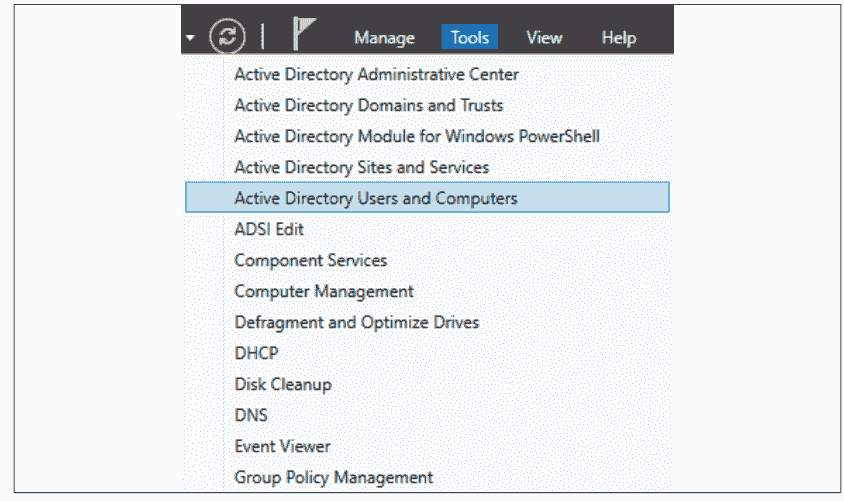

图 2.18：服务器管理器中的“工具”菜单

到目前为止，我们讨论的服务器管理器中的功能在任何 Windows Server 2019 安装上都可用，无论是独立还是域的一部分。我们所做的一切都只涉及我们登录的本地服务器。现在，让我们探索服务器管理器中为跨多台服务器集中化管理提供的选项。管理多台服务器的这种新思维通常被称为 *从单一玻璃窗管理*。我们将使用网络中其中一台服务器上的服务器管理器来连接到其他服务器，完成后，服务器管理器内部应该有更多信息供我们跟踪所有这些服务器。

**服务器管理器** 控制台正中央的部分标题为 **欢迎使用服务器管理器**。在它下面，我们有一系列可以单击的步骤或链接。第一个允许您配置仅适用于此本地服务器的设置。我们在向服务器添加新角色时已经对第二步做了一些工作。现在我们将测试第三步，**添加要管理的其他服务器。**

顺便说一下，此功能也可以通过单击顶部的 **管理** 菜单，然后选择 **添加服务器** 来调用，如图 2.19 所示：

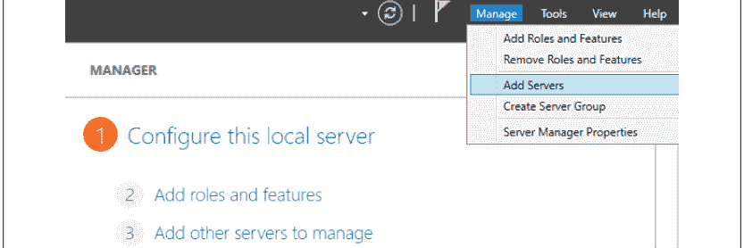

图 2.19：添加服务器

你们中的大多数人将在域环境中工作，其中服务器都加入了域，这使得下一步变得非常容易。只需单击 **立即查找** 按钮，网络中可用的机器就会显示出来。从这里，您可以选择要管理的服务器，并将它们移动到右侧的 **已选定** 列中，如图 2.20 所示：

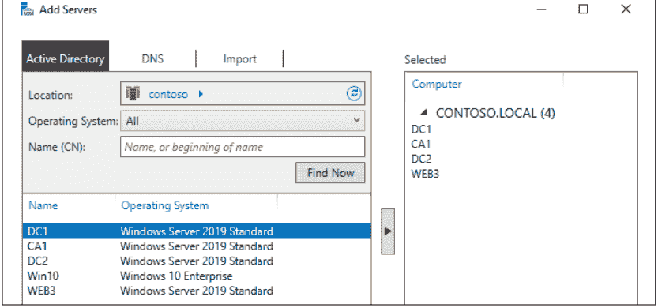

图 2.20：选择要管理的服务器


点击 **OK** 后，你会看到 Server Manager 已发生变化，以便为你提供有关这些服务器及其上安装的角色的更多信息。现在当你登录到这台单一服务器时，你会立即看到有关你在此选择的添加的 **所有** 系统的关键维护信息。你甚至可以使用一台专用服务器来处理整个服务器群的管理。例如，我目前登录到一台名为 CA1 的全新服务器。该服务器上未安装任何角色，因此默认情况下 Server Manager 看起来比较基础。一旦我添加其他服务器（我的域控制器）进行管理，我在 CA1 服务器上的 Server Manager 现在就包含了有关 CA1 和我的域控制器的所有详细信息，因此我可以从此单一面板查看我的基础设施的所有方面。如 *Figure 2.21* 所示，我这里甚至有一些标志，表明我的基础设施中某些服务未正常运行：

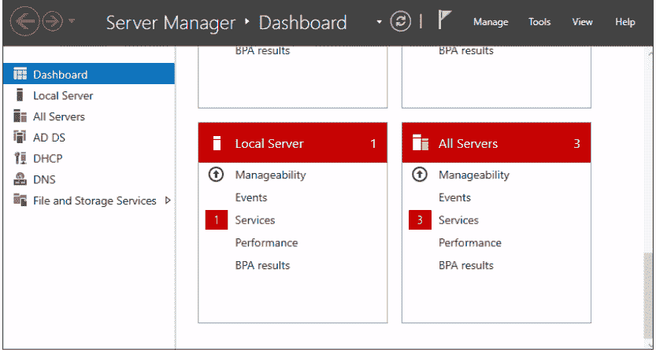

图 2.21： 在 Server Manager 仪表板上管理服务器

单击 **All Servers** 链接，或进入某个特定角色，会为你提供从这些远程服务器收集的更全面的信息。将多个服务器添加到 Server Manager 不仅对监控有用，对未来的配置也很有用。你还记得几页前我们使用向导添加新角色时吗？该过程现在已经变得更加全面，因为我们现在已将此服务器 *接入* 到网络中的其他服务器。

如果我现在从 Server Manager 内部选择添加一个能够感知网络中多个服务器的新角色，当我到达询问要在哪里安装该角色的屏幕时，我会看到我可以选择将新角色或功能安装到我的其他服务器之一，即使我没有在这些服务器的控制台上工作，如 Figure 2.22 所示：

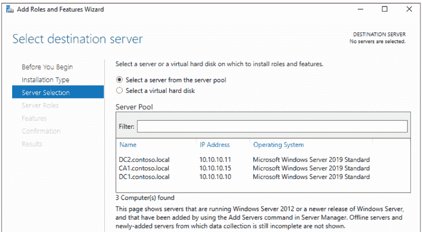

图 2.22： 选择要安装新角色或功能的服务器

如果我想将 AD DS 角色安装到 DC2 上，即我正在准备作为环境中第二台域控制器的服务器，我就不需要登录到 DC2 服务器。在这里，从运行在 CA1 上的 Server Manager 中，我可以运行 Add Roles 向导，将 DC2 定义为我想要操作的服务器，并直接从这里安装该角色。

## 远程服务器管理工具 (RSAT)

在单台服务器上使用 Server Manager 来管理和监控所有服务器非常方便，但如果我们能再进一步呢？如果我告诉你，你不必登录任何服务器，而是可以从桌子上的电脑执行所有这些任务呢？

这可以通过安装 Microsoft 提供的一套工具来实现，称为远程服务器管理工具 (RSAT)。我有一台普通的 Windows 10 客户端电脑在线运行在我们的网络中，并且已加入域。我现在将向这台 Windows 10 电脑添加一个可选功能以提供 RSAT 工具集。

在客户端电脑上打开 **Settings**，并在搜索栏中输入单词 optional。呈现的选项之一将是 **Manage optional features**。继续点击它。进入可选功能后，点击 **Add a feature** 按钮。这将打开一个包含许多可选功能的列表可供选择，其中包括大量语言选项，但如果你在列表中向下滚动，最终会看到一些以 RSAT: 开头的不同条目。如果只想从这台 Windows 10 客户端使用其中一些工具，你可以在这里有选择地仅安装实际需要的管理控制台。由于这是一个测试实验室，我想要尽可能多的选项，我只需选中每个以 RSAT: 开头的项目旁边的复选框，如 Figure 2.23 所示：

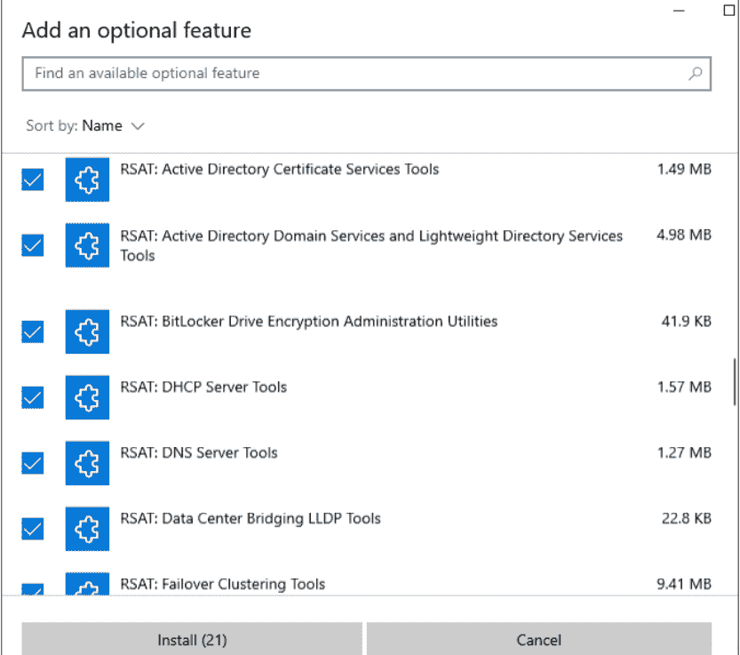

图 2.23： 安装 RSAT 功能

如果你的电脑运行的是早于 1809 的 Windows 10 版本，你将在 **Settings** 屏幕上找不到这些选项。相反，你可以从以下链接下载并安装整个 RSAT 包：https://www.microsoft.com/en-us/download/details.aspx?id=45520。

在完成将这些工具安装到我的 Windows 10 客户端电脑的过程后，我似乎找不到任何名为 **Remote Server Administration Tool** 的程序。那是正确的。即使我们安装的这些功能名称都以 RSAT 开头，被安装到你系统上的组件实际上是 Windows Server 系统工具。如果你浏览你的 **Start** 菜单，你现在会找到 **Server Manager**，就像在服务器上一样，还有一个装满 Windows 管理工具的文件夹！这说得通，只是如果你没有意识到名称上的差异，可能需要花几分钟时间来弄清楚为什么找不到你刚刚安装的内容。

所以，继续通过在 **Start** 菜单中找到它，或使用搜索栏，甚至说 *嘿 Cortana，打开 Server Manager* 来启动 Server Manager。抱歉，我忍不住。但无论你的方法如何，在你的桌面电脑上打开 Server Manager，你会看到它看起来和感觉都与 Windows Server 2019 中的 Server Manager 一样。而且，就像你在服务器操作系统内部使用和操作它一样，你可以在这里采取相同的步骤来添加你的服务器进行管理。

在 *Figure 2.24* 中，你可以看到我已完成 **Add other servers to manage** 步骤并选择了一些在我的测试网络中的服务器。我现在可以直接从我的 Windows 10 客户端电脑访问，以管理和监控实验室中的所有服务器，而无需登录它们：

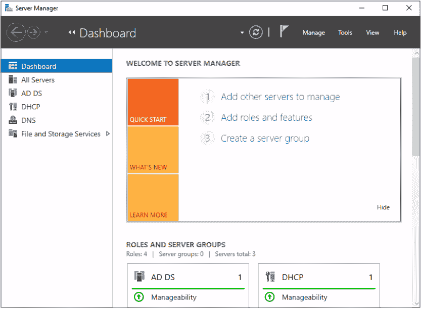

图 2.24： 通过 Server Manager 实现集中管理

## 这是否意味着 RDP 已死？

随着这些新改进的管理方式，可以在无需直接登录服务器的情况下管理服务器的底层组件，这是否意味着我们老朋友 RDP 要消失了？当然不是！即使我们全力使用更新的管理工具，我们仍然有时需要直接访问服务器。而且我也预计许多管理员仍将继续使用 RDP 和基于完整桌面的访问来管理监控他们的所有服务器，仅仅因为他们更习惯于此，即使现在存在更新、更高效的方式来完成相同的任务。

## 远程桌面连接管理器

由于我们大多数人仍然偶尔（或经常）在服务器之间切换时使用 RDP，让我们快速看一下一个可以使此任务更易于管理和集中的工具。我不会花太多时间查看该工具的各个功能或能力，因为它是一个客户端工具，而不是 Windows Server 2019 特有的东西。你可以使用它来处理任何和所有服务器的 RDP 连接，甚至是你网络中的所有客户端电脑。远程桌面连接管理器是一个非常有用的平台，用于存储你在环境中建立的所有不同 RDP 连接。你可以保存连接，这样就不用花费时间尝试记住服务器名称，对服务器进行分类，甚至存储凭据，这样在连接服务器时就不用输入密码了。尽管对此应附带免责声明——如果你选择使用密码存储功能，你的安全人员可能不会高兴。

不幸的是，我无法再为你提供该工具的 Microsoft 下载链接，因为官方 Microsoft 的立场是他们不再对远程桌面连接管理器进行改进，你应该改用内置的 MSTSC 程序或来自 Microsoft Store 的通用远程桌面客户端应用程序。在此刻，这些工具集的功能相比 RDCM 曾经提供的有限，因此我将由你决定你更喜欢追求哪一个。如果你在线搜索，仍然有很多方法可以找到 RDCM 安装程序。然而，你应该知道，它被停用并从 Microsoft 自己的下载页面中移除的原因是 RDCM 工具中存在安全漏洞。该漏洞需要攻击者说服你，管理员，在你的电脑上启动一个 RDG 文件，这将允许攻击者从你的电脑中提取数据。因此，风险取决于你是否认为自己可以永远避免这样做。以下是 RDCM 工具的屏幕截图，以便你了解它的外观和感觉：

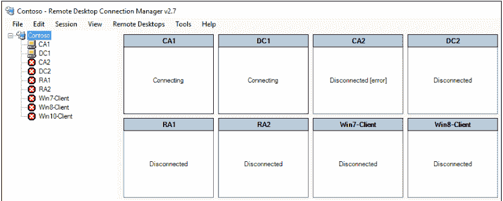

Figure 2.25: RDCM 工具

我差点因安全漏洞以及官方下载不再可用而从书中删除了整个章节。最后，我决定保留它，并非要对你应该怎么做做出任何官方建议，而是至少传达这样一个想法：当你需要处理大量不同的服务器时，你有快速便捷的 RDP 连接管理选项可用。有很多替代的第三方工具集可以实现同样的功能，因此虽然微软提供的远程桌面连接管理器已不再正式提供，但仍有其他公司编写的免费和付费应用程序可以执行相同的任务。

## Windows 管理中心 (WAC)

现在忘掉我刚才关于远程服务器管理的那些话，转而关注这里。我开玩笑的……有点。我已经讨论过的所有工具仍然稳定、相关，并且是与你的众多 Windows 服务器交互和管理的好方法。然而，有个新成员出现了，微软预计它会非常受欢迎。

Windows 管理中心 (WAC) 是一个服务器和客户端管理平台，旨在帮助你更高效地管理机器。这是一个基于浏览器的工具，意味着安装后，你可以通过 Web 浏览器访问 WAC，这很棒。无需在工作站上安装管理工具或应用程序——只需坐下并通过 URL 访问即可。

WAC 可以管理你的服务器（一直追溯到 Server 2008 R2）、你的服务器群集，甚至具有管理超融合基础设施群集的特殊功能。你可以管理本地托管的服务器以及 Azure 内部的服务器，甚至可以管理 Windows 10 版本的客户端机器。

> 这样一个令人惊叹、功能强大的工具要多少钱？免费！

Windows 管理中心甚至支持第三方厂商为 WAC 界面创建扩展，因此该工具将继续发展。如果你一直跟着书中到目前为止的测试实验室配置，你会从每次打开服务器管理器时弹出的窗口中认出“Windows 管理中心”这个词。微软如此迫切地希望管理员了解 WAC，以至于他们在每次登录 Server 2019 系统时都会提醒你应该开始使用它，如图 2.26 所示：

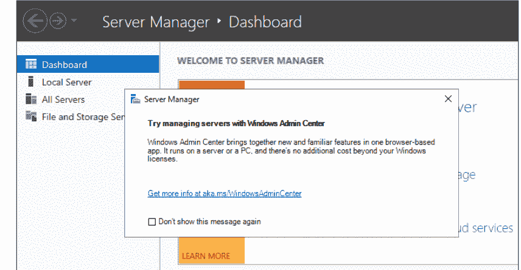

Figure 2.26: 即使是服务器管理器也推荐使用 WAC

## 安装 Windows 管理中心

够了，闲话少说，让我们试试！首先，我们需要选择一个安装 WAC 组件的位置。没错，我确实说过其中一个好处是我们不需要安装客户端软件组件，但我的意思是，一旦 WAC 部署完成，访问它就像打开浏览器一样简单。那个网站需要在某个地方安装并运行，对吧？虽然你可以把整个 WAC 系统放到 Windows 10 客户端上，但让我们采用在现场更常用的方法，将其安装到网络中的一台服务器上。我有一台名为 WEB3 的系统，目前还没有承载任何角色或网站；它现在只是一台空服务器。听起来很适合放置这类东西。

从这里下载 WAC：https://www.microsoft.com/en-us/windows-server/windows-admin-center.

下载完成后，只需在主机上运行安装程序即可。向导中有几个简单的决定需要做出，最值得注意的是定义端口和证书设置的那一屏。在生产环境中，最好运行 443 端口并在此处提供有效的 SSL 证书，以便通过 HTTPS 正确保护到此网站的流量往返，但对于我的小测试实验室，我将使用自签名证书运行 443，仅用于测试目的。不要在生产环境中使用自签名证书！

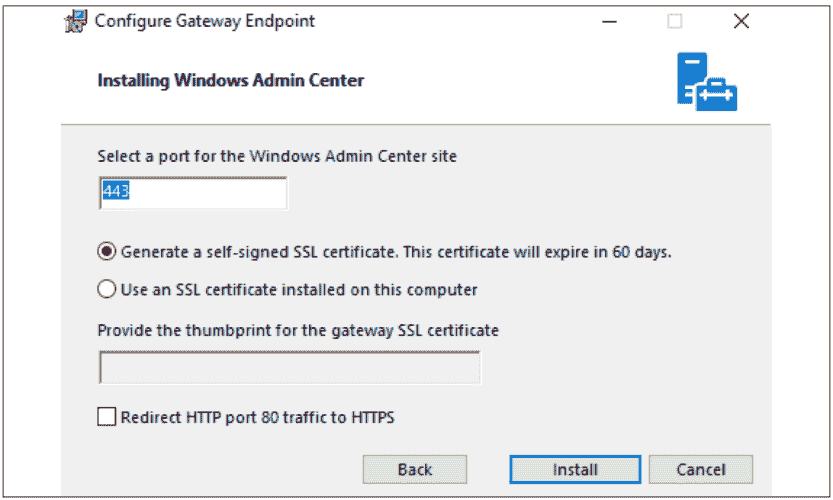

Figure 2.27: 安装 WAC

安装程序完成后，你现在将在这台服务器上托管 Windows 管理中心网站。对于我的特定安装，该新 Web 地址是 https://WEB3.contoso.local。

## 启动 Windows 管理中心

现在是好玩的部分，试试这个东西。要访问 Windows 管理中心，你只需从网络中的任何机器打开受支持的浏览器并浏览到 WAC URL。我的仍然是 https://WEB3.contoso.local。有趣的是，Internet Explorer 不是受支持的浏览器。微软推荐 Edge，但 Chrome 也可用。我已登录我的 Windows 10 工作站，并将简单地打开 Edge 浏览器并尝试访问我的新站点，如图 2.28 所示：

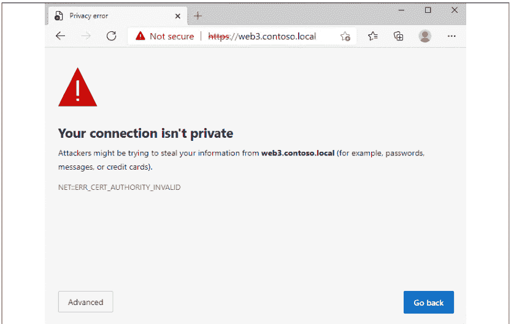

Figure 2.28: 在 Microsoft Edge 中打开 WAC URL

如你所见，我遇到了证书警告。这是可以预期的，因为我使用的是自签名证书，再次强调，这是一个坏主意。我之所以这样做，是因为我在测试实验室中运行。既然我预计会出现这种情况，并且今天为我们的目的接受这种风险，我可以点击“高级”按钮，然后点击“继续前往 web3.contoso.local”链接以继续。有趣的是，我现在被提示输入凭据：

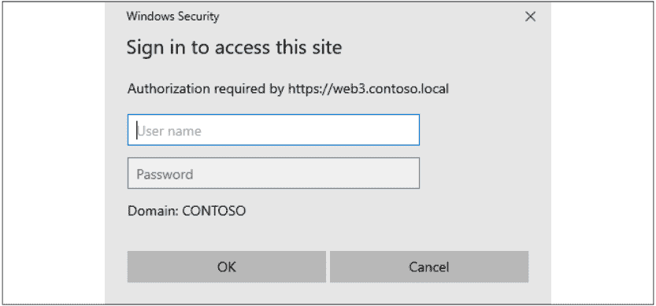

Figure 2.29: 登录以使用 WAC

即使我已登录到加入域的 Windows 10 计算机，并且使用域凭据登录，WAC 网站也不会自动尝试为其自身使用注入这些凭据，而是暂停并询问你的身份。如果我在此处简单输入我的域凭据，我现在就会看到 Windows 管理中心界面，如图 2.30 所示：

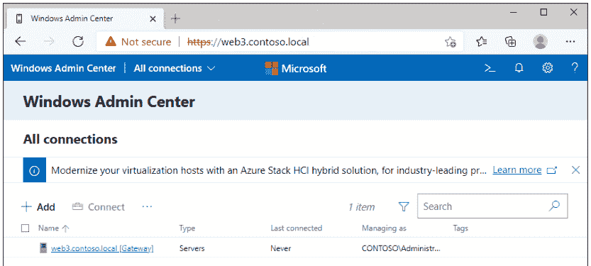

Figure 2.30: WAC 界面

## 向 Windows 管理中心添加更多服务器

登录 WAC 很棒，但在你添加一堆想要管理的机器之前并不太有用。要做到这一点，只需点击屏幕上显示的 + 添加按钮。你将被提示添加新服务器、新 PC、Windows Server 故障转移群集、Azure Stack HCI，甚至 Azure VM。做出选择并输入所需信息。我在测试实验室中还没有任何群集，至少目前还没有，所以我将添加我一直在环境中运行的标准服务器连接。如果我选择添加 Windows 服务器的选项，我可以输入单个服务器名称、导入服务器名称列表，甚至可以选择搜索 Active Directory。我将继续尝试该搜索功能，以测试其效果如何。我已经在实验室中设置了许多不同的服务器并将它们加入了我的域（我们将在下一章更详细地讨论域）——但我如何让 WAC 在这里搜索它们呢？当我点击搜索 Active Directory 时，我仍然会看到一个要求输入服务器名称的字段，但有一条关于允许使用通配符的说明。啊哈！如果你只是在搜索字段中输入一个星号 (*) 并点击搜索按钮，Windows 管理中心将轮询你的域并呈现可以添加到控制台的机器完整列表：

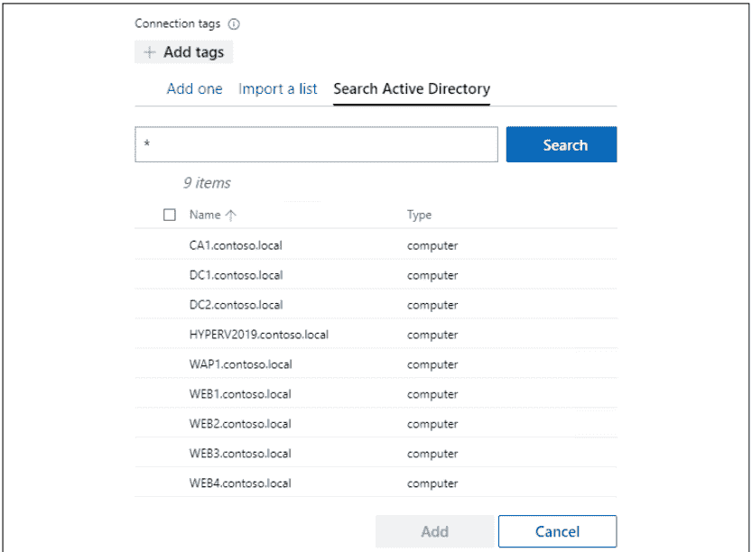

Figure 2.31: 使用 * 搜索

现在只需选择你希望通过 Windows 管理中心管理的每个服务器旁边的复选框，然后点击 **Add** 按钮。你可以在 *Figure 2.32* 中看到 WAC 现在包含有关我环境中所有服务器的信息：

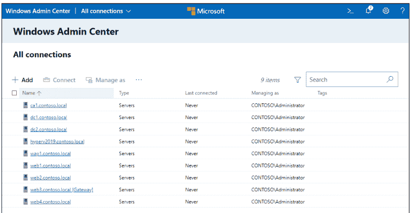

Figure 2.32: WAC 中的服务器信息

## 使用 Windows 管理中心管理服务器

从 WAC 中开始管理服务器只需点击服务器名称即可。如图 2.33 所示，我选择了我的 DC1 服务器，因为它目前是唯一安装并运行了一些实际角色的机器：

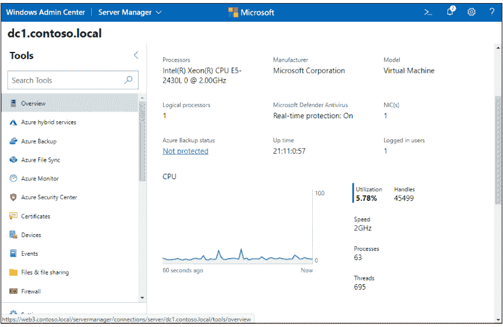

Figure 2.33: DC1 服务器信息

从此界面，我可以管理 DC1 服务器操作系统许多不同的方面。有电源控制功能，可以在服务器上运行备份，我甚至可以从这里查看和安装证书！你可以监控服务器性能、查看其事件日志、操作本地 Windows 防火墙，并启动到服务器的远程 PowerShell 连接。Windows 管理中心的目标是成为远程管理服务器的一站式商店，我认为它正朝着这一目标稳步前进。

我还没有在实验室中运行任何 Server Core 实例，但请放心，WAC 可以像管理运行桌面体验的服务器一样管理 Server Core 实例。这使得 Windows 管理中心对服务器管理员来说更加强大和有趣。当我们进入 Server Core 章节时，我们将确保回到这个想法，并以某种方式通过此 Windows 管理中心控制台操作一个 Server Core 实例。


## 更改易如反掌

从像 WAC 这样单一位置监控服务器信息非常棒且功能强大，但 WAC 最酷的部分在于你也可以通过此 Web 界面直接对服务器进行实质性的操作。这又是另一个可以为服务器添加角色或功能、创建计划任务、启动或停止服务，甚至执行诸如编辑注册表和添加 Windows 防火墙规则等操作的地方。让我们对 DC1 服务器做一个快速更改来验证这一点。我所有的虚拟机都位于在 Hyper-V 中运行的测试实验室内，因此到目前为止与服务器的交互都是直接通过 Hyper-V 控制台会话进行的。基本上就像每次需要与它们交互时，我都要走到这些服务器前并从控制台登录一样。此时，DC1 上从未启用过 RDP，但我想知道是否可以轻松地从 Windows Admin Center 内部启用它？

在 WAC 左侧工具列表中向下滚动时，我突然发现了一个名为 Remote Desktop 的工具。听起来就是该去的地方！点击 Remote Desktop 后会旋转一秒钟，WAC 在此期间会联系并查询 DC1 的信息。然后我会看到一个摘要，显示“Remote desktop connections are not allowed to this computer”，并有一个按钮可让我前往设置。在远程桌面设置屏幕中，我在这里看到的选项与我直接登录 DC1 并从经典高级系统属性屏幕中编辑远程桌面设置时看到的选项相同。你可以在图 2.34 中看到，我现在已选择“允许远程连接到此计算机”选项——之前此选项未启用：

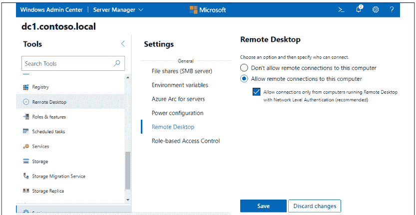

Figure 2.34: 远程桌面设置

只需在此处更改设置并单击“保存”按钮，Windows Admin Center 就会联系 DC1 并启用此远程桌面设置，之后我就可以立即使用我的 Windows 10 计算机通过 RDP 连接到它。我从未需要登录 DC1 即可启用对 DC1 的远程登录！

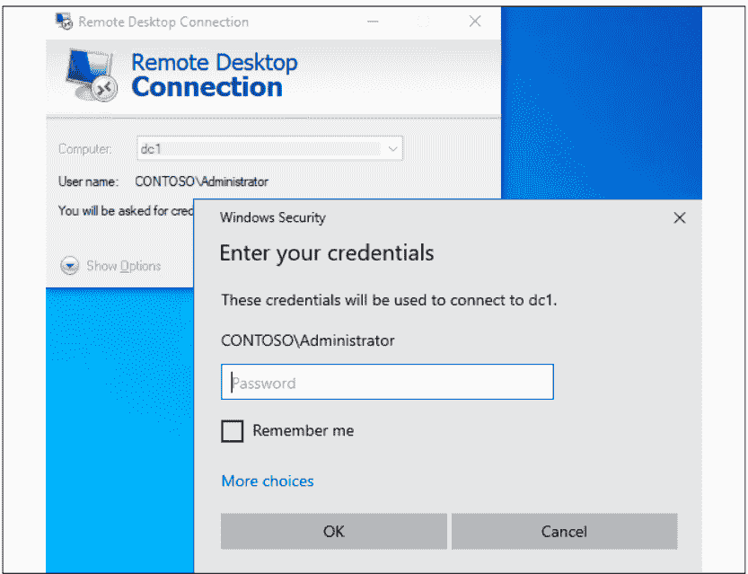

Figure 2.35: RDP 现已启用

## Azure 集成

你会注意到 WAC 内部有许多与 Azure 相关的工具。如果你拥有 Azure 环境或正在考虑开始使用 Azure，你的本地 Windows Admin Center 可用于管理本地服务器以及 Azure 服务器。WAC 还可通过 Azure 文件同步和 Azure 备份等功能将本地环境与 Azure 环境绑定在一起。这些工具可以成为创建混合云配置的强大方式，在该配置中你在两个环境中都维护服务器，并且还可帮助你从传统数据中心向纯云思维过渡。

## 使用 Sysprep 实现快速服务器部署

在本章开头，我们介绍了将 Windows Server 2019 操作系统安装到新服务器上的过程。无论是物理硬件还是我们正在使用的虚拟机，安装过程本质上都相同。插入 DVD 或 USB 闪存驱动器，从其启动并让安装程序运行是很容易做到的，但如果需要构建十台新服务器而不是一台怎么办？这个过程很快就会变得乏味，似乎你在重复做完全相同的事情而浪费了大量时间。你是对的——这确实浪费了大量时间，只要你从相对相似的硬件平台构建所有服务器，就有更简单、更快速的新服务器部署方式。如果你将服务器构建为虚拟机，这在当今很常见，那么此过程效果很好，可以为新服务器构建节省相当多的时间。

现在，在我深入描述 Sysprep 过程之前，我还要指出，Windows 基础设施中还有更复杂的可用技术，可实现自动化操作系统和服务器部署，使新服务器部署过程比我在此描述的还要简单。一些自动化技术的问题在于，使其正常工作所需的基础设施比许多刚开始学习 Windows Server 的人所能接触到的更为先进。换句话说，对于小型环境或测试实验室来说，拥有完全自动化的服务器部署机制并不太可行，而我们学习这些新技术时很多人就生活在这样的环境中。

所以，无论如何，我们不会专注于服务器部署的自动化方法，而是会在第一台服务器上多花几分钟的工作，然后在之后构建的每台服务器上节省大量设置时间。此过程的核心是 **Sysprep** 工具，它内置于所有版本的 Windows 中，因此你可以在任何当前 Windows 机器上使用此相同过程，无论是客户端还是服务器。

**Sysprep** 是一个为系统复制做准备的工具。它的正式名称是 **Microsoft System Preparation Tool**，用一句话概括其功能，它允许你创建服务器的主 *image*，可重复使用任意多次以部署额外的服务器。使用 Sysprep 的一个关键好处是，你可以在主服务器上设置自定义设置并在 Sysprep 之前安装诸如 Windows 更新之类的内容，所有这些设置和补丁随后都会存在于主映像中。

使用 Sysprep 可通过免除操作系统安装过程为你节省时间，但它还能通过免除等待 Windows Update 将所有当前补丁推送到你创建的每个新系统上来为你节省更多时间。

现在，有些人可能会想知道 Sysprep 到底为什么必要。如果你想克隆主服务器，你可以简单地使用硬盘映像工具，或者，如果你处理的是虚拟机，你可以简单地复制并粘贴 .VHDX 文件本身来制作新服务器的副本，对吧？答案是肯定的，但大问题是，你刚刚创建的新映像或硬盘将是原始映像的精确复制品。主机名将相同，更重要的是，Windows 内部的一些核心识别信息，例如操作系统的 **security identifier (SID)** 编号，将完全相同。如果你同时启动原始主服务器和基于此精确复制品的新服务器，你将导致网络冲突和碰撞，因为这两个服务器会争夺成为具有该唯一名称和 SID 的唯一服务器的权利。这个问题在域环境中会加剧，在域环境中，确保网络中每个系统具有唯一的 SID/GUID——它们在 Active Directory 中的标识符——更为重要。如果你创建服务器的精确副本并同时将其上线，姑且说两者都不会对此感到高兴。如果你在此生产环境中这样做，你可能会对网络造成严重破坏。我从个人经验中知道，在域控制器的硬盘被简单复制、粘贴并作为第二台服务器启动后，帮助某人恢复其域的情况是什么样的。这就是糟糕一天的定义。

Sysprep 通过随机化操作系统中的唯一标识符来修复系统复制过程中的所有固有问题。为了准备使用 Sysprep 创建的主映像部署许多服务器，以下是我们将采取的步骤的快速参考摘要：

- 1. 在新服务器上安装 Windows Server 2019
- 2. 在新服务器上配置自定义设置和更新
- 3. 运行 Sysprep 以准备并关闭主服务器
- 4. 创建驱动器的主映像
- 5. 使用主映像的副本构建新服务器

现在让我们更详细地介绍这些步骤。


## 在新服务器上安装 Windows Server 2019

首先，就像你已经做过的那样，我们需要通过安装 Windows Server 2019 操作系统来准备我们的第一台服务器。请避免在服务器上安装任何完整的角色，因为根据角色及其独特配置，我们稍后运行的 Sysprep 过程可能会导致单个角色配置出现问题。安装操作系统并确保所有设备驱动程序都已就绪，然后即可进入下一步。

## 在新服务器上配置自定义设置和更新

接下来，你需要在新服务器上配置自定义设置并安装操作系统更新。你现在可以做的、适用于服务器批次的通用设置或安装，将使你在未来不必在服务器上重复此步骤。这部分可能有点令人困惑，因为我刚才才告诉你不要在主服务器上安装角色。这是因为角色安装会在操作系统中进行大量更改，并且你可以安装的一些角色会将自己锁定到系统上运行的特定主机名。如果你对主服务器做类似的事情，该角色在新服务器上启动时很可能会损坏。你可以在主服务器上实施的自定义设置包括诸如插入你可能希望在所有服务器上都有的文件和文件夹，例如 Admin Tools 文件夹之类的东西。你还可以启动或停止你可能希望在每台服务器上运行或不运行的服务，并在注册表中更改设置，如果这是你正常的服务器准备或加固流程的一部分。无论你实施了哪些更改或自定义设置，对从此主映像构建的第一台新服务器运行全面的测试套件都是一个不错的主意，以确保你的所有更改都通过了 Sysprep 过程。

现在也是让 Windows Update 安装并在新服务器上应用你希望将来安装在所有新服务器上的任何补丁的时候。没有什么比安装新操作系统只需 5 分钟，却必须坐等 4 小时让所有当前更新和补丁安装完成才能使用新服务器更令人沮丧的了。通过将所有这些更新和补丁包含在主映像中，你可以为每次启动的新服务器节省所有下载和安装时间。

> 通过每隔几个月创建主映像的新副本来继续为自己节省时间和精力。这样，最新的补丁始终包含在主映像中，并且在 Windows Server 2019 的整个生命周期中会继续为你节省越来越多的时间。

## 运行 Sysprep 准备并关闭主服务器

现在我们的主服务器已按我们想要的方式准备好，是时候运行 Sysprep 工具本身了。为此，打开一个具有管理员权限的命令提示符并浏览到 C:\Windows\System32\Sysprep。现在你可以使用该文件夹中的 Sysprep.exe 实用程序来启动 Sysprep 本身。

与从命令提示符运行的许多可执行文件一样，你可以在命令末尾添加各种可选开关以使其执行特定任务。从你的命令提示符窗口，如果你只运行 sysprep.exe 命令，你将看到 Sysprep 的图形界面，在其中可以选择可用选项，如图 2.36 所示：


图 2.36：Sysprep 选项

由于我总是为 Sysprep 使用相同的选项集，我发现直接从命令行输入中包含所有可选开关更容易，因此完全绕过了图形界面。以下是可与 sysprep.exe 一起使用的不同开关的一些信息：

- `/quiet`：这告诉 Sysprep 在不显示屏幕状态消息的情况下运行。
- `/generalize`：这指定 Sysprep 要从 Windows 安装中删除所有唯一的系统信息（SID），使最终映像可在网络中的多台机器上使用，因为从映像启动的每个新机器都会获得一个新的、唯一的 SID。
- `/audit`：这将机器重新启动到特殊的审核模式，在该模式下，你可以在最终映像被捕获之前选择向 Windows 添加其他驱动程序。
- `/oobe`：这告诉机器在 Windows 下次启动时启动迷你设置向导。
- `/reboot`：Sysprep 完成后重新启动。
- `/shutdown`：Sysprep 完成后关闭系统（不是重新启动）。这是一个重要项，也是我通常使用的项。
- `/quit`：Sysprep 完成后关闭 Sysprep。
- `/unattend`：你可以创建一个特殊的应答文件，当指定时，它将与 Sysprep 过程一起使用，以进一步配置新服务器使其上线。例如，你可以在此应答文件中指定在 Sysprep 后的首次 Windows 启动时启动某个特定的安装程序或批处理文件。这对于你可能想要执行的任何类型的清理任务都很有用，例如，如果你的系统上有一个批处理文件，你用它在新服务器首次启动后刷新日志文件。

对于我们想要创建可在未来快速部署服务器时使用的主映像文件这一目的而言，最重要的两个是 `/generalize` 开关和 `/shutdown` 开关。`/generalize` 非常重要，因为它会替换上线的新 Windows 副本中的所有唯一标识信息，即 SID 信息。这允许你的新服务器与原始服务器以及你上线的其他新服务器在网络中共存。`/shutdown` 开关也很重要，因为我们希望此主服务器完成 Sysprep 后立即关闭，以便我们可以从中创建主映像。


> 确保你的服务器在创建主映像或获取 .VHDX 文件的主副本之前不要再次启动到 Windows。Windows 第一次启动时会注入新的 SID 信息，而你希望这仅发生在基于新映像创建的新服务器上。

所以，与其把所有开关都抛给你让你自己决定，不如让我们看看我通常使用的那些。我将使用 /generalize 使我的新服务器唯一化，我也喜欢使用 /oobe，以便在我的任何新系统上 Windows 首次启动时启动迷你设置向导。然后，我当然也会使用 /shutdown，因为我需要在 Sysprep 后立即让此服务器离线，以便我可以复制硬盘以用作主映像。因此，我的完整优化的 sysprep 命令如下所示：

```
sysprep.exe /generalize /oobe /shutdown
```

启动此命令后，你将看到 Sysprep 在 Windows 内进行一些处理，几分钟后，你的服务器将自行关闭，如图 2.37 所示：


图 2.37：Sysprep 和关机

你现在可以从此硬盘创建主映像了。

## 创建驱动器的主映像

我们的主服务器现在已关闭，我们已准备好从此服务器创建主映像。如果是物理服务器，你可以使用任何硬盘映像实用程序从驱动器创建映像文件。像 Acronis 公司提供的映像实用程序会从你的驱动器创建一个单一文件。此文件包含整个磁盘的映像，你将来可以用它恢复到新服务器中的全新硬盘上。另一方面，你们大多数人可能在日常工作中最常处理的是虚拟服务器，而在虚拟世界中准备新服务器甚至更容易。


一旦我们的主服务器已进行 Sysprep 并关闭，你只需复制 .VHDX 文件。登录到你的 Hyper-V 服务器，复制并粘贴硬盘文件，就完成了。此新文件可以重命名为 WS2019_Master_withUpdates.VHDX，或你想要的任何名称，以便帮助你跟踪此映像文件的当前状态。将此映像文件或 .VHDX 文件的副本保存在网络上的安全位置，以便在需要启动新的 Windows Server 2019 时能够快速获取其副本。

## 使用主映像副本构建新服务器

现在到了简单部分。当你将来想要创建新服务器时，你只需将主文件复制并粘贴到新服务器的新位置，重命名驱动文件以适合你要创建的服务器，然后从中启动新的虚拟机。这就是 Sysprep 节省时间带来的真正好处所在，因为你现在可以通过快速复制并粘贴主映像文件并从这些新文件启动所有新服务器，同时启动许多新服务器。无需安装 Windows 或拿出那张尘封的安装 DVD！

当新服务器首次打开并启动到 Windows 时，它们将运行开箱即用体验、迷你设置向导。此外，在后台，操作系统会为自己分配一个新的随机且唯一的计算机名称和 SID 信息，这样你就可以确保这些新服务器在网络上不会发生冲突。

> 从已进行 Sysprep 的映像文件创建的新服务器在启动时总是会获得一个新的计算机名称。这经常让管理员感到困惑，他们可能将主服务器命名为 MASTER 之类的名称。启动新服务器后，你可以预期在新服务器上看到随机名称，并且你需要根据它们在生活中的新职责对其重命名。

例如，在运行 Sysprep 并创建我的主映像之前，我正在处理的服务器名为 DC1，因为我最初打算将其用作网络中的域控制器。然而，由于我尚未在其上安装角色或配置任何域相关内容，此服务器非常适合演示 Sysprep 过程，因此我今天在本文中使用了它。我对其进行了 Sysprep，关闭它，复制了其 .VHDX 文件（作为我的主映像文件），然后重新启动 DC1。你现在可以在系统属性中看到，我又回到了随机计算机名称的状态，因此如果我仍想将此服务器用作 DC1，在它完成迷你设置启动后，我必须再次重命名它，如图 2.38 所示：


图 2.38：系统属性

希望，这个过程是有帮助的信息，可以在你自己的环境中构建新服务器时为你节省时间。下次你需要构建新服务器时，不妨去尝试一下！你可以通过保留许多不同的主映像文件来进一步利用 Sysprep 工具。也许你有几种不同类型的服务器需要定期准备——没有任何东西阻止你创建多个不同的主服务器并从这些服务器创建多个主映像。

## 摘要

任何有兴趣成为 Windows Server 管理员的人都需要熟悉安装和管理服务器，涵盖这些主题为继续前进建立了重要的基础。在当今的 IT 世界中，对新操作系统版本进行彻底测试是很常见的，这既是因为我们可以通过虚拟化技术轻松获得服务器硬件资源，也是因为大多数业务系统现在都是为 100% 的正常运行时间而设计的。这种可靠性需要对任何平台更改进行非常彻底的测试，并且为了在你的环境中完成对 Windows Server 2019 操作系统的此类测试，你将花费大量时间多次重复基本安装过程。我希望你能将本章提供的建议很好地用于在处理 Windows Server 世界中的这些任务时节省宝贵的额外时间。

多年前，由于我们可用的服务器数量有限，人们经常花费大量精力来确定哪些角色和服务可以共存。随着新的虚拟化和云范式转变，许多公司拥有几乎无限数量可以运行的服务器，这意味着我们运行了更多数量的服务器来执行相同的任务和功能。然后，这些服务器的管理和维护就成为 IT 负担，采用 Windows Server 2019 中可用的集中式管理工具和理念也将在你的日常工作中为你节省大量时间和精力。在下一章中，我们将开始深入探讨 Windows Server 环境中最常用的角色和工具，围绕 Active Directory 的核心基础设施技术。

## 问题

- 1. 微软的新基于 Web 的集中式服务器管理工具的名称是什么（有趣的事实，这个工具集以前被称为 **Project Honolulu**）？
- 2. 正确或错误 – Windows Server 2019 需要安装在机架式服务器硬件上。
- 3. 正确或错误 – 通过选择 Windows Server 2019 的默认安装选项，你将获得一个看起来很像 Windows 10 的用户界面。
- 4. 显示 Windows Server 2019 中当前已安装角色和功能的 PowerShell cmdlet 是什么？
- 5. 正确或错误 – Server Manager 可用于同时管理许多不同的服务器。
- 6. 可以安装在 Windows 10 计算机上以便在该客户端工作站上运行 Server Manager 的工具集的名称是什么？
- 7. 可以用于与 Windows Admin Center 交互的受支持的 Web 浏览器有哪些？
