# 3 Active Directory

阅读本书的每位读者都拥有不同的技能组合和对 Windows Server 环境的经验水平。如我之前提到的，能够让服务器运行操作系统是非常好的，并且是你在环境中开展实际工作的非常重要第一步。但在你了解并理解 Windows Server 2019 上可运行的主要角色背后的目的之前，你的新服务器唯一做的就是消耗电能。

服务器的用途是提供数据。它提供的数据类型以及目的完全取决于你确定服务器必须 ... 好吧 ... 提供的角色。相应地，你必须在 Windows Server 2019 中安装角色才能让它做点什么。我们已经知道如何将角色安装到服务器上，但尚未讨论这些角色背后的任何目的。在接下来的几章中，我们将开始研究我通常所说的 Windows Server 中可用的核心基础设施角色。这涉及讨论角色的一般目的，以及插入一些与这些角色相关的特定任务，这些任务是你作为服务器管理员在日常任务中负责完成的。

我们从所有本地 Microsoft 世界中最重要的角色开始，即通常所说的 Active Directory（AD），它是一种目录服务，充当一种数据库，存储并集中有关组织的各种类型信息。用户账户、计算机账户、证书、策略，甚至文件复制都是你可以在 AD 中找到的事项。

当我们查看 AD 的各个部分时，会更清楚地了解其中存储了哪些信息以及为什么它如此重要。如果你是 IT 新手且尚未很好地掌握 AD，请务必学习这项技术！AD 是几乎所有 Windows Server 世界运转的枢纽。是否可以在不将 Windows 服务器连接到 Active Directory 并加入其中的情况下使用它们？可以。你是否可能在现实世界中遇到这种场景？不会。在本章中，我们将学习以下内容：

- 什么是域控制器？
- 创建你的第一个域
- 用于冗余的多个域控制器
- Active Directory 用户和计算机
- Active Directory 域和信任
- Active Directory 站点和服务
- Active Directory 管理中心
- 只读域控制器
- 组策略

### 什么是域控制器？

如果我们要讨论构建你的 Microsoft 驱动网络所需的核心基础设施服务，没有比从域控制器开始更好的地方了。域控制器，通常称为 DC，仅仅是一台托管 Active Directory 的服务器。它是一个中央联系点，换句话说是一个“枢纽”，在网络中客户端和服务器之间几乎任何通信之前都会访问它。也许最简单的描述方式是将其视为网络中所有身份识别的存储容器。用户名、密码、计算机账户、计算机组、服务器、服务器组和集合、安全策略、文件复制服务以及许多其他内容都存储在 DC 中并由其管理。如果你不打算让域控制器成为你的 Microsoft 为中心网络中的首批服务器之一，你最好甚至不要开始构建该网络。DC 对于我们的计算机和设备如何相互通信以及与公司内部的服务器基础设施通信至关重要。


## Active Directory 域服务

如果你在读到这里时停下来去在服务器上安装域控制器角色，欢迎回来！并没有叫做域控制器的角色。提供所有这些功能的角色叫做 Active Directory 域服务，或 AD DS。这就是你需要在服务器上安装的角色。通过安装该角色，你就将服务器转变为域控制器。运行 DC 的真正目的其实是创建网络中对象的目录或数据库。这个数据库被称为 Active Directory，它是一个平台，在其中你构建分层结构来存储对象，例如用户名、密码和计算机账户。你可能会想，“我们不是刚刚用稍微不同的方式说了同样的话吗？” 你没说错。AD 很重要，我希望你能明白这一点。IT 职业生涯保证你在工作中以某种方式会与 AD 交互。

大部分时间当你听到任何人谈论“Active Directory”时，他们真正的意思很可能是指目录中的单个域。Active Directory 架构内部存在一个完整的层次结构，由林、树、域和组织单位组成。我们将在本章后面介绍你将用来与 AD 交互的工具时，讨论 Active Directory 的每个组织级别。

一旦你创建了一个可以存储账户、对象和设备的域，你就可以为员工创建用户账户和密码以用于身份验证。然后你还可以将其他服务器和计算机加入此域，以便它们可以接受并受益于这些用户凭据。拥有并加入域是“秘密酱料”，让你可以在公司内部从一台计算机走到另一台计算机，并使用自己的用户名和密码登录其中每一台，即使你从未登录过该计算机之前。更强大的事实是，它使具备目录功能的应用程序在需要身份验证信息时能够直接向 Active Directory 进行身份验证。例如，当我作为域用户使用用户名和密码在工作中登录我的计算机时，我的计算机上运行的 Windows 操作系统会联系域控制器服务器并验证我的密码是否正确。

一旦它确认我确实是我所说的那个人，它就会向我的计算机颁发一个身份验证令牌，我就可以登录。然后，一旦我进入桌面并打开一个应用程序——比如我打开 Outlook 来访问我的电子邮件——该电子邮件程序设计为联系我的电子邮件服务器，即 Exchange Server，并对其进行身份验证，以确保显示的是我自己的邮箱而不是别人的。这是否意味着我需要为 Outlook 或我从计算机打开的任何其他应用程序重新输入用户名和密码？通常不需要。而我不必一遍又一遍地重新输入凭据的原因是我的用户名、我的计算机和应用程序服务器都属于同一个域。

当这种情况成立时，而在大多数网络中确实如此，我的身份验证令牌可以在我的程序之间共享。因此，一旦我登录到计算机本身，我的应用程序就可以启动并打开，并将我的凭据传递给应用程序服务器，而无需我作为用户进行任何进一步输入。如果我们要求用户在打开他们工作所需的程序时全天每天都输入密码，那将是非常令人沮丧的体验。

Active Directory 本身是一个足够广泛的话题，足以写成一本书，事实上已经有很多书籍写过这个主题。现在我们对它是什么以及为什么在 Windows Server 环境中至关重要有了基本了解，让我们动手使用在 AD DS 角色安装过程中安装到你的域控制器上的一些工具。

## 创建你的第一个域

我必须承认我有点作弊，到目前为止为了截屏，我已经在域内工作了。我的测试实验室已经有一个 DC1 服务器正在运行，并且我已在上面配置了一个名为 contoso.local 的域。然而，说“域很重要”却不向你展示如何创建它对你这位读者没有帮助，所以我们现在要在全新的服务器上构建一个全新的域。

如果你曾经阅读过 Microsoft 的教程或示例配置文档，你可能认识“Contoso”，因为它是 Microsoft 在文档中或用于展示示例场景时经常使用的几个虚假公司名称之一。我在这里也使用它，但你可以给你的域命名为任何你想要的名称。为了设置我们的第二个域，我将从 Microsoft 的帽子里再取一个公司名称，Fabrikam。

在你能够构建域之前需要决定的第一件事之一就是域的名称。我们不想在这里深入讨论 DNS，因为还有整整一章专门讲这个，但每个人每天都在使用 DNS，无论他们意识到与否。每当你输入任何网站名称——microsoft.com、google.com、bing.com 等——你都在输入一个名称，然后 DNS 会将其转换为 IP 地址。你也知道网站名称的结尾可以有多种形式。最常见的是 .com，但你可能还会访问以 .org、.biz、.info、.tech、.edu、.mil 等结尾的网站。

让我们以 `microsoft.com` 为例。如果你只是访问 `microsoft.com`，你会看到公司的[content]
## Active Directory 域服务

如果你在读到这里时停下来去在服务器上安装域控制器角色，欢迎回来！并没有叫做域控制器的角色。提供所有这些功能的角色叫做 Active Directory 域服务，或 AD DS。这就是你需要在服务器上安装的角色。通过安装该角色，你就将服务器转变为域控制器。运行 DC 的真正目的其实是创建网络中对象的目录或数据库。这个数据库被称为 Active Directory，它是一个平台，在其中你构建分层结构来存储对象，例如用户名、密码和计算机账户。你可能会想，“我们不是刚刚用稍微不同的方式说了同样的话吗？” 你没说错。AD 很重要，我希望你能明白这一点。IT 职业生涯保证你在工作中以某种方式会与 AD 交互。

大部分时间当你听到任何人谈论“Active Directory”时，他们真正的意思很可能是指目录中的单个域。Active Directory 架构内部存在一个完整的层次结构，由林、树、域和组织单位组成。我们将在本章后面介绍你将用来与 AD 交互的工具时，讨论 Active Directory 的每个组织级别。

一旦你创建了一个可以存储账户、对象和设备的域，你就可以为员工创建用户账户和密码以用于身份验证。然后你还可以将其他服务器和计算机加入此域，以便它们可以接受并受益于这些用户凭据。拥有并加入域是“秘密酱料”，让你可以在公司内部从一台计算机走到另一台计算机，并使用自己的用户名和密码登录其中每一台，即使你从未登录过该计算机之前。更强大的事实是，它使具备目录功能的应用程序在需要身份验证信息时能够直接向 Active Directory 进行身份验证。例如，当我作为域用户使用用户名和密码在工作中登录我的计算机时，我的计算机上运行的 Windows 操作系统会联系域控制器服务器并验证我的密码是否正确。

一旦它确认我确实是我所说的那个人，它就会向我的计算机颁发一个身份验证令牌，我就可以登录。然后，一旦我进入桌面并打开一个应用程序——比如我打开 Outlook 来访问我的电子邮件——该电子邮件程序设计为联系我的电子邮件服务器，即 Exchange Server，并对其进行身份验证，以确保显示的是我自己的邮箱而不是别人的。这是否意味着我需要为 Outlook 或我从计算机打开的任何其他应用程序重新输入用户名和密码？通常不需要。而我不必一遍又一遍地重新输入凭据的原因是我的用户名、我的计算机和应用程序服务器都属于同一个域。

当这种情况成立时，而在大多数网络中确实如此，我的身份验证令牌可以在我的程序之间共享。因此，一旦我登录到计算机本身，我的应用程序就可以启动并打开，并将我的凭据传递给应用程序服务器，而无需我作为用户进行任何进一步输入。如果我们要求用户在打开他们工作所需的程序时全天每天都输入密码，那将是非常令人沮丧的体验。

Active Directory 本身是一个足够广泛的话题，足以写成一本书，事实上已经有很多书籍写过这个主题。现在我们对它是什么以及为什么在 Windows Server 环境中至关重要有了基本了解，让我们动手使用在 AD DS 角色安装过程中安装到你的域控制器上的一些工具。

## 创建你的第一个域

我必须承认我有点作弊，到目前为止为了截屏，我已经在域内工作了。我的测试实验室已经有一个 DC1 服务器正在运行，并且我已在上面配置了一个名为 contoso.local 的域。然而，说“域很重要”却不向你展示如何创建它对你这位读者没有帮助，所以我们现在要在全新的服务器上构建一个全新的域。

你可能认识“Contoso”，如果你曾经阅读过 Microsoft 的教程或示例配置文档，因为它是 Microsoft 在文档中或用于展示示例场景时经常使用的几个虚假公司名称之一。我在这里也使用它，但你可以给你的域命名为任何你想要的名称。为了设置我们的第二个域，我将从 Microsoft 的帽子里再取一个公司名称，Fabrikam。

在你能够构建域之前需要决定的第一件事之一就是域的名称。我们不想在这里深入讨论 DNS，因为还有整整一章专门讲这个，但每个人每天都在使用 DNS，无论他们意识到与否。每当你输入任何网站名称——microsoft.com、google.com、bing.com 等——你都在输入一个名称，然后 DNS 会将其转换为 IP 地址。你也知道网站名称的结尾可以有多种形式。最常见的是 .com，但你可能还会访问以 .org、.biz、.info、.tech、.edu、.mil 等结尾的网站。

让我们以 `microsoft.com` 为例。如果你只是访问 `microsoft.com`，你会看到公司的[content]
## Active Directory 域服务

如果你在读到这里时停下来去在服务器上安装域控制器角色，欢迎回来！并没有叫做域控制器的角色。提供所有这些功能的角色叫做 Active Directory 域服务，或 AD DS。这就是你需要在服务器上安装的角色。通过安装该角色，你就将服务器转变为域控制器。运行 DC 的真正目的其实是创建网络中对象的目录或数据库。这个数据库被称为 Active Directory，它是一个平台，在其中你构建分层结构来存储对象，例如用户名、密码和计算机账户。你可能会想，“我们不是刚刚用稍微不同的方式说了同样的话吗？” 你没说错。AD 很重要，我希望你能明白这一点。IT 职业生涯保证你在工作中以某种方式会与 AD 交互。

大部分时间当你听到任何人谈论“Active Directory”时，他们真正的意思很可能是指目录中的单个域。Active Directory 架构内部存在一个完整的层次结构，由林、树、域和组织单位组成。我们将在本章后面介绍你将用来与 AD 交互的工具时，讨论 Active Directory 的每个组织级别。

一旦你创建了一个可以存储账户、对象和设备的域，你就可以为员工创建用户账户和密码以用于身份验证。然后你还可以将其他服务器和计算机加入此域，以便它们可以接受并受益于这些用户凭据。拥有并加入域是“秘密酱料”，让你可以在公司内部从一台计算机走到另一台计算机，并使用自己的用户名和密码登录其中每一台，即使你从未登录过该计算机之前。更强大的事实是，它使具备目录功能的应用程序在需要身份验证信息时能够直接向 Active Directory 进行身份验证。例如，当我作为域用户使用用户名和密码在工作中登录我的计算机时，我的计算机上运行的 Windows 操作系统会联系域控制器服务器并验证我的密码是否正确。

一旦它确认我确实是我所说的那个人，它就会向我的计算机颁发一个身份验证令牌，我就可以登录。然后，一旦我进入桌面并打开一个应用程序——比如我打开 Outlook 来访问我的电子邮件——该电子邮件程序设计为联系我的电子邮件服务器，即 Exchange Server，并对其进行身份验证，以确保显示的是我自己的邮箱而不是别人的。这是否意味着我需要为 Outlook 或我从计算机打开的任何其他应用程序重新输入用户名和密码？通常不需要。而我不必一遍又一遍地重新输入凭据的原因是我的用户名、我的计算机和应用程序服务器都属于同一个域。

当这种情况成立时，而在大多数网络中确实如此，我的身份验证令牌可以在我的程序之间共享。因此，一旦我登录到计算机本身，我的应用程序就可以启动并打开，并将我的凭据传递给应用程序服务器，而无需我作为用户进行任何进一步输入。如果我们要求用户在打开他们工作所需的程序时全天每天都输入密码，那将是非常令人沮丧的体验。

Active Directory 本身是一个足够广泛的话题，足以写成一本书，事实上已经有很多书籍写过这个主题。现在我们对它是什么以及为什么在 Windows Server 环境中至关重要有了基本了解，让我们动手使用在 AD DS 角色安装过程中安装到你的域控制器上的一些工具。

## 创建你的第一个域

我必须承认我有点作弊，到目前为止为了截屏，我已经在域内工作了。我的测试实验室已经有一个 DC1 服务器正在运行，并且我已在上面配置了一个名为 contoso.local 的域。然而，说“域很重要”却不向你展示如何创建它对你这位读者没有帮助，所以我们现在要在全新的服务器上构建一个全新的域。

你可能认识“Contoso”，如果你曾经阅读过 Microsoft 的教程或示例配置文档，因为它是 Microsoft 在文档中或用于展示示例场景时经常使用的几个虚假公司名称之一。我在这里也使用它，但你可以给你的域命名为任何你想要的名称。为了设置我们的第二个域，我将从 Microsoft 的帽子里再取一个公司名称，Fabrikam。

在你能够构建域之前需要决定的第一件事之一就是域的名称。我们不想在这里深入讨论 DNS，因为还有整整一章专门讲这个，但每个人每天都在使用 DNS，无论他们意识到与否。每当你输入任何网站名称——microsoft.com、google.com、bing.com 等——你都在输入一个名称，然后 DNS 会将其转换为 IP 地址。你也知道网站名称的结尾可以有多种形式。最常见的是 .com，但你可能还会访问以 .org、.biz、.info、.tech、.edu、.mil 等结尾的网站。

让我们以 `microsoft.com` 为例。如果你只是访问 `microsoft.com`，你会看到公司的[content]
## Active Directory 域服务

如果你在读到这里时停下来去在服务器上安装域控制器角色，欢迎回来！并没有叫做域控制器的角色。提供所有这些功能的角色叫做 Active Directory 域服务，或 AD DS。这就是你需要在服务器上安装的角色。通过安装该角色，你就将服务器转变为域控制器。运行 DC 的真正目的其实是创建网络中对象的目录或数据库。这个数据库被称为 Active Directory，它是一个平台，在其中你构建分层结构来存储对象，例如用户名、密码和计算机账户。你可能会想，“我们不是刚刚用稍微不同的方式说了同样的话吗？” 你没说错。AD 很重要，我希望你能明白这一点。IT 职业生涯保证你在工作中以某种方式会与 AD 交互。

大部分时间当你听到任何人谈论“Active Directory”时，他们真正的意思很可能是指目录中的单个域。Active Directory 架构内部存在一个完整的层次结构，由林、树、域和组织单位组成。我们将在本章后面介绍你将用来与 AD 交互的工具时，讨论 Active Directory 的每个组织级别。

一旦你创建了一个可以存储账户、对象和设备的域，你就可以为员工创建用户账户和密码以用于身份验证。然后你还可以将其他服务器和计算机加入此域，以便它们可以接受并受益于这些用户凭据。拥有并加入域是“秘密酱料”，让你可以在公司内部从一台计算机走到另一台计算机，并使用自己的用户名和密码登录其中每一台，即使你从未登录过该计算机之前。更强大的事实是，它使具备目录功能的应用程序在需要身份验证信息时能够直接向 Active Directory 进行身份验证。例如，当我作为域用户使用用户名和密码在工作中登录我的计算机时，我的计算机上运行的 Windows 操作系统会联系域控制器服务器并验证我的密码是否正确。

一旦它确认我确实是我所说的那个人，它就会向我的计算机颁发一个身份验证令牌，我就可以登录。然后，一旦我进入桌面并打开一个应用程序——比如我打开 Outlook 来访问我的电子邮件——该电子邮件程序设计为联系我的电子邮件服务器，即 Exchange Server，并对其进行身份验证，以确保显示的是我自己的邮箱而不是别人的。这是否意味着我需要为 Outlook 或我从计算机打开的任何其他应用程序重新输入用户名和密码？通常不需要。而我不必一遍又一遍地重新输入凭据的原因是我的用户名、我的计算机和应用程序服务器都属于同一个域。

当这种情况成立时，而在大多数网络中确实如此，我的身份验证令牌可以在我的程序之间共享。因此，一旦我登录到计算机本身，我的应用程序就可以启动并打开，并将我的凭据传递给应用程序服务器，而无需我作为用户进行任何进一步输入。如果我们要求用户在打开他们工作所需的程序时全天每天都输入密码，那将是非常令人沮丧的体验。

Active Directory 本身是一个足够广泛的话题，足以写成一本书，事实上已经有很多书籍写过这个主题。现在我们对它是什么以及为什么在 Windows Server 环境中至关重要有了基本了解，让我们动手使用在 AD DS 角色安装过程中安装到你的域控制器上的一些工具。

## 创建你的第一个域

我必须承认我有点作弊，到目前为止为了截屏，我已经在域内工作了。我的测试实验室已经有一个 DC1 服务器正在运行，并且我已在上面配置了一个名为 contoso.local 的域。然而，说“域很重要”却不向你展示如何创建它对你这位读者没有帮助，所以我们现在要在全新的服务器上构建一个全新的域。

你可能认识“Contoso”，如果你曾经阅读过 Microsoft 的教程或示例配置文档，因为它是 Microsoft 在文档中或用于展示示例场景时经常使用的几个虚假公司名称之一。我在这里也使用它，但你可以给你的域命名为任何你想要的名称。为了设置我们的第二个域，我将从 Microsoft 的帽子里再取一个公司名称，Fabrikam。

在你能够构建域之前需要决定的第一件事之一就是域的名称。我们不想在这里深入讨论 DNS，因为还有整整一章专门讲这个，但每个人每天都在使用 DNS，无论他们意识到与否。每当你输入任何网站名称——microsoft.com、google.com、bing.com 等——你都在输入一个名称，然后 DNS 会将其转换为 IP 地址。你也知道网站名称的结尾可以有多种形式。最常见的是 .com，但你可能还会访问以 .org、.biz、.info、.tech、.edu、.mil 等结尾的网站。

让我们以 `microsoft.com` 为例。如果你只是访问 `microsoft.com`，你会看到公司的[content]
## Active Directory 域服务

如果你在读到这里时停下来去在服务器上安装域控制器角色，欢迎回来！并没有叫做域控制器的角色。提供所有这些功能的角色叫做 Active Directory 域服务，或 AD DS。这就是你需要在服务器上安装的角色。通过安装该角色，你就将服务器转变为域控制器。运行 DC 的真正目的其实是创建网络中对象的目录或数据库。这个数据库被称为 Active Directory，它是一个平台，在其中你构建分层结构来存储对象，例如用户名、密码和计算机账户。你可能会想，“我们不是刚刚用稍微不同的方式说了同样的话吗？” 你没说错。AD 很重要，我希望你能明白这一点。IT 职业生涯保证你在工作中以某种方式会与 AD 交互。

大部分时间当你听到任何人谈论“Active Directory”时，他们真正的意思很可能是指目录中的单个域。Active Directory 架构内部存在一个完整的层次结构，由林、树、域和组织单位组成。我们将在本章后面介绍你将用来与 AD 交互的工具时，讨论 Active Directory 的每个组织级别。

一旦你创建了一个可以存储账户、对象和设备的域，你就可以为员工创建用户账户和密码以用于身份验证。然后你还可以将其他服务器和计算机加入此域，以便它们可以接受并受益于这些用户凭据。拥有并加入域是“秘密酱料”，让你可以在公司内部从一台计算机走到另一台计算机，并使用自己的用户名和密码登录其中每一台，即使你从未登录过该计算机之前。更强大的事实是，它使具备目录功能的应用程序在需要身份验证信息时能够直接向 Active Directory 进行身份验证。例如，当我作为域用户使用用户名和密码在工作中登录我的计算机时，我的计算机上运行的 Windows 操作系统会联系域控制器服务器并验证我的密码是否正确。

一旦它确认我确实是我所说的那个人，它就会向我的计算机颁发一个身份验证令牌，我就可以登录。然后，一旦我进入桌面并打开一个应用程序——比如我打开 Outlook 来访问我的电子邮件——该电子邮件程序设计为联系我的电子邮件服务器，即 Exchange Server，并对其进行身份验证，以确保显示的是我自己的邮箱而不是别人的。这是否意味着我需要为 Outlook 或我从计算机打开的任何其他应用程序重新输入用户名和密码？通常不需要。而我不必一遍又一遍地重新输入凭据的原因是我的用户名、我的计算机和应用程序服务器都属于同一个域。

当这种情况成立时，而在大多数网络中确实如此，我的身份验证令牌可以在我的程序之间共享。因此，一旦我登录到计算机本身，我的应用程序就可以启动并打开，并将我的凭据传递给应用程序服务器，而无需我作为用户进行任何进一步输入。如果我们要求用户在打开他们工作所需的程序时全天每天都输入密码，那将是非常令人沮丧的体验。

Active Directory 本身是一个足够广泛的话题，足以写成一本书，事实上已经有很多书籍写过这个主题。现在我们对它是什么以及为什么在 Windows Server 环境中至关重要有了基本了解，让我们动手使用在 AD DS 角色安装过程中安装到你的域控制器上的一些工具。

## 创建你的第一个域

我必须承认我有点作弊，到目前为止为了截屏，我已经在域内工作了。我的测试实验室已经有一个 DC1 服务器正在运行，并且我已在上面配置了一个名为 contoso.local 的域。然而，说“域很重要”却不向你展示如何创建它对你这位读者没有帮助，所以我们现在要在全新的服务器上构建一个全新的域。

你可能认识“Contoso”，如果你曾经阅读过 Microsoft 的教程或示例配置文档，因为它是 Microsoft 在文档中或用于展示示例场景时经常使用的几个虚假公司名称之一。我在这里也使用它，但你可以给你的域命名为任何你想要的名称。为了设置我们的第二个域，我将从 Microsoft 的帽子里再取一个公司名称，Fabrikam。

在你能够构建域之前需要决定的第一件事之一就是域的名称。我们不想在这里深入讨论 DNS，因为还有整整一章专门讲这个，但每个人每天都在使用 DNS，无论他们意识到与否。每当你输入任何网站名称——microsoft.com、google.com、bing.com 等——你都在输入一个名称，然后 DNS 会将其转换为 IP 地址。你也知道网站名称的结尾可以有多种形式。最常见的是 .com，但你可能还会访问以 .org、.biz、.info、.tech、.edu、.mil 等结尾的网站。

让我们以 `microsoft.com` 为例。如果你只是访问 `microsoft.com`，你会看到公司的[content]
## Active Directory 域服务

如果你在读到这里时停下来去在服务器上安装域控制器角色，欢迎回来！并没有叫做域控制器的角色。提供所有这些功能的角色叫做 Active Directory 域服务，或 AD DS。这就是你需要在服务器上安装的角色。通过安装该角色，你就将服务器转变为域控制器。运行 DC 的真正目的其实是创建网络中对象的目录或数据库。这个数据库被称为 Active Directory，它是一个平台，在其中你构建分层结构来存储对象，例如用户名、密码和计算机账户。你可能会想，“我们不是刚刚用稍微不同的方式说了同样的话吗？” 你没说错。AD 很重要，我希望你能明白这一点。IT 职业生涯保证你在工作中以某种方式会与 AD 交互。

大部分时间当你听到任何人谈论“Active Directory”时，他们真正的意思很可能是指目录中的单个域。Active Directory 架构内部存在一个完整的层次结构，由林、树、域和组织单位组成。我们将在本章后面介绍你将用来与 AD 交互的工具时，讨论 Active Directory 的每个组织级别。

一旦你创建了一个可以存储账户、对象和设备的域，你就可以为员工创建用户账户和密码以用于身份验证。然后你还可以将其他服务器和计算机加入此域，以便它们可以接受并受益于这些用户凭据。拥有并加入域是“秘密酱料”，让你可以在公司内部从一台计算机走到另一台计算机，并使用自己的用户名和密码登录其中每一台，即使你从未登录过该计算机之前。更强大的事实是，它使具备目录功能的应用程序在需要身份验证信息时能够直接向 Active Directory 进行身份验证。例如，当我作为域用户使用用户名和密码在工作中登录我的计算机时，我的计算机上运行的 Windows 操作系统会联系域控制器服务器并验证我的密码是否正确。

一旦它确认我确实是我所说的那个人，它就会向我的计算机颁发一个身份验证令牌，我就可以登录。然后，一旦我进入桌面并打开一个应用程序——比如我打开 Outlook 来访问我的电子邮件——该电子邮件程序设计为联系我的电子邮件服务器，即 Exchange Server，并对其进行身份验证，以确保显示的是我自己的邮箱而不是别人的。这是否意味着我需要为 Outlook 或我从计算机打开的任何其他应用程序重新输入用户名和密码？通常不需要。而我不必一遍又一遍地重新输入凭据的原因是我的用户名、我的计算机和应用程序服务器都属于同一个域。

当这种情况成立时，而在大多数网络中确实如此，我的身份验证令牌可以在我的程序之间共享。因此，一旦我登录到计算机本身，我的应用程序就可以启动并打开，并将我的凭据传递给应用程序服务器，而无需我作为用户进行任何进一步输入。如果我们要求用户在打开他们工作所需的程序时全天每天都输入密码，那将是非常令人沮丧的体验。

Active Directory 本身是一个足够广泛的话题，足以写成一本书，事实上已经有很多书籍写过这个主题。现在我们对它是什么以及为什么在 Windows Server 环境中至关重要有了基本了解，让我们动手使用在 AD DS 角色安装过程中安装到你的域控制器上的一些工具。

## 创建你的第一个域

我必须承认我有点作弊，到目前为止为了截屏，我已经在域内工作了。我的测试实验室已经有一个 DC1 服务器正在运行，并且我已在上面配置了一个名为 contoso.local 的域。然而，说“域很重要”却不向你展示如何创建它对你这位读者没有帮助，所以我们现在要在全新的服务器上构建一个全新的域。

你可能认识“Contoso”，如果你曾经阅读过 Microsoft 的教程或示例配置文档，因为它是 Microsoft 在文档中或用于展示示例场景时经常使用的几个虚假公司名称之一。我在这里也使用它，但你可以给你的域命名为任何你想要的名称。为了设置我们的第二个域，我将从 Microsoft 的帽子里再取一个公司名称，Fabrikam。

在你能够构建域之前需要决定的第一件事之一就是域的名称。我们不想在这里深入讨论 DNS，因为还有整整一章专门讲这个，但每个人每天都在使用 DNS，无论他们意识到与否。每当你输入任何网站名称——microsoft.com、google.com、bing.com 等——你都在输入一个名称，然后 DNS 会将其转换为 IP 地址。你也知道网站名称的结尾可以有多种形式。最常见的是 .com，但你可能还会访问以 .org、.biz、.info、.tech、.edu、.mil 等结尾的网站。

让我们以 `microsoft.com` 为例。如果你只是访问 `microsoft.com`，你会看到公司的[content]
## Active Directory 域服务

如果你在读到这里时停下来去在服务器上安装域控制器角色，欢迎回来！并没有叫做域控制器的角色。提供所有这些功能的角色叫做 Active Directory 域服务，或 AD DS。这就是你需要在服务器上安装的角色。通过安装该角色，你就将服务器转变为域控制器。运行 DC 的真正目的其实是创建网络中对象的目录或数据库。这个数据库被称为 Active Directory，它是一个平台，在其中你构建分层结构来存储对象，例如用户名、密码和计算机账户。你可能会想，“我们不是刚刚用稍微不同的方式说了同样的话吗？” 你没说错。AD 很重要，我希望你能明白这一点。IT 职业生涯保证你在工作中以某种方式会与 AD 交互。

大部分时间当你听到任何人谈论“Active Directory”时，他们真正的意思很可能是指目录中的单个域。Active Directory 架构内部存在一个完整的层次结构，由林、树、域和组织单位组成。我们将在本章后面介绍你将用来与 AD 交互的工具时，讨论 Active Directory 的每个组织级别。

一旦你创建了一个可以存储账户、对象和设备的域，你就可以为员工创建用户账户和密码以用于身份验证。然后你还可以将其他服务器和计算机加入此域，以便它们可以接受并受益于这些用户凭据。拥有并加入域是“秘密酱料”，让你可以在公司内部从一台计算机走到另一台计算机，并使用自己的用户名和密码登录其中每一台，即使你从未登录过该计算机之前。更强大的事实是，它使具备目录功能的应用程序在需要身份验证信息时能够直接向 Active Directory 进行身份验证。例如，当我作为域用户使用用户名和密码在工作中登录我的计算机时，我的计算机上运行的 Windows 操作系统会联系域控制器服务器并验证我的密码是否正确。

一旦它确认我确实是我所说的那个人，它就会向我的计算机颁发一个身份验证令牌，我就可以登录。然后，一旦我进入桌面并打开一个应用程序——比如我打开 Outlook 来访问我的电子邮件——该电子邮件程序设计为联系我的电子邮件服务器，即 Exchange Server，并对其进行身份验证，以确保显示的是我自己的邮箱而不是别人的。这是否意味着我需要为 Outlook 或我从计算机打开的任何其他应用程序重新输入用户名和密码？通常不需要。而我不必一遍又一遍地重新输入凭据的原因是我的用户名、我的计算机和应用程序服务器都属于同一个域。

当这种情况成立时，而在大多数网络中确实如此，我的身份验证令牌可以在我的程序之间共享。因此，一旦我登录到计算机本身，我的应用程序就可以启动并打开，并将我的凭据传递给应用程序服务器，而无需我作为用户进行任何进一步输入。如果我们要求用户在打开他们工作所需的程序时全天每天都输入密码，那将是非常令人沮丧的体验。

Active Directory 本身是一个足够广泛的话题，足以写成一本书，事实上已经有很多书籍写过这个主题。现在我们对它是什么以及为什么在 Windows Server 环境中至关重要有了基本了解，让我们动手使用在 AD DS 角色安装过程中安装到你的域控制器上的一些工具。

## 创建你的第一个域

我必须承认我有点作弊，到目前为止为了截屏，我已经在域内工作了。我的测试实验室已经有一个 DC1 服务器正在运行，并且我已在上面配置了一个名为 contoso.local 的域。然而，说“域很重要”却不向你展示如何创建它对你这位读者没有帮助，所以我们现在要在全新的服务器上构建一个全新的域。

你可能认识“Contoso”，如果你曾经阅读过 Microsoft 的教程或示例配置文档，因为它是 Microsoft 在文档中或用于展示示例场景时经常使用的几个虚假公司名称之一。我在这里也使用它，但你可以给你的域命名为任何你想要的名称。为了设置我们的第二个域，我将从 Microsoft 的帽子里再取一个公司名称，Fabrikam。

在你能够构建域之前需要决定的第一件事之一就是域的名称。我们不想在这里深入讨论 DNS，因为还有整整一章专门讲这个，但每个人每天都在使用 DNS，无论他们意识到与否。每当你输入任何网站名称——microsoft.com、google.com、bing.com 等——你都在输入一个名称，然后 DNS 会将其转换为 IP 地址。你也知道网站名称的结尾可以有多种形式。最常见的是 .com，但你可能还会访问以 .org、.biz、.info、.tech、.edu、.mil 等结尾的网站。

让我们以 `microsoft.com` 为例。如果你只是访问 `microsoft.com`，你会看到公司的[content]
## Active Directory 域服务

如果你在读到这里时停下来去在服务器上安装域控制器角色，欢迎回来！并没有叫做域控制器的角色。提供所有这些功能的角色叫做 Active Directory 域服务，或 AD DS。这就是你需要在服务器上安装的角色。通过安装该角色，你就将服务器转变为域控制器。运行 DC 的真正目的其实是创建网络中对象的目录或数据库。这个数据库被称为 Active Directory，它是一个平台，在其中你构建分层结构来存储对象，例如用户名、密码和计算机账户。你可能会想，“我们不是刚刚用稍微不同的方式说了同样的话吗？” 你没说错。AD 很重要，我希望你能明白这一点。IT 职业生涯保证你在工作中以某种方式会与 AD 交互。

大部分时间当你听到任何人谈论“Active Directory”时，他们真正的意思很可能是指目录中的单个域。Active Directory 架构内部存在一个完整的层次结构，由林、树、域和组织单位组成。我们将在本章后面介绍你将用来与 AD 交互的工具时，讨论 Active Directory 的每个组织级别。

一旦你创建了一个可以存储账户、对象和设备的域，你就可以为员工创建用户账户和密码以用于身份验证。然后你还可以将其他服务器和计算机加入此域，以便它们可以接受并受益于这些用户凭据。拥有并加入域是“秘密酱料”，让你可以在公司内部从一台计算机走到另一台计算机，并使用自己的用户名和密码登录其中每一台，即使你从未登录过该计算机之前。更强大的事实是，它使具备目录功能的应用程序在需要身份验证信息时能够直接向 Active Directory 进行身份验证。例如，当我作为域用户使用用户名和密码在工作中登录我的计算机时，我的计算机上运行的 Windows 操作系统会联系域控制器服务器并验证我的密码是否正确。

一旦它确认我确实是我所说的那个人，它就会向我的计算机颁发一个身份验证令牌，我就可以登录。然后，一旦我进入桌面并打开一个应用程序——比如我打开 Outlook 来访问我的电子邮件——该电子邮件程序设计为联系我的电子邮件服务器，即 Exchange Server，并对其进行身份验证，以确保显示的是我自己的邮箱而不是别人的。这是否意味着我需要为 Outlook 或我从计算机打开的任何其他应用程序重新输入用户名和密码？通常不需要。而我不必一遍又一遍地重新输入凭据的原因是我的用户名、我的计算机和应用程序服务器都属于同一个域。

当这种情况成立时，而在大多数网络中确实如此，我的身份验证令牌可以在我的程序之间共享。因此，一旦我登录到计算机本身，我的应用程序就可以启动并打开，并将我的凭据传递给应用程序服务器，而无需我作为用户进行任何进一步输入。如果我们要求用户在打开他们工作所需的程序时全天每天都输入密码，那将是非常令人沮丧的体验。

Active Directory 本身是一个足够广泛的话题，足以写成一本书，事实上已经有很多书籍写过这个主题。现在我们对它是什么以及为什么在 Windows Server 环境中至关重要有了基本了解，让我们动手使用在 AD DS 角色安装过程中安装到你的域控制器上的一些工具。

## 创建你的第一个域

我必须承认我有点作弊，到目前为止为了截屏，我已经在域内工作了。我的测试实验室已经有一个 DC1 服务器正在运行，并且我已在上面配置了一个名为 contoso.local 的域。然而，说“域很重要”却不向你展示如何创建它对你这位读者没有帮助，所以我们现在要在全新的服务器上构建一个全新的域。

你可能认识“Contoso”，如果你曾经阅读过 Microsoft 的教程或示例配置文档，因为它是 Microsoft 在文档中或用于展示示例场景时经常使用的几个虚假公司名称之一。我在这里也使用它，但你可以给你的域命名为任何你想要的名称。为了设置我们的第二个域，我将从 Microsoft 的帽子里再取一个公司名称，Fabrikam。

在你能够构建域之前需要决定的第一件事之一就是域的名称。我们不想在这里深入讨论 DNS，因为还有整整一章专门讲这个，但每个人每天都在使用 DNS，无论他们意识到与否。每当你输入任何网站名称——microsoft.com、google.com、bing.com 等——你都在输入一个名称，然后 DNS 会将其转换为 IP 地址。你也知道网站名称的结尾可以有多种形式。最常见的是 .com，但你可能还会访问以 .org、.biz、.info、.tech、.edu、.mil 等结尾的网站。

让我们以 `microsoft.com` 为例。如果你只是访问 `microsoft.com`，你会看到公司的[content]
## Active Directory 域服务

如果你在读到这里时停下来去在服务器上安装域控制器角色，欢迎回来！并没有叫做域控制器的角色。提供所有这些功能的角色叫做 Active Directory 域服务，或 AD DS。这就是你需要在服务器上安装的角色。通过安装该角色，你就将服务器转变为域控制器。运行 DC 的真正目的其实是创建网络中对象的目录或数据库。这个数据库被称为 Active Directory，它是一个平台，在其中你构建分层结构来存储对象，例如用户名、密码和计算机账户。你可能会想，“我们不是刚刚用稍微不同的方式说了同样的话吗？” 你没说错。AD 很重要，我希望你能明白这一点。IT 职业生涯保证你在工作中以某种方式会与 AD 交互。

大部分时间当你听到任何人谈论“Active Directory”时，他们真正的意思很可能是指目录中的单个域。Active Directory 架构内部存在一个完整的层次结构，由林、树、域和组织单位组成。我们将在本章后面介绍你将用来与 AD 交互的工具时，讨论 Active Directory 的每个组织级别。

一旦你创建了一个可以存储账户、对象和设备的域，你就可以为员工创建用户账户和密码以用于身份验证。然后你还可以将其他服务器和计算机加入此域，以便它们可以接受并受益于这些用户凭据。拥有并加入域是“秘密酱料”，让你可以在公司内部从一台计算机走到另一台计算机，并使用自己的用户名和密码登录其中每一台，即使你从未登录过该计算机之前。更强大的事实是，它使具备目录功能的应用程序在需要身份验证信息时能够直接向 Active Directory 进行身份验证。例如，当我作为域用户使用用户名和密码在工作中登录我的计算机时，我的计算机上运行的 Windows 操作系统会联系域控制器服务器并验证我的密码是否正确。

一旦它确认我确实是我所说的那个人，它就会向我的计算机颁发一个身份验证令牌，我就可以登录。然后，一旦我进入桌面并打开一个应用程序——比如我打开 Outlook 来访问我的电子邮件——该电子邮件程序设计为联系我的电子邮件服务器，即 Exchange Server，并对其进行身份验证，以确保显示的是我自己的邮箱而不是别人的。这是否意味着我需要为 Outlook 或我从计算机打开的任何其他应用程序重新输入用户名和密码？通常不需要。而我不必一遍又一遍地重新输入凭据的原因是我的用户名、我的计算机和应用程序服务器都属于同一个域。

当这种情况成立时，而在大多数网络中确实如此，我的身份验证令牌可以在我的程序之间共享。因此，一旦我登录到计算机本身，我的应用程序就可以启动并打开，并将我的凭据传递给应用程序服务器，而无需我作为用户进行任何进一步输入。如果我们要求用户在打开他们工作所需的程序时全天每天都输入密码，那将是非常令人沮丧的体验。

Active Directory 本身是一个足够广泛的话题，足以写成一本书，事实上已经有很多书籍写过这个主题。现在我们对它是什么以及为什么在 Windows Server 环境中至关重要有了基本了解，让我们动手使用在 AD DS 角色安装过程中安装到你的域控制器上的一些工具。

## 创建你的第一个域

我必须承认我有点作弊，到目前为止为了截屏，我已经在域内工作了。我的测试实验室已经有一个 DC1 服务器正在运行，并且我已在上面配置了一个名为 contoso.local 的域。然而，说“域很重要”却不向你展示如何创建它对你这位读者没有帮助，所以我们现在要在全新的服务器上构建一个全新的域。

你可能认识“Contoso”，如果你曾经阅读过 Microsoft 的教程或示例配置文档，因为它是 Microsoft 在文档中或用于展示示例场景时经常使用的几个虚假公司名称之一。我在这里也使用它，但你可以给你的域命名为任何你想要的名称。为了设置我们的第二个域，我将从 Microsoft 的帽子里再取一个公司名称，Fabrikam。

在你能够构建域之前需要决定的第一件事之一就是域的名称。我们不想在这里深入讨论 DNS，因为还有整整一章专门讲这个，但每个人每天都在使用 DNS，无论他们意识到与否。每当你输入任何网站名称——microsoft.com、google.com、bing.com 等——你都在输入一个名称，然后 DNS 会将其转换为 IP 地址。你也知道网站名称的结尾可以有多种形式。最常见的是 .com，但你可能还会访问以 .org、.biz、.info、.tech、.edu、.mil 等结尾的网站。

让我们以 `microsoft.com` 为例。如果你只是访问 `microsoft.com`，你会看到公司的[content]
## Active Directory 域服务

如果你在读到这里时停下来去在服务器上安装域控制器角色，欢迎回来！并没有叫做域控制器的角色。提供所有这些功能的角色叫做 Active Directory 域服务，或 AD DS。这就是你需要在服务器上安装的角色。通过安装该角色，你就将服务器转变为域控制器。运行 DC 的真正目的其实是创建网络中对象的目录或数据库。这个数据库被称为 Active Directory，它是一个平台，在其中你构建分层结构来存储对象，例如用户名、密码和计算机账户。你可能会想，“我们不是刚刚用稍微不同的方式说了同样的话吗？” 你没说错。AD 很重要，我希望你能明白这一点。IT 职业生涯保证你在工作中以某种方式会与 AD 交互。

大部分时间当你听到任何人谈论“Active Directory”时，他们真正的意思很可能是指目录中的单个域。Active Directory 架构内部存在一个完整的层次结构，由林、树、域和组织单位组成。我们将在本章后面介绍你将用来与 AD 交互的工具时，讨论 Active Directory 的每个组织级别。

一旦你创建了一个可以存储账户、对象和设备的域，你就可以为员工创建用户账户和密码以用于身份验证。然后你还可以将其他服务器和计算机加入此域，以便它们可以接受并受益于这些用户凭据。拥有并加入域是“秘密酱料”，让你可以在公司内部从一台计算机走到另一台计算机，并使用自己的用户名和密码登录其中每一台，即使你从未登录过该计算机之前。更强大的事实是，它使具备目录功能的应用程序在需要身份验证信息时能够直接向 Active Directory 进行身份验证。例如，当我作为域用户使用用户名和密码在工作中登录我的计算机时，我的计算机上运行的 Windows 操作系统会联系域控制器服务器并验证我的密码是否正确。

一旦它确认我确实是我所说的那个人，它就会向我的计算机颁发一个身份验证令牌，我就可以登录。然后，一旦我进入桌面并打开一个应用程序——比如我打开 Outlook 来访问我的电子邮件——该电子邮件程序设计为联系我的电子邮件服务器，即 Exchange Server，并对其进行身份验证，以确保显示的是我自己的邮箱而不是别人的。这是否意味着我需要为 Outlook 或我从计算机打开的任何其他应用程序重新输入用户名和密码？通常不需要。而我不必一遍又一遍地重新输入凭据的原因是我的用户名、我的计算机和应用程序服务器都属于同一个域。

当这种情况成立时，而在大多数网络中确实如此，我的身份验证令牌可以在我的程序之间共享。因此，一旦我登录到计算机本身，我的应用程序就可以启动并打开，并将我的凭据传递给应用程序服务器，而无需我作为用户进行任何进一步输入。如果我们要求用户在打开他们工作所需的程序时全天每天都输入密码，那将是非常令人沮丧的体验。

Active Directory 本身是一个足够广泛的话题，足以写成一本书，事实上已经有很多书籍写过这个主题。现在我们对它是什么以及为什么在 Windows Server 环境中至关重要有了基本了解，让我们动手使用在 AD DS 角色安装过程中安装到你的域控制器上的一些工具。

## 创建你的第一个域

我必须承认我有点作弊，到目前为止为了截屏，我已经在域内工作了。我的测试实验室已经有一个 DC1 服务器正在运行，并且我已在上面配置了一个名为 contoso.local 的域。然而，说“域很重要”却不向你展示如何创建它对你这位读者没有帮助，所以我们现在要在全新的服务器上构建一个全新的域。

你可能认识“Contoso”，如果你曾经阅读过 Microsoft 的教程或示例配置文档，因为它是 Microsoft 在文档中或用于展示示例场景时经常使用的几个虚假公司名称之一。我在这里也使用它，但你可以给你的域命名为任何你想要的名称。为了设置我们的第二个域，我将从 Microsoft 的帽子里再取一个公司名称，Fabrikam。

在你能够构建域之前需要决定的第一件事之一就是域的名称。我们不想在这里深入讨论 DNS，因为还有整整一章专门讲这个，但每个人每天都在使用 DNS，无论他们意识到与否。每当你输入任何网站名称——microsoft.com、google.com、bing.com 等——你都在输入一个名称，然后 DNS 会将其转换为 IP 地址。你也知道网站名称的结尾可以有多种形式。最常见的是 .com，但你可能还会访问以 .org、.biz、.info、.tech、.edu、.mil 等结尾的网站。

让我们以 `microsoft.com` 为例。如果你只是访问 `microsoft.com`，你会看到该公司的[content]
## Active Directory 域服务

如果你在读到这里就去装域控制器角色，欢迎回来！没有域控制器角色，提供这些功能的角色是 Active Directory 域服务，或 AD DS。这就是要在服务器上安装的角色。安装后，服务器就成为域控制器。运行 DC 的目的其实是创建网络对象的目录或数据库。这个数据库就是 Active Directory，是一个用于构建分层结构存储对象如用户名、密码和计算机账户的平台。你可能想，“我们不是刚用不同说法说了同样的话？” 你没错。AD 很重要，我希望你知道。IT 职业生涯保证你会在工作中以某种方式接触 AD。

大多数时候人们说“Active Directory”，实际指目录中的单个域。Active Directory 架构内有完整层次结构，包括林、树、域和组织单位。我们在后面介绍用于与 AD 交互的工具时，会讨论这些组织级别。

创建可存储账户、对象和设备的域后，就可为员工创建用于身份验证的用户账户和密码。也可将其他服务器和计算机加入此域，使其接受并受益于这些凭据。拥有并加入域让你可在公司内从一台电脑走到另一台，用自己的用户名和密码登录，即使从未登录过该电脑。更强大的是，它使目录型应用在需要时可直接向 Active Directory 进行身份验证。例如，我作为域用户用用户名和密码在工作登录电脑时，电脑上的 Windows 会联系域控制器服务器验证密码是否正确。

确认身份后，它会向电脑颁发身份验证令牌，我即可登录。登录桌面后打开应用——比如打开 Outlook 访问邮件——该邮件程序会联系邮件服务器 Exchange Server 并对其进行身份验证，确保显示的是我的邮箱而非他人。这是否意味着我需要为 Outlook 或其他应用重新输入用户名和密码？通常不需要。因为我的用户名、电脑和应用服务器都在同一域内。

当此情况成立时，而大多数网络都如此，我的身份验证令牌可在程序间共享。登录电脑后，应用可启动并将凭据传递给应用服务器，无需我进一步输入。若要求用户每天每次打开程序都输入密码，将非常令人沮丧。

Active Directory 本身足够庞大可写成一本书，事实上已有许多书籍。现在我们对它是什么以及在 Windows Server 环境中为何关键有了基本了解，让我们使用 AD DS 角色安装时安装到域控制器上的工具动手实践。

## 创建你的第一个域

我必须承认我有点作弊，为截屏我已在域内工作。我的测试实验室已有 DC1 服务器运行，并在其上配置了 contoso.local 域。只说“域很重要”而不展示如何创建对读者无帮助，所以我们现在要在全新服务器上构建全新域。

如果你读过 Microsoft 教程或示例配置文档，可能认识“Contoso”，它是 Microsoft 在文档或示例场景中常用的虚假公司名之一。我这里也用它，但你可以随意命名域。为第二个域，我将再从 Microsoft 帽子里取一个公司名 Fabrikam。

构建域前首先要决定域名。我们不想在此深入 DNS，因为另有整章专门讲，但每个人每天都在用 DNS。每当你输入网站名——microsoft.com、google.com、bing.com 等——你输入的是名称，DNS 会将其转为 IP 地址。你也知道网站名结尾形式多样。最常见的是 .com，但你也可能访问以 .org、.biz、.info、.tech、.edu、.mil 等结尾的网站。

以 `microsoft.com` 为例。访问 `microsoft.com` 会看到公司主站。访问 `docs.microsoft.com` 会进入文档平台页。访问 `portal.microsoft.com` 会进入 Office 365 登录页，若有 Office 365 账户即可在此登录并执行多项功能。你在浏览器中输入的不同地址会带你到截然不同的网页和系统，但浏览器中调用的域名都以相同的 `microsoft.com` 结尾。这意味着 `microsoft.com` 是这些事物的主域名，也称为 **域名后缀** 或顶级域名。

为什么要走这条兔子洞？因为在决定内部域名时理解这一点很重要。就像互联网上的域名后缀一样，构建内部域后加入电脑和服务器，每个设备都会有真正的全名 *computername.domainname.something*。在我当前的域 contoso.local 中，现存的一个完整服务器名是 DC1.Contoso.local。

我遇到的多数内部域以 .local 结尾。能否将内部域命名为以这些互联网后缀结尾，如 Contoso.com？可以！你可以随意命名内部域，事实上若计划在 Office 365 中托管邮件，使用与邮件公共域名匹配的内部域有一定优势。此时你可能在想，“我已拥有 contoso.com（填入你自己的业务网站名），如果内部域也同名 contoso.com 会不会更清晰？” 答案是既是也不是。对于涉及云资源如 Office 365 和 Azure 的场景，使用 .com 内部域可实现更顺畅的云迁移。然而在这些云技术之前，微软一直建议内部域以 .local 结尾。我们将在 *第 4 章，DNS 和 DHCP* 中讨论 **拆分脑 DNS** 时，详细说明原因。

## 准备你的域控制器

好，我决定使用 `fabrikam.local` 作为内部域名。现在如何实现？构建域只需一台服务器，即你希望成为域控制器的服务器。我有一台新的 Windows Server 2019 VM 已运行并接入网络，但目前尚未做任何配置。任何计划转为域控制器的服务器都需要发生三件简单的事情：

### 设置静态 IP 地址
进入你的网卡属性并为此服务器定义一个静态 IP 地址。即使你的网络中已经运行着 DHCP 服务器来分配 IP 地址，你也不希望域控制器服务器的 IP 地址 ever 改变。虽然可以这样做，但相当具有挑战性。因此最佳实践规定，你为 DC 定义的 IP 地址，计划让它永远都是该服务器的 IP 地址。

### 设置良好的主机名
与域控制器上的 IP 地址类似，不建议 ever 更改 DC 服务器的名称。事实上，这比更改 IP 地址复杂得多，你绝对应该计划，今天给服务器起的名字，将永远是该服务器在网络上的名称，直到你完全退役该服务器为止。

### 设置 DNS 服务器地址
返回到你的网卡属性，并将域控制器查找的 DNS 服务器地址配置为它自己。什么？它自己？它不是 DNS 服务器！还没呢，但除了非常罕见的情况外，几乎每个域控制器也会成为 DNS 服务器。DNS 与 Active Directory 集成在一起，将这些服务托管在一起有很多好处，因此你在遇到的大多数 Microsoft 环境中，AD DS 和 DNS 会一起安装在域控制器服务器上。通常，在设置第一个 DC 时，你总是首先将 NIC 的 DNS 设置指向服务器自己的 IP 地址。

你可以在图 3.1 中看到，我现在已将新服务器命名为 FAB-DC1，配置了静态 IP，并将 DNS 指向了它自己：

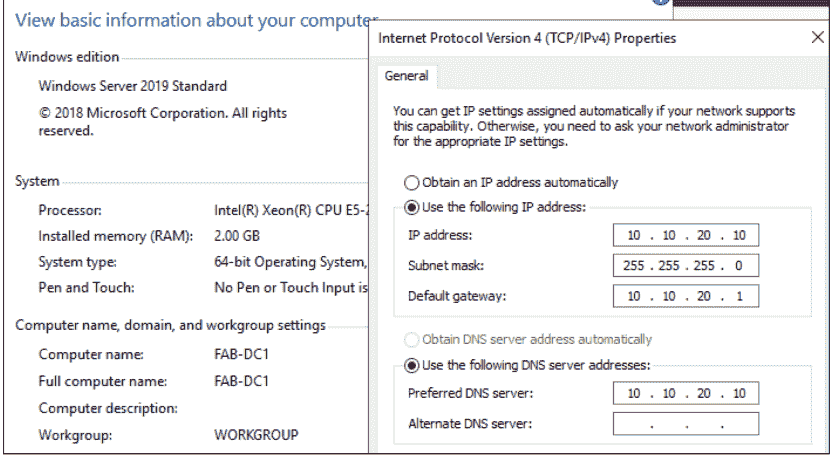

图 3.1：准备服务器成为域控制器

## 安装 AD DS 角色
现在服务器已准备好成为域控制器，我们来安装角色！由于你已经熟悉向服务器添加角色的过程，我们就不再逐步讲解整个过程。只需利用 Server Manager 或 PowerShell 将以下组件安装到你的新服务器上：

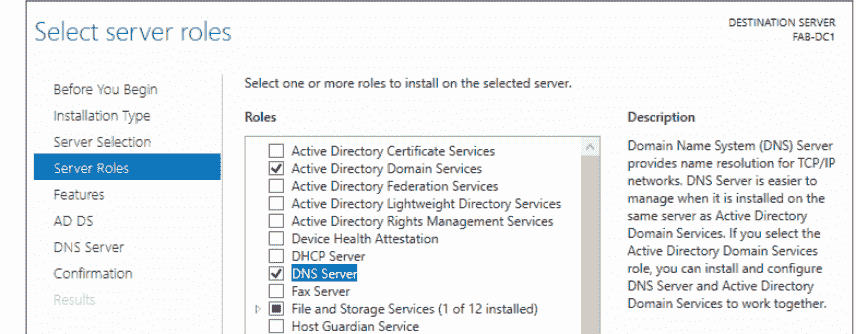

图 3.2：安装 Active Directory 域服务和 DNS 服务器角色

如前所述，我将安装 AD DS 用于 Active Directory，并安装 DNS Server，以便此域控制器也能作为我们新业务的真正 DNS 服务器。随着你在角色安装向导中的进展，你会遇到一些有用的信息文本需要阅读，但为了将这两个角色安装到服务器上，你不需要选择任何进一步的选项。

## 配置域
在安装角色后，你会注意到 Server Manager 顶部附近有一个黄色感叹号。点击该图标，你可以看到指示 Active Directory 域服务角色需要进行一些配置的文本：

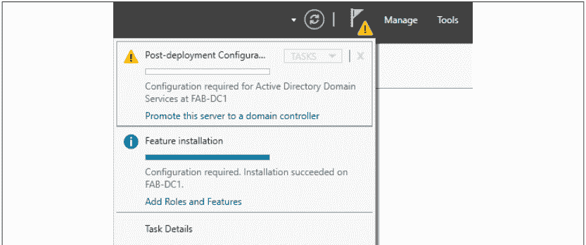

图 3.3：Active Directory 域服务角色需要额外配置

点击写着 **将此服务器提升为域控制器** 的链接。此链接将调用配置向导，引导我们将服务器转变为真正的 DC。

## 树、森林和……域？
等等，第一屏我们在这个提升向导中需要做决定时，谈论的是灌木丛。有何缘故？你已经知道域就像一个数据库，包含有关许多种对象的信息，但主要是属于该域的用户帐户和计算机帐户。我们尚未真正讨论的是，域并不是其存在的顶层，而是一个 **域位于森林之内**。这些是你在 Active Directory 中工作时会遇到的两个技术术语，域和森林，而对树的引用更具比喻性，与森林的布局有关，域位于森林之下，可能还有子域位于其下。将整个架构在纸上绘制出来时可能类似于树的许多分支，因此得名树。

森林是 Active Directory 中的顶层，你可能在同一个森林内拥有许多不同的域。为什么要这样做？大多数公司都不这样做，而且大多数情况下你会发现任何公司都只有一个内部域，位于一个森林中，仅此而已。

你可能会在同一个森林内找到多个域的一个原因是，如果公司有不同的部门或业务单元需要将其身份验证和系统彼此分离。在单个域中，请记住通常任何域用户都可以对任何域计算机进行身份验证并登录，也许你希望确保 DivisionA 中的任何人都无法登录由 DivisionB 拥有的计算机。创建多个域是实现该场景的一种方法。

当你通过在新服务器上启动的域配置向导时，你会看到许多不同的选项，决定此服务器可能成为哪种类型的域控制器。你可能正在向现有域添加 DC，向现有森林添加新域，或创建全新的森林。在向导中选择每个选项都会为你呈现与该选择相关的不同子选项。如果你点击 **向现有森林添加新域**，你会发现然后有创建新子域或树域的选项。子域是存在于 AD 树层次结构中现有域下的新域，而树域是直接位于森林本身下并与任何现有域并列的新域。在同一森林下但与任何现有域分离。

今天，我们 Fabrikam 网络中什么都没有。没有森林，没有域，没有子域。所以我们将选择第三个选项，**添加新森林**。此屏幕上需要决定的全部内容是 **根域名称**，我将在其中输入 fabrikam.local，这是我们之前决定的：

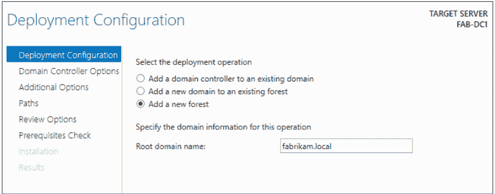

图 3.4：添加新森林

此配置向导中的剩余屏幕包含许多选项，但如果不确定答案，其中很多都不需要填写。尤其是如果你正在构建测试实验室，默认选项通常已足够。我们在这里快速总结每个屏幕，指出选项及其含义。

## 域控制器选项
现在你了解 Active Directory 至少有两层，最少一个森林和一个域，重要的是要了解其中每一个都有其自己的功能级别。森林和域功能级别由不同版本的 Windows Server 操作系统发布进行分类。例如，Windows Server 2016 功能级别内置的功能和配件比 Server 2012 R2 更多，等等。有趣的是要注意的是，Windows Server 2019 没有新的功能级别，你可以选择的最新的仍是 Server 2016。

为什么向导还要询问？选择列表中最新的不是更有意义吗？在几乎所有情况下，答案是肯定的。你可能需要为森林或域选择较旧的功能级别的一个原因是，如果你计划实施的某些技术或计划加入该域的某些设备版本需要较旧的功能级别版本。这凸显了另一个可能需要公司在现有森林下构建二级域的有效场景，如果你为业务想要实施的技术带有某些特定要求，将你锁定在特定版本的功能级别中，但你的主要生产域由于某种原因无法满足这些要求。

就我们今天的目的而言，我们只需将森林和域功能级别都保留在默认的 Windows Server 2016 上。

在此向导屏幕上，你还有选项可以选择此域控制器是否也将是 DNS 服务器（通常为是），是否将是全局编录服务器（也通常为是），或只读域控制器，我们将在本章后面讨论。

第三个选项，也是唯一绝对需要你注意的，是定义目录服务还原模式密码。我真诚希望你永远不需要进入 Active Directory 恢复模式来恢复信息或你的目录，但如果你需要——此密码对该过程将非常重要：


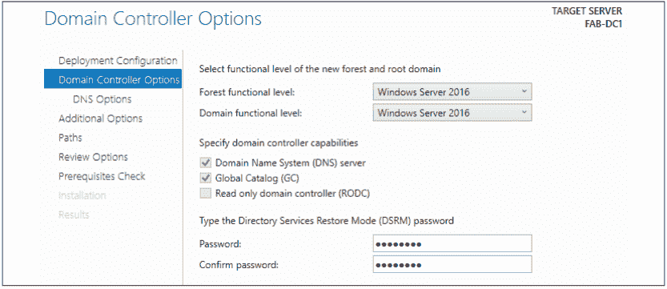

图 3.5: 域控制器选项

## DNS 选项

如果你要创建一台新的域控制器/DNS 服务器，使其位于现有树中，特别是如果新服务器将担任子域角色，那么你通常希望确保父域的 DNS 区域对你正在创建的这个新 DNS 服务器有委派，以便你的域中的名称也能在父域中成功解析。此屏幕上唯一的选项就是创建该 DNS 委派，而在我们创建全新林和域的情况下，不存在现有的权威父区域，因此屏幕上会出现预期的警告消息：

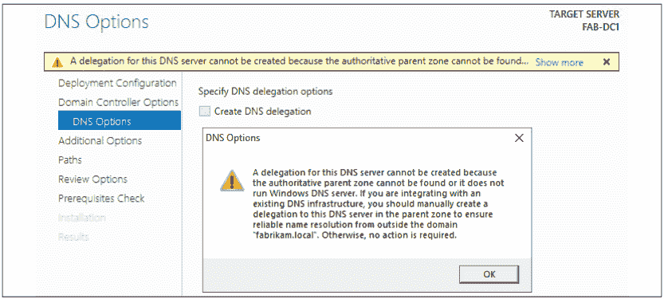

图 3.6: 关于无权威父区域的预期警告消息

由于我们正在构建一个新林，对此警告消息无需采取任何操作，我们只需单击 **下一步** 继续即可。

## 其他选项

NetBIOS 域名应在向导中自动填充，并且将是域名的第一部分。在我的示例中，它已将单词 FABRIKAM 插入此字段。许多人似乎认为 NetBIOS 已过时，但它在许多情况下仍被应用程序用于传递流量，因此在此处配置它的选项仍然很重要。你无需在此屏幕上执行任何其他操作，只需确保 NetBIOS 名称在向导中填充，然后继续即可。

## 路径

Active Directory 在你的域控制器服务器上存储了大量非常重要的信息。如有需要，你可以在此处指定存储此数据的路径，如果你希望它位于特殊位置，例如专用硬盘上。默认选项全部位于 C:\Windows 文件夹中，这通常是大家保留的位置。

## 查看选项、先决条件检查、安装

就这样！你现在已填写了所有可用选项，并且会看到一个屏幕，允许你查看所做的选择。一旦确认此屏幕上的内容看起来良好，向导将对你的服务器运行先决条件检查，以确保它已准备好成为域控制器。这就是，如果你忘记为 NIC 属性分配静态 IP 或设置 DNS 服务器，向导将使先决条件检查失败并提示你一些警告的时候。事实上，即使你已完美完成所有操作，你也可能会看到一两个警告：一个关于我们已经讨论过的 DNS 委派，另一个关于密码算法的警告。在 Windows Server 2019 上配置全新的林/域时，这种行为是正常的。

假设你已准备就绪，向导将继续进行安装，安装结束时你的服务器将重新启动，并正式成为你网络的域控制器。

在对现在已成为域控制器的服务器进行首次登录时，你会在登录屏幕上注意到，你现在使用的是域账户登录，不再是该服务器上的本地账户。域控制器实际上不再拥有本地用户账户；如果你之前像我一样使用内置管理员账户登录服务器，那么该账户和密码现在已被转换为域管理员账户。此账户现在可用于登录稍后加入域的任何计算机或服务器，并将自动获得该设备上的管理权限。确保你使用的是良好的域管理员密码，并且不要与任何人分享！

## 用于冗余的多个域控制器

现在，我们已经配置了第一个域控制器，我们应该跳进去开始在 Active Directory 中设置对象，对吧？还没！我在这里有点夸张，当然你可以提前开始使用与 AD 交互的工具，我们将在本章这一节之后立即讨论。但如果你正在设置真实环境，而不是在测试实验室里瞎折腾，建立域的冗余将变得至关重要。

添加第二个域控制器甚至比启动第一个更容易。只需重复上次的步骤，只有一个例外，即 NIC 的配置方式：

- 1. 启动一台新服务器。
- 2. 设置静态 IP。
- 3. 配置一个良好的永久主机名。
- 4. 与之前不同：不要将 NIC 的 DNS 服务器设置指向新服务器本身，而是将主要 DNS 指向现有域控制器的 IP 地址。

现在，当你添加 AD DS 和 DNS 服务器角色并再次浏览几分钟前见证的相同配置向导时，这次你将选择将域控制器添加到现有域的选项。然后你只需选择或输入域的名称并提供该域上的管理凭据即可：

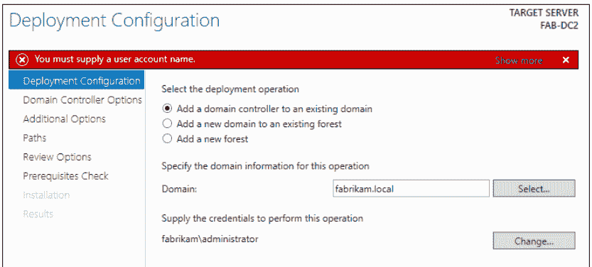

图 3.7: 向现有域添加 DC

向导的其余部分相当直接，但你会注意到在域控制器选项屏幕上出现了一个新的下拉菜单，允许你选择站点名称。如果你有多个 AD 站点，你可以在此处选择此新 DC 安装到的站点。我们将在本章后面的部分讨论更多关于 Active Directory 站点和服务的主题。你还会注意到你需要再次为目录服务还原模式创建密码。此密码按域控制器配置，因此每个 DC 服务器可能不同。

如果你记得我们迄今为止所做的一切，你会意识到现在我们两个域控制器服务器都指向 FAB-DC1 作为其主要 DNS 服务器，如 NIC 属性中定义的那样。只要每个 DC 都能联系到 DNS 服务器，你的域就能正常运行，但现在我们已为冗余目的创建了两个 DC，如果你确保两个域控制器从 DNS 角度相互感知，你的整体解决方案会更好。

有两种不同的方法可以做到这一点，两者都被认为是不错的做法：

- 配置每个域控制器使其主要 DNS 服务器地址为自身，次要 DNS 服务器地址为另一个 DC。这会导致这些服务器上的 DNS 查找稍快，但潜在的缺点是，你可能需要等待 Active Directory 在两个服务器之间复制完成，然后新创建的 DNS 记录才会在两个服务器上可用。
- 配置所有域控制器使用网络上的单个 DNS 服务器作为主要 DNS 服务器，自己作为次要 DNS 服务器。如果所有 DC 都查询集中式 DNS 服务器，那么你对该 DNS 服务器所做的任何更新或添加都会立即在所有 DC 上可用。然而，如果该中央 DNS 服务器离线，它会给其他所有 DC 带来麻烦，因为它们必须意识到现在需要故障转移到自身进行名称解析。

哎呀，我说有两种方法，通常你会发现大多数环境中的 DNS 配置都是上述选项 #1 或选项 #2。但，这里还有第三种可能性，它有点介于两者之间。你可以配置每个域控制器的 NIC 设置，使主要 DNS 服务器为环境中的另一个 DNS 服务器，然后使次要 DNS 服务器指向自身。这会导致 DNS 查找始终在网络上进行，这会产生比其他选项更多的流量，但也确保每个 DC 如果另一个失败可以独立运行。在这种第三种情况下，如果网络中有两个 DC，你基本上就是让它们相互指向，同时使用自身作为备份。

我不能告诉你什么对你自己的环境最好，但我大多数时候的做法是配置每个 DC 使其自身成为主要 DNS 服务器，并且意识到每当我创建新的 DNS 记录时，可能需要几分钟时间在 DC 之间复制。

> 当你配置域控制器使其自身成为主要 DNS 时，通常建议使用本地主机 IP 地址 127.0.0.1，而不是 DC 的实际 IPv4 地址。

关于将 DNS 服务器信息填充到域控制器服务器的 NIC 属性中的主题，还有一个重要的注意事项。绝不要将 DC 配置为指向公共 DNS 服务器。将 8.8.8.8 或类似地址插入 NIC 的 DNS 设置是为互联网连接的家庭电脑常做的事情。服务器不行。不要把这种心态带入你的业务。你的域控制器必须在 Active Directory 中注册特殊记录，而将 DC 的 NIC 指向公共 DNS 服务器将导致该过程失败。


我实际上不得不清理这个混乱局面，正是由这种确切情况造成的——一家公司出现了一些互联网连接问题，作为故障排除的一部分，一名 IT 人员决定将网络中每台服务器的 NIC 属性中的实际 DNS 服务器信息替换为 8.8.8.8。说实话，这并没有取得很好的效果。

## Active Directory Users and Computers

没有单一的工具可以用来管理 Active Directory 的所有方面。由于它是一个如此庞大的技术，我们对目录的配置分布在多个不同的管理控制台中。让我们逐一查看它们，以及您将在这些工具中执行的最常见的几个任务。任何这些管理控制台都可以从您的任何域控制器服务器启动，就像我们在上一章中看到的那样，启动这些控制台最简单的方法就是直接从 Server Manager 右上角的 **Tools** 菜单启动。

我将从我们 Active Directory 工具列表中按字母顺序排在最后的工具开始，因为这无疑是日常服务器管理员使用最频繁的工具。AD 用户和计算机是创建和管理所有用户账户和计算机账户的控制台。打开它，您将在左侧列中看到域的名称。展开域名称，您将在这里看到列出的一系列文件夹。如果您在成熟网络中的现有域控制器上打开它，您可能会看到成页成页的文件夹列表。如果这是一个新环境，则只有少数几个。这里最重要需要指出的部分是 **Computers** 和 **Users**。正如常识所指示的那样，这些是新计算机账户和加入域的用户账户将所在的默认容器。

虽然这个窗口看起来很像带有文件夹树的 File Explorer，但这些文件夹实际上根本不是文件夹。这里看到的大多数棕黄色文件夹图标被称为 **Organizational Units (OUs)**。我说大多数是因为开箱即用的几个容器是合法的用于存放对象的存储容器，但它们不是正式的 OU。我们之前指出的 **Users** 和 **Computers** 实际上就是这些通用存储容器，而不是传统的组织单元。然而，您在 AD 内部为自己创建的任何新文件夹都将是 OU。区别体现在棕黄色文件夹图标上。您可以在即将出现的屏幕截图中看到，其中一些棕黄色文件夹在文件夹本身顶部有一个额外的图形。只有那些带有额外小黄色标记的文件夹才是真正的 OU。

OU 是我们在 Active Directory 内部使用的结构化容器，用于组织我们的对象并将它们保存在有用的位置。就像文件服务器上的文件夹一样，您可以在这里创建自己的组织单元层次结构，以便对所有域加入的网络对象和设备在 Active Directory 中的位置进行排序和操作。在下面的屏幕截图中，您可以看到我没有仅仅保留普通的 **Users** 和 **Computers** 文件夹，而是创建了一些新的 OU 包括子类别（更正式地称为 **nested OUs**），这样随着环境的增长，我将拥有一个更结构化和有组织的目录：

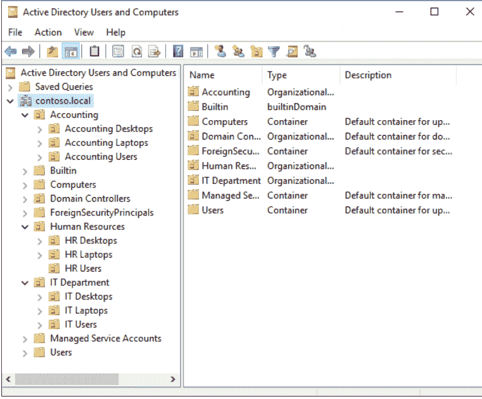

图 3.8：Active Directory 结构

## User accounts

现在我们已经准备好一些 OU 来容纳我们的对象，让我们创建一个新用户。假设我们有一名新的服务器管理员加入，我们需要为他提供一个 Active Directory 登录名，以便他可以开始工作。只需找到适合其账户所在的 OU，右键单击该 OU，然后导航到 New | User。然后我们会看到一个信息收集屏幕，关于 AD 创建此新账户所需的所有信息。这里的大部分信息都是自解释的，但如果您是 Active Directory 的新手，我要指出的一个字段是 User logon name。放入此字段中的任何信息都是用户在网络上的官方用户名。每当他们登录计算机或服务器时，这就是他们将作为登录名输入的名称。

完成后，我们的新管理员就可以利用新的用户名和密码登录网络上的计算机和服务器，当然是在我们在这些机器上建立的安全边界之内。但那是另一章的另一个话题：

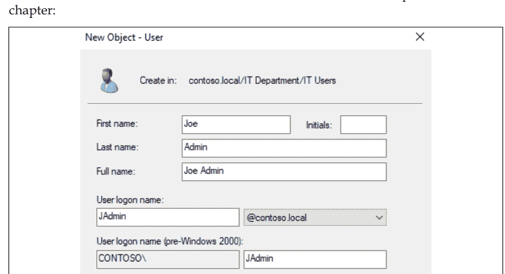

图 3.9：创建新用户

## Security groups

Active Directory 内部的另一个有用的组织单元是 **security groups**。我们可以使用组织单元来区分不同类型和种类的用户和计算机账户，但当我们需要在这种结构中进行一点交叉时怎么办？也许我们有一名员工负责部分人力资源和部分会计职责。更有可能的是，我们在文件服务器上配置了文件和文件夹权限，以便只有属于某些组的人才能访问特定文件夹的读写权限。人力资源部的 Susie 需要访问工资文件夹，但 Jim 不需要。Susie 和 Jim 都位于同一个 OU 中，因此在该级别上，他们将具有相同的权限和功能，但我们显然需要一种不同的方式来区分他们，以便只有 Susie 可以访问工资信息。通过在 Active Directory 中创建安全组，我们可以获得添加和删除特定用户账户、计算机账户甚至其他组的能力，以便我们可以精细地定义对资源的访问。您创建新组的方式与创建用户账户相同，选择要让新组所在位置的 OU，然后右键单击该 OU 并导航到 **New | Group**。创建组后，右键单击它并进入 **Properties**。然后您可以单击 **Members** 选项卡；这就是您添加希望成为此新组一部分的所有用户的位置：

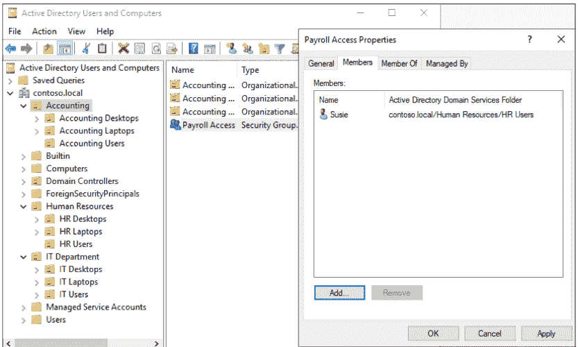

图 3.10：创建新组

## Prestaging computer accounts

利用 Active Directory 用户和计算机创建新用户账户是非常常见的，因为如果没有手动创建用户账户，那个人将完全无法在您的网络上登录。然而，在加入新计算机到域时想到打开此工具则要少得多。这是因为大多数域都配置为允许新计算机通过在计算机本身上执行的操作加入域，而无需事先在 Active Directory 内部进行任何操作。换句话说，只要有人知道具有域内管理权限的用户名和密码，他们就可以坐在连接到网络的任何计算机前，在该本地计算机上完成域加入过程。它将成功加入域，并且 Active Directory 会自动为其创建一个新的计算机对象。这些自动生成的计算机对象会放置在默认的 Computers 容器中，因此在许多网络中，如果您单击该 Computers 文件夹，您将看到列出的一系列不同机器，它们甚至可能是最近加入域的桌面计算机和服务器的混合体，并且尚未移动到适当的、更具体的 OU 中。在我不断发展的实验室环境中，我最近将几台机器加入了域。我在从未打开 Active Directory 用户和计算机的情况下完成了此操作，您可以看到我的新计算机对象仍然位于该默认 Computers 容器中：

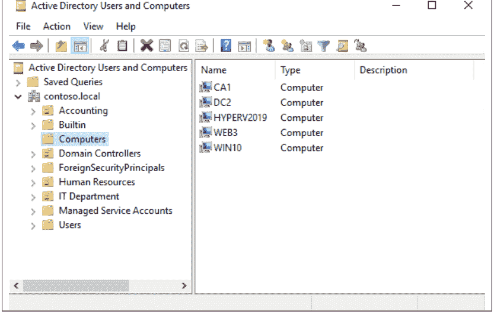

图 3.11：Active Directory 的默认 Computers 容器


允许新的计算机账户将自己放置在默认的 **计算机** 容器中对于客户端系统来说通常不是大问题，但如果允许服务器在该文件夹中自动生成，就可能导致严重问题。许多公司在网络中实施了安全策略，这些策略通常以这样的方式创建：它们将自动应用于驻留在通用 OU 中的任何计算机账户。使用安全策略可以很好地锁定用户不需要访问或使用的客户端机器的部分，但如果您不小心导致这些 **锁定** 策略在新服务器加入域后立即生效，您可以在甚至开始配置它之前就有效地破坏服务器。相信我，我做过。而且不幸的是，添加到 Active Directory 的新服务器对象将被识别和分类，与添加到域中的任何客户端工作站相同，因此您无法仅仅因为它是服务器而不是普通工作站就为服务器指定不同的默认容器。

那么，如何缓解这一潜在问题呢？答案是为新服务器 **预先创建** 域账户。您甚至可以出于原则预先创建所有新的计算机账户，但我通常只在大企业中看到这一要求。预先创建计算机账户与创建新用户账户非常相似。在将计算机加入域之前，您在 Active Directory 中为其创建对象。通过在域加入过程之前完成对象的创建，您可以选择计算机加入域时所在的 OU。然后您可以确保该 OU 会或不会接收您打算在此新计算机或服务器上实施的安全设置和策略。我强烈建议为上线的新服务器在 Active Directory 中预先创建所有计算机账户。如果您将其作为一种做法，即使并非总是绝对必要，您也会养成一个好习惯，这也许有一天可以避免您因仅仅将其加入域而破坏服务器而不得不重建服务器。

预先创建计算机对象极其快速简单；让我们一起做一个。将来，我计划构建一台托管远程访问角色的 Windows Server，以便将我的漫游用户从家中、咖啡店等连接到网络。远程访问角色中的某些组件在网络安全策略方面很挑剔，因此我宁愿确保我的新 RA1 服务器在加入域后不会立即接收大量锁定设置。我创建了一个名为 **远程访问服务器** 的 OU，现在我将在该 OU 中为我的 RA1 服务器预先创建计算机对象。

右键单击远程访问服务器 OU 并选择 新建 | 计算机。然后只需在计算机名称字段中填入服务器的名称。尽管我尚未构建此服务器，但我计划将其命名为 RA1，因此我只需在该字段中输入它：

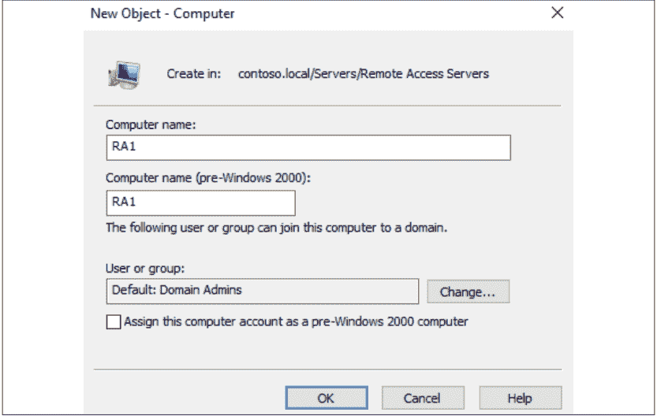

图 3.12： 在 OU 中预先创建计算机

就是这样！通过几次简单的鼠标点击和输入一个服务器名称，我现在已为 RA1 服务器预先创建（预创建）了我的计算机对象。如果您仔细查看之前的屏幕截图，您会注意到您还可以调整哪些用户或组被允许将此特定计算机加入域。如果您计划构建新服务器并希望确保只有您一个人被允许将其加入域，此字段可以轻松更新以满足该要求。

一旦我实际开始构建该服务器，并继续执行将其加入我的域的步骤，Active Directory 将意识到我的新服务器的名称与 Active Directory 中已有的对象匹配，并将我的新服务器与此预先创建的 RA1 对象关联起来，而不是在通用的计算机容器中创建一个全新的对象：

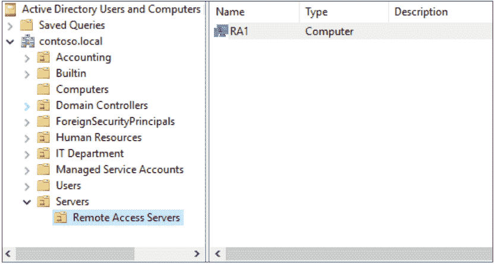

图 3.13： RA1 的 AD 对象现已预先创建

## Active Directory 域和信任

此工具通常仅在同一网络中拥有多个域的大型环境中使用。正如我们之前讨论的，公司可能会使用多个域名来隔离资源或服务，或为了公司内部服务器和命名空间的更好组织结构。您已经了解域和林之间的区别以及域如何在林中驻留。另一种思考林的方式是将其视为您的 AD 结构的边界。如果单个林下有多个域，这并不一定意味着这些域相互信任。因此，根据域之间存在的信任级别，一个域的用户可能有权或无权访问另一个域上的资源。当您拥有一个域并在其下添加子域时，这些域之间会自动建立信任关系，但如果您需要以不同于默认权限的方式合并一些域，**Active Directory 域和信任** 就是用于建立和修改这些信任关系的管理工具。

成长中的组织经常会因业务收购而需要定期管理域信任。如果 Contoso 收购 Fabrikam，并且两家公司都有完全功能的域环境，通常最好通过扩展的迁移过程将 Fabrikam 员工迁移到 Contoso 的 Active Directory，而不是仅仅关闭 Fabrikam 网络所带来的所有损失。因此，在一段时间内，您希望同时运行两个域，并可以建立这两个域之间的信任关系以使其成为可能。

如果您发现需要进行某种域迁移，有一个工具您可能想要尝试。它被称为 **Active Directory 迁移工具 (ADMT)**，在前面描述的情况中非常有用。如果您有兴趣更详细地了解此工具，您可以从以下链接下载：https://www.microsoft.com/en-us/download/details.aspx?id=19188。

## 构建信任

我之前提到我已经为 contoso.local 搭建了域控制器和整个测试实验室网络，并且在本章中我们搭建了一个新的 fabrikam.local 域。这些域之间没有任何关联，它们是完全分离的林。因此，一个域中的用户账户绝对无法登录到加入另一个域的任何机器。

让我们改变这一点。我们将使用 Active Directory 域和信任在这些域之间建立双向信任关系，这将实现完全相同的场景——contoso.local 的用户将能够登录到加入 fabrikam.local 的计算机，反之亦然。可以建立单向或双向信任。在现实世界中我最常看到双向信任，因为它使两个域之间可以流动更多信息，在收购的情况下，这通常是我们想要实现的目标。如果需要此信任仅在一个方向流动，例如允许 contoso.local 账户登录到 fabrikam.local 机器但不允许 Fabrikam 员工登录到 Contoso 设备，则可以使用单向信任。

构建成功的信任关系有三个组成部分：
- 网络连接
- 条件 DNS 转发
- 配置信任

### 网络连接

第一点是常识，那些域需要能够相互通信！如果您收购了一家公司，其服务器位于不同的物理位置，您可能需要构建两个物理站点之间的某种站点到站点 VPN 连接。

在我的测试实验室中，我确实将 Contoso 和 Fabrikam 服务器 IP 地址分配到不同的子网，但它们都是同一个测试实验室网络的一部分，因此它们已经可以在 TCP/IP 级别相互通信。

在继续执行信任构建的剩余步骤之前，请确保域控制器之间可以在两个方向上收发数据包。

### 条件 DNS 转发

到目前为止，我们尚未在 DNS 管理控制台中做任何事情，但它已安装在我们所有的 DC 上。我们下一章将涵盖与 DNS 本身管理相关的更多项目，但现在我们需要利用 DNS 管理并在每个域内进行更改。目前，如果我登录到 Contoso 工作站并 ping fabrikam.local，或者如果我登录到 Fabrikam 计算机并尝试 ping contoso.local——这些功能都会完全失败，因为两个域都不知道这些 DNS 命名空间应该解析到这些域中的 DNS 服务器。

为了在两个域之间实现名称解析的完整循环，我需要在每个域内设置条件转发。


我登录到 DC1，即 contoso.local 的其中一台域控制器，并从服务器管理器的 **Tools** 菜单启动 **DNS Manager** 工具。进入后，在我的服务器名称下方有一个名为 **Conditional Forwarders** 的文件夹。如果右键单击该文件夹，然后可以选择创建 **New Conditional Forwarder...** 的选项：

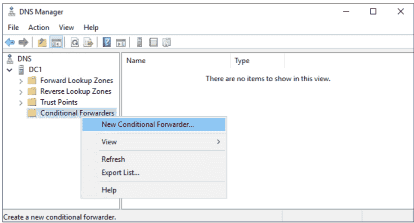

图 3.14：创建新的条件转发器

接下来，将您要联系的远程域名输入到 DNS 域字段中。然后填写该其他域内 DNS 服务器的 IP 地址。屏幕应该能够接受您的 IP 地址并查询远程服务器以发现该服务器的服务器 FQDN。我通常还会选中将此条件转发器存储在 Active Directory 中的复选框，这样我的所有 AD 启用的 DNS 服务器都可以执行此转发。以下是我在 contoso.local DNS 服务器中做出的选择，这将告诉它如何联系并与 fabrikam.local 通信：

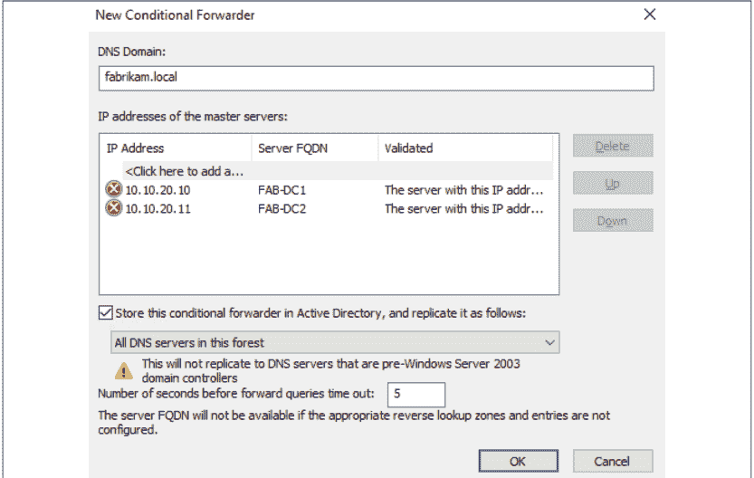

图 3.15：配置条件转发器

您现在应该能在 DNS Manager 中看到新的条件转发器已填充，如果您打开命令提示符并尝试 ping 远程域，就我而言是 fabrikam.local，您可以看到该远程域的名称解析现在已成功，而在我们创建条件转发器之前它会失败：

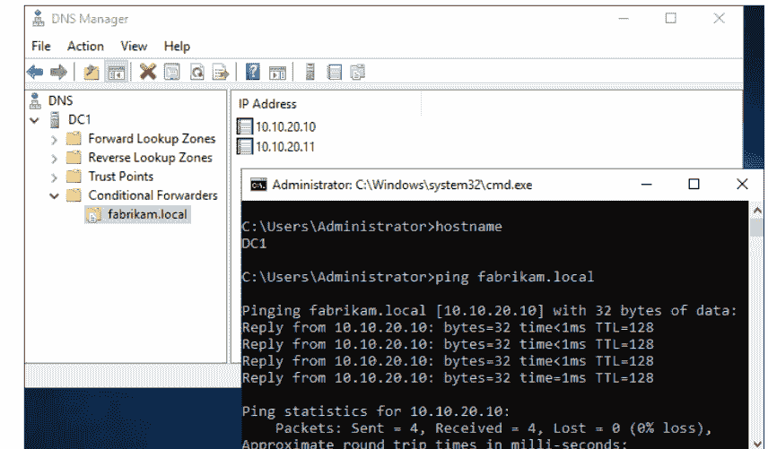

图 3.16：从 contoso.local 服务器成功 ping fabrikam.local

## Do it again!

我们现在已从 contoso.local 向 fabrikam.local 创建了一个条件转发器，但请记住我们想要建立双向信任，因此现在必须在 fabrikam.local 域内配置相同类型的转发器，指向 contoso.local 的域控制器。按照上述相同步骤创建第二个条件转发器。完成该步骤后，跨域名称解析已成功工作，我现在准备配置信任。

## Configuring the trust

两个域之间的 VPN 或其他形式的连接：已检查

两个域之间的条件转发设置：已检查

是时候创建信任了！

登录到其中一台域控制器，我将使用 DC1.contoso.local，并启动 Active Directory 域和信任。进入后，您应该在左侧窗口窗格中看到域的名称。右键单击域的名称并选择属性。在域的属性中，您会看到第二个选项卡称为信任。继续选择此选项卡，底部有一个创建新信任的按钮。您可以在图 3.17 中看到此屏幕和按钮。

为信任命名有几个选项，但当在两个林之间创建信任时，就像我们今天这样，您需要指定要连接到的远程林的完整 DNS 名称。在我的示例中，我是从 contoso.local 域内部创建此信任，因此我将在此屏幕上指定 fabrikam.local，如下所示：

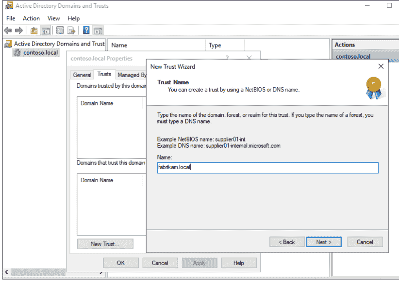

图 3.17：创建新的信任

现在您将遇到几个屏幕，展示有关如何建立此新信任的各种选项。您可以基于域或林创建信任，外 部信任或林信任，您可以将其创建为双向信任或单向信任，任一方向，并且您可以决定允许身份验证在整个林中进行还是更具选择性。在向导界面中推进时，每个选项的含义都有很好的说明，但我今天感兴趣建立的是 contoso.local 和 fabrikam.local 之间完全的双向传递信任，因此我选择以下选项：

- **林信任。**
- **双向。**
- **仅此域。**
- **林范围身份验证。**
- **信任密码** – 您可以为信任密码指定任何想要的内容，重要的是要记住它，因为当您切换到第二个林或域并再次执行这些步骤以创建信任的另一侧时，您必须再次输入相同的信任密码。

图 3.18 总结了所选设置：

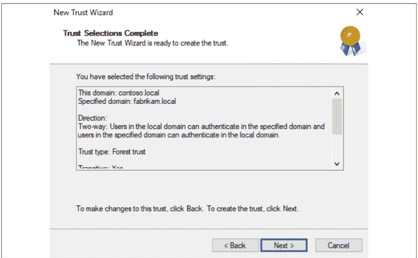

图 3.18：信任设置摘要

向导的最后一步是是否要确认传出信任。由于此时我们只创建了信任的一侧，请记住我们仍需要访问 fabrikam.local 的域控制器并设置信任的另一侧；此时我们不想确认传出信任，因为信任设置尚未完成。

现在 contoso.local 中已建立信任的一侧，登录到 fabrikam.local 中的域控制器并执行相同的设置过程。完成后，您现在已在两个林之间配置了完整的双向传递信任：

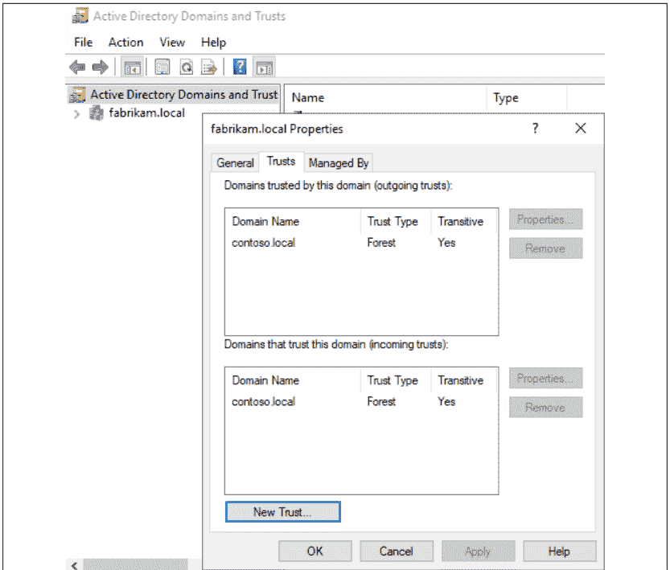

图 3.19：双向信任已完成

## Test it out!

我们有一个信任。太好了！现在，我们能用它做什么？请记住，信任的核心就是允许域之间进行交叉身份验证。您现在应该能够在任一域的计算机上登录，并使用来自另一域的用户帐户登录，假设网络中没有限制此类登录的内容。另一个快速简单的测试是尝试设置文件共享，这是在多个域之间共享的常见操作。在一个域的任何服务器上设置一个文件夹并像共享任何文件夹一样共享它。现在访问安全选项卡为此文件夹设置一些 NTFS 权限。当您单击添加...按钮在此屏幕上包含更多权限时，它当然默认为此服务器所加入的域。但是，如果您单击位置...按钮，您现在就有了指定远程域作为搜索位置的能力，这仅因为信任存在，然后您就可以从该远程域添加用户帐户或组到文件夹共享权限，从而授予这些用户访问共享文件夹的权限。您可以在图 3.20 中看到我的 Share1 文件夹现在允许 CONTOSO 域和 FABRIKAM 域中的组拥有权限：

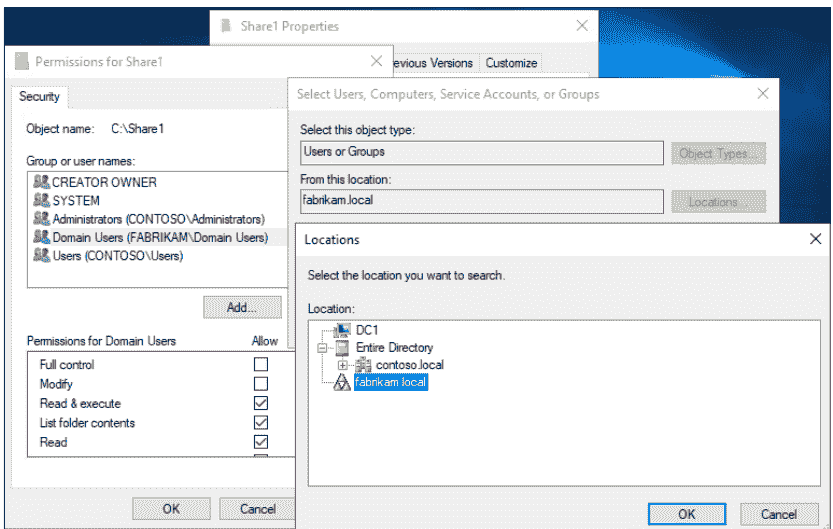

图 3.20：Share1 文件夹权限反映了两个域

## Active Directory Sites and Services

Sites and Services 是另一款工具，通常仅由拥有更大 Active Directory 基础架构的公司使用。就服务器而言，如果有一台域控制器是好的，那么有两台域控制器就更好了。随着公司规模的扩大，Active Directory 基础架构也会随之扩大。在您意识到之前，您将开始考虑在第二个位置设置服务器，然后是第三个位置，等等。在以域为中心的网络中，在每个重要站点拥有域控制器服务器是通用做法，您很快可能会看到网络中运行着数十台域控制器服务器。

启动新的域控制器并将其加入现有域，使其开始为用户和计算机提供服务是相当容易的。更困难的部分是保持所有流量有序并流向您希望的方向。如果您有一个主要数据中心，其中大部分服务器都位于该中心，您可能在该数据中心现场有多个 DC。事实上，为了使 AD 高度可用，至少拥有两个域控制器是必不可少的。但让我们假设您随后建立了一个相当大的新办公室，在那里安装本地 DC 服务器是有意义的，这样办公室中的计算机就不必一直通过 **Wide Area Network (WAN)** 进行身份验证。如果您在新办公室启动一台服务器并将其转变为网络的域控制器，它会立即开始工作。问题是客户端计算机并不总是足够智能来知道需要与哪台 DC 通信。您现在可能有远程办公室中的计算机仍在向主数据中心的 DC 进行身份验证。更糟糕的是，您可能还会有主办公室中的计算机现在通过 WAN 与位于远程办公室的新 DC 进行身份验证，即使它们本地网络上就有 DC！

这就是 Active Directory Sites and Services 变得必不可少的情况。在这里，您构建不同的物理站点并将域控制器分配给这些站点。此网络中加入域的用户和计算机现在遵循您通过 Sites and Services 设定的规则，以便它们始终与本地域控制器服务器通信并从其进行身份验证。这节省了时间，因为连接更快、更高效，并且还节省了 WAN 上不必要的带宽和数据消耗，这通常可以为您节省资金。

这是 Active Directory Sites and Services 的一个示例。如您所见，这里列出了多个站点，它们对应于网络子网信息。这是 AD Sites and Services 跟踪哪个站点是哪个站点的方式。当客户端计算机上线时，它显然知道自己属于哪个子网，这是基于它使用的 IP 地址。AD Sites and Services 然后根据该 IP 地址知道客户端现在位于哪个站点。


## 活动目录

该站点标识随后有助于 Active Directory 将身份验证请求引导至正确的域控制器，并有助于像组策略（我们稍后会讨论）这样的功能能够处理特定站点的信息。如果你所在的组织正在发展壮大，未来你很可能会需要使用此工具。在 AD 站点和服务中添加新对象几乎就是最简单的事情了。只需右键单击 Sites 文件夹，然后选择 New Site，即可配置所有站点。你可以随意命名你的站点。

一旦所有站点都放置在 AD 站点和服务中，你可以以类似的方式添加子网，方法是右键单击 Subnets 文件夹并选择 New Subnet。创建新子网时，你需要输入该子网的标识网络信息，屏幕底部允许你选择子网所在的站点。你可以在图 3.21 中看到该过程，以及我示例 AD 站点和服务中现在已填充多个站点和多个子网的视图：

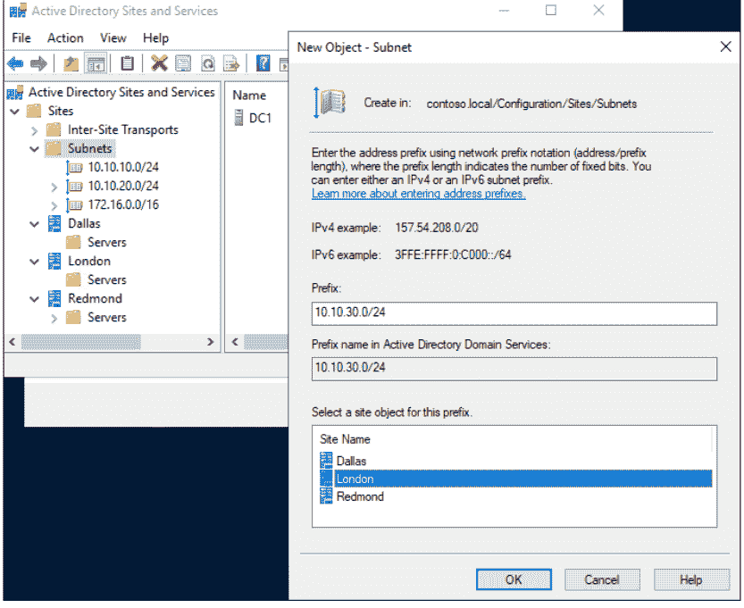

Figure 3.21: 在 AD 站点和服务中定义子网

## Active Directory 管理中心

虽然了解并熟悉我们迄今为止查看过的用于管理 Active Directory 的工具至关重要，但可以看出它们的美观程度有些过时。另一方面，Active Directory 管理中心 (ADAC) 拥有更简洁的界面，看起来和感觉起来都像我们越来越熟悉的新版服务器管理器。ADAC 中提供的许多功能与我们已可通过其他工具完成的功能相同，但它将这些功能整合到更结构化的界面中，使最常用的功能更易于访问并更易于运行。

一个很好的例子就在 ADAC 的登陆页面上。在任何网络中，重置用户账户密码都是常见的帮助台任务。无论用户忘记了密码、最近更改后输错了，还是你在进行其他故障排除时重置密码，重置用户账户密码通常需要在 AD 用户和计算机中进行多次鼠标点击才能完成。现在，主页上直接显示了一个名为 RESET PASSWORD 的快速链接，位于 Active Directory 管理中心的主页面上。旁边非常有用的 GLOBAL SEARCH 功能，你可以在搜索字段中输入任何内容，它将搜索整个目录以查找与搜索相关的结果。这是 AD 中另一个以前需要多次点击才能完成的常见任务：

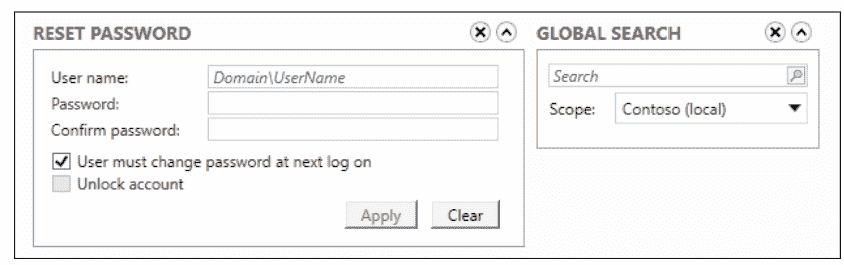

Figure 3.22: ADAC 内部的有用工具

如果你在左侧导航树中单击你的域名称，你将更深入地了解 ADAC 的功能。如你所见，这里列出的信息是从 Active Directory 中提取的，看起来与你在 AD 用户和计算机中看到的信息相同。这是正确的，除了不再需要为每个功能（如新建用户或搜索）右键单击之外，右侧现在有一些快速任务，可以快速启动这些功能。此屏幕上用于提升林或域功能级别的链接也很有趣。

要使用经典工具执行此操作，我看到大多数管理员都是通过启动 AD 域和信任来实现的。因此，新版 ADAC 工具的一个主要好处是它能够为你提供一个集中管理窗口，从中可以完成通常需要多个窗口和管理控制台的任务。你是否感受到 Windows Server 2019 中关于集中管理一切的共同主题？

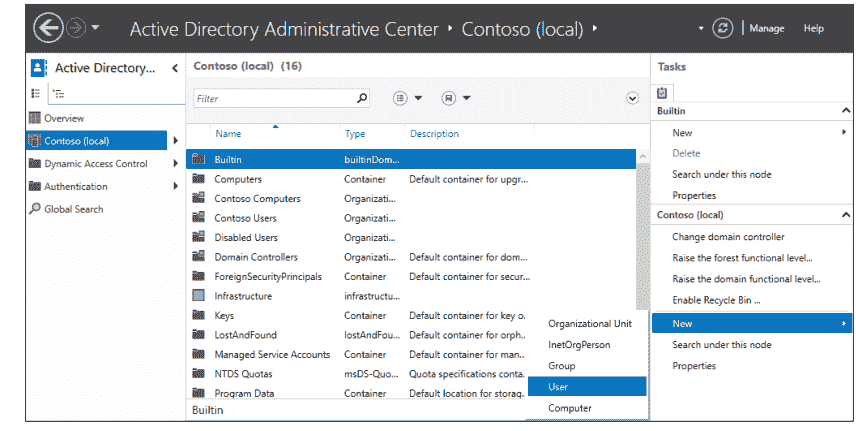

Figure 3.23: ADAC 用户界面

## 动态访问控制

除了让老狗学习新把戏之外，Active Directory 管理中心还带来了经典工具中任何地方都找不到的一些新功能。如果你再次查看左侧的树，你会看到列表中的下一部分是动态访问控制 (DAC)。这是一种完全关于你文件和公司数据的技术，你需要牢牢掌握，确保它不会落入错误的人手中。DAC 使你能够为文件打标签，从而将其分类为特定组或用途。然后你可以创建访问控制策略，定义谁可以访问这些特定标记的文件。动态访问控制的另一个强大功能是报告功能。一旦 DAC 在你的环境中建立并运行，你可以对文件进行报告和取证，例如查找最近访问过机密文档的人员列表。

DAC 还可用于根据用户当前使用的设备类型修改用户的权限。如果我们的用户 Susie 在网络上使用她的公司桌面登录，她应该可以访问那些敏感的 HR 文件。另一方面，如果她带个人笔记本电脑到办公室并连接到网络，即使提供她的域用户凭据，我们可能也不想允许访问这些相同的文件，仅仅因为我们不对该笔记本电脑的安全负责。这些区别可以使用动态访问控制策略来做出。

## 精细密码策略

几乎任何曾在企业中作为工作的一部分使用过 Windows 计算机的人都熟悉“每 x 天重置一次密码”的要求。在 Microsoft Active Directory 环境中，有几种不同的方法可以强制执行密码策略，这些策略要求一定的密码长度、设置密码的复杂性要求以及定义密码的最大使用期限，从而导致用户需要不时重置密码。很多时候密码需要每 30 天左右更新一次。

定义密码策略最常见也最简单的地方是使用组策略。我们将在第 5 章《组策略》中讨论默认域策略时更详细地介绍这一点，但该策略将把一套密码要求设置应用于域中的所有用户，无一例外。如果你的需求稍微复杂一些怎么办？例如，也许你要求所有办公室员工使用复杂的密码并且每 30 天更改一次，但你为一家制造公司管理 IT，该公司在车间地板上还有一些共享计算机。这些计算机使用域账户登录，以便你能有效地向它们推送策略并在域级别授予权限，但你不需要这些车间登录具有相同的密码复杂性，也不在乎这些密码是否更改，因为它们只在网络内部使用。

进入精细密码策略。这种策略通过允许你在 Active Directory 内部为不同的人群配置不同的密码策略，完美地满足了这些扩展需求。我们实际上将在第 9 章《加固和安全》中构建一个精细密码策略，因此我们必须等到那时再了解细节。我在这里提到它的原因是创建精细密码策略需要使用 Active Directory 管理中心，因此我们将在此新控制台中创建策略。

## 只读域控制器

你在网络中设置的第一个域控制器将是一个完全可写的域控制器，能够接受网络中域加入的用户和计算机的数据。事实上，你网络中的大多数 DC 很可能都是完全功能且可写的。然而，花一点时间指出一种可以安装的有限范围 DC 是值得的，它被称为 **只读域控制器 (RODC)**。正如名称所示，RODC 只能从中读取目录数据。从用户计算机尝试对域进行的写入操作，例如密码更改或新建用户账户，在 RODC 上是不可能的。相反，RODC 从其他更传统的域控制器接收其目录数据，然后利用该数据验证来自用户和计算机的身份验证请求。这种有限访问的域控制器在何处会有所帮助？许多公司在较小的分支机构或安全性较低的站点安装它们，以便这些小型办公室现场的本地计算机可以快速轻松地从域读取和进行身份验证，而不会出现未经授权的用户获得对物理服务器的访问并以不良方式操纵整个域的潜在安全风险。RODC 的另一个有效用例是在 DMZ 中，DMZ 是一个受保护的网络，你通常不会梦想在其中安装完整的域控制器，因为 DMZ 网络完全关乎访问限制和保护内部网络信息安全。

配置只读域控制器并不是一个完全不同的过程，不包括另一个角色或功能，而只是在运行 AD DS 角色的标准安装过程中选择的不同选项，我们在本章中已经多次使用过该角色。事实上，让我们现在就设置一个。我刚刚在我的环境中创建了一个新的 VM，并为其分配了 IP 地址和主机名。在安装了 AD DS 角色后，就像我已经为环境中的其他域控制器所做的那样，我现在要进入配置向导，该向导帮助我将此服务器提升为域控制器。

由于我正在向现有域添加另一个 DC，第一个选择相当直接。当我们来到 **域控制器选项** 屏幕时，我们与过去运行此向导的方式有所偏离。你看到那个写着 **只读域控制器 (RODC)** 的小复选框吗？继续勾选该框：

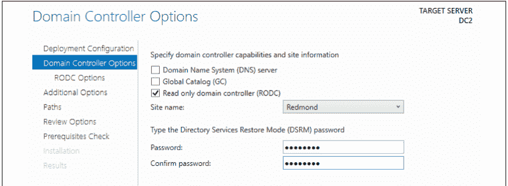

图 3.24：定义新的域控制器为 RODC

点击此屏幕上的下一步后，你现在会看到新的选项，我们以前从未见过，屏幕标题为 RODC 选项。这里最有趣的是，存在字段可以定义哪些用户账户或用户账户组被允许或被拒绝将其密码复制到 RODC 的权限。这些字段中预先定义了对象。请特别注意两个 Active Directory 组，名为允许 RODC 密码复制组和拒绝 RODC 密码复制组。这些是完成向导后会添加到 AD 中的全新组吗？不是！虽然你可能从未注意到这些组，但它们已经存在于 Active Directory 内部，只是如果你从未在环境中部署 RODC，则它们 simply 未被使用：

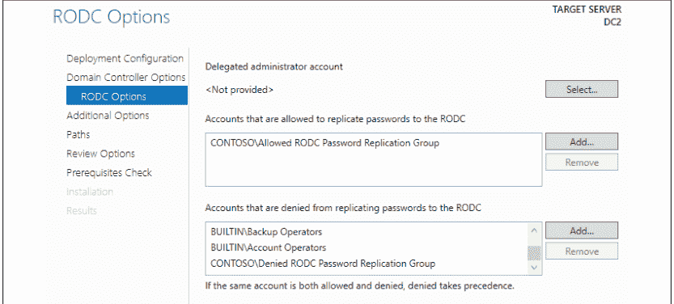

图 3.25：与 RODC 相关的内置组

是否使用这些内置组或指定自己的组，由你决定，这些组要么允许复制密码到此 RODC，要么被拒绝这样做。RODC 的全部意义在于尽可能保持安全性，因此你通常不希望在 RODC 上缓存任何对该本地办公室身份验证实际上不需要的密码。使用 RODC 而不是完整域控制器是另一个物理安全的优势。如果有人闯入你的分支机构并偷走物理服务器会怎样？如果坏人拿到一台完整的 DC，你域中的所有用户名和密码都会存储在该硬盘上。有了 RODC，只有被允许缓存的账户才包含在被盗的服务器上。

每个 RODC 都有自己的允许和拒绝定义。默认情况下，你添加到域中的每个 RODC 都会遵循这些相同的向导步骤，如果你保留所有默认选项，则环境中的所有 RODC 都会将这些内置的允许和拒绝 RODC 组作为其定义，这意味着环境中的所有 RODC 都将缓存相同的密码，因为它们都关注相同的组。然而，每个 RODC 都维护自己允许或拒绝缓存的用户和组集。此 RODC 选项屏幕可以为你建立的每个 RODC 配置不同。

如果以后你想更改这些定义怎么办？很容易，你只需要知道在哪里查找此信息以便更改它。允许或拒绝缓存的账户列表通常称为每个 RODC 的 **密码复制策略 (PRP)**。要查找 RODC 的 PRP，只需打开 AD 用户和计算机并找到你的只读域控制器的对象，右键单击该计算机对象，然后访问 **属性**。在你的 RODC 属性中，导航到名为 **密码复制策略** 的选项卡。在这里，你可以单独查看和操作每个 RODC 的密码缓存策略：

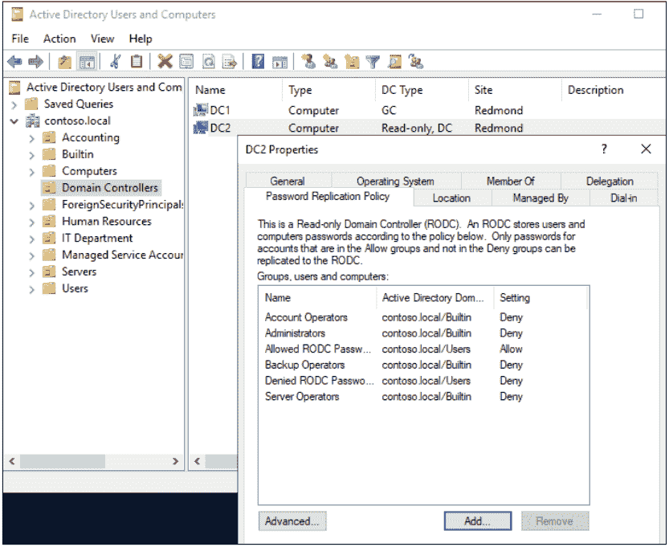

图 3.26：密码复制策略设置

> 拒绝总是获胜！在 Microsoft 世界中，权限拒绝始终优先于权限允许。对于 RODC 缓存也是如此。如果用户账户是同时属于允许 RODC 缓存和拒绝 RODC 缓存类别的组的成员，则该账户将被拒绝缓存。

## 组策略

在基于 Windows Server 和 Active Directory 的网络中，几乎总是情况是主要客户端计算机集也基于 Microsoft Windows 操作系统，并且这些机器都已加入域。以这种方式设置一切不仅在 Active Directory 内部从组织角度来看是有意义的，而且还允许跨设备和应用程序进行集中身份验证，正如我们已经讨论过的。我知道我在本书前面给出的几个例子中大概是这样的，*当公司实施了安全策略时怎么办...* 或 *确保你的服务器不会获得这些现有安全策略，因为...* 那么这些神奇的 **安全策略** 到底是什么，我该如何设置一个？

这就是组策略的强大之处。它使你能够创建 **组策略对象** (**GPOs**)，其中包含你希望应用于 Active Directory 域中计算机或用户的设置和配置。一旦你创建并构建了一个包含各种设置的 GPO，你就可以选择将该 GPO 引导到你选择的任何方向。如果你有一个想要应用于所有桌面系统的策略，你可以将其指向 Active Directory 中容纳所有已加入域的桌面计算机的适当 OU 或安全组。或者也许你创建了一个仅适用于你的 Windows 7 计算机的 GPO；你可以适当地对其进行筛选，以便只有这些系统接收策略。真正的魔力在于这些设置的发布是自动发生的，只需这些计算机加入你的域即可。你完全不需要触摸客户端系统就可以通过 GPO 将设置推送给它们。你可以使用组策略调整或锁定 Windows 操作系统中的几乎任何内容。

再次，我查看我在 Windows Server 2019 上可用的角色列表，我只是看不到一个名为 **组策略** 的角色。再次正确：没有！事实上，如果你按照本书中的实验室设置进行操作，你的网络中已经完全可以使用组策略。组策略所需工作的所有内容都是 Active Directory 域服务的一部分。因此，如果你的网络中有域控制器，那么你也在同一台服务器上拥有组策略，因为组策略使用的所有信息都存储在目录中。由于安装 AD DS 角色是我们使用组策略所需的一切，而我们已经在域控制器上完成了此操作，我们已经准备好开始使用组策略向域中的计算机和用户发送策略和首选项。

但等等！组策略是一个足够大的主题，确实需要它自己的章节，这正是我决定要做的。如果你有兴趣使用这个迷人的工具进行集中管理和管理策略，你应该会感兴趣，继续阅读，我们将在 *第 5 章，组策略* 中深入探讨所有 GPO 相关内容。

## 总结

任何使用过 Windows Server 的人都知道 Active Directory 并不是什么新鲜事物，也 certainly 不是 Windows Server 2019 中对我们来说的新事物。AD 一直是任何以 Microsoft 为中心的环境的身份验证基础，已经很长时间了，并且对于任何托管本地数据中心的个人来说，将会持续到很遥远的未来。了解和理解 AD 对于掌握 Windows Server 2019 来说是完全关键的，因为没有这方面的知识，你在服务器管理方面的职业生涯甚至无法起步。

本章中提到了另一个核心基础设施技术，该技术通常与 Active Directory 一起部署在你的所有域控制器服务器上，即 DNS。在我看来，有效管理 Microsoft 基础设施的三个内置服务器技术是任何管理员必须能够熟练工作的：Active Directory、DNS 和 DHCP。跟随我们到 *第 4 章，DNS 和 DHCP*，我们将介绍后两者。

## 问题

- 1. 在 Active Directory 中，容纳计算机和用户账户的容器（文件夹）称为...？
- 2. 在计算机加入域之前在 Active Directory 中创建计算机账户的术语是什么？
- 3. 用于指定网络中某些物理位置绑定到特定 IP 子网的管理工具是什么？
- 4. 只能从现有域控制器同步而不能接受新信息的特殊域控制器的名称是什么？
- 5. 创建细粒度密码策略需要什么工具？
- 6. 在建立林信任之前必须在 DNS 中配置什么？


# 4 DNS 和 DHCP

# DNS 和 DHCP

如果我们将 **Active Directory 域服务** (AD DS) 视为使我们的以 Microsoft 为中心的网络正常运行的最常见和核心角色，那么 DNS 和 DHCP 角色则排在第二和第三位。我至今尚未遇到过有管理员在部署新域时不同时部署 DNS 的情况，而且每个网络都需要 DHCP，无论该服务是否由 Windows 服务器提供。这两种角色都可能由传统服务器之外的其他东西提供。还有其他公司甚至设备可以提供企业网络内的 DNS 服务，这有一些优点也有一些缺点。关于 DHCP，在 Windows 之外提供该服务的选项很多，因为大多数防火墙甚至交换机都能够在网络中充当 DHCP“服务器”。尽管前面的句子都是正确的，但实际上，全球大多数公司的内部 DNS 和 DHCP 服务都是由 Windows 服务器提供的，并且这两种角色通常与 AD DS 一起位于任何给定网络中的至少一些 **域控制器** (DC) 服务器上。

在本章中，我们将介绍 Windows Server 2019 提供的 DNS 和 DHCP，了解其用途并介绍与这些角色相关的一些常见术语和任务。本章将涵盖以下内容：

- DNS 的用途
- DNS 记录的类型
- 分裂脑 DNS
- DNS 区域的类型
- DHCP 的 IP 地址分配
- 创建 DHCP 作用域
- DHCP 保留
- DHCP 故障转移
- IPAM

### DNS 的用途

域名系统 (DNS) 与 Active Directory 类似，它是一个结构化数据库，通常存储在域控制器服务器上并自动分发到网络中的其他域控制器/DNS 服务器。AD 数据库包含有关域对象本身的信息，而 DNS 则负责存储和解析网络上的所有名称。我所说的名称是什么意思？每当用户或计算机尝试通过调用名称来联系任何资源时，DNS 就是负责将该名称转换为其他内容以便将流量引导到正确目的地的平台。你看，流量从客户端到服务器的方式是通过网络，通常通过 TCP/IP 堆栈，使用 IP 地址到达目的地。当我在计算机上打开应用程序以访问驻留在服务器上的某些数据时，我可以配置该应用程序使其直接通过网络上的服务器 IP 地址与我的服务器通信。

如果我计算机上的应用程序需要与名为 APP01 的服务器通信，并且该服务器在网络上使用 10.10.10.15 的 IP 地址，我可以将 10.10.10.15 填入我的应用程序配置中，它就会成功打开。如果我以这种方式设置数百台不同的计算机，所有计算机都指向 IP 地址，一段时间后它会正常工作。但总有一天，出于某种原因，该 IP 地址可能需要更改。或者我可能添加一台第二台服务器来分担负载并处理我增加的用户流量。现在该怎么办？重新访问每台客户端计算机并更新正在使用的 IP 地址？当然不。

这是 DNS 对我们设计和管理基础设施方式至关重要的原因之一。通过使用 DNS，我们可以使用名称而不是 IP 地址。有了 DNS，我的应用程序可以配置为与 APP01 或我的服务器名称进行通信，如果我以后需要更改 IP 地址，我只需在 DNS 控制台中将其更改为更新后的 IP 地址，立即我的所有客户端计算机将开始将 APP01 名称解析为新的 IP 地址。或者我甚至可以使用更通用的名称，例如 intranet，并使其在多个不同的服务器上解析。我们稍后会讨论更多。

每当计算机向服务器、服务或网站发出调用时，它都在使用 DNS 将该名称解析为更有用的信息，以便成功建立网络连接。这在企业网络内部和外部都是如此。就我个人笔记本电脑而言，如果我现在打开 Edge 并浏览到 https://www.bing.com/，我的互联网提供商的 DNS 服务器会将 bing.com 解析为互联网上的 IP 地址，这就是我的笔记本电脑通信的地址，因此该页面成功打开。当我们在自己的企业网络内部工作时，我们不想依赖或信任公共提供商来处理我们的内部服务器名称信息，因此我们在网络内部构建自己的 DNS 服务器。由于域网络中的 DNS 记录几乎总是将名称解析为驻留在 Active Directory 中的对象，因此 DNS 和 AD DS 紧密集成是有意义的。在大多数 Microsoft 网络中，这一点是正确的，在域控制器服务器上同时安装 AD DS 角色和 DNS 角色是非常常见的做法。

### DNS 记录的类型

在网络中的服务器上安装了 DNS 角色后，我们就可以开始使用它创建 DNS 记录，这些记录将名称解析为相应的 IP 地址，或路由网络流量所需的其他信息。假设你正在域网络中工作，你可能会惊讶地发现 DNS 中已经存在许多记录，即使你还没有创建任何记录。当你同时运行 Active Directory 和 DNS 时，你对计算机和服务器执行的域加入过程会在该过程中自动注册 DNS 记录，这意味着为每个新服务器或计算机创建 DNS 记录不是你需要记住完成的任务。

我尚未在我的新实验室环境中创建任何 DNS 记录，至少不是有意为之，而当我从服务器管理器的工具菜单中打开 DNS 管理器控制台时，我可以看到已经存在一些记录。这是因为当我将这些机器加入域时，它会自动为我注册这些记录，以便新服务器和客户端能够立即在我们的域内解析：

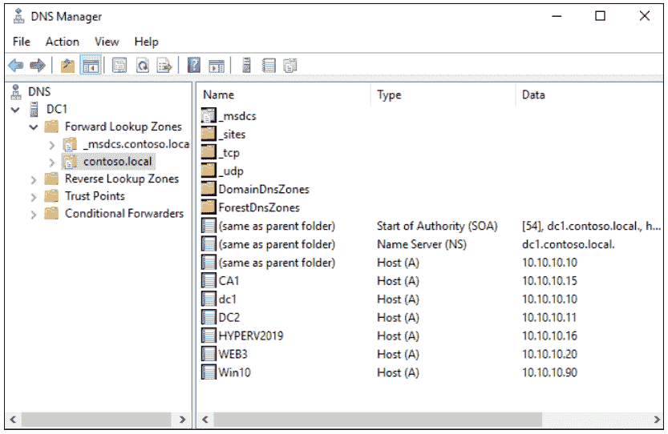

图 4.1：DNS 管理器

### 主机记录 (A 或 AAAA)

我们要查看的第一种 DNS 记录是你将要处理的最常见类型。主机记录是将特定名称解析为特定 IP 地址的记录。很简单，对于网络上的大多数设备，DNS 中存在的唯一记录类型就是它。你应该了解两种不同类别的主机记录，即使在未来几年你可能只会使用其中一种。这两种不同类型的主机记录称为 A 记录和 AAAA 记录，发音为 Quad A。两者有什么区别？A 记录用于 IPv4 地址，在大多数公司中将使用多年。AAAA 记录在解析名称到 IP 地址方面的作用完全相同，但仅用于 IPv6 地址，只有在你的网络中使用 IPv6 时才有用。

在图 4.1 中，你可以看到一些在这些机器加入我们的域时自动创建的主机 (A) 记录。我网络上还有另一台服务器尚未加入域，因此它尚未自行注册到 DNS。这台服务器称为 RA1，但如果我登录到网络上的任何其他系统，我都无法联系到我的 RA1 服务器，因为该名称尚未填入 DNS：

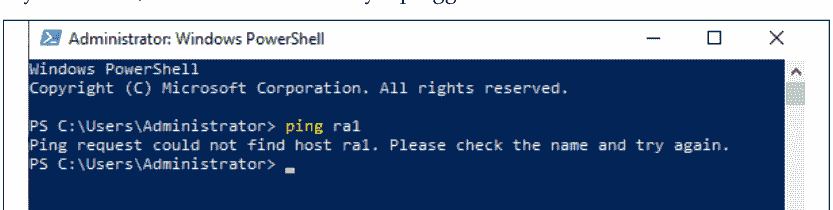

图 4.2：RA1 服务器无法解析

现在，我选择不将此服务器加入域，以便我们可以手动为其创建 DNS 记录，并在执行此操作后确保我能够正确解析名称。回到 DNS 服务器上的 DNS 管理器中，右键单击“正向查找区域”文件夹下列出的域名称，然后选择新建主机 (A 或 AAAA)。在创建新主机记录的屏幕中，只需输入服务器的名称以及其网络接口上配置的 IP 地址：

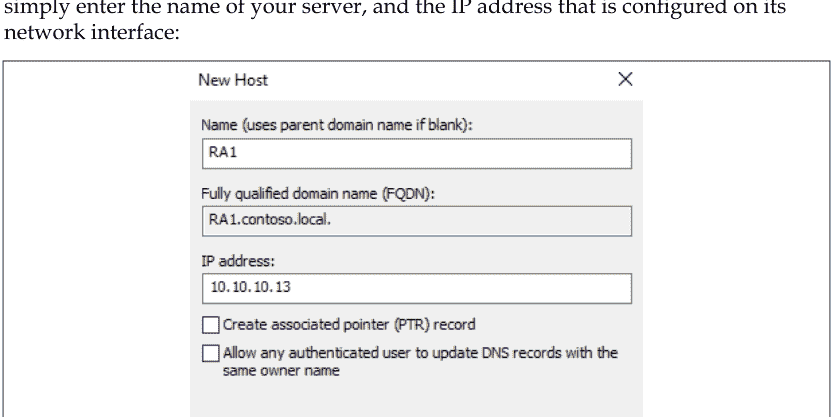

图 4.3：添加新的主机记录


现在我们已经创建了这个新的主机记录，应该能够立即在我们的域网络内部开始解析这个名称。回到我之前尝试 ping RA1 的那台客户端机器，我再次尝试相同的命令，这次它成功解析并回复：

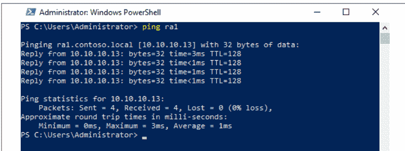

图 4.4：成功 ping RA1

## 别名记录 – CNAME

另一种有用的 DNS 记录类型是 CNAME，如今更常被称为别名记录。这是一种你可以创建的记录，它接受一个名称并将其指向另一个名称。乍一看似乎有点傻，因为最终你仍然需要使用主机记录将最终名称解析为 IP 地址，才能使流量到达所需位置，但别名记录的用途可以非常广泛。说明别名记录用处的一个好例子是当你在网络内部运行提供网站的 Web 服务器时。与其强迫所有用户记住像 http://web1.contoso.local 这样的 URL 来访问网站，我们可以创建一个名为 intranet 的别名记录，并将其指向 WEB1。这样，更通用的 intranet 记录就可以始终被客户端计算机使用，这对用户来说是一个更友好的名称，便于记忆。

除了通过这个新的 DNS 记录创造更愉悦的用户体验外，你同时也获得了额外的管理灵活性，因为你可以轻松更改该记录下运行的服务器组件，而无需调整客户端机器上的任何设置或重新培训员工如何访问页面。需要更换 Web 服务器？没问题，只需在旧服务器旁准备好新服务器，然后将别名记录指向新服务器即可。需要添加另一台 Web 服务器？也很简单，因为我们可以创建多个别名记录，都使用相同的 intranet 名称，并将它们指向环境中正在使用的不同 Web 服务器。这创建了一种非常简单的负载均衡形式，因为 DNS 将根据该 intranet CNAME 记录开始在不同 Web 服务器之间轮询流量。

事实上，与其继续谈论这个，让我们来试试。我在环境中正好有一个运行在该 URL 上的网站，但目前我只能通过输入 http://web1.contoso.local 来访问它。在 DNS 中，我将创建一个别名记录，将 intranet 重定向到 WEB1：

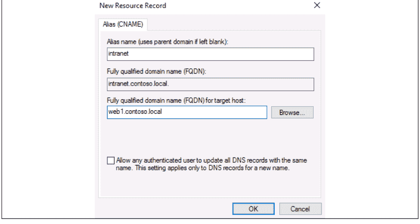

图 4.5：创建新的别名记录

现在当我 ping intranet 时，你可以看到它解析到了我的 WEB1 服务器。当访问网页时，我只需在 Internet Explorer 的地址栏中输入单词 intranet 即可启动我的页面。网站本身并不感知名称的更改，因此我不需要对网站本身做任何修改，只在 DNS 中进行更改：

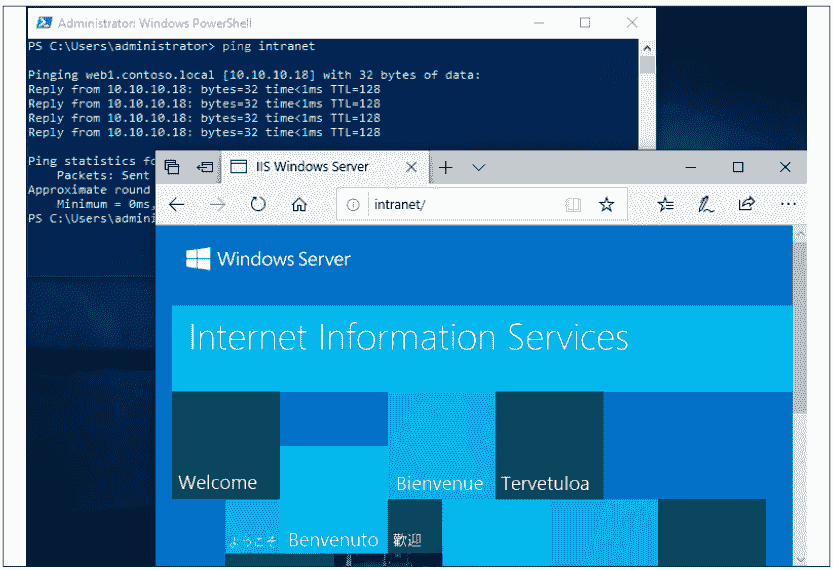

图 4.6：使用新的别名加载 WEB1

## 邮件交换器（MX）记录

第三种 DNS 记录类型称为邮件交换器（MX）记录。在日常工作中，你遇到或配置 MX 记录的频率远不如 A 或 CNAME 记录，但它们仍然很重要。MX 记录完全关乎电子邮件服务和投递。无论你的电子邮件地址中 @ 后面跟随什么域名，处理该域名的 DNS 服务器必须包含一个 MX 记录，告诉该域名其邮件服务应指向何处。MX 记录最常用于公共 DNS，用于通过互联网进行的名称解析。对于在本地 Exchange 服务器上托管自己电子邮件的公司，你的公共 DNS 服务器将包含一个指向其 Exchange 环境的 MX 记录。对于将电子邮件托管在 Office 365 等云服务中的公司，你的公共 DNS 记录需要包含一个 MX 记录，将电子邮件流量导向托管其邮箱的云服务提供商。

每当发送一封外发电子邮件时，互联网需要确定如何投递该邮件。会检查邮件目的地域名的公共互联网 DNS，而该 DNS 配置中包含的 MX 记录定义了邮件被发送到何处。如果没有 MX 记录，或者由于某种原因它消失了，你的域名将收不到任何邮件。

## TXT 记录

TXT 只是文本记录的简写。TXT 记录在 DNS 中用于各种目的，可以包含几乎任何类型的信息。有时 TXT 记录是为人类阅读某种信息而放置的，但更可能的是你会在某个时候被要求创建 TXT 记录作为一种验证形式。

例如，大多数网站都受 SSL 证书保护，而购买 SSL 证书的过程相当直接。然而，你肯定不希望任何带着笔记本电脑和互联网接入的家伙能够购买一个可以保护以你企业拥有的域名结尾的网站名称的证书，对吧？因此，证书颁发机构（CAs）（购买 SSL 证书的地方）在允许你为域名购买证书之前会要求某种验证过程。有时该验证过程只是向与该域名关联的地址发送电子邮件，有时你会被要求在公共 DNS 记录中创建包含非常精确字符集的 TXT 记录。其含义和验证当然是，如果你真的拥有该域名，你将有权在该域内创建 DNS 记录。当 CA 看到你新建的包含他们要求你输入的数据的 TXT 记录时，他们就知道你确实拥有该域名。试图伪造你的网站并恶意获取 SSL 证书的攻击者将无法访问你域名的 DNS 设置。

## SPF 记录

有几种特殊的 TXT 记录，其中常见的一种是发件人策略框架（SPF）记录。该记录涉及电子邮件的投递，但 MX 记录标识电子邮件应流向哪些服务器，而 SPF 记录标识电子邮件来自何处。SPF 记录是垃圾邮件和伪造计算的一部分，用于识别预期从你的域名流出的电子邮件来自互联网上的哪些位置。让我们看几个 SPF 记录示例，这将帮助你了解它们的格式，并有助于说明它们为何必要：

```
v=spf1 [IP address 1] [IP address 2] [include:<domain>] -<enforcement rule>
```

上述是 SPF TXT 记录的标准格式。对于所有电子邮件都从互联网上的一个公共 IP 地址或一个托管电子邮件系统流出的简单电子邮件系统，你的记录会很简短。Office 365 发出的电子邮件就是一个很好的例子。所有在 Office 365 中托管电子邮件的人都应具有包含以下信息的 SPF 记录：

```
v=spf1 include:spf.protection.outlook.com -all
```

SPF 记录信息由接收电子邮件服务器用于验证传入邮件。该邮件服务器会接收电子邮件，发现其来源域名，然后通过互联网再次联系该域名的 DNS 服务器以检查是否存在 SPF 记录。如果找不到此类记录，你的电子邮件被标记为垃圾邮件的可能性会大大增加。如果找到了 SPF 记录，邮件服务器随后会检查该记录中的条目，这些条目标识了我们期望邮件流出的安全位置，并确认电子邮件确实源自这些位置之一。在我们之前的 Office 365 SPF 记录中，我们包含了域名 spf.protection.outlook.com。所有从 Office 365 服务器流出的电子邮件都将匹配此来源，因此此简单记录是确保从你的 Office 365 租户安全投递电子邮件所需唯一的内容。

现在假设你的 SPF 记录已经就位并与你的托管电子邮件配合工作，但你设置了一台本地 SMTP 中继服务器，以便网络上的复印机能够扫描到电子邮件。这是企业常见的需求，我在实际环境中也经常遇到。你的 SMTP 服务器的性质并不重要；有各种方法可以实现这一点。不过你通常会发现，当你从复印机发送电子邮件时，该邮件可能会开始被标记为垃圾邮件。有时它会进入收件人的垃圾邮件文件夹，有时会被捕获且根本未被投递。为什么会这样？如果你有一个现场 SMTP 中继邮件来自那里，请记住复印机只是将电子邮件交给 SMTP 中继，而该中继是负责在互联网上传输电子邮件的人。该中继邮件并非来自 spf.protection.outlook.com，而是从你的本地服务器发送的电子邮件来自你的 ISP 外发公共 IP 地址。你的 SPF 记录需要调整以包含此额外的安全发件人，以便你的电子邮件收件人知道来自你大楼的邮件是合法的。让我们构建一个包含单个 IP 地址的 SPF 记录：

```
v=spf1 ip4:8.8.8.8 include:spf.protection.outlook.com -all
```


就这样！只需将复印机扫描件发出的公网 IP 地址添加到你的 SPF 记录中，收件方邮件服务器就会更信任这些传入邮件。

> 我显然是在前文中使用 8.8.8.8 作为示例；不要把它填入你自己的 SPF 记录中！你需要识别实际的外发 IP 地址并使用该信息代替。

添加多个 IP 地址也很简单，例如，如果你的企业拥有多栋建筑，每栋都有自己的 ISP 连接，并且希望来自各地点设备（如复印机）的邮件流量能够正常传输：

```
v=spf1 ip4:8.8.8.8 ip4:4.4.2.2 include:spf.protection.outlook.com -all
```

## 强制规则 -all

SPF 记录末尾的那个 -all 到底是什么？很高兴你问了！SPF 末尾的声明是在告诉接收邮件服务器应如何严格执行这些 SPF 规则。你可以有三种不同的方式来配置该强制规则：

```
-all
```

这通常是你始终希望设置 SPF 记录的方式。-all 表示“硬失败”。它将 SPF 规则设为严格，以便收件方邮件服务器遵循这些规则。

```
~all
```

如果你不确定 SPF 记录中是否列出了所有 IP 地址，可以在软失败场景下使用此替代方案。我只会将其作为临时措施使用，老实说，我从未在生产环境中遇到过如此配置的 SPF 记录。

```
?all
```

这里的最后一个选项是中性的。仅在测试 SPF 记录时使用它，因为在你之后将其更改为 -all 之前，它不会有助于邮件投递。

## 名称服务器 (NS) 记录

这里还有另一种 DNS 记录类型，你日常不必处理，但仍应了解其用途。NS 记录是 DNS 区域内的标识符，用于指定该区域应使用哪些名称服务器（即你的 DNS 服务器）作为权威服务器。如果你现在查看内部 DNS 中列出的 NS 记录，你会发现它列出了网络上 DNS 服务器的名称。当你在域中添加新的 DC/DNS 服务器时，该服务器的新 NS 记录会自动添加到你的 DNS 区域中：

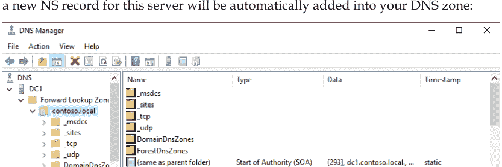

图 4.7：在你的区域中查看名称服务器记录

## 公共名称服务器记录

在处理公共/互联网 DNS 记录时，NS 记录至关重要。我无法告诉你我帮助过多少次管理员，他们试图为其区域创建新的 DNS 记录却苦苦挣扎，因为无论他们在 DNS 设置中填入什么，新记录似乎永远不会在互联网上显示并生效。快速查看后，我们发现该域的 Name Server 记录指向了完全不同的服务器或服务，而他们甚至没有意识到这是 DNS 方程的一部分。以下示例场景有助于解释：

当你接手一家公司的服务器管理工作时，你继承了一个已建立的基础设施。之前的管理员已记录了所有密码；到目前为止一切看起来都不错。公司的市场总监有一张公司信用卡，并在第二天来找你，告诉你他没有走正规的 IT 采购渠道，而是刚刚注册了一个名为 xyz 的营销服务，该服务将帮助发送群发邮件。该营销公司要求在你的公共 DNS 中创建名为 CNAME 的记录，以便你的邮件和他们的系统能够协同工作。现在由你来放置这些 CNAME 记录。

没什么大不了的，对吧？你查阅密码文档，找到一条标记为“DNS”的记录，其中有 GoDaddy 的登录凭据。听起来像是中了大奖，而且合情合理，因为 GoDaddy 是互联网上管理 DNS 区域的常见平台。你登录 GoDaddy，编辑域的 DNS 区域，并添加新的 CNAME 记录。CNAME 记录尚未解析，但你知道 DNS 传播在互联网上需要一段时间，所以你告诉市场先生，他的服务应该在 24 小时内上线。你是英雄！

但是……24 小时过去了，仍然无法工作。M 先生开始施压，你意识到季度奖金可能没那么稳妥。不幸的是，你忘记了拼图中的一个关键部分。即使你拥有 GoDaddy 账户，且它被标记为“DNS”，并且你能够在该账户中创建新的 DNS 记录，域的注册商实际上可能将名称服务器记录指向了完全不同的 DNS 服务！在此场景中，一个有用的工具是来自 MXToolBox.com 的 DNS Lookup 工具。在互联网上快速搜索即可找到当前链接，你只需在 DNS Lookup 工具中输入你的域名，它就会告诉你当前使用了哪些名称服务器，以及实际在互联网上托管你 DNS 记录的是哪项服务。

按照上述流程，你发现域的名称服务器记录实际上指向的是 Network Solutions，而不是 GoDaddy！事实证明，你的 IT 前任并不完全清楚如何进行域名转移，他们进行到一半就停止了，所以虽然你可以使用 GoDaddy，并且域名甚至列在 GoDaddy 控制台中，但当互联网上的任何计算机尝试查找你域的 DNS 信息时，名称服务器记录会指示该计算机前往 Network Solutions 获取该域的 DNS 服务器，而不是 GoDaddy。你现在有两个选择。你可以登录 Network Solutions 并在那里添加 CNAME 记录，因为 Network Solutions 目前是为你的域提供 DNS 解析的服务，所以它们会生效；或者你可以完成迁移并更新名称服务器记录，使其指向 GoDaddy 的 DNS 服务器，而不是 Network Solutions。

总结一下，DNS 查找发生的流程如下：

客户端/服务器发起 DNS 请求 >> 名称服务器记录识别出所请求域的权威 DNS 服务器 >> DNS 查找被引导至这些名称服务器 >> DNS 解析发生。

## ipconfig /flushdns

最后再补充一点来结束本节。我一直说诸如“现在我这样做……”或“在此更改后立即……”之类的话，如果你正在创建自己的记录，你可能会注意到客户端计算机有时需要一段时间才能识别这些新的 DNS 记录。这是正常行为，更改在整个网络中生效所需的时间完全取决于你的网络规模以及 Active Directory 复制的配置方式。当你在其中一台域控制器上创建新的 DNS 记录时，该记录需要在网络中的所有其他 DC 之间复制。仅此过程如果 AD 未配置为更快复制，可能需要长达几个小时。通常只需要几分钟。然后，一旦新记录存在于所有 DC 服务器上，你的客户端可能仍需要一点时间才能使用新记录，因为域网络中的客户端计算机会保留 DNS 数据缓存。这样，它们就不必为每个名称解析请求都联系 DNS 服务器。它们可以更快地参考本地缓存，以查看上次与 DNS 服务器检查时信息是什么。如果你想立即测试刚创建的新 DNS 记录但它不起作用，你可能想在客户端计算机上运行 ipconfig /flushdns 命令。这会强制客户端丢弃其本地缓存的 DNS 解析器记录副本，并从 DNS 服务器获取最新的信息。刷新缓存后，新记录很可能会开始正常解析。

## 分裂脑 DNS

在我们所有的实验室配置、截图和示例中，你会注意到我们在内部网络中创建的域始终以 .local 结尾。这是出于目的性的，也是最佳实践。公共 DNS 区域，如你所知，可以以多种方式结尾。存在于互联网上的网站或服务可能以 .com、.org、.edu、.biz、.info、.tech、.construction 等结尾——列表还在继续。这些被称为顶级域名，此类 DNS 后缀的创造性使用应保留在互联网上，远离我们的内部 DNS 区域。

现在，许多人可能已经在企业环境中工作，其中内部 DNS 配置为除 .local 之外的其他名称，因此你已经意识到内部域完全可以配置为这些其他后缀之一。例如，Microsoft.com 显然是 Microsoft 拥有的公共域名之一，他们完全也可以将 Microsoft.com 用作内部 DNS 区域。事实上，它甚至可能是 Active Directory 内部的主要域名，这不一定会造成任何问题，但如果你不知道自己在做什么，肯定会增加出现问题的可能性。


每当一家公司将内部 DNS 配置为与其外部 DNS 匹配时，这通常被称为 **分裂脑 DNS**。多年前，微软在互联网上发布了文章警告管理员不要这样做，因为这会导致混淆以及一些微软角色和技术出现问题，而这些公司会尝试在他们的环境中部署。时间推移后，许多人要么不知道要么简单地忽略了这一建议，因此现在世界各地充斥着存在分裂脑 DNS 的网络。其中许多环境已经如此庞大和复杂，以至于现在永远不会被更改，因此微软和世界别无选择，只能适应。值得庆幸的是，在当今世界，大多数你部署的角色或服务都是以一种开箱即用的方式编写的，可以适应可能的分裂脑 DNS，但有些仍然需要特别考虑。

一个例子是 Microsoft DirectAccess，我们将在 *第8章，远程访问* 中介绍。在部署 DirectAccess 时，有一个关键的客户端技术称为名称解析策略表，必须根据你的内部 DNS 架构进行填充。对于内部使用 .local 域的公司来说，此配置轻而易举且不需要特别考虑。对于任何使用分裂脑 DNS 的人来说，这有时会变成一个复杂混乱的情况，对于不熟悉 DirectAccess 复杂性的人来说，环境中仅仅存在分裂脑 DNS 就可能意味着你永远无法在环境中使 DirectAccess 正常工作。

乍一看，你会认为如果内部 DNS 区域与公共 DNS 区域匹配，管理会变得更容易，但事实并非如此。事实上，你会发现恰恰相反。每当你发布任何外部服务时，你就必须对内部 DNS 做出特别考虑，以便该服务从网络内部按预期工作，因为内部 DNS 区域通常会优先于外部。分裂脑 DNS 最终在日常工作中会带来更多的工作。

俗话说，你可以把马带到水边，但不能强迫它喝水。你现在已被告知，在网络内部使用与互联网上相同的 DNS 区域必然会给你带来一些头痛。至于你在未来的构建中如何利用这些信息，嗯，这取决于你...

## DNS 区域的类型

你现在已经熟悉创建不同类型的 DNS 记录，但这些信息只能让你在现有 DNS 区域内创建新记录。目前在我们的测试实验室中，我们只有一个可用的 DNS 区域，即 contoso.local，它是在我们构建 contoso.local 域时自动创建的。截至目前，使用我的 contoso.local 域控制器之一作为 DNS 服务器的计算机只能查找我已添加到我的 DNS 区域中的 DNS 记录。

使用 Windows Server 2019 提供的 DNS Server，你当然可以构建许多不同的 DNS 区域，以提高网络中的名称解析能力。有很多不同的原因可能促使你想要创建额外的 DNS 区域，你应该了解可供实施的区域类型。让我们花一点时间讨论一下我们可用的不同区域类型。

## Active Directory 集成区域

这本身并不是一种“区域类型”，而是在创建某些类型的 DNS 区域时可以选定的一个选项。创建新区域时，你会看到一个复选框，其说明为 Store the zone in Active Directory。选中后，这意味着你正在创建的新区域将被存储在 Active Directory 内部，而不是作为独立区域存储在你创建该区域的 DNS 服务器上。存储在 AD 中意味着此新区域能够自动复制到域中的所有域控制器服务器，这意味着你的 DNS 区域具有高度可用性，并且在整个网络中可以更快地访问。一般来说，如果你正在创建的区域类型允许存储在 Active Directory 中，就这样做。

在域控制器上打开 DNS 管理器工具后，你会注意到任何当前的 DNS 区域都列在名为 Forward Lookup Zones 和 Reverse Lookup Zones 的文件夹下。有什么区别？

## 正向查找区域

配置在 Forward Lookup Zones 内部的区域是你的传统 DNS 区域。它们的目的是接收来自客户端计算机等发出的 DNS 请求，并将该 DNS 名称请求转换为 IP 地址交还给客户端计算机。Forward Lookup Zones 几乎总是 DNS 管理员的工作位置。

## 反向查找区域

如果“反向”是“正向”的相反，那么在 DNS 上下文中也必须如此。Reverse Lookup Zones 负责将 IP 地址反向映射为名称。你可能甚至没有意识到这些在你的环境中发生了，但你随时可以轻松测试。你可能都知道如何使用 ping 命令，它依赖 DNS 将名称转换为 IP 地址。当然，这是由 Forward Lookup Zone 处理的，就像我们在这里看到的那样：

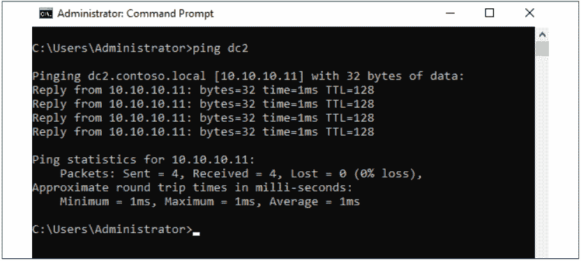

## 图 4.8：将名称解析为 IP

你知道你也可以使用 ping 命令执行相反的操作吗？如果想查询 DNS 以找出 10.10.10.11 IP 地址映射回的主机名怎么办？

```
ping -a 10.10.10.11
```

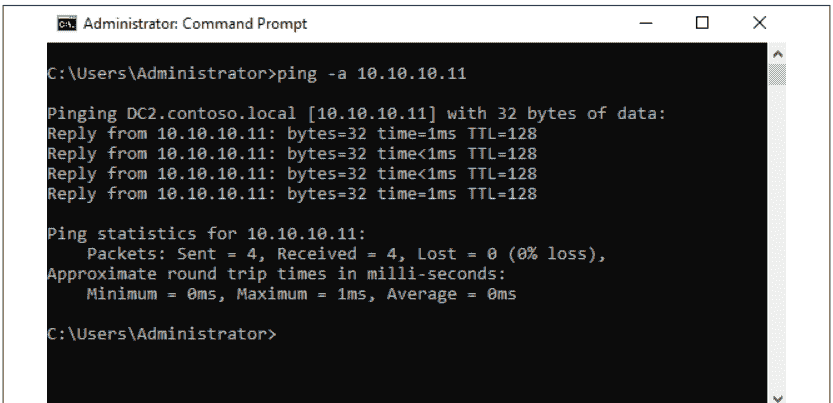

## 图 4.9：查询 DNS 以从 IP 查找主机名

这种反向查找，将 IP 地址转换回名称，显示 IP 地址 10.10.10.11 具有一个反向指针记录，映射回我们的 DC2 服务器。这种类型的查找由 DNS 内部的 Reverse Lookup Zone 处理。

现在我们了解了 Forward 和 Reverse Lookup Zones 之间的区别，右键单击 **Forward Lookup Zones** 并选择 **New Zone...** 会让我们看到三种可创建的区域类型选择：

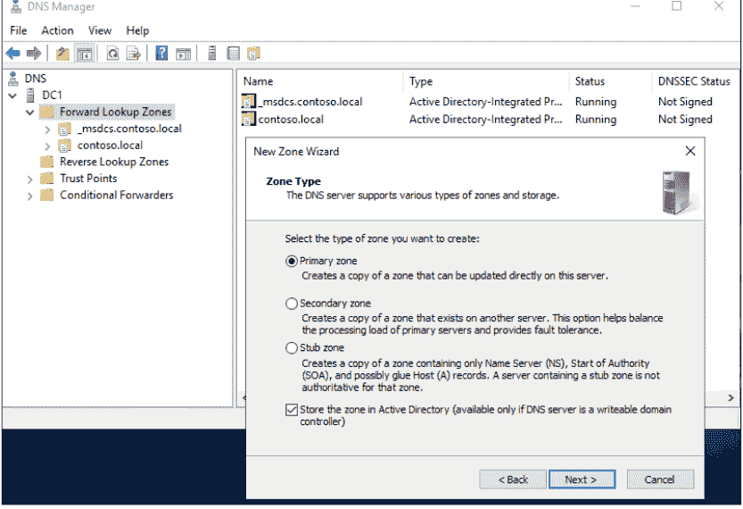

图 4.10：创建区域

## 主区域

内部网络中的大多数 DNS 区域都是主区域。这表明它是“父级”，换句话说，任何特定 DNS 区域的主副本将是该域的主区域。当对 DNS 记录进行更改和更新时，它始终发生在主区域中。我们将在几分钟内一起创建一个新的主区域。你可以选择将主区域存储在 Active Directory 中，也可以不存储。

## 次要区域

根据其名称，似乎次要区域可能不如主区域重要，这通常是正确的。次要区域只是主区域的只读副本。由于它是只读的，因此不能在次要区域内进行更新，它始终从主区域同步。次要区域可用于在多个服务器之间分配 DNS 计算能力，减轻主区域的负载，但重要的是要知道次要区域不是 Active Directory 集成的。当你尝试选择创建新的次要区域的选项时，你会注意到 AD 复选框变灰。

在我工作过的大多数基于 Microsoft 基础设施的网络中，你的主区域都设置为 Active Directory 集成，这意味着它们无论如何都会同步到所有基于域控制器的 DNS 服务器。在这种情况下，次要区域不太可能需要。如果你偏离这种思维方式并创建既不是域控制器的 DNS 服务器（你完全可以这样做）——那么你可能需要确保你了解次要区域的用例，因为在此场景中你更有可能使用它们。

## 委派区域

新区域屏幕上的第三个选项是 Stub Zone。与次要区域类似，委派区域是主区域的副本，但只包含某些信息。也就是说，委派区域包含资源记录，帮助客户端识别并更快地访问它们所调用的区域的完整 DNS 服务器。委派区域如果需要可以是 AD 集成的。

委派区域使你的 DNS 服务器能够知道如何定向流量以解析另一个域内的记录。听起来就像我们在上一章学到的条件转发器，对吧？相似，是的，但正如你所知，我们将条件转发器指向特定的 IP 地址，告诉 DNS 对远程域的请求应始终指向特定服务器或服务器。委派区域包含远程域的 NS 记录，因此即使该远程域进行一些内部调整并且其 DNS 服务器发生变化或更新，委派区域也能更准确地处理这些情况。

AD 集成的 DNS 区域使用域复制在域控制器之间复制，但非 AD 集成的 DNS 区域必须使用自己的进程同步，即区域传输。委派区域可用于帮助使区域传输过程更高效，并为客户端计算机创建更快的名称解析。


## 创建新的区域

我们将通过本节的快速演示来完成本节内容，演示如何创建新的 DNS 区域。过程很直接，但在过程中有几个选项需要考虑。在大多数情况下创建新的 DNS 区域时，您这样做是为了使内部客户端计算机能够解析新内部命名空间（例如另一个 .local）的名称，以便您可以使用该内部命名方案访问网络内部的服务器和资源。

在我们的示例中，让我们创建一个新的主区域，就像为任何内部命名空间所做的那样，但我们将配置 DNS 区域的名称，使其与众所周知的互联网命名空间冲突。本演示不仅会展示我们在配置 DNS 区域时可用的选项，还会让您一窥在分裂脑 DNS 场景中可能出现的挑战类型。它还说明了当客户端位于网络内部时，其内部 DNS 服务器优先于互联网 DNS 服务器这一事实。

在 DNS 管理器中，右键单击 **Forward Lookup Zones** 并选择 **New Zone....** 现在选择创建新的 **Primary Zone** 的选项，我将选择将其存储在 Active Directory 中。如果您需要这些选项的参考点，请参阅图 4.10。

我们现在会遇到一个标题为 **Active Directory Zone Replication Scope** 的屏幕。此屏幕和选项仅在选中 **Store inside AD** 选项时才会出现，否则向导将跳过此屏幕。在这里，您可以选择希望此新 DNS 区域在域控制器之间复制的范围。您可以复制到域内的所有 DC，甚至整个林。

接下来，为区域命名。您在此为区域提供的名称是该区域将包含记录的命名空间。这里的可能性是无穷无尽的，我甚至可以输入 Jordan.local 作为我的 DNS 区域，或 Jordan.com。这实际上是一个合法的网站，重定向到 Nike.com，我想这是公平的，因为迈克尔·乔丹比我更受欢迎。

现在，我只是为了好玩才输入了 Jordan.com，但它实际上正好说明了我想要向您展示的内容，所以让我们坚持使用它。这可能是我在 DNS 管理器中做过最愚蠢的事情。

为了证明这里发生的情况，首先从我网络中的一台客户端计算机打开了网页浏览器，并验证我可以成功访问 Jordan.com。如果我 ping 该名称，您可以看到它解析为一个公共 IP 地址，这是预期的。这是托管 Jordan.com 的 Web 服务器的公共、可通过互联网路由的 IP 地址：

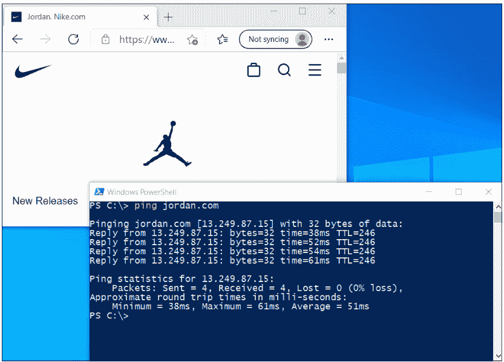

图 4.11：解析公共 DNS 区域

这是完全正常的行为，对吧？输入网站 URL，即 DNS 名称；DNS 将其解析为主机网站的 IP 地址，您的浏览器会带您前往。接下来，在我们的内部 DNS 服务器上完成新的 Jordan.com 内部 DNS 区域的创建。

在区域创建向导中，我输入了区域名称 Jordan.com，下一个需要回答的屏幕是关于动态更新的。服务器管理员始终可以手动在 DNS 区域内创建 DNS 记录，但如果您的环境中有数百台客户端计算机，您真的希望 DNS 记录的创建成为全职工作吗？幸运的是没有必要这样做，因为加入域的客户端计算机在每次连接到网络时都会自动尝试将其自己的主机名和 IP 地址注册到 DNS 服务器。此过程称为动态更新，此屏幕上的设置显示了有关这些更新的选项。您可以允许或禁止每个区域的动态更新，并设置更新过程需要多安全的一些要求。在大多数域环境中，您会配置顶部选项，仅允许区域中的安全更新。如果您的网络中存在大量旧设备或非 Microsoft 产品，您可能需要选择第二个选项以允许安全和非安全更新：

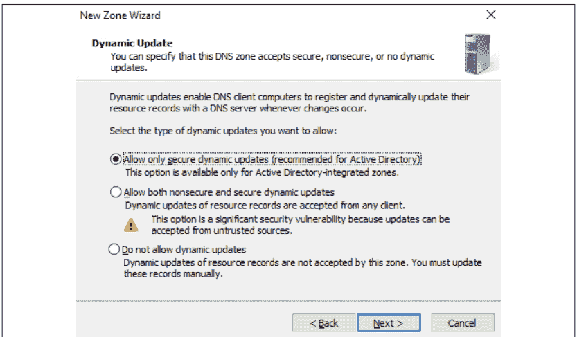

图 4.12：DNS 更新的安全性

就是这样！向导的最后屏幕只是设置审核，单击“完成”后，您的新 DNS 区域即可立即使用并开始解析新 Jordan.com 命名空间中的名称，供任何使用此服务器作为 DNS 服务器的客户端计算机使用。如图 4.13 所示，Jordan.com 区域现在已列在 DNS 管理器中，我还创建了几个 A 记录，以便对 Jordan.com 或 www.Jordan.com 的任何请求都返回 IP 地址 10.10.10.23。（看到了我做了什么吗？号码 23？）：

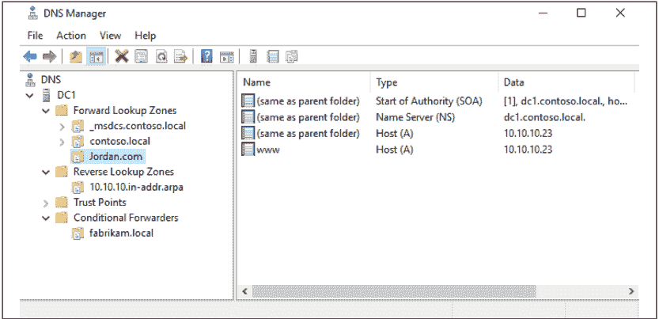

图 4.13：创建内部 Jordan.com DNS 区域

现在我们的新区域已在网络内部创建，这改变了什么？让我们回到我测试网络中的那台客户端计算机，再次尝试浏览和 ping Jordan.com：

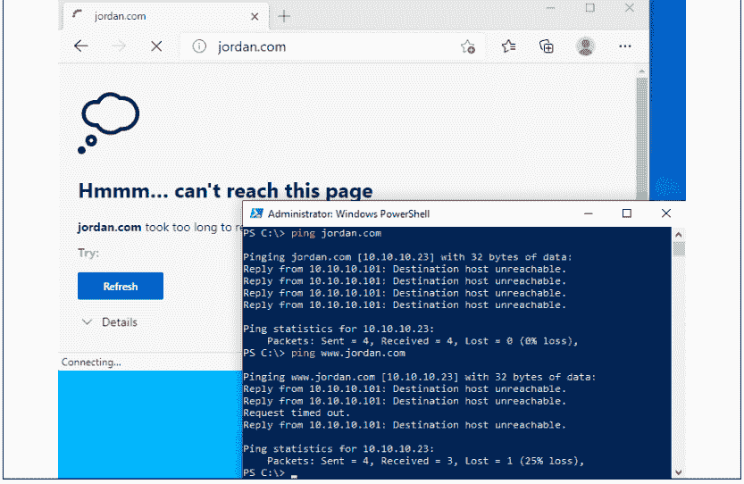

图 4.14：再次 Ping Jordan.com

在创建此新区域之前，我对 Jordan.com 的客户端请求只是简单地转发到公共互联网 DNS 服务器，因为我的内部 DNS 服务器没有任何关于如何处理 Jordan.com 查询的定义。在为 Jordan.com 创建内部 DNS 区域后，我们现在中断了对该网站的访问，因为我们自己的 DNS 服务器现在拥有处理这些名称请求自己的规则集！如果我在 Web 服务器上构建自己的网站并为该服务器分配 IP 地址 10.10.10.23，当我的客户端计算机在浏览器中输入 Jordan.com 时，将成功加载我的自定义网站。

本示例有两个目的。首先，演示创建新 DNS 区域的过程以回顾可用选项，并展示其易用性。其次，确保您理解内部企业 DNS 服务器优先于公共互联网 DNS 服务器。这意味着在创建 DNS 区域时以及在决定是否通过在网络内部托管公共命名空间来采用分裂脑 DNS 时，您需要谨慎，因为您的内部 DNS 服务器将成为这些区域的主要解析器。

## 使用 DHCP 进行 IP 地址分配

您网络上的 IP 地址有点像您街道上的家庭地址。当您想向某人发送包裹时，您会在包裹正面写上他们的地址并放入邮箱。同样，当您的计算机想要向服务器或网络上的另一台设备发送数据时，这些设备各自都有一个用于交付这些数据包的 IP 地址。我们知道 DNS 负责告诉机器哪个名称解析为哪个 IP 地址，但这些 IP 地址最初是如何部署到服务器和计算机上的呢？

静态寻址只是手动配置系统上 IP 地址的过程，使用您自己的双手作为配置工具，将所有 IP 地址信息填入该设备上的 NIC 设置中。虽然这是一种快速简便的方法，可以通过为每个端点分配 IP 地址来使网络流量在少数端点之间流动，但它不可扩展。我们经常对服务器进行静态寻址，以确保这些 IP 地址不会发生变化，但客户端和设备方面呢？即使在只有 10 名员工的小公司中，每个人可能有一台台式机和一台笔记本电脑，网络上可能还有需要 IP 地址的打印机，您可能还有一个无线网络，员工甚至客人可以连接手机和其他设备以获得互联网访问。您会手动为所有这些设备分配 IP 地址吗？当然不会。

我们对这个问题的答案是 **Dynamic Host Configuration Protocol (DHCP)**。这是一种协议，旨在通过提供机器和设备接入您的网络并自动获取 IP 地址信息的能力来解决我们确切的问题。全世界几乎任何设备上的任何用户每天都在使用 DHCP 而甚至没有意识到。当您将笔记本电脑或智能手机连接到 Wi-Fi 路由器以获得互联网访问时，DHCP 服务器通过分配 IP 地址信息为您提供了在该 Wi-Fi 网络上路由流量的能力。通常，在公共 Wi-Fi 的情况下，您的 DHCP 服务器实际上运行在路由器本身上，但在 Windows Server 主导数据中心的企业中，我们的 DHCP 服务通常托管在一台或多台服务器上。

## 创建 DHCP 作用域

到目前为止，在我正在构建的新 Windows Server 2019 实验室环境中，我一直为所有正在构建的服务器静态分配 IP 地址。这开始变得陈旧且难以跟踪。当第一个域控制器配置时，我在其上安装了 DHCP 角色，但尚未告诉它开始执行任何操作。DHCP 服务器需要什么才能开始分发 IP 地址？它需要知道您网络中的 IP 地址、子网掩码、默认网关和 DNS 服务器地址，以便将其打包并开始向请求它的计算机分发信息。DHCP 服务器内部的这个信息包称为 **DHCP scope**。一旦我们定义了作用域，DHCP 服务器将开始从该作用域向我们的新服务器和尚未定义静态地址的计算机分发 IP 地址。


再一次，我们需要在 Windows Server 2019 上启动一个管理工具，再一次，最简单的方法是通过服务器管理器中的 **Tools** 菜单来启动。继续启动 **DHCP** 控制台。在其中，你会看到运行 DHCP 服务器的服务器名称。展开它，你将同时看到 **IPv4** 和 **IPv6** 的选项。是的，这意味着你可以使用此 DHCP 服务器为正在测试 IPv6 或计划将来使用的用户分发 IPv4 地址以及 IPv6 地址。现在，我们坚持使用老式的 IPv4，因此我可以右键单击 **IPv4** 并选择创建 **New Scope**。这会启动 **New Scope Wizard**，它会引导你完成 DHCP 服务器创建作用域所需的一些信息，以便在网络内部开始分发 IP 地址。我将我的新作用域设置为分发从 10.10.10.100 到 10.10.10.150 的 IP 地址：

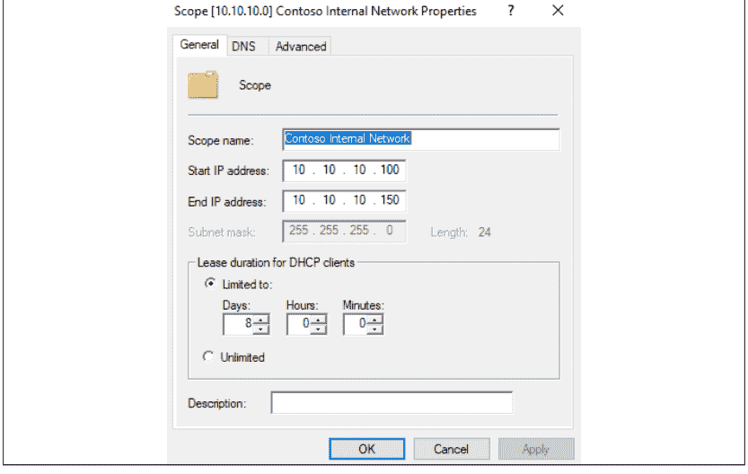

图 4.15：设置新的 DHCP 作用域

一旦你完成作用域的创建，它会立即生效，网络中任何将 NIC 配置为从 DHCP 服务器自动获取地址的计算机都将开始向此新的 DHCP 服务器请求地址。

现在我们的新作用域已经创建，你可以在 DHCP 控制台中展开该作用域并查看有关此作用域的一些附加信息。通过单击 **Address Leases** 文件夹，你可以看到此 DHCP 服务器已分发的所有 DHCP 地址。

正如你在图 4.16 中看到的，我网络上有一台 Windows 10 客户端计算机，它没有静态地址，因此它已从我的 DHCP 服务器获取了一个 DHCP 地址。它被分配了我在此作用域中定义的第一个 IP 地址 10.10.10.100。接下来从此 DHCP 服务器获取 IP 地址的机器将收到 10.10.10.101，以此类推：

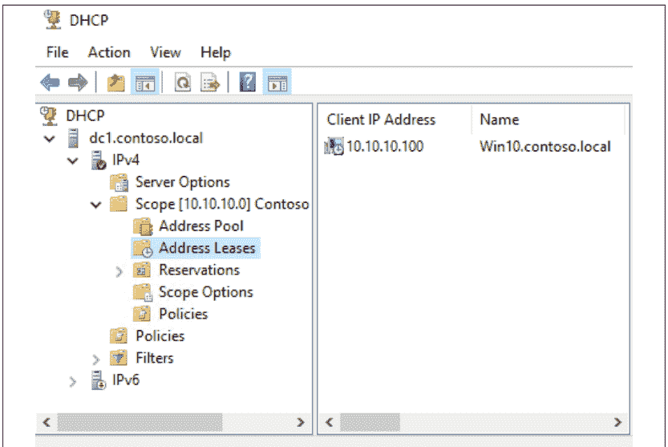

图 4.16：DHCP 分配的 IP 地址

## 范围选项

DHCP 作用域可以配置为分发非常少量的信息，就像我们到目前为止所配置的那样，或者在需要时 DHCP 能够分发更多信息。当客户端向 DHCP 请求信息时，我们目前分发的是 IP 地址和子网掩码，因为这两条信息对于使网络上的流量流动至关重要。然而，大多数网络都需要向 DHCP 客户端提供至少几条额外的信息，以便这些设备在传统的企业网络中真正可用。

在我们刚刚创建的新作用域下，你会看到一个名为 Scope Options 的文件夹。右键单击 Scope Options，然后选择 Configure Options...。

在这里你会找到许多、许多不同的复选框，所有这些都是可用的 DHCP 作用域选项。通过选择一个复选框并为该特定作用域选项填充必要的信息，你就在配置此 DHCP 作用域，不仅向所有请求连接的客户端提供简单的 IP 地址和子网掩码信息，还提供这些附加信息。其中两个非常常见的是 003 Router 和 006 DNS Servers。003 Router 指定本质上是客户端 NIC 上的默认网关设置。几乎所有网络都会有一个默认网关，通常是防火墙或路由器，通过选择此选项你可以定义分配给 DHCP 客户端的默认网关地址。

在图 4.17 中，你可以看到我已选择 006 DNS Servers，并配置了我实验室中 DNS 服务器的 IP 地址。现在，当我的客户端计算机通过 DHCP 拉取 IP 地址时，它们的 NIC 也会被自动配置为这两个 DNS 服务器地址，这将使它们能够在我的环境中解析 DNS 名称：

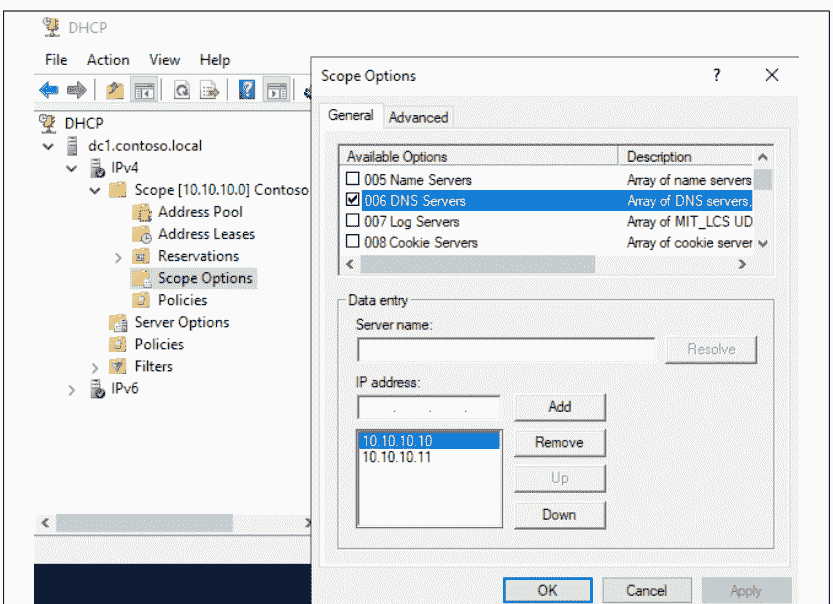

图 4.17：使用 DHCP 选项

另一个有用的 DHCP 作用域选项是选项 66。如果你有一个 VoIP 电话系统并希望为你的物理电话设置自动配置，很容易为电话创建一个单独的 DHCP 作用域，并使用选项 66 指向你电话系统的配置链接。当电话从 DHCP 服务器获取 IP 地址时，它们也会在电话系统中自动配置！

## DHCP 预留

从一大池可用地址中分配 IP 地址很棒，但这些地址租约会过期并发生变化。这意味着今天拥有 10.10.10.100 的计算机明天可能会收到 10.10.10.125。通常，从桌面计算机的角度来看这没问题，因为它们通常不在乎自己的 IP 地址是什么。客户端计算机通常向外连接到网络，但其他设备很少尝试查找并联系它们。如果你的网络中有更永久的设备，比如 Windows 服务器，但你不想处理为该服务器静态寻址怎么办？另一个很好的例子是连接到网络的打印机。有些打印机甚至没有可以分配静态 IP 地址的界面，一旦打印机获得 DHCP 地址，你通常希望该地址在其整个生命周期内保持不变，因为你会将计算机配置为向该 IP 地址发送打印作业。这就是 DHCP 预留发挥作用的地方。预留是将 DHCP 作用域内的单个 IP 地址保留给特定设备的行为。该设备每次通过 DHCP 服务器连接时都会收到相同的 IP 地址，并且此特定 IP 地址不会分发给网络上的任何其他设备。通过在 DHCP 中使用预留，你可以让 DHCP 服务器甚至为你的永久服务器处理 IP 地址分配，这样你就不必手动配置这些服务器的 NIC，同时仍能在这些机器上保持永久 IP 地址。

你可以在 DHCP 控制台中看到名为 **Reservations** 的文件夹。目前这里没有任何内容，但通过右键单击 **Reservations** 并选择 **New Reservation...**，我们将为自己创建一个。让我们再次使用那个 WEB1 服务器。现在，我已为 WEB1 分配了静态 IP 地址，但我将为其在 IP 地址 10.10.10.150 上创建一个预留：

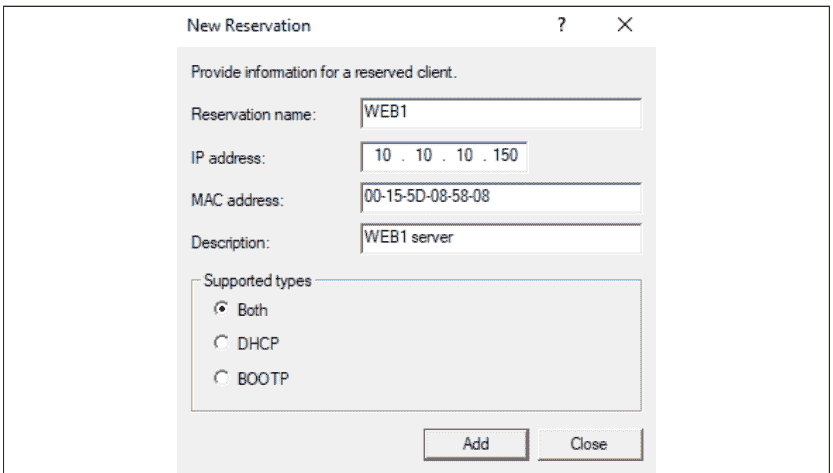

图 4.18：设置预留

哇，哇，哇……把火车拉回来。屏幕上的大部分信息都有意义——服务器名称和 IP 地址本身的简要描述——但我是如何得出那个 MAC 地址的？**MAC address** 是网络卡在网络上的物理地址。当你的网络设备尝试向某个 IP 地址发送信息时，或者在这种情况下，当 DHCP 服务器需要向服务器上的特定 NIC 分发某个 IP 地址时，它需要该网络卡的物理标识符。因此，这个 MAC 地址是我的 WEB1 服务器上 NIC 所独有的。你的网络上的每张网卡都有唯一的 MAC 地址。通过登录我的 WEB1 服务器，我可以运行 `ipconfig /all` 并在该输出中看到为我的 NIC 列出的 MAC 地址，那个看起来很奇怪的字母和数字组合显示为 **Physical Address**。这就是我获取此信息的地方。这就是 DHCP 决定何时调用预留的方式。如果网络接口向其请求 DHCP 地址，并且该设备的 MAC 地址在此处预留中列出，则 DHCP 服务器将把预留地址交还给该设备，而不是从通用池中分配一个：

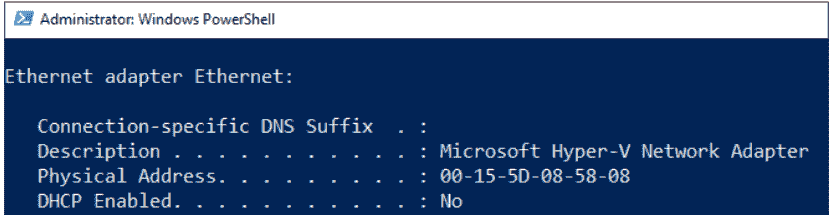

图 4.19：查找 MAC 地址

现在我们的 DHCP 预留已创建，我将进入 WEB1 服务器上的 NIC 设置，并通过选择自动获取 IP 地址的选项来清除所有静态 IP 地址信息：

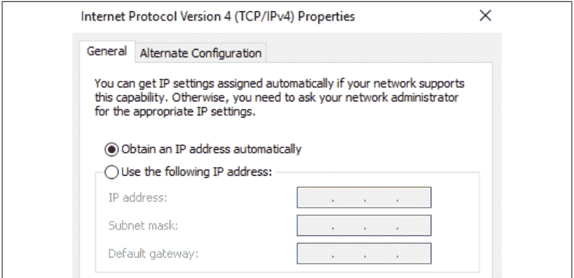

图 4.20：删除静态 IP 地址信息


After doing that, WEB1 will reach over to the DHCP server and ask for an address, and you can see that I have now been assigned the reserved address of 10.10.10.150:

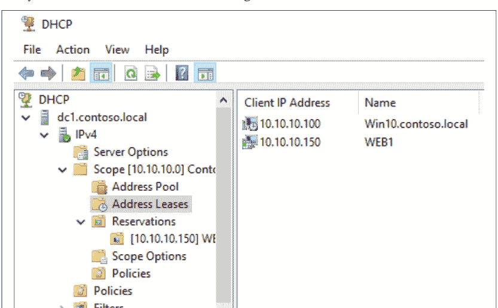

Figure 4.21: 为 WEB1 预留 10.10.10.150

This will always be the IP address of the WEB1 server from this point forward, unless I change my DHCP reservation or somehow change the MAC address of WEB1. This could possibly happen if I were to install a new NIC into WEB1.

> 你也可以为网络中除 Windows 设备之外的对象创建 DHCP 预留。只要需要设备的 MAC 地址即可（并且每个具有网络适配器的设备都有 MAC 地址），因此可以轻松为打印服务器、复印机、安全报警系统、无线接入点等设备创建预留。

## DHCP 故障转移

好东西不嫌多？正如创建多个域控制器服务器为 Active Directory 提供了良好的冗余一样，你网络中的 DHCP 服务器也可以配对形成故障转移，以创建自己的高可用性形式。虽然 DHCP 服务器角色经常与 AD DS 和 DNS 角色共存，但这并不是必需的。你已经知道 DNS 区域可以轻松存储在 Active Directory 中以实现区域信息的自动复制，但这种思路并不适用于 DHCP 作用域。

DHCP 在域环境内部或外部都是一个有用的工具。因此，它并不是像 DNS 那样紧密集成的角色。所以在创建 DHCP 故障转移时，我们需要采取更手动的方法，无论 DHCP 角色是否托管在域控制器之上都没有区别。

## 两个 DHCP 服务器

在 DHCP 服务器故障转移环境中，可以配置两个 DHCP 服务器并相互指向，然后它们会在两者之间复制 DHCP 租约信息，始终保持信息最新。这样，如果一台 DHCP 服务器离线，另一台可以接管并继续分配 IP 地址以及续订这些 IP 的租约。

我上面说的是“两个” DHCP 服务器，这是一个需要澄清的重要点。在 Windows Server DHCP 故障转移中，你只能将两台 DHCP 服务器连接在一起。不多也不少。同样重要的是，随着我们进入 IPv6 世界，DHCP 故障转移仅适用于 IPv4 作用域。无论如何，在 IPv6 世界中 DHCP 服务器的故障转移是不必要的，因为大多数 IPv6 实现都是无状态的，而 DHCP 需要提供给 IPv6 客户端的唯一信息是选项，这些选项可以简单地配置在多个 DHCP 服务器上，客户端并不关心它们从哪台服务器获取这些选项信息。

## 热备份模式

DHCP 故障转移可采用两种不同的操作模式：热备份模式或负载共享模式。热备份顾名思义，更偏向于主/故障转移的思路。一台 DHCP 服务器为主服务器，始终负责一个 IPv4 作用域，除非它变得不可用。在这种情况下，故障转移 DHCP 服务器开始接管，直到主服务器恢复。

热备份模式适用于通过某种 WAN 连接回主网络的分支机构。本地分支机构可以拥有自己的本地 DHCP 服务器来主要处理 DHCP，但如果该 DHCP 服务器离线，DHCP 请求将通过 WAN 链路到达并从位于主站点中的备用 DHCP 服务器获取租约。在这种部署中，你可以轻松配置主站点中的一台 DHCP 服务器作为多个分支机构的热备份，因为在 DHCP 服务器上配置多个作用域很容易。

## 负载共享模式

另一种更常见的方式是负载共享模式。这是 DHCP 故障转移的默认操作模式。在负载共享模式下，两台 DHCP 服务器配置相同的范围信息，然后同时为传入客户端提供服务。这样，它们在服务器之间共享负载，同时响应并在两者之间复制信息，因此两者始终知道哪些 IP 地址已分配给客户端。

在负载共享模式下，你希望两台 DHCP 服务器位于同一物理站点。它们之间需要非常快的通信以保持复制数据的一致。我以前见过跨站点配置 DHCP 故障转移，可以明确地告诉你，这可能会导致 IP 冲突和类似问题。保持它们在同一站点。

## 配置 DHCP 故障转移

现在我们了解了 DHCP 故障转移，如何设置它？你已经知道我在测试实验室环境中有 DC1 和 DC2。这两台服务器都是域控制器，DC1 也是 DNS 服务器，不过这些事实与 DHCP 配置无关。它们可以是域控制器，也可以是仅加入域的服务器，甚至是非域加入的服务器，DHCP 在故障转移方面的选项都相同。由于我已经有这两台服务器，我将使用它们创建一个在两者之间复制的 DHCP 作用域。这是一个需要澄清的重要点，即 DHCP 故障转移是按作用域配置的。你不一定将 DC1 和 DC2 绑定在一起，而是在 DHCP 作用域属性中为特定作用域（或多个作用域）在 DC1 和 DC2 之间建立故障转移。这意味着，你可以在这些服务器上创建运行在故障转移模式下的 DHCP 作用域，同时也可以创建在同一服务器上不进行任何故障转移的 DHCP 作用域。

> 确保时钟同步！如果你的 DHCP 服务器已加入域，它们的时钟应始终由 Active Directory 自动保持同步。如果你的 DHCP 服务器未加入域，你需要确保两台服务器的系统时钟使用相同的时间源以始终保持连续性。

DC1 已安装 DHCP 角色，我在最初设置此测试实验室时就已在其上创建了一个快速作用域，以便我的 Win10 客户端计算机可以获取 DHCP 地址并与网络中的其他设备通信。DC2 尚未安装 DHCP 角色，因此第一步是继续添加该角色。

在网络中创建新的 DHCP 服务器时，当然必须安装该角色，但还有第二件关键的事情才能使它们被识别为 DHCP 服务器。这相当明显，但在服务器上安装 DHCP 角色后，服务器管理器会提示你完成 DHCP 配置。这会打开一个小型向导，基本上只有一个步骤要完成——授权你的新 DHCP 服务器。此迷你向导可以通过服务器管理器调用，或者如果你错过了那里的提示并直接打开了 DHCP 管理工具，你也可以通过在 DHCP 管理工具中右键单击服务器名称，然后选择“授权”来授权 DHCP 服务器。

好的，现在我们环境中有两台已授权的 DHCP 服务器，并且 DC1 上已存在一个作用域。该作用域已在为客户端提供服务，在网络中分配 IP 地址。为此作用域创建故障转移非常容易。在 DC1 上打开 DHCP 管理，并导航找到你的 IPv4 作用域。右键单击该作用域本身，然后选择“配置故障转移...”：

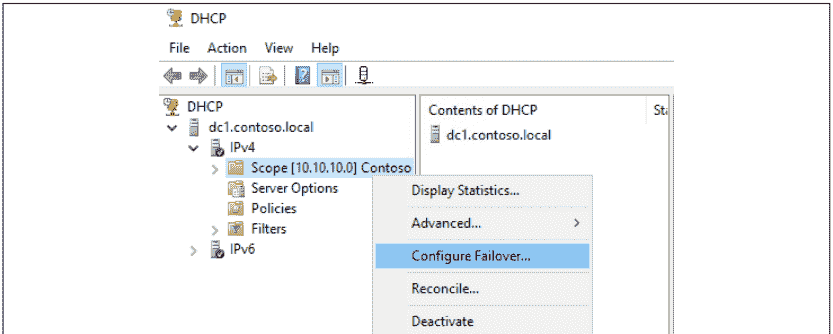

Figure 4.22: 配置 DHCP 故障转移

接下来，选择你想要配置为故障转移的作用域。如前所述，DHCP 故障转移配置是按 DHCP 作用域单独进行的。如果你的 DHCP 服务器已建立多个作用域，你可以选择为全部或仅部分作用域配置故障转移。然后在第二个屏幕上，我们需要定义故障转移 DHCP 服务器。你可以在此屏幕上输入服务器名称，但我喜欢做的是单击“添加服务器”按钮，然后显示环境中被识别为已授权 DHCP 服务器的服务器。通过使用按钮然后从列表中选择第二个 DHCP 服务器，它可以为你提供一次额外的验证，即你已正确授权网络中的第二台服务器（就我而言是 DC2）。你可以在图 4.23 中看到这一点：

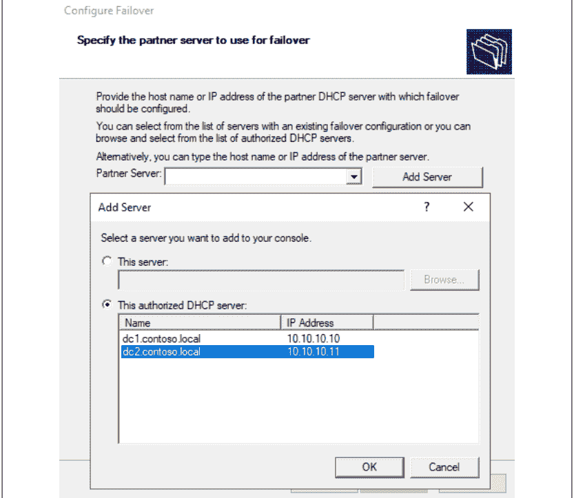

Figure 4.23: 为 DHCP 故障转移选择 DC2


在本向导的下一个屏幕中，我们定义两个 DHCP 服务器之间的所有关系参数。如我们在下一张截图中所见，这是定义一些影响不大的简单项目（如 Relationship Name 和创建两个 DHCP 服务器用于相互交互的 Shared Secret）的屏幕，但此屏幕也是为该作用域创建故障转移类型定义的位置。我们已经讨论过负载均衡模式和热备份模式，而在这里，在负载均衡模式下，您还将额外定义为建立该负载均衡而分配给两个服务器的权重。

除非您有特别偏离的理由，否则默认设置通常就是您想要的。请确保最大客户端租期时间仍配置为一小时或更长。您可以在网络中测试故障转移时将该数字调小一些，但在生产环境中，一小时是通常的建议：

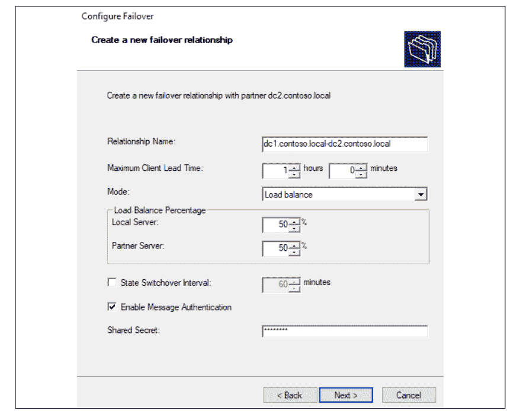

图 4.24：配置最大客户端租期时间为一小时或更长

就这样！再点击几次“下一步”，您的 DHCP 故障转移配置将被推送到第二台 DHCP 服务器。现在，如果其中一台服务器离线或出现某种问题，刚接入或 DHCP 租期即将到期的 DHCP 客户端将能够从为故障转移设置的任一 DHCP 服务器获取租约。

现在 DHCP 故障转移已经建立，您可能会期望 DHCP 管理控制台内部出现某些变化，以直观地表明作用域上已配置了故障转移，但实际情况并非如此。这里的一切看起来与创建故障转移之前完全相同。我指出这一点是为了让您知道，在今后访问此控制台时，或如果您是现有基础设施的新管理员，想快速识别环境中是否已建立 DHCP 故障转移，您可以通过右键单击作用域找到此信息。右键单击后显示的菜单列表中，您现在会找到一个名为 Deconfigure Failover 的选项，这意味着该作用域当前已配置了故障转移。此外，如果您进入该作用域的属性，您会找到一个 Failover 选项卡，其中显示了有关 DHCP 故障转移的所有相关信息：


图 4.25：取消配置故障转移

最后一次验证，让我们登录 DC2 看看 DHCP 管理控制台现在是什么样子的！请记住，之前我在 DC2 上所做的唯一事情就是安装 DHCP 角色并授权该服务器。我甚至从未在该服务器上打开过 DHCP 管理控制台。如果现在打开，您可以看到我的 10.10.10.0 作用域已被复制到该服务器，包括当前的地址租约信息！


图 4.26：将 10.10.10.0 作用域复制到 DC2

## IPAM

内置于 Windows Server 2019 的 IP 地址管理（IPAM）功能被许多服务器管理员所忽视，因为它是一个功能，而不是 Windows 内部的完整角色。IPAM 是一种技术，允许在您的环境中集中监控和管理 DHCP 和 DNS。如果您的整个基础设施都位于一栋建筑内，那么只需从网络中的任何服务器或工作站使用 DNS 和 DHCP 管理工具即可完全控制这两种技术就足够了。但对于跨多个位置、每个位置都有自己的一组 DNS 和 DHCP 服务器的大型和企业级网络呢？IPAM 可用于收集所有不同的命名空间和作用域，并从一个界面提供对它们的访问。

让我们在我的实验室中安装 IPAM 功能，以便您了解如果选择使用此功能应从何处开始。首先选择要安装 IPAM 的服务器，然后只需通过“添加角色和功能向导”逐步操作以添加名为 IP 地址管理（IPAM）服务器的功能。

> 注意：不建议将 IPAM 安装到域控制器上，或安装到 DHCP 服务器上，因为这会妨碍其从这些系统获取信息的能力。

现在功能已安装，启动服务器管理器将在左侧窗口窗格中显示一个名为 IPAM 的新部分。继续单击 IPAM，您现在会看到一组需要完成才能使用 IPAM 的六项任务：


图 4.27：IPAM 服务器任务

第一步已经完成，我们已连接到 IPAM 服务器。在我的实验室中，我将 IPAM 安装在我的 CA1 服务器上，但没有特别的原因。您可以为此任务专门分配一台服务器，或将该功能安装到现有服务器上。

继续到第 2 步“配置 IPAM 服务器”，您将有机会阅读一些关于 IPAM 如何与您的服务器交互的良好描述性文本。您可以选择手动配置每台服务器（谁会去做那件事？），但很明显，微软期望我们大多数人通过使用组策略来集中推广这种方式。我们将在本书下一章讨论组策略，但就设置 IPAM 而言，我们基本上可以只通过这些配置向导，选择默认设置，并理解在幕后此控制台正在为我们建立 GPO，这些 GPO 然后将被推送到网络中的服务器以配置它们向 IPAM 报告。

*第 2 步*内部需要做出的唯一选择是 IPAM 要使用的数据库，以及应使用哪种配置方法将 IPAM 设置发送到您的服务器。对于数据库，如果您有 SQL 服务器，您当然可以使用它来存储 IPAM 信息，但默认选择是 **Windows Internal Database (WID)**，这是一个内置数据库平台，被许多 Windows Server 角色和功能使用。我们将为此新的 IPAM 服务器使用 WID，并且正如我们已经提到的，通过组策略轻松推广 IPAM 设置。在您选择 **Group Policy Based** 作为配置方法 的屏幕上，您还需要定义一个 **GPO name prefix**。当此控制台创建 IPAM 所需的 GPO 时，它会为 GPO 定义名称，这些名称无法更改，但微软在此允许您为这些 GPO 名称分配前缀，这样当您以后在组策略管理工具中查看时，所有与 IPAM 相关的 GPO 配置都将一起列出，所有都具有您在此屏幕上定义的前缀：


图 4.28：选择配置方法

您会注意到图 4.28 中有一点信息性文字，以及在完成第 2 步时的摘要屏幕，关于一个名为 Invoke-IpamGpoProvisioning 的 PowerShell cmdlet。常识会告诉我们，在 IPAM 实施的第 2 步之后，您会继续到第 3 步，对吧？实际上并非如此。在此情况下，配置服务器发现（第 3 步）是我们需要执行的一步，但在这一点上，IPAM 控制台正在等待这些 GPO 被创建，以便它们可以在后续的设置过程中使用和引用。

暂停您在 IPAM 步骤中的工作，并打开一个提升的 PowerShell 提示符，确保您使用域管理员帐户登录到服务器。然后只需运行 Invoke-IpamGpoProvisioning。这将要求您输入域的名称，以及在向导期间指定的 GPOPrefixName；请确保完全相同地输入！


图 4.29：运行 Invoke-IpamGpoProvisioning

您需要输入 Y 并按 Enter 三次才能完成此命令。在阅读正在显示的警告文本时，连续三次显示相同的文本，这是在请求确认，仅仅是因为当这些 GPO 被创建时，它们的 安全筛选设置 被修改为远离默认 GPO 安全筛选行为。我们很快会解释 GPO 安全筛选，但就 IPAM 而言，只需输入 Y 并继续这些提示。现在 Invoke-IpamGpoProvisioning 已完成其工作，如果我们偷偷快速查看组策略管理，您可以看到现在有三个新的 GPO，一分钟前还没有：


Figure 4.30: Invoke-IpamGpoProvisioning 已添加了三个新的 GPO

现在回到 CA1 上的 IPAM 配置，我们将继续点击步骤 3，配置服务器发现。在其中，使用“获取林”和“添加”按钮查询您的域中可由 IPAM 监视的基础结构服务。您的域应列出，并且在向导能够发现的有关您域的组件上选中了复选框。在我的例子中，我发现了全部三个 – 域控制器、DHCP 服务器和 DNS 服务器。我将保持全部三个选中，以便 IPAM 可以提取这三个角色的数据，然后单击“确定”：


Figure 4.31: 配置服务器发现

继续到步骤 4，开始服务器发现。这会在后台启动一个计划任务，该任务会联系并查找有关您基础结构的其他信息。完成后，单击步骤 5，选择或添加要管理的服务器并验证 IPAM 访问权限。在这里，您应该会看到托管您的 AD DS、DNS 和 DHCP 角色的服务器列表。右键单击您要管理的每个服务器，然后选择“编辑服务器...”。在此屏幕中，对于每个服务器，将服务器的管理状态字段更改为“已管理”：


最后，单击步骤 6，从受管理的服务器检索数据，这将使 GPO 投入运行并开始从这些服务器中提取信息到 IPAM 数据库中。完成后，您现在将拥有一个集中式界面，可以从中查看有关 Active Directory、DNS 和 DHCP 范围的信息，如图 4.33 所示：


Figure 4.33: IPAM 的集中式界面

从 IPAM 内部管理 DHCP 特别有用，因为在具有许多不同 DHCP 范围的环境中，通过其自己的管理控制台对 DHCP 进行经典管理可能会变得相当混乱。IPAM 提供了一个界面，您可以从中快速轻松地查看所有范围的汇总信息，甚至可以运行一些有趣的 PowerShell cmdlet 来快速收集数据，而这些数据过去如果不手动查找和探测是无法发现的：

- Find-IpamFreeSubnet
- Add-IpamSubnet
- Find-IpamFreeRange（这个很好，因为它可以帮助您快速发现可用 IP 地址的范围）
- Add-IpamRange

## 摘要

Microsoft 基础设施技术的核心堆栈通常由 Active Directory、DNS 和 DHCP 组成 – 而且您经常会发现这三者都托管在同一台服务器上。了解这些技术并知道如何利用其相关工具集是任何服务器管理员生活中的重要组成部分。作为一家 IT 公司的经理，我可以肯定地说，掌握这一点将极大地提高您找到一直寻求的系统管理员职位的机会。

我希望这两章对您整体了解公司如何使用 Windows Server 技术有所帮助，并为您准备企业环境中的 IT 生活提供了一些帮助。接下来，我们将转向任何以 Active Directory 为中心的环境的内置组件，但它经常被低估。组策略是一种功能强大的工具，可用于增强任何域内的安全性和自动化。

## 问题

- 1. 什么类型的 DNS 记录指导电子邮件流？
- 2. 哪种类型的 DNS 记录将名称解析为 IPv6 地址？
- 3. 哪种 DNS 区域类型将 IP 地址反向解析为主机名？
- 4. 哪种 DHCP 选项常用于 VoIP 电话配置？
- 5. 哪种 DHCP 故障转移模式常用于分支机构和主站点之间？
- 6. 配置负载均衡 DHCP 故障转移时，最大客户端提前时间的标准建议和默认设置是什么？
- 7. IPAM 可以利用哪些 Windows Server 角色？
