# 5 组策略

如果您从头到尾阅读本书，确实是一种良好且一点也不奇怪的阅读方式，您已经对组策略是什么以及它做什么有一个大致的了解（因为我们在 *第 3 章，Active Directory* 中提到过它一分钟）。然而，我在 IT 从业者身边待的时间足够长，知道从头到尾阅读一本书相当罕见，注意力很难承受这样的追求。因此，对于任何以随机方式阅读本章的人，因为“组策略”这个词吸引了您的注意，或者您希望本章能回答某个特定需求，请不要担心！让我们再次总结组策略的伟大而辉煌的力量。

很容易理解“策略”这个词的一般用法，意味着某种规则集、结构或标准，您需要让某些事物遵循它。在我们的例子中，我们谈论的是基于 Microsoft Windows 的计算机（和服务器）。将策略应用于计算机，例如安全策略、应用程序策略或打印机策略，听起来是个好主意。如果将策略应用于一台计算机很好，那么将策略应用于一组计算机就更好了，因此有了“组策略”这个术语。简而言之，组策略是在域网络内部向计算机组分发策略的集中方式。下面是我们计划一起涵盖的主题的快速列表：

- Group Policy Object
- Building a GPO
- Scoping a GPO
- Computer settings and user settings
- Policy vs preference
- Default Domain Policy
- Administrative Templates
- Central store

### 组策略对象

这很简单。我们在这里讨论的覆盖技术称为组策略，组策略的单个实例称为 **Group Policy Object**，通常简称为 **GPO**。GPO 是一个包含一个或多个策略设置并应用于域计算机、域用户或有时同时应用于许多计算机和用户的单个包。

GPO 存储在 Active Directory 中，并在域控制器服务器之间进行复制。每当域用户登录到连接到网络的域加入计算机时，计算机就会联系 Active Directory 并询问：“嘿，有什么 GPO 设置给我吗？”然后是一系列活动开始，域控制器会传递所有适用于登录计算机和/或用户的 GPO 设置。这是关键信息。GPO 在创建时进行范围限定，使您有能力定义每个策略的适用对象。极其强大的功能。然后这些策略设置会插入到您的计算机上，根据 IT 部门的意愿强制某些事情发生（或不发生）。您可以锁定设置、强制设置到位，并配置默认设置但仍允许用户覆盖它们。您可以将某些设置投放到某些计算机上，并将完全相反的设置投放到其他计算机上。您甚至可以对同一台计算机应用冲突的 GPO，然后坐下来观看它们争斗，看谁最终获胜。如果您不了解组策略的工作原理，很容易在网络中造成巨大问题，因为它非常、非常容易将设置应用于域中的每台机器。单个 GPO 如果被滥用，有可能使整个网络瘫痪。

所以……*这*很让人安心，对吧？相信我，虽然组策略带有警告标签和“能力越大责任越大”之类的说法，但在看到它能做的一切之后，您会比现在更想使用 GPO。

### 组策略后台刷新周期

我提到组策略在域加入计算机上每次用户登录时都会处理，这一点是正确的。同样正确的是，组策略会在一天中以间隔重新处理，即使用户保持登录状态。默认情况下，几乎没有人会更改它，称为后台刷新每 90 分钟发生一次。这意味着在白天实施新的 GPO 通常效果很好，因为这些设置会在用户无需注销或重新启动计算机的情况下逐步到位。尽管如此，也有例外，因为某些 GPO 设置无法作为后台周期处理，只能在登录过程中生效。例如登录脚本（只能在计算机登录或注销时运行）或类似映射网络驱动器之类的东西。某些 GPO 仅在用户登录过程中推送到位。

很多时候我发现自己在对 GPO 进行更改时测试 GPO 设置，如果我每次对 GPO 进行一点调整或更改后都必须等待 90 分钟或重新启动测试计算机，那将是非常低效的工作日。幸运的是，我们有一个快速简便的命令行工具，可以用来强制组策略随时随地执行其操作！

```
gpupdate /force
```

在域加入客户端计算机上的命令提示符或 PowerShell 中运行此命令将导致它立即联系并获取更新的 GPO 设置。请记住，您的计算机需要能够联系域控制器才能处理组策略，因此如果您的工作笔记本电脑在家中并且未通过 VPN 连接，这将不起作用。但对于办公室内的任何计算机或以某种方式连接到公司网络的计算机，您可以全天运行 gpupdate 并不断将新策略和更改推送到位。


## 构建 GPO

没有什么比亲自动手更让人满意的了，所以让我们开始动手构建一个新的 GPO。 不用担心，我们会小心不要现在就将此 GPO 应用到任何对象上，留到下一节再说。 与大多数 Microsoft 技术一样，有一个专门用于与组策略交互的管理控制台，恰当地命名为组策略管理控制台（GPMC）。 登录到任何域控制器服务器后，您可以从“管理工具”内部启动 GPMC，从服务器管理器的“工具”菜单内部启动，或通过“开始 | 运行”、命令提示符或 PowerShell 启动 GPMC.MSC：

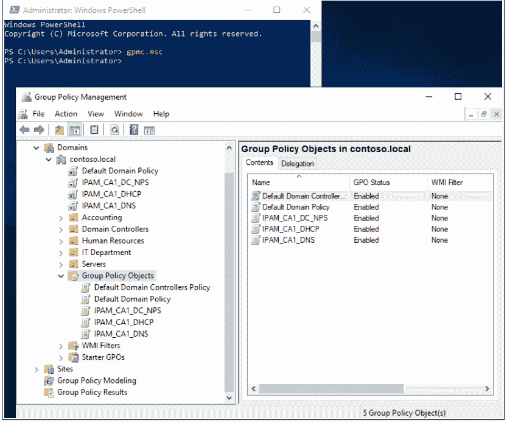

图 5.1：GPMC

您会在 *图 5.1* 中注意到这里已经列出了一些 GPO。 它们是安装 Active Directory 时始终存在的默认 GPO 的组合（我们将在本章稍后讨论默认域策略）和 IPAM 配置过程在 *第 4 章，DNS 和 DHCP* 中为我们设置好的 IPAM GPO。 要以不 yet 应用到任何工作站或用户的方式创建新的 GPO，请右键单击 **Group Policy Objects** 文件夹并选择 **New**。 为新的 GPO 创建一个名称，单击 **OK**，您就创建了一个组策略对象！ 目前，您的新 GPO 没有任何设置或配置，并且未应用于任何对象，因此完全没有意义。我们很快就会改变这一点...

## 添加受信任站点

我将我的第一个 GPO 命名为“Adding Trusted Sites”，因为我要使用这个新的 GPO 将一些 URL 应用为在我的 Windows 10 客户端计算机上的 Internet Explorer 中被识别为受信任站点。 如果您在网络中运行需要运行 JavaScript 或 ActiveX 控件之类的 Web 应用程序，则可能需要该网站是 Internet Explorer 中受信任站点列表的一部分才能正常运行。 您可以为帮助台打印一份说明页，说明如何在每台计算机上执行此操作，并让他们花费时间为每个因无法访问应用程序而致电的用户执行此操作。 或者您可以简单地创建一个 GPO，让它在每台工作站上自动进行这些更改，从而节省您处理所有这些电话呼叫的时间。 这只是组策略所具备的强大功能的一个微小例子，但这是一个很好的例子，因为它很有用，而且它是一个深埋在 GPO 设置中的设置，因此您可以感受到这些功能到底有多深。

## 组策略

右键单击新的 GPO 并选择 Edit... 现在导航到 Computer Configuration | Policies | Administrative Templates | Windows Components | Internet Explorer | Internet Control Panel | Security Page。 看，我就说它埋在里面了！

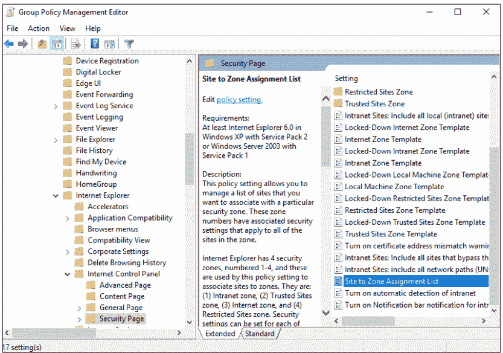

图 5.2：创建 GPO 来管理受信任网站

现在双击“站点到区域分配列表”并将其设置为“已启用”。 这允许您单击“显示...”按钮，在其中可以输入网站并为其分配区域。 每个 GPO 设置都有一个很好的描述性文本来伴随它，告诉您该特定设置的用途以及选项的含义。 如该文本所示，为了将我的网站设置为受信任站点，我需要为其分配区域值 2。 另外，为了好玩，我还添加了一个我不希望用户访问的站点，并为其分配了区域值 4，以便 badsite.contoso.com 在我的所有桌面计算机上成为受限站点区域的成员。 这是我的完整列表：


图 5.3：将网站分配到不同区域

我们做完了吗？ 几乎完成了。 一旦我单击“确定”按钮，这些设置就会存储在我的组策略对象中并准备部署。 如您所知，我们尚未将此新 GPO 分配给任何人应用，因此目前 GPO 已填充这些设置但仍未执行任何操作。 在推送这些设置之前，让我们再构建几个常见的 GPO，以确保我们的示例内容全面。

## 映射网络驱动器

文件服务器是最常见的服务器类型之一，因为所有行业的所有公司都需要创建和维护文档来运行其业务。 本章并不是关于如何构建文件服务器、设置共享、限制权限或利用分布式文件系统（DFS）来提高文件服务器基础设施整体灵活性和弹性的内容，尽管这些都是值得学习的好东西。 今天，我们假设您已经部署了文件服务器，并且这些文件服务器上已经存在共享文件夹。 在我的测试实验室中，我有来自几个不同服务器的共享文件夹，如下所示：

- \\DC1\HR
- \\DC2\Accounting
- \\WEB3\Installers

我们要解决的挑战是如何使这些共享文件夹位置自动在我的所有用户工作站上可用。 我可以准备一份文档，指导用户如何通过将 UNC 路径粘贴到文件资源管理器的地址栏来手动访问这些位置。 或者甚至更进一步，指导我的同事如何在文件资源管理器内部映射网络驱动器，以便他们在计算机上获得用于持续访问这些位置的驱动器号。 这样做是可行的，但会给用户带来管理负担，并且可能导致用户使用不同的驱动器号。 Grace 可能会使用她的“R”驱动器号映射到会计共享，而 Jackson 可能决定使用“T”作为他的会计驱动器号。

显然，有更好的处理方式。 我们经常交给 GPO 处理的一项非常常见的任务是在客户端计算机上标准化创建映射的网络驱动器。 在新的 GPO 内部，我们可以为共享定义 UNC 路径并分配驱动器号。 然后我们可以将该 GPO 分配给用户和计算机，驱动器号将在用户登录计算机时自动映射。

为此目的创建一个新的 GPO，并编辑该 GPO，就像您已经知道如何做的那样。 这次我们导航到以下位置：

### User Configuration | Preferences | Windows Settings | Drive Maps

右键单击“驱动器映射”并选择“新建 | 映射驱动器”会带您进入单个映射驱动器号的配置部分。 您可以在下面的屏幕截图中看到，我正在将驱动器映射到 \\DC1\HR，并分配驱动器号 H：

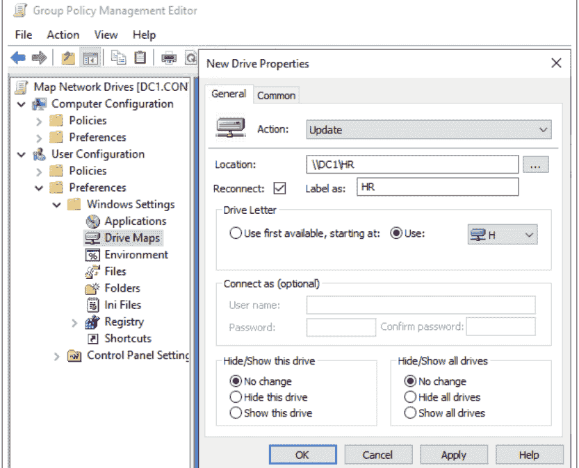

图 5.4：使用组策略映射驱动器

您会注意到 **Action** 下拉菜单有四个不同的选项： **Create**、 **Replace**、 **Update** 和 **Delete**。 这很重要，因为许多 GPO 首选项配置都有相同的下拉选择。 以下是每个可用选项与我们新的驱动器映射策略相关的简要总结：

- **Create**：使用此操作仅在映射的驱动器尚不存在时创建新的映射驱动器。 如果工作站上 H: 驱动器已在使用中，则此新映射将被忽略。 在我们的示例中，如果我将此新的驱动器映射配置为 Create，它只会在 H: 驱动器号当前空闲可用时采取操作。
- **Replace**：使用此操作删除现有设置并替换为新设置。 在我们的例子中，它将更新使用 H: 的任何映射驱动器到我们的 \\DC1\HR。 由于 Update 选项的存在，Replace 选项是多余的，很少使用。
- **Update**：这是大多数首选项设置的默认操作，通常是最有用的。 如果我们配置的设置不存在，Update 将创建它。 此外，如果设置（映射驱动器）已在工作站上就位，它现在将被更新以反映 GPO 内部的新定义。 驱动器映射策略几乎总是使用 Update 操作来推送新的驱动器号。
- **Delete**：这会从客户端计算机中删除特定设置。 如果您正在删除网络共享并希望确保它从域中的所有计算机中删除，则此操作将很有用以确保发生这种情况。


在点击此新驱动器映射上的 **OK** 之前，先前往 **Common** 选项卡。此选项卡及其五个选项在插入到 GPO 的许多首选项设置中都很常见。其中大部分都是自解释的，不过我们将在几页后更详细地讨论 Item-level targeting。对于我们的驱动器映射 GPO，我想指出 **Run in logged-on user's security context** 复选框。这告诉组策略在已登录用户的帐户下运行 GPO 所设置的任何设置或首选项。对于映射驱动器而言，这特别有用，因为您通常希望用户在其常规用户上下文中与映射驱动器交互。虽然通常不会勾选此框，但对于驱动器映射 GPO，我总是会勾选：

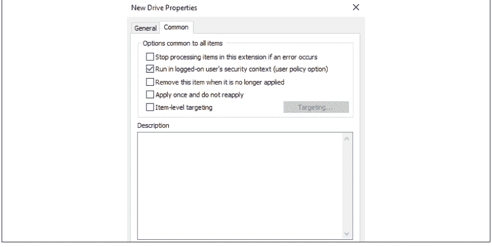

Figure 5.5: 在用户安全上下文下映射驱动器

对您想要包含在新 GPO 中的任何其他驱动器号重复此操作，您现在就已经在通往自动化整个网络中所有驱动器号映射的道路上了！我为每个共享文件夹设置了驱动器号映射，并添加了一个 GPO 设置，如果存在则删除 Z: 驱动器。我的实验室中没有，但这样您也可以看到策略内部的示例是什么样的：

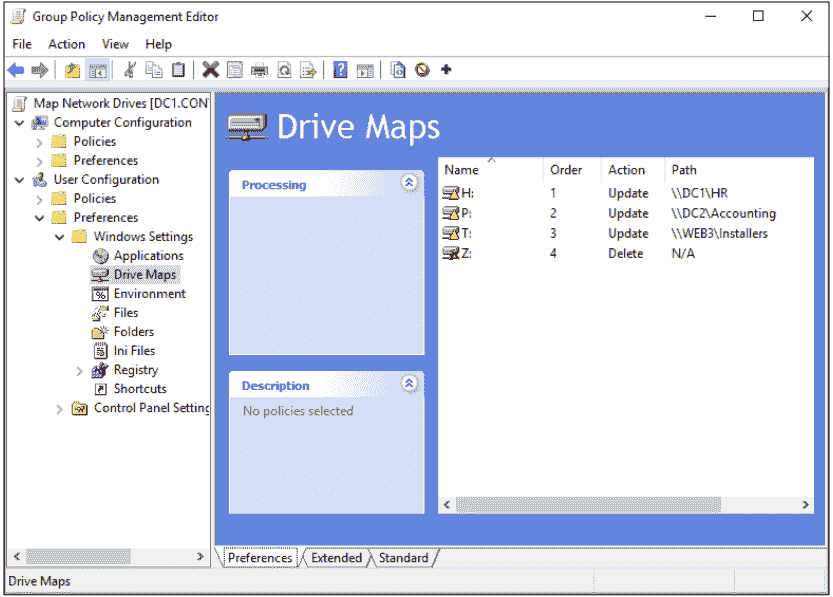

Figure 5.6: 通过 GPO 映射驱动器

再次说明，此新 GPO 尚未应用于任何用户，但请不必担心——一旦我们完成再创建一个示例 GPO，我们将进入 GPO 设置的范围限定，这就是我们将新 GPO 付诸实施并验证设置和映射驱动器是否会自动显示在我们的客户端计算机上的地方。

## Installing registry keys

与通过 GPO 将映射的网络驱动器推送给用户的方式非常相似，我们也可以自动将注册表项和值实现到计算机上。这非常强大，因为 Windows 环境中的几乎任何东西都可以通过使用注册表项进行操作。再创建一个新的 GPO，这次导航到以下位置：

User Configuration | Preferences | Windows Settings | Registry

创建、替换、更新或删除注册表项的方式与映射网络驱动器的方式非常相似。棘手的部分是确保选项被正确指定，否则它们将无法工作，特别是 Key Path 和 Value 信息。作为示例，我将推送一个注册表值，该值可防止用户更改其桌面背景图像并指定我自己的自定义桌面背景。根据我的经验，确保 GPO 配置在配置窗口中正确填充的最简单方法是，实际上将您正在处理的新的注册表项和/或值放置到您运行 GPMC 的服务器或计算机上。这样您就可以选择省略号按钮并查找确切的注册表设置，而不是尝试记住 Key Path 字段的格式。

我正在设置中的注册表信息是：

HKCU\Software\Microsoft\Windows\CurrentVersion\Policies\System

在 System 注册表项内部，注册表值名称是 Wallpaper。

这是我在组策略中的已填充条目：

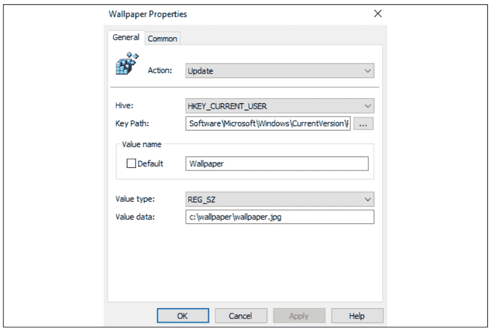

Figure 5.7: 通过组策略添加注册表项

因为我已选择将此注册表值作为 **Update** 操作推送，所以每次此计算机上的组策略处理时，它都会确保此注册表项存在，从而持续防止用户调整其桌面壁纸。

我选择此示例是因为它很直接，并且因为在组策略中您经常会发现有多种方法可以实现相同的目标。不是使用注册表值来锁定壁纸设置，我也可以选择创建一个利用以下 GPO 设置的 GPO，并且它会在无需触及注册表设置的情况下实现相同的效果：

**User Configuration | Policies | Administrative Templates | Desktop | Desktop | Desktop Wallpaper**

## Scoping a GPO

我简要提到了限定 GPO 的范围，使其仅适用于您希望的计算机或用户的能力。这可能是理解组策略难题中最重要的一点。您已经看到了几个将设置插入 GPO 的示例，并且互联网上充斥着有关有用且精确的策略设置以及如何将其设置到位的信息。如果您试图在较大规模上完成某项特定任务，请使用搜索引擎查找该项目，同时包含搜索词 "GPO"，您很快就会找到有关如何设置新 GPO 来执行该操作的信息。那些文章、Microsoft 文档和博客文章 *不会* 为您定义的是，您在多大程度上将这些设置推送到网络中，以及如何确保新 GPO 不会过于宽泛。这一决定完全由您自己做出。在本节中，我们将讨论每个 GPO 中可用的不同选项，这些选项允许您精确定位谁应该或不应该接收这些 GPO 设置的非常具体的细节。

## Links

GPO 链接可以说是您组策略工具箱中最重要的工具。链接只是将一个 GPO 绑定到 Active Directory 中的一个位置。您现在链接的 GPO 将开始将其包含的设置应用于该位置内的用户和设备。

我们已在组策略内部创建了多个 GPO，但尚未将它们应用于任何对象。这意味着我们尚未将这些 GPO 链接到任何对象，而当我们这样做时，它们就会被释放并开始工作。在我们链接其中一个新 GPO 之前，让我们先看看哪些 GPO 当前适用于我的 Windows 10 计算机。这样我们就可以在创建链接后再次检查，以证明新 GPO 确实起作用。

## GPRESULT

到目前为止，我们还没有谈论如何检查计算机以发现哪些策略可能适用或不适用。让我们暂时离开配置，现在就做这件事。登录我的 Windows 10 客户端计算机后，我可以打开命令提示符或 PowerShell 并运行以下命令：

```
Gpresult /r
```

这会输出大量有趣的信息，但我们最感兴趣的是名为 **Applied Group Policy Objects** 的部分。事实上，您可能会注意到此输出有两个部分，并且会找到两个 Applied Group Policy Objects 实例。其中一个列在 **COMPUTER SETTINGS** 下，另一个列在 **USER SETTINGS** 下。不久后，我们将描述 GPO 中计算机设置和用户设置之间的差异，但对于我们现在的示例，我想指出的是，我的测试客户端上的输出显示在用户设置级别上没有应用任何 GPO，如图 5.8 所示：


Figure 5.8: 未向用户应用任何 GPO

> 随着对组策略的熟悉程度提高，您可能会经常发现自己运行 gpresult 并希望将结果缩小到计算机或用户设置。
> 
> 您可以通过向 gpresult 命令添加开关轻松完成此操作：
> 
> Gpresult /r /scope computer
> Gpresult /r /scope user

## Continuing with the link

返回组策略管理控制台，找到您想要链接新 GPO 的位置。我将链接我的 Map Network Drives GPO，并向您证明所有映射的网络驱动器都会在下次登录工作站时自动创建。我登录时使用的用户帐户位于名为 Accounting Users 的 OU 中。找到 Accounting Users OU，我右键单击它并选择 Link an Existing GPO... 选项。在随后的屏幕上，找到您新创建的 GPO 并选择它。您现在已将 GPO 链接到此特定 OU，并且此更改在您的网络中立即生效。您可以在图 5.9 中看到我的 GPO 链接显示在 Accounting Users OU 下：

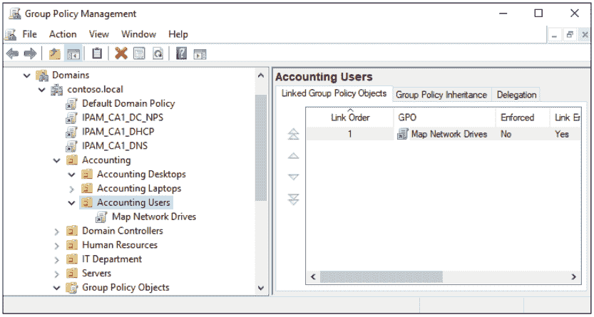

Figure 5.9: 将 GPO 链接到 Accounting Users OU


## 组策略

下次此 OU 中的用户登录到域加入的计算机时，他们的网络驱动器应在登录过程中为其映射。登录我的 Windows 10 工作站后，我现在发现确实如此，再次运行 gpresult 证明我的 GPO 已成功应用！

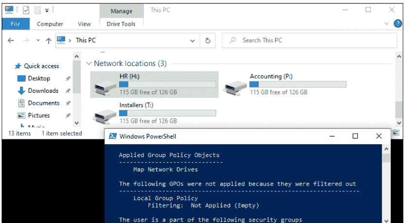

图 5.10：GPO 已成功实施

你可以将一个 GPO 链接到多个 OU。只需再次按照相同流程操作，这次选择不同的 OU 进行链接，那么该 GPO 现在将应用于具有活动链接的两个 OU。你可以通过右键单击它们并删除它们来移除链接，或通过单击 Group Policy 对象本身来查看和修改其链接属性。

## 组策略处理顺序

在刚刚完成的 GPO 链接示例中，我们将一个 GPO 链接到特定的 OU。你可能在一些截图中注意到 GPO 也链接在不同级别，例如就在我的 contoso.local 域的根部。这是为什么呢？事实证明，登录计算机时实际上会发生四种不同的组策略处理级别。链接的位置会对你的 GPO 对计算机和用户产生的正确效果产生很大影响。让我们讨论这四种 GPO 处理级别。

### 本地策略

假设你从事 IT 工作有一段时间了，很可能你曾跟随一篇博客文章或论坛帖子，通过 `gpedit.msc` 进行修改。在任何 Windows 系统上运行 `gpedit.msc` 会带你进入 **本地组策略编辑器**。这是存在于单台机器上的策略对象和设置的集合。它们可以通过 `gpedit.msc` 手动操作，也可以通过 GPO 进行操作和覆盖。我想强调的关键点是，当你的 Windows 计算机启动并登录时，发生的首件事就是处理本地组策略编辑器中的设置。由于本地策略最先应用，这意味着我们即将讨论的任何级别的 Active Directory 组策略都将优先于本地策略。换句话说，你的计算机可能已设置了本地策略，但在启动过程的毫秒之后，这些本地设置可能会被 AD 策略设置覆盖。

### 站点级策略

还记得在 *第 3 章，活动目录* 中，我们讨论 Active Directory 站点和服务时吗？这里就用到了。如果你的环境足够大，包含多个站点，则可以链接到单个站点级别的 GPO，从而使组策略能够根据计算机或用户所在的站点向其发布设置。

根据我的经验，将 GPO 链接到站点的情况相当罕见，但在排查 GPO 应用问题时，这是一个需要放在脑后考虑的事情。计算机和用户只有在物理上位于这些站点内时才会接收站点级策略，这基于你在 AD 站点和服务中定义的 IP 地址方案和子网。如果计算机基于站点级链接接收到 GPO 设置，并且这些设置与本地组策略中的内容矛盾，则站点级策略将覆盖本地策略，并且在继续登录过程中，这些将成为新的设置。

### 域级策略

一些策略和设置是你希望应用于整个域中所有机器或用户的，而这些设置的合适位置是域级 GPO。需要指出的是，我们谈论所有这些不同的策略级别时，GPO 本身并没有不同——一个 GPO 就是一个 GPO。我们讨论的是 GPO 的 *链接* 级别与这些层次级别的关系。

在组策略管理中，在域的根部或顶层创建的链接，默认情况下会尝试应用于域中的任何用户或计算机。有许多其他因素可以过滤域链接的 GPO，但总的来说，如果你将 GPO 链接到域名，你最好能接受该 GPO 中的设置可能应用于每台工作站、每台服务器、每个用户。如果你回头翻几页查看组策略管理控制台中的一些截图，你可以看到我的 IPAM GPO 都直接链接到 contoso.local。这些被称为域级链接。

假设我们仍在通过这些示例进行计算机登录过程，域级策略在站点级策略之后应用。因此，通过站点级策略传递给你的任何设置现在都已添加，或者可能被（如果有冲突）我们的域级策略覆盖。

### OU 级策略

我们从本地组策略设置开始登录之旅，这些设置随后被站点级 GPO 添加或覆盖，然后又被域级 GPO 再次添加（或在冲突情况下再次覆盖）。你可以猜到这将走向何方。OU 级策略现在应用于域级 GPO 之上。

如你所知，OU 包含已加入域的计算机和用户账户的文件夹。大多数公司充分利用 Active Directory 中的多个 OU 来区分机器和用户类型。服务器与工作站分开，会计用户与人力资源用户不同，等等。嵌套 OU 也是常见做法。就像使用文件资源管理器在其他文件夹内创建文件夹一样，你可以使用 AD 用户和计算机在其他 OU 内创建 OU。这对域对象的组织很重要，对组策略也很重要。

将 GPO 链接到特定 OU 使我们能够灵活地向不同的人群或机器提供不同的设置。当 GPO 链接到单个 OU 时，只有该 OU 内或其下游的计算机或用户才会受到 GPO 影响。你甚至可以将多个 GPO 链接到同一个 OU。

嵌套 OU 为此 GPO 工作流程提供了额外的一层。请记住一般规则是组策略从上到下处理，因此链接到嵌套 OU 的 GPO 很可能优先于链接到更高级别 OU 的 GPO。

## 安全筛选

现在你已经创建了 GPO 并将其链接到特定 OU，你已拥有足够的信息开始在环境中使用组策略。使用链接来确定哪些机器或用户获得哪些策略是我看到管理员使用最常见的方法，但有很多情况你可能想更进一步。如果你有一个新的 GPO 并将其链接到包含所有桌面计算机的 OU，但随后决定其中一些机器需要该策略而另一些不需要怎么办？仅仅为了构建此策略而必须将这些机器拆分到两个单独的 OU 中会很麻烦。这就是 GPO 安全筛选发挥作用的地方。

安全筛选是将 GPO 过滤到特定 Active Directory 对象的能力。在目录中的任何给定 GPO 上，你可以设置筛选器，使 GPO 仅应用于特定用户、特定计算机，甚至特定用户或计算机组。我发现使用组特别有用。

对于我们的映射网络驱动器 GPO，目前我已将其链接到我的会计用户 OU，但如果我想以不同方式筛选该 GPO 怎么办？与其将此 GPO 的范围限制在单个 OU，不如让其范围更广一些，我将把 GPO 链接到我的 contoso.local 域。天哪，这不意味着它将应用于所有内容吗？是的，除非你利用安全筛选部分来定义应应用的用户账户或账户组。

> 我总是先做出安全筛选决定，然后再创建链接。链接一旦创建就立即生效，因此先构建安全筛选可确保从开始就正确分发。


## 组策略

在 GPMC 中点击任意一个 GPO 都会显示该 GPO 的信息，而“作用范围”选项卡会显示此 GPO 存在的任何链接，以及安全筛选信息。所有新建的 GPO 在安全筛选内部都会定义经过身份验证的用户，这本质上意味着“所有域用户和计算机”。记住它指的是两者！在下一张截图中，你可以看到我的映射网络驱动器 GPO 已链接到会计用户 OU。它在安全筛选列表中列出了经过身份验证的用户。如果我只是移除现有的 OU 链接并创建一个新的域级链接，此 GPO 将立即开始应用于我整个域中的所有用户账户：

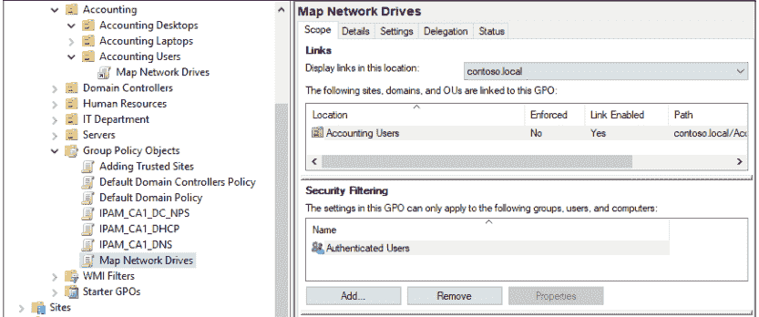

图 5.11：GPO 的安全筛选设置

而不是这样做，我会先调整我的安全筛选设置。所有会计用户都是 Acct Group 安全组的一部分（我太有创意了！）。将 Acct Group 添加到此 GPO 的安全筛选并移除经过身份验证的用户意味着，无论我将此 GPO 链接到何处，只有 Acct Group 组的成员才会接收 GPO 设置。现在我已将 Acct Group 添加到我的安全筛选，我可以安全地将 GPO 链接到域的顶层，并确信只有 Acct Group 的成员才会接收我的 GPO 设置：

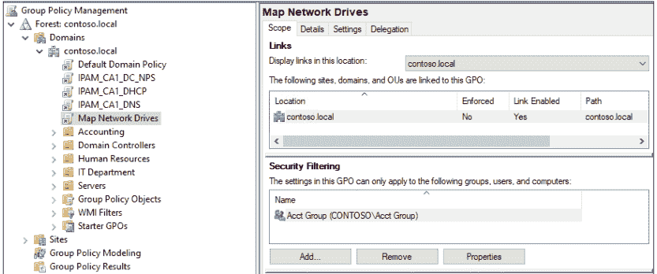

图 5.12：将 GPO 筛选到 Acct Group

另一个只需点击即可使用的很酷的功能是同一屏幕上的 **设置** 选项卡。点击该选项卡，它将显示您 GPO 内部当前设置的所有配置。这对于检查他人可能创建的 GPO 以查看正在修改哪些设置非常有用。

## WMI 筛选

使用精心设计的链接和安全筛选的组合来缩小 GPO 的范围，您很可能能够在 90% 的时间内完美规划和应用策略设置。我们接下来的几个小标题反映了剩余的 10%，我们将介绍一些高级筛选技术，以便在筛选组策略对象时获得更精细的控制。

WMI 筛选是一个天才的、尽管有点令人困惑的工具，用于进一步定义 GPO 的应用。WMI 筛选利用存在于每台 Windows 计算机上的 WMI 信息，并使用该 WMI 数据进一步筛选 GPO 设置。WMI 筛选可以定义为查找操作系统版本号、CPU 类型、RAM 数量、可用磁盘空间大小，有时甚至是 BIOS 固件等信息。一旦定义了 WMI 筛选，您就可以在 GPMC 内部安全筛选正下方标题为 WMI 筛选的部分为每个 GPO 选择该筛选。

WMI 筛选使您能够执行诸如“只有在可用磁盘空间至少有 5 GB 时才安装这款庞大的软件”或“仅在运行 Windows Server 操作系统的机器上实施这些防火墙设置”等操作。另一个现实世界的例子是使用 WMI 筛选来识别机器是否运行移动硬件，这允许您的 GPO 仅应用于笔记本电脑和平板电脑，而不应用于台式计算机。

WMI 筛选从操作系统内部的其他组件提取信息，因此会导致组策略在运行需要花费更多时间和 CPU 处理资源。这可能会导致终端计算机的系统资源增加，并且还会减慢登录速度，因为该处理在后台进行。

构建 WMI 筛选是深入组策略细节的工作，因此有关该方面的进一步指导，我会将您指向本章末尾的总结部分，在那里我会引用另一本专门介绍组策略的出版物。

## 项目级目标

链接、安全筛选和 WMI 筛选是确定哪些 GPO 应用于哪些计算机和用户的绝佳方式。但如果您需要更进一步怎么办？如果您有一个包含多个设置的单个 GPO，而您只希望其中某些设置应用于特定用户或计算机，而同一策略中的其他设置应用于不同的用户和计算机怎么办？

一个典型的例子是映射网络驱动器 GPO。通常将所有网络驱动器放在域中的单个 GPO 中并命名为“映射驱动器”或类似名称也很常见。另一个常见情况是并非所有用户都应获得所有映射的网络驱动器，处理这种情况的最佳方式是什么？对于此场景，您可以将 GPO 拆分为许多较小的 GPO，为每个驱动器号创建单独的 GPO，然后通过链接和筛选确定哪些用户获得哪些驱动器号。但随后您将不得不处理大量 GPO。

进入项目级目标（ILT）。您可能不记得了，但之前我们瞥见了存在于许多 GPO 设置内部的特殊常规选项卡。常规选项卡内的五个设置之一是项目级目标，这正是我们实现映射网络驱动器 GPO 梦想所需的明确设置。

参考我现在已经处理了多页的同一个映射网络驱动器 GPO，您知道此策略包含多个驱动器号。目前，我的 Acct Group 用户接收到所有这些映射驱动器。让我们假装一分钟，我只希望 Acct Group 接收其中一个驱动器号映射，而不接收其他映射。编辑 GPO 时，我双击我的 P: 驱动器映射，然后访问 **常规** 选项卡。在这里，我勾选 **项目级目标** 的复选框并点击该 **目标...** 按钮。

在目标编辑器内部，选择 **新建项目**，您将找到可用于这些额外目标参数的大量条件列表：

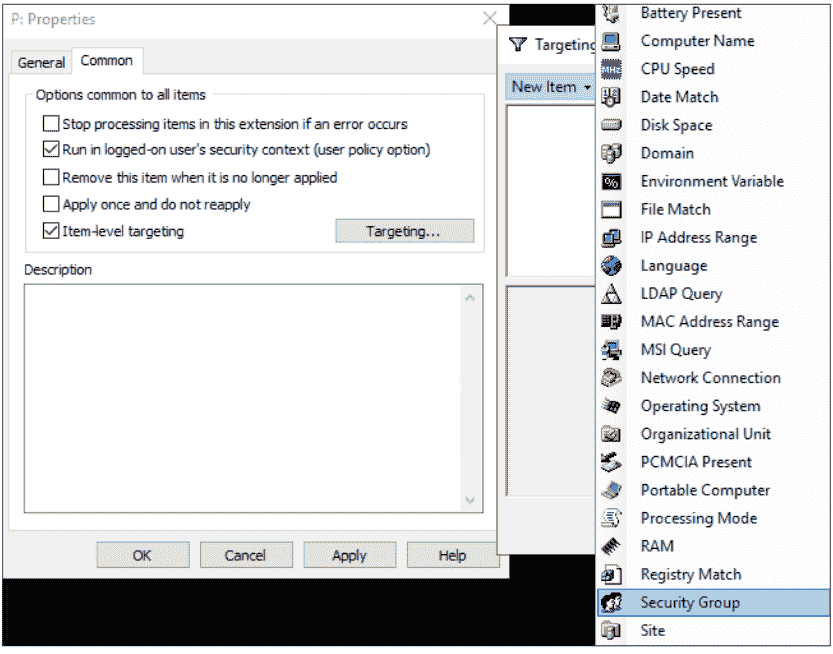

图 5.13：在目标编辑器中添加新的安全组

我希望指示此 GPO，P: 驱动器应仅为 Acct Group 安全组的成员映射。选择向我的 ILT 添加新的安全组，我可以定义 Acct Group，您可以在图 5.14 中看到我的 P: 驱动器 ILT 设置现已更新，因此只有当用户是 CONTOSO\Acct Group 安全组的成员时，该用户在登录时才会接收 P: 驱动器映射：

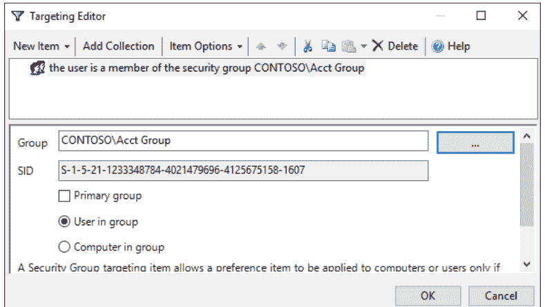

图 5.14：将 P: 驱动器映射应用于 CONTOSO\Acct Group

对 GPO 内部其余的驱动器号重复此过程，您现在就拥有一个包含整个组织所有驱动器号映射的单个 GPO。您可以将此 GPO 链接到域，将其安全筛选保留为所有经过身份验证的用户（默认情况），而基于 ILT，只有与相应组对应的驱动器号现在才会被为每个登录用户映射。ILT 太棒了！

## 委派

考虑以下场景：贵公司的执行领导层要求您锁定域中所有计算机的安全限制。听起来像是组策略的工作！只是，因为他们是领导层，不希望自己的系统妨碍他们浏览 Instagram 和配置可爱小猫桌面背景的能力，他们要求这些锁定设置适用于除 Active Directory 中 Leadership 组成员外的所有人。

我们知道很多将 GPO 筛选到特定用户或组的方法，但如何将 GPO 筛选到除特定用户或组之外的所有内容？为此，我们访问 GPMC，点击相关 GPO，并访问名为委派的选项卡。

如果您的 GPO 应用了自定义安全筛选，您也会在委派屏幕中看到这些用户或组的名称。在配置安全筛选时，GPMC 实际上在后台配置 GPO 上的委派权限。我已导航到我的映射网络驱动器 GPO 的委派选项卡，该 GPO 目前仍筛选到 Acct Group。在委派中，点击左下角附近的“高级...”按钮会将我带入此 GPO 委派和权限设置背后的具体安全细节。

在图 5.15 中，您可以看到我的 Acct Group 目前已将“读取”和“应用组策略”权限配置为允许。这就是我在安全筛选添加 Acct Group 时发生的情况。这组权限实现了神奇的效果，即每当有人登录域中的计算机时，他们既被允许读取此 GPO 内部的设置，也被允许应用此 GPO 的设置：

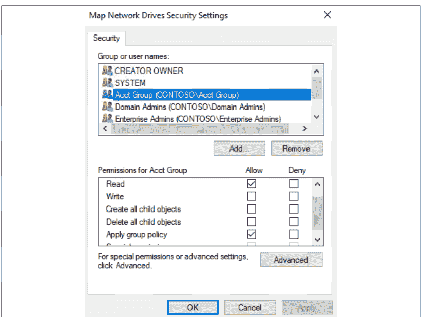

图 5.15：Acct Group 具有读取和应用权限


回到正题，在 Microsoft 的世界里，权限拒绝始终优先于权限允许。如果你需要禁止某个特定用户、计算机或组接收来自特定 GPO 的组策略设置，只需将它们添加到委派权限中并勾选“应用组策略”的拒绝框即可。即使他们基于此列表中的另一项权限条目被允许应用组策略，现在也会被拒绝应用此 GPO。为了更清楚地说明，下面这张截图显示我的 Jordan 用户账户现在已被拒绝应用“映射网络驱动器”GPO。这意味着当 Jordan 登录时，他将不会从此 GPO 接收网络驱动器映射：

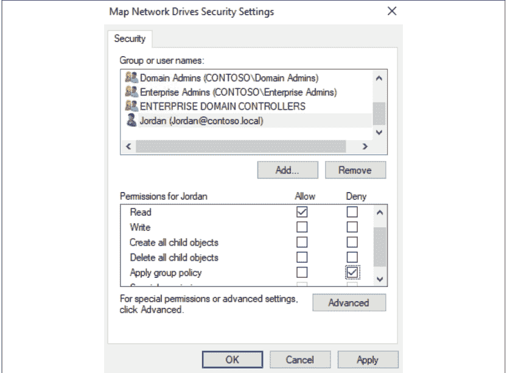

图 5.16：拒绝用户接收此 GPO

> 谨慎使用！在“委派”选项卡内创建 GPO 拒绝效果很好，但未来很容易忘记或忽略这些设置。我多次协助管理员排查似乎未正确应用的 GPO 问题，最后才发现委派中的拒绝权限导致了所有麻烦。

## 计算机设置和用户设置

在 GPO 内部探索几分钟后，你很可能会注意到组策略管理编辑器被分为两个不同的部分。在深入 GPO 查找即将部署的特定设置时，你需要做的第一个选择是正在处理计算机配置还是用户配置。理解这些差异并始终牢记这些差异不仅对找到你要搜索的设置很重要，也对确保新 GPO 链接到正确的位置并应用于正确的对象类型很重要。你可以在图 5.17 中看到任何 GPO 的这两个部分：

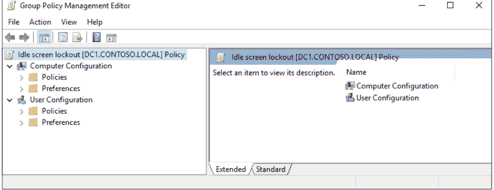

图 5.17：计算机配置和用户配置

### 计算机配置

当然，列在计算机配置下的所有 GPO 设置都是可以应用于域加入计算机的设置。废话！难道所有 GPO 设置都应用于计算机吗？不，其实并非如此。许多 GPO 设置确实应用于 Active Directory 中的计算机对象，所有这些类型的 GPO 设置都属于计算机配置之下。有些 GPO 设置甚至可以在计算机级别或用户级别进行配置。有时你在计算机配置和用户配置中都可能有类似的选项，以略微不同的方式完成任务。

一个很好的例子是空闲屏幕锁定策略。公司通常要求计算机屏幕在一段时间内无活动后自动锁定。这样，如果用户离开计算机忘记手动锁定屏幕，它将在例如 15 分钟后自动锁定。

如果你负责创建此类策略，你需要决定是否希望此 GPO 在计算机级别或用户级别应用。这需要你根据正常的用户活动自行决定。

如果你确定在计算机级别锁定屏幕是最好的方法，即无论谁登录该计算机，屏幕都会在 15 分钟后锁定，那么你希望在 GPO 中设置的特定配置如下：

计算机配置 | 策略 | Windows 设置 | 安全设置 | 本地策略 | 安全选项

交互式登录：机器非活动限制 = 已启用 并指定为 900 秒（15 分钟）

### 用户配置

另一方面，许多其他 GPO 设置根本不应用于计算机账户，而是应用于登录该计算机的域用户。用户配置设置会跟随用户账户，并在用户登录的任何工作站上应用。回顾我们的“映射网络驱动器”GPO，你会看到我们在该 GPO 中创建的网络驱动器配置全部属于用户配置之下。这意味着这些驱动器映射会在用户登录的任何地方尝试映射。你无法从计算机配置中创建映射网络驱动器的原生 GPO 设置。

回到我们的空闲屏幕锁定示例，如果你决定希望空闲屏幕锁定适用于特定类型的用户，甚至是所有用户，并且无论他们登录哪台计算机都会锁定屏幕怎么办？在这种情况下，用户配置中没有特定的“屏幕锁定”策略设置可以配置，但通常建议的做法是利用屏幕保护程序设置进行创意配置，这些设置属于用户配置。如果配置以下四个 GPO 设置，你将有效地创建与计算机配置机器非活动限制超时设置相同的行为，但现在此策略是基于用户账户而非计算机账户生效的：

用户配置 | 策略 | 管理模板 | 控制面板 | 个性化

启用屏幕保护程序 = 已启用

强制特定屏幕保护程序 = 用此定义要运行的屏幕保护程序

屏幕保护程序超时 = 已启用 并设置为 900 秒

密码保护屏幕保护程序 = 已启用

### 相应地链接 GPO

当你在环境中寻找要部署的 GPO 配置时，有时会发现计算机配置或用户配置之间没有选择，因为某些选项只存在于其中一个位置。其他时候，你会发现正在部署的设置可以从任一位置配置，如何最好地设置 GPO 的决定取决于你希望 GPO 设置应用的级别。

这个决定直接与你要将此 GPO 链接到的位置相关！如果你的 GPO 包含计算机配置设置，这些设置只能应用于计算机对象，因此该 GPO 需要链接到包含计算机对象的 OU。当然也可以链接到域，这涵盖所有 OU。

反之亦然，如果你的新 GPO 仅包含用户配置设置，该 GPO 仅会应用于用户对象，你为该 GPO 创建的任何链接都应链接到包含你希望 GPO 应用到的用户对象的 OU。

你可能已经明白了这一点，但通常的最佳实践是创建基于计算机的 GPO 或基于用户的 GPO。单个 GPO 可以包含大量不同的设置，如果该 GPO 链接在足够高的层级，它确实可以从单个 GPO 中同时应用用户和计算机配置设置。但这会给单个 GPO 带来更高的管理负担，通常认为的最佳实践是任何 GPO 只包含计算机配置设置或用户配置设置。

### 组策略回环处理

GPO 内部有一个特殊功能，本质上将计算机配置和用户配置融合在一起，用于特殊情况：即，如果你需要将用户配置设置推送到特定计算机，但希望这些计算机将其视为计算机配置设置对待，对登录该计算机的任何用户都应用相同的策略设置。

也许人力资源部的 Laura 在她的日常工作站上有特定的一组策略，但偶尔也会登录大厅里的一台公共信息亭工作站。你对该信息亭应用了一组锁定限制，但由于它已加入域，当 Laura 登录信息亭时，组策略会将其视为她自己的工作站一样对待并应用所有相同的基于用户的 GPO 设置。如果你创建一个启用了回环策略处理的“用户配置”GPO 并将其链接到该信息亭工作站，它现在将对 Laura 应用所有这些特殊配置，即使她在常规计算机上不会接收到这些 GPO 设置。


关于回环处理的更多细节，我将再次引导你阅读本章末尾的 *Summary* 部分，在那里我会为你指引一个深入学习该主题的绝佳位置。

## 策略与首选项

每位组策略管理员都需要了解 GPO 设置中的一个重要区别。存在两种不同类型的策略设置，它们的行为截然不同。现在我们已经了解了计算机配置与用户配置之间的差异，在组策略管理编辑器中你会注意到下一层级包含名为 **Policies** 和 **Preferences** 的子文件夹。

### 策略

受管策略，即在计算机和用户配置的策略部分下列出的项目，通常表现得像真正的绅士。这些是你部署并期望得到结果的设置，强制将设置实施到位，且用户无论尝试做什么都无法更改它们。当你反向操作并从系统上移除 GPO 时，它们会欣然配合。我是什么意思？当你将一些策略设置放入 GPO 中然后将该 GPO 链接到某个位置时，你期望这些设置会被应用到你对该 GPO 进行筛选的计算机或用户上。事实上，这对任何 GPO 设置都适用，无论是策略还是首选项，受管或未受管。但当该 GPO 不再适用于某个用户或计算机时怎么办？如果删除 GPO 链接，或调整 GPO 上的安全筛选使其不再适用于工作站呢？这些设置会继续被应用，还是会被主动移除？

对此问题的答案取决于你是在处理策略还是首选项。真正的策略项目会在 GPO 不再适用时主动从计算机上移除自己。这适用于组策略内部的大多数内置配置设置。技术上讲，在底层真正发生的是组策略会监控 Windows 注册表的四个特殊部分，并在组策略刷新周期期间重新处理它们。所有影响这些注册表区域的 GPO 设置都具有自我移除的能力。未受管的策略设置，即使是列在 **Policies** 文件夹下的一些设置，在 GPO 被取消链接时也可能无法移除其设置。这只取决于你所谈论的是什么设置，以及它在客户端计算机上操纵了什么来做出更改。

技术上讲，存在受管策略和未受管策略——而这两者都超出了组策略首选项的范围，我们将在下一部分讨论。

### 首选项

策略会强制执行操作，无论用户想要什么。另一方面，首选项通常可以由用户自行还原。首选项是配置能让用户生活更轻松的设置的好方法，但你最终需要接受这些更改和设置可能被用户手动再次更改的事实。一些 GPO 设置同时存在于策略和首选项中，这就是你的决定因素——你是否希望允许用户操纵和更改配置，还是始终强制实施？

首选项也是“粘性”的！虽然大多数策略设置在 GPO 停止应用于计算机时会自我移除，但首选项不会。在删除 GPO 或 GPO 链接时，了解这一点非常重要。组策略首选项并不存在于我们之前谈到的那些注册表的特殊部分中，因此 Windows 不会主动重新扫描这些设置以确定它们是否应继续应用。当 GPO 将首选项设置部署到位时，即使用户如果愿意可以调整该设置，移除 GPO 也不会将计算机恢复到原始默认状态。GPO 首选项设置会一直保留并继续应用于该机器，即使 GPO 早已不存在。要将首选项设置改回默认值，用户必须自行调整，或者你需要推送一个新的 GPO 来实现该调整。

## 默认域策略

在本章中，我们多次进出组策略管理控制台，现在你已经知道 GPO 的外观以及如何识别 GPO 链接，你可能已经注意到一个链接到域根的名为 Default Domain Policy 的 GPO。该 GPO 是组策略内置的，每个环境都有一个，除非管理员采取措施将其删除，而我不建议这样做。

默认域策略适用于域目录中的每个用户和计算机。由于该 GPO 从一开始就完全启用并适用于所有人，因此公司通常会强制执行需要适用于所有人的全局密码策略或安全规则。事实上，许多不熟悉组策略且不愿创建、链接和筛选自己的 GPO 的人会不断地将更多设置塞入默认域策略。当然，所有这些设置都会成功应用——适用于网络中所有机器上的所有用户，包括服务器。最终，这种心态会反噬得很厉害。

我的一般规则是除了一种原因外不要触碰默认域策略——在域内创建全局密码过期和复杂性要求。事实上，在某些情况下，即使是密码策略也不适合默认域策略，例如，如果你想创建一个更精细的密码策略，具有一些额外的功能，例如能够对某些用户与他人相比要求不同的密码标准。我们将在 *Chapter 9, Hardening and Security* 中介绍精细密码策略，因此暂时让我们坚持创建一个密码策略并将其应用于所有人的想法。这似乎是一个很好的示例来逐步讲解，并且请记住——如果你发现自己进入默认域策略做任何与密码管理无关的事情，你可能做错了。拜托，创建一个自己的 GPO 吧！

在管理控制台中看到的任何 GPO，如果你右键单击该 GPO 然后选择 **Edit...**，你会看到一个新窗口打开，而这个 GPO 编辑器包含该策略的所有内部内容。这就是你进行任何想要成为该特定 GPO 一部分的设置或配置的地方。所以，继续编辑你的 **Default Domain Policy**，然后导航到 **Computer Configuration** | **Policies** | **Windows Settings** | **Security Settings** | **Account Policies** | **Password Policy**：

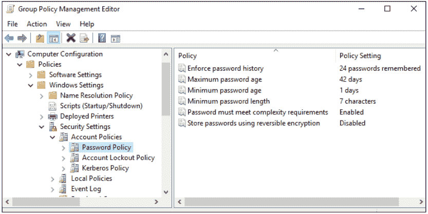

图 5.18：默认域策略中的密码设置

在这里，你可以看到用于在域内配置密码策略的各种选项的列表。双击其中任何一个设置即可修改它们，并且该更改会立即在网络中的所有域加入计算机上开始生效。例如，你可以看到默认的最小密码长度设置为 7 个字符。许多公司已经就网络中密码的标准长度的书面政策进行了多次讨论，为了设置新的目录基础架构以接受你的决定，你只需修改此字段。在此处将最小密码长度更改为 14 个字符将立即要求所有用户账户在下次重置密码时做出更改。

值得重复强调：虽然默认域策略是快速轻松地将一些设置配置并推送给所有人的方法，但在对该默认策略进行更改时要谨慎。每次在此处进行设置更改时，请记住它将影响域中的每个人，包括你自己。很多时候，你会创建不需要适用于所有人的策略。在这些情况下，强烈建议你远离默认域策略。相反，为你想要实施的任务设置一个新的 GPO。

## 管理模板

继续编辑一个 GPO，任何 GPO，以便组策略管理编辑器在你面前打开。展开计算机配置、用户配置或两者中的策略文件夹，你会注意到每个文件夹内都有一个名为管理模板的文件夹。我们大多数人通常将管理模板视为与其他 GPO 配置设置相同，只是可以用来操纵用户或计算机的项目集合，对吧？有点像，但软件设置和 Windows 设置是内置于组策略中的，并且对于任何域环境基本相同，而管理模板是可以自定义的。

管理模板展示了组策略的灵活性。管理模板中的每个设置都是从驻留在域控制器服务器上的模板文件提取的。这些模板文件是 ADMX 文件。组策略管理编辑器中显示设置所需的所有信息都包含在这些 ADMX 文件中。这包括设置包含哪些选项、需要显示的任何下拉框，以及管理员双击策略设置时描述字段会显示什么内容等项目。

每个 ADMX 文件都附带一个 ADML 文件。这是用于定义 ADMX 文件中包含的设置的语言的语言文件。


回到 Windows XP（及更早版本）时代，这些文件类型并不存在。Administrative Templates 中的设置当时基于 ADM 文件。没人应该再运行 Windows XP 了，除非我知道你们中有些人还在用，因为我每个月至少一次仍会在部分客户处接触到 Windows XP 机器。所以我想我会把这些信息作为 FYI 包含进来。旁注：赶紧淘汰你们的 Windows XP 电脑吧！

Windows 7 及更新版本知道如何处理 ADMX/ADML 文件，所以我假设你的环境已完全更新，并且希望没有太多不受支持的 Windows 7 机器闲置。

## 实现 ADMX/ADML 文件

你可能会发现自己在摆弄 ADMX 文件，有两个原因。第一个原因是当你在环境中升级到更新版本的 Windows Server 时。操作系统的每个版本——2012、2012R2、2016、2019——都附带一些新的和更新的组策略设置。当你安装运行在更新平台上的第一个域控制器到环境中时，设置过程通常会运行一个名为 ADPrep 的过程。此过程为新操作系统准备 Active Directory 架构并填充新的组策略设置。然而，有时你向环境引入的第一个新版本操作系统并不是域控制器。在这种情况下，组策略不会用新设置进行更新，但如果无论如何你希望这些新设置在组策略中可用怎么办？手动复制 ADMX/ADML 文件到指定位置可以满足该需求。

第二个也是最常见的原因是当软件厂商，通常是微软自己，发布自定义 ADMX 文件时，需要手动将新的 ADMX/ADML 文件插入到位。这些文件安装到 Active Directory 后，会在组策略中提供 Windows Server 原生不存在的新设置。我们现在就来试试！

Google Chrome（我刚在微软的书里说了这些词？？？）是世界上最受欢迎的网络浏览器之一。Chrome 的集中配置是许多管理员苦恼的问题。可能对你来说是新消息的是，Google 也有自己的一套 ADMX 文件！你可以将这些文件插入组策略，并在 GPMC 中直接使用 Google 定义的设置，将与 Chrome 相关的设置和配置推送给你的员工。

首先，我们需要下载这些文件。截至撰写时，此链接即可解决问题：https://dl.google.com/dl/edgedl/chrome/policy/policy_templates.zip。

如果无法使用该链接，只需在网上搜索 download chrome admx files 应该就能找到。

将这些文件复制到你的域控制器并解压，以便找到 ADMX 和 ADML 文件；它们应该位于名为 **windows** 的文件夹内。ADMX 文件就位于 **windows** 文件夹中，而 ADML 文件会按语言分组到文件夹中。这与我们一分钟后在组策略中看到的情况相符。现在你手头有了文件，继续在域控制器上打开以下文件夹：

```
%systemroot%\PolicyDefinitions
```

（在大多数服务器上，这将是 C:\Windows\PolicyDefinitions。）

在 *Figure 5.19* 中，你可以看到我已下载的 Chrome 文件，以及 **PolicyDefinitions** 文件夹。如你所见，**PolicyDefinitions** 中已有众多 ADMX 文件，这是意料之中的。这些 ADMX 文件就是我们目前在组策略下的 **Administrative Templates** 文件夹中拥有任何设置的原因：

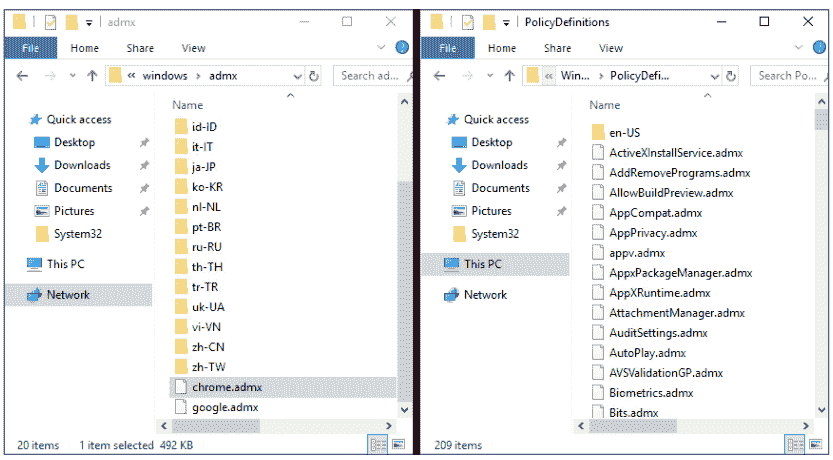

Figure 5.19: 将新的 ADMX 文件复制到域控制器

## 组策略

只需将新的 Chrome ADMX 文件复制到 **PolicyDefinitions** 中，然后将随附的语言 ADML 文件从其文件夹复制到 **PolicyDefinitions** 内的对应语言文件夹中。就这样！如果现在关闭并重新打开组策略管理控制台，查看 **Administrative Templates** 内部就会显示新的 Google Chrome 设置，这两个小小的 ADMX 文件带来了大量设置：

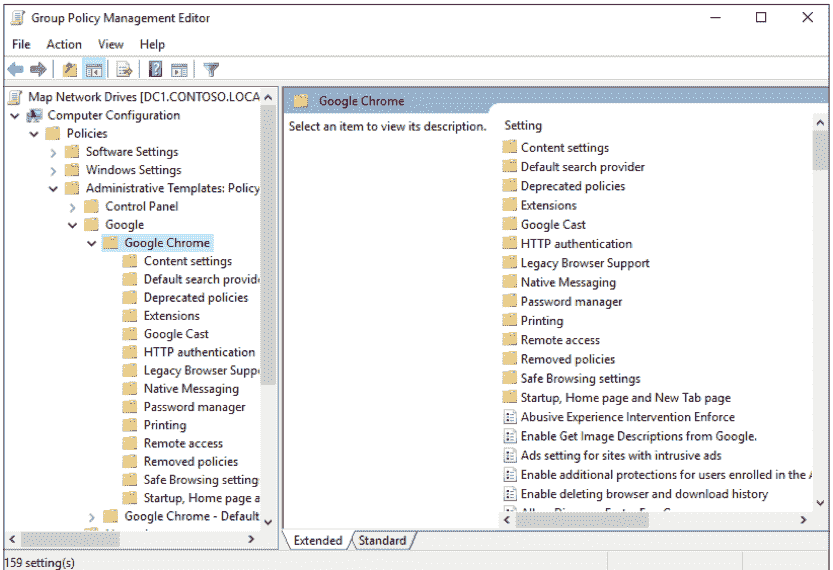

Figure 5.20: Google Chrome GPO 设置

> 对于本特定示例，我使用的是我的测试实验室，并假设你的环境中只有一个域控制器。如果有多个 DC，你要么需要将这些文件复制到每个域控制器服务器上的 `%systemroot%\PolicyDefinitions`，要么继续阅读本章下一节以了解有关 Central Store 的更多信息。

## 中央存储

打开组策略管理控制台并创建或编辑 GPO 时，会话中可用的设置是从你使用 GPMC 的计算机或服务器硬盘上的 ADMX/ADML 文件中提取的。通过 ADMX 文件实现新设置时，必须将这些新文件复制到每个域控制器上，再加上可能安装了 RSAT 工具的所有客户端计算机，这将是一项巨大的工作。幸运的是，有一个解决方案可以为你自动化此过程！

Central Store 是可在 Active Directory 中启用的功能，允许复制 ADMX/ADML 文件。一旦启用 Central Store，你的所有组策略管理机器，例如域控制器，将把该存储作为这些模板文件的存储库。

## 启用中央存储

在 Active Directory 中启用 Central Store 所需的只是在一个名为 SYSVOL 的特殊文件夹内创建两个文件夹。创建后，GPMC 在后续启动时会检查此位置，并提取任何新增的 ADMX/ADML 文件。登录到域控制器服务器，并创建以下新文件夹：

```
%systemroot%\SYSVOL\sysvol\contoso.local\Policies\PolicyDefinitions
```

在你的新 PolicyDefinitions 文件夹内再创建一个文件夹，用于存放特定语言的 ADML 文件。就我而言，我需要一个用于英语的文件夹，如下所示：

```
%systemroot%\SYSVOL\sysvol\contoso.local\Policies\PolicyDefinitions\en-US
```

显然你需要将 contoso.local 替换为自己的内部域名，然后就完成了！一旦创建了这两个新文件夹，从此以后使用此位置插入新的 ADMX 和 ADML 文件，这些新设置将从你未来任何位置启动 GPMC 时显示出来。

## 填充中央存储

你可能没有立即查看 GPO 内部以了解启用 Central Store 后 **Administrative Templates** 文件夹看起来如何的理由，但我们现在就去做吧。打开 GPMC 并编辑任何现有 GPO。查看其中一个 **Administrative Templates** 文件夹，它是空的！你还会注意到 **Administrative Templates** 文件夹的名称已更改，以反映它正在从 Central Store 查找此信息：**Administrative Templates: Policy definitions (ADMX files) retrieved from the central store：**

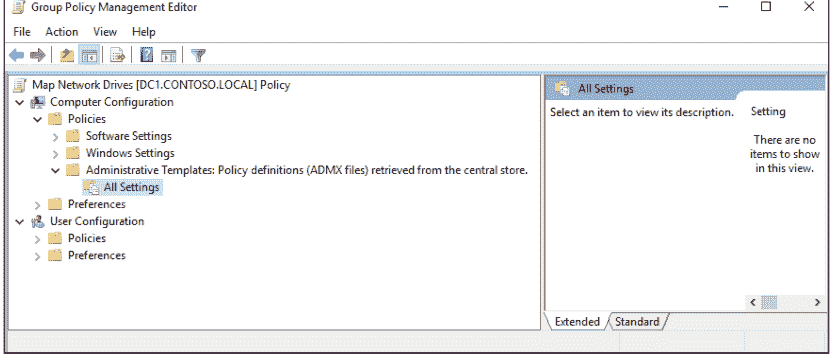

Figure 5.21: Administrative Templates 文件夹为空！

把我们的设置还回来！幸运的是，它们仍在域控制器的硬盘上，就在几分钟前我们添加新 Google 设置的同一位置。执行以下文件复制操作，你应该就能恢复正常，所有设置现在都存储在 Central Store 中。

```
Copy %systemroot%\PolicyDefinitions to %systemroot%\SYSVOL\sysvol\contoso.local\Policies\PolicyDefinitions.
```

将 %systemroot%\PolicyDefinitions\en-US 复制到 %systemroot%\SYSVOL\sysvol\contoso.local\Policies\PolicyDefinitions\en-US（根据需要调整语言）：

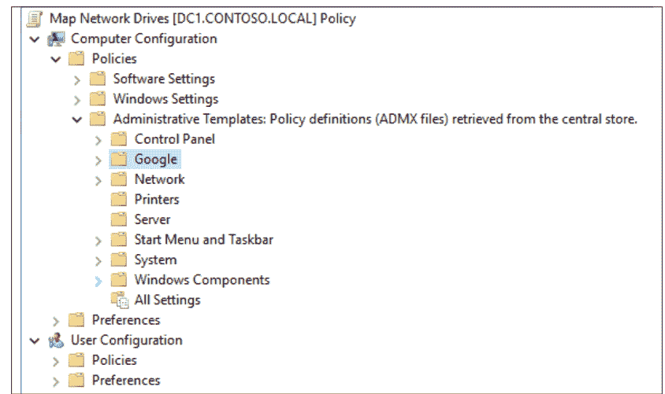

Figure 5.22: Central Store 现已填充了设置

如你所见，Administrative Templates 文件夹仍从 Central Store 获取，但经过我们的文件复制后，Central Store 现已填充了可在 GPO 中使用的 ADMX 文件和设置。Central Store 现在可供环境中的所有域控制器使用，并由 SYSVOL 进行复制。


## 摘要

Group Policy 是在域环境中工作时可供使用的极其强大的工具。存在许多预先构建的配置和设置，并且由于我们可以操作客户端计算机上的注册表，因此通过 GPO 可以管理的客户端计算机内容几乎没有限制。

与 Windows Server 内部的许多主题一样，与 Group Policy 相关的内容非常多，以至于值得单独写一本书。幸运的是，我有机会正是这样做了！如果您有兴趣了解更多关于 Group Policy 的内容以及它可以用于保护基础设施的所有方式，请查看我的著作 Mastering Windows Group Policy (https://www.packtpub.com/networking-and-servers/mastering-windows-group-policy)。

## 问题

- 1. 屏幕保护程序设置是计算机配置还是用户配置？
- 2. 域级别还是 OU 级别的链接先处理？
- 3. 强制用户设置应用于给定计算机上的任何用户的特殊 GPO 设置是什么？
- 4. 您在 GPO 本身内部配置的类型是什么样的 GPO 过滤，例如使用映射网络驱动器策略？
- 5. 真或假 – 用户有可能覆盖 Group Policy 首选项。
- 6. Group Policy 后台刷新周期之间的默认计时器是多少？

# 6 Windows Server 2019 中的证书

# Windows Server 2019 中的证书

> "唉，我们需要使用证书才能让它工作。"
> - 来自一位刚刚发现其最新技术采购在其组织中需要使用证书的匿名管理员的引语

如果上面的引语听起来很熟悉，请不要就此放弃该新项目！出于某种原因，使用证书对我们中的许多人来说似乎是一项艰巨的任务，即使是工作了多年 IT 的人也是如此。我认为这可能是因为在证书服务器上有很多不同的选项可用，但用于处理证书的管理控制台并没有太多常识或用户友好性。再加上多年来服务器对证书的需求普遍缺乏，这意味着尽管该技术已经存在很长时间，但许多服务器管理员从未有机会深入研究并为自己部署证书。我经常部署一些需要在组织中广泛使用证书的技术，通常需要向网络中的每台工作站或用户颁发证书，我经常听到这类担忧。如果您没有任何流程经验，为单个业务关键型 Web 服务器颁发证书听起来就已经很 daunting 了，更不用说一次颁发数百或数千个证书了。

另一个常见场景是，公司确定证书对自己有利，但缺乏内部资源自行搭建，因此聘请第三方在网络中实施证书。虽然这样可以让证书运行起来，但它往往会留下永远无法填补的知识空白，因此您可能拥有一个正在运行的证书服务器，但完全不习惯修改或使用它。

证书环境的广义术语是 **公钥基础设施 (PKI)**。我特别指出这一点，因为如果您还没有看到，您很可能会在文档或要求中看到 PKI 列表。您的 PKI 由网络中的服务器提供，并且配置这些服务器为您颁发证书是本章的目的。您确定为证书服务器的服务器被称为 **证书颁发机构 (CA)** 服务器，我们将在本书中始终将它们称为 CA 服务器。

为了让您在网络中使用证书入门，以下是本章将涵盖的主题：

- 常见证书类型
- 规划您的 PKI
- 创建新的证书模板
- 颁发您的新证书
- 创建自动注册策略
- 获取公共机构 SSL 证书
- 导出和导入证书

### 常见证书类型

您可能会发现自己需要发布不同类型的证书。随着您将看到，当您需要具有特定要求的证书时，您可以根据喜欢的任何规范构建证书模板。因此，从某种意义上说，根本没有证书 *类型*，而只是证书模板，您将其范围限定为包含该证书执行其工作所需的信息。虽然从技术上讲这是正确的，但通常更容易将证书细分为不同的组，使其更易于区分其预期执行的特定工作。

### 用户证书

顾名思义，用户证书是用于特定于用户名本身目的的证书。推动更多证书采用的平台之一是网络身份验证过程。公司在环境中寻找更强的身份验证时，通常会将证书作为该身份验证过程的一部分。智能卡是可用于此目的的机制之一，具体来说是某种物理卡插入计算机以供用户访问该计算机。

智能卡也可以虚拟存储在现代机器上的一个特殊位置，称为 TPM。但那是另一天的讨论。我们在这里提到智能卡的原因是，通常智能卡身份验证的核心功能是由存储在该智能卡上的用户证书提供的。如果您发现自己处于部署智能卡或某种物理密钥登录的项目中，您很可能会需要一个 PKI。

另一种流行的强身份验证形式是一次性密码 (OTP)。这要求用户除了常规登录条件外，还输入随机生成的 PIN，在某些情况下，当用户输入 PIN 时，会为其颁发临时用户证书以用作身份验证链的一部分。用户证书常见的其他地方包括公司采用文件加密技术时，例如 EFS（Encrypting File System 的缩写），或在构建虚拟专用网络 (VPN) 系统以使远程用户能够将笔记本电脑重新连接到公司网络时。许多公司不希望仅依赖用户名和密码进行 VPN 身份验证，因此颁发用户证书并要求它们存在以建立该 VPN 隧道是很常见的。

### 计算机证书

通常称为计算机证书或机器证书，这些家伙会颁发给计算机，以协助网络与计算机账户本身之间的交互。诸如 SCCM 之类的技术，无论哪些用户登录到这些计算机，都与计算机系统交互并管理它们，使用计算机证书。这些类型的证书也用于网络上系统之间的加密处理，例如，如果您有兴趣使用 IPsec 在客户端和高度安全的服务器之间加密通信。将计算机或机器证书颁发给此通信链中的端点对于使其正常工作至关重要。我经常为企业的机器颁发计算机证书以验证 DirectAccess 隧道，这是一种自动远程访问形式。您可能感兴趣的有很多不同的原因和技术，需要向环境中的客户端工作站颁发证书。

### SSL 证书

如果您发现自己处于证书道路的中间，既没有真正管理过 CA 服务器，但您在某个时候颁发并安装过某种证书，那么您处理的证书很可能是 SSL 证书。这是当今技术基础设施中使用最广泛的证书类型，而且您的公司很可能正在使用 SSL 证书，即使您不知道并且在网络内部没有运行单个 CA 服务器。

SSL 证书最常用于保护网站流量。只要您访问网站并在地址栏中看到 HTTPS，您的浏览器就会使用 SSL 数据包流在您的计算机和您正在对话的 Web 服务器之间来回发送信息。Web 服务器上有一个 SSL 证书，您的浏览器在允许您进入网页之前会检查该证书，以确保证书有效并且网站确实是它声称的那样。你看，如果我们在网站上不使用 SSL 证书，任何人都可以冒充我们的网站并访问传递给网站的信息。

让我们提供一个快速示例。假设您的其中一位用户在咖啡店，使用公共 Wi-Fi。攻击者想出了在该 Wi-Fi 网络上操纵 DNS 的方法，因此当您的用户尝试访问 mail.contoso.com 以便在网上访问公司的 Outlook 检查电子邮件时，攻击者劫持了该流量，用户现在坐在一个看起来像公司门户但实际上由攻击者托管的网站上。用户输入其用户名和密码，bingo，攻击者现在拥有该用户的凭据，可以使用它们访问您的真实网络。是什么阻止了这种事情每天在现实世界中发生？SSL 证书。当您强制外部面向的网站，例如该电子邮件登录页面，成为 HTTPS 站点时，它要求客户端浏览器检查随网站提供的 SSL 证书。该 SSL 证书包含只有您作为公司才拥有的信息；它无法被冒充。这样，当您的用户访问真实的登录页面时，浏览器会检查 SSL 证书，发现它是正确的，然后继续其快乐的旅程。用户甚至不知道自己受到保护，除了浏览器地址栏附近的小锁符号。另一方面，如果他们的流量被拦截并重定向到假网站，SSL 证书检查将失败（因为攻击者不会为您的公司网站名称拥有有效的 SSL 证书），用户将被阻止，至少在能够继续之前需要阅读证书警告页面。此时，用户应退后一步意识到有些不对劲并联系 IT 人员进行调查。


互联网上网站使用的 SSL 证书几乎总是由公共证书颁发机构提供，而不是由您内部的 CA 服务器提供。
您可能听说过其中许多，例如 Verisign、Entrust、DigiCert 和 GoDaddy。
公司通常从这些公共机构购买 SSL 证书，因为这些机构在用户可能在外购买的新计算机上默认受信任。
当您购买一台新电脑，甚至直接从零售店购买，如果您打开该系统开箱即用的本地证书存储，您会找到一份受信任根机构的列表。
当您访问由这些公共机构之一颁发的 SSL 证书保护的网站时，该证书以及因此该网站会被此计算机自动信任。
公共 CA 是公开认可的实体，以其安全颁发 SSL 证书的能力而闻名。

当公司从这些公共机构之一获取 SSL 证书时，机构会进行深入的验证流程，以确保请求证书的人（您）确实是拥有适当公司并有权签发这些证书的人。
这是使用公共 CA 的 SSL 证书安全的基石。
所有新计算机默认都知道信任由这些机构颁发的证书，您无需采取任何特殊操作即可使您的网站在互联网上运行。
另一方面，您可以从自己构建并在内部网络中运行的 CA 服务器签发 SSL 证书，但这需要一些使其变得困难的事情，因为您的 CA 服务器显然不会被所有计算机信任，也不应该被信任。
首先，如果您想为公共网站签发自己的 SSL 证书，您需要将内部 PKI 的至少一部分，即 **certificate revocation list (CRL)**，对外公开到互联网。
任何时候您将网络内部的组件公开到互联网上，您都会引入安全风险，因此除非绝对必须这样做，一般不建议这样做。
第二个原因在于难以在公共网站上使用您自己的 SSL 证书，因为只有您公司自己的域加入计算机才会知道如何信任此 SSL 证书。
因此，如果用户将公司笔记本带回家并用它访问其电子邮件登录页面，它可能工作正常。
但是如果用户尝试从其家庭电脑访问同一电子邮件登录页面，而该电脑不属于您的域或网络，他们将收到证书警告消息，并且必须采取特殊步骤才能访问网站。
这对用户来说太麻烦了。
您绝不应鼓励用户接受风险并通过证书警告消息继续操作——这是一场灾难的配方，即使他们点击通过的证书是由您自己的 CA 颁发的。
从原则上讲，永远不应接受这种风险。

这些问题可以通过从这些公共 CA 之一购买 SSL 证书来缓解，因此购买这类证书是在面向公众的网站上使用 SSL 的正常且推荐方式。
完全位于网络内部的网站则另当别论，因为它们不面向互联网，其安全足迹要小得多。
您可以使用内部 CA 服务器为内部网站签发 SSL 证书，而无需承担为所有这些网站购买证书的成本。

您可以在公共 CA 购买几种不同级别的 SSL 证书，其信息列在该机构自己的网站上。
本质上，想法是您支付的越多，您的证书就越安全。
这些级别与机构对证书请求者的验证方式有关，因为这正是 SSL 证书的安全性发挥作用的地方。
机构保证的是，当您访问其证书保护的页面时，该证书已颁发给拥有该网页的真实公司。

除了在购买证书时可选择的验证级别外，您还有另一个需要决定的选项，而这个选项对证书工作原理的技术方面更为重要。
购买证书时您可以使用不同的命名约定，没有最佳答案可供选择。
需要证书的每种情况都是独特的，必须单独评估以决定哪种命名方案最合适。
让我们快速介绍三种 SSL 证书命名约定的可能性。

## 单名称证书
这是在为单个网站购买证书时最便宜且最常见的选择。
单名称证书保护并包含有关单个 DNS 名称的信息。
当您在 portal1.contoso.com 设置新网站并希望该网站通过使用 HTTPS 保护部分流量时，您会将 SSL 证书安装到该网站上。
当您向证书颁发机构发出此新证书的请求时，您会将 portal1.contoso.com 的特定名称输入请求表单的 **Common name** 字段。
这个单一的 DNS 名称是此证书唯一可以保护和验证的名称。

## 多域名或主题备用名称证书
**Multi-domain certificates, sometimes called subject alternative name (SAN)** 证书，通常比单名称证书贵一点，因为它们具有更多功能。
当您请求 SAN 证书时，您可以选择定义证书可以保护的多个 DNS 名称。
一旦签发，SAN 证书将包含一个主 DNS 名称，通常是网站的主要名称，并且在证书属性的更深处，您会找到在请求期间指定的额外 DNS 名称列表。
此单一证书可以安装在 Web 服务器上，并用于验证证书中包含的任何 DNS 名称的流量。
SAN 证书的用例示例是在设置 Lync（Skype for Business）服务器或 Exchange 服务器时。
Lync 使用许多不同的 DNS 名称，但所有名称都在同一 DNS 域内。
以下是我们可能为 Lync 目的包含在单个 SAN 证书中的名称示例列表：
- Lync.contoso.com (the primary one)
- Lyncdiscover.contoso.com
- Meet.contoso.com
- Dialin.contoso.com
- Admin.contoso.com

Lync 使用的这些不同网站/服务随后在一个或多个服务器上实现，您可以在所有这些服务器上使用相同的 SAN 证书，以验证流向这些 DNS 名称中任何一个的流量。

## 通配符证书
最后但绝对不容忽视的是通配符证书。
这是豪华型号，具有最多的功能，提供最大的灵活性，同时在许多服务器上提供最简单的实施路径。
通配符证书上的名称以 **star (*)** 开始。
这个星号表示 *any*，即 *anything preceding the DNS domain name* 都被此证书覆盖。
如果您拥有 contoso.com 并计划建立许多公共 DNS 记录，这些记录将流向许多不同的网站和 Web 服务器，您可以购买一个名为 *.contoso.com 的单一通配符证书，它可能涵盖您所有的证书需求。

通常，通配符可以安装在您需要的任意多台 Web 服务器上，对它们可以验证的不同 DNS 名称的数量没有限制。
我曾经遇到过一次例外情况，当时某位客户与其证书颁发机构的协议规定，他们必须报告并为每个正在使用的通配符证书实例付费。
因此，在与您的 CA 签订协议时请注意这些条款。
大多数情况下，通配符旨在在公司内部自由使用，以便您可以在许多服务器上部署许多站点和服务，并在任何地方使用您的通配符证书。

通配符证书的缺点是它成本更高，明显更高。
但如果您有大量的证书需求或大的增长计划，它将使您的证书管理在长期内更轻松、更快、更具成本效益。

## 规划您的 PKI
由于本书围绕 Windows Server 2019 展开讨论，这意味着您的内部 CA 服务器可以并且应该由这一最新最好的操作系统提供。
与 Server 2019 中的大多数功能一样，在您的网络中创建证书颁发机构服务器就像安装一个 Windows 角色一样简单。
当您前往为新服务器添加角色时，它是列表中的第一个角色，即 Active Directory Certificate Services (AD CS)。
安装此角色时，您将看到几个重要选项，在创建稳固的 PKI 环境之前，您必须理解它们背后的含义。

> 在实施 CA 角色后，服务器的主机名和域状态无法更改。请确保在安装 AD CS 角色之前已设置最终主机名并将此服务器加入域（如适用）。之后您将无法更改这些设置！

### 角色服务
安装 AD CS 角色时，您需要做出的第一个决定是您希望安装哪些角色服务，如图 6.1 所示：

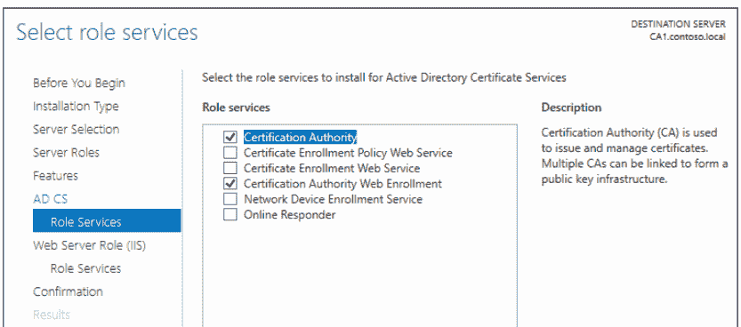

图 6.1：安装 AD CS 角色

点击每个选项都会显示其功能描述，因此你可以通过在此屏幕上查看来大致确定需要安装角色的哪些组件。以下是这些选项的简要总结。请注意，我按顺序列出这些选项是乱序的，因为这是我在实际环境中通常看到的配置方式：

-   **证书颁发机构**：这是服务器要正式成为 CA 所需安装的主要证书引擎。
-   **证书颁发机构 Web 注册**：通常也会安装此项，尤其是在环境规模足够小，可以为整个环境运行单个 CA 服务器的情况下。Web 注册部分将在此服务器上安装 IIS（Web 服务器）功能并启动一个小型网站，用于请求证书。我们将在本章后面介绍通过此 Web 界面颁发证书时进一步讨论此内容。
-   **证书注册 Web 服务和证书注册策略 Web 服务**：大多数情况下，我们只关心为公司拥有的、已加入域的系统颁发证书。在这种情况下，这两个选项是不必要的。如果计划从此 CA 服务器为未加入域的计算机颁发证书，则需要选择这些选项。
-   **网络设备注册服务**：顾名思义，CA 角色的这一部分提供了向路由器和其他类型网络设备颁发证书的能力。
-   **联机响应器**：这是为大型环境保留的特殊功能。每个证书内部都包含对 CRL 的规范。当客户端计算机使用证书时，它会联系并检查该 CRL，以确保其证书未被吊销。CRL 是证书安全拼图中的重要部分；在拥有数千客户端的环境中，您的 CRL 可能非常繁忙，需要响应所有这些请求。您可以部署运行联机响应器的额外 CA 服务器来减轻该负载。

为了我们的实验目的，并涵盖大多数中小型企业的所需功能，我将选择图 6.1 中显示的两个选项：**证书颁发机构**和**证书颁发机构 Web 注册**。

## 企业版与独立版

在安装 AD CS 角色后，服务器管理器会通知您证书服务需要一些额外配置，这对于许多角色安装来说是常见的。在首次配置 CA 角色时，您将面临一个重大选择。您希望此 CA 服务器是**企业 CA**还是**独立 CA**？

让我们先从企业 CA 开始。正如向导会告诉您的那样，企业 CA 服务器必须是域的成员，并且这些证书服务器通常保持在线，以便为需要它们的计算机和用户颁发证书。等等！我们为什么要关闭证书服务器呢？我们稍后再讨论这个问题，但如果您打算利用此 CA 颁发证书，它显然必须保持开启状态。域环境中的大多数 CA 服务器都是企业 CA。在创建企业 CA 时，您的模板和一些证书特定信息可以存储在 Active Directory 中，这使得证书与域之间的集成更加紧密和有益。如果这是您首次接触 CA 角色，我建议您从企业 CA 开始，因为这更符合大多数组织的需求。

正如您从前文可以正确推断的那样，这意味着在实际环境中看到独立 CA 的情况较少。独立 CA 可以是域的成员，也可以脱离网络的该部分而驻留在本地工作组中。如果您有安全要求规定证书服务器不能加入域，那么使用独立 CA 可能就是一个原因。另一个原因可能是所选环境中根本不存在 Active Directory。

在我看来，找到一个网络同时使用 Windows Server 2019 作为其证书颁发机构却又不运行 Active Directory 域服务的网络将是非常罕见的，但我确信某个角落案例正在这样做。在这种情况下，您也需要选择独立 CA。选择独立 CA 的第三个示例是我们已经提到的情况，即您可能有理由关闭服务器。运行此场景时，通常被称为拥有**离线根**。我们还没有谈论根 CA，但我们稍后会谈到。当您运行离线根时，您将 PKI 层次结构的顶层创建为独立根 CA，然后在其下构建从属 CA。您的从属 CA 是执行颁发证书繁重工作的部分——这意味着根 CA 可以安全地关闭，因为它没有任何持续的职责。为什么要这样做呢？好吧，大多数公司不会这样做，但我曾与一些具有非常高级别安全策略的公司合作过，这就是您可能会涉及此主题的原因。如果一家公司的所有 CA 服务器都作为企业 CA 绑定在一起，并且所有信息都存储在 Active Directory 中，那么对其中一个从属颁发 CA 的入侵可能会给整个 PKI 带来灾难。可能唯一的补救攻击的方法就是清除整个 PKI 环境、所有 CA 服务器并重新构建它们。如果必须这样做，这意味着不仅要重建服务器，还要为拥有这些证书的每个用户和设备重新颁发全新的证书副本。

另一方面，如果您运行的是离线的独立根 CA，它将不会受到攻击的影响。在这种情况下，您可以拆除受影响的证书服务器，但您的核心根服务器将安全地隐藏起来。然后，您可以重新将此根 CA 恢复在线，从其重建新的从属 CA，并且恢复到 100% 运行状态的路径会更容易，因为存储在 CA 中的根密钥无需重新颁发，因为它们在攻击中从未被泄露。

正如我所说，我在实际环境中很少看到这种情况，但这是有可能的。如果您有兴趣了解更多关于离线根 CA 及其用途的信息，我强烈建议查看 TechNet 文章 at http://social.technet.microsoft.com/wiki/contents/articles/2900.offline-root-certification-authority-ca.aspx。如果您只是因为离线根 CA 看起来更安全而考虑推进，但没有具体原因，我建议您改变方向，直接使用在线企业根 CA。虽然离线根有一些安全优势，但大多数公司认为这些优势不值得使用离线根 CA 所带来的额外麻烦。选择离线方式存在可用性上的权衡。

在大多数情况下，您希望选择**企业 CA**并继续进行。

## 根与从属（颁发）

这是在构建新 CA 时需要做出的第二个重大选择。您的新服务器将是**根 CA**还是**从属 CA**？在某些情况下，甚至在许多 Microsoft 文档中，从属 CA 更常被称为颁发 CA。通常，在多层 PKI 中，从属/颁发 CA 是向网络中的用户和设备颁发证书的实体。

区别实际上只是您希望 CA 层次结构是什么样子的问题。在 PKI 树中，存在一个由根 CA 自签名的高级证书，一切都链接到该证书。另一方面，从属 CA 是位于树中根 CA 下方的实体，并且已从其上方的根 CA 获得了自己的证书。

如果您的计划只运行单个 CA 服务器，它必须是根 CA。如果您要创建分层颁发证书的方法，则环境中的第一个 CA 需要是根 CA，您可以在其下添加从属 CA。您可以在网络中拥有多个根 CA，因此多个树。因此，您的特定 PKI 可以按您认为合适的方式构建。在小型公司中，看到只有一个 CA 服务器，即企业根 CA 的情况非常常见。为了管理上的简单性，这些客户愿意承担风险，即如果该服务器出现问题，重建一个并重新颁发证书不会是大事。

对于大型网络，更常见的是看到一个根 CA 下方有几个从属 CA。通常，在这种情况下，根 CA 只负责作为顶层和重要密钥的持有者，而从属 CA 才是做实际工作的人——向客户端颁发证书。

## 为 CA 服务器命名

到目前为止，现在您已经安装了角色，服务器本身的主机名已确定。您早就知道这一点。但在您通过向导首次配置 CA 时，您会遇到一个名为**指定 CA 名称**的屏幕。嗯？我以为我们在设置主机名时已经做过这个了？

不，我们确实有最终的主机名，并且该服务器名称已插入 Active Directory，因为我的服务器已加入域，但实际的“CA 名称”完全是另一回事。这是此 CA 颁发的每个证书的属性中将被标识的名称。由于我正在构建企业 CA，这也是将在 Active Directory 中的各个位置配置的名称。向导会为您识别一个可能使用的名称，许多管理员直接采用并使用。如果您想配置自己的名称，这里就是应该进行的地方。一旦您在此处设置名称，这就是 CA 的永久名称：

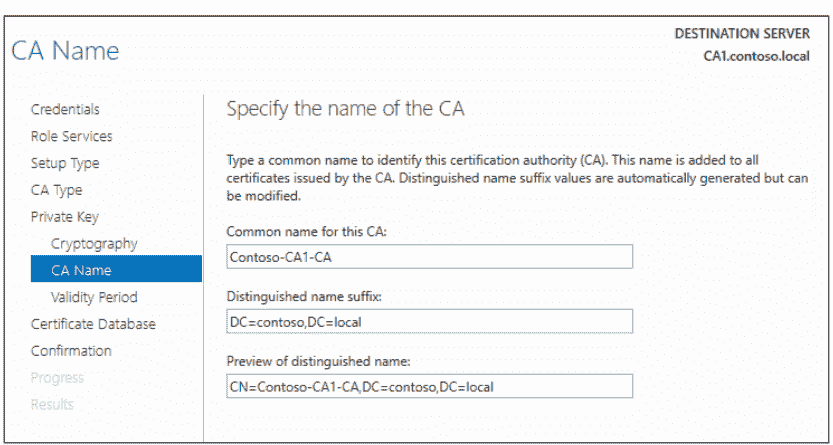

Figure 6.2: 设置 CA 的名称

## 我可以把 CA 角色安装到域控制器上吗？

由于该角色正式名称为 Active Directory 证书服务角色，这是否意味着我应该将其安装到其中一台域控制器服务器上？不！不幸的是，我遇到过许多中小型企业正是这样做的，幸运的是它们并没有太多问题。所以从技术上讲，它确实可以工作。然而，这不是微软推荐的安装路径，你应该在独立服务器上构建你的 CA；只要有可能，就不要与其他角色共置。

## 创建新的证书模板

够了谈论。 是时候做点工作了。现在我们的 CA 角色已经安装，让它做点事情吧！证书服务器的目的是签发证书，对吧？那么，我们来做这个吗？别急。当你从 CA 服务器向设备或用户签发证书时，你并不是在选择要部署哪个证书；而是在选择要利用哪个证书模板来部署证书，该模板基于模板内部配置的设置。证书模板有点像烹饪食谱。在 CA 服务器上，你构建模板并包含所有你想要纳入最终证书的特定配料或设置。

然后，当用户或计算机来请求 CA 服务器的证书时，他们基本上是通过告诉 CA 在构建该证书时遵循哪个模板食谱，从而将证书“烘焙”到其系统中。关于食物的证书？也许有点牵强，但现在已经很晚了，显然我饿了。

当你逐步配置第一台 CA 服务器时，控制台中会自带一些预建的证书模板。事实上，其中一个名为 **计算机** 的模板通常预配置到足以让客户端计算机在向你的新 CA 请求计算机证书时成功签发的程度。然而，使用预建模板和证书有什么乐趣呢？我宁愿自己构建模板，这样我就可以在模板内部指定特定的配置和设置。这样，我就能确切知道最终将签发给网络中计算机的证书包含哪些设置。

再次，我们需要启动适当的管理员控制台来完成工作。在 **服务器管理器** 的 **工具** 菜单中，单击 **证书颁发机构**。进入后，你可以展开证书颁发机构的名称并看到一些文件夹，包括底部的一个名为 **证书模板** 的文件夹。如果你单击此文件夹，你将看到当前内置于我们 CA 服务器的模板列表。由于我们不想使用其中一个预先存在的模板，按常理我们会尝试在此处右键单击并创建新模板，但这实际上并不是构建新模板的正确位置。为什么不能直接从此屏幕构建新证书模板的原因必须在我职级之上，因为这看起来很荒谬。唉，为了进入管理并修改模板的正确屏幕，你需要右键单击 **证书模板** 文件夹，然后选择 **管理**：

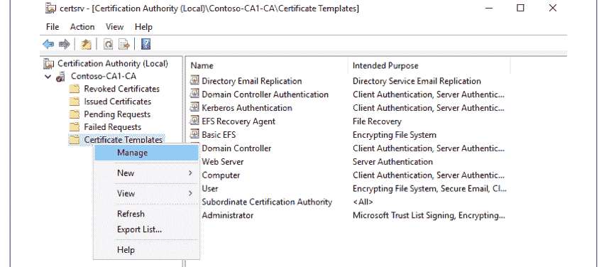

Figure 6.3: 管理证书模板

现在你可以看到一个更全面的模板列表，其中包括在第一个屏幕上无法查看的许多模板。要构建新模板，我们想要做的是找到一个与我们希望新证书模板服务的目的功能相似的预先存在的模板。由于越来越多的技术要求这些证书存在，计算机模板在许多组织中变得越来越常见。然而，我们不想使用那个内置的模板，它简单地称为 Computer，因为我们希望模板具有更具体的名称，并且我们希望灵活地修改模板设置。也许我们希望证书的有效期比默认设置更长。右键单击内置的 Computer 模板并单击“复制模板”。这会打开我们新模板的属性屏幕，我们首先要在“常规”选项卡内为新模板指定一个唯一名称。

在接下来的章节中，我们将讨论 DirectAccess，这是一种将在我们的环境中使用的远程访问技术。DirectAccess 的良好实现包括向所有移动客户端工作站签发机器证书，因此我们计划为此目的使用此新模板。常规选项卡也是我们定义此证书有效期的地方，我们将其设置为 2 年：

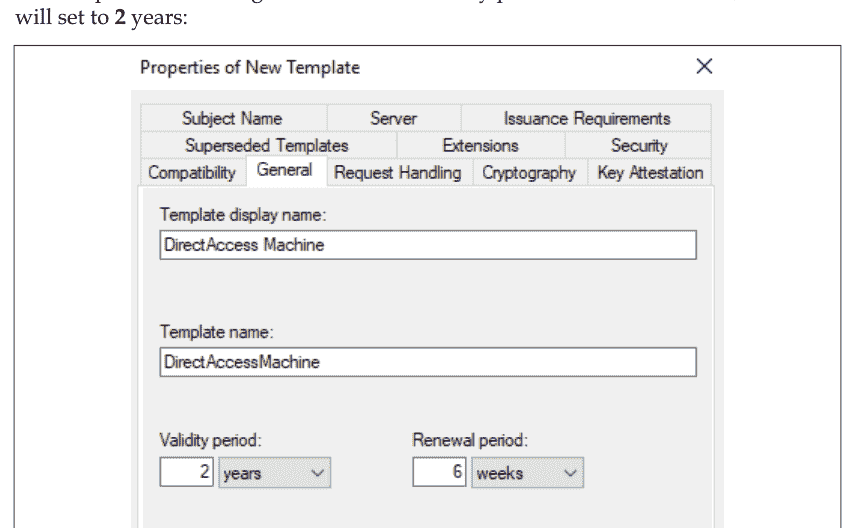

Figure 6.4: 常规选项卡

如果要签发的证书需要任何额外的设置更改，你可以翻阅属性中的可用选项卡并进行必要的调整。对于我们的示例，我将更改的另一个设置在“主体名称”选项卡内。我希望我的新证书的主体名称与证书签发所在的计算机的通用名称匹配，因此我已从下拉列表中选择了“通用名称”：

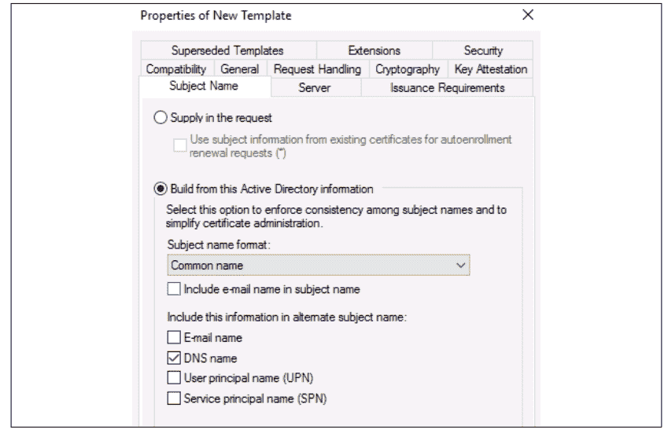

Figure 6.5: 主体名称选项卡

我们还有一个选项卡需要访问，这是在你构建的每个证书模板上都应检查的内容：安全选项卡。我们在这里检查以确保该模板的安全权限设置方式允许证书签发给我们希望的用户或计算机，同时确保模板的安全设置不过于宽松，从而导致不需要它的人可能获得证书。对于我们的示例，我计划将这些 DirectAccess 证书签发给域中的所有计算机，因为我创建的这种机器证书也可以用于一般的 IPsec 身份验证，而我将来可能会配置。

因此，我只是确保在“安全”选项卡中列出了“域计算机”，并且它们设置为“读取”和“注册”权限，这样加入我的域的任何计算机都可以选择基于我的新模板请求新证书：

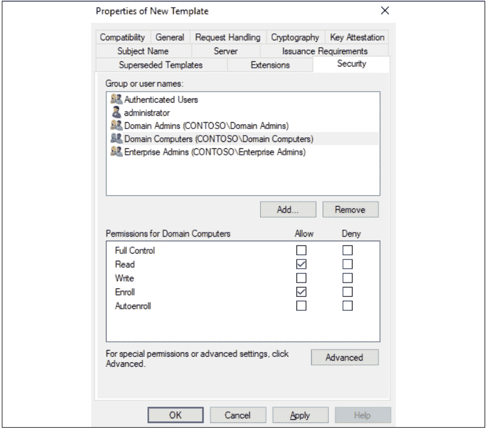

Figure 6.6: 证书权限

既然这是我新证书内部所需的一切，我只需单击“确定”，我的新证书模板现在就包含在我 CA 服务器上的模板列表中。

## 签发你的新证书

接下来是第一次尝试时让很多人绊倒的部分。你现在有一个全新的模板可供签发，我们已经验证了该证书模板内的权限已适当配置，以便域成员的任何计算机都应能够请求这些证书，对吧？那么我们的逻辑下一步将是跳转到客户端计算机并请求证书，但首先需要完成一项额外的任务才能使这成为可能。

即使新模板已被 **创建**，它尚未被 **发布**。因此，目前 CA 服务器不会向客户端提供我们的新模板作为选项，即使为此配置了安全权限。发布证书模板的过程非常快速——只需几次鼠标点击——但除非你知道需要这样做，否则这可能是一种非常令人沮丧的体验，因为界面中没有任何提示表明有此要求。

## 发布模板

如果你的 **证书模板控制台** 仍然打开（我们在其中管理模板的那个），请关闭它，以便返回到主证书颁发机构管理控制台。还记得我们注意到这里显示的可用证书模板列表要短得多吗？这是因为只有这些证书模板当前已发布并且可供签发。为了将其他模板添加到已发布列表中，包括我们的新模板，我们只需右键单击 **证书模板** 文件夹，然后导航到 **新建 | 要颁发的证书模板**：

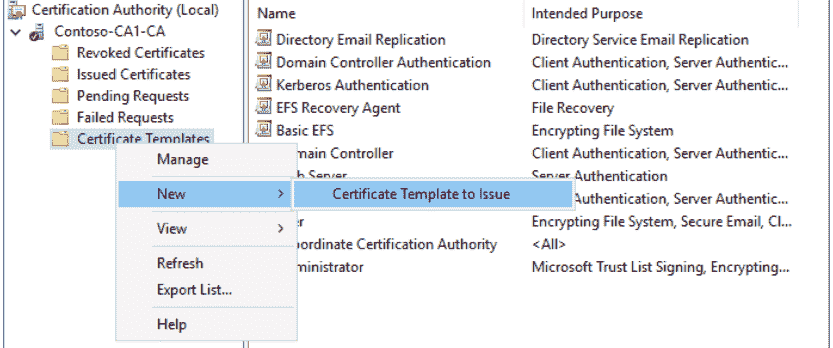

Figure 6.7: 发布我们的新模板


现在我们面前出现了一份尚未颁发的可用模板列表。你需要做的就是从列表中选择你的新模板并单击“确定”。新模板现在已包含在已发布的证书模板列表中，我们准备好从客户端计算机请求一个：

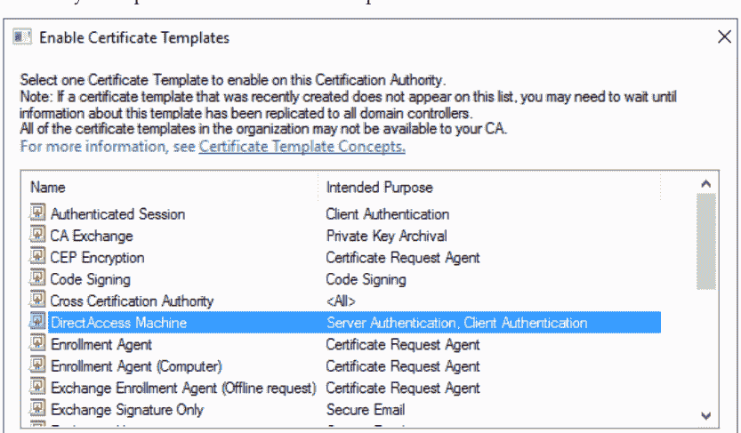

| 名称 | 预期用途 |
|---|---|
| 已验证会话 | 客户端身份验证 |
| CA 交换 | 私钥归档 |
| CEP 加密 | 证书请求代理 |
| 代码签名 | 代码签名 |
| 跨认证机构 | <全部> |
| DirectAccess 计算机 | 服务器身份验证、客户端身份验证 |
| 注册代理 | 证书请求代理 |
| 注册代理（计算机） | 证书请求代理 |
| Exchange 注册代理（离线请求） | 证书请求代理 |
| Exchange 仅签名 | 安全电子邮件 |

图 6.8：选择要颁发的新证书模板

如果你浏览此列表却看不到你新创建的模板，你可能需要执行额外的步骤。有时只需等待即可解决此行为，因为偶尔新模板未显示在列表中的原因是你正在等待域控制器完成复制。其他时候，即使等待了一段时间，你的新模板仍不在此列表中。在这种情况下，你可能只需要重新启动证书颁发机构服务以强制其获取新的模板信息。要重新启动 CA 服务，请在 **Certification Authority** 管理控制台顶部附近右键单击 CA 的名称，然后导航到 **All Tasks | Stop Service**。停止该服务通常只需一两秒钟，然后你可以立即再次右键单击 CA 名称，这次导航到 **All Tasks | Start Service**，如 图 6.9 所示。现在，再次尝试发布你的新模板，你应该能在列表中看到它：

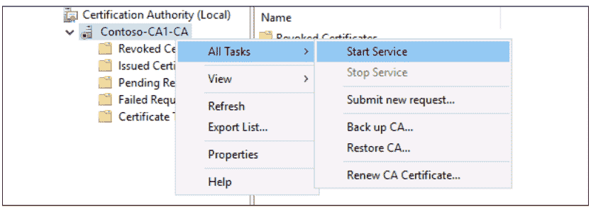

图 6.9：重新启动 CA 服务

## 从 MMC 请求证书

我们的新证书模板已创建，并且我们已成功在 CA 控制台中发布它，从而使其正式准备好颁发。是时候测试一下了。继续登录你网络上的普通客户端计算机以执行此操作。在客户端计算机上请求新证书有几种标准方法。第一种是使用老牌的 MMC 控制台。在你的客户端计算机上启动 MMC 并添加 **Certificates** 快捷方式。当你从可用快捷方式列表中选择 **Certificates** 并单击 **Add** 按钮时，你会看到一些额外的选项，用于选择要打开的证书存储。你可以在 **User account**、**Service account** 或 **Computer account** 之间进行选择。由于我们尝试颁发的证书将由计算机本身使用，我想从此列表中选择 **Computer account**，然后单击 **Finish**：


图 6.10：添加计算机证书

在下一页，再次单击 **Finish** 按钮以选择默认选项，即 **Local computer**。这将在 MMC 中添加本地计算机的基于计算机的证书存储。

在较新的操作系统上，例如 Windows 8 和 10 以及 Windows Server 2012、2012R2、2016 和 2019，有一个 MSC 快捷方式可直接打开到本地计算机的证书存储。只需在 **Run** 提示符中输入 `CERTLM.MSC`，MMC 就会自动启动并为你创建此快捷方式。

当你将证书安装到计算机或服务器上时，这通常是你想要访问的位置。在此证书存储中，我们想要安装证书的具体位置是 **Personal** 文件夹。无论你是在安装机器证书（如我们在此处所做的），还是在 Web 服务器上安装 SSL 证书，本地计算机的个人证书文件夹都是这两种证书的正确位置。如果你单击 **Personal**，你会看到我们目前没有任何内容列在其中：

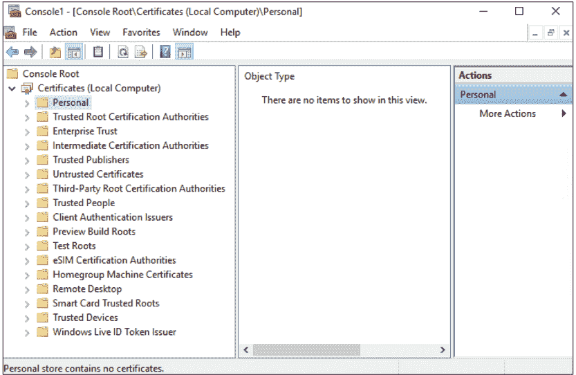

图 6.11：个人为空

要从我们的 CA 服务器请求新证书，我们只需右键单击 **Personal** 文件夹，然后导航到 **All Tasks** | **Request New Certificate...**。这样会打开一个向导；继续单击一次 **Next** 按钮。

现在你会遇到 *图 6.12* 所示的屏幕，看起来需要做些什么，但在大多数情况下，因为我们是在加入域的企业计算机上请求证书，我们实际上不需要在以下屏幕截图中显示的屏幕上执行任何操作。只需再次单击 **Next**，向导就会查询 Active Directory 以显示所有可供颁发的证书模板：

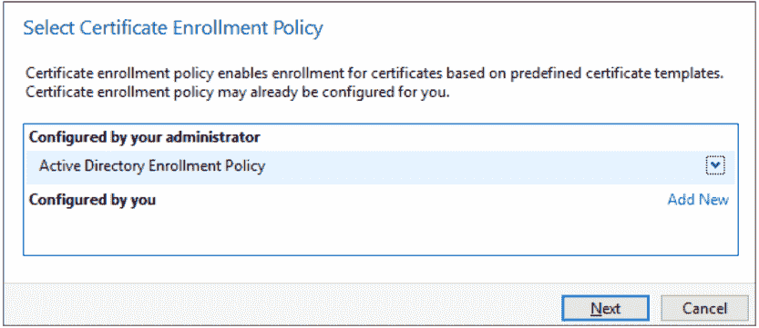

图 6.12：单击“下一步”以查询 Active Directory

接下来会显示 **Request Certificates** 屏幕，这是可供我们使用的模板列表。此列表是动态的；它基于你登录的计算机以及你的用户帐户权限。还记得我们设置新证书模板的安全选项卡时吗？就在那里我们定义了谁以及什么可以基于该模板下载新证书，如果我定义了一个比域计算机更具体的组，那么我的新 **DirectAccess Machine** 模板可能不会显示在此列表中。然而，由于我已将该模板开放给域内任何计算机颁发，我可以在此处看到并选择它：

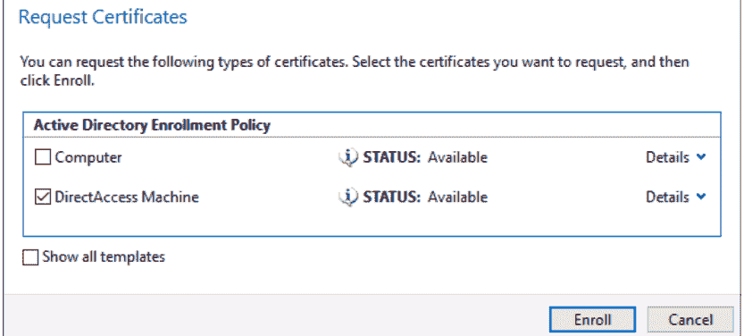

图 6.13：可用于颁发的证书模板

如果你在列表中看不到你的新模板，请单击 **Show all templates** 复选框。这将为你提供 CA 服务器上所有模板的完整列表，并说明每个模板当前无法颁发的原因。

在你想要的任何证书旁边打上复选标记，然后单击 **Enroll**。现在控制台会旋转几秒钟，同时 CA 服务器处理你的请求并颁发一个特定于你的计算机以及我们在证书模板中放置的标准的新证书。完成后，你会看到我们的全新机器证书现在位于 MMC 中的 **Personal | Certificates** 中。如果你双击该证书，可以检查其属性以确保你希望推送到此证书的所有设置都存在：

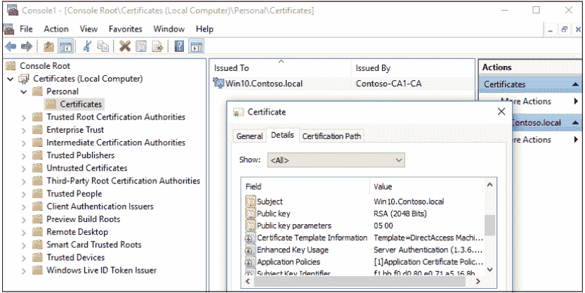

图 6.14：证书属性

## 从 Web 界面请求证书

我通常在可能的情况下使用 MMC 请求证书，但，在大多数情况下，还有另一个平台可以从中请求和颁发证书。我说 *在大多数情况下*，因为此选项的存在取决于 CA 服务器最初是如何构建的。当我安装我的 AD CS 角色时，我确保同时选择 **Certification Authority** 和 **Certification Authority Web Enrollment** 选项。

此第二个选项对于我们下一节的文本很重要。如果没有角色的 Web 注册部分，我们的 CA 服务器上将不会运行 Web 界面，并且这部分将无法供我们使用。如果你的 CA 服务器未打开 Web 注册，你可以重新访问 Server Manager 中的角色安装页面并将其添加到现有角色中：

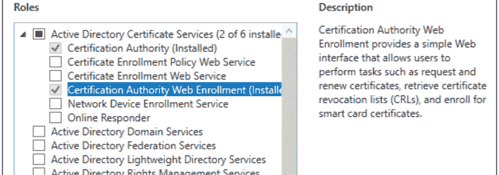

图 6.15：安装证书颁发机构 Web 注册

一旦在你的 CA 上安装了 Certification Authority Web Enrollment，该服务器上就会运行一个网站，你可以从网络内部通过浏览器访问它。拥有此网站很有用，如果你需要用户出于某种原因能够自行颁发证书；给他们提供文档或培训他们如何从网站请求证书的过程，比期望他们导航 MMC 控制台要容易得多。此外，如果你尝试从不在 CA 服务器同一网络中的计算机请求证书，使用 MMC 会很困难。例如，如果你需要家庭用户能够请求新证书，没有完整的 VPN 隧道，MMC 控制台很可能无法连接到 CA 服务器以下载该证书。但由于我们运行了此证书注册网站，你可以像在网络中对任何其他网站一样外部发布此网站，使用反向代理或防火墙以保持流量安全，并让用户能够从任何位置访问此站点并请求证书。


为了访问此网站，让我们再次使用常规的客户端计算机。这次，我不会打开 MMC，而是直接启动 Internet Explorer 或其他任何浏览器，并登录到运行在 https://<CASERVER>/certsrv 的网站。对于我的特定环境，该确切的 Web 地址是 https://CA1/certsrv：

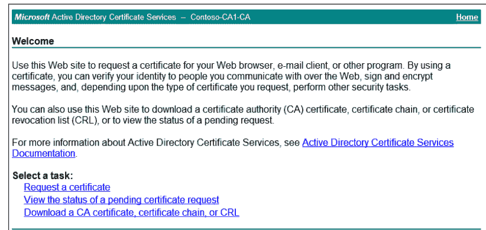

图 6.16：查看 CA Web 注册站点

> 我们的 URL 以 HTTPS 开头。此网站必须配置为在 HTTPS 而非普通的 HTTP 上运行，以便允许网站请求证书。它不允许通过 HTTP 签发证书，因为该信息将以明文形式传输到客户端。在 CA 服务器上为 HTTPS 启用网站可确保签发的证书在传输过程中被加密。

单击“Request a certificate”链接会进入我们的向导，在其中我们可以从 CA 服务器请求新证书。当用户自行通过此 Web 界面操作时，通常是为了获取基于用户的证书，因为我们有相当简单的方法可以在无需用户交互的情况下自动分发计算机级证书。我们稍后会讨论这个问题。然而，对于本示例，由于我们要求用户在此登录并请求新的用户证书，在下一页中，我将选择该链接：

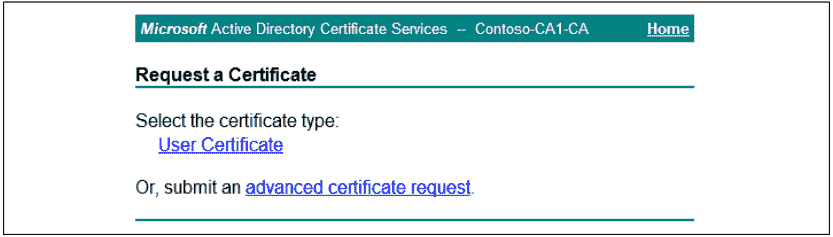

图 6.17：选择证书类型

> 如果您对用户证书不感兴趣，并希望使用 Web 界面请求机器证书、Web 服务器证书或任何其他类型的证书，您可以改选 **高级证书请求** 链接并按照提示操作。

接下来，单击 **提交** 按钮，证书生成后，您将看到一个允许您 **安装此证书** 的链接。单击该链接，刚刚为您创建的新证书将被安装到您的计算机上。您可以在下面的屏幕截图中看到网站给我的响应，表明安装成功，您还可以看到我已在 MMC 中打开当前用户证书，以便查看并验证证书确实存在：

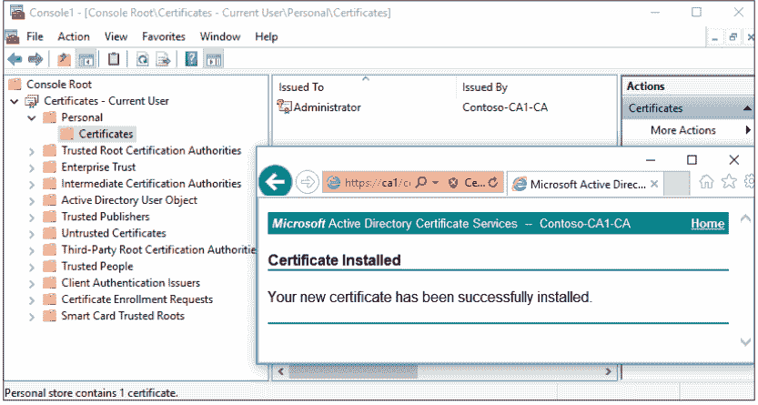

图 6.18：证书成功安装

在本节中，我们证明了我们的 CA 服务器正在工作；请继续阅读接下来的几页，我们将把证书签发提升到下一个层次。

## 创建自动注册策略

我们的证书颁发机构服务器已配置并正在运行，并且我们可以成功地向客户端计算机签发证书。太好了！现在让我们假装我们手头有一个新项目，而该项目的其中一个要求是网络中的所有计算机都需要有一份我们创建的新机器证书的副本。哦不，这听起来工作量很大。尽管请求其中一个证书的过程非常快——在每台工作站上只需几秒钟——如果您必须在几千台机器上单独执行此操作，您将花费大量时间在此过程中。此外，在许多情况下，您签发的证书仅有效一年。这是否意味着我每年都要面临极大的管理工作来重新签发这些证书？当然不是！

让我们弄清楚如何利用组策略创建一个 GPO，以便将我们新证书自动注册到网络中的所有计算机，并且在其中同时配置它，以便在证书到期日期到来时，证书将在适当的间隔自动续订。

让我们进入 CA 服务器上的证书颁发机构管理控制台，并查看已颁发证书文件夹。我只想在这里看一分钟，以便了解我们迄今为止在网络中颁发了多少证书。看起来只有少数几个，所以希望一旦我们完成策略配置，如果我们做得正确，并且它自动生效，我们应该会在此列表中看到更多证书开始出现：

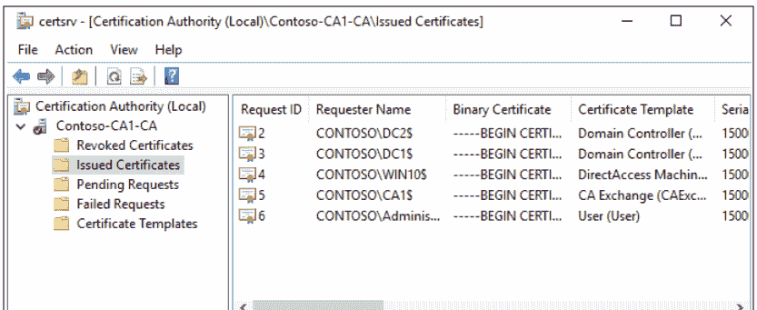

图 6.19：由我们的 CA 颁发的证书

登录到域控制器服务器，然后打开组策略管理控制台。我创建了一个名为 Enable Certificate Auto-enrollment 的新 GPO，现在正在编辑该 GPO 以找到我需要配置的设置，以便使该 GPO 发挥作用：

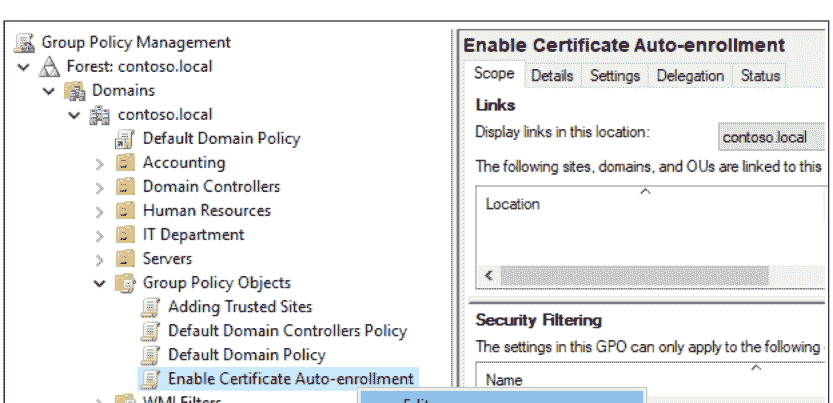

图 6.20：编辑新的自动注册 GPO

我们想要在此 GPO 中配置的设置位于 Computer Configuration | Policies | Windows Settings | Security Settings | Public Key Policies | Certificate Services Client - Auto-Enrollment。

双击此设置以查看其属性。我们需要做的就是将配置模型更改为已启用，并确保选中“Renew expired certificates, update pending certificates, and remove revoked certificates”复选框。还请选中“Update certificates that use certificate templates”复选框。这些设置将确保在未来几年证书开始接近到期日期时，自动续订会自动发生：

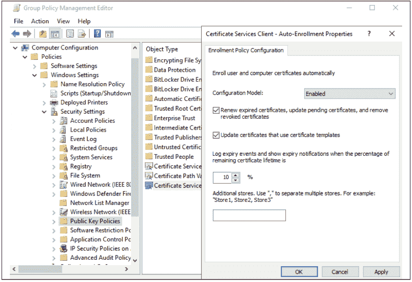

图 6.21：启用自动注册

为了使我们的 GPO 生效，我们还需要做什么？创建链接以使其开始应用！对于您自己的环境，您可能会创建一个更具体的链接到特定的 OU，正如我们在上一章讨论的那样，但对于我的实验室，我希望这些证书适用于加入域的每台机器，因此我将在域根目录链接我的新 GPO，以便它适用于我的所有客户端和服务器。

现在 GPO 已创建并配置，并且我们已将其链接到域，我认为应该会签发一些新证书，并且我的证书颁发机构控制台中的已颁发证书文件夹内会显示更多名称。但事实并非如此。等等，在我们的 GPO 中，我们并没有真正指定我 DirectAccess Machine 证书模板的任何特定内容，对吧？这可能是问题所在吗？不，实际上并没有指定要为自动注册设置哪个模板的选项。

当您在组策略中启用自动注册时，您只是打开一个开关并为每个证书模板启用它。因此，现在我们有一个配置为启用自动注册并已链接到域（从而使其生效）的策略，自动注册已在每台加入域的计算机上为 CA 服务器上发布的每个证书模板启用。

然而，没有一个证书自行签发到我的计算机上。这是因为我们需要调整新 DirectAccess Machine 模板的安全设置。目前，我们已将其配置为所有域计算机都具有 **注册** 权限，但如果您记得证书模板属性中的 **安全** 选项卡，其中有一个额外的安全标识符称为 **自动注册**。每个证书模板都有 **自动注册** 权限标识符，并且默认情况下不允许。现在我们域中的自动注册开关已打开，我们需要在想要开始分发的任何模板上启用 **自动注册** 权限。一旦我们启用该权限，这些证书将开始在我们的网络中流动。

进入 CA 服务器的证书管理部分并打开新模板的 **属性**，然后转到 **安全** 选项卡并为 **域计算机** 组允许 **自动注册** 权限。这应该会指示 CA 相应地开始分发这些证书：

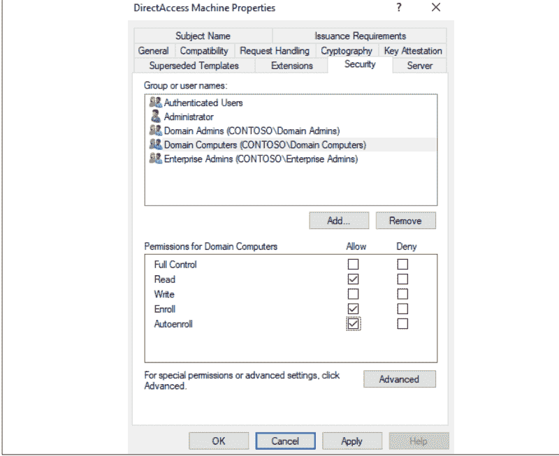

图 6.22：模板安全设置用于自动注册权限


果不其然，如果我让环境静置一段时间，给 Active Directory 和组策略在所有机器上更新的机会，我现在看到从我的 CA 服务器签发了更多证书：

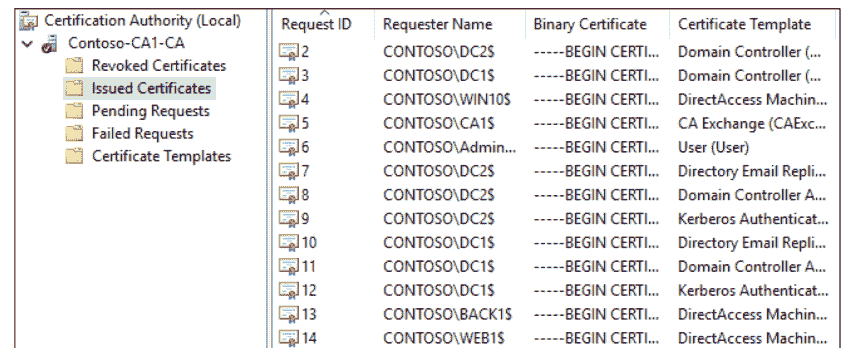

图 6.23：CA 服务器上已签发的证书列表

要自动从您创建的任何模板签发证书，只需发布该模板并确保在该模板上配置适当的自动注册权限即可。一旦在这些客户端上部署了自动注册 GPO，它们将联系您的 CA 服务器，并请求其签发它们有权接收证书的任何模板的证书。将来，当该证书即将过期且机器需要新副本时，自动注册策略将在到期日期之前根据您在 GPO 中定义的时间戳签发新证书。

证书自动注册可以将原本巨大的管理负担转变为完全自动化的流程！

## 获取公共机构 SSL 证书

我们现在已经相当熟悉从内部网络自己的 CA 服务器获取证书，但对于应从公共认证机构获取的 Web 服务器 SSL 证书的处理又如何呢？对于你们中的许多人来说，这将是您与证书最常见的交互，同样非常重要要理解这一方面。当您需要从您选择的公共机构获取 SSL 证书时，有一个三步流程：创建证书请求、提交证书请求并安装结果证书。

我们将使用我的 `WEB1` 服务器，其上运行着一个网站。目前，该站点只能处理 HTTP 流量，但当我们将其发布到互联网上时，我们需要启用 HTTPS 以保持提交到站点的信息被加密。

要使用 HTTPS，我们需要在 `WEB1` 服务器上安装 SSL 证书。该 Web 服务器运行的是 Microsoft Web 服务平台 **Internet Information Services (IIS)**。我们采取的三步流程与您运行不同的 Web 服务器（如 Apache）时相同，但完成这三个步骤的具体操作会有所不同，因为 Apache 或任何其他 Web 服务器的用户界面与 IIS 不同。由于我们使用的是 Windows Server 2019 Web 服务器，因此我们使用的是 IIS 10。

## 公钥/私钥对

在我们开始执行这三个步骤之前，让我们讨论一下为什么这一切甚至重要。您可能听说过 **private key** 这一术语，但可能并不完全理解其含义。当我们通过互联网发送流量，从客户端计算机到 HTTPS 网站时，我们知道流量是加密的。这意味着在数据包离开我的笔记本电脑之前，它们会被打包成一个漂亮的小包裹，以便在传输过程中无人可以看到，然后当这些数据包到达 Web 服务器时成功解包。我的笔记本电脑使用密钥加密流量，服务器使用密钥解密流量，但它们如何知道使用什么密钥呢？这里可以使用两种不同的加密方法：

- **Symmetric encryption**：加密的更简单方法，对称加密意味着只有一个密钥，双方都使用它。流量使用密钥打包，并在到达目的地时使用同一密钥解包。由于这个单一密钥是全能的奥兹，您不希望它落入错误的人手中，这意味着您不会将其发布到互联网上。因此，对称加密通常不用于保护互联网网站流量。相反，它更常用于您控制通信流两端的地方，例如 VPN 流量。
- **Asymmetric encryption**：这是我们针对 HTTPS 流量的重点。非对称加密使用两个密钥：公钥和私钥。公钥包含在您的 SSL 证书中，因此互联网上的任何人都可以联系您的网站并获取公钥。然后您的笔记本电脑使用该公钥加密流量并发送到 Web 服务器。如果公钥广播给整个互联网，为什么这是安全的？因为流量只能通过使用相应的私钥解密，而该私钥安全地存储在您的 Web 服务器上。维护对私钥和 Web 服务器的安全性非常重要，确保密钥不会落入他人之手。

## 创建证书签名请求

如果您已经提前一步，通过登录其网站、购买证书并立即下载它，从公共 CA 实体获取了 SSL 证书——您已经错过了时机。显然，该证书没有任何方式知道您 Web 服务器上可能存在的私钥，因此该证书在安装到任何地方时实际上将毫无用处。

当您将 SSL 证书安装到 Web 服务器上时，证书知道您的私钥非常重要。我们如何确保这一点？这就是证书签名请求（CSR）发挥作用的地方。正确获取 SSL 证书的第一步是生成 CSR。当您创建该文件时，Web 服务器平台会创建所需的私钥并将其隐藏在您的服务器上。然后 CSR 以能够精确了解如何与该私钥交互的方式创建，然后当您登录 CA 网站请求证书时，您将使用 CSR。

> 私钥并不 *inside* CSR 内部，您的 CA 永远不知道您的私钥是什么。此密钥极其重要，并且只存储在您的 Web 服务器上，在您的组织内部。

要生成 CSR，请从服务器管理器的“工具”菜单打开 IIS，然后单击屏幕左侧导航树中的 Web 服务器名称。这将在控制台中央填充多个不同的小程序。我们要使用的是名为“服务器证书”的小程序。继续双击它：

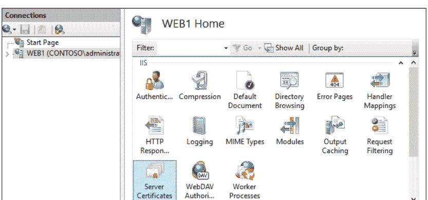

图 6.24：通过 IIS 查看服务器证书

现在，在 **Server Certificates** 屏幕中，您可以看到服务器上现有的任何证书列于此处。这是我们最终需要看到新 SSL 证书的地方，以便在准备启用 HTTPS 时将其用于网站属性中。获取新证书的第一步是创建与我们的 CA 一起使用的证书请求，如果您查看屏幕右侧，您将看到一个 **Actions** 部分，其下列出了 **Create Certificate Request...** 继续单击该操作：

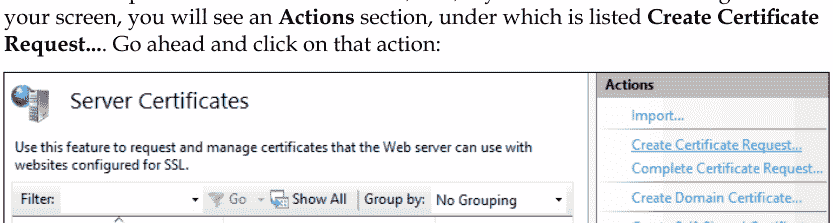

图 6.25：创建证书请求

在结果向导中，您需要填写将存储在 SSL 证书中的信息。**Common name** 字段是这里最重要的信息。它需要是该证书将要保护的 DNS 名称。因此基本上，您在此处输入网站的名称，然后继续填写其余的公司特定信息。这里有几个经常让管理员困惑的特殊注意事项：**Organizational unit** 可以是任何内容；我通常只输入单词 Web。请务必拼写出您的 **State** 名称；不要使用缩写：

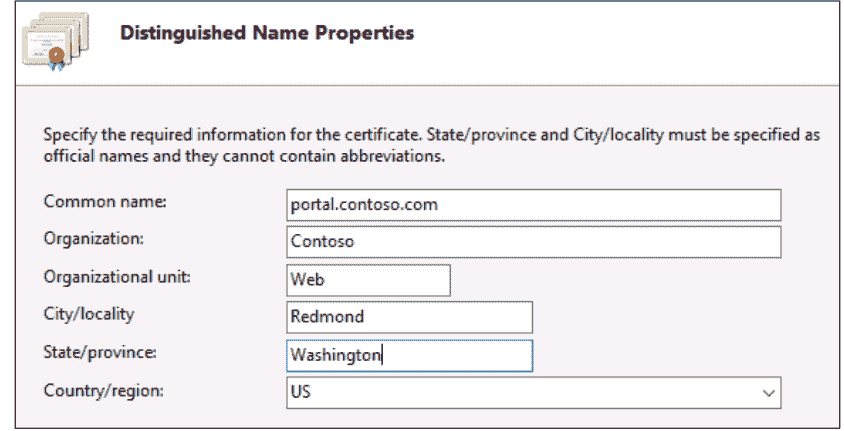

图 6.26：为证书填充信息

在 **Cryptographic Service Provider Properties** 页面上，您通常希望将 **Cryptographic service provider** 保持为默认值，除非您的服务器中有专用加密卡并且计划将其用于处理此网站的加密处理。在 IIS 服务器上，您几乎总是会在此处看到 **Microsoft RSA SChannel Cryptographic Provider**。您 **do** 想要更改的 however 是 **Bit length**。多年来，标准的位长度为 1024，并且在 Windows Server 2019 中仍然是默认选择。SSL 加密的通用行业已决定 1024 太弱，新标准是 2048。当您前往 CA 网站请求证书时，您很可能会发现您的请求需要至少 2048 位。因此继续将该下拉设置更改为 **2048**：

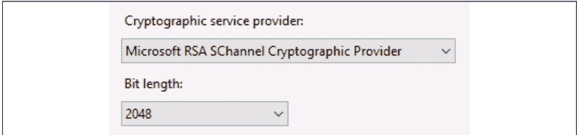

图 6.27：将加密位长度设置为 2048

对我们的 CSR 剩下的唯一要做的事情就是为其指定位置和文件名。将此 csr 保存为文本文件是常规做法，也很好地满足了我们的需求，因为在请求证书时我们所需要做的只是打开文件然后复制粘贴其内容。你现在已经创建了你的 csr 文件，我们可以利用此文件向我们的公共 CA 请求证书。

## 提交证书请求

现在，前往你的公共证书颁发机构的网站。同样，前面提到的任何公司，例如 GoDaddy 或 Verisign，都适合此目的。每个机构的 Web 界面外观和感觉各不相同，因此我无法为此过程提供确切的步骤。一旦你拥有账户并登录到机构的网站，你应该能够找到购买 SSL 证书的选项。对于某些 CA，购买流程和证书获取流程是两个不同的事情。例如，你购买并支付新 SSL 证书，然后访问界面的不同部分，使用你刚刚购买的“证书额度”来创建证书。另一方面，一些 CA 会引导你完成从头到尾的整个流程。无论如何，一旦证书被购买，就会有一个请求和部署该证书的过程。

一旦找到用于生成新证书的界面，通常会要求你提供四项信息：

- 1. **有效期** – 这个 SSL 证书应该持续多久？过去公司购买有效期为 1 年、2 年甚至 3 年的 SSL 证书是很常见的，这意味着证书在该时间内是“有效”的。最近，苹果在这方面发力，决定 Safari 网络浏览器只信任有效期约为 1 年的证书。行业并未反抗，而是说“好吧，为什么不呢？”因此，从今往后，SSL 证书每次仅有效 1 年。

- 2. **Web 服务器平台** – 你运行的是什么类型的 Web 服务器？对此问题的回答会影响在此流程结束时可下载的文件类型。在使用 Windows Server 时，你的答案将是“IIS”，但其他可能的选择包括 Apache、Tomcat、NGINX 以及许多其他基于 Linux 的 Web 服务器选择。

- 3. **域名所有权验证** – 这点很有趣，如果你以前没经历过这个流程，你可能没有想过为什么它有必要。有什么能阻止坐在一家位于世界另一端的网吧里的黑客 Joe，或是在他地下室玩电子游戏的 12 岁孩子，甚至是你的隔壁邻居创建自己的 CA 登录并购买一张带有*你的*公司名称和网站的 SSL 证书呢？域名所有权验证是一个证明你确实拥有 contoso.com（或你的域名）的流程，这样只有你才被允许购买保护你域名流量的有效 SSL 证书。验证域名所有权最常见的方式是从 CA 内部预定义的电子邮件地址列表中选择，并向该电子邮件地址发送某种验证邮件。例如，你可能会有如下的电子邮件地址选择：

```
admin@contoso.com
administrator@contoso.com
webmaster@contoso.com
hostmaster@contoso.com
```

- 4. 你所需要做的就是验证你能够接收到其中一个电子邮件地址的邮件，并且通过选择此选项，你将收到一封发送到该地址的邮件，通常包含一个链接和一个代码。只需复制代码并粘贴到链接中，这就是验证域名所有权的一种简单方法，因为作为该域名的所有者，只有你才有权访问这些电子邮件地址。第二种所有权形式，如果电子邮件验证不可行，CA 可能会给你一个特殊的 DNS 记录，可以放置在你域名的公共 DNS 中。你输入该记录，CA 在互联网上看到该记录出现，并验证你是域名所有者。此过程比电子邮件验证花费的时间更长，因此很少使用。

- 5. **CSR** – 你将被要求提供的最后一项（也是最重要的一项）信息是我们几分钟前创建的那个 CSR 文件内部的文本。会有上传功能或简单的输入框，你所需要做的就是将 CSR 的全部内容复制/粘贴到该框中。如果你打开我们之前保存的文本文件，你会看到一大堆无意义的内容：

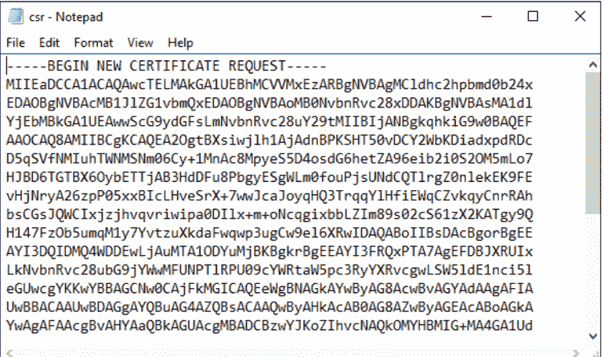

图 6.28：CSR 文件内部的文本

这堆数据包含有关你的证书请求的信息，正是 CA 为了创建你的新 SSL 证书所需要的，以便它知道如何与你的 Web 服务器的私钥交互。只有生成 CSR 的服务器才能接受并正确使用基于此 CSR 的 SSL 证书。

## 下载和安装你的证书

现在你坐下来等待。取决于你使用的是哪个机构以及你的公司多久从该机构购买一次证书，你的证书可能几乎立即即可下载，也可能需要几个小时才会出现在可用下载列表中。原因在于许多 CA 对新证书采用人工审批，你实际上是在等待有人查看证书请求和你的信息，以确保你确实为该公司工作并且确实拥有此域名。记住，公共 SSL 证书的真正好处在于 CA 保证该证书的用户是真实的，因此他们希望确保不会错误地向 Fabrikam 组织中的某人签发 portal.contoso.com 的证书。

一旦你能够从 CA 网站下载证书，请将其复制到我们生成 CSR 的 Web 服务器上。至关重要的是，你必须将此新证书安装到**同一台服务器**上。如果你将此新证书安装到不同的 Web 服务器上，即未生成此证书所基于的 CSR 的服务器上，该证书将成功导入，但无法正常运行。再次强调，这是因为证书计划交互的私钥不会存在于不同的服务器上。

回到 IIS 管理控制台，我们现在可以使用右侧列表中的下一个操作，名为 **完成证书请求...**。这会启动一个简短的小向导，你在其中指向新下载的证书文件，然后向导将其导入我们的服务器。现在证书已驻留在服务器上，它就可以被你的网站使用了。

安装或导入 SSL 证书后，我总是会检查的一项额外内容。你现在可以在 IIS 中看到你的新证书列出，如果双击新证书，你将看到证书的 **属性** 页面。在这些属性的 **常规** 选项卡上，查看底部附近。你的证书应显示一个小钥匙图标以及 **你拥有与此证书对应的私钥** 文本。如果你能看到此消息，则说明导入成功，并且新证书文件与 CSR 完全匹配。服务器和证书现在共享该关键的私钥信息，SSL 证书将能够正常工作以保护我们的网站。如果你看不到此消息，则在请求和下载我们的证书的过程中出了问题。如果你在这里看不到此消息，你需要通过生成新的 CSR 重新开始，因为你收回的证书文件可能未针对该 CSR 正确配对密钥，或类似情况。如果此屏幕底部没有 *你拥有与此证书对应的私钥* 文本，你的证书将 *不* 正确验证流量。


以下是正常工作时应有的示例：

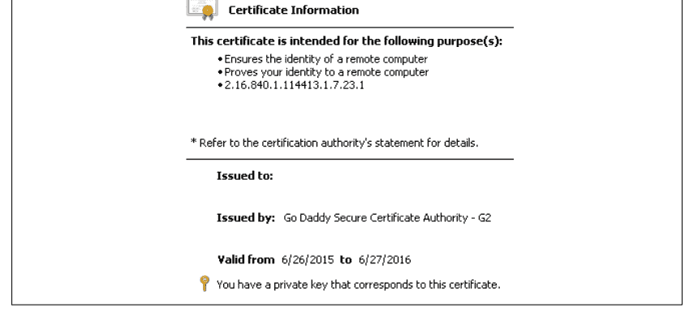

图 6.29：此证书与私钥正确匹配

## 导出和导入证书

我经常需要在一台以上的服务器上使用相同的 SSL 证书。这可能发生在我有一台以上的 IIS 服务器提供相同的网站，并且我使用某种负载均衡将流量分配到它们之间时。这种需求在使用任何形式的硬件负载均衡器时也可能出现，因为有时你需要在 Web 服务器本身以及负载均衡器设备上导入证书。另一个例子是使用通配符证书；当你购买通配符证书时，通常打算将其安装到多台服务器上。

这是否意味着我需要从每台服务器生成一个新的 CSR，并多次请求同一证书的新副本？绝对不是，而且这样做可能会导致其他问题：当公共 CA 重新签发证书时——也就是说，如果你已经使用特定名称请求过证书，然后稍后再次回来请求同一证书的另一份副本——该 CA 在签发第二份副本时可能会使第一份失效。这并不总是立即显现，因为通常会在第一份证书的失效上设置一个计时器。如果你重新访问 CA 的 Web 界面，并使用第二台 Web 服务器的新 CSR 请求同一证书的新副本，你可能会发现一切在几天内都正常工作，但随后主 Web 服务器突然停止验证流量，因为其 SSL 证书，即原始副本，已过期。

当你需要在多台服务器上重复使用相同的 SSL 证书时，你只需从一台服务器导出它，然后导入到下一台服务器即可。完全不需要联系 CA。此过程相当直接，并且有两个常见的操作位置：证书的 MMC 快照中或 IIS 本身中。需要注意的是，具体流程会根据你选择的途径略有不同，并且在逐步进行这些向导时，你必须特别注意私钥发生了什么。

### 从 MMC 导出

返回 MMC 中的本地计算机证书存储，并导航到 个人 | 证书，以便可以看到列出的 SSL 证书。右键单击该证书，然后导航到 所有任务 | 导出... 当你逐步进行此导出向导时，我想提到的重要部分会在向导步骤的开头出现。你必须做出的第一个选择是是否导出私钥。再次说明，私钥是使证书能够与安装它的服务器正确交互的“秘密”。如果你在不带私钥的情况下导出，该证书在另一台服务器上将无法工作。因此，如果你导出此证书的目的是将其安装到第二台 Web 服务器并用于验证 SSL 流量，那么选择顶部选项“是，导出私钥”非常重要：

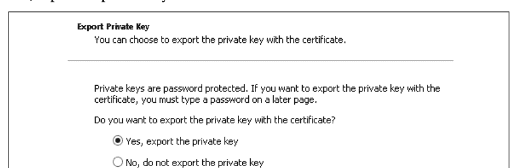

图 6.30：使用 MMC 导出证书

正如向导充分警告你的那样，当你选择导出包含私钥信息的证书时，你需要提供一个密码，该密码将用于保护导出的 PFX 文件。选择一个良好的密码非常重要。如果你忘记了它，你导出的文件将完全无用（这倒也不算太糟糕，因为你可以重新导出）。如果你输入一个非常简单或容易猜到的密码，任何拿到此 PFX 文件的人都可能在自己的 Web 服务器上使用你的证书和私钥，这将非常不好。

### 从 IIS 导出

另外，导出的 PFX 文件也可以从 IIS 控制台生成。在 IIS 的 服务器证书 插件中，只需右键单击证书并选择 导出... 这会启动一个单页向导，只需询问你位置和密码：

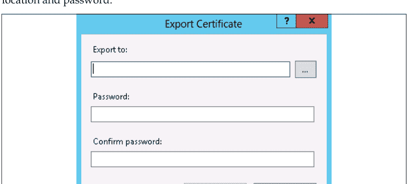

图 6.31：使用 IIS 导出证书

我们使用 MMC 导出时可以选择或拒绝的选项更多了，那么为什么这里这么简短？IIS 为了加快导出过程，对其余设置做了假设。当你导出 SSL 证书时，很可能你也打算导出私钥。因此，IIS 直接做出此假设并跳过其余选择。你必须输入密码，因为你对私钥没有选择权；它将自动包含在证书导出中。因此，如果你出于某种原因需要导出不包含私钥信息的证书，就无法利用 IIS 控制台完成此任务。你需要打开 MMC 并逐步进行其中更详细的向导。

### 导入到第二台服务器

无论你采用哪种方式完成导出，一旦拥有完整的 PFX 文件，将其导入到第二台服务器就非常容易。从任一控制台 MMC 或 IIS 中，你都可以右键单击并选择 **导入** 操作。逐步进行时，你只需选择 PFX 文件，然后输入用于保护该文件的密码。证书随后会被导入，如果你打开 **属性**，你会看到小钥匙图标和私钥消息已正确显示在证书属性屏幕底部。如果你没有看到 *you have a private key* 消息，这意味着你在导出过程中操作有误，需要重试。

自己试试；找一台带有 SSL 证书的服务器，测试有无私钥的导出情况。当你将其导入到新服务器时，你会看到导入不带私钥的证书文件在属性页底部不包含此消息，但包含私钥的导出文件会在此处显示正确的消息。再进一步，尝试在不重要的网站上同时使用这两个证书，看看会发生什么。你会发现缺少私钥的证书将无法验证 SSL 流量。

> 如果你尝试导出 SSL 证书并且包含私钥的选项呈灰色不可选状态，这意味着原始管理员在将此证书安装到 Web 服务器时选择了一个特殊选项，该选项阻止了私钥将来被导出的能力。在这种情况下，你将无法导出带私钥的证书。

## 总结

证书经常被诟病，我认为这是因为人们觉得处理它们很头疼。我理解这种观点。如果不了解如何浏览处理证书基础设施的各种管理控制台，即使是最简单的项目也难以正常运行。通过逐步介绍任何服务器管理员在其网络中最终必须处理的常见证书相关任务，我希望你现在对那些可能因等待证书基础设施建设而搁置的项目有了一些安心和信心。在下一章中，我们将研究 Windows Server 2019 的网络。

## 问题

- 1. Windows Server 2019 中允许你从服务器签发证书的角色名称是什么？
- 2. 在域环境中通常首先安装哪种类型的 CA 服务器？
- 3. 是否应该将证书颁发机构角色安装到域控制器上？
- 4. 创建新的证书模板后，在可以从该新模板向计算机或用户签发证书之前，下一步需要采取什么操作？
- 5. 强制证书在管理员无需手动干预的情况下签发的 GPO 设置的通用名称是什么？
- 6. SSL 证书只有在与 Web 服务器共享 ______ 密钥信息时才能正确验证流量。
- 7. 公共证书颁发机构为了向你签发新的 SSL 证书所需的主要信息是什么（提示：你从 Web 服务器生成此信息）？


