# 7 使用 Windows Server 2019 进行网络配置

正如本书迄今为止所讨论的，服务器是我们网络的树干。它们是使我们能够开展工作的骨干基础设施。如果服务器是树干，那么网络本身就必须是根系。您的网络是支撑公司基础设施的平台；它构成了公司内部所有设备相互通信所使用的通道。

传统上，IT 行业中存在 *server admins* 和 *network admins*，职责分离，在许多地方仍然如此。主要从事服务器工作的管理员通常没有足够的时间在任何规模的组织中同时支持网络基础设施，反之亦然。网络管理员通常只专注于自己的设备和管理工具，对深入 Windows Server 世界不感兴趣。然而，我们中的许多人都在规模较小的公司工作，需要身兼数职。有些日子，server admin 和 network admin 的帽子叠在一起，因此我们必须至少了解网络的基础知识以及可以用来排查连接故障的工具。此外，Windows Server 2019 将一种新的网络思维推向前台：网络的虚拟化。总会存在某种物理网络的形态，使用物理交换机和路由器在不同房间和建筑物之间传输数据包。但现在我们也在 Windows 服务器中引入了 **software-defined networking (SDN)** 的概念，这使我们能够虚拟化其中部分配置。不仅是配置本身；我们实际上是在虚拟化网络流量，并从服务器控制台内部构建网络，而不是像过去那样使用命令行界面来配置路由器。

慢着；我有点超前了。首先，让我们谈谈 Windows Server 2019 中一些新颖且有用的功能，这些功能涉及物理网络或任何网络，因为它们对当今网络世界中的任何管理员都很重要。稍后，我们将花一点时间进一步探讨网络虚拟化这一新概念。

本章计划讨论以下主题：

- IPv6 简介
- 您的网络工具箱
- 构建路由表
- NIC Teaming
- 软件定义网络

### Introduction to IPv6

欢迎来到黑暗面！不幸的是，目前许多人就是这样看待 IPv6 的。虽然 IPv6 绝非新鲜事物，但据我经验，它仍然是几乎没有人在其网络中部署的东西。在过去几年与世界各地数百家不同公司合作的过程中，我只遇到过两家组织在其整个生产网络上运行 IPv6，而且其中一家甚至不是真正的原生 IPv6。相反，他们在整个网络中使用了一种称为 ISATAP 的隧道技术，使所有服务器和客户端都使用 IPv6 数据包相互通信，但这些数据包仍在 IPv4 物理网络上传输。别误会；我发现了许多公司在尝试 IPv6 并在网络的某个隔离部分配置了一些痕迹的案例，但将其用于整个生产网络？我们大多数人还未准备好接受如此大的改变。为什么部署 IPv6 这么困难？因为我们基本上从一开始就使用 IPv4，这是我们所有人都知道和理解的，而且在我们的内部网络中真的没有很大的必要迁移到 IPv6。等一下；我以为关于 IPv4 地址耗尽的恐慌很大？是的，这对于公共互联网上的 IP 地址是正确的，但与我们的内部网络无关。你看，即使我们明天就耗尽公共 IPv4 地址，我们公司的内部网络也不会受到影响。只要我们习惯使用 NAT 技术将从互联网进入我们网络的流量转换为 IPv4，我们就可以在很长一段时间内，甚至永远继续在网络内部运行 IPv4。我们几乎和 IPv4 存在一样长的时间里都在以一种或另一种形式使用 NAT，所以这显然是人们非常熟悉的东西。

让我明确一点：我并不是想说服你坚持使用 IPv4 就是未来的出路。我只是陈述一个事实：对于大多数组织来说，在未来几年里，这就是事实。我在这里讨论 IPv6 的原因是，最终你必须处理它。而一旦你这样做了，你实际上会为此感到兴奋！IPv6 相对于 IPv4 有一些巨大的优势，即你可以在单个网络中容纳的庞大 IP 地址数量。世界各地的公司网络团队每天都在为构建更多 IPv4 网络并将它们连接起来的需求而苦恼。想想看：现在有许多公司的员工人数超过 10,000。有些公司的员工人数是这个数字的许多倍。在当今世界，每个人都需要几乎不间断地访问他们的数据。数据是新的货币。现在大多数用户至少有两台用于工作的物理设备，有时甚至更多：一台笔记本电脑和一台平板电脑，或一台笔记本电脑和一台智能手机，或一台台式机和一台笔记本电脑，以及一台平板电脑和一台智能手机；你明白我的意思。在 IPv4 世界中，处理的 IP 地址范围相对较小，你必须非常有创意地创建子网以容纳所有这些物理设备。每台设备都需要一个唯一的 IP 地址在网络上通信。IPv6 最大的优势在于，它通过默认提供在单个网络中拥有大量 IP 地址的能力，立即解决了所有这些问题。我们说的是多少个地址？以下是一些比较数据，供你参考：

- IPv4 地址是一个 32 位长度的地址，看起来像这样：192.168.1.5
- IPv6 地址是一个 128 位长度的地址，看起来像这样：2001:AABB:CCDD:AB00:0123:4567:8901:ABCD

如你所见，IPv4 地址要短得多，这显然意味着唯一 IP 地址的可能性更少。你看不到的是 IPv6 地址实际上有多长。这些示例以我们习惯看到的形式展示了 IPv4 和 IPv6 地址，即它们的最终形式。实际上，IPv4 地址以十进制形式显示，而 IPv6 以十六进制形式显示。IPv6 地址通过十六进制显示和使用，以便尽可能压缩地址。实际上，如果你深入底层，一个 IPv6 地址在其原生 128 位形式下可能看起来像这样（事实上，这就是它在实际数据包内部的样子）：

```
00010000010000100001101100110000000000000000001000000000000000
00010000000000000000000000010000000000000000000000000000000001
```

这是一组令人印象深刻的数字，但对人眼来说并不实用或友好。那么，与其显示位，不如以 IPv4 地址一直显示的方式以十进制格式显示 IPv6 地址？在这种情况下，IPv6 地址可能看起来像这样：

```
192.16.1.2.34.0.0.1.0.0.0.0.0.0.1
```

现在我们完全理解为什么 IPv6 总是以十六进制使用和显示；即使在压缩格式下，地址也很长！

### Understanding IPv6 IP addresses

当我们设置 IPv4 网络时，子网划分极其重要，因为它使我们能够在同一网络中拥有多个 IP 地址集合。在最基本的网络形式中，你设置一些 IP 地址并运行一个 /24 子网（子网掩码为 255.255.255.0），这在家庭或小型企业办公室等小型网络中非常常见，你的唯一 IP 地址限制为 254 个。哎呀！一些公司拥有数千台不同的服务器，还不包括所有需要连接到网络的客户端计算机和设备。幸运的是，我们可以在单个 IPv4 网络内构建许多不同的子网以增加可用 IP 地址范围，但这需要仔细规划和计算这些子网和地址空间，这也是我们依赖经验丰富的网络管理员来管理网络这一部分的原因。路由表中的一个无效子网配置可能会导致网络流量中断。在大型 IPv4 网络中管理子网不是胆小者能胜任的。

当我们谈论 IPv6 地址时，天空似乎几乎没有限制。如果你计算前述 128 位空间中所有可用的唯一 IPv6 地址，你会发现可以创建超过 340 不可数十亿个地址。换句话说，340 万亿万亿个地址。这就是人们宣传的 IPv6 互联网上可用地址数量，但这对我们的内部网络意味着什么？

为了讨论在运行 IPv6 的典型内部网络中我们可以拥有的地址数量，让我们先退一步看看地址本身。我之前展示的地址只是我编造的，但我们将在此处分解其各部分：

```
2001:AABB:CCDD:AB00:0123:4567:8901:ABCD
```


与 192.168.1.5 相比，这东西看起来像个怪物。这是因为我们通常不习惯处理十六进制格式；它只是查看数据的一种不同方式。正如我们提到的，这是一个 128 位地址。它被分成 8 个不同的段，每段由冒号分隔，每个段由 16 位组成。地址的前 64 位（前半部分）是路由信息，后 64 位是网络上的唯一设备 ID。在第一部分中，我们有两个不同的组件。前 48 位（3 组十六进制）是组织前缀，在网络中的所有设备上都相同。然后第四组信息，即接下来的 16 位，可以作为我们的子网 ID。这样，如果将来需要，我们可以通过在此处使用多个数字作为子网 ID，仍然保持拥有许多不同子网的灵活性。在分配了地址的前半部分后，我们现在可以使用后半部分，即最后 64 位。这些我们可以留给设备 ID 使用。地址的这一部分在网络上的每个设备上都不同，并将定义用于通信的各个静态 IPv6 地址。让我们将示例地址分解为以下几部分：

- **整体 IP 地址:** 2001:AABB:CCDD:AB00:0123:4567:8901:ABCD
- **组织前缀:** 2001:AABB:CCDD
- **子网 ID:** AB00
- **设备 ID:** 0123:4567:8901:ABCD 是一个唯一的设备 ID

使用这种 IP 方案，我们的网络可以容纳多少台设备？嗯，即使在我们的示例中，我们只为子网分配了一个 16 位段，为实际 IP 地址分配了 64 位，也将使我们能够拥有超过 65,000 个子网以及 IP 范围内千万亿个唯一的设备 ID。令人印象深刻，不是吗？

如果我们坚持这样做并只使用一个子网来容纳所有机器，我们地址的前半部分将始终相同，使得这些长地址更容易记住和处理。令人惊讶的是，你很快就会习惯在环境中看到这些大十六进制数字，但即使你开始认识它们，你可能仍然不会再通过静态 IP 地址快速跳转到网络中的服务器或计算机。我知道我们中的许多人仍然习惯说：我需要快速进入我的 Web 服务器；我只需 RDP 到 192.168.1.5。即使你记得，输入这些 IPv6 地址所需的时间通常也不值得。IPv6 将带来对 DNS 的更大依赖，以使其更易于使用。

现在我们了解了地址的各个部分将用于什么目的，我们该如何为网络上的所有计算机、服务器和其他设备分配各个设备 ID 号码？你可以从数字 1 开始，然后依次递增。另一个想法是将旧的 IPv4 地址计算成十六进制并将其用作地址最后 32 位——在你的计算机上打开 Windows 计算器，展开菜单并将其更改为程序员模式。这是一个快速简单的工具，可用于将十进制转换为十六进制，反之亦然。让我们以我的运行在 192.168.1.5 上的 Web 服务器为例。我想在我的网络内部实现 IPv6，并且我希望服务器的 IPv6 地址在新地址的设备 ID 部分反映原始 IPv4 地址。在我的计算器中，如果我输入 192 然后点击 HEX，它将显示 192 的十进制对应的十六进制，如图 7.1 所示：


图 7.1：使用 Windows 计算器将十进制转换为十六进制

如果我们对 IPv4 地址中的每个八位字节都这样做，我们将看到以下内容：

```
192 = C0
168 = A8
1 = 01
5 = 05
```

因此，我的 192.168.1.5 解析为 C0A8:0105。我现在可以利用它结合我的组织前缀和子网 ID 为我的 Web 服务器创建一个静态 IPv6 地址：

```
2001:AABB:CCDD:0001:0000:0000:C0A8:0105
```

你会注意到在前面的 IPv6 地址中，我在末尾输入了设备 ID 的十六进制，但我也做了另外一些更改。由于我们将最后 64 位留给设备 ID 使用，但我的旧 IPv4 地址只占用 32 位，我剩下了中间的 32 位。在那里放一些对我们来说毫无意义的数据会很奇怪，所以我们将简单地全部设为零以简化我的寻址方案。除此之外，我还将子网 ID 调整为数字 1，因为这是我网络中的第一个子网。

我们的新寻址开始看起来更干净一些，也更有意义。现在我们看到为 Web 服务器布置的新地址，我可以看到我们可以对地址执行一些额外的清理任务，以使其看起来更好。现在列出的地址是 100% 准确的。我可以将此 IP 地址插入 Web 服务器的 NIC 属性中，它就会工作。然而，我的地址中有很多零，我不需要全部保留。只要在 16 位段中存在不必要的、位于实际数字之前的零，就可简单地将其删除。例如，我们的子网 ID 和设备 ID 的前 32 位有很多不必要的零，因此我可以将地址合并为以下内容：

```
2001:AABB:CCDD:1:0:0:C0A8:0105
```

然后，为了更进一步，只要你有完全由零组成的 16 位段，就可将其完全合并为双冒号。因此，我的设备 ID 中全部为零的前 32 位，我可以用 :: 替换。以下是完整地址和合并后的地址。这些数字看起来相当不同。我的合并地址在视觉上更容易接受，但从技术角度来看，它们是完全相同的数字：

```
2001:AABB:CCDD:0001:0000:0000:C0A8:0105
```

```
2001:AABB:CCDD:1::C0A8:0105
```

事实上，如果你正在设置实验室或想快速测试 IPv6，你可以使用以下示例这样简单的地址。我在这里展示的两个地址完全相同：

```
2001:0000:0000:0000:0000:0000:0000:0001
```

```
2001::1
```

需要注意的是，你在一个 IP 地址中只能使用一次双冒号。如果你在一个地址中有两个可以适用的位置，你只能在其中一个位置实现它，并且必须在另一个位置写出零。例如，将 2001:AABB:0000:0000:0001:0000:0000:0123 改为 2001:AABB::1::123 会让你的计算机困惑，因为它不知道该如何处理那个双冒号。有了这里提供的信息，你应该能够拼凑出自己的 IPv6 方案并开始为网络中的计算机或服务器发放 IPv6 地址。关于这个主题还有很多可以学习的内容，可以写一整本书，事实上有很多选择。

## 你的网络工具箱

无论你是服务器管理员、网络管理员，还是两者兼具，在 Windows Server 世界中都有许多工具可用于测试和监控网络连接。其中一些工具已内置于操作系统中，可以从命令提示符或 PowerShell 使用，而其他一些则是更庞大的图形界面，需要在运行前安装。以下是我们将要查看的内置 Windows 网络工具：

- ping
- tracert
- pathping
- Test-Connection
- telnet
- Test-NetConnection

所有这些工具都是免费的，并且开箱即用，所以你没有任何借口延迟熟悉这些有用的实用程序。

### ping

即使是最新的 IT 专业人员通常也熟悉这个。ping 是一个命令，你可以从命令提示符或 PowerShell 使用，它只是用于查询 DNS 名称和/或 IP 地址以了解它是否响应。ping 一直是，也是我们测试网络中两个设备之间网络连接的首选工具。从我 LAN 上的 Windows 10 客户端，我可以打开一个提示符并 ping <IP_ADDRESS>。另外，因为我在环境中使用 DNS，它会将名称解析为 IP 地址，所以我也可以使用 ping <SERVERNAME>，如图 7.2 所示。你可以看到我的服务器回复了我的 ping，让我知道它在线并且正在响应：

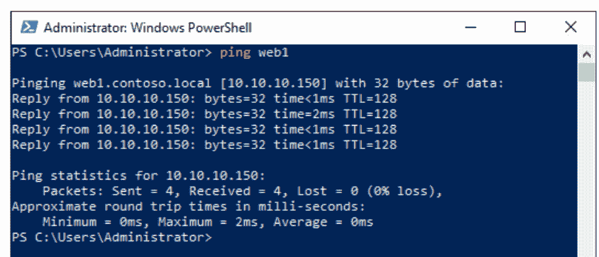

图 7.2：Ping 服务器

Ping 流量在技术上称为 ICMP 流量。这很重要，因为如今 ICMP 被默认阻止的情况越来越多，许多系统和设备默认都开启了防火墙。历史上，ping 一直是我们可以依靠的工具，能够相当确定地告诉我们两台设备之间是否连通，但现在情况已不再如此。如果你搭建一台全新的 Windows 机器并将其接入网络，这台计算机可能可以很好地与互联网和网络上的所有服务器通信，但如果你尝试从网络上的另一台机器 ping 这台新电脑，ping 很可能会失败。为什么会发生这种情况？因为 Windows 默认内置了一些安全措施，其中包括在 Windows Defender 防火墙中阻止 ICMP 流量。在这种情况下，你需要关闭 Windows 防火墙，或为其提供允许 ICMP 流量的访问规则。一旦启用此类规则，ping 请求将开始从这台新计算机得到回复。请记住，在构建网络中的新系统或服务器时，ping 在当今的网络世界中并不是总是最值得信赖的工具。

通过在 Windows Defender 防火墙的高级安全中添加规则，很容易允许 ICMP 响应，不过你也不希望每次向网络中引入新系统时都必须手动执行此操作。幸运的是，你已经知道如何利用组策略构建 GPO 并将其推送到网络上的所有机器上，而且是的，你完全可以将防火墙规则放在该 GPO 中。这是一种通过组策略发布防火墙规则来允许或阻止整个组织中 ICMP 的常见方法。

## tracert
tracert，发音为 Trace Route，是一种用于追踪网络数据包在其穿越网络时的工具。它真正做的是监视数据包在到达目的地之前碰到的所有位置。网络数据包需要通过的这些“路障”称为跳数。Trace route 会显示你的流量在向目标服务器或其试图联系的对象移动时所经过的所有跳数。我的测试实验室网络非常平坦且乏味，因此在那里执行 tracert 不会显示出什么有用的信息。然而，如果我从一台联网的机器打开 PowerShell 提示符并对某个 Web 服务（如 Bing）执行 tracert，我们会得到一些有趣的结果：

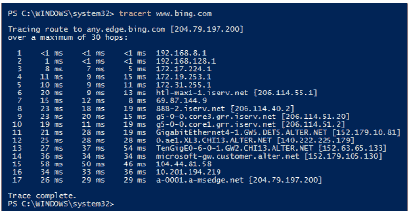

图 7.3：使用 tracert

> 如果你使用 tracert 但不想查看输出中提供的所有 DNS 信息，请使用 tracert -d 仅关注 IP 地址。

这些信息在尝试诊断不工作的连接时可能非常有用。如果你的流量在到达目的地之前经过多个跳数，例如路由器和防火墙，tracert 在确定连接流中问题出在哪里时至关重要。鉴于前面的屏幕截图显示了到 Bing 的成功跟踪路由，现在让我们看看当出现问题时会是什么样子。我将拔掉我的互联网调制解调器并再次运行相同的 tracert www.bing.com，现在我们可以看到我仍然能够与本地路由器通信，但不能再往外：

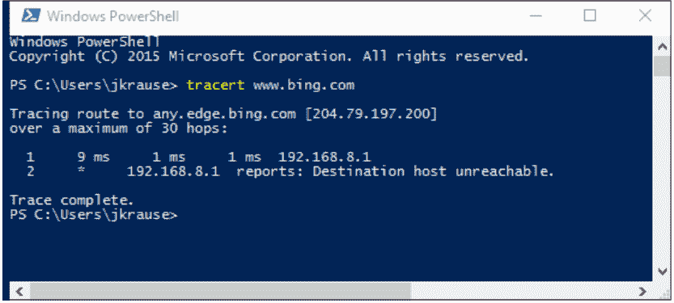

图 7.4：断开互联网连接时跟踪到网站的路由

## pathping
tracert 很有用，似乎是追踪网络中数据包的事实标准，但我认为下一个命令更加强大。pathping 基本上与 tracert 做同样的事情，只是它提供了额外的重要信息。大多数情况下，使用这两个命令中的任何一个，你只关心在跳数链中哪里出了问题，但经常，当我为网络目的设置服务器时，我处理的服务器和硬件具有许多不同的网卡。在处理系统中的多个 NIC 时，本地路由表与外部路由器和交换机一样重要，我经常想检查网络数据包的路径，以查看它是从哪个本地 NIC 流出。这就是 pathping 比 tracert 更强大的地方。tracert 显示给你的第一条信息是你正在穿越的本地服务器之外的第一个跳数。然而，pathping 还会显示你的数据包是从哪个本地网络接口流出。

让我举个例子：我经常为具有多个 NIC 的远程访问服务器设置，并且在此过程中，我们在本地服务器上创建许多路由，以便它知道需要将哪些流量发送到哪个方向，例如哪些流量需要从内部 NIC 发出，哪些流量需要从外部 NIC 发出。完成内部 NIC 的所有路由语句后，我们通过 ping 网络内部的服务器来测试它们。也许 ping 失败了，我们不确定原因。我可以尝试 tracert 命令，但它不会提供任何有用的信息，因为它根本看不到第一个跳数；它只是超时。然而，如果我改用 pathping 命令，第一个跳数仍会超时，但我现在可以看到我的流量正试图从我的 *外部网卡* 流出。糟糕！我们一定是在这台服务器上的静态路由设置上出现了错误。因此，我知道需要删除该路由并重新创建它，以便使此流量改走内部 NIC。

以下是我在 tracert 屏幕截图中使用的同一台计算机上的相同 PowerShell 提示符。你可以看到 pathping 命令显示了我笔记本电脑上流量试图离开系统的本地 IP 地址，而 tracert 命令并未显示此信息：

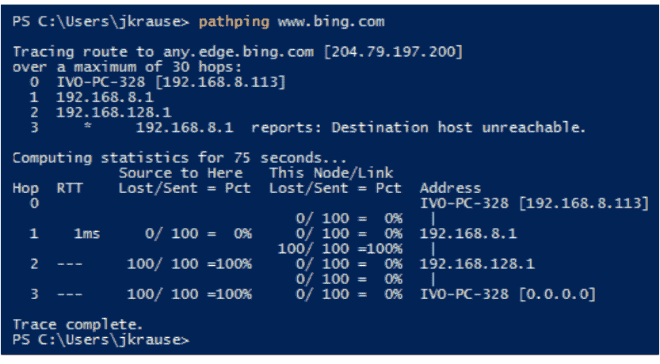

图 7.5：pathping 显示初始出站跳数

## Test-Connection
我们迄今为止讨论的命令可以从命令提示符或 PowerShell 运行，但现在是时候深入了解一个只能从 PowerShell 提示符运行的新命令：一个名为 Test-Connection 的 cmdlet；它有点像加强版的 ping。如果我们在实验室中打开 PowerShell 提示符并运行 Test-Connection WEB1，我们看到的输出与常规 ping 非常相似，但信息以我认为更易于阅读的方式排列。这里还有一个意外的列，称为 Source：

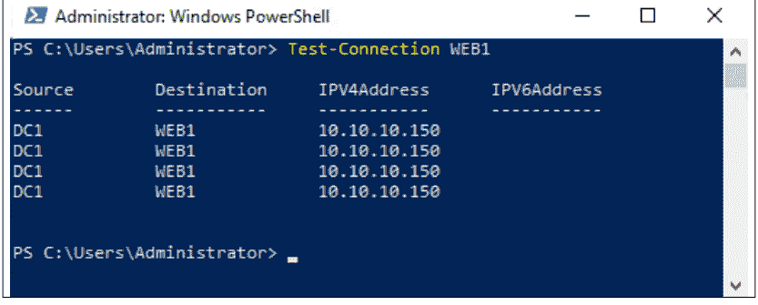

图 7.6：使用 Test-Connection

这很有趣。我在运行此命令时登录到我的 DC1 服务器，因此此命令的源计算机是 DC1。但这是否意味着我可以操纵 Test-Connection cmdlet 的源计算机？是的，这正是它的含义。就像 Windows Server 2019 管理中的一切一样，登录到本地服务器的需求是解耦的。具体来说，对于 Test-Connection cmdlet，这意味着你可以在网络上的任何位置打开 PowerShell 提示符并测试两个不同端点之间的连接，即使你未登录到其中任何一个。让我们来测试一下。

我仍然登录到我的 DC1 服务器，但我将使用 Test-Connection cmdlet 来测试网络中多台服务器之间的连接。你看，你不仅可以指定与当前登录的计算机不同的源计算机，还可以更进一步，使用这个强大的 cmdlet 指定多个源和目标。因此，如果我想从几台不同的源机器测试到几个不同目标的连接，可以很容易地使用以下命令完成：

```
Test-Connection -Source DC1, DC2 -ComputerName WEB1, BACK1
```

你可以在图 7.7 中看到，我有来自 DC1 和 DC2 的 ping 统计信息，分别指向网络中的 WEB1 和 BACK1 服务器。Test-Connection 有潜力成为一个非常强大的监控工具：

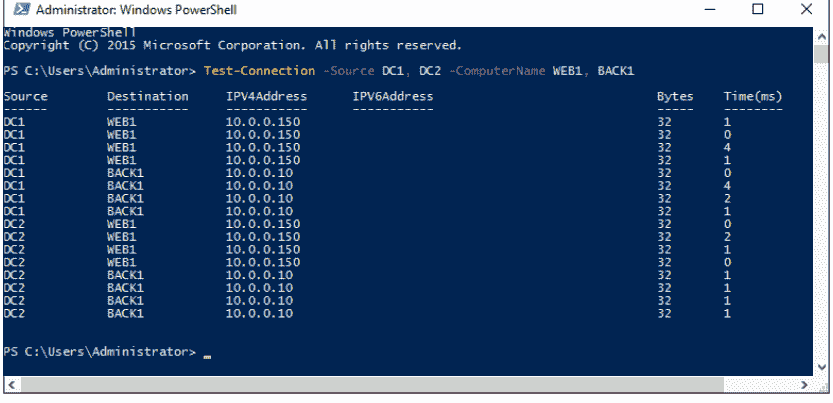

图 7.7：使用 Test-Connection 的多个源和目标

再提一个有用的功能，你可以通过使用 -Quiet 开关轻松清理命令的输出。通过在 Test-Connection 命令中添加 -Quiet，它会清理输出，只显示连接是否成功的简单 True 或 False，而不是显示发送的每个单独的 ICMP 数据包。不幸的是，你不能同时组合 -Source 开关和 -Quiet 开关，但如果你从你登录的原始源计算机使用 Test-Connection，就像我们大多数人会做的那样，-Quiet 效果很好。大多数情况下，我们真正关心的只是这些连接是否工作，而不是一定想看到全部四次尝试。使用 -Quiet，我们就能得到这一点：

```
Test-Connection -Quiet -ComputerName WEB1, BACK1, DC2, CA1
```

如果我以标准方式使用 Test-Connection 来尝试联系网络中的所有服务器，那将会产生大量输出。但通过使用 -Quiet 开关，我会得到每个服务器是否能够被联系到的简单 True 或 False 结果：

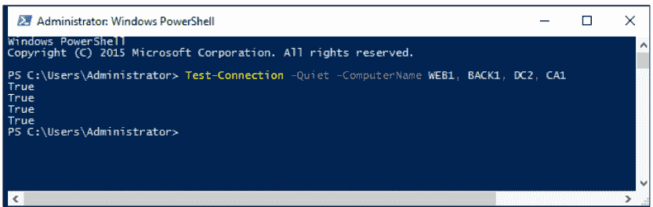

图 7.8：使用 -Quiet 开关

## Telnet

telnet 提供了相当多的远程管理功能；它本质上提供了在两台计算机之间建立连接的能力，通过虚拟终端连接来操作远程机器。令人惊讶的是，我们这里并不是要讨论 telnet 提供的任何实际功能，因为就网络而言，我发现它作为一个简单的连接测试工具非常有用，而无需了解 telnet 命令本身实际提供的功能。

当我们讨论 ping 时，我们谈到了 ICMP 的缺点：它很容易被阻止，而且在当今的网络中，不允许 ping 成功的情况变得越来越常见。这很不幸，因为 ping 一直是最常见的网络连接测试形式，但现实是，如果 ping 让我们的生活更轻松，它也会让黑客的生活更轻松。如果我们不能依赖 ping 来确定是否可以联系到远程系统，我们该用什么代替？另一个我经常看到的情况是，服务器本身可能响应正常，但该服务器上运行的某个特定服务出现问题且未响应。简单的 ping 可能显示服务器在线，但它无法告诉我们有关该服务的具体信息。通过使用 Telnet Client 命令，我们可以轻松地远程查询服务器。更重要的是，我们可以选择查询该服务器上的单个服务，以确保它按设计方式进行监听。让我举一个我经常使用的例子。

我经常设置面向互联网的新 Web 服务器。安装新 Web 服务器后，显然我会想从互联网测试访问它以确保它有响应，对吧？但也许网站本身尚未上线且功能正常，所以我无法使用 Edge 或任何其他浏览器浏览它。很可能我们在服务器或防火墙级别禁用了 ping，因为出于安全原因在互联网上阻止 ICMP 非常常见，以降低 Web 上的安全漏洞面。所以我的新服务器正在运行，我们认为网络都已配置妥当，但我无法通过 ping 测试我的新服务器，因为按设计它不会回复。我们可以用什么来测试？telnet。通过发出简单的 telnet 命令，我可以指示我的计算机查询新 Web 服务器上的特定端口，并找出是否可以连接到该端口。这样就建立了与该服务器上端口的套接字连接，这比 ping 更接近真实的用户流量。如果 telnet 命令成功连接，你就知道你的流量正在到达服务器，并且我们在查询的端口上运行的服务器服务似乎正在正常响应。

在 Windows Server 2019 或任何其他 Windows 操作系统中，使用 telnet 的功能默认未安装，因此我们首先需要进入 Server Manager，然后添加角色和功能来安装名为 Telnet Client 的功能：

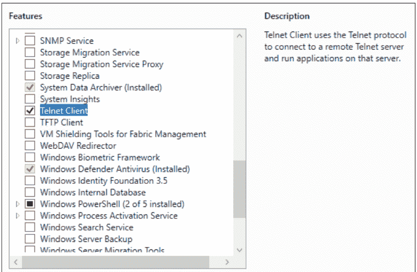

图 7.9：安装 Telnet 客户端

> 你只需要在一台想要进行命令行测试的机器上安装 **Telnet 客户端**。你不需要在要连接的远程服务器上做任何事情。

现在 Telnet Client 功能已安装，我们可以从命令提示符或 PowerShell 中利用它，通过尝试从我们的计算机向远程服务建立套接字连接来为我们工作。我们只需要告诉它查询哪个服务器和端口。然后 telnet 只会连接或超时，基于该结果，我们可以看到服务器上该特定服务是否正在响应。让我们用自己的 Web 服务器来试试。对于我们的示例，我已在 IIS 中关闭了网站，因此我们现在处于服务器在线但网站已死的状况。如果我 ping WEB1，我仍然可以看到它愉快地响应。你可以看到，依赖 ICMP 的服务器监控工具会出现误报，表明服务器在线且运行中，即使我们的网站无法访问。在图 7.10 中成功 ping 的正下方，你可以看到我还尝试查询 WEB1 服务器上的端口 80。我为此使用的命令是 telnet web1 80。那次超时了。这表明运行在端口 80 上的网站未响应：

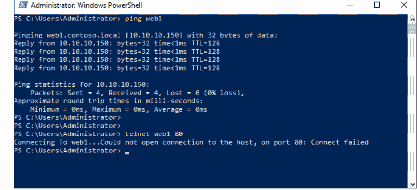

图 7.10：端口 80 连接失败

如果我重新打开网站，我们可以再次尝试 telnet web1 80，这次我不会收到超时消息。这次，我的 PowerShell 提示符会自行清除，并在顶部等待闪烁的光标。虽然它不会告诉我 耶，我已连接！，但这个闪烁的光标表明已成功建立到我的 Web 服务器端口 80 的套接字连接，表明网站已上线并正在响应：

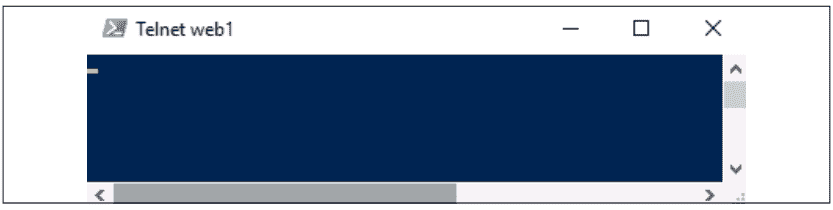

图 7.11：闪烁的光标表示连接成功

> 在创建成功的 telnet 套接字连接后，你可能会想知道如何返回到常规的 PowerShell 界面。一起按下 Ctrl + ] 键（第二个是闭合括号键，通常位于键盘上的反斜杠键旁边），输入 quit，然后按 Enter。这应该会带你返回到常规提示符。或者直接关闭 PowerShell 提示符并打开一个新的。

## Test-NetConnection

如果 ping 有一个等效且改进的 PowerShell cmdlet 称为 Test-Connection，那么 PowerShell 是否也包含一个与 telnet 类似、用于测试到资源的套接字连接的改进工具？当然有。Test-NetConnection 是查询远程系统上特定端口或服务的另一种方式，并且显示的输出比 telnet 更友好。

让我们再次走一遍同样的测试，再次查询 WEB1 上的端口 80。你可以在下面的屏幕截图中看到我运行了该命令两次。第一次 WEB1 上的网站被禁用，我对端口 80 的连接失败。第二次，我重新启用了网站，现在我看到了成功的连接：

```
Test-NetConnection WEB1 -Port 80
```

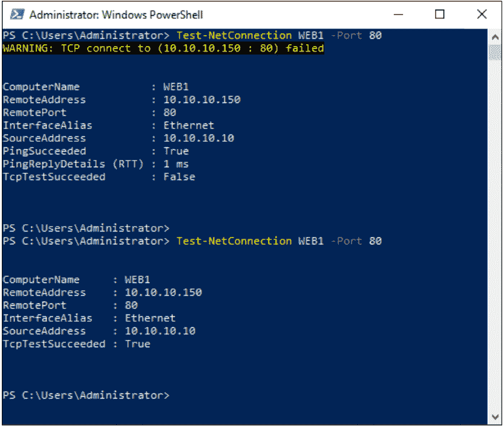

图 7.12：使用 Test-NetConnection 测试单个端口连接

## 使用 Wireshark 进行数据包跟踪

最终，你可能需要更深入地查看网络数据包。现在我们进入了网络团队也可能参与的领域，但如果你熟悉这些工具，你可能在需要呼叫协助之前就能解决问题。利用命令行工具检查服务器和服务的状况非常有用，但有时可能不够。例如，你有一个客户端应用程序无法连接到应用程序服务器，但你不知道原因。ping 甚至 telnet 等实用程序可能能够成功连接，表明网络路由设置正确，但应用程序在打开时仍无法连接。如果应用程序自己的事件日志没有帮助你排查问题，你可能想要更深入地查看应用程序试图推送到服务器的网络数据包 *内部* 的情况。

这就是 **Wireshark** 应用程序派上用场的地方。微软曾经提供并支持了两个自研工具 NetMon 和 Message Analyzer，它们提供类似的功能，但两者现在已被正式退役。可能是因为 Wireshark 很棒，而且是免费的！该工具捕获从系统发出或到达系统的网络流量，并捕获数据包 *内部* 的信息，以便你可以更深入地了解正在发生的事情。在我们的应用程序无法连接的示例中，你可以在客户端计算机上运行 Wireshark 来监视传出流量，也可以在应用程序服务器上运行以监视来自客户端的传入流量。

Wireshark 内部有大量的功能，我们这里没有空间全部涵盖，所以我留给你一个可以从中获取此工具的链接，以便你自己开始测试：https://www.wireshark.org/download.html。

## TCPView

我们到目前为止讨论过的工具很棒，可以每天用于探测你想要测试的各个资源，但有时，你需要退一步弄清楚自己到底在寻找什么。也许你正在处理计算机上的一个应用程序，不知道它在与哪个服务器通信。或者你怀疑一台机器感染了病毒并试图 *回拨* 到互联网上的某个地方，你想识别它试图联系的位置或发起调用的进程。在这些情况下，如果有一个工具可以启动在本地计算机上，清晰简洁地显示该计算机或服务器上所有活动的网络流量流，那就太有帮助了。这正是 **TCPView** 所做的。TCPView 是 Sysinternals 创建的一个工具；你可能听说过他们其他的工具，例如 ProcMon 和 FileMon。在机器上运行 TCPView 会实时显示该计算机上所有活动的 TCP 和 UDP 连接。同样重要的是，你不需要安装任何东西来使 TCPView 工作；它是一个独立的可执行文件，使其极易使用，并在你使用完毕后从机器上清除。

你可以从 https://technet.microsoft.com/en-us/sysinternals/tcpview.aspx 下载 TCPView。

只需将文件复制到你想要监视的计算机或服务器上并双击它。*图 7.13* 显示了 TCPView 界面在我的本地计算机上运行，显示了 Windows 和我的应用程序当前正在建立的所有连接。你可以暂停此输出以更仔细地查看，也可以设置过滤器来精简数据并找到你真正想要的内容。过滤器可以消除所谓的 *噪音*，使你能够更仔细地查看特定目标或特定进程 ID：

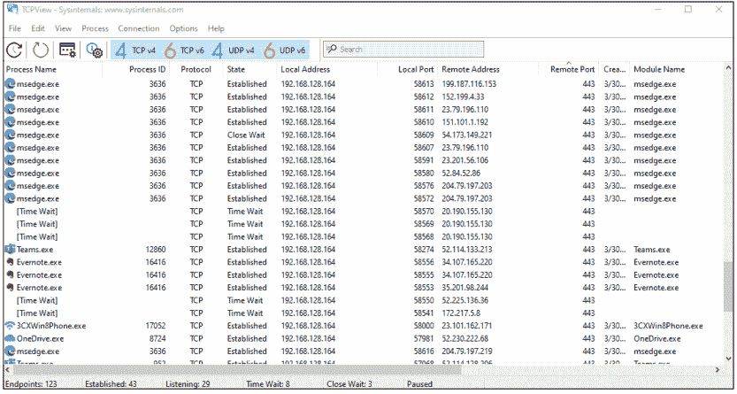

图 7.13：TCPView 界面

现在我们已经发现并测试了一些用于测试连接的有用工具，让我们进入一个新主题，在这个主题中我们开始操控来自服务器的网络流量的流动。请跟随我们学习 Windows 路由表。

## 构建路由表

当你听到“路由表”这个术语时，很容易将其视为网络人员需要处理的事情，是在网络路由器和防火墙内部配置的东西。它不适用于服务器管理员，对吧？通过仅需要 IP 地址、子网掩码和默认网关，我们将服务器联网变得非常简单，并且可以立即与网络中其余部分的所有内容进行通信。虽然确实有很多网络魔法在幕后运行，这些是由网络设备和网络管理员提供的，但了解 Windows 内部的路由工作原理非常重要，因为在某些情况下，你需要在 Windows Server 本身上修改或构建路由表。

## 多宿主服务器

运行多宿主服务器就是一种你肯定需要理解并操作本地 Windows 路由表的情况，所以我们从这里开始。如果你认为这不适用于你，因为你从未听说过“multi-homed”，再想想。Multi-homed 只是一个看起来有点奇怪的词，意思是你的服务器拥有不止一个网卡。对于你来说这种情况完全可能存在，即使你是一个服务器不多的小型企业。经常，Small Business 或 Essentials 服务器具有多个网络接口，用于将内部局域网流量与互联网流量分开。多宿主服务器的另一个例子是提供 DirectAccess、VPN 或代理功能的远程访问服务器，位于网络边缘。另一个让你感兴趣并理解多宿主的原因是 Hyper-V 服务器。Hyper-V 服务器拥有多个网卡是非常常见的，因为在该服务器上运行的虚拟机可能需要接入组织内部的不同物理网络。

现在我们已经明确了多宿主服务器是什么，你可能仍然在想为什么我们要讨论这个。如果我有不止一个网卡，我难道不只是在 Windows 内部单独配置每个网卡，给每个网卡一个 IP 地址，就像对任何服务器上的任何网卡一样吗？是也不是。是的，你需要在每个网卡上配置 IP 地址，因为它需要这个来进行网络上数据包的标识和传输。不，你不能以相同的方式设置服务器上的所有网卡。你需要牢记并遵守一个关键事项，以便让多宿主服务器上的流量正常流动。

## 只有一个默认网关

这就是关键所在。当你通过拥有多个网卡使服务器多宿主时，你只能有一个默认网关。一个适用于整个服务器。这意味着你将有一个带有默认网关的网卡，而一个或多个网卡在其 TCP/IP 设置中没有默认网关。这非常重要。默认网关的目的是作为最后的路径。当 Windows 想向目标发送数据包时，它会浏览本地路由表——是的，即使你从未配置或查看过它，也存在路由表——并检查是否存在通往该数据包所需去往的目标子网的特定静态路由。如果存在路由，它会通过该路由和网络接口将数据包发送到目标。如果路由表中不存在静态路由，它就会回退到使用默认网关，并将流量发送到该默认网关地址。在所有单网卡服务器上，默认网关是一个路由器，它拥有网络的所有路由信息，因此服务器只需将其交给路由器，路由器就会完成剩余的工作。

当 Windows Server 上有多个网卡时，我们不能为每个网卡设置默认网关，因为这会混淆服务器的流量。每次网络传输时，流量流向哪个默认网关都将是碰运气。我曾帮助许多人在现场排查过完全相同的问题。他们需要将服务器用作两个网络之间的桥接，或出于某种原因将服务器插入多个不同网络，并且苦于有时流量似乎可以工作，有时却不行。我们开始查看网卡属性，却发现每个网卡的 TCP/IP 属性中都有自己的默认网关地址。bingo，这就是我们的问题。当系统尝试发送流量时完全混乱，因为它不知道在什么时间需要使用哪个网关。

如果你曾经尝试在同一台服务器的多个网卡上添加默认网关，你可能熟悉执行此操作时显示的警告提示。让我们试试看。我已向其中一台服务器添加了另一个网卡，并且只在一个网卡上配置了 IP 设置。现在我将在第二个网卡上添加新的 IP 地址、子网掩码和默认网关。当我单击“确定”按钮保存这些更改时，我会看到以下弹出窗口：

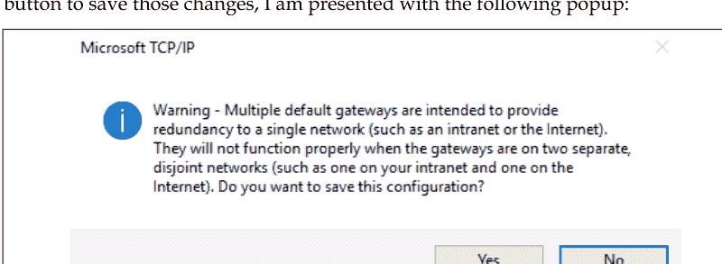

图 7.14：配置多个默认网关时的警告消息

这是那些容易因其略显晦涩的性质而被误读的警告之一，但你能抓住其精髓：自担风险！那么大多数管理员在此时会怎么做呢？只是直接点击通过并仍然保存更改。然后路由问题就开始了。也许不是今天，但也许在下次重启服务器时，或也许在三周后，但总有一天，你的服务器会开始将数据包发送到错误的目标并给你带来麻烦。

## 构建一条路由

那么我们对所有这些问题的答案是什么？构建静态路由表。当服务器上有多个网卡，从而使其多宿主时，你必须在路由表中告诉 Windows 对何种流量使用哪个网卡。这样，当网络流量需要离开服务器前往特定目标时，路由表会了解流量需要采取的不同方向和路径才能到达那里，并相应地发送出去。你仍然需要依赖路由器将流量带到剩余路程，但通过正确的物理网卡将数据包发送到正确的路由器是确保多宿主服务器的流量快速且适当流动的关键。

现在我们已经理解了路由表的重要性以及概念上我们需要如何使用它，让我们深入并在我的双网卡服务器上添加几条路由。我们将使用命令提示符添加一条路由，也将使用 PowerShell 添加一条，因为你可以在任一平台上完成此任务，但使用的语法取决于你偏好的平台而不同。

## 使用命令提示符添加路由

在规划新路由之前，我们需要了解该服务器当前网络配置的概况。它有两个网卡：一个插入我的内部网络，一个插入面向互联网的 DMZ。由于我只能有一个默认网关地址，它被放在 DMZ 网卡上，因为我无法为可能需要通过互联网联系的每个子网添加路由。通过将默认网关放在我的 DMZ 网卡上，内部网卡没有默认网关，目前能联系到的范围非常有限。我物理连接的内部子网是 10.10.10.0/24，因此我目前可以联系该小网络中的任何设备，从 10.10.10.1 到 10.10.10.254。这被称为直连路由；由于我直接插入此子网，我的服务器自动知道如何在该子网内部路由流量。然而，我目前无法通过内部网卡联系其他任何东西，因为路由表对我内部网络中的其他子网一无所知。例如，我还有一个额外的子网 192.168.16.0/24，并且该子网内运行着一些服务器，我需要能够从这台新服务器联系它们。如果我现在尝试联系其中一台服务器，数据包会从我的 DMZ 网卡发出，因为服务器上的路由表不知道如何处理 192.168 流量，因此会将其发送到默认网关。以下是我们需要遵循的路由语句的一般语法，以便使此流量从我们的服务器流入新子网：

```
Route add -p <SUBNET_ID> mask <SUBNET_MASK> <GATEWAY> IF <INTERFACE_ID>
```


在我们能够输入用于添加 192.168 网络的唯一路由语句之前，我们需要做一些侦探工作，弄清楚要在这些字段中使用什么。以下是构建路由语句所需的部分和组件的分解：

- `-p`：这会使命令保持持久。如果你在 route add 语句中忘记加上 -p，下次重启服务器时，这个新路由就会消失。不好。
- `SUBNET_ID`：这是我们要添加的子网；在我们的例子中，它是 192.168.16.0。
- `SUBNET_MASK`：这是新路由的子网掩码号码，255.255.255.0。
- `GATEWAY`：这个有点让人困惑。很常见的是认为它意味着你需要输入新子网的网关地址，但那是不正确的。你在这里实际定义的是服务器为了发送此流量需要访问的第一跳。换句话说，如果你在内部 NIC 上配置了默认网关地址，那个地址会是什么？对于我们的网络，它是 10.10.10.1。这有效地指示服务器，“任何发往此路由（192.168.16.0/24）的流量，把这些数据包发送到 10.10.10.1，那家伙会弄清楚该怎么做。”
- `INTERFACE_ID`：指定接口 ID 号对于创建路由并不是完全必要的，但如果你不指定它，你的路由可能会绑定到错误的 NIC 并将流量发送到错误的方向。我以前见过这种情况，所以我总是指定一个 NIC 接口 ID 号。这通常是一个一位或两位数字，是 Windows 对内部 NIC 本身的标识符。我们可以通过查看 route print 命令来确定接口 ID 号是什么：

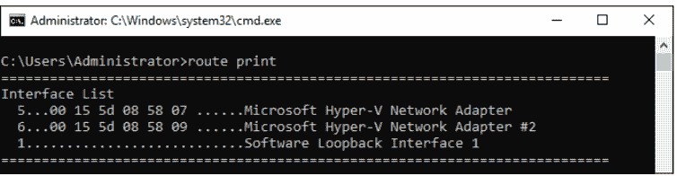

Figure 7.15: 获取接口 ID 编号

在 route print 的顶部，你会看到系统中列出的所有 NIC。在我们的例子中，内部 NIC 是列表中的第一个。我是通过查看 ipconfig /all 命令输出中该 NIC 的 MAC 地址来识别它的。如你所见，我的内部 NIC 的接口 ID 号是 5。所以在我的 route add 语句中，我将在语句末尾使用 IF 5，以确保我的新路由绑定到该内部物理 NIC。

以下是我们完成的 route add 语句：

```
route add -p 192.168.16.0 mask 255.255.255.0 10.10.10.1 if 5
```

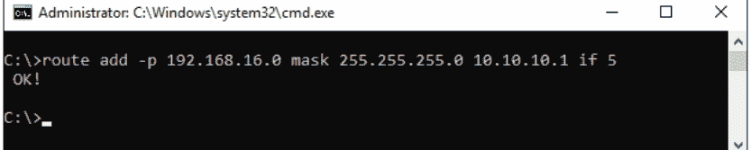

Figure 7.16: 运行完整的路由语句

如果你现在运行 route print 命令，你可以看到我们的新 192.168.16.0 路由列在路由表的持久路由部分，我们现在可以从这台新服务器向该子网发送数据包。每当我们的服务器有需要进入 192.168.16.x 子网的流量时，它会通过内部 NIC 向运行在 10.10.10.1 上的路由器发送该流量。然后路由器从那里接收流量并将其带入 192.168.16.0 子网：

持久路由：
| 网络地址 | 子网掩码 | 网关地址 | 度量值 |
|---|---|---|---|
| 0.0.0.0 | 0.0.0.0 | 10.10.10.1 | Default |
| 192.168.16.0 | 255.255.255.0 | 10.10.10.1 | 1 |

Figure 7.17: 向 192.168.16.0 子网发送流量

## 删除路由

偶尔，你可能会错误地输入路由语句。处理此问题的最佳方法是简单地删除错误的路由，然后使用正确的语法重新运行 route add 语句。也许还有其他原因导致你时不时需要删除路由，因此你需要熟悉此命令。删除路由比添加新路由简单得多。你只需要知道要删除的路由的子网 ID，然后简单地执行 route delete <SUBNET_ID>。例如，要删除我们在命令提示符中工作时创建的 192.168.16.0 路由，我只需发出此命令：

```
route delete 192.168.16.0
```

## 使用 PowerShell 添加路由

由于 PowerShell 在 Windows Server 内部的大多数命令行任务中占据主导地位，我们也应该从此界面完成同样的任务。你可以在 PowerShell 提示符中使用相同的 route add 命令，这会很好地工作，但也有一个专门的 cmdlet 可以使用。让我们利用 New-NetRoute 向路由表添加另一个子网。这次，我们将添加 192.168.17.0。以下是我们可以使用的一条命令：

```
New-NetRoute -DestinationPrefix "192.168.17.0/24" -InterfaceIndex 5
-NextHop 10.10.10.1
```

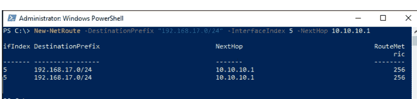

Figure 7.18: 向路由表添加另一个子网

你可以看到结构相似，但友好一些。无需输入单词 mask 并指定整个子网掩码号码，你可以使用斜杠方法在同一个标识符中识别子网和掩码。此外，以前我们指定的是网关，这总是有些令人困惑，使用 New-NetRoute cmdlet 时，我们改为指定称为 NextHop 的内容。这对我来说更有意义一些。

我们之前使用 route print 来查看完整的路由表，PowerShell 用于显示该表的 cmdlet 只是 Get-NetRoute：

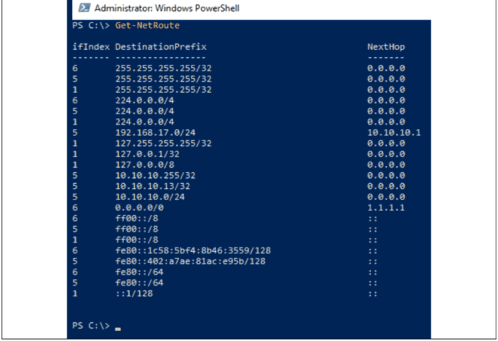

Figure 7.19: 显示完整的路由表

构建路由表是任何遇到具有多个连接到不同网络的网络接口的服务器的服务器管理员必备的知识。现在，让我们讨论另一个用例，在该用例中，你可能会在同一台服务器上找到多个网卡，但这次它们连接到同一个网络。

## NIC 团队

转向服务器硬件上越来越流行的另一个网络主题，让我们逐步了解创建 NIC Teaming 的步骤。将 NIC 组合在一起的能力本质上是将两个或多个物理网络接口绑定在一起，使它们在 Windows 中表现得像一个单一的网络接口。这允许你将两根物理电缆插入两个不同的交换机端口，所有设置都相同。这样，如果一个 NIC 端口或交换机端口或跳线出现故障，服务器会继续工作和通信而不会犹豫，因为团队化允许仍在工作的 NIC 处理网络流量。

> NIC Teaming 本身并不是什么新鲜事。它在 Windows Server 操作系统内部已经存在 10 年或更长时间了。然而，早期的版本存在问题，在实际环境中，我发现 Server 2016 是大多数 IT 人员认为稳定到足以在生产环境中使用 NIC Teaming 的最早的服务器操作系统。因此，基于这一点，它在野外仍然相对较新。

开始将你的 NIC 组合在一起时，你需要确保服务器上有多个网卡。我目前在这台机器上有四个 NIC 端口。我计划创建两个团队：我的第一个和第二个 NIC 将绑定在一起成为 **内部网络团队**，我的第三个和第四个 NIC 将成为 **DMZ 网络团队**。这样，我在这台服务器的网络流量的两侧都有网卡冗余。

我想做的第一件事是清除 NIC 上可能存在的任何 IP 地址设置。你看，一旦你将多个 NIC 绑定到一个团队，你将在团队上配置 IP 地址设置——你将不再深入到单个 NIC 属性中分配 IP 地址。所以打开每个 NIC 的属性并确保它们没有静态 IP 信息，如下所示：

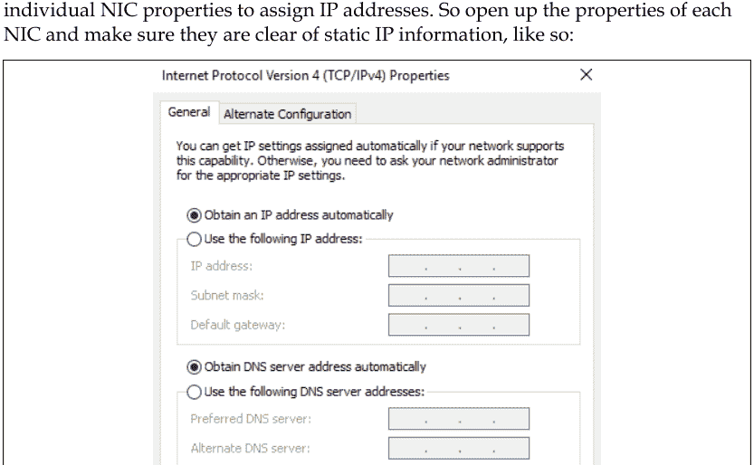

Figure 7.20: 清除每个 NIC 的静态 IP 地址

现在打开服务器管理器并单击 **本地服务器**。查看服务器的属性信息，你将看到每个 NIC 的列表，以及一个名为 **NIC Teaming** 的选项，目前设置为 **已禁用**：

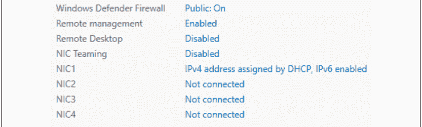

Figure 7.21: NIC Teaming 最初是禁用的

继续单击单词 **已禁用**，现在查找标题为 **Teams** 的部分。单击 **任务** 按钮并选择创建 **新团队**。

为你的新团队提供一个合适的名称并选择你希望成为此团队一部分的 NIC。完成后，你可以根据需要多次重复相同的步骤，使用剩余的 NIC 创建额外的团队：

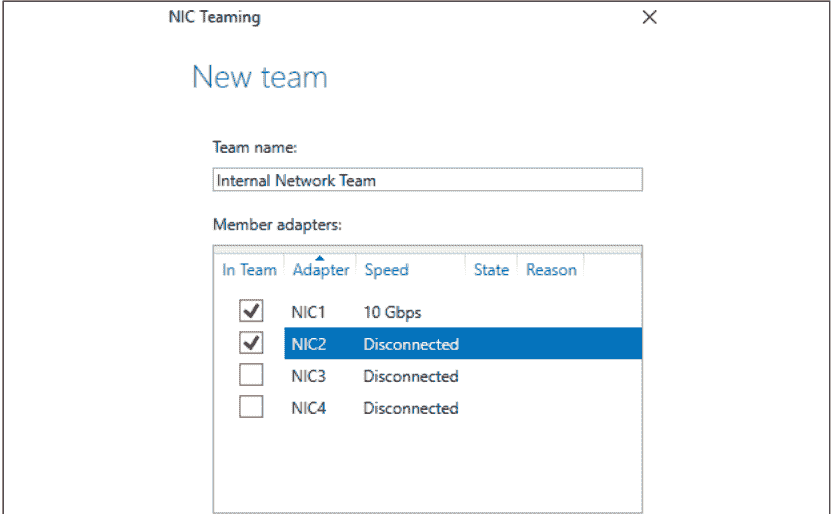

Figure 7.22: 创建新的 NIC 团队


完成之后，你将在服务器管理器中看到你的团队列表，如果你在 Windows 中打开网络连接屏幕，你可以在图 7.23 中看到，除了四个物理 NIC，我现在这里还有两个新的条目，它们是我们新团队的配置位置。从这里，我可以右键单击我的每个网络团队并配置 IP 地址信息，就像我对单个 NIC 所做的那样。输入到团队属性中的 IP 将对团队中的所有 NIC 生效：

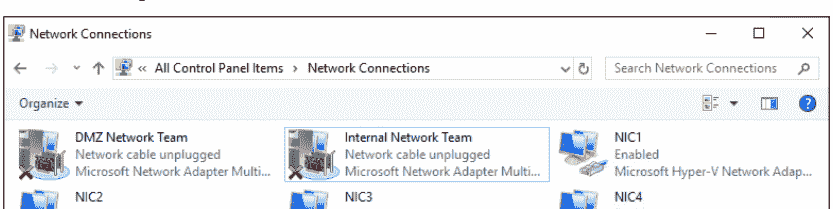

图 7.23：网络连接下额外的 NIC 团队选项

本章迄今为止讨论的内容适用于任何使用 Windows Server 2019 的环境，也可应用于 Windows Server 操作系统的许多早期版本。接下来，我们将进入一个话题，有些人可能已经身处其中，但许多人可能永远不需要与之交互——软件定义网络。

## 软件定义网络

云计算的灵活性和弹性不容否认，大多数技术高管目前都在探索利用云技术的方法。适应过程中的一大主要障碍是信任。云服务提供巨大的计算能力，只需按一下按钮即可立即访问。为了让公司将数据存储在这些系统上，你的组织对该云提供商的信任程度必须非常高。毕竟，当数据在云中时，你并不拥有数据所在的基础设施或网络硬件，因此你对这些资源的控制充其量是有限的。看到这一障碍，微软在最近的更新中做出了许多努力，将类似云的技术带入本地数据中心。将服务器弹性引入我们的数据中心意味着虚拟化。我们多年来一直在虚拟化服务器，尽管其中的能力仍在不断改进。现在，通过虚拟化技术，我们能够如此轻松地启动新服务器，接下来最合理的障碍将是我们能够随时随地轻松移动这些虚拟服务器的能力。

你是否有一个服务器想要迁移到全国各地的其他数据中心？你是否考虑将整个数据中心迁移到城里的新托管设施？也许你最近收购了一家新公司，需要将其基础设施纳入你的网络，但存在重叠的网络配置。你是否在云服务提供商处购买了一些空间，现在正试图梳理将所有服务器迁移到云中的计划？这些都是需要答案的问题，而答案就是 SDN。

SDN 是一个广泛的通用术语，涵盖了许多协同工作以使这一想法成为可能的技术。其目的是在你需要时随时随地扩展你的网络边界。让我们看看 Windows Server 2019 中可用的一些组件和部分，它们协同工作以创建一个虚拟网络环境，这是采用我们软件定义网络理念的第一步。

## Hyper-V 网络虚拟化

目前重点关注的最大组件，它带来在虚拟化层上拾取网络并在其中滑动的能力，位于 Hyper-V 中。这是有道理的，因为这正是你触及和访问以虚拟化服务器的地方。通过 Hyper-V 网络虚拟化，我们在虚拟网络和物理网络之间创建了分离。当你设置新的虚拟网络时，你不再需要在物理网络上适应 IP 方案限制，因为后者可以在物理网络之上运行，即使两种网络的配置在正常情况下通常不兼容。

如果这是你第一次听说这个概念，这个概念有点难以理解，所以让我们讨论一些会从这种分离中受益的现实情况。

## 私有云

私有云正席卷全球的数据中心，因为它们非常有意义。任何有兴趣将云的巨大好处带入其环境，同时又避开云的负面影响的人都可以从中受益。构建私有云使你能够拥有动态扩展和收缩的计算资源，并能够在同一计算基础设施内托管多个租户或部门。它为这些部门提供直接的管理界面，以便繁琐的设置和配置工作可以由租户完成，而你不必在基础设施提供商层面花费时间和资源进行小的、详细的配置。

私有云在避开你的数据托管在你几乎无法控制的云服务提供商数据中心这一巨大担忧以及围绕它的所有隐私问题方面实现了所有这些能力。

为了在你的基础设施内部提供私有云，特别是当你希望为多个租户提供访问权限时，网络虚拟化的好处变得明显，甚至成为必需。假设你为一家公司的两个部门提供计算资源，他们各自都有托管一些 Web 服务器的需求。没什么大不了的，但这两个部门都有自己的管理团队，他们希望使用 10.0.0.0 范围内的 IP 方案。他们都需要能够在你提供的同一核心网络上使用相同的 IP 地址，但你需要将他们所有的流量完全隔离和分离。在传统的物理网络上，这些要求是不可能的，但通过利用网络虚拟化的强大功能，你可以轻松地为每个部门授予其选择的任何级别的 IP 子网和地址方案。他们可以在他们喜欢的任何子网和 IP 地址上运行服务器，并且所有流量都被唯一封装，因此保持分离，完全不知道在虚拟化层下运行的同一物理核心网络上运行的其他流量。此场景在企业收购中也适用得很好。在 IT 层面合并的两个公司通常在域和网络子网方面存在冲突。通过网络虚拟化，你可以允许现有基础设施和服务器继续使用其当前的网络配置运行，但通过使用 Hyper-V 网络虚拟化，将它们纳入同一物理网络。

另一个更简单的例子是你只想在企业网络内移动一台服务器。也许你有一台遗留的业务线服务器，许多员工仍然需要访问它，因为他们的日常工作包括 LOB 应用程序必须始终运行。移动服务器的问题在于客户端计算机上的 LOB 应用程序配置了静态 IPv4 地址，通过该地址与服务器通信。当用户打开其应用程序时，它会做类似 *与服务器 10.10.10.10 通信* 的事情。传统上，这可能成为移动服务器的决定性障碍，因为将该服务器从其当前数据中心移动到新位置意味着更改服务器的 IP 地址，这将破坏每个人连接它的能力。通过虚拟网络，这不是问题。通过能够在虚拟化层上承载网络流量和 IP 子网，该服务器可以从纽约移动到圣地亚哥并保留其所有 IP 地址设置，因为下面运行的物理网络根本无关紧要。所有流量在发送到物理网络之前都会被封装，因此遗留服务器的 IP 地址可以保持为 10.10.10.10，并且可以在你的环境中无中断地拾取并移动到任何地方。


## 混合云

虽然为企业网络增加灵活性本身已是巨大优势，但当你最终决定开始深入使用真正的云资源时，网络虚拟化所提供的能力会呈指数级扩展。如果/当你决定将部分资源托管给公共云服务提供商时，你很可能会运行一个混合云环境。这意味着你将在云中构建一些服务，但也会保留部分服务器和服务在本地。我预见大多数公司将永远停留在混合云场景中，因为鉴于许多公司开展业务的方式，100% 迁移到云是不可能的。因此，现在你想要搭建混合云，我们再次面临与物理网络和云网络之间资源移动相关的各种头痛问题。当我想将一台服务器从本地迁移到云中时，我需要调整一切以使网络配置与云基础设施兼容，对吧？我是否必须重新配置服务器上的 NIC 以匹配云网络中运行的子网？不，如果你的网络虚拟化基础设施已运行则不需要。再一次，软件定义网络拯救了局面，使我们能够在服务器迁移时保留其现有的 IP 地址信息，并在云中直接使用这些 IP 地址运行。同样，由于所有流量在传输前都会被封装，云提供的物理网络无需与我们的虚拟网络兼容或不同，这使我们能够在不为网络做特殊安排的情况下无缝地在本地和云之间来回调配服务器。

## 它是如何工作的？

到目前为止，这听起来有点像魔术；这到底是如何工作的，需要哪些组件协同才能使网络虚拟化在我们的组织中成为现实？如此全面的东西必然有很多 moving parts，不能简单地通过拨动开关来启用。已启用网络虚拟化的网络中运行着各种技术和组件。让我们在这里做一些解释，以便你更好地理解一旦开始使用软件定义网络工作时将要处理的各种技术和术语。

## System Center 虚拟机管理器

Microsoft System Center 是创建软件定义网络模型的关键要素，特别是 System Center 中的 **虚拟机管理器 (VMM)** 组件。将 IP 地址拾取并移动到世界各地其他位置的能力需要对网络设备进行一些协调，而 VMM 正是为此而生。这是你作为中央管理点来定义和配置虚拟网络时所交互的组件。System Center 是一个庞大的主题，包含许多选项和数据点，无法全部收录于本书，因此我留给你一个 VMM 学习的起点链接：https://docs.microsoft.com/en-us/system-center/vmm/?view=sc-vmm-2019.

## 网络控制器

Microsoft 的 Network Controller 角色最初是在 Windows Server 2016 中引入的，正如名称所示，它用于控制组织内部的网络资源。在大多数情况下，它将与 VMM 并排工作，以便使网络配置尽可能集中和无缝。Network Controller 是一个独立角色，可以安装在 Server 2016 或 2019 上，然后在不使用 VMM 的情况下直接访问，但我不认为会有很多部署会止步于此。通过 PowerShell 深入其 API 可以直接与 Network Controller 交互，但通过添加一个图形界面来配置新网络、监控现有网络和设备，或在虚拟网络模型中排查问题会更好。可以使用 System Center VMM 作为图形界面。

Network Controller 可用于配置虚拟和物理网络的许多不同方面。你可以配置 Hyper-V 交换机上的 IP 子网和地址、配置以及 VLAN，甚至可以使用它来配置 VM 上的 NIC。Network Controller 还允许你在 Hyper-V 交换机内创建和管理 **访问控制列表 (ACL)** 类型规则，以便在此级别构建自己的防火墙解决方案，而无需在 VM 本身配置本地防火墙或拥有专用防火墙硬件。Network Controller 甚至可用于配置负载平衡并通过 RRAS 服务器提供 VPN 访问。

## 通用路由封装

**通用路由封装** (GRE) 只是一种隧道协议，但在使网络虚拟化成功实现方面至关重要。前面我们谈到移动 IP 子网以及如何在不考虑确保其 IP 配置兼容的情况下将虚拟网络置于物理网络之上，我们应该补充说，所有这些功能的核心都由 GRE 提供。当你的物理网络运行 192.168.0.x 但你想在该数据中心的子网上托管一些 VM 时，你可以毫无问题地创建一个 10.10.10.x 的虚拟网络，但该流量需要能够穿越物理 192.168 网络才能正常工作。这就是路由封装发挥作用的地方。来自 10.10.10.x 网络的所有数据包在跨物理 192.168.0.x 网络传输之前都会被封装。192.168.0.x 网络将这些数据包视为 192.168.0.x 数据包，但它们实际上承载的是 10.10.10.x 网络的有效载荷。

在我们的 Microsoft Hyper-V 网络虚拟化环境中支持两种不同的特定路由封装协议。在 Windows Server 操作系统的早期版本中，我们只能专注于 **网络虚拟化通用路由封装** (NVGRE)，因为这是 Windows 版网络虚拟化唯一支持的协议。然而，还有另一种协议，称为 **虚拟可扩展局域网** (VXLAN)，它已存在相当一段时间了，而且你环境中的许多网络交换机——尤其是 Cisco——更可能支持 VXLAN 而非 NVGRE。因此，对于 Windows Server 2016+ 中提供的新的网络虚拟化平台，我们现在能够支持 NVGRE 或 VXLAN，以最适合公司需求为准。

你不必一定理解这些 GRE 协议的工作原理才能让它们为你工作，因为它们将由 Hyper-V 网络虚拟化堆栈中存在的管理工具为你配置。但在整体虚拟网络环境概念中，了解 GRE 的存在非常重要，因为它是使这一切工作的秘密。

## Microsoft Azure 虚拟网络

一旦你在企业网络内部运行 Hyper-V 网络虚拟化并习惯于将物理和虚拟网络分离的思维方式，你很可能会想要探索与云服务提供商网络交互的可能性。当你将 Microsoft Azure 用作云服务提供商时，你可以构建一个混合云环境，将本地物理网络与托管在 Azure 中的远程虚拟网络桥接起来。Azure 虚拟网络是 Azure 中允许你将自己的 IP 地址和子网带入云中的组件。你可以在此处获取更多信息（甚至注册 Azure 虚拟网络的免费试用）：https://azure.microsoft.com/en-us/services/virtual-network/.

## RAS 网关/SDN 网关

当你处理物理网络、虚拟网络以及存储在云环境中的虚拟网络时，你需要一些组件来弥合这些差距，使网络能够相互交互和通信。这就是 RAS 网关（也称为 SDN 网关）发挥作用的地方。该角色多年来享有不同的名称；你可能在某些文档中看到这些服务器被引用为 Windows Server 网关甚至 Hyper-V 网络虚拟化网关。RAS 网关的用途非常简单：充当虚拟网络与其它网络之间的连接，最常见的是虚拟网络与物理网络之间的网关。这些虚拟网络可以托管在本地环境中，也可以托管在云中。在任何一种情况下，当你想要连接网络时，你都需要使用网关。当你在本地和云之间创建桥梁时，你的云服务提供商将在其侧使用网关，你将通过 VPN 隧道从物理网络接入。

RAS 网关通常是一个虚拟机，并与 Hyper-V 网络虚拟化集成。单个网关可用于为许多不同的客户、租户或部门路由流量。即使这些不同的客户拥有需要相互隔离流量的分离网络，公共或私有的云提供商仍可使用单个网关来管理此流量，因为网关在这些流量流之间保持完全隔离。


Windows Server 网关功能已存在于 Server 2016 中，但在投入实践后，发现了一些限制网络流量吞吐量的性能限制。 这些开销在 Windows Server 2019 中已大幅降低，这意味着您可以通过单个网关传输更多流量和更多租户，比以前可能的情况更多。

## 虚拟网络加密

安全团队持续关注数据的加密问题。无论数据是存储还是在传输中，确保其得到妥善保护且免受篡改都是至关重要的。 在 Server 2019 之前，让内部网络流量在传输过程中得到加密通常是软件应用程序本身的责任，而不是网络的工作。 如果您的软件可以在客户端和服务器之间，或在应用服务器和数据库服务器之间传输时加密流量，那就太好了！ 如果您的应用程序没有原生加密功能，那么该应用程序的通信很可能以明文形式在客户端和服务器之间传输。 即使对于确实进行加密的应用程序，加密密码和算法有时也会被破解和破坏，未来随着新漏洞的发现，希望您应用程序加密流量的方式能够得到更新，以支持更新更好、更安全的加密方法。

幸运的是，Windows Server 2019 在软件定义网络的范围内为我们带来了一个新功能。 该功能称为虚拟网络加密，它正如其名称所暗示的那样发挥作用。 当流量在虚拟机之间以及 Hyper-V 服务器之间移动时（在同一网络内），整个子网可以被标记为加密，这意味着在这些子网周围流动的所有流量都会在虚拟网络层自动加密。 VM 服务器以及在这些服务器上运行的应用程序无需以任何方式进行配置或更改即可利用此加密，因为它发生在网络本身内部，自动加密该网络上流动的所有流量。

使用 Server 2019 SDN，虚拟网络中的任何子网都可以通过指定用于该加密的证书来标记为加密。 如果未来出现当前加密标准已过时或不安全的场景，SDN 结构可以更新为新的加密标准，并且这些子网将继续使用新方法进行加密，再次无需对 VM 或应用程序进行更改。 如果您在环境中使用 SDN 和虚拟网络，在这些子网上启用加密是理所当然的！

## 连接到 Azure 的桥梁

大多数在 Microsoft Azure 中托管服务器的公司仍然拥有物理的本地网络，而始终需要回答的一个重要问题是 *我们将如何连接我们的物理数据中心到我们的 Azure 数据中心？* 通常，公司会建立两种不同的方法来实现这一点。 您可以在本地和 Azure 网络的边缘部署网关服务器，并使用站点到站点 VPN 将它们连接起来。 这会在两个网络之间建立一个由您自己在自己的服务器或设备上管理的持续隧道。 另外，Microsoft 提供了一项名为 **Azure ExpressRoute** 的服务，它有效地做同样的事情； 它在您的物理网络和 Azure 虚拟网络之间创建一个永久隧道，虽然使用 ExpressRoute，您只需在连接的您这一端提供设备，并支付 Microsoft 处理 Azure 端。 一旦配置，这两种方法都运行良好，但对于只有少数本地服务器需要连接到 Azure 云的小型组织来说，这些解决方案可能被认为过于复杂。

## Azure 网络适配器

如果您有一个本地服务器需要快速连接到 Azure 环境（并且您尚未在物理站点和 Azure 站点之间建立永久连接），则可以附加到 Windows Server 的混合云功能称为 **Azure Network Adapter**。 为了使用其中一个新网络适配器，您必须使用新的 Windows Admin Center 来管理服务器。

使用 Windows Admin Center，您可以快速向本地服务器添加 Azure 网络适配器，该适配器使用点对站点 VPN 连接将其直接连接到您的 Azure 网络。 太棒了！ 此功能可能对拥有云资源且只想将单个本地服务器连接到 Azure 的小型企业有帮助，甚至对大型公司的分支机构场景也有帮助。 而不是在主数据中心和每个分支机构之间创建站点到站点连接，如果您的主数据中心已经永久连接到 Azure，您就可以使用 Azure 网络适配器将分支机构服务器直接连接到 Azure。

Azure 网络适配器真正做的是为您在该服务器上配置点对站点 VPN，将服务器通过 VPN 隧道连接到 Azure。 如您所知，VPN 隧道需要客户端配置和接收端的 VPN 集中器或网关，这正是 Azure 网络适配器所做的。 它在服务器上配置 P2S 客户端 VPN，并在 Azure 内部启动虚拟网络网关以接收该连接。

> 更棒的是，此功能已被回溯移植，因此您可以将其中一个适配器不仅添加到 Server 2019 机器，还可以添加到 Server 2016 和 Server 2012 R2 机器。

要实现这一点，需要满足一些要求。 您必须拥有一个活动的 Azure 订阅，并且至少需要配置一个 Azure 虚拟网络。

接下来，您需要将 Windows Admin Center 与 Azure 注册。 这是通过打开 Windows Admin Center 并访问设置来完成的。 进入后，导航到 网关 | Azure 并完成注册流程：

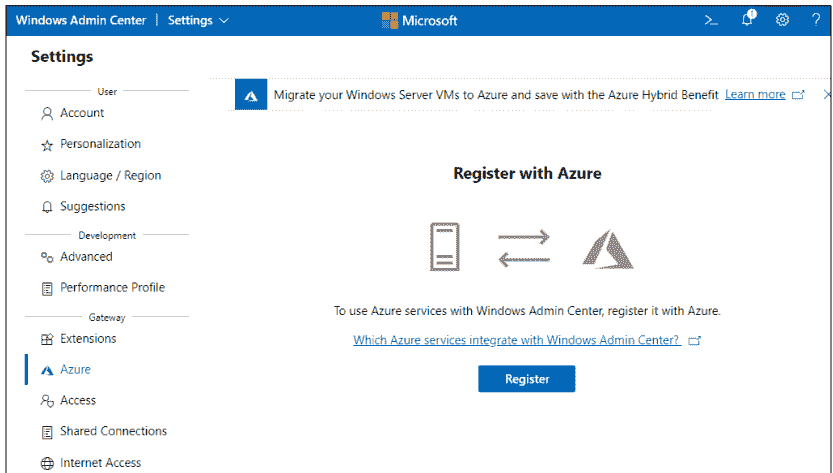

图 7.24：使用 Azure 注册 WAC

现在您的 WAC 已与 Azure 注册，从 WAC 内部打开您正在管理的服务器并前往 **Networks** 部分。 您将在此处看到服务器上存在的任何 NIC 的列表，并且窗口顶部附近有一个省略号可以选中以显示其他选项。 在其中，单击 **Add Azure Network Adapter (Preview)**：

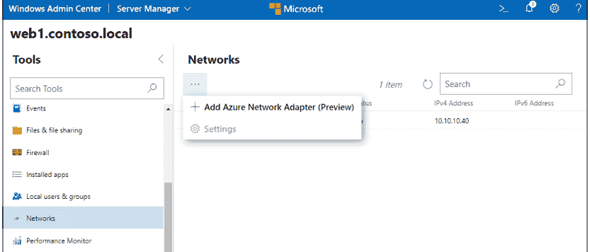

图 7.25：添加 Azure 网络适配器

您会发现 Azure 为了建立此连接所需的所有值都已根据您的 Azure 网络和订阅为您自动填充。 如果您还没有 Azure 虚拟网络，此向导甚至可以为您创建一个。 您还有机会指定自己的证书来对该连接进行身份验证，如果您计划将其作为长期连接到 Azure，这将是一个良好的做法； 否则，您可以通过允许 WAC/Azure 生成自签名证书并简单单击 **Create** 按钮在没有任何输入的情况下继续。 Windows Admin Center 将继续在您的本地服务器和 Azure 虚拟网络之间创建连接。 这只用了几个鼠标点击！ 这是一种巧妙的方式，可以非常快速且无复杂性地在服务器和 Azure 之间创建临时连接。

如果您以后需要将此服务器与 Azure 网络断开连接，您可以打开该本地服务器上的 **Network Connections**，就像您尝试修改服务器上 NIC 属性时一样，您会发现 WAC 在幕后所做的是配置了一个点对站点 VPN 连接，该连接列在 **Network Connections** 内部。 您只需右键单击该 Azure VPN 连接并断开它即可。


## Summary
服务器管理与网络管理在大多数组织中过去曾被相当清晰地分离，但随着时间的推移，这些界限已经模糊。现在有许多网络配置和任务需要由 Windows Server 管理员完成，而无需涉及网络团队，因此了解基础设施如何连接非常重要。熟悉本章介绍的工具将使您能够配置、监控和排查大多数以 Microsoft 为中心的网络。

如果您从未接触过这个概念，我们对软件定义网络的介绍可能是一个部分令人困惑的章节，但希望它能促使您深入挖掘并为将来处理此问题做好准备。准备好与否，云计算已成为常态。Microsoft 本地网络现在有多种方式可以与 Microsoft Azure 交互，IT 人员很快就必须熟悉这些概念。SDN 的理念将在未来几年变得越来越受欢迎。目前，这可能看起来令人望而生畏，但 5 年后，我们可能会回头想知道我们过去如何在没有虚拟网络的情况下让一切正常工作。如果您有兴趣自行设置，关于 Hyper-V 虚拟网络和 System Center 虚拟机管理器的更多信息可在 Microsoft Docs 和出版书籍中找到。现在，请继续阅读下一章，我们将在其中讨论 Windows Server 2019 中将使员工能够远程工作的组件，这在我们当前生活的这种新的在家办公世界中是一个特别有趣的内容。

## Questions
1. IPv6 地址的长度是多少位？
2. 将以下 IPv6 地址改写为压缩形式：
`2001:ABCD:0001:0002:0000:0000:0000:0001`.
3. 与 tracert 类似但显示流量流出的本地 NIC 的命令名称是什么？
4. 真或假 — 在具有多个 NIC 的服务器上，您可以在每个 NIC 上输入默认网关地址。
5. 可用于在 Windows Server 上创建新路由的 PowerShell cmdlet 是什么？
6. 哪些 Windows Server 操作系统可与 Azure 网络适配器配合使用，以便直接连接到 Azure 虚拟网络？

# 8 Remote Access
# Remote Access
为员工提供远程访问企业资源的能力过去对大多数公司来说是一个很大的优势，但不一定是必需的。这种心态在过去一年中发生了显著变化，因为由于 COVID-19，我们的政府发布了禁止我们去办公室的命令，许多人现在被迫在家工作。大多数公司和员工现在都期望无论身在何处都能完成工作。手机是这个等式的重要组成部分，但受限于小屏幕和受限操作系统所能完成的工作范围。为了让远程工作人员能够在家、咖啡店或酒店完成工作，我们传统上使用虚拟专用网络（VPNs）。

当今企业中的大多数 VPN 均由 Microsoft 以外的公司产品提供。Windows Server 2019 中的远程访问角色旨在改变这一现状。由于 Windows Server 中 VPN 组件已进行了许多改进，现在它已成为从远程计算机提供对企业资源访问的可行且安全的平台。除了 VPN 连接外，Windows Server 2019 中还内置了一些更新的技术，它们也旨在以不同于传统 VPN 的方式提供对企业资源的远程访问。本章将涵盖以下主题：

- 始终在线 VPN
- DirectAccess
- 远程访问管理控制台
- DA、VPN 还是 AOVPN？哪种最好？
- Web Application Proxy
- WAP 的要求
- WAP 的最新改进

### Always On VPN
传统上，为用户提供 VPN 连接访问权限意味着为他们提供一个特殊的网络连接链接，他们可以启动该链接并输入凭据以通过身份验证，连接到其工作环境的网络以便与公司资源通信。启动 VPN 后，用户可以打开电子邮件、查找文档、启动业务线应用程序，或以与 physically 坐在办公室时相同的方式工作。此外，通过 VPN 连接时，可以管理其笔记本电脑，从而使 Group Policy 和 SCCM 等系统能够成功通信。VPN 连接为您的网络提供了良好的连接性，但（请记住，我们在这里谈论的是传统的、常规的 VPN 连接）它们仅在用户手动启动并指示其工作时才有效。只要用户未连接到其 VPN，他们就是在没有与公司数据中心连接的情况下浏览互联网。这也意味着传统 VPN 连接在 Windows 登录屏幕上没有任何形式的连接，因为在用户登录计算机并进入 Windows 桌面之前，他们无法启动该 VPN 隧道。这意味着登录屏幕上可能尝试发生的任何事情，例如实时身份验证查找，或登录过程中发生的任何事情，例如组策略处理或登录脚本，都无法通过传统 VPN 正常运行。

**始终在线 VPN（AOVPN）**，正如您根据名称可能猜到的那样，简单来说就是让 VPN 连接保持持续且自动连接的想法。换句话说，只要用户将笔记本电脑带出办公室墙外并连接到互联网，就会自动建立回企业网络的 VPN 隧道，理想情况下无需用户任何操作。这使用户可以完全忘记 VPN，因为它始终保持连接并随时可用。他们可以登录机器、启动应用程序并开始工作。这也意味着 IT 管理功能（如安全策略、更新和安装程序包）可以更频繁地推送到客户端机器，因为我们不再等待用户决定何时重新连接到工作；它会自动发生并且几乎全天候进行。

实际上，Always On VPN 在客户端机器上可以有三种不同的触发方式，且都不需要用户手动启动 VPN 连接：

- AOVPN 可以配置为真正始终在线，这意味着只要有互联网访问可用，它就会始终尝试连接。
- 另一个选项是 **应用程序触发**，这意味着您可以配置 AOVPN 仅在工作站上打开特定应用程序时才自行启动。
- 第三个选项是基于 DNS 名称的触发。当需要特定 DNS 名称时（通常发生在用户启动特定应用程序时），它会触发 VPN 连接。

由于当笔记本电脑位于企业网络 *内部* 时，您不需要 Always On VPN 保持连接和工作，我们还应讨论 AOVPN 足够智能，在用户走过那些玻璃门时自动关闭的事实。启用 AOVPN 的计算机将自动判断何时位于网络内部，从而禁用 VPN 组件，以及何时位于网络外部并需要启动 VPN 隧道连接。这种检测过程称为 **受信任网络检测**。正确配置后，Always On VPN 组件会知道您公司内部的 DNS 后缀，然后它会监控您的 NIC 和防火墙配置文件设置，以确定是否已将相同的后缀分配给这些组件。当它看到匹配时，就知道您位于网络内部，然后禁用 AOVPN。

### Types of AOVPN tunnels
在开始讨论实现 AOVPN 所需的客户端和服务器组件的具体细节之前，有一个重要的核心主题需要理解，以便您对如何在公司中使用 AOVPN 做出适当的决策。可与 Always On VPN 一起使用的有两种非常不同的 VPN 隧道：**用户隧道** 和 **设备隧道**。正如您将在本章后面学到的，具有两种不同隧道的能力是 AOVPN 包含的一项功能，旨在使其更接近 **DirectAccess（DA）** 的功能对等性，后者也具有这种双隧道理念。让我们花一点时间来探讨这两种隧道的用途。


## 用户隧道

目前在实际环境中最常见的做法是 AOVPN 涉及用户隧道在用户级别进行身份验证。用户证书由内部 PKI 签发给您的计算机，并在连接期间作为身份验证过程的一部分使用。用户隧道承载所有机器和用户流量，但必须注意，用户隧道无法在计算机停留在登录屏幕时建立，因为此时尚未进行用户身份验证。因此，用户隧道只有在用户成功登录计算机后才会自行启动。仅使用用户隧道时，计算机在有人登录之前将无法与企业网络建立管理功能的连接，这也意味着您需要依赖缓存凭据才能通过登录提示。

## 设备隧道

设备隧道旨在填补仅运行用户隧道所留下的空白。设备隧道通过机器证书进行身份验证，该证书同样由内部 PKI 签发。这意味着设备隧道可以在用户身份验证之前建立。换句话说，即使停留在 Windows 登录屏幕上也能工作。这使得诸如组策略和 SCCM 之类的管理工具能够在不依赖用户输入的情况下工作，并且还能够对域控制器进行实时身份验证，从而使用户能够登录从未登录过的 workstation。这也支持实时密码过期重置。

## 设备隧道要求

用户隧道几乎可以在任何 Windows 10 机器上工作，但要使用设备隧道则有一些严格的要求。要部署设备隧道，您需要满足以下要求：

- 客户端必须**域加入**。
- 客户端必须签发**机器证书**。
- 客户端必须运行**Windows 10 1709 或更新版本**。
- **客户端必须运行 Windows 10 Enterprise** 或 **Education** 版本。
- 设备隧道只能使用**IKEv2**。这不一定是要求，但在我们讨论 IKEv2 是什么以及为什么它可能或可能不是客户端的最佳连接方式时，了解这一点很重要。

## AOVPN 客户端要求

必须了解，Always On VPN 中的 *Always On* 部分实际上是客户端功能。您可以在客户端计算机上使用 AOVPN 连接到后端各种类型的 VPN 基础设施。我们将在 *AOVPN 服务器组件* 部分稍后讨论这个问题。

虽然在 Windows 客户端操作系统上创建常规手动 VPN 连接已有 15 或 20 年历史，但 Always On VPN 非常新。您的员工需要运行 Windows 10 才能实现这一点。具体来说，他们需要运行 Windows 10 版本 1607 或更新版本。

以下为受支持的 SKU：

- Windows 10 1607+
- Windows 10 1709+
- Windows 10 1803+

等等——这说不通。为什么要分别列出这三项，如果它们是相互包含的呢？因为从技术上讲，Always On VPN 是在 Windows 10 1607 中正式引入的，但在此期间也进行了一些改进。让我们再次列出这些内容，并简要总结多年来发生了哪些变化：

- **Windows 10 1607**：原始的自动启动 VPN 连接功能，从而实现 Always On VPN。
- **Windows 10 1709**：更新和更改包括添加设备隧道。如果您打算为计算机管理目的运行设备隧道（大多数企业都会这样做），那么请将 1709 视为您的最低操作系统要求。
- **Windows 10 1803**：包含在 1709 中发现的一些重大修复。实际上，这意味着我从未见过有人在未运行 1803 的情况下实施 Always On VPN。值得庆幸的是，Windows 10 更新平台有了很大改进，这意味着越来越多的公司持续推出更新版本的 Win10，而 1803 现在大多已成为过去，早已被更新的版本取代。

无论您运行的是 1607、1709、1803、1809 还是最新最好的版本，这些平台中的特定 SKU 并不重要。好吧，几乎不重要。Always On VPN 可与 Windows 10 Home、Pro、Enterprise 以及所有其他版本配合使用。也就是说，用户隧道可与所有这些版本配合使用。

值得再次指出：如果您想在 Always On VPN 中使用设备隧道，使用域加入的 Windows 10 Enterprise 或 Education SKU 是严格要求。

## 域加入

正如我们已经确定的那样，当您有兴趣使用 AOVPN 设备隧道时，您的客户端计算机必须加入域。但是，如果您只运行用户隧道进行 AOVPN 访问是可以接受的，那么就没有域成员资格要求。客户端仍需运行 Windows 10 1607 或更新版本，但它们可以是任何 SKU，甚至可以是加入简单工作组的家庭计算机；不需要域。

这在 Microsoft 文档的许多地方都被特别强调，因为它使得 Always On VPN 能够（在某种程度上）与 **自带设备 (BYOD)** 群体一起使用。虽然这很有趣，但我认为公司允许员工的个人计算机连接到其 VPN 的情况并不常见。大多数组织试图通过云提供对某些资源的访问，例如用于电子邮件和文档的 Office 365，从而在一定程度上迎合 BYOD 市场。但用全功能的第 3 层 VPN 隧道将这些个人计算机和设备重新连接到您的网络？我不这么认为。那是安全管理员噩梦般的东西。

## 部署设置

假设您已准备好所有服务器端组件以实现 VPN 连接，并且事实上，您已成功建立可以毫无问题地创建临时传统 VPN 连接到您的基础设施。太好了！看起来从基础设施方面您已准备就绪。现在，需要什么才能让客户端开始进行 Always On 连接？

这目前对一些企业来说有点苛刻的要求。Always On VPN 策略设置的配置本身并不太难；您只需要熟悉可用的不同选项，确定哪些对您的部署很重要，并组装配置文件/脚本即可。虽然我们在这里没有空间详细介绍所有这些选项，但组装这些设置的方法通常是构建手动启动的 VPN 连接，根据您希望员工使用的安全和身份验证设置进行调整，然后运行一个实用程序将该配置导出到一些配置文件中。这些 VPN 配置文件设置有 XML 和 PS1（PowerShell 脚本）两种格式，您可能需要其中一个或两个文件才能将设置推广到您的员工。以下是处理这些配置的绝佳起点：https://docs.microsoft.com/en-us/windows-server/remote/remote-access/vpn/always-on-vpn/deploy/vpn-deploy-client-vpn-connections.

一旦您创建了配置文件，您就需要将该配置推送到客户端。理想情况下，您需要某种 **移动设备管理 (MDM)** 解决方案才能将设置推广到您的员工。虽然野外的许多技术都可以被视为 MDM，但 Microsoft 专注的两项是 **System Center Configuration Manager (SCCM)** 和 **Microsoft Intune**。

如果您在本地部署了 SCCM，太好了！您可以轻松配置并推广基于 PowerShell 的配置设置到客户端计算机，并为其启用 Always On VPN。

也许您没有 SCCM，但您专注于云，并且所有计算机都已接入 Intune？太棒了！您也可以选择使用 Intune 通过 XML 配置推广这些 AOVPN 设置。选择 Intune 路线的优势之一是 Intune 可以管理非域加入的计算机，因此理论上您可以将用户的家庭和个人计算机纳入 Intune 管理的基础设施并设置它们进行连接。

SCCM 和 Intune 很棒，但并非每个人都在使用它们。通过 PowerShell 脚本推广 Always On VPN 设置还有第三种选择。虽然这是 Microsoft 的 *备选方案 B*（他们更希望您通过 MDM 推广 AOVPN），但我担心 PowerShell 将成为许多希望使用 AOVPN 的中小型企业客户的现实。使用 PowerShell 部署 AOVPN 设置的最大缺点是 PowerShell 需要以提升模式运行，这意味着难以自动化，因为已登录的用户（您需要在此处建立 VPN 连接）必须是本地管理员才能使脚本正常运行。

我满怀希望且焦急地等待着他们宣布用于推广 Always On VPN 设置的组策略模板的那一天，但到目前为止，尚无消息表明这是否会成为一种选择。每个人都有组策略；并非每个人都有 MDM。您将在稍后阅读到，Microsoft DirectAccess 连接设置（AOVPN 的替代方案）的推广是通过组策略完成的，这非常容易理解和管理。就我而言，在撰写本文时，DirectAccess 在处理客户端设置推广方式方面比 AOVPN 具有主要优势。但请务必在线查看 Microsoft Docs 以获取有关此主题的最新信息，因为 AOVPN 正在不断改进，这一技术领域可能会出现一些变化。


## AOVPN server components

现在我们已经了解了客户端实现 Always On VPN 所需的内容，那么在服务器/基础设施端需要哪些部分和组件才能让这些连接得以建立？有趣的是，AOVPN 的 Always On 组件与服务器基础设施无关；Always On 部分完全由客户端处理。因此，服务器端我们需要做的就是确保能够接收传入的 VPN 连接。如果你目前的员工团队已经能够成功建立 VPN 连接，那么你很可能已经拥有将 AOVPN 引入环境的必要服务器基础设施。

### Remote Access server

显然，你需要一个 VPN 服务器来承载 VPN 连接，对吧？其实没那么显而易见。在 Windows Server 中，承载 VPN、AOVPN 和 DirectAccess 连接的角色称为远程访问角色，但你实际上可以在不使用 Windows Server 作为远程访问服务器的情况下实现 Always On VPN。 由于 Always On 部分是客户端功能，因此这使得 VPN 服务器端基础设施可以由第三方厂商托管。即使这在技术上是准确的，但这并不是微软所期望的；也不是我在实际环境中发现的情况。实际上，我们这些有兴趣使用 Microsoft Always On VPN 的人将会使用 Microsoft Windows Server 来承载远程访问角色，它将成为我们的远程客户端连接到的入站系统。

很多人自动认为 AOVPN 与 Windows Server 2019 绑定，因为它是一种全新技术，而 Server 2019 刚刚发布，但事实并非如此。你可以将 VPN 基础设施（远程访问角色）托管在 Server 2019、Server 2016，甚至 Server 2012 R2 上。后端的工作方式相同，为客户端的 VPN 连接提供接入点。

在新 Windows Server 上安装远程访问角色后，你会发现大部分 VPN 配置都是通过路由和远程访问（RRAS）控制台完成的。在配置 VPN 时，你会发现有多种协议可用于在客户端和服务器之间建立 VPN 连接，你应该至少对这些不同协议有一个简要的了解。我将在这里按从最强最安全到完全不要碰的顺序列出它们！

### IKEv2

最新、最强、总体上最好的通过 VPN 或 AOVPN 连接客户端计算机的方式，IKEv2 是连接 AOVPN 设备隧道的唯一方式。IKEv2 需要向客户端计算机颁发机器证书以进行身份验证。这通常意味着，如果你希望客户端通过 IKEv2 连接，这些客户端将加入域。非常重要的一点是，IKEv2 使用 UDP 端口 500 和 4500 来建立连接，这有时会成为阻碍并被防火墙阻止。

### SSTP

被认为是可以连接 AOVPN 连接的后备方法，SSTP 使用 SSL 流进行连接。因此，它需要在远程访问服务器上安装 SSL 证书，但客户端计算机不需要机器证书。SSTP 使用 TCP 端口 443，因此即使在非常受限的网络中也能连接，而在这些网络中 IKEv2 可能失败（因为 IKEv2 依赖 UDP）。

### L2TP

L2TP 通常不用于 AOVPN 部署，它能够通过使用证书或预共享密钥建立 VPN 连接。既然你已经有两种更好的协议可用，就不应该使用它。

### PPTP

虽然在 RRAS 中仍然是一个有效的配置选项，但请远离它！PPTP 已不再是安全的隧道方法，如果你仍在运行基于 PPTP 的 VPN 连接，你基本上需要将这些流量视为在互联网上未加密的明文。

### Certification Authority (CA)

机器证书、用户证书、SSL 证书……天哪！很明显，要使用 Always On VPN，你需要熟悉证书的工作和部署。这在任何类型的更新且安全性更好的技术中变得越来越常见。这里的主要要求是，你需要在环境中拥有 PKI 并且至少有一台 Windows CA 服务器来颁发必要的证书。以下是证书可能被 AOVPN 基础设施使用的位置列表：

- **User certificates**: 这些是由内部 CA 颁发给你的 VPN 用户的证书，用于用户隧道的身份验证
- **Machine certificates**: 这些是由内部 CA 颁发给你的工作站（主要是笔记本电脑）的证书，用于设备隧道的身份验证
- **SSL certificate**: 安装在你的远程访问服务器上，用于验证 SSTP VPN 连接的传入流量
- **VPN and NPS machine certificates**: 你的远程访问服务器以及我们马上要谈到的 NPS 服务器，需要由内部 CA 颁发的机器证书

### Network Policy Server (NPS)

NPS 基本上是 VPN 连接的身份验证方法。当 VPN 连接请求到来时，远程访问服务器会将该身份验证请求交给 NPS 服务器，以验证该用户是谁并验证用户是否具有通过 VPN 登录的权限。

在处理 Microsoft VPN 连接时，最常见的做法是配置 NPS，使其仅允许属于某个 Active Directory 安全组的成员。例如，如果你创建一个名为 VPN Users 的组，然后将 NPS 指向该组，它只会允许你放置在该组内的用户成功建立 VPN 连接。

NPS 是另一个 Windows Server 角色，可以托管在自己的系统上或分布在多个服务器上以实现冗余。与远程访问角色一样，NPS 也没有 Server 2019 的要求。你可以轻松地将其部署在 Windows Server 的早期版本上。

在仅有一个远程访问服务器的小型环境中，通常会将 NPS 角色与提供 VPN 连接的同一服务器共同托管。

### DirectAccess

在我们关于 Always On VPN 的讨论中，我几次提到了 Microsoft DirectAccess。DirectAccess 是另一种自动 VPN 类似连接形式，但它采用的方法与 Always On VPN 不同。AOVPN 只是使用预期且众所周知的 VPN 协议，并施展一些巧妙的魔法来自动启动那些原本传统的 VPN 隧道，而 DirectAccess 隧道则相当专有。隧道受 IPsec 保护，本质上是不可渗透的，也无法被冒充。我发现安全团队喜欢围绕 DA 隧道的保护和复杂性，因为它是一个攻击者根本不知道如何篡改或复制的连接平台。

在我看来，到目前为止，Microsoft DirectAccess 是管理员在 Windows Server 实例上部署远程访问角色的最常见原因。如前所述，最容易理解 DirectAccess 的方式就是将其视为自动 VPN。与 VPN 类似，其目的是在员工在办公室外时将用户的计算机连接到企业网络。然而，与 VPN 不同的是，员工用来实现此连接的方法。DirectAccess 并不是一个软件组件；它是一系列组件，已经内置在 Windows 操作系统中，协同工作为用户提供完全无缝的访问。我所说的无缝是什么意思？与 AOVPN 无需用户交互即可连接一样，用户无需做任何事情即可使 DirectAccess 连接。它完全自行完成。一旦移动计算机获得互联网连接，无论该连接是家庭 Wi-Fi、咖啡店的公共互联网，还是手机热点连接，DirectAccess 隧道都会自动使用任何可用的互联网连接自行建立，无需任何用户输入。

无论使用 Always On VPN 还是 DirectAccess，当你的计算机自动连接时都能节省时间和金钱。时间得以节省，因为用户不再需要启动 VPN 连接。金钱得以节省，因为时间就是金钱，但也因为拥有 *always-on* 连接意味着修补、安全性策略以及对这些远程计算机的管理始终会发生，即使用户远程工作。你不再需要等待用户回到办公室或让他们选择启动手动 VPN 连接才能将新设置和策略推送到他们的计算机上；只要他们有互联网访问权限，无论他们身在何处都会发生。很明显，随着两种都专注于远程用户自动连接的远程访问技术的出现，微软正在为更具生产力的工作队伍铺平道路。术语 **user-friendly** 和 **VPN** 从未如此紧密联系过，但在最新的 Windows 操作系统版本中，这正是目标。

DirectAccess 实际上自 Windows Server 2008 R2 发布以来就已存在，然而我经常遇到从未听说过它的人。在早期，部署它相当困难，并且伴随着许多尴尬的要求，但过去几年发生了很多变化，现在 DirectAccess 比以往任何时候都更容易部署，并且在你的环境中运行它比以往任何时候都更有益。


## DirectAccess 与 IPv6 的真相

我之前提到的一个尴尬要求曾经是需要在你的网络内部使用 IPv6。在 DirectAccess 的第一个版本中，这是一个不幸的要求。我说是“不幸”，因为即使在今天，几乎没有人在其企业网络内部运行 IPv6，更不用说该技术发布多年前的时期了——很多管理员甚至不知道 IPv6 是什么。幸运的是，网络内部需要 IPv6 的要求已不复存在。我再重复一遍，以防有人没注意或正在阅读旧的、过时的 TechNet 文档——你使用 DirectAccess 不需要 IPv6！我见过太多案例，公司考虑过 DirectAccess，但项目被搁置，因为阅读 TechNet 后他们认为 IPv6 是必需的，于是将 DirectAccess 视为不可行的方案而放弃。你绝对不需要在网络中运行 IPv6 即可使 DirectAccess 正常运行，但了解 DirectAccess 如何使用 IPv6 很重要，因为一旦部署开始，你就会开始遇到它的痕迹。

当我在家使用公司笔记本工作时，DirectAccess 将我连接到企业网络。我工作处的内部网络完全没有运行 IPv6；我们目前是一个纯 IPv4 网络。这对今天大多数公司来说都是事实。然而，当我打开命令提示符并从 DirectAccess 笔记本 ping 其中一台服务器时，我看到的是——对截图中经过清理的输出表示歉意：


图 8.1：从 DirectAccess 笔记本 ping 内部服务器

这到底是什么？看起来像是 IPv6。这就是 IPv6 在 DirectAccess 中发挥作用的地方。连接中经过互联网的部分，即我的笔记本与位于数据中心的 DirectAccess 服务器之间的所有流量，都是 IPv6 流量。我的内部网络是 IPv4，我的 DirectAccess 服务器上只有 IPv4 地址，然而我的 DirectAccess 隧道仍在使用 IPv6 承载我的流量。这就是 DirectAccess 的核心工作原理，无法更改。你的 DA 笔记本通过互联网向 DA 服务器发送 IPsec 加密的 IPv6 数据包，而当 DA 服务器接收到这些数据包时，它有能力将它们转换回 IPv4，以便发送到企业网络内部的目标服务器。例如，当我打开 Outlook 并尝试连接 Exchange 服务器时，我的 Outlook 数据包以 IPv6 的形式流经 DirectAccess 隧道。一旦这些数据包到达我的 DirectAccess 服务器，该 DA 服务器就会查询内部 DNS 以确定我的 Exchange 服务器是 IPv4 还是 IPv6。

如果你确实在网络内部运行 IPv6 并且 Exchange 服务器可通过 IPv6 访问，DA 服务器只需将 IPv6 数据包直接发送给 Exchange 服务器。连接完成！另一方面，如果你在网络内部运行 IPv4，DA 服务器在 DNS 中只会看到一条主机记录，意味着 Exchange 服务器仅为 IPv4—only。DirectAccess 服务器随后会操作该 IPv6 数据包，将其转换为 IPv4，然后将其发送到 Exchange 服务器。处理这种数据包操作的两项技术是 **DNS64** 和 **NAT64**，如果你在线阅读过关于 DirectAccess 的任何文档，可能已经见过它们。这些技术的目的是将传入的 IPv6 数据包流转换为 IPv4，供当前几乎所有网络所需的环境使用，并将从 IPv4 返回的流量转换回 IPv6，以便通过基于 IPv6 的 IPsec 隧道返回到 DirectAccess 客户端计算机，该隧道通过互联网连接 DA 客户端和 DA 服务器。

了解 DirectAccess 在此情况下使用 IPv6 很重要，因为你可能实施的任何默认情况下会禁用客户端计算机上 IPv6 的安全策略都会阻止 DirectAccess 在你的环境中正常工作。你必须撤销这些策略，以允许客户端发出 IPv6 数据包并将流量传输到互联网。然而，也非常重要地要理解，你不需要在企业网络内部运行任何形式的 IPv6 即可实现此功能，因为 DirectAccess 服务器可以在流量到达内部网络之前将其全部转换回 IPv4，而今天大多数活跃的 DA 部署正是以这种方式运行。

## DirectAccess 的先决条件

DirectAccess 有很多组件，并且有多种不同的设置方式。然而，并非所有方式都是好主意。因此，在本节中，我们将讨论在设计自己的 DirectAccess 环境时你必须做出的一些重要决策。

### 加入域

第一个重要要求是参与 DirectAccess 的系统需要加入域。你的 DA 服务器或服务器都需要加入你的域，并且你希望通过 DA 连接的所有客户端计算机也需要加入域。域成员身份对于身份验证是必需的，并且因为需要应用于移动计算机的 DirectAccess 客户端设置会通过组策略下发到这些计算机。

我总是喜欢在规划过程早期指出这一要求，因为这意味着用户在零售店购买的笔记本通常无法使用 DirectAccess——除非你愿意将家庭电脑加入域——因此 DA 实际上是一种用于管理和连接可以加入域的企业资产的技术。从安全角度来看，了解这一要求也很重要，因为你的 DirectAccess 服务器通常会面向网络边缘。DA 服务器的外部 NIC 通常位于 DMZ 中很常见，但它们也必须加入域，这可能不是你对边界网络中系统所习惯的做法。

### 受支持的客户端操作系统

并非所有 Windows 客户端操作系统都包含使 DirectAccess 连接正常工作所需的组件。Enterprise 具备这些组件，涵盖了拥有 Microsoft 操作系统的大多数大型企业，但这当然并不包括所有人。我仍然看到许多小型企业在其客户端机器上使用专业版甚至家庭版 SKU，而这些版本不包含 DirectAccess 组件。以下是支持 DirectAccess 的操作系统列表。在规划期间，你需要确保你的移动计算机运行其中之一：

- Windows 10 Enterprise
- Windows 10 Education
- Windows 8.0 or 8.1 Enterprise
- Windows 7 Enterprise
- Windows 7 Ultimate

### DirectAccess 服务器——一个还是两个网卡？

在新服务器上安装远程访问角色之前就需要回答的一个重要问题是：这台服务器需要多少个网卡？实现 DirectAccess 有两种受支持的方法。

### 单网卡模式

你的 DirectAccess 服务器可以仅安装一个网卡。在这种情况下，你通常会将该网络连接直接插入内部网络，以便在用户 DA 会话期间客户端计算机需要联系的所有内部资源都可以访问。为了使互联网流量到达你的 DirectAccess 服务器，你需要从公共 IP 地址到分配给 DA 服务器的内部 IP 地址建立 **Network Address Translation (NAT)**。

许多网络安全管理员不喜欢这种方法，因为这意味着创建一条 NAT，直接将流量带入企业网络，而不经过任何 DMZ。

我也可以根据经验告诉你，单网卡模式并不总是能正常工作。它在快速搭建测试实验室或概念验证方面表现良好，但我见过太多现场问题，人们尝试在单网卡上运行生产环境 DirectAccess。仅使用单张网卡的能力是在 DirectAccess 的较新版本中添加的，因此它最初并非设计为这样运行。因此，我强烈建议，对于你的生产环境 DA 安装，你应正确操作并选择...

### 双网卡

在这里，DirectAccess 服务器中有两张网卡。内部 NIC 通常直接插入企业网络，外部 NIC 的物理位置则取决于组织。我们将在本章下一节立即讨论外部网卡放置位置的利弊。

采用双网卡的边缘模式是 DirectAccess 最佳的工作方式。正如你在书中前面所回忆的那样，使用多张网卡部署 Windows Server 实例意味着该服务器将进行多宿主，你需要相应地设置网络设置。对于远程访问服务器，你的外部 NIC 始终是接收默认网关设置的那一个，因此你需要确保遵循此规则并 *do not configure a default gateway on the internal NIC*。另一方面，你确实需要在内部网卡属性中配置 DNS 服务器地址，但你 *do not* 想要为外部网卡配置 DNS 服务器。由于该服务器是多宿主的，你可能需要在 Windows 路由表中添加企业子网，以便服务器成功发送和接收流量之前创建一些路由语句。唯一不需要添加静态路由的网络是小型网络，其中所有内部设备都在同一个子网中。如果是这种情况，则无需输入静态路由。但大多数企业网络跨多个子网，在这种情况下，你应参考 *Chapter 7, Networking with Windows Server 2019*，其中我们讨论了多宿主以及如何构建这些路由语句。

### 超过两个网卡

不行，别去那里。如果你熟悉路由器或防火墙的配置，你知道服务器上可以安装许多不同的 NIC 并将它们全部插入不同的子网。虽然在远程访问服务器上以这种方式拆分网络访问可能有很多好处，但它不会按你期望的方式工作。DirectAccess 配置本身只能管理两个不同的网络接口。


正如你在 *图 8.2* 中所见，在设置向导的过程中，你必须将一个 NIC 定义为 **外部**，另一个定义为 **内部**。该服务器中存在的任何其他 NIC 都不会被 DirectAccess 使用，很遗憾。也许在未来的版本中会有所改变！

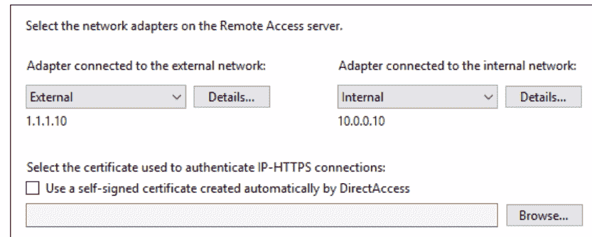

图 8.2：配置 DirectAccess 时定义 NIC

## NAT 还是不 NAT？

现在你决定在 DirectAccess 服务器中使用两个 NIC，我们将外部 NIC 插入到哪里？这个外部网络接口可以连接到的常见位置有两个，但根据你的选择，你的 DirectAccess 环境的结果可能大不相同。在讨论 NIC 的实际放置位置之前，我想定义几个重要的协议，因为它们与回答关于 NIC 放置的这个问题非常相关。当你的 DirectAccess 笔记本连接到 DirectAccess 服务器时，它将使用三种 IPv6 过渡隧道协议之一。这些协议是 **6to4**、**Teredo** 和 **IP-HTTPS**。当 DA 客户端连接其 DA 隧道时，它会根据用户的当前互联网连接自动选择其中哪一种协议最适合使用。三种协议对 DirectAccess 连接执行相同的功能：它们的工作是将来自笔记本的 IPv6 数据包流封装在 IPv4 内部，以便流量能够成功地通过 IPv4 互联网传输。当数据包到达 DirectAccess 服务器时，它们会被解封装，以便 DA 服务器可以处理这些 IPv6 数据包。

### 6to4

DA 客户端只有在远程笔记本具有真正的公共互联网 IP 地址时才会尝试使用 6to4 进行连接。如今由于可用的互联网 IPv4 地址短缺，这种情况很少发生，因此 6to4 通常不会被任何 DirectAccess 客户端计算机使用。事实上，当用户使用笔记本中的手机卡连接时，它会带来自己的一系列挑战，因此作为 DirectAccess 最佳实践设置，通常的做法是在客户端计算机上禁用 6to4 适配器。

### Teredo

当 DA 客户端使用私有 IP 地址连接到互联网时，例如在家庭路由器或公共 Wi-Fi 路由器后面，它们会尝试使用 Teredo 协议进行连接。Teredo 使用 UDP 流来封装 DA 数据包，因此，只要用户的互联网连接允许传出 UDP 3544，Teredo 通常就能连接，并且是该 DirectAccess 连接的首选过渡协议。

### IP-HTTPS

如果 Teredo 无法连接，例如用户坐在阻止传出 UDP 的网络中时，DirectAccess 连接将回退到使用 IP-HTTPS，发音为 IP over HTTPS。该协议将 IPv6 数据包封装在 IPv4 头部中，然后将它们包装在 HTTP 头部中并使用 TLS/SSL 加密，然后再将数据包发送到互联网上。这有效地使 DirectAccess 连接成为一个 SSL 流，就像你浏览 HTTPS 网站时一样。

## 在真正的边缘安装 – 在互联网上

当你将 DirectAccess 服务器的外部 NIC 直接插入互联网时，你就可以为该 NIC 分配真正的公共 IP 地址。这样做可以启用前面提到的全部三种过渡隧道协议，以便 DirectAccess 客户端计算机可以在它们之间选择最佳的连接方式。通过真正的边缘方法安装时，你需要在该外部 NIC 上放置的不止一个而是两个公共 IP 地址。请确保公共 IP 地址是连续的，因为这是 Teredo 的要求。当你的 DirectAccess 服务器为外部 NIC 分配了两个连续的公共 IP 地址时，它将启用 Teredo 协议以供连接使用。


NIC 不一定必须直接插入互联网才能工作。取决于你的防火墙功能，你可能有建立 *桥接 DMZ* 的选项，在其中不进行 NAT。你需要与防火墙厂商核实这是否是你组织的选项。在这种情况下，你仍然能够在外部 NIC 上配置真正的公共 IP 地址，但流量首先会流经防火墙，以便保护和管理该流量。

## 在 NAT 后面安装

网络团队更常见的做法是希望将 DirectAccess 服务器的外部 NIC 放置在防火墙后面，位于 DMZ 内部。这通常意味着创建 NAT 以将此流量引入服务器。虽然这完全可行，并且更好地保护 DirectAccess 服务器本身免受互联网侵害，但它也带来了一个很大的缺点。当你在 NAT 后面安装 DA 服务器时，Teredo 就不再工作了。事实上，DirectAccess 配置向导会识别出外部 NIC 上列出的是私有 IP 地址，并且甚至不会打开 Teredo。

当 Teredo 不可用时，你的所有 DirectAccess 客户端都将使用 IP-HTTPS 连接。那么 Teredo 不可用为什么重要呢？因为它比 IP-HTTPS 更高效的协议。当 Teredo 隧道传输数据包时，它只是简单地将 IPv6 封装在 IPv4 内部。DirectAccess 流量流始终并且总是 IPsec 加密的，因此 Teredo 隧道无需进行任何额外的加密。另一方面，当 IP-HTTPS 隧道传输数据包时，它会将已经加密的 IPsec 流量流再次使用 SSL 加密。这意味着进出的数据包都受到双重加密的影响，这会增加处理和 CPU 周期，并使连接变慢。它还会在 DirectAccess 服务器本身上造成额外的硬件负载，因为它处理的是双倍的加密处理量。

当你在客户端计算机上运行 Windows 7 时，这是一个特别明显的问题，因为双重加密处理会使用户的连接明显变慢。DirectAccess 仍然可以正常工作，但如果你将一台通过 Teredo 连接的笔记本电脑放在一台通过 IP-HTTPS 连接的笔记本电脑旁边，你会注意到两者之间的速度差异。

值得庆幸的是，在 Windows 8 和 Windows 10 中，已经添加了一些对策来帮助解决这种速度差异。这些更新的客户端操作系统现在足够智能，可以通过使用 NULL 加密算法来协商 IP-HTTPS 隧道中的 SSL 部分，这意味着 IP-HTTPS 不会进行第二次加密，并且 IP-HTTPS 的性能现在基本上与 Teredo 不相上下。

然而，这仅适用于更新的客户端操作系统（Win7 使用 IP-HTTPS 时始终会双重加密），并且在某些情况下仍然不起作用。例如，当你启用 DirectAccess 服务器同时提供 VPN 连接时，或者如果你选择在 DirectAccess 旁边使用 **一次性密码 (OTP)** 系统，则 NULL 算法将被禁用，因为在这些情况下它存在安全风险，因此即使你的 Windows 8 和 Windows 10 计算机通过 IP-HTTPS 连接时也会执行双重加密。你可以看到让 Teredo 启用并可用是有益的，这样任何可以通过 Teredo 连接的计算机都会这样做。

总之，你当然可以将 DirectAccess 服务器的外部 NIC 安装在 NAT 后面，但请注意所有 DA 客户端计算机都将使用 IP-HTTPS 协议连接，了解以这种方式实现它可能产生的副作用非常重要。

## 网络位置服务器

DirectAccess 基础设施中的这个主要组件甚至不存在于 DA 服务器本身上，或者至少如果你正确设置的话不应该存在。**网络位置服务器 (NLS)** 只是一个运行在企业网络内部的网站。该网站不需要在互联网上可访问；事实上，不应该可访问。NLS 用于 DirectAccess 客户端计算机上的内部/外部检测机制的一部分，类似于 Always On VPN 的受信任网络检测的工作方式。每次 DA 客户端获得网络连接时，它都会开始查找 NLS 网站。如果它可以看到该站点，则知道你位于企业网络内部，不需要 DirectAccess，因此它会关闭自己。然而，如果无法联系到你的 NLS 网站，则意味着你位于企业网络外部，DirectAccess 组件将开始打开。

此先决条件很容易满足；你所需要做的就是启动一个 VM 并在上面安装 IIS 以托管这个新网站，或者你甚至可以在网络中现有的 Web 服务器上添加一个新网站。设置 NLS 网站时只有两点需要注意。第一点是它必须是 HTTPS 站点，因此需要 SSL 证书。我们将在本章下一节讨论 DA 中使用的证书，包括此证书。除了确保网站可以通过 HTTPS 访问外，你还必须确保用于联系该网站的 DNS 名称是唯一的。你之所以要这样做，是因为无论你为 NLS 网站选择什么名称，当客户端计算机位于企业网络外部时，该名称都无法解析。这是设计使然，因为你显然不希望你的 DA 客户端在远程工作时能够成功联系到 NLS 网站，因为那样会禁用它们的 DirectAccess 连接。


我提到唯一 DNS 名称的原因是我经常看到新的 DirectAccess 管理员使用现有的内部网站作为其 NLS 网站。例如，如果你有 https://intranet 作为 SharePoint 站点运行，你可以在 DA 配置中简单地将其用作 NLS 服务器定义。然而，一旦你这样设置，你会很快意识到远程工作的任何人都无法访问 https://intranet 网站。这是设计使然，因为 DA 环境现在将你的内部网网站视为 NLS 服务器，而你在移动时无法解析它。解决这个问题的办法？确保你为此 NLS 网站选择一个新的 DNS 名称。像 https://nls.contoso.local 这样的名称是合适的。

我想强调关于网络位置服务器的最重要的一点是，你绝对应该在网络中除 DirectAccess 服务器本身之外的服务器上部署此网站。当你运行 DA 配置向导时，你会在定义 NLS 的屏幕上看到建议将 NLS 部署在远程 Web 服务器上，但它也提供了将 NLS 网站直接托管在 DirectAccess 服务器本身上的选项。不要这样做！在 DA 服务器上共同托管 NLS 时会出现许多问题。在 DA 服务器上运行 NLS 也会限制你未来 DirectAccess 的潜力，因为某些高级 DA 配置要求你无论如何都要将 NLS 从 DA 服务器上移除，所以你最好在第一次设置时就正确完成。更改你在生产环境中运行 DA 后 NLS 网站会非常棘手，而且经常会出错。我曾帮助过众多公司迁移其 NLS 网站，因为他们意识到如果想要为扩展或冗余添加第二个 DirectAccess 服务器，就无法在 DA 服务器上共同托管 NLS。以下是 DA 配置向导中选择 NLS 位置部分的屏幕截图。确保你坚持使用上面的框！

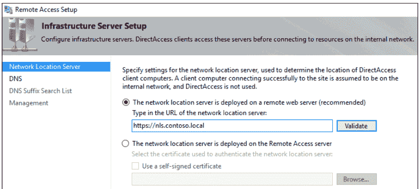

图 8.3：定义网络位置服务器

## 使用 DirectAccess 的证书

除了阅读和误解 DirectAccess 如何使用 IPv6 外，这对于有兴趣尝试 DirectAccess 的管理员来说是下一个最大的“阻碍”。一旦你开始阅读 DA 的工作原理，你会很快意识到证书需要在多个地方使用。虽然 VPN 通常也需要使用证书，但坦率地说，当你查阅 Microsoft DirectAccess 文档时，很难区分哪些证书需要放在哪里，因此本节澄清了关于 DirectAccess 证书存在的任何混淆。一旦你知道需要做什么和不需要做什么，其实并不复杂。

核心前提是你网络中某处有一个 Windows CA 服务器。你的 PKI 实施的规模对 DirectAccess 并不是那么重要。我们只需要能够向我们的 DA 服务器和客户端颁发证书的能力。在 DirectAccess 中，证书仅用于三个地方，其中两个是 SSL 证书。

### NLS Web 服务器上的 SSL 证书

如前所述，你的 NLS 网站需要运行 HTTPS。这意味着你需要在托管 NLS 网站的服务器上安装 SSL 证书。假设你有一个内部 CA 服务器，该证书可以从该内部 CA 轻松获取，因此该证书没有相关成本。你不需要从公共 CA 购买，因为该证书只会被你的域加入机器，即 DirectAccess 客户端访问和验证。由于域加入的计算机会自动信任网络中的 CA 服务器，该证书可以简单地从你的内部 CA 颁发，并且它将完全满足 DirectAccess 的目的。

### DirectAccess 服务器上的 SSL 证书

在 DirectAccess 服务器本身上也需要安装 SSL 证书，但这个证书应从你的公共认证机构购买。该证书将用于验证来自客户端计算机的 IP-HTTPS 流量流，因为那是 SSL 流量，所以我们需要 SSL 证书来验证它。由于 IP-HTTPS 侦听器面向公共互联网，强烈建议你使用公共 CA 的证书，而不是尝试使用内部 PKI 的证书。

> 如果你的公司已经拥有通配符 SSL 证书，请在此使用以节省成本！

### DA 服务器和所有 DA 客户端上的机器证书

DirectAccess 证书难题的最后一个也是最复杂的部分是机器证书。一旦你知道需要什么，其实一点也不难。我们只需要一个计算机或机器证书安装在 DirectAccess 服务器上，以及每个 DirectAccess 客户端机器上。该机器证书用于 IPsec 隧道的身份验证过程。它是 DirectAccess 验证你确实是你所声称的人的重要部分，当你的计算机建立该 DA 连接时。

颁发这些机器证书的最佳方法是登录你的 CA 服务器并创建一个新的证书模板，该模板复制自内置的“计算机”模板。在设置新的证书模板时，只需确保它满足以下标准：

- 证书的通用名称（主题）应与计算机的 FQDN 匹配。
- 证书的主题备用名称（SAN）应等于计算机的 DNS 名称。
- 证书应同时用于客户端身份验证和服务器身份验证的预期用途（增强型密钥用法）。

我在这里要指出，虽然我并不真的想这样说，但颁发这些证书并不是使 DirectAccess 工作绝对必要的。如果客户端使用的是 Windows 8 或更高版本，则可以在没有机器证书的情况下使 DA 工作。没有机器证书的客户端计算机可以改用称为 Kerberos 代理的东西来进行 IPsec 隧道建立时的计算机身份验证，但我强烈建议坚持使用证书。使用证书作为身份验证过程的一部分使连接更稳定、更安全。此外，与 NLS 的放置一样，如果你想使用 DirectAccess 的任何高级功能，例如负载平衡或多站点，甚至只是想让一些 Windows 7 计算机通过 DA 连接，那么你无论如何都需要颁发证书。所以，一开始就坚持最佳实践，在你甚至开始测试 DirectAccess 之前就颁发这些证书。

## 不要使用入门向导（GSW）！

在做出必要的设计决策并实施我们迄今为止讨论过的先决条件后，现在是时候在你的新 DirectAccess 服务器上安装远程访问角色了！安装完该角色后，与 Windows Server 2019 中的许多角色类似，你会看到一条消息，告知需要进行额外配置才能使用该角色。如果你跟随 Server Manager 中的黄色感叹号，你唯一的选择就是 **打开入门向导**。呃！这 *不是* 你想要点击的：


图 8.4：不要点击这个！


你的 DirectAccess 配置之家是 **远程访问管理控制台**，它现在在安装了远程访问角色后可从 Server Manager 的 **工具** 菜单中获得。继续启动它，现在我们面临一个选择：

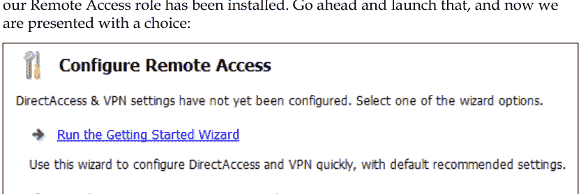

图 8.5：配置远程访问


请*不要*点击 **运行“入门向导”！**。GSW 是一种实现 DirectAccess 的快捷方法，仅设计用于尽可能快速地将 DA 投入运行，也许是为了快速的概念验证。在任何情况下都不要为生产 DA 环境信任 GSW，因为为了使配置快速简便，许多配置决策都是替你做出的，而这些并不是最佳实践。

你需要确保在控制台首次提示时点击 **运行远程访问设置向导**；这将调用完整的 DirectAccess 配置屏幕集。DA 设置包含一系列四个不同的步骤，每个步骤都包含若干个屏幕，你需要依次导航以选择合适的配置选项。这些屏幕上对每个选项的含义以及你的选择都有相当详细的说明，所以不要害怕深入进去以正确的方式进行设置。如果你已经配置了 DirectAccess 并使用了 **入门向导**，DA 可能对你有效，但它不会像本可以的那样高效或安全运行。以下是 **入门向导** 不符合你最佳利益的快速原因列表。这些是它所做的、直接违背最佳实践 DirectAccess 安装的事情，并附带我本人的 *花生观众席* 评论：

- GSW 在 DA 服务器上共同托管 NLS 网站 — *糟糕*
- GSW 将 DA 客户端 GPO 设置应用于域计算机 — *这是个糟糕的主意*
- GSW 使用自签名证书 — *“安全 101 级别”的大忌*
- GSW 自动禁用 Teredo — *效率低下*
- GSW 不会引导你完成 DirectAccess 的任何高级选项，可能是因为它设置的方式使你甚至无法使用高级功能 — *很烂*

## 远程访问管理控制台

你正朝着为此新服务器上的用户提供远程访问能力迈进。就像许多网络设备一样，一旦你在远程访问服务器上建立了所有配置，管理员通常会离开并让其运行。一旦运行良好，就不需要太多持续的维护或对该配置的更改。然而，Windows Server 2019 中的远程访问管理控制台不仅可用于远程访问各部分的配置，还可用于监控和报告。

在使用 DirectAccess 时，这就是你几乎所有事情的归宿：配置、管理、监控和故障排除。在远程访问工具集的 VPN/AOVPN 方面，你将在 RRAS 内部做出许多 VPN 配置决策，但 RAMC 是在检查服务器端监控、客户端连接监控和报告统计信息时需要去的地方。无论你使用 DA、VPN 还是两者结合，RAMC 都是你需要熟悉的工具。

让我们看看这个控制台内部，以便你熟悉将要交互的不同屏幕：

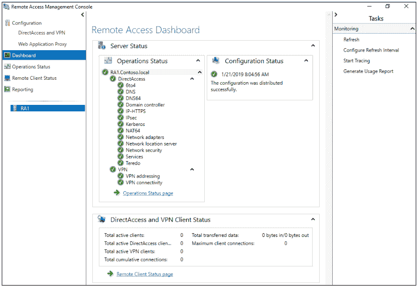

图 8.6：远程访问仪表板

## 配置

配置屏幕非常直观；这是你创建初始远程访问配置的地方，也是将来更新任何设置的地方。如图 8.6 所示，你可以从此远程访问管理控制台配置 DirectAccess 和 VPN，甚至 Web Application Proxy。

请不要效仿此截图。我已将远程访问角色的 DA/VPN 部分与同一角色的 Web Application Proxy 部分一起安装，但不建议在同一服务器上同时运行 DA/VPN 和 WAP。我只是为了在我的测试实验室中创建截图才这样做。

就 VPN 而言，没有太多可配置的内容；你实际上只有一个选项屏幕，在其中定义要分发给连接进来的 VPN 客户端的 IP 地址类型，以及如何处理 VPN 身份验证。这个屏幕的位置并不十分明显，所以我想指出一下。在 **DirectAccess 和 VPN** 配置部分，如果你在 **步骤 2** 下点击 **编辑...**，这将启动 **步骤 2** 小向导。此小向导的最后一个屏幕称为 **VPN 配置**。这是你可以配置 VPN 连接的这些 IP 地址和身份验证设置的屏幕。你其余的 VPN 配置任务将落在传统的 VPN 配置控制台 RRAS 中。然而，DirectAccess 连接的一切都可直接从 **远程访问管理控制台** 和那四个小向导中配置：

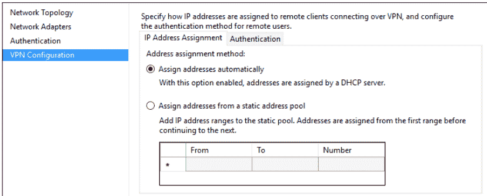

图 8.7：VPN 配置

## 仪表板

**远程访问仪表板** 为你提供远程访问服务器状态的 30,000 英尺视角。你可以查看服务器上运行组件的快速状态、最新配置更改是否已推出，以及底部附近的一些汇总数字，显示当前有多少 DirectAccess 和 VPN 连接正在进行：

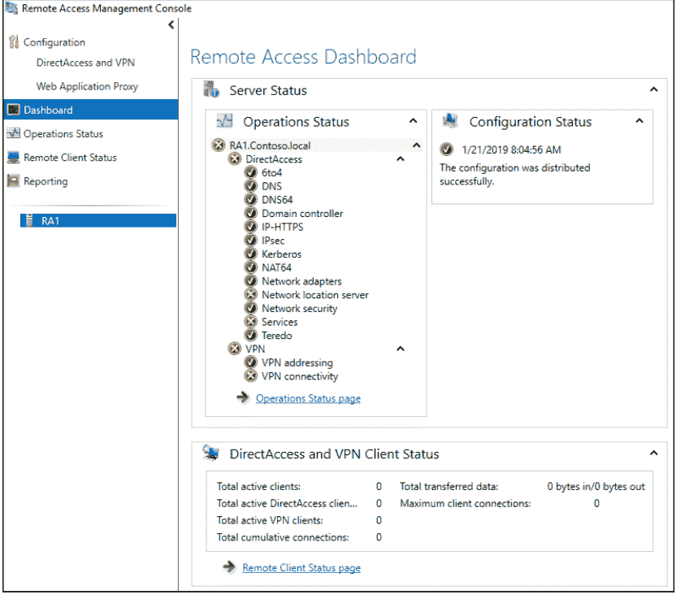

图 8.8：远程访问仪表板上的汇总统计

## 操作状态

如果你想进一步深入了解连接在服务器端发生的情况，那就是操作状态页面要做的事。在这里，你可以看到使你的 DA 和 VPN 连接发生的底层组件的更多详细信息。如果其中任何一个出现问题，你可以点击特定组件以获取更多信息。例如，作为测试，我已在我的实验室网络中关闭了 NLS Web 服务器，现在我可以在操作状态页面上看到 NLS 被标记为错误：

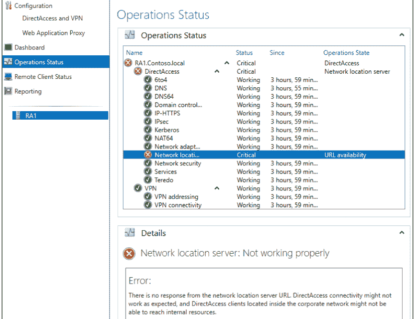

图 8.9：操作状态页面显示服务器组件信息

## 远程客户端状态

接下来是 **远程客户端状态** 屏幕。如图所示，这是我们可以监控已连接客户端计算机的屏幕。这里会显示 DirectAccess 和 VPN 连接。我们将能够看到计算机名称、用户名，甚至他们在连接期间使用的资源。此屏幕上的信息可以通过在窗口顶部的 **搜索** 栏中输入任何条件进行筛选。

需要注意的是，**远程客户端状态** 屏幕仅显示实时活动连接。这里不存储历史信息。

## 报告

你猜对了：如果你想查看历史远程访问信息，就需要访问此窗口。此屏幕几乎与 **远程客户端状态** 屏幕完全相同，只是你可以为所选日期范围提取的历史数据生成报告。一旦数据显示出来，你就拥有与 **远程客户端状态** 屏幕上相同的搜索和筛选功能。

报告默认处于禁用状态，但你只需导航到 **报告** 页面并点击 **配置会计**。启用后，你将看到有关存储历史信息的选项。你可以选择将数据存储在本地 WID 或远程 RADIUS 服务器上。

你在这里还可以选择日志数据的存储时长以及用于清除旧数据的机制：

## 配置会计

配置远程访问数据日志的会计设置。

配置远程访问会计设置。

- 使用 RADIUS 会计
  选择此设置以使用本地或远程 RADIUS 服务器存储日志并生成报告。
- 使用内置会计
  选择此设置以使用 Windows 内部数据库 (WID) 存储日志并在此服务器上生成报告。

配置会计设置
会计方法：内置会计
存储过去 12 个月的会计日志
已用空间：9191424 字节 9 MB
剩余空间：124288737280 字节 118531 MB


管理会计
删除所有会计日志
删除指定时期的会计日志
从：2/6/2019
至：2/6/2019
清空

图 8.10：配置会计（报告）设置


## 任务

我想要指出的 **远程访问管理控制台** 中最后一个窗口窗格是屏幕右侧的 **任务** 栏。任务栏中显示的操作和选项会根据你在控制台中浏览的部分而变化。请确保关注屏幕这一侧，以便设置一些更高级的功能。可用的任务示例包括创建使用报告、刷新屏幕、启用或禁用 VPN，以及在运行多个远程访问服务器时配置网络负载平衡或多站点配置。

## DA、VPN 还是 AOVPN？哪一个最好？

VPN 已存在很长时间，对任何从事 IT 工作的人来说都是一个相当熟悉的概念。Always On VPN 确实带来了其份额的新功能，但在底层 AOVPN 所做的是启动一个传统配置的 VPN 连接，因此连接流程与我们一直以来所知的相似。在本章中，我们也大量讨论了 DirectAccess，以便让你了解这种将远程客户端自动连接到数据中心的替代方法。现在你知道了 Windows Server 2019 内置了两种用于实现移动劳动力的优秀连接平台，哪一个更好？

你不必做出选择！你可以并行运行这两种技术，甚至在同一台远程访问服务器上运行。每种技术都有其优缺点，而你使用其中一种、另一种或两者的方式将取决于许多变量。你的用户、客户端计算机以及你组织的具体需求都需要纳入决策过程。让我们讨论一下 DirectAccess 和 VPN 之间的一些差异，以便你能够明智地决定哪些连接平台适合你的组织。

## 是否加入域？

DirectAccess 客户端计算机必须加入域，这是其最大的要求之一。虽然这一要求本身似乎并不那么重要，但它所隐含的意义可能具有巨大的影响。信任一台计算机加入你的域，很可能意味着这台笔记本电脑由公司拥有。它也可能意味着这台笔记本电脑最初是由 IT 团队构建和准备的。习惯于允许员工自行购买用于工作的电脑的公司可能不会发现 DirectAccess 适合这种模式。DA 对于员工使用现有的家庭电脑远程连接到工作的情况也不理想。

在这种情况下，例如家庭和个人拥有的电脑，VPN 可能更适合该任务。你可以从未加入域的 Windows 10 机器连接到 VPN（包括 Always On VPN），并且你甚至可以从许多非微软设备建立 VPN 连接（手动连接）。iOS、Android、Windows Phone 和 Mac——所有这些平台都内置了 VPN 客户端，可用于连接到 Windows Server 2019 远程访问服务器上的 VPN 侦听器。如果你的唯一远程访问解决方案是 DirectAccess，你将无法为未加入域的设备提供连接平台。

请记住，虽然 Always On VPN 用户隧道在这方面比 DirectAccess 更灵活，但如果你打算使用 AOVPN 设备隧道，那么你的机器仍需要加入域。

## 自动还是手动启动

这个问题有多种不同的看法。在讨论 DirectAccess 还是传统 VPN 更好时，DirectAccess 明显胜出。当有自动化平台可用时，没有人希望让用户打开连接并手动启动它来建立 VPN 连接。

Always On VPN 然而，将自动化和无缝连接带到了 VPN 世界。在这方面，AOVPN 与 DirectAccess 几乎一样无缝。我说几乎是因为在撰写本文时，让设备隧道良好运行相当困难。这意味着大多数部署 AOVPN 的公司仅使用用户隧道。在用户隧道场景中，VPN 确实会自动启动，但不是在用户通过登录屏幕之前。那意味着在这些情况下，DirectAccess 仍然优于 AOVPN，因为 DA 在登录屏幕处无缝连接。这使得密码重置和新域用户能够登录到 DA 连接的机器。我希望未来的改进能够使 AOVPN 设备隧道和用户隧道以稳定方式共存，这将为 AOVPN 客户端提供真正的始终在线连接。

## 软件与内置

我是宜家家具的粉丝。他们以低成本提供优质产品，包括将它们包装在极小的盒子中做得很好。在你付钱购买产品、拆箱、组装，然后测试以确保它能工作之后——它就很棒了。如果你看不出这是在暗示什么，我给你一个提示：它是对传统第三方 VPN 的类比。也就是说，你通常会向供应商支付其 VPN 产品费用，拆箱，以更高的费用实施它，然后测试该产品。然后该 VPN 软件有可能会损坏并需要重新安装或重新配置，并且肯定会带来需要日后完成的软件更新。维护，维护，维护。

也许我最近看了太多家居改造节目，但我喜欢带内置家具的房子。内置家具本质上是永久属于房子的家具，建在墙壁、角落或它所在的地方。它增加了价值，并且比单独拼凑然后塞在墙角的家具更好地融入整体房屋。

DirectAccess 和 Always On VPN 就像内置家具。它们存在于操作系统内部。没有软件需要安装，没有软件需要更新，也没有软件在损坏时需要重新安装。DA 和 AOVPN 所需要的一切今天都已在 Windows 中，你只是没有使用它。哦，而且它是免费的！好吧，至少已包含在你的 Windows 许可成本中。没有用户 CAL，也没有与实施微软远程访问解决方案相关的持续许可成本。

如果你的劳动力由 Windows 10 机器组成，与任何第三方 VPN 连接解决方案相比，Microsoft DirectAccess 或 Microsoft Always On VPN 都是明显的赢家。

## 传统 VPN 的密码和登录问题

如果你曾为使用 VPN 的公司做过帮助台工作，你就知道我在说什么。在 VPN 世界中，存在一系列与密码相关的常见故障排除电话。有时，用户忘记了密码。也许他们的密码已过期需要更改——唉！VPN 在处理这种场景时也不太好。或者也许员工在下班前在桌面上更改了过期的密码，但现在正尝试从笔记本电脑远程登录，而它不起作用。

VPN 密码问题的解决方案是什么？重置用户的密码，然后让用户到办公室来使其在笔记本电脑上生效。是的，这种电话每天仍然会发生。这很不幸，但也是老式 VPN 的一个真实潜在问题。

好消息是什么？新的微软远程访问解决方案没有这些问题！由于 DA 和 AOVPN 是操作系统的组成部分，它们可以在 Windows 在线时随时连接。这包括登录屏幕！即使我坐在登录或锁定屏幕上，系统正在等待我输入用户名和密码，只要我有互联网访问，我也拥有 DirectAccess 隧道或 Always On VPN 设备隧道。这意味着我可以主动执行密码管理任务。如果我的密码过期需要更新，它就能工作。如果我忘记了密码无法进入笔记本电脑，我可以打电话给帮助台，简单地请他们重置我的密码。然后我就可以立即使用新密码登录我的 DA 或 AOVPN 笔记本电脑，就在家里。


这种无缝性带来的另一个很酷的功能是能够使用新用户账户登录。你是否曾经以不同的用户账户登录你的笔记本电脑来测试某些东西？没错，这在 DA 和 AOVPN 上也同样适用。例如，我在家，需要帮助销售团队中的某个人排查某种文件权限问题。我怀疑这与他的用户账户有关，所以我想以他的身份登录我的笔记本电脑来测试。问题是他的用户账户以前从未登录过我的笔记本电脑。使用 VPN，完全没戏；这永远不会成功。使用 DirectAccess，轻而易举！我只需注销，输入他的用户名和密码，就大功告成。我已经登录了，而我仍在家中穿着睡衣坐着。


> 需要注意的是，你可以在同一台 Windows Server 2019 Remote Access 服务器上同时运行 DirectAccess 和 VPN 连接。这使你能够托管通过 DA、通过 AOVPN 以及通过传统 VPN 连接的客户端（如果有非 Win10 机器需要连接）。如果这些连接技术中的任何一种具有你可受益的功能，就全部使用它们吧！

## Port-restricted firewalls

另一个常见的与 VPN 相关的服务台呼叫一直是 *我的 VPN 从这家酒店无法连接*。不幸的是，VPN 用于连接的大多数协议都不友好于防火墙。很可能你家里的路由器允许所有出站流量，因此从家庭互联网连接来看，使用 VPN 协议连接时一切都很顺利。但把同一台笔记本电脑和连接带到公共咖啡店、酒店或机场，VPN 突然就无法连接，并出现奇怪的错误。这通常是由该公共互联网连接的流量通过端口限制防火墙引起的。这些防火墙限制出站访问，通常会阻止 ICMP 和 UDP 等内容，这可能会干扰 VPN 连接。在最严重的情况下，这些防火墙可能只允许两个出站端口：用于 HTTP 的 TCP 80 和用于 HTTPS 网站流量的 TCP 443。然后它们会阻止所有其他内容。

如果你坐在端口受限防火墙后面，这些较新的远程访问技术如何处理连接？

DirectAccess 开箱即用即可处理此场景。还记得 DA 可以用来连接的那三种不同协议吗？*回退* 选项称为 IP-HTTPS，它将流量在 TCP 443 内传输。因此，即使坐在最严格的防火墙后面，DA 通常也会自动且毫不犹豫地连接。

Always On VPN 通常（也应如此）遵循最佳实践部署，其中包括将 IKEv2 优先作为 VPN 连接协议。事实上，一些公司仅使用 IKEv2 部署 AOVPN。对于这些人来说，端口限制防火墙会损害该用户的 VPN 连接，因为 IKEv2 使用 UDP 端口连接。它将无法工作。因此，希望你从中得到的要点是，在设置 AOVPN 时，请确保采取必要步骤也启用 SSTP VPN 连接作为回退方法。SSTP 将流量在 TCP 443 内传输，即使通过硬核防火墙也能连接。


> **非常重要：** AOVPN 设备隧道只能使用 IKEv2。如果你身处端口限制防火墙后面并依赖设备隧道进行连接，它将无法工作。AOVPN 用户隧道是唯一能够执行 SSTP 回退的隧道。

事实上，我最近正好处理过这个场景，有人正在决定为其远程机器设置 DirectAccess 还是 Always On VPN。这是一家为众多医院和医生办公室管理计算机的公司，他们没有通往这些办公室的 WAN 链路。不过这些办公室有互联网访问，因此我们需要能够让这些计算机始终自动连接到主数据中心。到目前为止，在此场景中，DirectAccess 或 Always On VPN 都符合要求。然后，在测试期间，我们发现许多医院网络限制出站互联网访问。DA 连接的唯一方式是通过 IP-HTTPS，而 AOVPN 连接的唯一方式是通过 SSTP。没问题，对吧？除了它确实是个问题。你看，这些远程工作站通常被视为自助服务亭、随时可用的机器，数十名不同的员工可能随时走上来登录它们。通常这意味着登录这些机器的用户以前从未登录过，因此这些计算机上没有缓存的凭据。

如果你还没猜出来，在此场景中我们别无选择，只能使用 DirectAccess。即使使用其回退 IP-HTTPS 方法，DA 在登录屏幕时始终保持连接。然而，Always On VPN 在登录屏幕时只能使用 IKEv2，因为设备隧道需要 IKEv2。这使用 UDP 且被防火墙阻止，因此 AOVPN 连接的唯一方式是使用 SSTP，但这要等到用户隧道启动后才可用，而用户隧道只有在用户登录机器后才会启动。这是一个极其有趣的真实用例，有助于阐明你可能需要为自己的环境做出的决策过程。

## Manual disconnect

如果你还没有被说服老式、传统的 VPN 已是昨日黄花，让我们再抛给你一个观点。当你使用需要用户手动启动连接的 VPN 时，你就依赖用户本人来保持该机器受管理、打补丁并保持最新。当然，你可能有自动化系统为你执行这些操作，例如 WSUS、SCCM 和组策略。但当笔记本电脑外出、远离局域网漫游时，这些管理系统只能在用户决定建立 VPN 连接时才能发挥作用。笔记本电脑完全在公司网络之外待上数周是完全可能的，在此期间员工乘坐游轮在加勒比海游荡，连接数十个不安全的热点。在度过了数周的狂欢和 Netflix 后，他们随后通过局域网或 VPN 连接回来工作，而你会发现，那台机器离线太久，以至于安装了各种有趣且富有创意的全新软件，而你现在必须处理这些软件。

使用 Microsoft 远程访问工具则不会如此！提供 Always On VPN 或 DirectAccess 等自动连接选项意味着笔记本电脑在整个假期期间都已连接并接收其所有安全策略和补丁。

事实上，更进一步说，在 DirectAccess 连接的机器上，用户即使想也不能禁用其 DA 隧道。你确实可以为他们提供一个断开按钮，但这基本上只是从用户角度伪装连接，让他们感觉 DA 已离线。实际上，IPsec 隧道仍在后台传输，始终允许管理类任务发生。

## Native load-balancing capabilities

长话短说，在这里 DirectAccess 是赢家。Windows Server 2019 中的远程访问管理控制台具有内置功能，可配置和管理 DA 服务器阵列。你可以堆叠多个 DA 服务器，将它们绑定在负载均衡阵列中，并在控制台内部直接提供冗余和弹性，而无需额外的硬件或传统负载均衡器考虑。你甚至可以配置名为 DirectAccess 多站点 的功能，在其中将位于不同地理位置的 DirectAccess 服务器配置为阵列，提供跨站点弹性。几乎所有运行 DirectAccess 的公司都会配置冗余环境，提供站点内负载均衡或多站点，有时两者兼而有之，因为这些功能内置且易于配置。


不幸的是，这些功能（至少目前为止）并未移植到 Microsoft VPN 世界中。无论您是通过传统 VPN 连接 Windows 7 客户端，还是让 Windows 10 客户端使用 Always On VPN 连接，RRAS VPN 的后端基础设施都是相同的，并且没有内置对多个服务器或站点的支持。当然可以做到，使该 VPN 系统实现冗余，但这需要您自行使用外部负载均衡器进行设置，并且通常还需要使用全局站点/服务器负载均衡器来使流量正常流动。

任何过去设置过任何类型的负载均衡 VPN 的人可能都非常了解这一过程并且能够轻松配置，这很好。但这对于服务器、网络设备和 IT 经验有限的小型企业客户来说绝对是一个限制因素。总的来说，与 DirectAccess 相关的控制台中内置的额外功能使其在构建具有故障恢复能力的远程访问基础设施方面领先于任何 VPN 解决方案。

## Distribution of client configurations
客户端配置的分配

最后需要考虑的主要因素是在决定远程访问方向时，客户端设置如何推送到各自计算机的方式：

- **Third-party VPN:** 我们已经讨论过处理第三方 VPN 厂商软件应用程序的缺点。如果您可以使用 Windows 操作系统内置的功能，那似乎是不言而喻的选择。
- **Always On VPN:** 推广 AOVPN 设置到客户端计算机的推荐方式是通过使用 MDM 解决方案，即 SCCM 或 Intune。如果您拥有其中一种系统，将 AOVPN 设置推广到员工中非常轻松。如果您没有这些系统中的任何一个，仍然可行，但过程并不简单。
- **DirectAccess:** 我认为 DA 的客户端设置分发方法绝对是最容易使用且最灵活的。您必须记住 DirectAccess 仅适用于加入域的系统。鉴于您可以期望所有客户端都加入域，您可以通过组策略推广 DirectAccess 连接设置，而组策略存在于任何 Microsoft 驱动的基础设施中。

我真心希望未来能在 Always On VPN 配置推广中增加组策略分发选项。如果引入此类功能，我完全有信心它会立即成为推广 AOVPN 设置最流行的方式。

总结整个主题，将 DirectAccess 与传统的手动启动 VPN 相比，DA 毫无悬念地获得第一名。两者真的没有可比性。现在我们有了 Always On VPN 可用，两者之间的优势（DA 或 AOVPN）变得相当模糊。它们以不同的方式实现了很多相同的功能。到目前为止，大多数客户的主要决定因素似乎是客户端推广能力、是否可以访问 MDM 解决方案，以及设备隧道连接对他们的重要性。微软的目标是让 AOVPN 与 DirectAccess 功能对等，并且已经接近。Always On VPN 还具有 DirectAccess 不具备的一些高级身份验证功能，例如与 Windows Hello for Business 或 Azure MFA 的集成。

## Web Application Proxy
Web Application Proxy

DirectAccess 和 VPN 都是出色的远程访问技术，将两者结合起来可以为您的组织提供完整的远程访问解决方案，而无需支付费用或与第三方解决方案合作。更妙的是，在 Windows Server 2019 中，RemoteAccess 角色中还有另一个可用的组件。远程访问故事的第三部分是 **Web Application Proxy (WAP)**。这本质上是一种反向代理机制，使您能够将托管在企业网络内部的某些 HTTP 和 HTTPS 应用程序安全地发布到互联网。过去十年一直在边界网络领域使用 Microsoft 技术的人们可能都会认识一个名为 Forefront **Unified Access Gateway (UAG)** 的产品，它实现了类似的功能。UAG 是一款全面的 SSL VPN 解决方案，也旨在通过 SSL 将内部应用程序发布到互联网。它的功能远比简单的反向代理强大，包括预身份验证、SSTP VPN 和 RDS 网关等组件；DirectAccess 本身甚至可以通过 UAG 运行。

如果您的所有移动工作人员都可以启动 DirectAccess 或 VPN，那么您可能不需要 WAP。然而，随着云思维的增长，用户期望从任何计算机、任何地方打开网页浏览器并访问其某些应用程序的情况非常普遍。文档访问现在通常由 SharePoint 等 Web 服务提供。通过访问 Outlook Web Access，电子邮件访问可以从任何计算机远程获得。使用 Azure 和 Microsoft 365 等云服务时，这很容易实现，但很多人没有意识到这对于本地 Exchange 和 SharePoint 服务也是如此。

如此多的应用程序和数据只能通过网页浏览器访问，这使员工能够在无需建立 VPN 等完整的企业隧道的情况下访问这些数据。那么 WAP 在现实世界中的用例是什么？您不希望其 VPN 连接的家庭计算机。这样，您就不必太担心家庭或用户拥有的计算机的健康状况和状态，因为它们与公司的唯一交互是通过网页浏览器。这限制了这些计算机可能将恶意活动带入您网络的可能性。正如您所见，像 WAP 这样的技术在远程访问市场中确实有其一席之地。

我希望随着时间的推移，WAP 会继续得到改进，从而使其成为 UAG 的真正替代品。UAG 运行在 Windows Server 2008 R2 上，现在已被微软正式停用为产品。微软现在最接近 UAG 的解决方案是 WAP 角色。它还不像 UAG 那样全面，但他们正在努力改进。目前，WAP 可用于发布对简单 Web 应用程序的访问。您还可以发布对使用基本 HTTP 身份验证的富客户端的访问，例如 Exchange ActiveSync。还包括能够向使用 MSOFBA 的客户端发布数据，例如当用户尝试从本地计算机上运行的 Word 或 Excel 应用程序中提取公司数据时。

WAP 可用于反向代理（发布）对 Exchange 和 SharePoint 环境等内容的远程访问。这不是一件小事，因为这些是几乎每个人都在使用的技术，因此为这些资源发布安全访问而实施 WAP 对您的公司来说肯定是有益的；这肯定比直接将 Exchange 服务器 NAT 到互联网更好。

### WAP as AD FS Proxy
### WAP 作为 AD FS 代理

利用 WAP 服务器的另一种有用方式是在网络中设置 Active Directory Federation Services (AD FS) 时（这可能是目前 WAP 最常见的用途）。AD FS 是一种旨在为用户启用单点登录和与其他公司联合的技术，因此它涉及将来自互联网的流量引入内部网络。过去，有一个伴随 AD FS 的 Windows Server 角色组件，称为 AD FS 代理。在最新的 AD FS 版本中，这个单独的角色不再存在，已被 Remote Access 角色的 Web Application Proxy 组件取代。这更好地统一了远程访问解决方案，将传入的 AD FS 流量通过官方 Remote Access 服务器传输，而无需单独的 AD FS 代理服务器。任何在环境中实施面向外部的 AD FS 的人很可能会在某个时候被要求部署 WAP。


## WAP 的要求

不幸的是，使用 Web Application Proxy 的能力伴随着一个相当尴尬的要求：你必须在环境中安装 AD FS 才能使用它——即使只是测试，因为 WAP 配置存储在 AD FS 内部。没有任何 WAP 配置信息存储在 Remote Access 服务器本身，这使得服务器轻量，可以轻松移动、更改或添加。其缺点是，你必须在环境中运行 AD FS，以便 WAP 有地方存储这些配置信息。

虽然与 AD FS 的紧密集成意味着我们拥有更好的身份验证选项，并且用户可以利用 AD FS 单点登录其通过 WAP 发布的应用，但到目前为止，这已证明是小型企业实施的障碍。许多人尚未运行 AD FS，如果他们研究实施 AD FS 的唯一原因是为了使用 WAP 将几个 Web 应用发布到互联网，他们可能不会选择投入时间和精力来实现这一点。

如果你有兴趣使用 WAP，因此正在考虑 AD FS 的要求，需要记住的一点是 AD FS 当然可以用于其他功能。事实上，它目前最常见的用途之一是与 Office 365 集成。如果你计划将 Office 365 纳入环境，或考虑将其纳入环境，AD FS 是一个可以增强该流量身份验证能力的优秀工具。

## WAP 的最新改进

Web Application Proxy 在 Server 2012 R2 中引入，并在 Windows Server 2016 发布时进行了许多改进。自那时以来没有重大修改，但仍然很重要指出已集成到此功能中的最新优势，以表明它仍在学习做新事物。以下是如果你自首次迭代以来没有查看过 WAP，所做的一些改进。

### HTTP Basic 的预身份验证

用户可以通过两种不同的方式对由 Web Application Proxy 发布的应用进行身份验证——预身份验证或直通身份验证。当发布应用使用预身份验证时，这意味着用户必须先在 AD FS 界面对自己进行身份验证，然后才允许进入 Web 应用本身。

在我看来，预身份验证是任何反向代理的关键组件，如果要外部发布一个不需要预身份验证的应用，我会左右为难。然而，第二个选项是进行直通身份验证，它正是这样做的。当你发布对应用的访问并选择直通身份验证时，WAP 所做的只是将数据包从互联网搬运到应用服务器。用户能够在未经身份验证的情况下访问 Web 应用，因此理论上任何人都可以访问你的应用的 Web 前端。从那里，应用本身可能会要求用户进行身份验证，但没有中间人保护；该 Web 应用可供公众查看。正如你所能看出，我不推荐走这条路。

我们已经知道 WAP 可以预身份验证 Web 应用，但原始版本无法对 HTTP Basic 应用进行任何形式的预身份验证，例如当公司想要发布对 Exchange ActiveSync 的访问时。这种无能使 ActiveSync 对外部世界暴露得有点多，存在安全风险。值得庆幸的是，这在 Windows Server 2016 中发生了变化——你现在可以对使用 HTTP Basic 的流量流进行预身份验证。

### HTTP 到 HTTPS 重定向

用户不喜欢费力或浪费时间记住在访问应用时需要在 URL 前输入 HTTPS://。他们宁愿只记住 email.contoso.com。WAP 无法进行 HTTP 到 HTTPS 重定向曾是一个令人厌烦的问题，也是采用的阻碍，但此后已发生变化。Web Application Proxy 现在包含 WAP 本身处理 HTTP 到 HTTPS 重定向的功能，这意味着用户不再需要在浏览器地址栏输入 HTTPS；他们只需输入站点的 DNS 名称，让 WAP 处理转换即可。

### 客户端 IP 地址转发到应用

在反向代理和 SSLVPN 世界中，我们偶尔会遇到需要知道客户端本地 IP 地址的应用。虽然这种需求并不经常发生，通常局限于我们所称的传统应用，但它确实会发生。当后端应用需要知道客户端的 IP 地址时，这对反向代理解决方案来说是一个大挑战。当用户的流量通过 WAP 或任何其他反向代理时，类似于 NAT，这些数据包中的源 IP 地址信息会发生变化。后端应用服务器无法确定客户端自己的 IP 地址，问题随之而来。Web Application Proxy 现在能够将客户端 IP 地址传播到后端应用服务器，缓解了这一问题。

### 发布远程桌面网关

UAG 常用于的一项功能是发布对远程桌面服务的访问。UAG 本质上是它自己的远程桌面网关，这使你能够发布对 RDSH 服务器的访问、VDI 实现中对桌面计算机的单个 RDP 连接，甚至对 RemoteApp 应用的访问。不幸的是，即使在新版本中，WAP 也无法做到任何这些，但他们在此添加了一些功能，意味着正在朝着正确的方向发展。

关于 WAP 和远程桌面的改进是，你现在可以使用 WAP 发布对远程桌面网关服务器本身的访问。传统上，远程桌面网关位于网络边缘，并将外部用户连接到内部远程桌面服务器。将 WAP 放置在 RD 网关前面可以为远程桌面服务提供更强的预身份验证，并创建内部和外部网络之间更大的分离。

我衷心希望我们将继续看到该领域的改进，并且 WAP 可以扩展为原生处理像远程桌面这样的流量，甚至不需要远程桌面网关参与。

### 改进的管理控制台

Windows Server 2012 R2 中 WAP 的原始版本最好使用 PowerShell 来实现。你当然仍然可以使用 PowerShell 创建发布规则，如果你愿意的话，但远程访问管理控制台现在在与 Web Application Proxy 的关系方面得到了改进。在 RAMC 中看到 WAP 之前，你需要确保在远程访问角色安装期间选中了适当的框。如果你最初安装该角色时未选择 Web Application Proxy，请重新访问服务器管理器中的添加/删除角色功能以将 WAP 添加到此服务器：

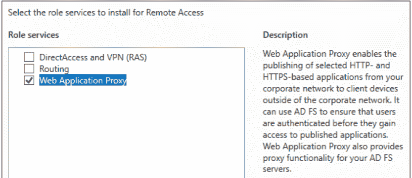

图 8.11：向服务器添加 WAP

> 请注意，虽然 Web Application Proxy 是与 DirectAccess 和 VPN 相同的远程访问角色的组件，但不建议在同一服务器上同时运行 WAP 以及 DA 和 VPN。正如你所知，你可以在单个远程访问服务器上同时共存 DA 和 VPN 连接。但一旦你涉足 WAP，这应该是一个独立组件。不要在 DA/VPN 服务器上运行 WAP，也不要在 WAP 服务器上运行 DA/VPN。

现在我们已将 **Web Application Proxy** 添加到服务器，你可以打开 **Remote Access Management Console** 并在 **Configuration** 部分中看到它。从这里，你启动 **Web Application Proxy Configuration Wizard** 并开始逐步定义你的 AD FS 服务器、计划使用的证书以及角色所需的其他标准：

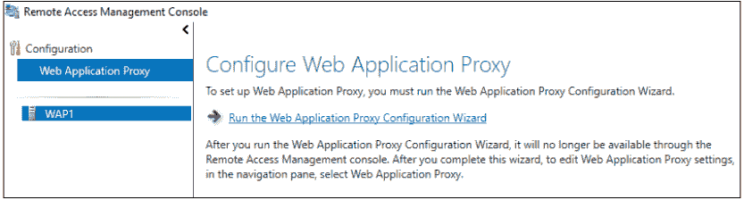

图 8.12：从远程访问管理控制台配置 WAP


## 摘要

当今世界的状况要求大多数公司让员工能够在任何地方工作。在过去几年里，居家办公已变得司空见惯，尤其是在过去一年全球大流行的情况下，我们看到在办公楼外工作的员工比例出现了惊人的增长。公司需要一种安全、稳定且高效的方式，为这些移动员工提供访问企业数据和应用程序的途径。Windows Server 2019 中的远程访问角色正是为此而设计。提供了三种不同的方式来访问企业资源，IT 部门从未拥有过如此多的远程访问技术触手可及，而且这些技术已内置于他们已拥有的 Windows 操作系统中。如果你仍在支持第三方或旧版 VPN 系统，你应该探索此处提供的新功能，并发现它们能为你的业务节省多少成本。

DirectAccess 和 Always On VPN 是特别令人印象深刻且极具吸引力的连接选项——这是一种全新的远程访问方式。自动连接意味着你的机器会不断地进行修补和更新，因为它们始终连接到你的管理服务器。你可以同时提高用户生产力和网络安全性。这两件事在 IT 世界中通常是自相矛盾的，但借助 Microsoft 远程访问堆栈，它们手拉手一起唱歌。

接下来，我们将查看内置于 Windows Server 2019 操作系统中的一些安全功能，以及可以加固服务器以提供比开箱即用更好的安全性的方法。

## 问题

- 1. AOVPN 的缩写是什么？
- 2. 连接 AOVPN 客户端使用的两个主要协议是什么？
- 3. AOVPN 在哪个版本的 Windows 10 中发布？
- 4. 在什么特殊情况下，AOVPN 客户端需要加入你的域？
- 5. DirectAccess 是否要求你的企业内部网络运行 IPv6？
- 6. DirectAccess 客户端用于确定是否位于企业网络内部的内部网站的名称是什么？
- 7. Web Application Proxy 服务器在联合环境中扮演什么角色？
