# 9 加固与安全

*819 万美元*。对于任何以 Dr. Evil 的声音读出这句话的人，我向你致敬。对于任何不知道我在说什么的人，你可能有一个被保护良好的童年。开个玩笑 aside，那个数字对 IT 安全来说很重要。为什么？因为 819 万美元是企业在遭受数据泄露时的平均成本。我最初是在雷德蒙德的一次 Microsoft 大会上听到这个和其他令人恐惧的统计数据，而且这些数字每年都在攀升。如何看另一个可以用来争取增加安全预算批准的统计数据？根据你阅读的研究，攻击者在你的网络中停留的平均天数 **停留时间**，即他们在被检测和清除之前在你的文件和基础设施内部徘徊的时间，大约是 200 天。想想看——200 天！那几乎是一年的时间，他们在你发现他们之前就在那里扎营！在那 200 天里他们通常在做什么？一点一点地把你的所有数据从后门倒出来。另一个数字是 76%——即由于用户凭据被泄露而发生的网络入侵的百分比。此外，识别这些攻击变得越来越困难，因为攻击者使用合法的 IT 工具来获取他们想要的东西。例如，攻击者可以通过社会工程手段赢得单个员工的信任，并利用这种信任让远程访问连接工具安装到用户的办公电脑上。为什么要用恶意软件，当你可以使用 *受信任的* 且会飞过入侵检测系统雷达的东西时？对我来说很有道理。

数据安全、网络安全、凭据和身份安全——这些事情变得越来越难以实现，但总是有新的工具和技术出现可以帮助你抵御坏人。Windows Server 2019 是 Microsoft 生产的最安全的服务器操作系统；在本章中，让我们讨论一下其中包含的一些功能，使这一说法成立：

- Windows Defender 防病毒
- Windows Defender 防火墙 – 并非儿戏
- 加密技术
- Azure AD 密码保护
- 精细密码策略
- 高级威胁分析 – 已结束支持
- 通用安全最佳实践

### Windows Defender Antivirus

Windows Defender 这个术语已经存在多年，但其术语和功能随着新操作系统的发布而多次演变。Defender 早在 2005 年就已存在，当时提供非常简单的反恶意软件保护。Windows 8 时代为 Windows 用户带来了相当惊人的变化，包括 Windows Defender 免费随操作系统提供。虽然这在纸面上听起来很棒，但 Defender 的能力并未被 IT 人群太过认真对待。快进到今天，然而，现在被称为 Windows Defender Antivirus 的产品是一个大幅改进的反恶意软件/防病毒软件，运行在数百万台 Windows 10 客户端计算机上，以及，你猜对了，当前版本的 Windows Server 上。Defender Antivirus 存在于操作系统中并且默认启用，因此具有第三方厂商难以匹敌的集成度和响应性。我无法告诉你有多少次我追踪内存泄漏和随机服务器重启都追溯到功能不佳的第三方防病毒软件，这在今天的服务器世界中是不可接受的。有些人仍然认为 Defender 提供的防病毒功能平平无奇，也许只是因为它是免费的，但它确实在某些方面优于第三方 AV。我还没有见过 Windows Defender 产品拖垮客户端或服务器。

你可能也看到并听过有关 Windows Defender 高级威胁保护 ATP 的提及，最近更名为 Microsoft Defender 高级威胁保护。这是一系列协同工作以保护你的 Windows 机器的产品和系统。防病毒/反恶意软件只是其中一项功能，而内置防病毒在谈论 Windows Server 系列操作系统时是一个相对较新的概念。

我们发现的首个内置 Defender 用于防病毒的服务器操作系统是 Server 2016。此时，全球各公司生产环境中仍有许多服务器运行 Server 2012 R2，我知道这一点因为我每天都在处理它们，因此 Server 2019 中 Defender 工具集的改进存在是开始规划迁移的又一个理由。

我们没有足够的篇幅来深入探讨 Windows Defender ATP 的每一个方面，而且它仍在不断改进。我们将做的是探索一些界面，确保你知道如何使用最常见的组件，这些组件不需要策略级操作或集中管理，并扩展你对一些更高级功能的了解，以便进一步学习和挖掘。

### 安装 Windows Defender Antivirus

完成了！Windows Defender Antivirus 默认已安装在 Windows Server 2019 中。事实上，除非你以某种方式更改了它，不仅 Defender AV 已安装，而且操作系统安装后系统就会自动受到保护。但不要只听我的话：如果打开 Server Manager 并选择 **Add roles and features**，点击进入 **Select features** 页面，你应该会发现 **Windows Defender Antivirus** 旁边的复选框已被选中：

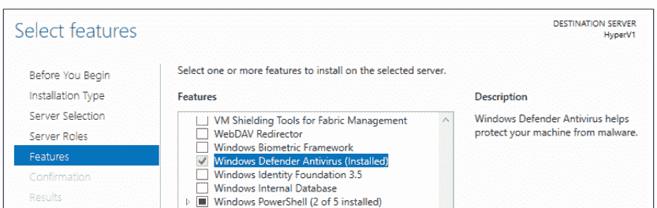

Figure 9.1: Windows Defender Antivirus 预装

如果由于某种原因它尚未被选中，那么这正是安装并使其运行的地方。

### 探索用户界面

Windows Defender 工具集的界面与最新版本的 Windows 10 中的相同，但如果你还没有探索过，我们在这里快速看一下。继续从 **Start** 菜单中启动 **Settings**，然后点击 **Update & Security**。


进入该部分后，您将在左侧看到 **Windows Security**。在这里，您可以获得不同 Defender 组件协同工作以保护系统的概览视图。

记住，您无需做任何操作来启用这些功能；这些都是开箱即用的功能：

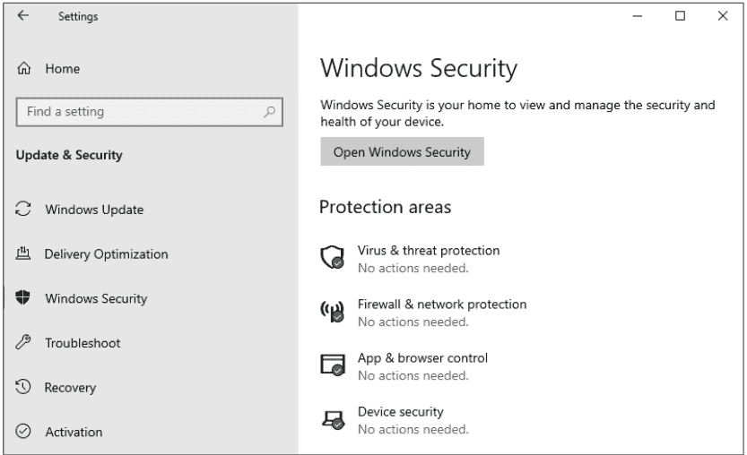

图 9.2：Windows Defender 功能

进一步点击这些 **保护区域** 中的任何一个都会带来每个功能的更详细描述，以及启用或禁用特定保护的许多选项。例如，如果您点击 **病毒和威胁保护**，您将看到有关 Defender AV 的摘要信息，其定义文件何时更新，它正在扫描的内容等等。然后进一步点击名为 **管理设置** 的链接将为您提供在需要时禁用 Defender AV 的选项，以及可以选中或取消选中的许多其他选项。*图 9.3* 向您展示了 Defender AV 内部可用的一些设置。我选择显示这三个是因为它们对我们稍后将要讨论的主题很重要，当我们讨论 Defender ATP 的 ATP 部分时：

## Windows 安全

### 实时保护

定位并阻止恶意软件在您的设备上安装或运行。您可以在短时间内关闭此设置，然后它会自动重新打开。

开启

### 基于云的交付保护

通过访问云中的最新保护数据提供更强更快的安全保护。与开启自动样本提交配合使用效果最佳。

隐私声明

开启

### 自动样本提交

发送样本文件给 Microsoft 以帮助保护您和其他人免受潜在威胁。如果我们需要的文件可能包含个人信息，我们会提示您。

开启

图 9.3：管理病毒和威胁保护选项

## 禁用 Windows Defender Antivirus

您已经知道 Defender AV 默认启用，正如构成 Windows Defender 产品系列的许多其他组件一样。通过切换图 9.3 中显示的单选选项，您可以暂时禁用 AV。更进一步，如果您完全确定不想使用 Defender AV，因为您已有付费的自有 AV 软件，则有两种不同的途径可供选择。

首先，Defender AV 设计为在安装其他 AV 时自动让位。很可能，您只需安装其他第三方防病毒工具，服务器重新启动后，Defender AV 就会让位并允许第三方产品运行，以免它们相互冲突。这很重要，因为即使许多计算机技术人员也不了解的一个事实是，单个系统上运行多个 AV 程序通常是一个糟糕的主意。它们经常相互冲突，导致内存分配错误，并导致系统出现缓慢且异常的行为。

如果您计划使用自己的 AV 并希望确保 Defender 完全被移除，可以从服务器上卸载 Defender 功能。这最容易通过 PowerShell 完成，使用以下命令：

```
Uninstall-WindowsFeature -Name Windows-Defender
```

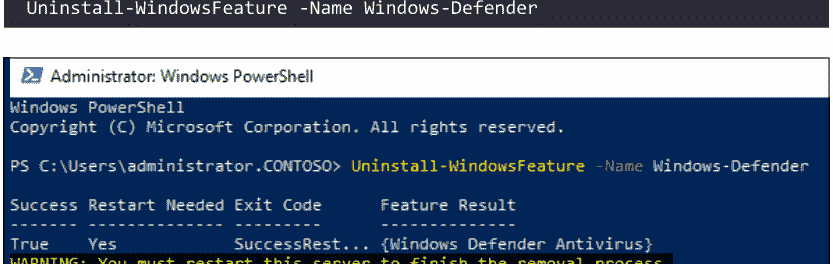

图 9.4：卸载 Defender

## ATP 到底是什么？

很难定义 ATP 到底意味着什么，因为它是 Windows Defender 的各个部分、组件和安全机制协同工作以保护客户端和服务器免受不良侵害的综合结果：AV、防火墙功能、硬件保护，甚至针对勒索软件的特定抵抗力。

Windows 10 和 Server 2019 中 *Windows Security* 部分内的功能组合共同构成 ATP。

对我们所有人来说都应该非常有趣的是，Microsoft 现在利用云连接和计算以智能方式每天改进 Defender AV 的方式。无论我们是否意识到，世界上大多数联网的 Windows 机器现在都在通过向 Microsoft 报告新发现的漏洞和恶意活动来不断互相帮助。这些信息随后通过机器学习进行解析和调查，所得到的信息可以立即被全球其他 Windows 机器使用。

虽然这听起来有点像 *Big Brother* 且充满隐私担忧，但我相信作为一个社区，我们很快会克服这种恐惧并意识到好处超过了潜在的担忧。数百万用户现在通过 Office 365 发送电子邮件；您可能甚至没有意识到，Office 365 也会进行这种数据处理以识别和阻止利用。例如，如果公司内的某个电子邮件地址突然向大量人员发送电子邮件，并且该邮件包含启用宏的 Word 文档，而这通常不是用户会做的操作，Office 365 可以非常快速地将该文档离线到安全区域，打开它（或如果附件是可执行文件则启动它），并发现该文件是否实际上是某种恶意软件。如果是，Office 365 将立即开始阻止该文件，从而阻止这种潜在灾难性行为的传播。所有这些都无需用户或公司 IT 人员的干预。这甚至不是公司内部特定。如果我的某个用户的电子邮件是第一个收到新病毒的，并且被 Microsoft 识别出来，该发现将有助于阻止该新病毒对也将电子邮件托管在 Microsoft 云中的任何其他客户。这真是令人难以置信！

当您选择允许 Defender AV 与 Microsoft 的云资源通信并提交信息时，同样的理念也适用于 Defender AV。之前，我粘贴了一些名为 **基于云的交付保护和自动样本提交** 的 Defender AV 功能的屏幕截图——正是这些 Defender AV 组件使这种基于云的魔术成为可能并惠及整个计算机群体。

## Windows Defender ATP Exploit Guard

再次，我们正在查看似乎是一个冗长标题的技术，必须有一个非常特定的目的，对吧？不。新的 Exploit Guard 不是 *a* 个新功能，而是一整 *set* 嵌入 Windows Defender 系列中的新功能。具体来说，这些新保护旨在帮助检测和防止当前恶意软件攻击中使用的一些常见行为。

以下是 Defender ATP Exploit Guard 的四个主要组件：

- **Attack Surface Reduction (ASR)**：ASR 是一系列控制措施，可阻止某些类型的文件运行。这可以帮助减轻用户通过点击电子邮件附件或打开某些类型的 Office 文件而安装的恶意软件。作为计算机社会，我们正在迅速学习永远不要点击电子邮件中看起来像可执行文件的文件，但通常标准计算机用户无法区分可执行文件和其他类型文件。ASR 可以帮助阻止从电子邮件内部运行任何可执行文件或脚本文件。
- **Network protection**：这启用了 Windows Defender SmartScreen，可阻止潜在恶意软件回拨，与攻击者服务器通信以从公司窃取或转移公司数据到公司之外。互联网上的网站具有声誉评级，根据过去流向该 IP 地址的流量类型，将站点或 IP 地址判定为受信任或不受信任。SmartScreen 利用这些声誉数据库阻止出站流量到达不良目的地。
- **Controlled folder access**：勒索软件保护！这一点很有趣，因为勒索软件是任何 IT 安全专业人士的首要关注点。如果您不熟悉这个概念，勒索软件是一种恶意软件，它在您的计算机上安装一个应用程序，然后加密计算机上的文件。一旦加密，您无法在没有加密密钥的情况下打开或修复这些文件，而攻击者（大多数时候）会很乐意为您提供大量金钱来交出密钥。每年，许多公司最终支付赎金（因此自己也参与了被动的犯罪行为），因为它们没有良好的保护或良好的备份来恢复信息。受控文件夹访问通过阻止不受信任的进程访问已被判定为受保护的硬盘区域来帮助防止勒索软件。
- **Exploit protection**：针对计算机上可能发生的许多类型利用的通用保护。Defender ATP 的 exploit protection 功能是从名为 **Enhanced Mitigation Experience Toolkit (EMET)** 的工具集成的功能，该工具以前可用，但在 2018 年中期已达到生命周期结束。Exploit protection 监视并保护系统进程以及应用程序可执行文件。

这些控制措施，特别是 exploit protection 控制措施，可以通过多种方式进行管理。它们可以通过 Intune、组策略或 Microsoft Endpoint Configuration Manager 以集中方式推出。此外，还可以使用 PowerShell 或内置于每个当前 Windows 版本的 Windows Security 应用按机器配置它们。


让我们来看看 Windows Server 2019 单个实例上的设置。打开 Windows 设置 | 更新和安全。在左侧导航窗格中，您会看到一个写着 Windows 安全的盾牌图标。继续点击它。现在进入 应用和浏览器控制。在此屏幕上，您可以配置 Windows Defender SmartScreen 的选项，我们之前讨论过它，还有一个 Exploit 保护部分。点击 Exploit 保护设置后，我们现在深入了解这些保护机制的细节。有许多不同的 exploit 保护组件可以全局启用或禁用（许多默认已启用），点击 程序设置 允许您进行精细化配置，定义 exploit 保护对各个程序的处理程度，如图 9.5 所示：

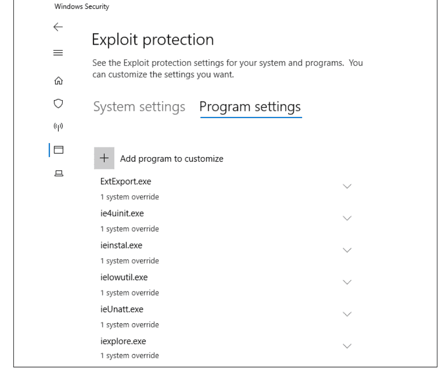

图 9.5：Exploit 保护设置

## Windows Defender 防火墙 – 不容开玩笑

让我们玩一个词语联想游戏。我会说点什么，你说出第一个想到的词。

*网络安全。*

你说的是 *防火墙* 吗？我觉得我会这么说。当我们思考在网络层面保护设备时，我们会想到边界。这些边界由防火墙定义并保护，大多在硬件层面，有专门的网络设备在我们的网络中处理这一特定任务。今天，我们在这里谈论另一层防火墙，你可以在环境中使用并且应该使用。是的，我们在谈论 Windows 防火墙。别笑了，很没礼貌！

嘲笑 Windows 防火墙很容易，基于它的历史。在 Windows XP 和 Server 2003 的时代，它几乎没用，造成的问题比解决的问题多得多。这些感受如此普遍，以至于我至今仍发现许多公司出于默认政策，会在所有加入域的系统上完全禁用 Windows 防火墙。如果你问他们，他们通常没有具体的理由这样做——*一直都是这样或写在我们的书面安全策略中* 是标准回复。这是个问题，因为今天 Windows 操作系统中的 **Windows Defender 防火墙高级安全 (WFAS)** 比以往任何时候都更强大、更先进，绝对可以用来增强你的安全架构。我甚至可以说，除非你有非常好的、非常具体的理由，否则在当前操作系统上禁用 WFAS 完全是愚蠢的。

## 三个 Windows 防火墙管理控制台

首先，重要的是要知道你可以从三个不同的控制台配置 Windows 防火墙设置。其中两个控制台相互冗余，第三个比其他两个更强大。让我们快速看一下每一个。

### Windows Defender 防火墙（控制面板）

在 Windows Server 2019 中尝试启动任何应用程序或设置时，最有效的方法通常是简单地点击 **开始** 按钮，然后输入与你要完成的任务相关的词。在我的例子中，我点击了 **开始** 并输入了 firewall。搜索结果中提供的最佳匹配选项首先是 **Windows Defender 防火墙**，所以我继续点击了它。

有趣的是，此链接从 **控制面板** 内部打开 Windows 防火墙配置控制台，这是旧式的系统设置方式。此控制台仍然在线，并且完全能够操作基本的防火墙功能，例如启用或禁用 Windows 防火墙，但由于此工具位于 **控制面板** 内部，我们必须假设这实际上不是微软希望我们使用的工具。请记住，所有新的配置功能都已迁移到 **Windows 设置** 屏幕，而不是旧的 **控制面板**：

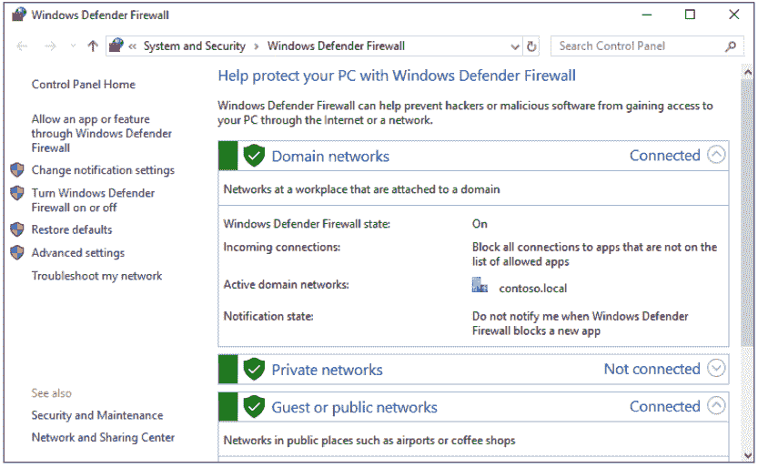

图 9.6：控制面板中的防火墙设置

### 防火墙和网络保护（Windows 安全设置）

虽然基于 **控制面板** 的工具在操作系统的过去版本中一直是进行这些更改的正确位置，但我们已经知道 **Windows 设置** 内部存储着许多 Windows Defender 选项。是否也有 Windows Defender 防火墙配置设置存储在 **设置** 的 **Windows 安全** 部分中？

是的，确实有。打开 **Windows 设置** 并点击 **更新和安全**，然后点击 **Windows 安全**。你以前来过这里——这是提供 Windows Defender 组件快速摘要的屏幕。果然，这里有一个名为 **防火墙和网络保护** 的选项。

点击该按钮，您将被带到一个新配置平台，用于 Windows 防火墙功能，而这些功能在早期版本的 Windows Server 中并不存在：

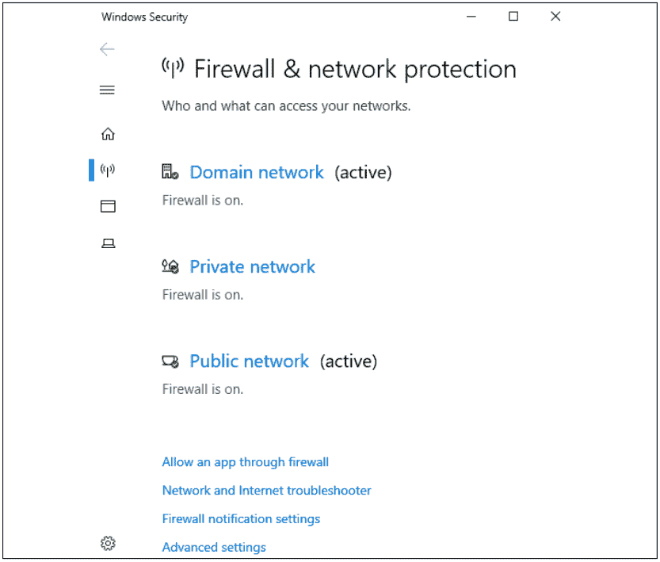

图 9.7：Windows 设置中的防火墙设置

点击此处提供的任何链接都将打开额外的配置选项。例如，如果您想快速启用或禁用特定的防火墙配置文件（我们稍后会学习这些），您可以点击要配置的配置文件，例如域网络配置文件，然后轻松关闭此网络配置文件的防火墙。许多公司会在其机器上禁用域网络配置文件，以便防火墙不保护发生在企业局域网内的流量。

虽然禁用防火墙通常是个坏主意，但有时为了适应您的业务模式是必需的：

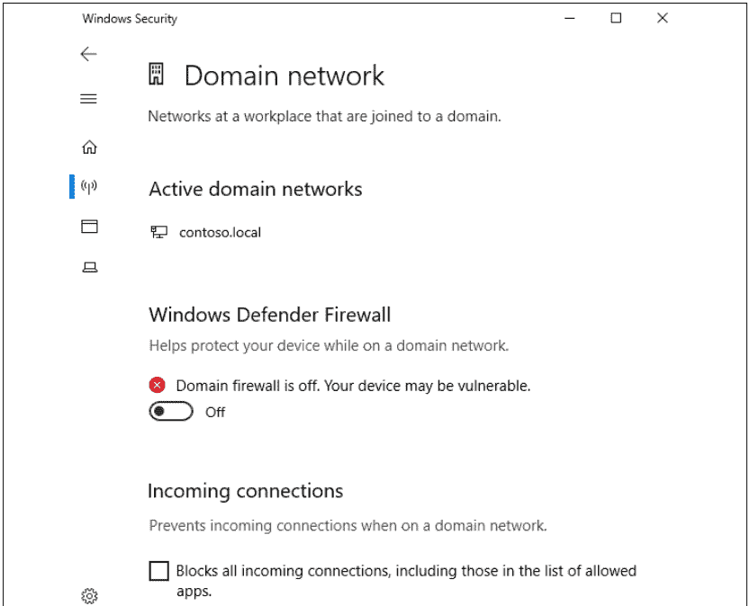

图 9.8：在域网络上禁用 Windows 防火墙

**Windows 设置** 内部可用的防火墙配置屏幕是进行关于 Windows Defender 防火墙简单、高层决策的好地方，但此界面的功能有限。对于防火墙功能或配置的任何实际使用...

### Windows Defender 防火墙高级安全（WFAS）

如果你和我一样，你不会满足于 Windows 设置中提供的防火墙信息，你会想了解底层发生了什么，因此你需要比基本 Windows 防火墙工具单独提供的信息更多一些。你可以点击之前截图中显示的其中一个高级设置链接，或者简单地打开命令提示符或 开始 | 运行 提示符并输入 wf.msc。这两种方法都会启动完整的 WFAS 管理控制台：

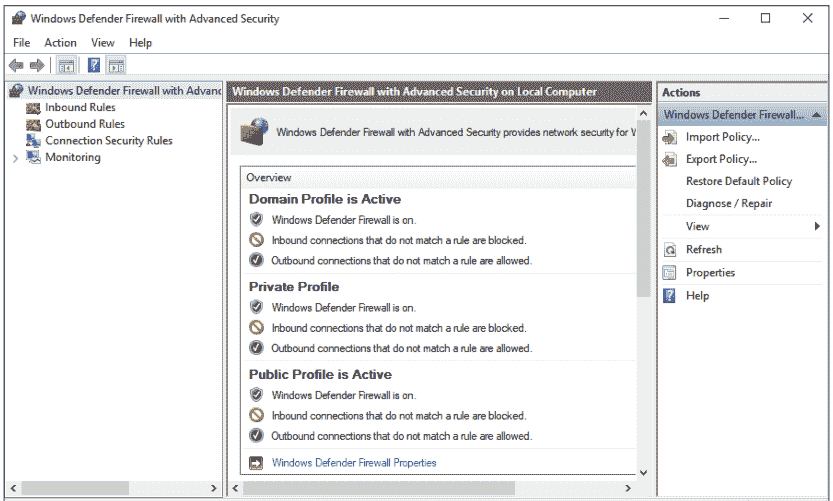

图 9.9：Windows Defender 防火墙高级安全

在这里，您可以看到有关 Windows 防火墙活动和规则的更深入信息，并对您的允许和阻止进行更精确的调整。还有一个监控部分，您可以在其中查看正在使用的规则，包括连接安全规则。这是一个重要的部分，因为它强调了 WFAS 不仅仅是阻止网络流量。它不仅仅是一个防火墙；它也是一个连接平台。如果您计划利用 IPsec 来加密网络流量，无论是网络内部的原生 IPsec 还是通过远程访问技术 DirectAccess，您将在此部分看到填充的规则，这些规则是这些 IPsec 隧道的定义。

无论你信不信，Windows 防火墙实际上负责建立这些加密连接和隧道。这比往年的 Windows 防火墙先进得多。

## 三种不同的防火墙配置文件

当计算机或服务器上的任何 NIC 连接到网络时，Windows 防火墙会为该连接分配三种不同配置文件之一。你可能在不知不觉中之前就已经与此决策过程交互过。当你将笔记本电脑连接到当地咖啡店的 Wi-Fi 时，Windows 是否询问你是否连接到家庭、工作或公共网络？或者在较新的 Windows 版本中，它会问你类似“您是否希望在此网络上允许计算机被发现，是或否？”的问题。这就是你的 Windows 防火墙询问你希望为新网络连接分配哪个配置文件。您可以为 NIC 和网络连接分配不同的防火墙配置文件的理由是，您可以为这些不同的配置文件分配不同的访问规则和允许或不允许的标准。有效地，它是在问你 *你有多信任这个网络？* 例如，当你的笔记本电脑连接到企业网络时，你可能可以比在全国各地的酒店连接同一台笔记本电脑时稍微宽松一些。通过为你在酒店时激活的配置文件分配更严格的防火墙规则，你为攻击者在你外出在公共互联网上工作时构建了更大的障碍。让我们来看看可用的三种不同类型的配置文件，并快速描述一下每个配置文件：

- **域配置文件**：这是你无法选择分配的唯一一个。域配置文件仅在你使用加入域的计算机并且当前连接到可以访问域域控制器的网络时处于活动状态。因此，对于企业网络内的任何企业机器，您可以预期域配置文件将处于活动状态。
- **专用配置文件**：连接新网络时，如果提示您选择连接位置，如果您选择 **家庭** 或 **工作**，该连接将被分配专用配置文件。
- **公用配置文件**：如果提示时，您选择 **公用**，那么当然您将被分配公用防火墙配置文件。此外，如果由于某种原因未提示您，或者您根本不选择任何选项而只是关闭询问您要为新连接分配什么的窗口，则此公用配置文件将成为默认配置文件，分配给任何没有已分配不同配置文件的连接。


在 Windows 的较新版本中（尤其是 Win10），你通常不会看到询问网络类型的提示；相反，你会看到询问是否允许你的计算机与新网络上的其他设备通信的提示。实际上，这仍然是同一个提示，你在此提示中所做的决定会将你的连接分配给公共或私有防火墙配置文件。

每个网络连接都会分配自己的配置文件定义。同一系统上同时激活多个防火墙配置文件是完全可能的。例如，我的 RA1 服务器同时连接到企业网络以及公共互联网。在 WFAS 中，你可以看到 Domain Profile 和 Public Profile 都是激活状态：

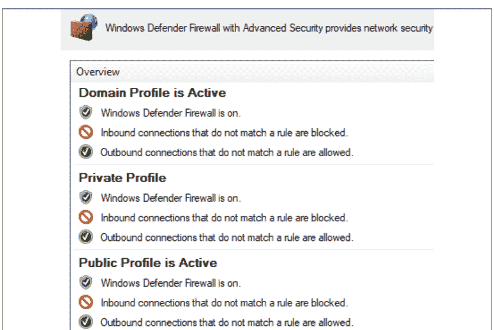

图 9.10：多个 NIC 可能意味着多个防火墙配置文件

另外，如果在此服务器上打开“网络和共享中心”，我们也可以在这里看到列出的配置文件，并且可以轻松判断哪个 NIC 使用哪个配置文件：

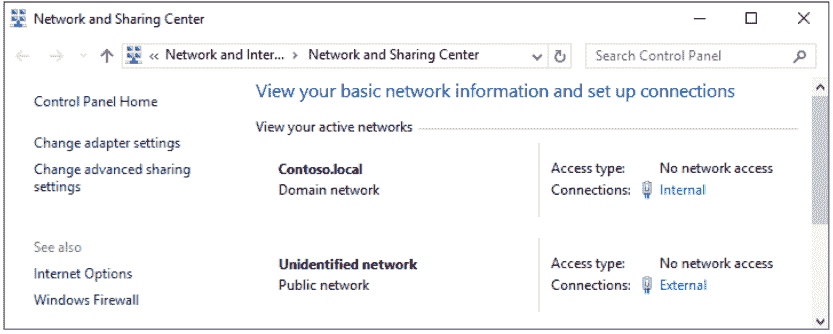

图 9.11：分配给每个 NIC 的防火墙配置文件

## 构建新的入站防火墙规则

现在我们知道 Windows 防火墙的核心功能在 WFAS 控制台内部，让我们使用 WFAS 为自己构建一条新规则。在这台 RA1 服务器上，我已启用 RDP 访问，以便我可以更轻松地从我的办公桌管理此服务器。然而，通过打开 RDP，我现在允许从该服务器上的所有网络访问 RDP。这意味着我可以从网络内部 RDP 进入 RA1，但我也可以从互联网 RDP 进入 RA1，因为这是一台远程访问服务器，并且直接连接到互联网。这是一个大问题，因为现在互联网上的任何人都有可能找到我的服务器，找到 RDP 登录提示，并尝试通过暴力破解进入 RA1。

为缓解此问题，我只想在我的外部 NIC 上禁用 RDP。我希望它在内部保持活动状态，以便我可以继续从办公桌访问服务器，但在 WFAS 内部是否有一种简单的方法可以创建防火墙规则，仅阻止来自外部的 RDP 访问？当然有。

打开 wf.msc 启动 Windows Defender 防火墙高级安全，导航到“入站规则”部分，你将看到此服务器上存在的所有现有入站防火墙规则（即使你从未访问过此控制台，这里也列出了许多规则，这些规则随操作系统一起安装）。右键单击“入站规则”并选择“新建规则...”。这将启动一个向导，我们将从中创建新的防火墙规则。第一个屏幕是确定我们想要创建哪种规则的地方。你可以创建修改特定程序流量的规则，也可以查看预定义协议的列表。

然而，我喜欢确切地知道我的规则在做什么，是因为我定义它的方式，而不是因为预先存在的协议定义，而且我知道 RDP 运行在 TCP 端口 3389 上。因此，我将在此屏幕上选择端口，并在单击“下一步”后，将 3389 定义为我想要修改的特定端口：

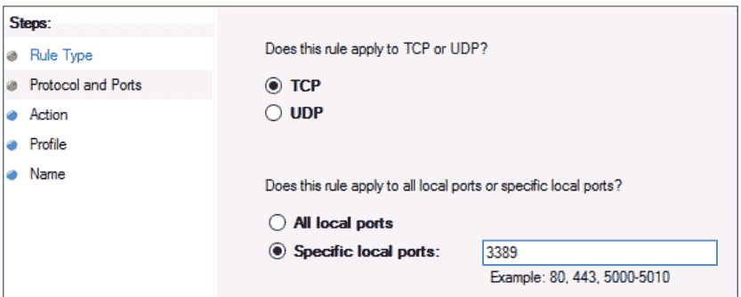

图 9.12：此防火墙规则将操作端口 3389（RDP）流量

我们的第三步是决定是否允许或阻止此特定端口。列出了第三个选项，即仅在通过 IPsec 进行身份验证时才允许连接，这是一个强大的选项，但需要网络中已建立 IPsec。由于该要求，此选项不适用于大多数人。对于我们的示例，我们已经可以使用 RDP，但我们希望在其中一个 NIC 上阻止它，因此我将选择“阻止连接”：

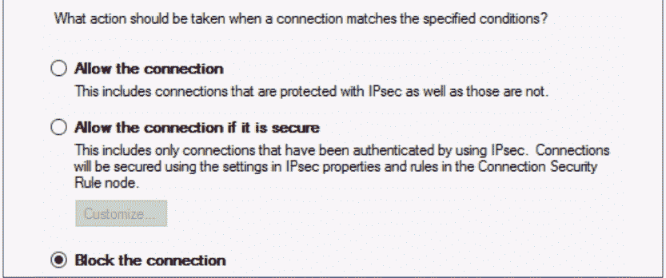

图 9.13：阻止连接

我们不想为 *所有* 的 NIC 阻止 RDP，因此下一个屏幕非常重要。在这里我们需要参考我们之前谈到的那些防火墙配置文件的知识。记住，连接到域网络的内部 NIC 将分配 Domain Profile。但任何未连接到存在域控制器的内部网络的 NIC 都将激活 Public 或 Private 配置文件。这就是我们需要在本屏幕上运用的知识。如果我们只想在外部 NIC 上禁用 RDP，我们需要此规则仅对 Private Profile 和 Public Profile 激活。事实上，回看我们已经看到的屏幕截图，我们可以看到外部 NIC 被 specifically 分配了 Public Profile，因此我们可以在此处仅勾选 **Public** 复选框，然后 RDP 将在外部 NIC 上被阻止。但如果将来我们向此服务器添加更多 NIC，并且希望确保无法通过 RDP 访问，我们将同时保留 **Public** 和 **Private** 的勾选，以确保未来更好的安全性。务必取消勾选 **Domain** 配置文件！否则，你将完全阻止 RDP 访问，如果你当前正在使用 RDP 连接到此服务器，你将被踢出并且无法重新连接：

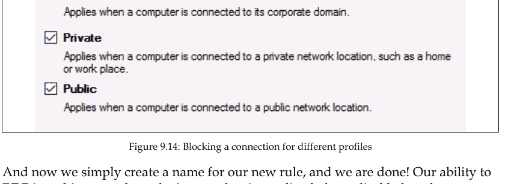

图 9.14：针对不同配置文件的阻止连接

现在我们只需为新规则创建一个名称，就完成了！我们从互联网 RDP 进入此服务器的能力已被立即禁用，我们今晚可以更安心地休息。

## 创建允许 ping（ICMP）的规则

我经常发现自己需要为 ICMP 创建允许或阻止规则。换句话说，我经常需要调整服务器上的防火墙以启用或禁用它们响应 ping 请求的能力。你可能已经注意到，对于较新的服务器操作系统，防火墙默认自动阻止 ping（ICMP）是很正常的。

对于 ping 是测试 IP 地址是否被占用或可用的标准方法的环境来说，这是一个问题。你可能会笑，但相信我，仍然有大量 IT 管理员没有跟踪他们在网络内部使用的 IP 地址，并且在面临设置新服务器并决定分配什么 IP 地址的需求时，他们只是开始 ping 网络中的 IP 地址，直到找到超时为止！我见过很多次。虽然这显然不是管理 IP 地址的好方法，但确实会发生。不幸的是，这种方法会遇到大问题，因为大多数新的 Windows 安装默认设计为阻止 ICMP 响应，这意味着你可能会 ping 一个 IP 地址并收到超时，但实际上可能有另一台服务器或 PC 运行在该 IP 地址上。

所以，回到重点。你可能需要在新服务器上启用 ICMP，以便在有人尝试 ping 它时做出响应。当我们需要创建允许 ping 的新规则时，我们设置规则的方式与为 RDP 设置的方式相同，但有一个大问题。在创建新规则时第一个 **Rule Type** 屏幕上，你必须确定要创建哪种规则，这里没有 ICMP 的选项或预定义。我觉得这很奇怪，因为这是一种非常常见的规则类型，但唉，从下拉列表中选择 ICMP 就太容易了。相反，你需要做的是像为 RDP 一样创建一个新的入站规则，但在第一个 **Rule Type** 屏幕上，确保你选择名为 **Custom** 的选项。

接下来，保留为 **All programs** 定义此规则的选项。再次单击 **Next**，现在你有一个名为 **Protocol type** 的下拉框。这就是你可以选择新规则以操作 ICMP 流量的菜单。如图 9.15 所示，你可以根据网络流量的情况选择 **ICMPv4** 或 **ICMPv6**。我的测试实验室仅为 IPv4，因此我将选择 **ICMPv4**：

## 步骤：

- 规则类型
- 程序
- 协议和端口
- 范围
- 操作
- 配置文件
- 名称

此规则适用于哪些端口和协议？

协议类型：
协议编号：
本地端口：
远程端口：
Internet 控制消息 (ICMP) 设置：

图 9.15：对特定协议应用规则

对于其余的 ICMP 规则创建，请遵循我们在创建 RDP 规则时概述的相同步骤，选择允许或阻止此流量，以及适用于哪些防火墙配置文件。完成后，你的新 ICMPv4 规则会立即生效，如果你配置了允许规则，你的新服务器现在将成功响应 ping 请求：

```
PS C:\Users\administrator.CONTOSO> ping ral

Pinging ral.contoso.local [10.10.10.13] with 32 bytes of data:
Reply from 10.10.10.13: bytes=32 time<1ms TTL=128
Reply from 10.10.10.13: bytes=32 time<1ms TTL=128
Reply from 10.10.10.13: bytes=32 time<1ms TTL=128
Reply from 10.10.10.13: bytes=32 time<1ms TTL=128
```

图 9.16：Ping 你的服务器并现在接收 ICMP 响应

如果以后需要修改规则或深入了解防火墙规则的更多高级属性，可以在 **入站规则** 屏幕中右键单击任何单个防火墙规则并进入 **属性**。在这些选项卡中，你可以修改规则的任何条件。例如，你可以容纳额外的端口，你可以修改它适用的防火墙配置文件，或者你甚至可以通过使用 **范围** 选项卡来限制此规则适用的特定 IP 地址。

这使你只能将防火墙规则应用于来自网络特定部分或特定机器子集的进出流量。例如，这里我已修改我的 **范围** 选项卡，以反映我只希望此防火墙规则适用于来自 192.168.0.0/16 子网的入站流量：

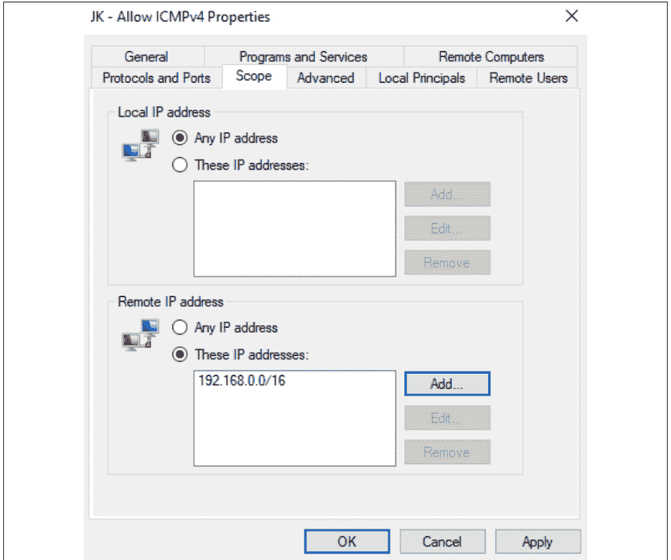

图 9.17：将防火墙规则应用于特定的 IP 地址或子网

## 使用组策略管理 WFAS

在服务器和客户端上管理防火墙规则可以成为为公司打造更安全环境的重要一步。最好的是？此技术属于企业级并且免费使用，因为它已内置于你使用的操作系统中。在此级别使用防火墙的唯一成本是设置所有这些规则所需的时间，如果你必须在每台机器上单独实现允许和阻止的整个列表，这将是一场管理噩梦。

感谢组策略。与 Microsoft Windows 平台中的大多数设置和功能一样，为域加入的机器设置适用于所有人的防火墙策略非常简单。你甚至可以将它分成多组策略，创建一个适用于客户端的 GPO 和一个适用于服务器的单独 GPO，视情况而定。重点是你可以将许多机器分组到类别中，为每个类别创建 GPO 规则集，并通过利用组策略强大的分发功能自动将其应用于每台机器。

你已经熟悉创建 GPO，因此现在请创建一个将包含一些供我们使用的防火墙设置的 GPO。相应地链接和筛选 GPO，以便只有你想要设置设置的机器才会真正获得它们。也许一个好的起点是测试 OU，这样你就可以确保即将放入 GPO 中的所有规则都能很好地协同工作，并且与你现有的所有其他策略兼容，然后再将新策略推广到生产员工。

一旦你的新 GPO 创建完成，从 **组策略管理控制台** 中右键单击它并单击 **编辑...**：

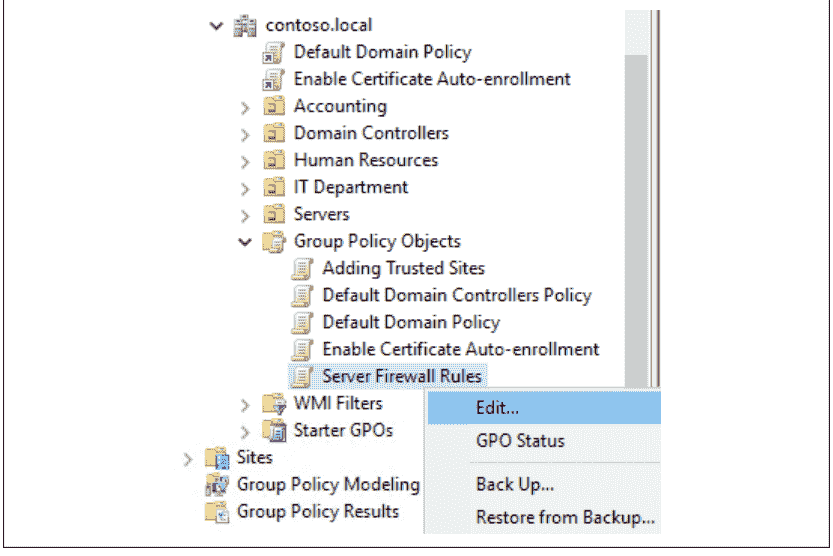

图 9.18：使用组策略集中管理 Windows 防火墙规则

现在我们正在查看这个新 GPO 的内部，我们只需要弄清楚为创建一些新的防火墙规则提供正确位置。当你在本地机器本身查看规则时，所有内容都列在 **Windows Defender 防火墙高级安全** 标题下，其位置为 **计算机配置** | **策略** | **Windows 设置** | **安全设置** | **Windows Defender 防火墙高级安全** | **Windows Defender 防火墙高级安全**：

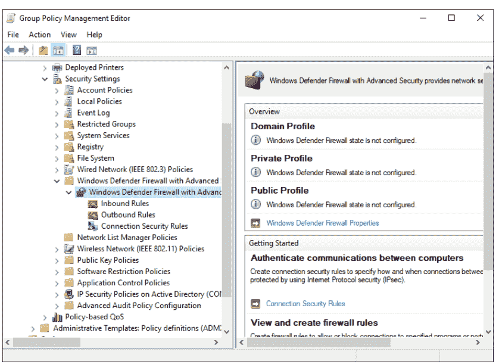

图 9.19：GPO 中防火墙规则设置的位置

正如你所见，当你想要确保特定防火墙配置文件或 Windows 防火墙整体被专门打开或关闭时，这也是要去的地方。所以，如果你想为所有人禁用 Windows 防火墙，你也会去同一个地方。

通过单击图 9.19 中显示的 Windows Defender 防火墙属性链接，你可以单独确定每个防火墙配置文件的状态：

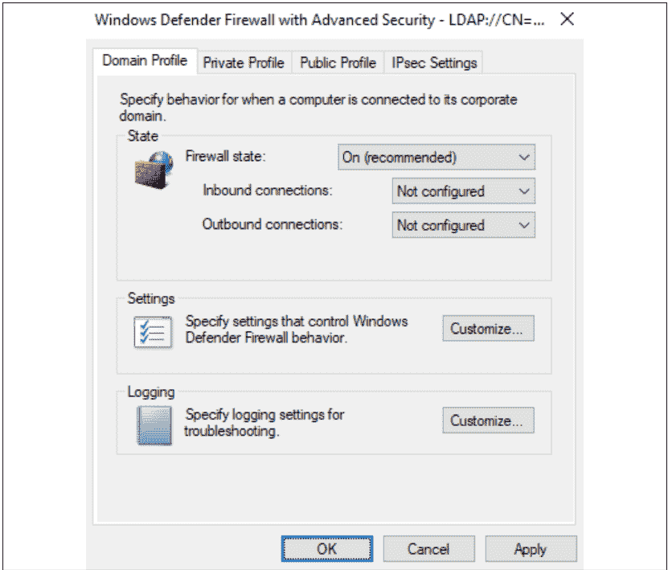

图 9.20：用于修改每个防火墙配置文件行为的单独选项卡

一旦你根据需要设置了配置文件，单击确定，你会发现自己回到了 GPO 的 WFAS 部分。就像在本地 WFAS 控制台内部一样，你有入站规则和出站规则的类别。只需右键单击入站规则并单击新建规则...即可开始在此 GPO 中构建规则。按照你从在本地 WFAS 控制台中创建规则时就熟悉的相同向导进行操作，完成后，你的新入站防火墙规则会显示在 GPO 中：

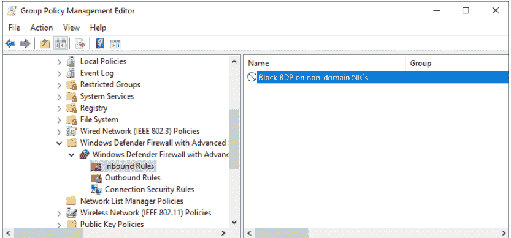

图 9.21：成功实现的防火墙规则

快得让你说不出 Jack Robinson，这条新防火墙规则已经在 Active Directory 中传播，并安装到你在策略的链接和筛选条件中定义的那些计算机和服务器上。

## 加密技术

加密技术的使用从大组织玩的东西快速发展到人人都需要的东西。我们大多数人多年来一直通过使用 HTTPS 网站来加密我们的网站流量，但在该领域也有令人惊讶的例外，许多廉价的网络托管公司仍然提供以明文传输流量的登录页面。这很糟糕，因为你现在通过常规 HTTP 或未加密的电子邮件在互联网上提交的任何内容，都必须假设它正在被其他人读取。很有可能你过于偏执，没有人真正拦截和读取你的流量，但你需要知道，如果你访问的网站地址栏显示 HTTP，或者如果你从任何免费电子邮件服务发送电子邮件，网页上输入的任何数据或电子邮件中的数据都可能被世界另一端的人轻松窃取。数据加密对于需要在互联网上传输的公司信息来说是绝对必要的；尽管如此，我说这的同时，我脑海中却在告诉我，绝大多数公司仍然没有在电子邮件系统上使用任何加密技术，因此这仍然是许多人等待发生的潜在灾难。

虽然我们在保护互联网浏览器流量方面做得越来越好，但我们传统上仍然没有太多关注组织墙内 *安全* 的数据。坏人并不愚蠢，他们拥有大量社交工程手段进入我们网络的工具箱。一旦进入，他们会发现什么？在大多数情况下，这是一场大混战。掌握一个用户账户或一台计算机，你就拥有了王国很大一部分的钥匙。幸运的是，Windows Server 2019 中内置了几种技术，旨在打击这些入侵并保护你的数据，即使它位于数据中心四面墙内。让我们看一些关于它们的信息，以便你可以探索使用这些加密技术进一步保护你的数据的可能性。

## BitLocker 和虚拟 TPM

**BitLocker** 是一种在企业网络中的客户端系统上变得相当熟悉的技术。它是一种全盘加密技术，使我们能够确保笔记本电脑或可能被盗的计算机上的数据得到充分保护。如果小偷拿到公司笔记本电脑，撬出硬盘并将其插入自己的电脑……对不起查理，没有访问权限。整个卷都被加密了。这对于可能轻易丢失或被盗的移动硬件来说非常有意义。但在该技术的初期阶段，从未真正考虑过使用 BitLocker 来保护我们的服务器。

随着云计算资源的加速采用，突然在服务器上使用 BitLocker 变得更有意义。更具体地说，在谈论云时，我们真正想要的是在我们的 **虚拟机 (VMs)** 上使用 BitLocker，无论是客户端还是服务器操作系统。无论你将 VM 存储在公共云服务提供商提供的真正的云环境中，还是托管自己的私有云，其中租户可以进入创建和管理自己的 VM，如果没有加密这些虚拟硬盘——VHD 和 VHDX 文件——你的数据绝对 **不** 安全。为什么不？因为任何拥有虚拟化主机平台管理权限的人都可以轻松访问服务器硬盘上存储的任何数据，而无需任何对网络或域上用户账户的访问。他们所要做的就是复制你的 VHDX 文件（服务器整个硬盘内容），复制到 USB 闪存驱动器，带回家，在自己的系统上挂载这个虚拟硬盘，bingo——他们就可以访问你的服务器硬盘和你的数据。这是数据安全合规性的一个大问题。

为什么历史上加密 VM 并不可行？因为 BitLocker 有一个有趣的要求。硬盘被加密，这意味着它在加密未解锁的情况下无法启动。我们如何解锁硬盘以便机器可以启动？有两种方法之一。

最佳方法是將 **解锁密钥** 存儲在 **受信任平台模块 (TPM)** 內部。這是一種物理微芯片，已內建於您今天購買的大多數計算機中。將 BitLocker 解鎖密鑰存儲在該芯片上意味著您無需將任何東西物理連接到計算機即可使其啟動，您只需輸入 PIN 以獲得對 TPM 的訪問權，然後 TPM 解鎖 BitLocker。另一方面，如果您選擇在沒有 TPM 的情況下部署 BitLocker，要解鎖 BitLocker 卷並使其可啟動，您需要插入一個包含 BitLocker 解鎖密鑰的物理 USB 隨身碟。您是否看出在 VM 場景中這兩種安裝路徑的問題？VM 無法擁有物理 TPM 芯片，而且您也沒有輕鬆插入 USB 隨身碟的方法！那麼，我們如何加密這些 VM 才能防止雲主機公司的窺探者看到我們所有的東西呢？

引入 **虚拟 TPM**。此功能在 Windows Server 2016 中全新推出；我們現在可以為虛擬服務器提供一個虛擬 TPM，用於存儲這些密鑰！這是令人難以置信的消息，意味著我們終於可以加密我們的服務器，無論它們是托管在數據中心中的物理 Hyper-V 服務器上還是位於 Azure 雲中。

## Shielded VMs

使用 BitLocker 和虛擬 TPM 來加密和保護虛擬硬盤文件會產生一種稱為 **受保护的虚拟机** 的東西。受保护的虚拟机 是一種首次在 Windows Server 2016 中引入並在 Server 2019 中得到改進的功能。我知道這只是這種令人驚嘆的新技術的一點點嘗試和預覽，但我想在這裡提及它，因為它確實與我們服務器環境的整體安全態勢相關。

我們將在 *第14章，Hyper-V* 中對受保护的虚拟机 進行更詳細的介紹。

## Encrypted virtual networks

如果我們能夠從圖形化管理界面配置、控制和管理我們的網絡，而不是整天查看路由器 CLI，不是會很棒嗎？我們不會從網絡靈活性中受益，將服務器和工作負載從一個子網移動到另一個子網，而無需更改這些服務器的 IP 地址或路由？我們找不到某種方法來自動加密服務器之間流動的所有流量，而無需在服務器本身上配置該加密嗎？

是的，是的，而且是的！通過使用 **软件定义网络 (SDN)** 和一種名為 **加密虚拟网络** 的新功能，我們可以實現所有這些目標。這段文字實際上只是一個參考點，一個將您引導回 *第7章，使用 Windows Server 2019 进行网络* 的地方，如果您跳過了它而直接到達這裡。我們已經討論過 SDN 及其創建並自動加密在 Hyper-V VM 和 Hyper-V 主機服務器之間流動的虛擬網絡的新功能，因此如果這個想法引起了您的興趣，請務必返回並重新閱讀該章節。

## Encrypting File System

**加密文件系统 (EFS)** 是 Microsoft Windows 的一個組件，已存在於客戶端和服務器操作系統中多年。雖然 BitLocker 負責保護整個卷或磁盤，但 EFS 更為具體。當您只想加密某些文檔或文件夾時，這就是您需要轉向的地方。當您選擇使用 EFS 加密文件時，重要的是要了解 Windows 需要在加密/解密過程中使用用戶證書，因此內部 PKI 的可用性是成功部署的關鍵。還需要注意的是，身份驗證密鑰與用戶密碼綁定，因此完全受損的用戶帳戶可能會抵消 EFS 提供的優勢。

我認為許多公司不使用 EFS 是因為您將加密哪些文檔的決定留給用戶。這也意味著您依賴他們首先記得進行加密，這意味著他們必須了解其重要性才能使其值得花時間。我想提到 EFS 是因為它仍然存在，並且仍然是一個可以加密數據的有效平台，但大多數管理員更傾向於將 BitLocker 作為更好的解決方案。用戶缺乏責任感以及良好的集中管理平台確實使 BitLocker 比 EFS 領先一大步。不過，兩種技術完全可以共存，在兩個不同的層級上保護數據安全，而不是僅依賴您可用的數據加密技術之一。

## IPsec

操作系統中內置的大量加密技術圍繞的是靜態數據。但我們的移動數據呢？我們談過在 HTTPS 網站上使用 SSL 作為加密在互聯網上移動的 Web 瀏覽器數據的一種方式，但對於不通過 Web 瀏覽器流動的數據呢？

如果我甚至不關心互聯網呢？如果我有興趣保護可能在公司網絡 *内部* 點對點流動的流量呢？有什麼可以幫助滿足這類需求嗎？當然有。

**IPsec** 是一組協議套件，可用於對網絡通信過程中發生的數據包進行身份驗證和加密。IPsec 並非特屬於 Microsoft 世界的技術，但在 Windows Server 2019 中有各種方式可以利用 IPsec 來保護您在機器之間傳輸的數據。

在 Windows Server 上，IPsec 交互最常見的地方是在使用遠程訪問角色時。配置 RA 服務器上的 VPN 時，您將擁有 VPN 客戶端可用於連接到 VPN 服務器的多種連接協議。IPsec (IKEv2) 隧道包含在可能的連接平台列表中。第二個使用 IPsec 的遠程訪問技術是 DirectAccess。當您在網絡中建立 DirectAccess 時，每當客戶端計算機通過互聯網向 DirectAccess 服務器創建 DirectAccess 隧道時，該隧道都會受到 IPsec 保護。值得慶幸的是，您用於部署 VPN 和 DirectAccess 的遠程訪問管理控制台足夠智能，能夠知道使 IPsec 身份驗證和加密工作所需的一切，您不需要知道 IPsec 的任何事情即可使這些遠程訪問技術為您工作！

遠程訪問角色提供的 IPsec 的一大缺失因素是網絡 *内部* 的流量。當您談論 VPN 或 DirectAccess 時，您談論的是在互聯網上移動的流量。但如果您只想加密在同一網絡內兩個不同服務器之間移動的流量呢？或者從辦公室內的客戶端計算機流向辦公室內本地服務器的流量呢？這就是了解 IPsec 策略設置派上用場的地方，因為我們可以指定希望公司網絡內流動的流量使用 IPsec 進行加密。實現這一點只是將正確的策略付諸實施的問題。

## Configuring IPsec

在 Microsoft Windows 環境中，IPsec 設置可以在兩個不同的地方進行配置。舊系統和新系統都可以通过傳統的 **IPsec 安全策略管理单元** 來提供 IPsec 配置。如果您運行的是所有較新的系統，例如 Windows 7 和 Server 2008 及以上版本，那麼您也可以採用 **具有高级安全性的 Windows Defender 防火墙** 來設置 IPsec 策略。WFAS 是最靈活的解決方案，但並非總是可選，取決於您環境中遺留系統的狀態。

首先，讓我們看一下舊的 IPsec 策略控制台。我們從這裡開始，因為可用的不同選項將有助於為我們建立一個基準，從而開始理解 IPsec 交互在兩個端點之間的工作方式。在此控制台中，我們將遇到可以分配給您機器 IPsec 策略的三個不同分類。讓我們花一點時間解釋每一個，因為策略名稱可能有點誤導。了解這些選項將使您在理解 WFAS 內部設置的工作方式時領先一步。

## Server policy

Server 策略可能應該更名為 *请求方* 策略，因為這才是它的真正作用。當一台計算機或服務器向另一台計算機或服務器發出網絡請求時，它是在請求建立網絡連接。在這些請求計算機上——即發起流量的計算機——這裡我們告訴 IPsec Server 策略應用。一旦應用，Server 策略會告訴該計算機或服務器請求對發起機器與遠程計算機之間的通信會話進行 IPsec 加密。如果遠程系統支持 IPsec，則會創建 IPsec 隧道以保護兩台機器之間流動的流量。不過，Server 策略相當寬鬆，如果遠程計算機不支持 IPsec，則網絡連接仍然成功但保持未加密狀態。

## Secure Server policy

這裡的區別在於 Secure Server 策略 *要求* IPsec 加密才能允許網絡通信發生。我們之前談到的普通 Server 策略在可能時會使用 IPsec 加密，但如果不可能則會繼續以未加密方式傳輸流量。另一方面，如果兩台機器之間無法協商 IPsec，Secure Server 策略將完全無法建立連接。

## Client policy

Client 策略需要更名為 *响应方* 策略，因為它位於連接的另一端。Client 策略不關心請求 IPsec 會話；它只關心 **接收** 一個。當一台計算機向服務器發出網絡請求，並且該計算機具有 Server 或 Secure Server 策略因此請求 IPsec 時，該計算機試圖連接的服務器就需要分配 Client 策略以接受並建立該 IPsec 隧道。Client 策略通過允許該會話進行加密來響應。


## IPsec 安全策略管理单元

用于操作 IPsec 设置的原始控制台通过 MMC 访问。打开它，并添加 **IP Security Policy Management** 管理单元。有趣的是，在添加此管理单元时，你会注意到可以查看当前登录的机器的本地 IPsec 策略，也可以打开域的 IPsec 策略。如果你有兴趣配置域范围的 IPsec 实施，这里就是处理这些设置的工作区域。但如果只是想探头进来看看，你可以选择 **Local computer** 来查看控制台：

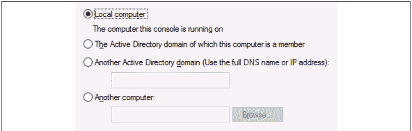

图 9.22：探索本地服务器的 IPsec 配置

进入后，你可以看到可能已存在的任何 IPsec 策略，或通过在 **IP Security Policies** 上右键单击时可用的 **Create IP Security Policy...** 操作开始创建自己的策略。执行此操作将启动一个向导，引导你完成自己的 IPsec 策略配置：

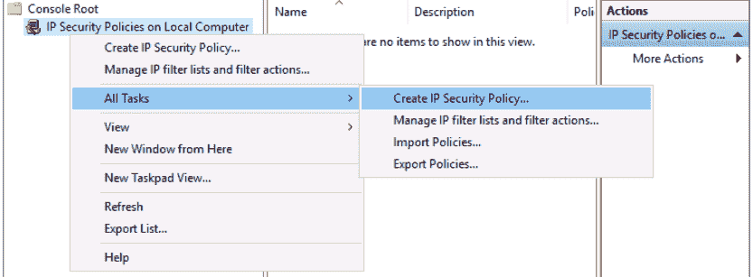

图 9.23：创建 IP 安全策略

## 改用 WFAS

用于建立 IPsec 连接规则的新平台是 Windows Defender 防火墙高级安全。请打开它，你已经熟悉操作了。进入后，导航到“连接安全规则”部分，该部分列在“入站规则”和“出站规则”正下方。连接安全规则是定义 IPsec 连接规则的位置。如果你在连接安全规则上右键单击并选择 New Rule...，然后你将通过一个与创建防火墙规则类似的向导：

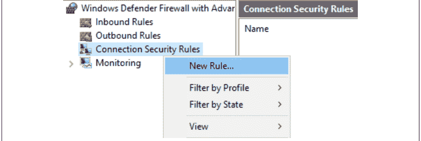

图 9.24：WFAS 也可用于创建 IPsec 策略规则

进入创建新规则的向导后，你会发现可用的选项与创建新防火墙规则时显示的选项大不相同。这是建立 IPsec 连接安全规则的平台，这些规则定义 IPsec 隧道的外观，以及需要在哪些机器或 IP 地址上处于活动状态：

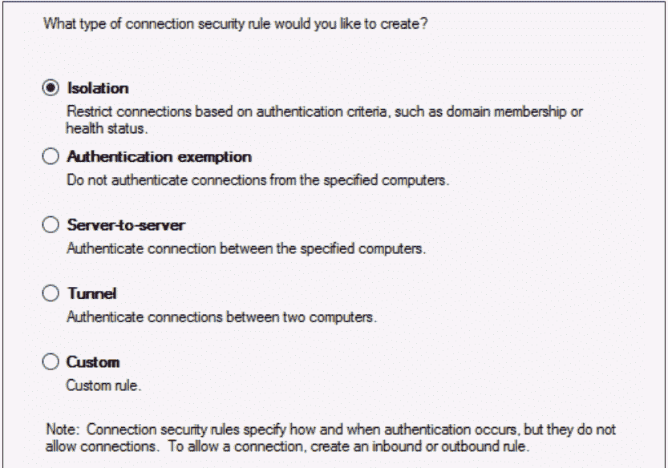

图 9.25：连接安全规则的类型

这里没有空间涵盖此向导中的所有可用选项，但我强烈建议从这里继续并通过以下 Microsoft Docs 文章进一步深入：https://docs.microsoft.com/en-us/previous-versions/windows/it-pro/windows-server-2012-R2-and-2012/hh831807(v=ws.11)。

## Azure AD 密码保护

如果你是 Azure Active Directory 客户，你已经可以访问这个名为 **Azure Active Directory Password Protection** 的新功能，前身称为 **banned passwords**。其思路是：Microsoft 维护一个持续更新的常见弱密码全球列表（例如单词 *password*）并自动阻止该密码的所有变体，例如 *P@ssword*、*Password123* 等。如果用户尝试将其创建为自己的密码，这些潜在密码将被完全阻止。你还可以在 Azure Active Directory 界面中添加自己的自定义禁止密码。一旦在 Azure 中启用了禁止密码，此功能也可以通过实施 Azure Active Directory Password Protection 代理服务移植到你的本地 Active Directory 环境中（哇，这名字太长了）。此代理在本地域控制器和 Azure Active Directory 之间进行接口，确保用户尝试在本地域控制器上设置的密码符合 Azure 禁止密码算法定义的规则。

要使用此技术，你当然必须使用 Azure Active Directory，因此并非人人适用。然而，如果你确实拥有并同步到 Azure Active Directory，那么此功能甚至可回溯到较旧版本的本地域控制器。这些服务器可以老到 Windows Server 2012。

这里有一个关于禁止密码的进一步信息的链接：https://docs.microsoft.com/en-us/azure/active-directory/authentication/concept-password-ban-bad-on-premises。

## 细粒度密码策略

正如我们在讨论域级密码策略时早已承诺的，我们在这里逐步介绍细粒度密码策略的构建。大多数组织确实要求用户具有特定的密码复杂度，但几乎总是通过默认域策略 GPO 实现，这意味着域内每个人的密码复杂度和过期设置完全相同。

如果你需要在某些用户账户上启用复杂度，而在其他账户上不启用怎么办？也许你有经常旅行的销售人员，要求他们使用非常强且复杂的密码是有意义的。但假设你还有一个机加工车间，用户每天必须登录计算机，但这些计算机从未离开办公室，并且用户从未在除这些物理安全设备之外的任何系统上输入其凭据。

对于那些机加工车间用户来说，真的有必要拥有与外出销售人员相同的密码复杂度级别吗？他们是否也应该被要求每 30 天更新一次密码，仅仅因为你也要求你的销售人员这样做？

从 Windows Server 2012 开始，登录任何域控制器服务器并启动服务器管理器，在“工具”列表的最顶部你会看到一个名为 **Active Directory Administrative Center (ADAC)** 的项目。此 ADAC 工具可用于操作 Active Directory 中的许多内容，但对我们今天的目的而言最重要的是，此新工具是使你能够创建 **fine-grained password policy (FGPP)** 的机制。FGPP 使我们刚才提到的场景成为可能，即创建多个密码策略并将这些策略分配给不同类别的用户和用户账户。

以域管理员身份登录域控制器并打开 ADAC。在左侧导航窗格中，展开内部域的名称，然后 **System | Password Settings Container**。在我的实验室环境中，我单击的是 **contoso (local) | System | Password Settings Container**。目前，密码设置容器为空，但使用 **New | Password Settings** 任务即可开始操作：

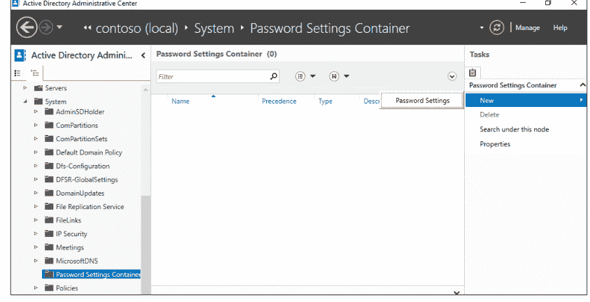

图 9.26：细粒度密码策略在 ADAC 内部配置

**Password Settings** 屏幕相当自解释。在这里，你定义与通常在默认域策略 GPO 中配置的相同类型的密码复杂度、长度和过期标准。你可以在图 9.27 中看到，我创建了一个名为 **Sales Users** 的密码设置策略，具有若干特定标准。

我能够配置密码设置以及账户锁定设置（另一种通常通过 GPO 全局完成的安全设置），并筛选此密码策略，使其仅适用于我的 AD 组 Sales Users 中的用户：

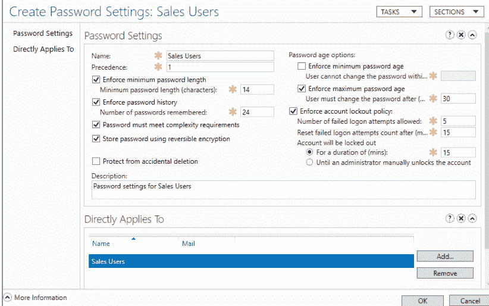

图 9.27：创建新的密码设置策略

现在我将再重复几次过程，之后你可以看到我的 ADAC 容器中有三个单独的密码设置策略：

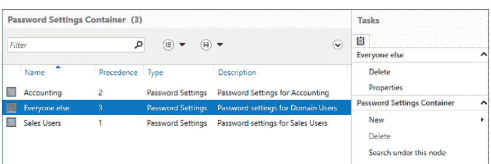

图 9.28：创建多个密码设置策略

> 这里需要注意的重要一点是，每个密码设置策略都有一个 Precedence 声明。由于我们将这些密码设置应用于组，某个用户可能属于多个组，从而获得多个密码策略是完全可能的。Precedence 数字有助于 FGPP 区分应应用哪些设置。

就是这样！一旦你在 ADAC 中定义了细粒度密码策略，这些新的密码设置现在将优先于默认域策略 GPO 中的设置。而不是通过组策略推送密码设置，使用细粒度密码策略利用 Active Directory 内部自己的对象来完成工作。这些对象称为密码设置对象（PSOs）。如果你想更深入地了解 PSO 的内部情况，现在你在 ADAC 中创建了 FGPP 后，请转到 Active Directory 用户和计算机，并在“查看”菜单下启用高级功能。启用高级功能后，你可以导航到域 | 系统 | 密码设置容器，并查看一分钟前创建的新 PSOs。


双击其中任何一个对象，然后访问 **属性编辑器** 选项卡，将显示该对象的密码标准详细信息。没有 *需要* 从 ADUC 内部访问这些对象，因为你始终可以从 ADAC 控制台内部对细粒度的密码策略进行调整和更改，但查看这些 PSO 有助于我们了解 Active Directory 如何存储和处理这些策略：

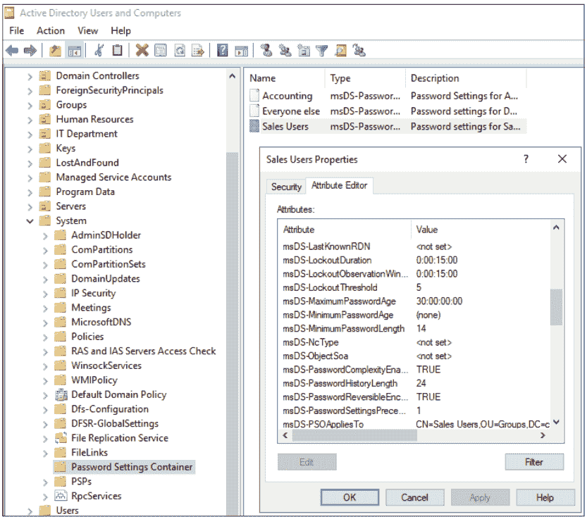

图 9.29：在 ADAC 外部查看密码标准

## 高级威胁分析 – 支持终止

我认为，过去几年微软推出的最酷的安全功能之一是 **高级威胁分析 (ATA)**，然而我几乎没听过有人谈论它。也许是因为他们从未将其作为内置于 Windows Server 操作系统的原生功能添加。ATA 是一种本地软件，运行在 Windows 之上，提供一些令人惊叹的功能。基本上，ATA 所做的是监控你所有的 Active Directory 流量，并在危险或异常行为发生时实时发出警告，就在它 *发生时*。

不幸的是，ATA 于 2021 年 1 月结束了主流支持。扩展支持仍将继续五年，因此我选择在本书最新版本中保留这些信息，因为这仍然是一种有效的技术，并且在已安装的环境中未来几年仍将存在。本节末尾提供了有关 ATA 路线图的更多信息。

## ATA 是什么（曾是）？

ATA 的想法非常简单易懂，而且合乎逻辑，以至于我们都会想知道为什么有人要花这么多年才想到这个主意。Active Directory 已经存在很长时间了，利用用户账户对环境的攻击也同样存在很长时间。发现和排查目录内的攻击是复杂而混乱的；AD 内部不断记录的信息太多，以至于几乎不可能在坏人作恶时抓住或追踪他们。在某种攻击发生后，你当然可以仔细研究多个域控制器的日志数据并拼凑出大致发生了什么，但能够在它 *发生时* 识别出来简直就是痴人说梦。还是吗…？

ATA 是一种使用机器学习的先进 Active Directory 监控形式。这就是 ATA 最酷的部分。你配置网络，使所有进出域控制器的流量也进入 ATA 系统。实现此目的最安全的方式是在网络层建立端口镜像，以便所有域控制器数据包也能到达 ATA，但处于攻击者无法看到的层面。

这样，即使有人恶意潜入你的网络并寻找针对他们的保护措施，ATA 对他们的窥探也保持不可见。然而，对该流量的端口镜像可能不是小型公司能够做到或初始设置过于复杂，因此第二个选项是直接在域控制器上安装 ATA 轻量级代理。该代理随后将必要的信息发送到 ATA 处理服务器。

无论哪种情况，这些 ATA 处理服务器都会接收所有这些数据并开始寻找模式。如果 Betty 使用名为 **BETTY-PC** 的台式电脑和名为 **BETTY-TABLET** 的平板电脑，ATA 会看到这种模式并将她的用户账户与这些设备关联。它还会监视她的正常流量模式。Betty 通常在上午 8 点左右登录，她的流量通常在下午 5 点左右停止。她通常访问几个文件服务器和一个 SharePoint 服务器。收集和监控数据一周左右后，ATA 对 Betty 的标准作案手法已有相当好的了解。

现在，有一天晚上，发生了某些事情。ATA 看到 Betty 账户出现了大量密码失败。那本身可能还不足以让人太兴奋，但随后 Betty 突然登录到她通常不访问的终端服务器。从那里，她的凭据被用来访问域控制器。糟糕，这听起来明显像一次攻击。对我来说很明显。有了我们目前可用的 Active Directory 内置工具，我们知道什么？几乎什么都不知道。我们可能会在深入事件日志后看到密码失败，基于此我们可以尝试查看其他服务器的事件日志以了解该账户访问了什么，但我们真的没有任何理由怀疑任何事情，也没有任何提示或警告表明正在发生什么。这可能是非常大泄露的开始，而我们永远看不到它。幸运的是，ATA 知道得更好。

ATA 的管理界面就像一个社交媒体信息流，几乎实时更新。在我刚刚描述的事件中，如果我们当时正在查看 ATA 信息流，我们会看到所有这些项目随着发生而发生，并且会立即明显有人入侵了 Betty 的账户并用它获得了对域控制器的访问权限。从未有过如此密集监视 Active Directory 流量的技术，也从未有过像这样学习模式和行为偏离的东西。这真是一种令人惊叹的技术，我并不是只因为我认识建造它的人才这么说。但既然我认识他们，我可以告诉你他们很聪明，这已经很明显了，因为微软把他们收购了。

即使这项技术现在正在演变为云层面的东西，让我们花几分钟时间回顾一下 ATA 界面的几个屏幕截图，以便你了解这种社交媒体风格的信息流是什么样的。这个屏幕截图来自微软的一个演示，其中他们故意从用户那里窃取了 Kerberos 票据，然后在另一台计算机上利用它以访问只有 Demi Albuz 应该能够访问的某些机密文件。虽然 ATA 并未阻止此活动，但它立即——我的意思是几秒钟内——在此信息流中发出警报，显示传递票据攻击：

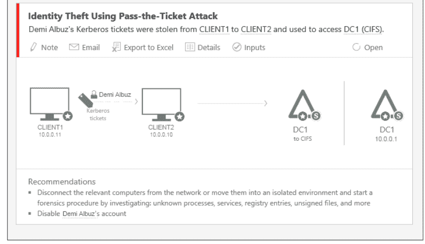

## 使用传递票据攻击进行身份盗窃

Demi Albuz 的 Kerberos 票据从 CLIENT1 被窃取到 CLIENT2 并用于访问 DC1（CIFS）。

建议

- 将相关计算机从网络断开或移至隔离环境，并开始取证程序，通过调查未知进程、服务、注册表项、未签名文件等进行调查
- 禁用 Demi Albuz 的账户

图 9.30：ATA 识别传递票据攻击

这里还有另一个例子，用户 Almeta Whitfield 突然访问了她通常不访问的 16 台计算机，这也是她的用户账户出现问题的另一个重大危险信号：

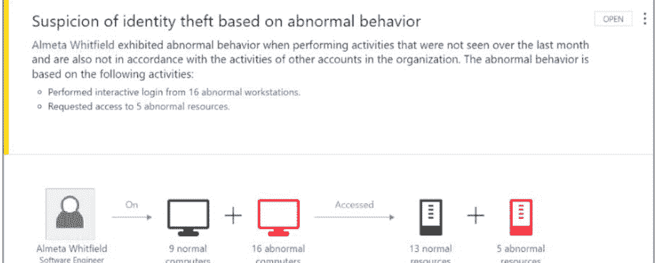

图 9.31：ATA 对异常行为发出警报

## Azure ATP

虽然 ATA 是本地解决方案，但其替代品位于云中。Azure 高级威胁保护是微软推荐的 ATA 替代品，尽管该公告似乎在 ATA 用户中引起了许多不满。主要问题是许可——Azure ATP 目前仅可与 Microsoft 365 E5 许可证一起使用，后者价格昂贵。

ATA 的文档仍在线提供，更多学习材料可在以下位置找到：https://docs.microsoft.com/en-us/advanced-threat-analytics/what-is-ata。

有关新的 Azure ATP 的更多信息，以下链接是良好的起点：https://techcommunity.microsoft.com/t5/security-compliance-identity/introducing-azure-advanced-threat-protection/ba-p/250332。

## 一般安全最佳实践

有时我们只需要依靠自己，而不一定是操作系统提供的功能来保护我们的系统。管理方面有很多常识性做法（身后这台键盘很有趣：我整天都可以创造新词），很容易实现但在实际操作中很少使用。


以下是多年来我所学到的一些技巧和窍门，并且帮助公司实施了这些技巧。希望作为读者的你能在此列表中添加更多对你有效的内容，但如果没有其他目的，本节旨在激发你的思考，帮助你找到创造性的方法来限制网络中的管理权限和漏洞。

## Getting rid of perpetual administrators

你所有的 IT 员工在入职当天就拥有域管理员权限吗？你的任何 IT 员工都能访问内置域管理员账户密码吗？你有普通用户其登录名在其自己的计算机上拥有管理权限吗？你知道我想表达什么——这些都是糟糕的主意！

不幸的是，在几乎每个网络中，这都是多年的现状，而且这一趋势至今仍在继续。我仍然经常看到工程师在设置新服务器时使用 **管理员** 域账户执行许多任务。这意味着他们不仅可以访问网络中可能最重要的账户并将其用于日常任务，而且意味着使用此用户账户设置的所有内容都无法追责。我是什么意思？当我使用通用管理员账户设置新服务器或对现有服务器进行更改时，如果最终导致某种大问题，没有人能证明是我做的。使用通用用户账户是导致出现问题时逃避责任的可靠方法。我并不是暗示你总是想知道“谁干的”，但如果我在我不常管理的应用程序服务器上搞砸了什么，很好的是，试图修复问题的人能够轻松判断出是我做的，并来问我做了什么，以便他们可以撤销它。使用内置管理员账户对我们所有人来说都应被禁止，有很多原因。

针对客户端，你的用户真的需要在其计算机上拥有管理权限吗？*真的吗？* 我认为你大概能找到变通方法。将普通用户降级为其系统上的用户甚至高级用户权限，可以对这些计算机的安全性产生巨大影响。如果用户在安装前需要通过提示请求管理员权限，病毒自行安装就会变得困难得多。它还使所有机器保持更一致的行为模式，而不会由用户引入新的未知应用程序和设置。

## Using distinct accounts for administrative access

这个想法建立在上一个想法之上，并且是我开始在为朋友和家人安装的所有家庭电脑上采用的做法。归根结底就是这样：使用两个不同的用户账户。一个具有管理访问权限，一个没有。当你登录进行日常任务和琐事时，确保你使用的是没有管理权限的普通用户账户登录，无论是在本地计算机还是域上。这样，如果你尝试安装任何东西，或者有东西尝试自行安装，你将被用户账户控制（UAC）框提示，要求你在安装程序被允许执行任何操作之前输入管理员用户名和密码。我可以告诉你这有效，因为我在浏览互联网为某个项目做研究时，已经阻止了我自己的电脑上多款病毒和/或臃肿软件自行安装。如果我收到 UAC 提示要求输入管理员密码，而我没有点击安装程序文件，我就知道这是我不想要的。我只需点击“否”，该安装程序就无法控制我的电脑。另一方面，如果是我打算安装的东西，那么只需输入我的管理员账户密码并允许安装程序继续，这只是一个小小的麻烦。

维护两个独立的账户让你能够完成大多数日常任务，同时安心知道你没有权限无意中对系统造成不良影响。这种心态也自然限制了管理员账户在任何给定计算机上执行的活动或更改量，这意味着对这些账户的更改进行日志记录和跟踪变得更容易。这导致更高的责任性和更好的变更管理流程。

## Using a different computer to accomplish administrative tasks

如果你想在独立用户账户的想法上更进一步，你可以通过在执行管理级别任务时使用完全不同的计算机，使你的计算体验更加安全。一台用于普通知识工作者任务，另一台用于管理。这当然有助于保持你的管理系统的安全，以及它所访问的远程系统的安全。虽然在办公桌上拥有两台物理计算机似乎很麻烦，但请记住，在 Windows 10 的大多数 SKU 中，我们可以在台式机上直接运行 Hyper-V。

我在自己的电脑上就是这样做的。我有一台运行 Windows 10 的电脑，然后在该电脑内部，我通过 Hyper-V 运行一个虚拟机，从中执行对敏感服务器的所有管理任务。这样，我的日常操作系统的被入侵并不必然导致整个环境被入侵。

你也可以反向使用这个想法。当需要测试一些新软件、功能或链接时，你可以在工作站上通过 Hyper-V 启动一个 VM，使其完全断开与任何网络的连接以实现沙箱隔离，并测试你需要测试的任何新东西或可疑东西。如果它导致你的 VM 崩溃，没关系。只需删除它并创建一个新的即可。

无论你选择在用户账户级别还是计算机级别拆分管理访问权限，请记住这个简单规则：**永远不要从你浏览 Facebook 的同一位置管理 Active Directory**。我认为这已经很好地概括了这一点。

## Never browse the internet from servers

看起来是显而易见的，但每个人都这样做。我们整天都在服务器上工作，很经常需要通过网页浏览器查阅某些东西。由于 Internet Explorer 存在于 Windows 服务器上，有时直接从我们工作的服务器控制台检查所需内容要比走回办公桌更快更方便。有时（也许经常）我们甚至更进一步，有意识地在服务器上安装不同的、更好的浏览器，只是为了在需要时可以使用。抵制这种诱惑！从互联网上获取不良东西很容易，尤其是在服务器上，因为如果我们网络中的任何机器未运行防病毒保护，那很可能是在服务器端。互联网过滤器也是如此。我们总是确保客户端流量通过我们的企业代理（如果有）或其他保护机制，但我们并不总是关心服务器流量是否以同样的方式流出。

即使是信任的网站也不要这样做。中间人攻击或网站本身被入侵都可能轻易破坏你的服务器，更糟糕的是让某人访问它，从而访问你的整个网络。重建客户端计算机比重建服务器容易得多。

## Role-Based Access Control (RBAC)

短语“基于角色的访问控制（RBAC）”并不仅限于 Microsoft 环境。它也不是可以在 Windows Server 2019 内部使用的特定技术，而是一种关于分离工作角色和职责的理念。

当我们从 IT 角度思考如何分离员工的工作角色时，我们传统上会想到 Active Directory 组。虽然将用户账户添加到组中确实解决了关于划分权限和访问级别的许多问题，但在这种思维方式上扩展可能会很复杂，最终 AD 组仍然赋予管理员对组本身的完全访问权限。RBAC 技术在不同层面上划分角色，关注的不仅仅是权限。RBAC 更关注员工的工作描述而非访问限制。有许多不同的技术利用了集成其中的 RBAC 工具，甚至还有第三方 RBAC 解决方案运行在所有现有基础设施之上，使其在整个组织中广泛可用，而不受单个域或林的限制。

## Just Enough Administration (JEA)

Windows Server 2019 中包含的一个很好的 RBAC 技术示例是 Just Enough Administration（JEA），它是 PowerShell 的一部分。JEA 为你提供了一种授予人员特殊特权访问权限的方法，而无需给予他们管理权限，而在过去完成相同职责时这是必需的。将某人添加到服务器的管理员组以便他们完成工作是相当常见的，但 JEA 是摆脱这种必要性的第一步。

在我们旧的思维方式中，很容易认为 JEA 就像允许用户在 PowerShell 中拥有管理访问权限，即使他们本身没有操作系统的管理权限，但它比这更强大。JEA 的设计允许你仅允许用户以管理级别运行特定的 PowerShell 命令和 cmdlet，而他们不需要访问的其他命令则保持在黑暗中。

事实上，如果用户在 PowerShell 的 JEA 上下文中工作并尝试调用不在其允许的 cmdlet 列表中的 cmdlet，PowerShell 会假装根本不认识该 cmdlet。它不会说，对不起，你不能这样做——它只是忽略该命令！这绝对有助于防止窥探的手伸进饼干罐，除非你想让他们进入。

这里有一个示例场景有助于说明 JEA 的能力。也许你是 DNS 管理员，偶尔需要重启 DNS 服务。由于我们采用了 JEA/RBAC 的思维方式，你不会在该 DNS 服务器的操作系统上拥有管理权限，但你将在 PowerShell 中拥有基于 JEA 的权限，以便你可以运行完成工作所需的工具。


重启 DNS 服务需要使用 Restart-Service cmdlet 的权限，对吧？但这是否意味着我就能重启该服务器上的任何服务，并可能做各种我不需要做的事情？JEA 甚至足够强大来处理这种情况。在设置用户所需的访问级别时，你可以深入到特定的 cmdlet 并划分权限。在我们的示例中，你可以为用户提供使用 Restart-Service cmdlet 的访问权限，但仅授予重启特定服务的权限，例如与 DNS 相关的服务。如果用户尝试对 WINrm 使用 Restart-Service，则会被拒绝。

## 禁用外部 RDP...立即

我们都知道如何通过 RDP 连接到服务器，而且我敢打赌，阅读本文的 99% 的人每周大多数日子都会通过 RDP 连接到服务器。从企业内部网络这样做是与服务器交互的一种快速简便的方式，我们采用这项技术是有道理的。你是否曾想过允许通过互联网进行 RDP 访问的可能性？如果能在家用电脑上直接打开 MSTSC，然后直接进入服务器，而无需先建立繁琐的 VPN，那不是很好吗？你做过吗？你现在是否有服务器在防火墙上配置了 NAT 规则，以便你可以使用 RDP 从世界任何地方访问某个端口并直接 RDP 到你的服务器？

立即停止！

关闭端口，删除 NAT 规则，不要过关，不要收取 200 美元。

这是最糟糕的想法，然而我却经常发现类似的 NAT 规则。我经常与新公司合作，支持其基础设施的各个部分，在排查这些客户网络时，我们总是会检查防火墙规则。令人惊讶的是，世界上有多少地方的服务器 RDP 访问对整个互联网开放。

现在，也许你会这样对自己说：“当然我不会那样做！好吧，我会，但我很狡猾，会为此访问使用模糊的端口号。你绝对找不到我的防火墙上开放的 RDP 端口 3389，因为我设置了 NAT 规则，让你必须连接到像 33343 和 5896 这样疯狂的端口；没人会找到那些。”

你。错。了。

外部端口是 3389 还是 12345 或其他任何端口都没有区别。你可能变得更狡猾了，还更改了服务器用于侦听 RDP 连接的端口，这样 3389 在外部或内部通信中都不会涉及。这仍然没有区别。攻击者拥有端口扫描器，可以轻松查找任何开放的 RDP 通道；这些 RDP 通道使用的端口对他们来说没有任何区别。

风险是什么？一切。勒索软件。你的整个网络瘫痪。这就是风险。我怎么知道？因为我曾帮助多家公司从备份中恢复所有内容，所有服务器，只是因为一条允许从互联网 RDP 访问服务器的 NAT 规则。仅仅一条小规则指向一台小服务器，整个基础设施一夜之间就被勒索软件锁定。

如果你允许 RDP 连接通过允许从互联网通信的 NAT 规则流入你的网络，那么坏人进入你的网络只是时间问题。这会发生。事实是它还没有发生，只是运气好。

立即删除防火墙规则并锁定它，然后研究更好的远程提供 RDP 访问的方法。这可能意味着从客户端启动 VPN，也可能意味着在你的环境中设置一个 RD Gateway 服务器。RD Gateway 是安全的，我绝不是说你的 RD Gateway 服务器有风险，因为它们允许从互联网 RDP 访问内部机器。那是它们的目的，而且它们有机制使这种通信安全。

## 摘要

许多 CIO 的头号议程项目是安全。客户端机器的安全、网络的安全、云资源的安全，最重要的是数据的安全。没有单一的解决方案可以保护你的基础设施；它需要许多移动部件和许多不同的技术协同工作，为你的资源提供安全保障。本章的目的是提供可在任何环境中使用的安全措施和技术的示例，并重新确定安全在当今 IT 世界中的重要性。关于隐私和安全的问题需要针对我们部署的任何和所有技术解决方案进行讨论。太多时候我发现新应用在组织内部实施时完全不考虑该应用平台的安全性。传输或存储未加密数据的应用需要被修改或废弃。保护信息对于我们业务的长久至关重要。

在没有讨论我们迄今为止在本书中一直忽略的默认操作系统安装选项的情况下，我们无法完成关于 Windows Server 2019 安全的讨论。在下一章，我们将深入研究 Server Core，我们无头且更不易受攻击的 Windows Server 版本。

## 问题

- 1. Windows Server 2019 内置的反恶意软件产品名称是什么？
- 2. 当域加入的计算机位于企业局域网内时，应激活哪个 Windows Defender 防火墙配置文件？
- 3. 除了域配置文件之外，Windows Defender 防火墙中还有哪两种可能的防火墙配置文件？
- 4. 创建允许 IPv4 ping 回复的防火墙规则时，在入站规则中必须指定什么协议类型？
- 5. 将标准化的 Windows Defender 防火墙规则推送到整个员工队伍的最简单方法是什么？
- 6. 虚拟硬盘文件被加密的虚拟机称为...？
- 7. 用于解析域控制器信息以识别传递哈希和传递票据攻击的 Microsoft 技术名称是什么？
