# 10 Server Core

Honey, I shrunk the server! 另一章，另一个过时的电影引用。过去 20 年左右，我们只见证了微软操作系统的不断增长。增长可能是好的；新功能和增强功能使我们的生活更轻松。但增长也可能不好，例如臃肿的文件结构和占用内存的图形界面。如果你按磁盘空间消耗和内存需求等因素，以占用空间为基准，按时间顺序绘制 Windows 和 Windows Server 操作系统的图表，它将显示出稳步上升的趋势。每个新版本都需要比前一版本稍多一点的处理能力和稍多一点的硬盘空间。那一直是这种情况，直到——我有点猜测——也许是 Windows 8 和 Server 2012。我们看到了降低这些阈值数字的惊人举措，这是一个受欢迎的变化，但变化并不太剧烈。我是说，从一台新的 Windows Server 2019 机器包含各种核心项目仍在 C:\Windows\System32 内部运行这一事实中，你能得到什么启示？我们甚至不谈注册表里有什么。显然，还可以做出更多削减，在某种程度上，新操作系统仍然只是建立在旧操作系统之上并在其上进行修补。

也许到现在为止。这里，我们将谈谈以更小、更小的规模使用 Windows Server 2019 的替代方法。Server Core 已经存在相当一段时间了，但我很难找到真正使用它的人。这个微型化的 Server 2019 版本旨在为你提供更小、更高效、更安全的服务器平台。

本章将涵盖以下主题：
- 为什么使用 Server Core？
- 与 Server Core 交互
- 用于管理 Server Core 的 Windows Admin Center
- Sconfig 实用工具
- Server Core 中可用的角色
- 构建 Server Core 域控制器
- Nano Server 发生了什么？

### 为什么使用 Server Core？

我为什么要谈论 Server Core？它不是从 2008 年就存在了吗？是的，这正是我谈论它的原因。Windows Server 操作系统的 Server Core 变体已经存在相当一段时间了，但似乎许多管理员害怕信任它。我与来自不同行业的许多不同公司合作。他们都有一个共同点：他们使用大量 Windows 服务器，而且所有这些 Windows 服务器都在运行完整的 GUI（桌面体验）。他们听说过 Server Core 吗？当然。它们在实验室中测试过吗？有时。每个人似乎对 Core 的经验水平略有不同，但在生产环境中找到一个实例却很少见。也许我只是找错了人，但我必须假设我们大多数人——包括我自己——需要更定期地开始使用 Server Core。

我们为什么需要开始使用 Server Core？因为微软说，无 GUI 服务器是未来。你能相信在 Windows Server 2016 预览早期，Desktop Experience 选项甚至不存在吗？你甚至无法在 Server 2016 上运行完整的 GUI 桌面 shell（尽管每个人都想），除了可以放在 Server Core 之上的迷你 shell。微软因此受到了大量批评，以至于在一次技术预览发布期间重新添加了完整的 Desktop Experience。即使如此，从那时起，你可能已经注意到 Server Core 是安装任何 Windows Server 操作系统的默认选项。还记得我们书的开头，我们快速回顾了实际的 Server 2019 安装吗？安装的默认选项不是 Desktop Experience；而是图 10.1 中的那个顶部选项，即安装命令行驱动的 Server Core 的选项：

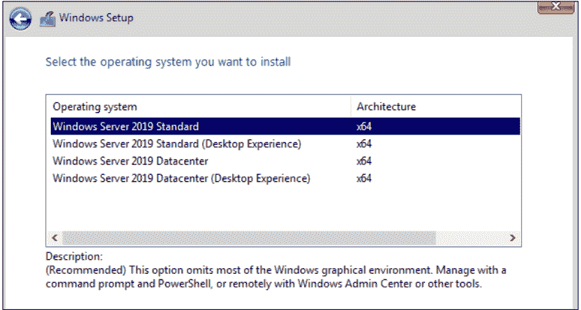

## 选择要安装的操作系统

| 操作系统 | 架构 |
|---|---|
| Windows Server 2019 Standard | x64 |
| Windows Server 2019 Standard (Desktop Experience) | x64 |
| Windows Server 2019 Datacenter | x64 |
| Windows Server 2019 Datacenter (Desktop Experience) | x64 |

描述：
（推荐）此选项省略了大部分 Windows 图形环境。使用命令提示符和 PowerShell 管理，或通过 Windows Admin Center 或其他工具远程管理。

图 10.1：默认安装选项是 Server Core

远离图形界面的一个原因是为了获得更强的自动化和可扩展能力。当我们的所有服务器都以相似的方式构建时，就意味着我们可以用它们实现更多类似云的功能。随着需求的出现自动启动和关闭资源，一键推出数十台服务器——这种自动化和规模调整在云中是可能的，但之所以可能，是因为基础设施的设置方式非常标准化。云硬件资源需要如此精简，以至于操作和自动化工具可以让它们按需执行，而不必担心用户调整的图形界面中会出现的所有变量。

将所有服务器都作为这种有限、受限的版本运行还有其他明显的优势。与传统的完整服务器体验相比，Server Core 具有更少的硬盘空间占用、更少的内存消耗以及更小的攻击面。现在你可以看到我一分钟前为什么要做出那种强硬的声明，认为我们所有人都需要开始更习惯于 Server Core！事实上，让我们来看看这种更小的占用空间。运行 Desktop Experience 的基础 Server 2019 Standard 消耗大约 10 GB 的硬盘空间；我通过查看我的 CA1 服务器使用的虚拟硬盘文件属性刚刚验证了这一点。CA1 是一台运行完整 Desktop Experience 的标准 Windows Server 2019。现在，我刚刚完成了我的第一台 Server Core 操作系统的安装，我们可以在图 10.2 中看到，这个新虚拟机使用的 VHDX 文件只有 5.8 GB，空间减少了 40%：

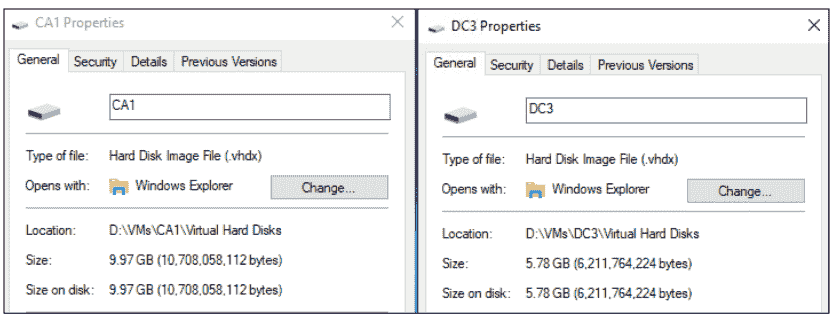

图 10.2：Server Core 占用的空间比 Server 2019 Standard 少

## 不再来回切换

这里有一个非常重要需要注意的地方：在 Windows Server 2012 R2 中使用过 Server Core 的人知道，我们当时有在运行中更改服务器的选项。我的意思是，如果你创建了一台完整的 Desktop Experience 服务器，后来可以将其更改为 Server Core。相反的做法同样可行；你可以将 Server Core 切换为完整的 Desktop Experience。虽然此功能存在，但它实际上让更多人使用 Server Core，因为即使你对与 Server Core 的交互一无所知，你也可以像对待任何其他服务器一样以图形方式构建新服务器，安装角色并进行配置，完成后，再将其切换为 Server Core，从而禁用图形界面。

不再如此了！在平台之间来回移动服务器的能力已被移除。我再重复一遍，这已不再可能。因此，从现在开始在安装这些操作系统时要仔细规划。如果你将服务器实现为 Server Core，那么它在其生命周期内都将保持为 Server Core。

## 与 Server Core 的交互

在完成第一次 Server Core 安装后，你将看到以下锁定屏幕：

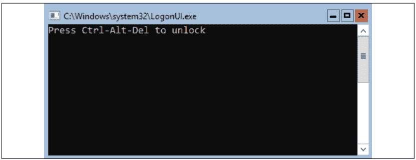

图 10.3：Server Core 锁定屏幕

那真的是一个显示 **按 Ctrl-Alt-Del 解锁** 的命令提示符窗口吗？是的，确实是。当管理员第一次看到它时，这通常会引起几声笑。我知道我当时也是如此。它让我想起了高中数学课上我们在 TI-83 计算器上编写 if/then 游戏的时光。按下 *Ctrl + Alt + Del*，你将被提示首次更改管理员密码，这是必须在 Windows Server 的 GUI 版本中首先执行的操作。不同之处在于，你完全在命令提示符窗口中使用键盘来完成。一旦你正式登录到服务器，你会发现自己坐在一个传统的 C:\Windows\system32\cmd.exe 提示符下，闪烁的光标等待指令：

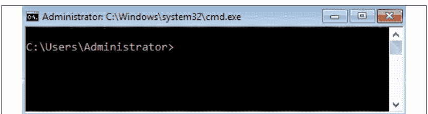

图 10.4：Server Core 用户界面

有趣的是，命令提示符窗口并没有占用整个屏幕；很明显，cmd.exe 运行在黑色背景之上。我只觉得这很有趣，因为你可以看出 Core 操作系统本身并不是命令提示符，而 cmd.exe 只是在登录时自动启动的一个应用程序。你甚至可以在这里使用鼠标并调整或移动该命令提示符窗口。我在想这个是否以及何时会以 PowerShell 提示符作为默认界面来取代它。

更有趣且值得了解的是，你可以从此提示符启动一些类似 GUI 的应用程序。例如，你可以打开记事本并使用键盘和鼠标，就像在任何版本的 Windows 中一样。如果你打开了记事本，创建一个笔记然后保存它；你可以看到存在一个真实的文件结构和一组相对正常的系统文件夹。因此，与其说是某种黑魔法，Server Core 实际上是真正的 Windows Server 操作系统，只是包装在一个更小、更安全的包中：

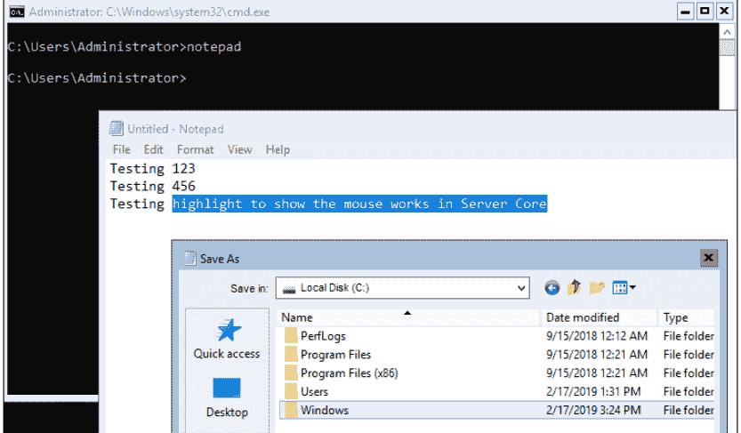

图 10.5：在 Server Core 上打开记事本

## PowerShell

就管理 Server Core 而言，你显然可以直接从控制台使用命令提示符，而它似乎是操作系统提供的默认界面。实际上，从命令提示符内部可用的命令和功能会很有限。如果你正在从 Windows Server Core 框的控制台工作，使用命令提示符最合理的目的只有一个：调用 PowerShell，然后使用它来完成需要在该服务器上执行的任务。我知道从基本命令提示符进入 PowerShell 的最快方法是简单地输入单词 powershell 然后按 Enter。这会将 PowerShell 功能直接带入你现有的命令提示符窗口，以便你可以开始使用所需的 PowerShell 命令和 cmdlet 来真正操作此服务器：

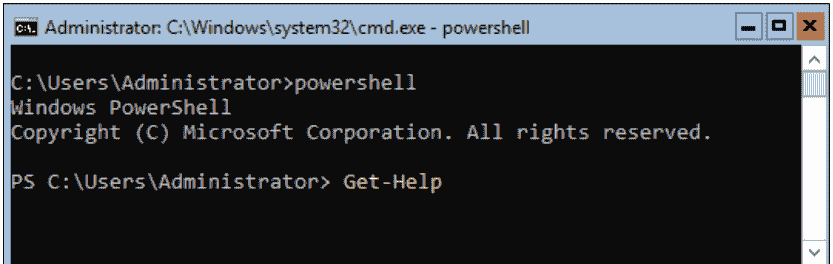

图 10.6：在 Server Core 中加载 PowerShell

我们在新服务器上通常做的第一件事是什么？当然是分配 IP 地址。没有网络连接，我们在这个服务器上几乎无法做任何事情。你可以使用 PowerShell 在任何较新的 Windows Server 上为 NIC 分配 IP 地址信息，但我们大多数人并没有养成这样做的习惯。由于我们不能像从 Windows Server 的 Desktop Experience GUI 中那样打开控制面板并进入网络和共享中心，那么在这个新的 Server Core 上我们如何开始获得网络连接？

## 使用 cmdlet 管理 IP 地址

你可以使用 cmdlet 在 PowerShell 中查看和操作 IP 地址设置。同样，这些 cmdlet 既可以在完整的 GUI 版本 Windows Server 中使用，也可以在 Server Core 中使用。

目前，从 Server Core 工作时，我们只有命令行交互可用，这些 cmdlet 对于让新服务器的网络连接畅通至关重要：

- Get-NetIPConfiguration：这会显示当前的网络配置。
- Get-NetIPAddress：这会显示当前的 IP 地址。
- Get-NetIPInterface：这会显示 NIC 列表及其接口 ID 号。这个数字在设置 IP 地址时非常重要，因为我们希望确保告诉 PowerShell 在正确的 NIC 上配置正确的 IP。
- New-NetIPAddress：用于配置新的 IP 地址。
- Set-DNSClientServerAddress：用于在 NIC 属性中配置 DNS 服务器设置。

让我们快速演示一下在新的 Server Core 实例上设置静态 IP 地址，确保所有内容都有意义。我想将 10.10.10.12 IP 地址分配给这台新服务器，但首先，我们需要找出它需要分配到的 NIC 接口 ID 号。Get-NetIPInterface 的输出告诉我们，我的以太网 NIC 的 ifIndex 为 4：

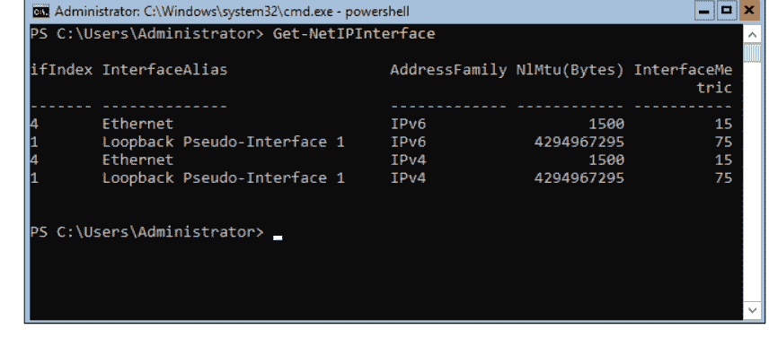

图 10.7：查找你的 NIC 的接口 ID 号

或者，作为双重检查，你也可以运行 route print 并在输出顶部附近验证你的接口 ID 号。你可以在图 10.8 中看到，我的这个 Server Core VM 上的 Hyper-V NIC 是接口 4（显示在输出左侧）：

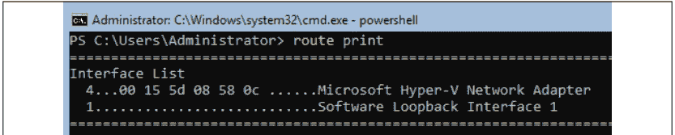

Figure 10.8: Displaying your interface list
图 10.8：显示您的接口列表

现在我们知道了接口编号，让我们构建将为网卡分配新的 IP 地址设置的命令。我将使用一个命令来分配 IP 地址、子网掩码前缀和默认网关。我将使用第二个命令来分配 DNS 服务器地址：

```
New-NetIPAddress -InterfaceIndex 4 -IPAddress 10.10.10.12 -PrefixLength 24 -DefaultGateway 10.10.10.1

Set-DNSClientServerAddress -InterfaceIndex 4 -ServerAddresses 10.10.10.10,10.10.10.11
```

Figure 10.9 shows us the resulting output:
图 10.9 显示了结果输出：

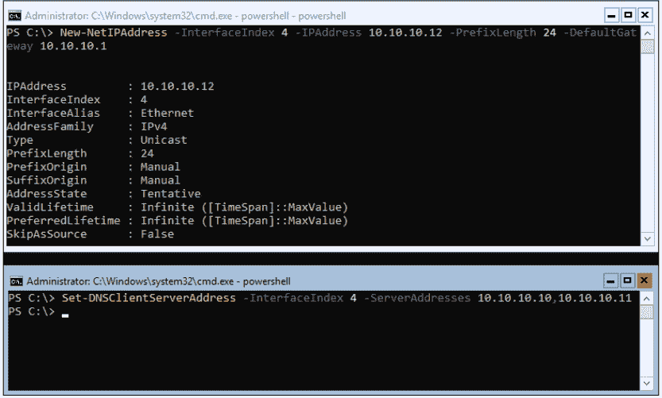

Figure 10.9: Assigning the IP and DNS server addresses
图 10.9：分配 IP 和 DNS 服务器地址

> Hold the phone! How did I get two PowerShell prompts open at the same time within the Server Core interface? Make sure to read the Accidentally closing Command Prompt section later in this chapter to discover how you can launch multiple windows and tools inside the Server Core console.
> 暂停一下！我如何在 Server Core 界面中同时打开两个 PowerShell 提示符？请务必阅读本章后面的“意外关闭命令提示符”部分，了解如何在 Server Core 控制台中启动多个窗口和工具。

现在，所有这些 IP 设置都应该已应用到网卡上。让我们使用图 10.10 中所示的 Get-NetIPConfiguration 命令再次确认。或者，您也可以使用老式的 ipconfig 来检查这些设置，但那样有什么乐趣呢？

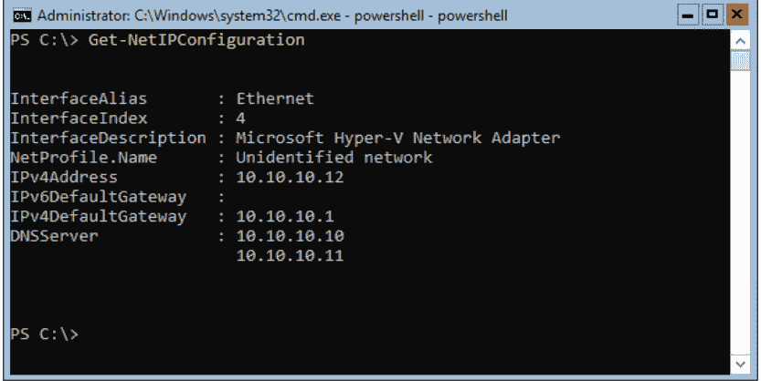

Figure 10.10: Checking the IP settings
图 10.10：检查 IP 设置

> Remember, you can always utilize DHCP reservations to make this a little bit easier. If you were to run a simple ipconfig /all from your Server Core and jot down the MAC address of your NIC, you could use this address to create a reservation in DHCP and assign a specific IP address to the new server that way.
> 请记住，您始终可以使用 DHCP 保留来让此过程稍微简单一些。如果您从 Server Core 运行简单的 ipconfig /all 并记下网卡的 MAC 地址，您就可以使用该地址在 DHCP 中创建保留，并以这种方式为新服务器分配特定的 IP 地址。

## Setting the server hostname
## 设置服务器主机名

现在我们已经建立了网络连接，下一步是设置服务器的主机名并将其加入域。首先，让我们先查看服务器当前的名称，并将其更改为符合我们标准的内容。当您全新安装 Windows 时，它会为服务器自动分配一个随机主机名。您只需键入 hostname 并按 Enter 即可查看当前主机名。

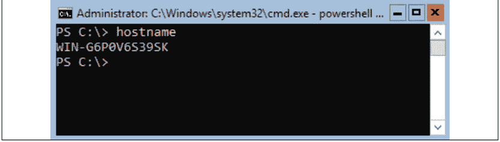

Figure 10.11: Checking the current hostname
图 10.11：检查当前主机名

要更改服务器的主机名，我们需要使用 PowerShell。如果尚未进入，请打开 PowerShell 提示符，我们只需使用 Rename-Computer cmdlet 来设置新的主机名即可。我决定将这台新服务器命名为 WEB4，因为稍后我们将安装 Web Services 角色并在其上托管网站。请记住，更改计算机名称后，就像在 Windows Server 的 GUI 版本中一样，需要系统重启才能使更改生效。因此，在执行 Rename-Computer 命令后，您可以发出 Restart-Computer 命令来重新启动虚拟机：

```
Rename-Computer WEB4

Restart-Computer
```

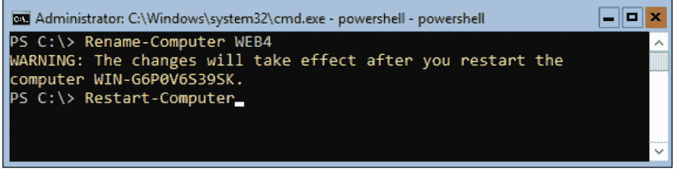

Figure 10.12: Changing the hostname and restarting your system
图 10.12：更改主机名并重启系统

## Joining your domain
## 加入您的域

下一步逻辑上当然是加入域。这些是我们会对环境中任何新服务器执行的标准功能，但由于我们完全通过命令提示符和 PowerShell 界面执行，因此您可能从未遇到过这种方式。要将 Server Core 加入域，请进入 PowerShell，然后使用 Add-Computer cmdlet。您将被要求指定域名称和用于加入域的凭据——这与将 Windows Server 2019 Desktop Experience 模式加入域时需要指定的信息相同。首先，您必须指定用于完成此域加入的凭据：

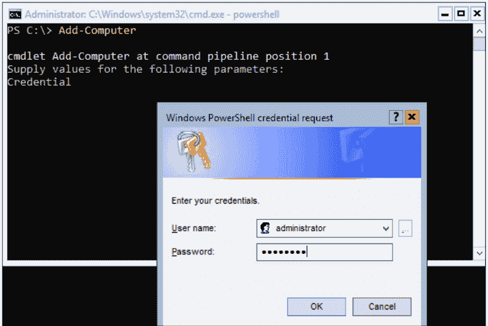

Figure 10.13: Entering credentials authorized to join this system to your domain
图 10.13：输入有权将此系统加入域的凭据

然后告诉它您想要加入的域：

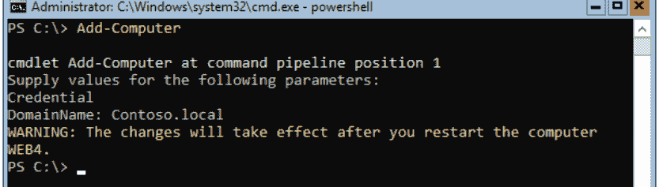

Figure 10.14: Specifying the domain to join
图 10.14：指定要加入的域

或者，您也可以使用 -DomainName 参数结合原始的 Add-Computer cmdlet，在原始命令中指定域的名称。当然，加入域后，您需要再次执行 Restart-Computer 以完成此更改。

## Remote PowerShell
## 远程 PowerShell

一旦新服务器已分配 IP 地址、命名并加入域，我们就可以开始对这个新的 Server Core 实例进行真正的管理。您当然可以继续登录并直接通过控制台进行交互，但与管理环境中的任何其他服务器一样，必须有远程处理的方式，对吧？在不坐在服务器前的情况下操作 Server Core 的方法之一是使用远程 PowerShell 连接。

我们将在第 11 章《PowerShell》中更详细地介绍使用远程 PowerShell 操作服务器（GUI 和无头）的过程，但这里先展示在域加入环境中的工作站 PowerShell 提示符下实现远程会话时所需的命令和可用功能。

从另一台系统打开 PowerShell——这可以是服务器甚至是客户端操作系统。此 PowerShell 窗口显然在您当前登录的机器的上下文中打开，通过 PowerShell 发出的任何命令都会从本地系统获得响应。为了将 PowerShell 连接到 WEB4 Server Core 实例，我将发出以下命令。运行后，我会被提示输入对应管理员帐户的密码，然后就可以针对我们的 Server Core 发出远程 PowerShell 命令：

```
Enter-PSSession -ComputerName WEB4 -Credential administrator
```

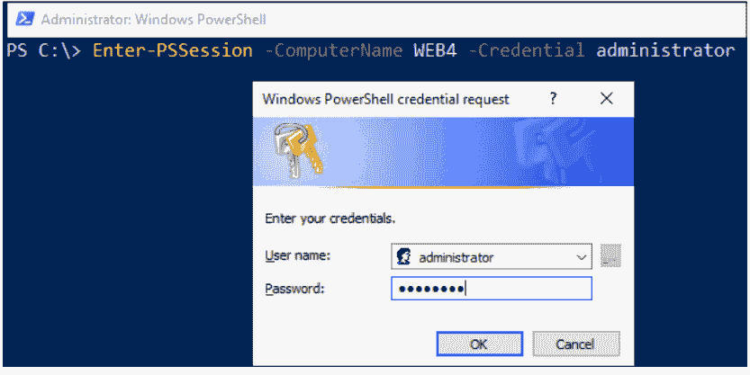

Figure 10.15: Using Enter-PSSession to remotely connect to WEB4
图 10.15：使用 Enter-PSSession 远程连接到 WEB4

现在我们坐在 PowerShell 提示符下，已远程连接到 WEB4 Server Core 机器。您可以通过提示符左侧列出的 [WEB4] 看到这一点。也许您不信任这个小标识符，并想确保此 PowerShell 窗口现在正在访问和操作远程 WEB4 服务器？让我们发出几个快速命令，例如 hostname 和 ipconfig，以证明在此 PowerShell 会话中提供给我们的信息确实来自新的 WEB4 服务器：

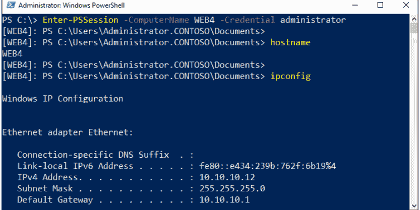

Figure 10.16: PowerShell now responds as if I was logged in to WEB4
图 10.16：PowerShell 现在响应就好像我已登录到 WEB4

现在我们已与这个新的 Server Core 建立了远程 PowerShell 连接，我们可以从此控制台对该服务器执行几乎任何操作。在此远程 PowerShell 会话中发出的命令和 cmdlet 将操作 WEB4，而不是我们的本地工作站。

## Server Manager
## 服务器管理器

虽然服务器的初始配置在一定程度上将通过控制台可用的命令行界面处理，但一旦服务器已在网络上建立，您可能会发现拓宽视野更有优势。您可能可以找到允许您管理并操作新服务器中任何内容的 PowerShell cmdlet，但这对我们大多数人来说仍然是一种比较新的思维方式——我们通常更习惯于使用图形工具，如服务器管理器。您已经知道服务器管理器可用于管理多个本地和远程服务器，并且是 Microsoft 集中管理拼图的一部分。我们在书中前面探索的服务器管理器中的远程管理功能不仅允许您访问基于 GUI 的 Windows 服务器，还允许访问 Server Core 实例。

我想在新的 WEB4 服务器上安装一个角色。我可以在服务器控制台上使用 PowerShell 来完成，但不如尝试将 WEB4 添加到服务器管理器中，而服务器管理器正在我的另一台服务器上运行。我将登录到 WEB3 并从那里使用服务器管理器。就像我们已经看到的那样，我可以使用“管理”菜单并选择“添加服务器”将新服务器添加到服务器管理器中：


Figure 10.17: Adding new servers to be managed inside Server Manager
图 10.17：在服务器管理器中添加要管理的服务器


将新的 WEB4 服务器添加到我们的受管机器列表中，现在可以从此实例的 Server Manager 中进行管理。回到我最初的意图，我想在 WEB4 上安装 Web Server (IIS) 角色。如果我在 Server Manager 中使用“添加角色和功能”功能，现在就可以选择操作 WEB4 服务器：

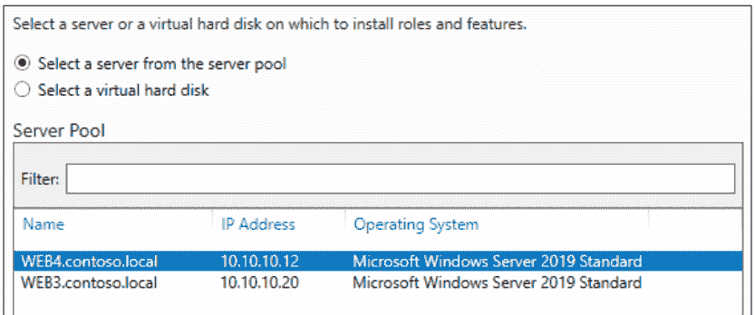

图 10.18：从 WEB3 的 Server Manager 修改 WEB4

与运行 Windows Server 完整桌面体验版本的任何服务器一样，我们现在可以完成角色安装向导的步骤，Web Server 角色将被安装在 WEB4 上。

## 远程服务器管理工具

同样重要的是，你可以使用 Windows 10 中的远程服务器管理工具 (RSAT) 来管理 Server Core 实例。RSAT 本质上只是 Server Manager 以及配套管理工具的副本，旨在在客户端操作系统上运行。在我们的例子中，我已经有一台 Windows 10 机器，书中前面已经在上面安装了 RSAT，所以我将通过登录该机器并将 WEB4 添加到界面中来进行测试。我刚刚在之前的任务中在 WEB4 上安装了 IIS 角色，所以当我将它连接到 WEB4 时，应该能在 RSAT 中看到该列表。

如果你之前没有使用过 RSAT，也没有阅读过我们文本中该部分的内容，重要的是要知道并没有一个名为“远程服务器管理工具”的应用程序。相反，在完成 RSAT 安装后，请在“开始”菜单中查找名为 Server Manager 的应用程序。这就是如何利用 Windows 10 客户端远程管理 Windows Server 2019 实例的方式：


图 10.19：Windows 10 中的 Server Manager，借助 RSAT

正如你在 Windows Server 2019 的 Server Manager 界面中所做的那样，继续通过向导添加其他要管理的服务器。一旦我在我的 Win10 的 Server Manager 中将 WEB4 添加为受管服务器，我就可以在我的仪表板中看到 IIS 的列表。这表明运行在 WEB4 上的 IIS 服务可以直接从我的 Windows 10 桌面计算机中看到、访问和配置。对于我在 WEB4 上需要完成的大多数任务，我永远不必担心登录该服务器的控制台。

如果我在该 RSAT 控制台中右键单击 WEB4 服务器名称，你可以看到我有许多可用的功能，可以用来管理此远程 Server Core 实例：

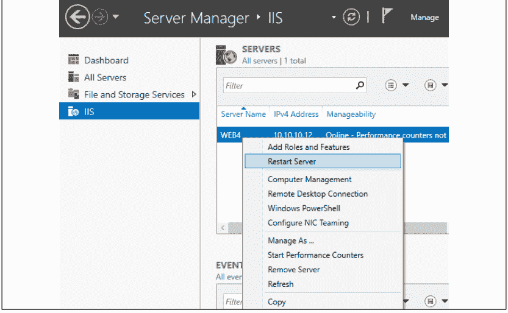

图 10.20 通过 Server Manager 与远程服务器交互

因此，你可以看到有方法可以使用 GUI 工具来管理我们的无 GUI Windows Server 实例。这只是将思维放在把服务器视为无头服务器的位置上，而 PowerShell 或 Server Manager 等工具根本不在乎它们所更改的服务器是本地还是远程。流程和工具在任何情况下都相同。你可以在之前的屏幕截图中看到，我甚至可以从这里单击启动到 WEB4 的远程 PowerShell 连接。单击此按钮会立即启动一个 PowerShell 提示，该提示远程连接到 WEB4 服务器，即使我目前仅登录到我的 Windows 10 工作站。这甚至比在 PowerShell 内部发出 Enter-PSSession cmdlet 更容易。

## 意外关闭命令提示符

让我们现在直接从 Server Core 控制台来看一件事情；如果你没有经常使用 Server Core，这是一个常见的障碍。我们倾向于关闭不再使用的窗口和应用程序，因此你可能会无意识地关闭在 Server Core 控制台会话中提供你整个管理存在的命令提示符窗口。现在你坐在一个大空白屏幕前，似乎没有任何界面，也无处可去。

你如何在这个服务器上恢复工作？我们是否必须关闭服务器然后重新打开以重置它？这会中断该服务器可能为用户提供的任何角色或流量，因此显然不是理想的方法。

有一个简单的方法可以恢复命令提示符，那就是使用任务管理器启动一个新的命令提示符实例。在错误关闭当前命令提示符窗口后，当你坐在 Server Core 控制台的空黑色屏幕前时，你可以按 Ctrl + Alt + Del，然后会出现以下选项：


图 10.21：Ctrl+Alt+Del 在 Server Core 中有效

这里可以执行一些不同的功能，这很不错。但要恢复我们的命令提示符窗口，请向下箭头到 **任务管理器** 并按 **Enter**。这将启动我们都熟悉的 **任务管理器** 应用程序。现在，单击 **显示更多详细信息** 以展开任务管理器的屏幕。展开 **文件** 菜单，然后单击 **运行新任务**：

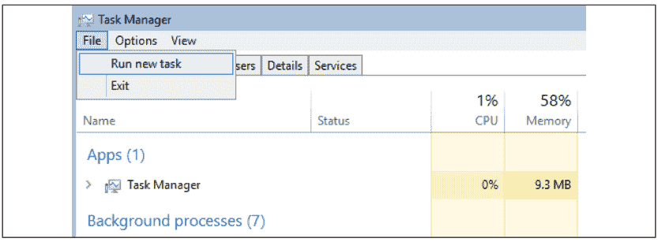

图 10.22：通过任务管理器运行新任务

在 **创建新任务** 框中，输入 `cmd` 然后单击 **确定**：

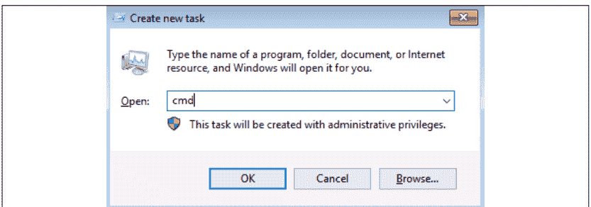

图 10.23：打开命令提示符

另外，你也可以直接从此 **创建新任务** 提示中指定启动任何应用程序。如果你有兴趣直接进入 PowerShell，而不是输入 cmd，你可以简单地在该提示中输入 powershell，它就会直接打开：

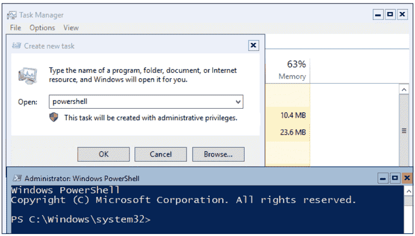

图 10.24：在 Server Core 中打开 PowerShell

## 使用 Windows Admin Center 管理 Server Core

虽然来自控制台的命令提示符、远程 PowerShell 连接、远程 Server Manager 管理，甚至在 Windows 10 工作站上运行的 RSAT 工具都是管理我们的 Server Core 实例的有效且强大的工具，但它们现在都已被 Windows Admin Center 的发布所取代。你已经了解 Windows Admin Center 可以为集中管理整个服务器基础设施做什么，但我们需要在此指出的是，WAC 可用于具有和不具有图形界面的服务器。

我与许多 Windows Server 管理员讨论过 Server Core 的话题，实现这些更高效、更安全的服务器平台的最大障碍之一是担心，一旦配置完成，这些服务器的持续管理和维护将更难处理。熟悉并习惯于在 Windows Server 桌面体验中工作的管理员确切知道需要做什么来完成日常任务，但移除那种点按式界面后，工作日突然变得复杂得多。

值得庆幸的是，使用 Server Core 你不必记住 PowerShell 手册！Windows Admin Center 将 Server Core 实例视为与运行桌面体验的服务器相同的方式。它就是能工作！

我们已经在测试实验室的一台服务器上安装了 WAC，所以让我们打开它并添加我的新 WEB4 服务器以供管理，并看看可用于此服务器持续维护的选项。

当我们首次通过 WAC 控制台连接到 WEB4 时，这里没有任何内容表明这是一个 Server Core 实例。我们有所有可供点击的 WAC 工具和实用程序：

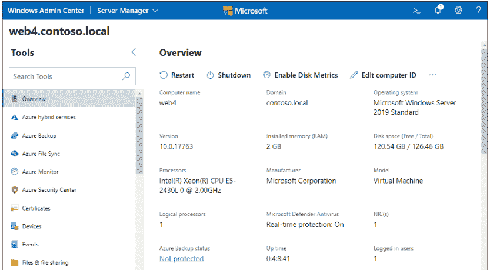

图 10.25：WAC 概览 WEB4

让我们从 Windows Admin Center 尝试几件事。你在屏幕顶部附近有电源控制，可以轻松关闭或重新启动服务器。这比必须建立远程 PowerShell 连接然后发出命令来完成相同操作要容易和快速得多。主屏幕上（如果向下滚动）还有性能指标，显示你消耗的 CPU、Memory 和 Networking 资源。如果没有 WAC，你需要登录 WEB4 并启动任务管理器才能看到这些统计信息：

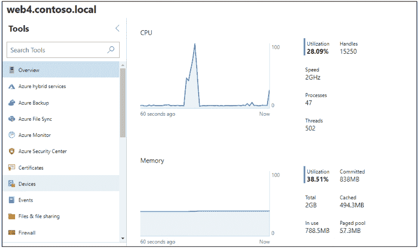

图 10.26：服务器性能指标


离开主屏幕，虽然它很有用，尝试点击屏幕左侧列出的其中一个工具，例如 **事件**。如果没有 WAC，如果你想在 Server Core 上排查问题，查看该服务器上的 Windows 事件日志是合理的，但你将如何从命令行界面执行此操作？我猜你可以登录到 Server Core 控制台并使用 **任务管理器** 启动 EventVwr，但打开 WAC 并简单点击 **事件** 要容易得多：

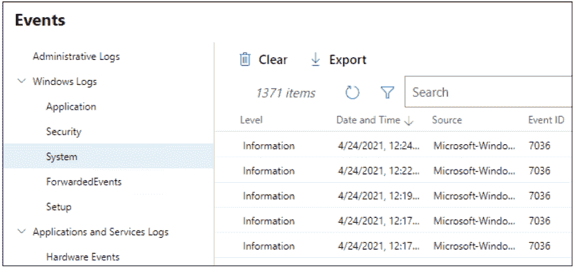

图 10.27：系统事件日志

WAC 内部其他有用的功能示例，尤其是在使用 Server Core 实例时，就是使用 **文件和文件共享** 来浏览 WEB4 硬盘的文件和文件夹结构，或使用此处的 **防火墙** 功能在 WEB4 上创建或删除 Windows 防火墙规则。还有一个 **网络** 工具，可用于操作 IP 地址配置。

虽然 Windows Admin Center 内部还有许多其他工具，但我想指出的最后一个是，我们再次拥有 PowerShell 选项（类似于我们可以在 Server Manager 内部启动的选项）。此 PowerShell 按钮将为我们调用并显示到 WEB4 Server Core 实例的远程 PowerShell 连接，如果我们找不到 WAC 内部所需的函数并且需要深入一点以从命令行界面完成某项操作。最好的部分是，你实际上从未启动过 PowerShell！所有这些仍在你的互联网浏览器窗口内进行：

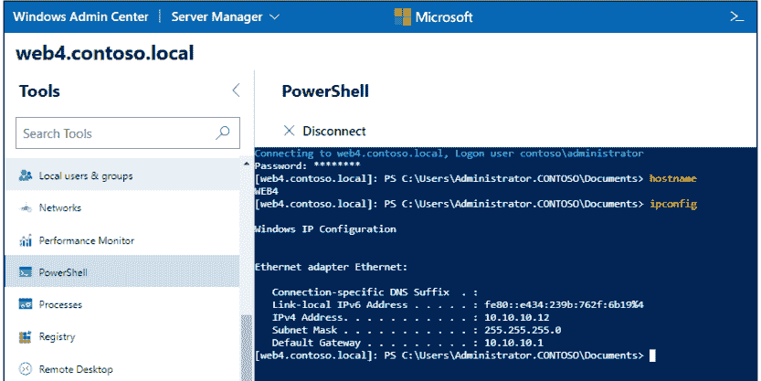

图 10.28：在 WAC 中使用 PowerShell

在 Windows Admin Center 内部还可以完成更多操作。编辑注册表、添加角色和功能、检查服务的状态，甚至与 Windows Update 交互。如果你还没有使用 WAC，你就错过了！

## Sconfig 实用工具

现在我们将退一步，查看一个在 Server Core 内部可用的工具，但它通常仅在你在服务器控制台上工作时才有用。正如你所见，每次启动 Server Core 时，你都会进入一个命令提示符窗口，从那里可以切换到 PowerShell，然后使用传统的 Windows cmdlet 来配置你的新 Server Core 实例。

或者，你可以使用 Sconfig 实用工具。这是一组工具，类似于命令行快捷方式，用于实现将新服务器上线并连接到网络所需的基本项目。Sconfig 的目的是在安装操作系统后成为第 1 步，处理新服务器上的初始配置，以便你随后可以转到使用更强大的管理界面，例如 Server Manager 或 Windows Admin Center。

在启动 Server Core 实例后，你会发现自己处于命令提示符，等待输入。在此屏幕中，只需键入 Sconfig 并按 Enter。你应该会看到从黑色快速变为蓝色并看到以下屏幕：

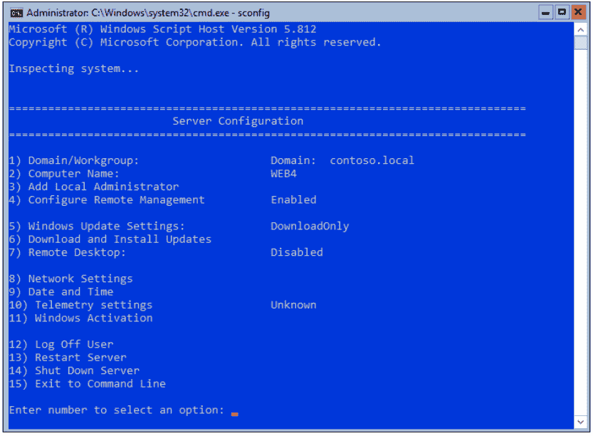

图 10.29：服务器配置实用工具

Sconfig 内部可用的选项相当自解释，但我们将介绍在此执行的常见任务。同样，这些都是你可以通过 PowerShell cmdlet 完成的事情，但我发现使用 Sconfig 方法更容易。此界面的最常见用途是通过按 8 来配置初始网络设置，或通过使用选项 2 和 1 来配置服务器主机名和域成员身份。

我将继续按键盘上的 2 然后按 Enter，我立即被提示指定新的计算机名称。这是配置新 Server Core 服务器主机名的极快方式。由于我实际上不想重命名 WEB4，我将保持选择为空并按 Enter 返回主屏幕。

现在我想查看网络设置。按 8 然后按 Enter 会将我带入网络设置，在那里我可以看到 WEB4 的 NIC 上的当前 IP 地址是 10.10.10.12。这是对的，但让我们为了演示一个实际的 Sconfig 设置更改而更改该地址。

我首先选择了我的网络适配器索引，即编号为一。现在我可以看到有关此 NIC 上已配置内容的附加信息，并且有选项可以更改此信息。再次选择选项一将允许我设置网络适配器地址：

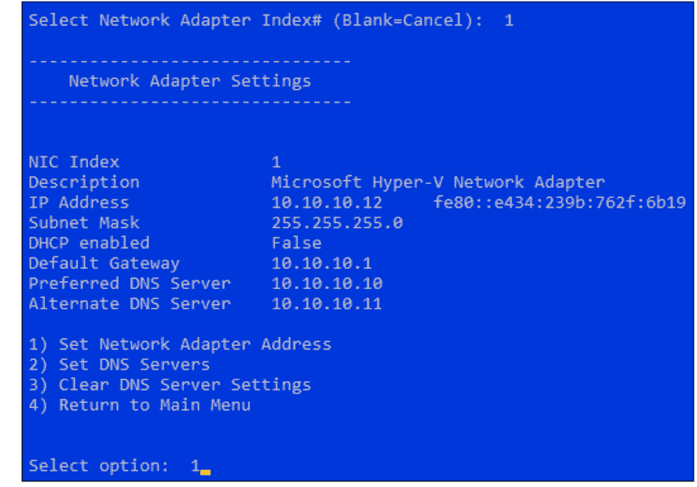

图 10.30：使用 Sconfig 配置 IP 地址

输入字母 S，这告诉 Sconfig 你想要输入静态 IP 地址，然后输入你希望在此 NIC 上配置的新 IP 地址。我将把 WEB4 改为 10.10.10.30，只是为了证明这有效。输入 IP 地址后，我还必须定义新的子网掩码和网关地址：

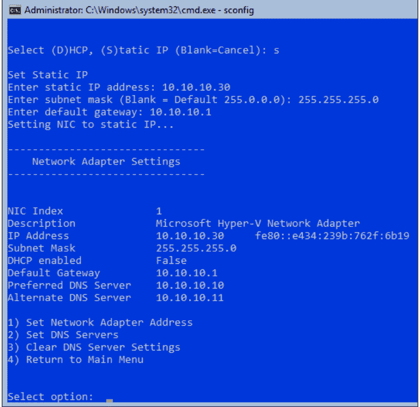

图 10.31：设置子网掩码和默认网关

WEB4 的 NIC 已立即更新为新的 IP 地址 10.10.10.30，如结果输出所示。虽然在 Server Core 实例的初始配置后访问 Sconfig 工具可能不是常见情况，但此工具在用于任何新 Server Core 实例的网络和命名设置的初始配置时可以节省大量时间。

## Server Core 中可用的角色

Server Core 显然是操作系统的受限形式，Windows Server 中的某些角色根本不是为在这种有限环境中正常工作而设计的。幸运的是，我们大多数角色都是可以的，这使得 Server 2019 管理员能够通过更安全的 Server Core 平台部署其大部分关键基础设施。以下是当前支持在 Windows Server 2019 Server Core 实例上运行的角色列表，我用粗体标记了我所在业务中最常使用的角色：

- Active Directory 证书服务
- **Active Directory 域服务**
- Active Directory 联合服务
- Active Directory 轻型目录服务
- Active Directory 权利管理服务
- 设备健康证明
- **DHCP 服务器**
- **DNS 服务器**
- **文件和存储服务**
- 主机守护服务
- **Hyper-V**
- 打印和文档服务
- 远程访问
- 远程桌面服务*
- 卷激活服务
- **Web 服务器 (IIS)**
- Windows Server 更新服务

你会注意到我在前面的列表中在远程桌面服务旁边放置了一个 *。虽然你可以在 Server Core 上安装 RDS 角色，但你不能使用 Server Core 实例执行远程桌面的所有功能。你可以使用 Server Core 作为你的 RDS 连接代理或 RDS 许可服务器，但不能将 Server Core 用作远程桌面会话主机。其他角色也存在类似的限制。

要获取始终更新的、关于哪些角色和功能的哪些部分和组件在 Server Core 上受支持的全面列表，请查看以下 Microsoft 文档：https://docs.microsoft.com/en-us/windows-server/administration/server-core/server-core-roles-and-services.

## 构建 Server Core 域控制器

你现在已具备启动 Server Core 实例、为其配置主机名、IP地址和域成员身份，并使用各种管理工具集管理这些新服务器的能力。我在生产环境中看到 Server Core 最频繁的用途之一是作为辅助域控制器。让我们逐步介绍设置过程，以便在这种情况适用于你时拥有确切的步骤。

首先准备新服务器。你已经知道所有这些内容，但以下是你在考虑将此服务器转变为域控制器之前想要完成的基本步骤概述：

- 1. 启动新服务器并安装 Server Core。
- 2. 使用控制台上的 Sconfig 或 PowerShell 配置静态 IP 地址和永久主机名。请记住，一旦你将此服务器转变为域控制器，不支持更改名称，并且更改 IP 也不容易——因此要明智选择。我将其命名为 DC3，因为我的实验室中已有 DC1 和 DC2。
  - 确保指定现有域控制器作为 NIC 的 DNS 服务器地址。
- 3. 使用 Sconfig 或 PowerShell 将此新服务器加入到现有域。
- 4. 此时，你的服务器已在线并可在网络上通信，但未安装任何角色。你可以从这里继续安装任何角色以用于任何目的。

## 安装 AD DS 角色

可以通过多种方式完成此步骤。使用 Windows Admin Center 或通过另一台机器上的 Server Manager 远程操作新服务器都是安装新角色的有效方法。你应该已经熟悉这些流程，基于我们迄今为止在本章中涵盖的内容。

相反，让我们坚持使用纯 PowerShell 将此新 Server Core 转换为无头域控制器。从 DC3 的控制台，确保你已登录到域管理员帐户。然后，使用 powershell 命令将我的命令提示符更改为 PowerShell 提示符。然后，运行以下命令将 AD DS 角色安装到新服务器上：

```
Install-WindowsFeature -Name AD-Domain-Services -IncludeManagementTools
```


如果还希望此服务器响应 DNS 查询（大多数域控制器都会这样做），请使用以下命令安装 DNS 角色：

```
Install-WindowsFeature DNS
```

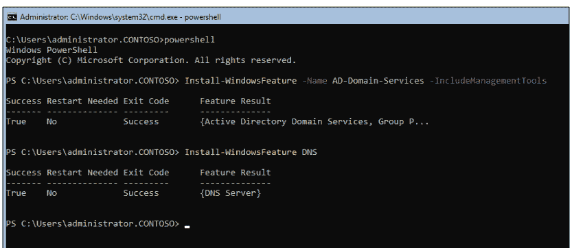

图 10.32：在 Server Core 上安装 AD DS 和 DNS 角色

## 将此服务器提升为域控制器

安装了角色后，我们现在可以准备将此服务器提升为域控制器。旧的 dcpromo 命令仍然存在，可以用来执行此功能，当然我们也可以利用其中一个图形化管理工具远程处理。尽管如此，由于我们从 PowerShell 开始，我们将使用相同的方式完成整个过程：

```
Install-ADDSDomainController -InstallDns -DomainName "contoso.local"
```

（当然，请将 contoso.local 替换为你自己的域名。）

执行此命令时，系统会要求你输入必要的信息，例如 AD 安全模式密码以及具有创建新域控制器权限的管理员凭据：

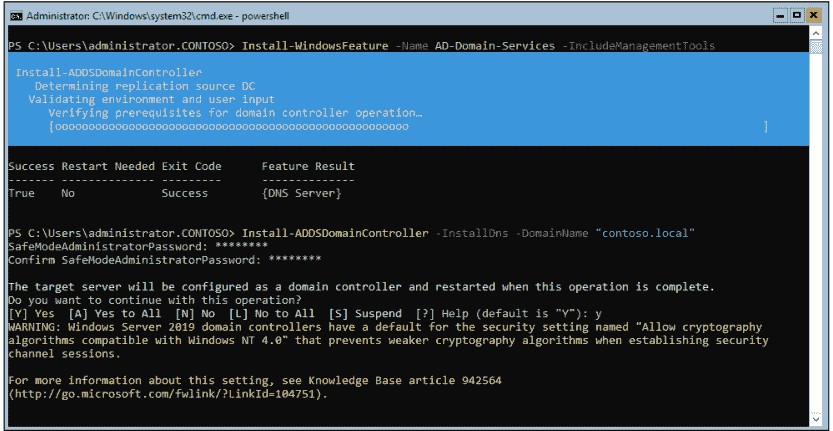

图 10.33：创建你的第一个 Server Core DC

完成后，服务器将自动重启，你的新的 Server Core 现在已成为环境中的无头域控制器！

## 验证是否成功

我知道你完全信任我，但就为了争论一下，如果我们想验证那些简单的 PowerShell 命令是否真的做到了它们所说的那样怎么办？让我们通过几种不同的方法验证 DC3 是否确实是一个域控制器。

环境中的所有域控制器都会自动将其计算机对象移动到 Active Directory 内部的“Domain Controllers”OU 中。登录到网络中的任何 DC，打开 Active Directory 用户和计算机，并导航到 **Domain Controllers** OU。你可以在 *图 10.34* 中看到 DC3 现在位于此容器内，表明它是我的域的 DC：

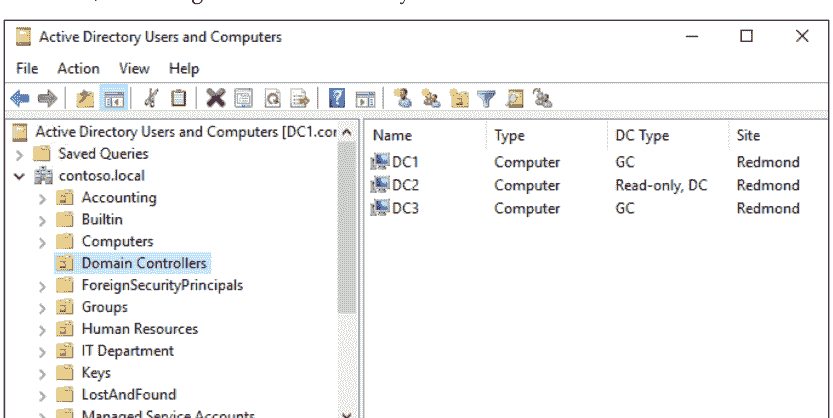

图 10.34：成功创建的 DC3

为了验证 DNS 方面，你现在可以从网络内部打开 DNS 管理控制台，并进入主要内部 DNS 区域的 **Properties**。就我而言，那就是 contoso.local。打开这些属性后，我可以看到我的 **Name Servers** 选项卡现在显示 DC3 为该区域的名称服务器：

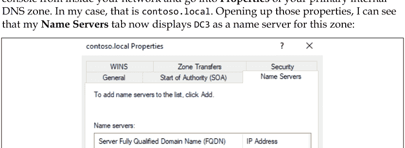

图 10.35：DC3 已确认的 DNS 服务器

最后一次测试和验证。让我们使用一个查询并显示我们环境中域控制器服务器之间复制状态的命令。在任何 DC 上打开命令提示符或 PowerShell 并运行以下命令：

```
Repadmin /showrepl
```

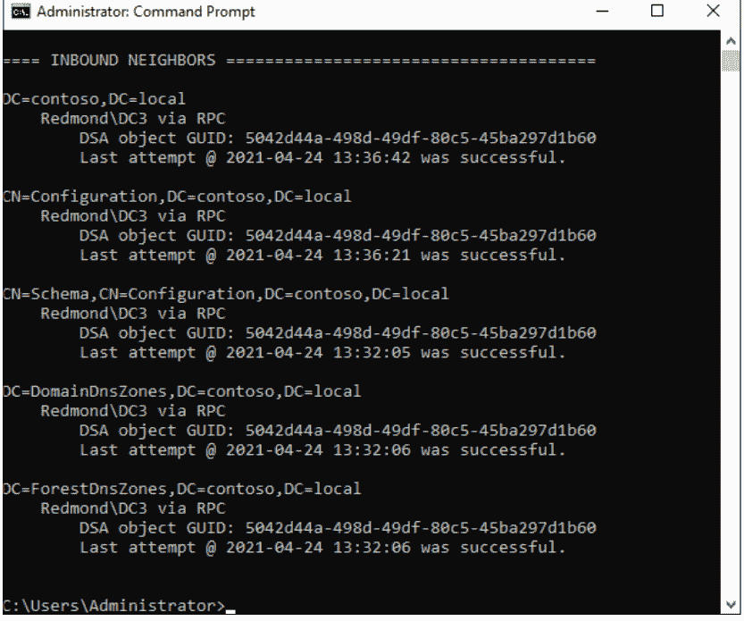

图 10.36：验证 DC3 连接

就是这样！三种不同的证明表明我们的 DC3 Server Core 实例确实是我们域中的域控制器和 DNS 服务器。多酷啊！

## Nano Server 发生了什么？

关于小占用 Windows Server 平台的故事过去并不以 Server Core 结束。任何关注 Server 2016 新功能的人都知道，Server 2016 操作系统还有另一种安装选项，称为 Nano Server。Nano Server 的前提是一个更小、更安全、更高效、超迷你的操作系统，可以运行有限的角色集。尽管有限，但它仍然能够安装在物理或虚拟服务器平台上，作为真正的服务器操作系统运行，并且仍可在其上托管传统工作负载。

不幸的是，对于 Nano Server 爱好者，尤其是已经投入工作安装和使用它的人来说，过去几年 Nano Server 背后的故事完全发生了翻转。长话短说，你现在不能再使用 Nano Server 来做传统服务器能做的任何事情。你不能将其安装在物理硬件上；你甚至不能在 VM 上安装 Nano。此外，诸如 PowerShell 和 WinRM 之类的管理功能已被从 Nano Server 中移除，并且你无法在其上安装任何 Microsoft 基础结构角色。

在所有这些功能都被从 Nano Server 范围中移除后，剩下了什么？它死了吗？Nano Server 还能做 ANYTHING 吗？

答案是容器。如果你有兴趣利用容器来构建和托管云就绪且可扩展的应用程序，这就是 Nano 现在的重点。我们将在第 13 章《容器和 Nano Server》中介绍有关容器以及 Nano Server 完全与其绑定事实的更多信息，但就说下载容器镜像从 Microsoft 将现在是你找到 Nano Server 的唯一地方。

## Summary

我必须诚实地告诉你——编写这一章正是我需要的那一脚，让我开始思考如何缩小自己的服务器。我和你们中的许多人一样：我知道 Server Core 是什么，并且玩过它，但从未采取步骤在支持的环境中真正使用它。现在有了 Sconfig 和新的 Windows Admin Center 等工具，我已经正式没有借口不将新角色部署到 Server Core 机器上了。事实上，当我构建新的 DC3 服务器时，我意识到与完整的图形界面相比，启动一个 Server Core 实例要快得多。重启更快，使用 Sconfig 设置 IP 地址、主机名和域成员资格总共只花了我大约 2 分钟。

虽然学习新东西永远不会有害，但使用 Server Core 不再要求你必须精通 PowerShell。Server Core 的早期日子要求你非常擅长 PowerShell，因为这是配置和与你的迷你服务器交互的唯一可靠方式，但这些新工具使我们能够利用更小的平台并在不记住一堆新 cmdlet 的情况下管理它。

安全性是我们所有人都应该考虑 Server Core 作为新标准的主要原因。Windows 图形界面添加了大量代码，并授予登录服务器的人员大量能力，例如浏览互联网的能力。这打开了许多 Server Core 中根本不存在的漏洞之门。

## Questions

- 1. True or False — Server Core is the default installation option for Windows Server 2019.
- 2. True or False — You can utilize PowerShell to change a Server 2019 from Server Core mode to Desktop Experience mode.
- 3. When sitting at the console of a freshly booted Windows Server 2019 Server Core instance, what application do you see on the screen?
- 4. What cmdlet can be used to view the current networking configuration on a Server Core?
- 5. Which PowerShell cmdlet can be used to configure the hostname of a Server Core?
- 6. Name some of the management tools that can be used to remotely interface with a Server Core.
- 7. What is the name of the utility built into Server Core that can be launched to provide quick task links for configuring IP addresses, hostnames, and domain membership?
