# 11 PowerShell

让我们诚实一点，我们中的许多人每天仍在使用命令提示符。如果你已经切换并使用更新的 PowerShell 提示符作为命令提示符的完全替代品，我赞扬你！我自己仍然习惯性地打开 cmd.exe，尽管随着 Windows 10 和 Windows Server 2019 的最新版本，我确实更加有意识地努力使用更新的、更蓝的、更漂亮的、更强大的 PowerShell 界面。在本章中，我们将探讨一些你也应该这样做的理由。除了微软似乎缩小了命令提示符的默认文本大小以阻止我们使用它，我觉得这很有趣之外，我们将看看 PowerShell 远比命令提示符强大和有用的技术原因。

在本章中，我们将涵盖以下主题：

- Why move to PowerShell?
- Working within PowerShell
- Using a pipeline
- PowerShell Integrated Scripting Environment
- Remotely managing a server
- Desired State Configuration


## 为什么要迁移到 PowerShell？

我认为人们不会质疑 PowerShell 确实是命令提示符的演进，但我们许多人仍默认使用旧界面的原因是它仍然包含完成我们历史上在服务器上所需操作所需的所有功能。命令提示符真正包含的能力就是能够做我们一直以来从命令提示符中完成的事情，仅此而已。人们没有意识到，有很多功能你使用 GUI 来完成，而这些功能在命令提示符窗口中无法很好地完成。

命令提示符中迫使你使用鼠标与 GUI 交互的限制在 PowerShell 中不存在。它功能全面，能够修改 Windows 操作系统的几乎任何方面。PowerShell 如何变得比命令提示符强大得多？它与任何经典的 I/O shell 不同，因为它构建在 .NET 之上，更像一种编程语言而不是简单的输入输出命令。

## Cmdlets

大多数传统服务器管理员在 PowerShell 中使用的功能都以 **cmdlets**（发音为 *command-lets*）的形式出现。这些是在 PowerShell 提示符中运行的命令，但你可以将它们视为工具而非简单命令。Cmdlet 既可用于从服务器获取信息，也可用于在服务器上设置信息和参数。许多 cmdlet 具有直观的名称，以 get 或 set 开头，并且与大多数命令行界面的工作方式类似，每个 cmdlet 都有各种开关或变量，可以在 cmdlet 末尾进行配置和标记，以使其执行特殊操作。了解 cmdlet 始终使用动词-名词语法构建是有帮助的。你指定想要完成的操作，例如 get 或 set，然后你的名词就是你在 Windows 内部试图操作的部分。以下是 PowerShell 中几个简单的 cmdlet 示例，供你了解它们的外观以及如何以相当简单的方式命名：

- Get-NetIPAddress：使用此 cmdlet，我们可以查看系统上的 IP 地址
- Set-NetIPAddress：我们可以使用它来修改现有的 IP 地址
- New-NetIPAddress：此 cmdlet 允许我们在计算机上创建新的 IP 地址
- Rename-Computer：正如我们在书中前面看到的，Rename-Computer 是设置系统计算机主机名的一种快速简便的方法

如果你曾经难以想出某个特定命令的名称或语法，微软的在线 Docs 网站（以前有时仍称为 TechNet）为 PowerShell 中的每个 cmdlet 都有专门的信息页面。这可能非常有用，但有时你不想特意上网只是为了查找你此刻记不起的命令名称。PowerShell 中最有用的 cmdlet 之一会显示所有可用 cmdlet 的列表。记住 cmdlet 的名称并不是至关重要的，只要你将这一个永久记住即可，Get-Command：

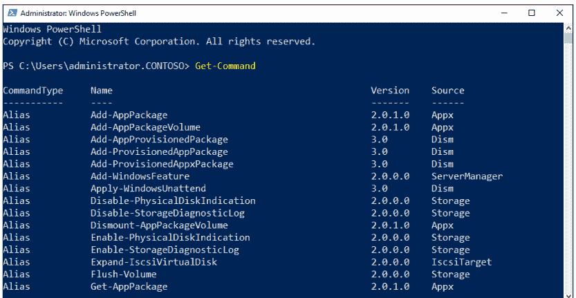

图 11.1：Get-Command 的结果

哇，有成页成页成页的 cmdlet！与其滚动浏览整个列表来寻找你要找的那个，很容易根据你想要的任何标准来过滤此列表。如果我们只想查看处理 IP 地址的命令，可以试试这个：

```
Get-Command -Name *IPAddress*
```

Get-Command cmdlet 与 -Name 参数结合使用，允许你有选择地搜索 PowerShell 中与任何名称或名称的一部分相关的有用项：

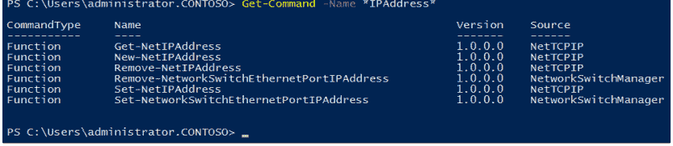

图 11.2：使用 Get-Command 进行搜索

与许多工具集一样，PowerShell 使用 * 作为通配符指示符。在我们刚刚完成的搜索中，实际上对于我运行的几乎任何 cmdlet 搜索，在我搜索的术语两端使用 * 通配符有助于显示包含我搜索术语的任何结果。

## PowerShell 是骨干

正如你在本章中会发现的，与 PowerShell 交互可以让你触手可及各种强大的功能。然而，我们有时会发现，管理员并不完全信任 PowerShell，因为他们习惯于从图形界面执行这些操作并进行更改。在运行单个 PowerShell cmdlet 来设置配置后，该配置本需十几次鼠标点击才能完成，很容易认为它可能根本没有做任何事情。这太容易了，它处理我的命令速度太快了，对吧？我还是最好进入那个图形界面，只是为了 double-check PowerShell 是否真的完成了工作。

当我开始使用 PowerShell 时，我一直想这样做。但我使用得越多，越深入研究这些图形界面本身，我就越意识到我不是唯一使用 PowerShell 的人。许多管理工具 GUI 也使用 PowerShell！在 Windows Server 操作系统中，你甚至没有意识到，你在许多图形化驱动的任务中使用了 PowerShell。当你打开管理控制台来更改服务器上的任何内容，做出配置，然后点击 Go 或 Finish 按钮时，这个图形控制台如何将你的配置应用到位？PowerShell。在幕后，控制台在后台接收你输入的信息，将其填入 PowerShell cmdlet 中并运行它们来执行实际的配置工作。

我们从 Server Manager 内部运行的许多管理工具都采用这种方法，接受你的更改和配置，然后将这些设置制定为在后台运行的 PowerShell 命令，以推动更改生效。

因此，如果你犹豫是否开始使用 PowerShell，因为它感觉不同，或者你不信任该过程与 GUI 中工作方式的一致性，就忘掉所有这些吧。因为经常，当你使用鼠标点击更改服务器设置时，你实际上是在调用 PowerShell cmdlet 来完成工作。

## 脚本编写

你使用 PowerShell 越多，它就越强大。除了运行临时单条命令和 cmdlet 外，你还可以构建能够完成各种不同事情的广泛脚本。我提到过 PowerShell 与常规编程语言相似，而脚本编写就是我们开始进入该领域的起点。PowerShell 提供了创建脚本文件的能力，我们稍后将为自己创建，保存脚本以便反复轻松运行相同的脚本。你也可以使用变量，就像其他形式的编码一样，以便提供脚本可使用的可变输入和对象，使其更灵活并发挥更多功能。

## Server Core

如果说有一个领域我认为我们作为服务器管理员可以更好地利用现有技术，那就是使用 PowerShell 来实现微软的集中管理模式。当我们需要在服务器上完成一项任务时，我们的默认倾向是登录到该服务器（通常通过 RDP），然后使用鼠标开始点击并进行工作。登录服务器变得越来越不必要，我们可以通过使用可用的集中管理工具节省大量时间。PowerShell 就是其中之一。与其 RDP 到该服务器，不如简单地在本地机器上使用 PowerShell 提示符来远程更改该服务器上的设置。

这种远程管理不仅高效，而且随着我们开始处理更多无头服务器变得必要。我希望在未来几年内看到组织中 Server Core 的使用率增加，而与这些服务器交互将需要你改变管理思维。通过现在熟悉从 PowerShell 内部完成日常任务，你将更好地为这些无头机器的未来管理做好准备，这些机器需要你以不同于今天习惯的方式与之交互。


## 在 PowerShell 中工作

使用 PowerShell 进行实际工作的第一步是熟悉与该平台的交互，并习惯于从此命令行界面工作，而不是依赖鼠标指针。在这里，我们将探讨我所见服务器管理员最常用的几种使用 PowerShell 提升日常工作流程的方式。

在本章中，我们将在随 Windows Server 2019 一起提供的 PowerShell 版本中工作，即 PowerShell 5.1。你可能听说过 PowerShell 7 发布的消息。如果你熟悉它并且已经在使用它，我们讨论的所有内容在该更新平台上都能完美运行。要管理 Windows Server 实例，版本之间的差异影响不大。安装 PowerShell 7 不会更新 PowerShell 5.1，而是两者并行运行。

PowerShell 7 是开源的，并且具有跨平台工作的能力，支持 Windows、macOS 和 Linux。它还包含了一些用于与 Docker 容器协作的额外支持。如果你选择并安装 PowerShell 7，请记住这两个版本是不同的可执行文件：

- PowerShell 5.1 = powershell.exe
- PowerShell 7 = pwsh.exe

## 启动 PowerShell

我们需要做的第一件事就是打开 PowerShell 开始使用它。PowerShell 控制台默认安装在所有较新的 Windows 版本中，因此你可以从开始菜单运行它，将其固定到桌面，或以你通常打开任何应用程序的方式访问它。

由于我倾向于对所有事情都使用键盘，我通常打开 PowerShell 的方式是按住 WinKey 并按 R 打开运行提示，输入单词 powershell，然后按 Enter：

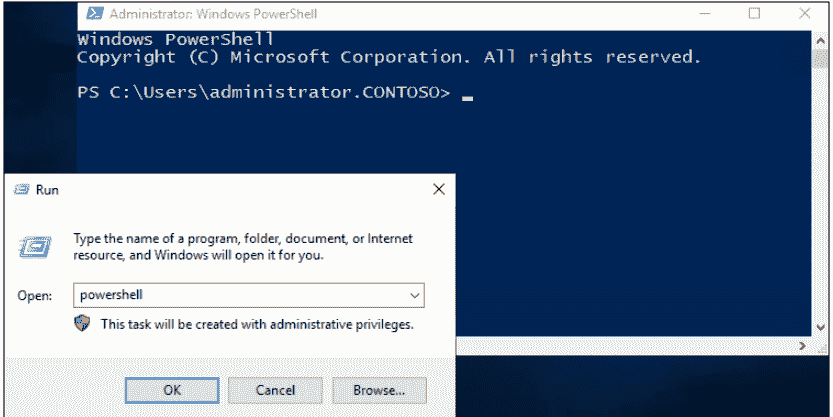

图 11.3：仅使用键盘启动 PowerShell

正如你所见，由于我以管理员账户登录到我的服务器，我的 PowerShell 提示已以提升的权限打开。PowerShell 窗口顶部的工具栏中列出了单词 **Administrator**。需要注意的是，就像命令提示符一样，你可以以普通用户权限或提升的管理员权限打开 PowerShell 提示。通常更安全的做法是在没有提升权限的普通 PowerShell 会话中工作，除非你要完成的任务需要这些额外权限。

在任何较新的 Windows 平台上打开 PowerShell 的另一种快速简便的方法是右键单击开始按钮并从呈现的快速任务列表中选择它。正如你在图 11.4 中所见，我右键单击了我的一台新 Server 2019 机器的开始按钮，可以从这里选择打开 PowerShell 甚至是提升的（管理员）PowerShell 提示：

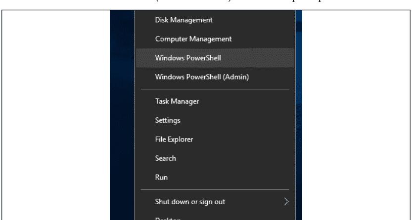

图 11.4：从快速管理员任务菜单启动 PowerShell

如果你右键单击开始按钮却找不到 PowerShell 选项而是打开命令提示符的选项，请不要沮丧。这是一个可配置的选项；你可以在快速管理员任务菜单中显示命令提示符或 PowerShell 选项。如果你右键单击任务栏并选择任务栏设置，你会找到一个名为在右键单击开始按钮或按 Windows 键+X 时将命令提示符替换为 Windows PowerShell 的选项。切换此选项将使你的快速管理员菜单在两个命令行界面之间切换。

你也可以从现有的命令提示符窗口进入 PowerShell 提示。通常，当你从命令提示符工作时，无法使用任何 PowerShell cmdlet。让我们试试。打开一个管理员命令提示符窗口并尝试输入我们之前提到的 cmdlet 之一的名称。也许输入 Get-NetIPAddress 来查看此系统上的 IP 地址。哎呀——失败了，因为命令提示符不识别 Get-NetIPAddress cmdlet。

现在输入单词 powershell 并按 Enter。不会打开单独的 PowerShell 窗口，你的提示会发生变化，但应用程序窗口本身保持不变。你现在已从黑白命令提示符窗口内部进入 PowerShell shell，并且可以按需使用 cmdlet。再次运行 Get-NetIPAddress 现在会产生一些信息：

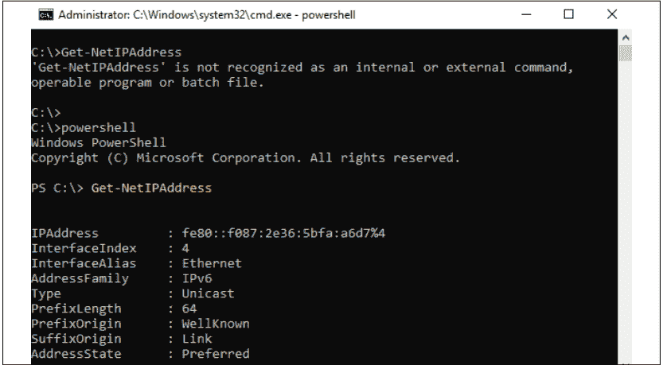

图 11.5：从命令提示符内部调用 PowerShell

你可以通过输入 exit 从 PowerShell 模式返回到常规命令提示符模式。

## 默认执行策略

当你直接使用 PowerShell 命令行界面工作时，你可以简单地打开 PowerShell，开始输入 cmdlet 并开始工作。然而，使用 PowerShell 的一大优势是在你开始创建、保存和运行脚本时显现出来。如果你打开 PowerShell，创建一个脚本，然后尝试运行它，有时你会发现它失败并出现一大堆错误消息，例如这一个：

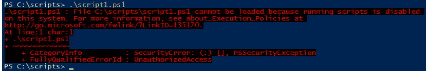

图 11.6：常见的 PowerShell 脚本执行错误

这在全新的 Windows Server 2019 实例上不应该发生，但在你对新服务器应用了任何 GPO 或你使用不同的操作系统并尝试运行一些 PowerShell 脚本时可能会发生；你可能会在开始时就被这些错误消息卡住。虽然某些版本的 Windows 默认阻止脚本运行的特性是一种安全增强，但在你试图完成某项任务时绕过它可能很麻烦。值得庆幸的是，如果你遇到此问题，解决方法很简单：你只需在 PowerShell 内部调整默认执行策略（DEP），使其允许脚本正常执行即可。

这不是一个简单的开/关开关。DEP 内部有五个不同的级别，了解每个级别非常重要，以便你根据服务器上想要的安全级别相应地设置 DEP。以下是每个级别的描述，按从最安全到最不安全的顺序排列。

### 受限

受限策略允许运行单个命令和 cmdlet，但完全阻止脚本运行。

### 所有已签名

这要求任何正在运行的脚本都必须由受信任的发布者签名。设置为 AllSigned 时，即使是你自己编写的脚本也必须经过该验证过程并签名后才允许运行。

### 远程签名

RemoteSigned 是 Windows Server 2019 中的默认策略。对于从互联网下载的脚本，它要求这些脚本由你信任的发布者使用数字签名签名。但是，如果你选择创建自己的脚本，它将允许这些本地脚本在无需数字签名的情况下运行。

### 无限制

允许运行已签名或未签名的脚本。你在运行从互联网下载的脚本时仍会收到警告提示。

### 绕过模式

在绕过模式下，脚本运行时不会被阻止也不会给出警告。换句话说，你自负风险。

有时单个执行策略并不能满足你的所有需求，这取决于你如何使用 PowerShell 脚本。DEP 可以通过设置执行策略范围来进一步增强，该范围允许你为系统的不同方面设置不同的执行策略。例如，你可以操作的三个范围是 Process、CurrentUser 和 LocalMachine。默认情况下，DEP 影响 LocalMachine，以便运行的脚本遵循 DEP。但如果你需要修改此行为，以便为 CurrentUser 或甚至单个进程设置不同的 DEP，你可以这样做。

如果你不确定 DEP 的当前状态或怀疑有人可能更改了它，你可以使用一个名为 Get-ExecutionPolicy 的简单 cmdlet 轻松查看当前分配的执行策略。正如你在图 11.7 中所见，我的设置为 Restricted，这解释了我之前尝试运行脚本时出现的错误消息：

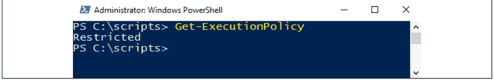

图 11.7：ExecutionPolicy 当前设置为 Restricted

一旦你决定了服务器或工作站上想要的 DEP 级别，你就可以使用一个快速 cmdlet 相应地设置它。例如，由于这是一个测试实验室，我希望脚本能够运行，而且由于我处于隔离状态，我不太关心安全性，我将把它更改为 Unrestricted。以下是我的执行命令：

```
Set-ExecutionPolicy Unrestricted
```

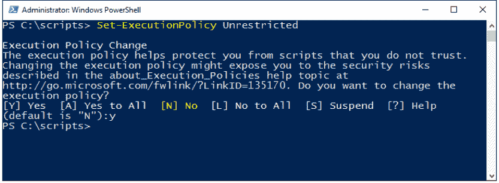

图 11.8：将 ExecutionPolicy 设置为 Unrestricted


请记住，现在，我们正在此本地系统上运行 PowerShell（我恰好登录到我的 WEB3 服务器），因此我设置的唯一执行策略是针对我的 WEB3 系统的本地策略。如果我想全局更改此设置或同时为一组计算机更改，我可以利用组策略进行此更改。组策略中配置 PowerShell 脚本执行策略的位置是 计算机配置 | 策略 | 管理模板 | Windows 组件 | Windows PowerShell | 打开脚本执行。

## 使用 Tab 键

在开始在 PowerShell 内部导航之前，有一件重要的事情我想指出：请习惯在 PowerShell 提示符中按下 Tab 键！如果您输入任何命令或 cmdlet 甚至添加到 cmdlet 的变量的前几个字母，然后按 Tab，cmdlet 名称的剩余部分将自动填充到屏幕上。

如果我们输入 get-co 然后按 Tab，提示符会自动填充完整的 Get-Command cmdlet。由于有多个以 get-co 开头的 cmdlet，如果您多次按 Tab，您可以看到它在所有以这些字母开头的可用 cmdlet 之间循环。

Tab 也适用于文件和文件夹名称。例如，我下载了一个需要安装到服务器上的热修复补丁。我想使用我已经打开的 PowerShell 提示符启动此热修复补丁，但我不想花费一分钟或更长时间来输入此热修复补丁的巨大文件名。我已经导航到我的热修复补丁所在的文件夹，现在如果我只输入文件名的前几个字母并按 Tab 键，PowerShell 将填充文件名的剩余部分。从那里，我们需要做的就是按 Enter 启动该安装程序：

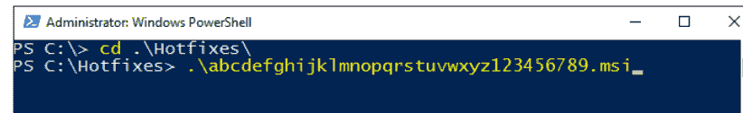

图 11.9：Tab 键自动填充文件或命令名称

## 日常任务的有用 cmdlet

当我开始将 PowerShell 整合到我的日常工作流程中时，我发现保留一份常用命令和 cmdlet 的清单很有用。在它们变得熟记于心、成为第二天性之前，如果您没有快速、轻松地回忆这些命令的方法，很可能您不会使用它们，并会回到配置服务器的旧方法。

以下是我在构建服务器时经常使用的一些项目的列表。其中一些是传统的命令，也可以在命令提示符中使用，而一些是 cmdlet，但在 PowerShell 窗口中工作时它们都很有用：

- Get-Command: 这对于查找您可能想要运行或研究的额外命令或 cmdlet 很有用。
- Get-Command -Name *example*: 通过在末尾添加 -Name 开关来增强 Get-Command 的实用性，以便您可以将结果过滤为您正在搜索的任何类型的 cmdlet。
- GCM: 这只是 Get-Command 的简短别名。我只想指出这一点，因为许多 PowerShell cmdlet 都有别名，例如 gcm，可以让您使用更少的击键启动这些常用的 cmdlet。
- Get-Alias: 由于我们刚刚提到了 Get-Command 的 GCM 别名，您可能想知道 PowerShell 内部还有哪些其他别名可用。要查看完整列表，只需输入 Get-Alias cmdlet。使用别名而不是完整的 cmdlet 名称可以大大减少您在 PowerShell 中输入的字符数。
- Rename-Computer: 这允许您为服务器设置新的主机名。
- Add-Computer: 使用 Add-Computer cmdlet 将服务器或计算机加入域。
- hostname: 这显示您当前正在操作的系统的名称。我经常使用 hostname 来确保我确实在认为的那台服务器上工作。您是否曾经重启过错误的服务器？我有过。通过运行快速的 hostname 命令，您可以放心，您即将执行的功能确实发生在正确的系统上。
- $env:computername: 这会向您显示您正在操作的系统的主机名，但我特别指出它是为了显示 PowerShell 可以轻松访问您的环境变量以提取信息。更简单的 hostname 命令在您登录到本地系统并且只是尝试验证其名称时很有用，但从变量（如 $env:computername）中提取信息的能力在创建脚本或尝试对远程系统执行功能时将更有用。
- Logoff: 名称不言自明；Logoff 只是让您退出系统。与其在服务器的 **Start** 菜单中到处点击寻找 **Sign out** 功能，不如在命令提示符或 PowerShell 窗口中输入一个快速的 Logoff 命令，您将立即退出该服务器。我在关闭 RDP 连接时经常使用它。
- Install-WindowsFeature: 使用 PowerShell 简化在服务器上添加新角色或功能。

shutdown 和 Restart-Computer 都可用于关闭或重启服务器。在我的电脑上，这些命令最常在 hostname 命令之前使用。在重启服务器时，您需要特别注意重启正确的机器，因此我发现最好打开一个 PowerShell 提示符，快速检查主机名，然后从同一提示符运行 Restart 命令。这确保了我正在重启 hostname 输出中返回的服务器：

```
shutdown /r /t 0
```

如果您运行简单的 shutdown 命令，系统将在一分钟后关闭。我不确定为什么这是默认值，因为我从未发现任何 IT 管理员实际上希望在关闭系统前等待额外的一分钟。相反，在关闭开始前设置时间限制更有效。在前面的命令中，我告诉 shutdown 命令我想要重启而不是关闭；这就是 /r 的作用。我还告诉它在执行此重启前等待零秒。这样，它会立即发生；我不必等待默认的 60 秒计时器。

## 查询用户或 quser

在 RDS 环境中最有用，quser 命令将显示当前登录到服务器的所有用户，包括他们是本地登录还是远程登录的统计信息，以及他们的会话活跃了多长时间。我通常使用 quser 来发现闲置了很长时间的 RDS 会话，以便我可以结束这些会话并释放服务器上的资源：

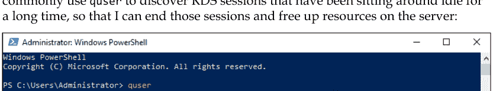

图 11.10：quser 命令显示已登录的会话

```
quser /server:WEB1
```

使用 quser 结合 /server 开关，您可以查看远程系统上当前已登录的用户。这样，您可以保持登录到 RDS 农场中的单个服务器，但可以检查所有系统的用户会话，而无需登录它们。您甚至可以编写一个脚本，对每个会话主机服务器运行此命令并将数据输出到文件。然后可以按计划运行此输出，并用作跟踪在任何给定时间哪些用户登录到哪些 RDS 会话主机服务器的报告机制。

## IP 地址 cmdlet

当我们在本书前面一起构建 Server Core 实例时，我们利用了 Sconfig 工具来为该服务器定义 IP 地址。虽然这是一种快速简便的完成此类任务的方法，但让我们定义用于配置服务器 NIC 上 IP 地址信息的 PowerShell cmdlet：

```
New-NetIPAddress -InterfaceIndex 12 -IPAddress 10.10.10.40
-PrefixLength 24 -DefaultGateway 10.10.10.1
```

上面只是一个带有一些示例数字的示例命令；这里的重点是我们可以使用 New-NetIPAddress 为服务器上的 NIC 分配 IP 地址。

通常与 New-NetIPAddress 结合使用，使用以下命令设置 NIC 属性中的 DNS 服务器地址：

```
Set-DnsClientServerAddress -InterfaceIndex 12 -ServerAddresses
10.10.10.2,10.10.10.3
```

## 使用 Get-Help

您有多少百次使用命令提示符中的 /? 开关来获取有关您想要运行的命令的一些额外信息？此帮助功能提供的额外信息有时可能意味着命令是有用还是完全无用之间的区别。PowerShell cmdlet 也有类似的功能，但您不能简单地在 PowerShell cmdlet 末尾加上 /?，因为 PowerShell 中 cmdlet 后的空格表示您即将指定要与该 cmdlet 一起使用的参数。例如，如果我们尝试使用 /? 与 Restart-Computer cmdlet 查找有关如何使用 Restart-Computer 的更多信息，它将无法将问号识别为有效参数，我们的输出将如下所示：

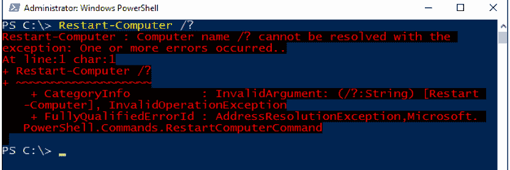

图 11.11：PowerShell cmdlet 不适用于 /?


Instead, there is an even more powerful help function inside PowerShell. Get-Help is a cmdlet itself, and like any cmdlet, we need to use information following the cmdlet to specify and pull the information that we are looking for. So instead of using Get-Help at the end of a command, like we used to do with the question mark, we use it as its own entity.

Running Get-Help by itself only gives us more information about the Get-Help command, which may be useful to look over, but right now we are more interested in finding out how we can use Get-Help to give us additional information for a cmdlet we want to run, such as the Restart-Computer function. What we need to do is use Get-Help as a cmdlet, and then specify the other cmdlet as a parameter to pass to Get-Help, by placing a space between them:

```
Get-Help Restart-Computer
```

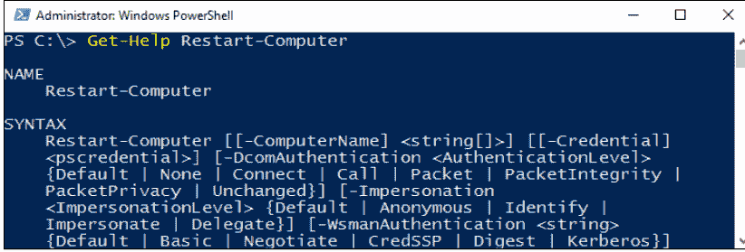

Figure 11.12: Displaying help information for any cmdlet

The information provided by Get-Help is very comprehensive; in some cases, it has all of the same information that you can find on Microsoft Docs. Using Get-Help is a quick way of finding example syntax for commands and cmdlets that you may be unfamiliar with, and negates the need for you to launch a web browser to find that information. Make sure to start utilizing Get-Help to further your knowledge of any cmdlet in PowerShell!

> When using PowerShell on a fresh system, or one that you haven't worked on in a while, take a minute to run a command called Update-Help. This will cause PowerShell to reach out to Microsoft and download the latest versions of help files, so that you know you are viewing the most up-to-date information when using Get-Help.

## Formatting the output

When searching for information in PowerShell, I often encounter the case where so much information is provided to me that it's difficult to sort through. Are you trying to find useful cmdlets from Get-Command, or maybe track down a particular alias with Get-Alias? The output from these cmdlets can be staggeringly long. While we have discussed some parameters you can use to whittle down this output, such as specifying particular -Name parameters, there are a couple of formatting parameters that can also be appended to cmdlets, in order to modify the data output.

### Format-Table

The purpose of Format-Table is pretty simple: it takes the data output from a command and puts it into a table format. This generally makes the information much easier to read and work with. Let's look at an example. We have used Get-NetIPAddress a couple of times, but, let's be honest, its output is a little messy. Running the cmdlet by itself on my virtual server, which only has a single NIC assigned to it, results in four pages of data inside my PowerShell window, with all kinds of informational fields that are either empty or not important for finding the IP addresses assigned to my server:

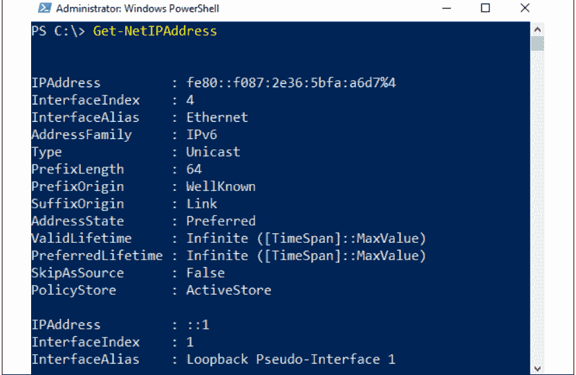

Figure 11.13: Default output from Get-NetIPAddress

If we simply add Format-Table to the end of my Get-NetIPAddress cmdlet, the generated data is much easier on the eyes, while still giving me the important information that I am really looking for: the IP addresses being used on the system:

```
Get-NetIPAddress | Format-Table
```

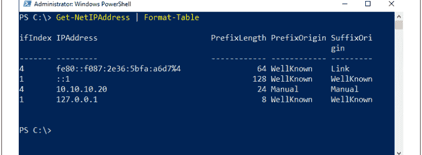

Figure 11.14: Formatted output of Get-NetIPAddress

Some of you may be familiar with a cmdlet called Select-Object, which can perform the same functions as Format-Table. While Select-Object seems to be the more widely known cmdlet, in my experience, it is actually less powerful than Format-Table, and so I suggest you spend some time playing around with the one we have discussed here.

### Format-List

Similar to the way that Format-Table works, you can utilize Format-List to display command output as a list of properties. Let's give it a quick try. We already know that Get-Command gives us the available cmdlets within PowerShell, and by default, it gives them to us in a table format.

If we wanted to view that output in a list instead, with more information being provided about each cmdlet, we could tell Get-Command to output its data in list format, with the following command:

```
Get-Command | Format-List
```

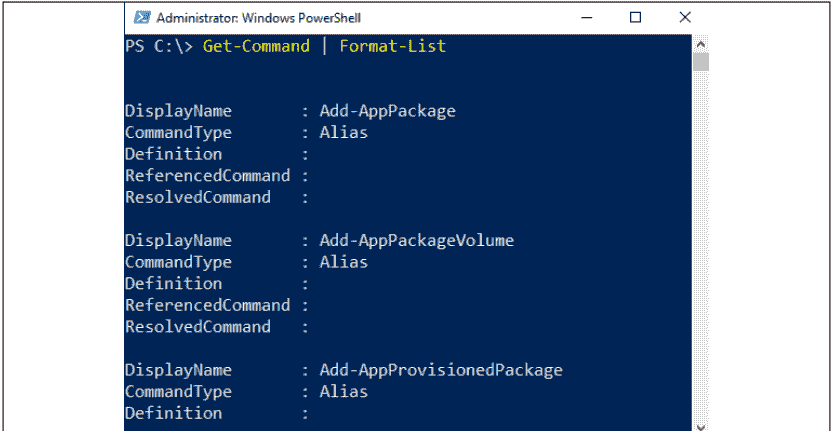

Figure 11.15: Using Format-List to modify cmdlet output

This results in a tremendously long output of information, so long in fact that my PowerShell window had a problem displaying it all. Maybe we need to whittle that info down a little bit by narrowing our focus. Let's search for all of the cmdlets that include the word Restart while displaying them in list format:

```
Get-Command -Name *Restart* | Format-List
```

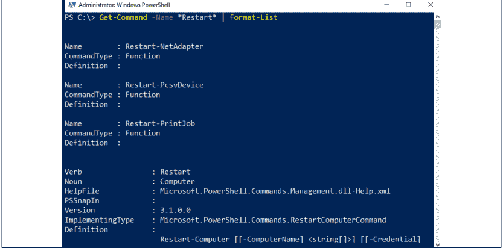

Figure 11.16: List format information about Restart-related cmdlets

### Using a pipeline

Following the last couple of example cmdlets that we ran, you may be thinking to yourself, "I see that he is using that vertical line on the key above Enter on my keyboard, but why?"

Great question. In Command Prompt, we generally issue one command at a time. The same is often true for PowerShell when we are manually interacting with it, but in PowerShell, we have the potential for so much more power. One of those items of power is the ability to create a pipeline of commands. In other words, you can connect, or chain, commands together. This is commonly referred to as piping information from one cmdlet to another cmdlet and is done by using that little |.

Cmdlets often output data. If you then want to utilize that set of data against another cmdlet, this is where the pipe comes in handy. In our last example command, we told PowerShell to gather all of the commands that included the word Restart by performing Get-Command -Name *Restart*. Then we piped that output to Format-List. PowerShell took the outputted dataset and threw it at Format-List to display a different set of output. The pipe is used very often in PowerShell commands.

### Export to CSV

One common way to use a pipe is when grabbing information via PowerShell that you want to retain, document, or send to somebody else. A common method for storing output data is within CSV files, a popular enough request that Microsoft has baked a cmdlet in for just that purpose. Let's work with another cmdlet that is very useful, Get-EventLog, and combine it with Export-CSV to show off this capability.

Event logs are essential information in a Windows Server environment. Troubleshooting issues on a server almost always involves a step of reviewing the Windows event logs. There is, of course, a graphical interface from which to accomplish this, but filtering and searching within that GUI is not as useful as it should be. Instead, we can use PowerShell to output event log information, such as the following:

```
Get-EventLog System
```

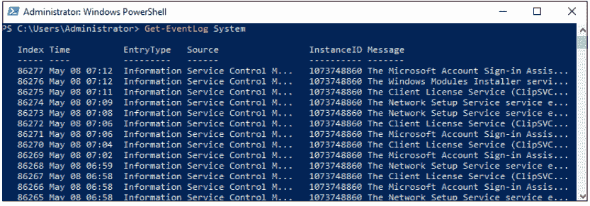

Figure 11.17: Viewing the system event logs in PowerShell

As you can see, the system event logs on this server contain a lot of information, and reading through it all within the PowerShell window could take the next three years. Filtering and searching is key to making this data useful, so let's see what this does instead:

```
Get-EventLog System | Export-CSV C:\Logs\SysLog.csv
```

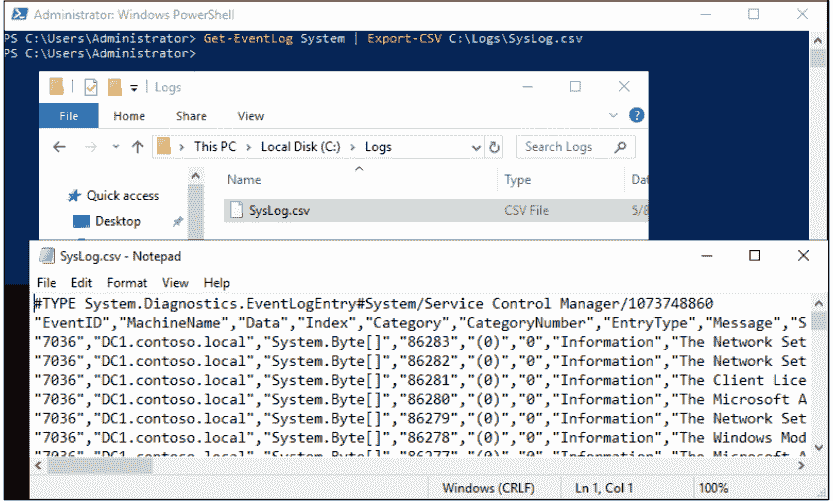

Figure 11.18: Piping output to a CSV file

PowerShell grabbed all of the information from system event logs and spit that info into a CSV file for us. We can now take that CSV file, open it inside a program like Microsoft Excel, and easily sort, filter, or search on these events in a much easier way than we could do from within the default Windows Event Viewer.

> You can also export to XML, HTML, or even pipe output directly to a printer!

### Pipes can invoke action

So far, we have only seen pipes modify outputted data. This is very useful, but I don't want you to walk away from this thinking that pipes are only useful for generating information. They can also take the output from one command and throw it at another command, but perhaps a command that actually causes a change or action to be performed. A good example is stopping a process or service. Let's pretend that for some reason you want to have a way to immediately stop all of the Hyper-V services on a server. Those services all have a DisplayName that begins with the word "Hyper-V." We can verify that by using the following command to view all of those services:

```
Get-Service -DisplayName hyper*
```

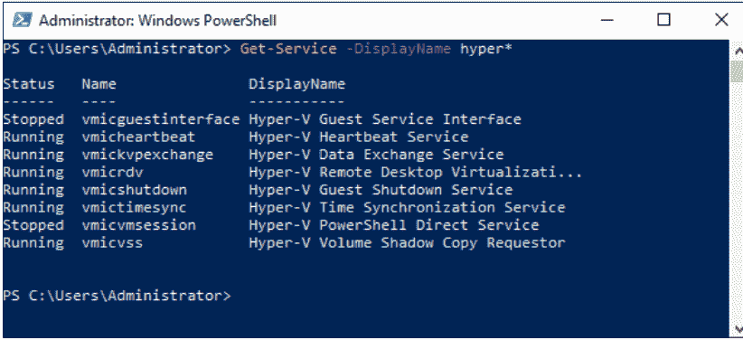

Figure 11.19: Viewing services related to Hyper-V


我们可以获取此 Get-Service cmdlet 的输出并将其通过管道传递给 Stop-Service，结果命令将立即停止所有以单词 "Hyper" 开头的服务：

```
Get-Service -DisplayName hyper* | Stop-Service
```

## PowerShell 集成脚本环境

大多数服务器管理员熟悉在命令提示符环境中创建批处理文件的概念。想要按顺序运行一系列命令？需要在不同服务器上多次运行此命令序列，或今后反复运行？将多个命令放入文本文档中然后保存为 .BAT 文件扩展名，将会得到一个批处理文件，该文件可在任何 Windows 计算机上运行，按顺序发出这些命令，从而节省了您反复在命令行界面中输入这些命令的时间和精力。

PowerShell 中的脚本编写是同样的思路，但功能更强大。命令提示符中的命令很有用，但有限，而 PowerShell cmdlet 能够操作操作系统内的任何内容。通过 PowerShell，我们可以引用环境变量或注册表中的项目，我们可以轻松地向远程系统发出命令，并且我们甚至可以在 PowerShell 脚本中使用变量，就像您对任何完整的编程语言所做的那样。

让我们探索几种可以用来开始创建第一个 PowerShell 脚本的不同方法。

## PS1 文件

创建简单的 .PS1 文件（PowerShell 脚本文件）几乎与创建 .BAT 文件完全相同。只需使用您喜欢的编辑器打开一个文本文档，输入一系列命令或 cmdlet，然后将文件保存为 FILENAME.PS1。只要您的 PowerShell 环境允许运行脚本 – 请参阅本章前面关于 DEP 的内容 – 您现在就可以双击该 .PS1 文件，或从任何 PowerShell 提示符启动它，以运行该脚本中的一系列 cmdlet。让我们试试并证明我们可以让一个简单的脚本运行起来。

由于您创建的脚本都必须有用途，让我们思考一个现实世界的例子。我经常使用终端服务器 – 抱歉，RDS 服务器 – 客户的常见请求是记录用户登录到哪些服务器的日志。

收集此信息的一种简单方法是创建一个登录脚本，在用户登录时将用户会话信息记录到文件中。为此，我需要创建一个脚本，可以配置为在登录过程中运行。为了让脚本今后更具趣味性和灵活性，我将使用一些变量来记录我的用户名、当前日期和时间，并记录正在登录到的 RDS 服务器的名称。这样，我以后可以查看汇总的日志，并轻松确定哪些用户在哪些服务器上。我将使用记事本创建此脚本。我已打开一个新的记事本实例，输入了以下命令，现在将其保存为 C:\Scripts\UserReporting.ps1：

```
$User = $env:username
$RDSH = $env:computername
$Date = Get-Date

echo $User,$Date,$RDSH | Out-File C:\Scripts\UserReporting.txt -append
```

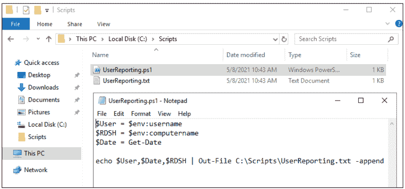

图 11.20：创建简单的 PS1 脚本

您可能已经可以看出这个脚本在做什么，但让我们还是逐步讲解一下。首先，我们定义了三个变量。我告诉脚本 $User 需要等于环境变量 username。这将给我提供登录人员的用户名。$RDSH 将是用户登录的服务器名称，也是通过访问服务器的环境变量获取的。定义的第三个变量是 $Date，它只需通过调用名为 Get-Date 的 PowerShell cmdlet 来获取当前系统日期。

在将所有信息提取到 PowerShell 变量后，我然后将这三项输出到位于服务器硬盘上的文本文件。

如果我多次运行此脚本，我可以打开 UserReporting.txt 文件并看到，每次运行脚本时，它都会成功将我指定的变量记录到此报表文件中：

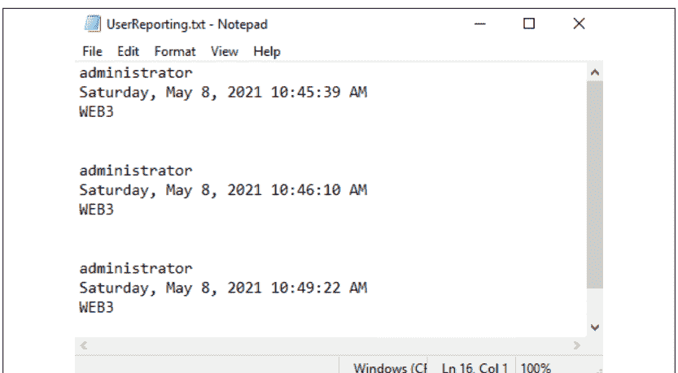

图 11.21：我们 PowerShell 脚本的结果

## 使用 PowerShell ISE

说实话，我们刚才运行的那个简单脚本的组装过程经过了一些反复试验。我没有现成的副本可以参考，我需要在脚本中确信它们会工作之前，先在 PowerShell 中单独测试其中的几行。我最初还尝试在不使用环境变量的情况下提取用户名，但没有成功。为什么我只是组装几行简单的代码就会遇到这么多麻烦？因为当我在记事本中输入这些行时，我完全不知道保存并尝试运行该脚本时它们是否会工作。所有文本都是黑底白字，我完全信任自己的知识和脚本编写能力来组装出真正可行的东西。

幸运的是，我们可以使用 **PowerShell 集成脚本环境 (ISE)**。这是一个程序，在 Windows Server 2019 中默认安装；它是一个脚本 shell，允许您编写 PowerShell 脚本并在过程中提供帮助。让我们打开它。如果您有任何 PS1 PowerShell 脚本文件，您可以简单地右键单击其中一个并选择 **编辑**。否则，通过右键单击 PowerShell 应用程序图标（例如从任务栏），您将找到从该菜单直接启动 **Windows PowerShell ISE** 的选项：

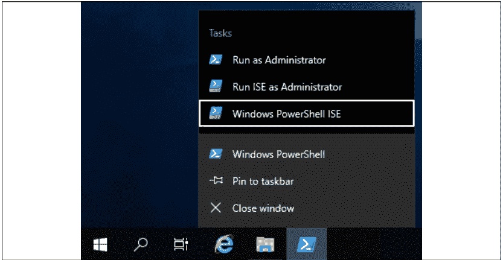

图 11.22：启动 PowerShell ISE

现在，如果我们开始在记事本中几分钟前使用的相同脚本信息，您可以看到，即使在输入时，我们也会收到弹出窗口和提示，帮助我们决定要使用哪些 cmdlet 或变量。与智能手机上的自动完成键盘类似，ISE 会提供您正在输入内容的建议，这样您就不必记住 cmdlet 或参数的名称；您可以根据它开头的字母做出有根据的猜测，然后从提供的列表中选择一个。右侧还有一个所有可用命令的列表，并且可以搜索！这是一个非常有用的功能，确实有助于让这些脚本顺利进行：

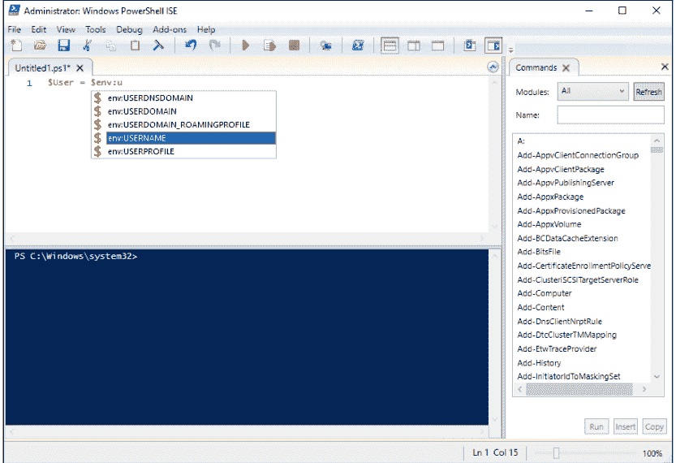

图 11.23：ISE 为 cmdlet 和变量提供建议

同样有用的是占用 ISE 开发窗口下半部分的蓝色 PowerShell 小屏幕。基本上，当您输入一些命令时，ISE 通过为 cmdlet 和参数着色以便轻松识别，帮助确保它们都能正常工作，然后您可以单击任务栏中标记为 **运行脚本 (F5)** 的绿色箭头按钮。即使您尚未将脚本保存到任何位置，ISE 也会通过您的命令并在以下 PowerShell 提示窗口中呈现输出。这使您可以测试脚本，或测试对现有脚本所做的更改，而无需保存文件然后从传统的 PowerShell 窗口单独启动它：

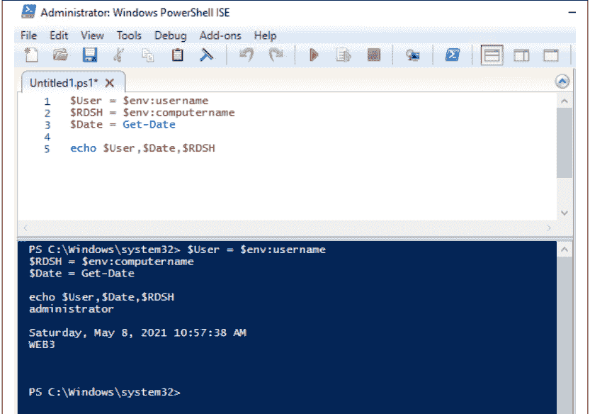

图 11.24：在 ISE 中测试脚本

更好的是，您可以突出显示脚本的特定部分并选择仅运行代码的隔离部分。这使您可以测试脚本的某些部分，或做一些创造性的事情，例如保留一个包含您每天可能会使用的常见 PowerShell 命令的大型 PS1 脚本文件。当您需要运行其中一个时，您只需突出显示要运行的文本，然后单击 **运行所选内容 (F8)** 按钮。通过在 ISE 中运行脚本前突出显示文本，只有所选的 cmdlet(s) 才会生效。在下面的屏幕截图中，您可以看到我脚本文件中有许多 cmdlet 列出，但只有突出显示的那一个在按下 F8 时被运行：


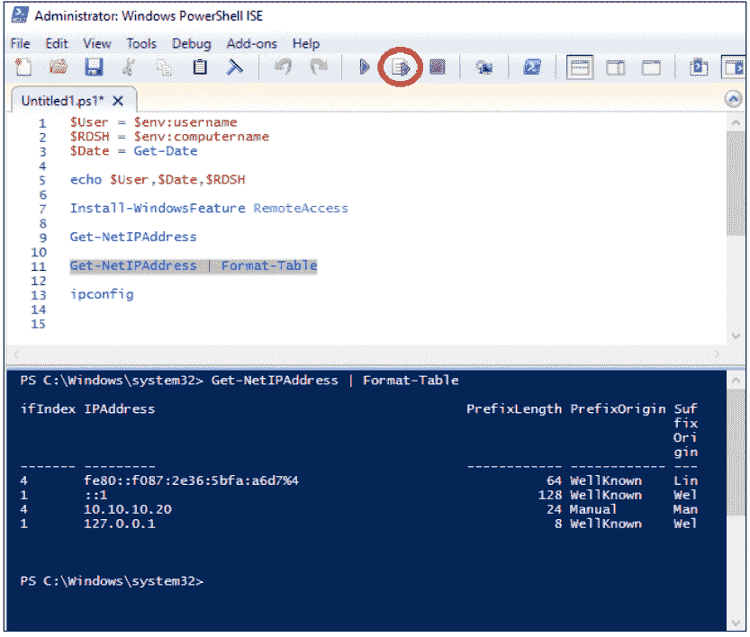

图 11.25：在 ISE 中仅运行高亮的命令

## 远程管理服务器

现在我们已经在 PowerShell 的本地实例中做了一点工作，并探索了一些可以用来开始创建脚本的方法，是时候更仔细地看看 PowerShell 如何融入你的集中化管理需求了。如果你开始使用 PowerShell 进行服务器管理，但仍然通过 RDP 登录到服务器然后再从那里打开 PowerShell，那你做错了。我们已经知道可以将远程服务器添加到 Server Manager 中以便集中管理。我们也知道 Server Manager 内部的工具在很大程度上只是在你点击按钮时发出一系列 PowerShell cmdlet。将这两条信息结合起来，你可以推断出 PowerShell 命令和 cmdlet 可以轻松地针对远程系统运行，包括那些你当前未登录的系统。

顺着这个思路，我们将查看在我们自己的环境中实现这一目标所需的条件。我们将确保我们的其中一台服务器已准备好接受远程 PowerShell 连接，然后使用另一台机器上的 PowerShell 提示符从该远程服务器提取信息并对其进行更改。

## 准备远程服务器

只需在远程服务器上运行并启用几项内容，PowerShell 才能从另一台机器访问它们。如果你的所有服务器都是 Windows Server 2019（事实上，如果它们都是 Windows Server 2012 或更高版本），那么 PowerShell 远程管理默认已启用，你可能可以跳过接下来的几个部分。然而，如果你尝试使用 PowerShell 远程管理但它对你不起作用，了解其内部工作原理非常重要。这样，你就可以对其进行故障排除，并在遇到问题或运行某些较旧的操作系统（这些步骤可能必要）时手动建立远程功能。也有可能你存在预先设定的安全策略会禁用 PowerShell 远程连接功能使用的组件，因此如果发现远程访问被阻止，这些就是需要在这些系统上检查的项目。

## WinRM 服务

远程管理拼图中的一个部分是 WinRM 服务。只需确保此服务正在运行。如果你出于某种加固或安全考虑而停止了它，你需要撤销该更改并使服务重新运行才能使用 PowerShell 远程管理。

当然，你可以从 services.msc 检查 WinRM 服务的状态，或者由于本章我们使用的是 PowerShell，你也可以使用以下命令进行检查：

```
Get-Service WinRM
```

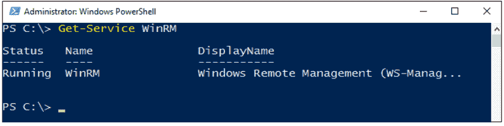

图 11.26：确保 WinRM 服务正在运行

## Enable-PSRemoting

通常，在远程服务器上需要完成的唯一其他事情就是运行一个单一、简单的 cmdlet。当然，服务器需要有网络访问权限，否则你根本无法在网络上看到它。但除了确保从新服务器的控制台直接进行网络连接和流量正常工作之外，你就可以发出 PowerShell 命令，使此服务器能够接受传入的远程 PowerShell 连接：

```
Enable-PSRemoting -Force
```

在 Enable-PSRemoting 命令末尾使用 -Force 会导致命令在不询问确认的情况下执行。这里 Enable-PSRemoting 在后台执行了几项不同的操作。首先，它尝试启动 WinRM 服务。我为什么已经指定你应该手动检查它？因为如果你将其作为锁定策略的一部分而禁用，你将干扰此过程。在使用 Enable-PSRemoting 之前检查 WinRM 会增加运行 Enable-PSRemoting cmdlet 成功率。此命令还做另外两件事：启动远程连接的侦听器，并在系统上创建防火墙规则以允许此流量成功通过。

如果你打算大规模使用 PowerShell 远程管理，想到要登录到每台服务器并运行此命令会令人望而生畏。幸好你不必这样做！与 Windows 世界中的大多数功能一样，我们可以使用组策略自动为我们进行此更改。创建一个新的 GPO，适当链接和筛选它，使其仅适用于你想要集中管理的服务器，然后配置此设置：**计算机配置** | **策略** | **管理模板** | **Windows 组件** | **Windows 远程管理 (WinRM)** | **WinRM 服务。**

将“通过 WinRM 允许远程服务器管理”设置为“已启用”，如下所示：

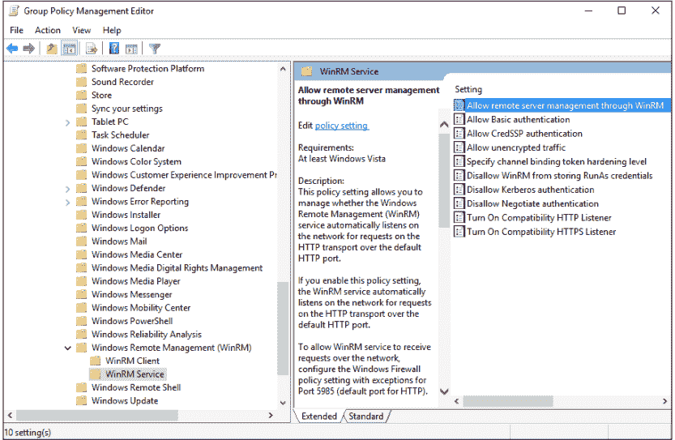

图 11.27：通过 GPO 启用远程管理

## 允许来自其他域或工作组的计算机

如果你处理的服务器都属于同一个企业域，这通常是这种情况，那么机器之间的身份验证很容易实现。它们在此级别上自动相互信任。然而，在你准备接受远程连接的服务器上，如果你预计这些远程计算机将是未受信任的不同域的成员——甚至是工作组成员——那么你将必须发出另一个命令以手动信任将要连接的各个计算机。例如，如果我计划从名为 Win10Client 且不受服务器信任的客户端计算机管理所有服务器，我需要在这些服务器上运行以下命令：

```
Set-Item wsman:\localhost\client\trustedhosts Win10Client
```

如果你想允许任何机器远程连接，你可以将单个计算机名替换为 *，但通常这不是一个好做法，因为以这种方式允许任何机器连接到你的服务器可能会招致麻烦。

## 连接到远程服务器

我通常看到管理员以两种不同的方式使用远程 PowerShell。你可以在 PowerShell 提示符仍在本地上下文中运行时按需对远程系统执行一些命令，或者你可以启动一个完整的远程 PowerShell 会话，使 PowerShell 提示符的行为就像直接在该远程系统上运行一样。让我们看看这两种选项。

## 使用 -ComputerName

PowerShell 中可用的许多 cmdlet，特别是以 Get- 开头的 cmdlet，可以与 -ComputerName 参数一起使用。这指定了你即将运行的命令需要在 -ComputerName 部分指定的远程系统上执行。对于我们的远程 PowerShell 示例，我将使用 Windows 10 客户端计算机上的 PowerShell 提示符来访问网络中某些服务器上的信息。我想查询 WinRM 服务，以确保它正在运行。为了证明我正在与 WEB3 远程通信，你将在输出中看到我首先查询了本地 WinRM 服务，而我恰好在我的 Win10 工作站上禁用了它。

你在图 11.28 中看到我的本地 WinRM 服务显示为已停止，但当我发出同一命令指定查询 WEB3 的 -ComputerName 时，它会联系并报告回给我，WinRM 服务确实在 WEB3 服务器上成功运行：

```
Hostname
Get-Service WinRM
Get-Service WinRM -ComputerName WEB3
```

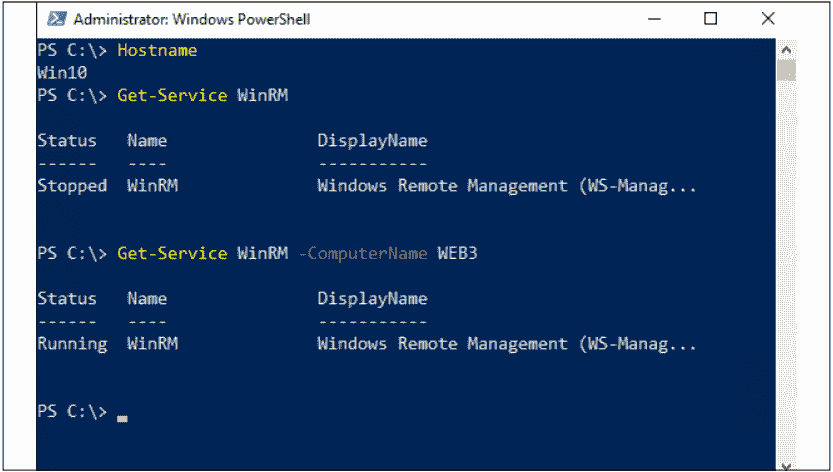

图 11.28：使用 -ComputerName 查询远程系统

或者，也许我想查询我们不久前设置的新 Server Core 实例并检查 WEB4 上当前安装了哪些角色：

```
Get-WindowsFeature -ComputerName WEB4 | Where Installed
```

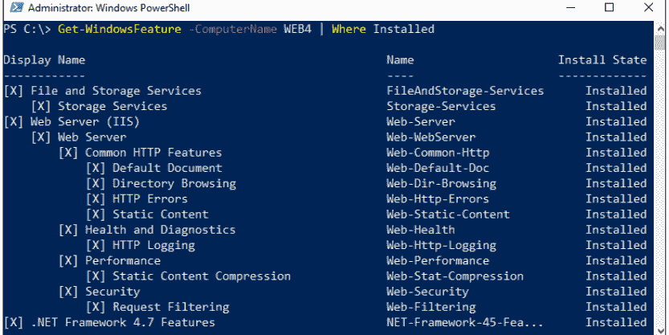

图 11.29：WEB4 上安装的角色和功能


-ComputerName 参数甚至可以同时接受多个服务器名称。如果我想通过一条命令检查几台服务器上的 WinRM 服务状态，可以这样做：

```
Get-Service WinRM -ComputerName WEB1,WEB2,DC1
```

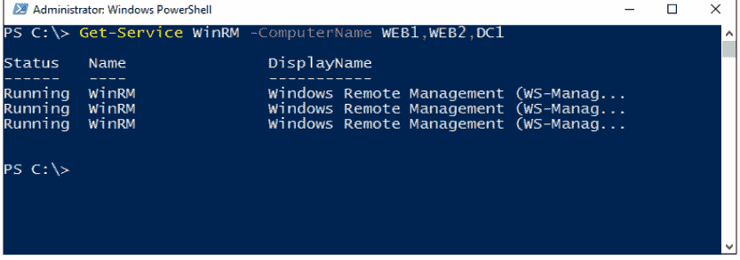

图 11.30：远程 PowerShell 同时运行于多台机器

## 使用 Enter-PSSession

另一方面，有时你想针对特定服务器运行许多不同的 cmdlet。在这种情况下，更合理的做法是调用完全功能、完全远程的 PowerShell 实例来连接该远程服务器。如果你在本机系统上打开 PowerShell 并使用 Enter-PSSession cmdlet，你的 PowerShell 提示符将成为该远程服务器上 PowerShell 的完整远程表示。之后你可以在该提示符中发出命令，它们将像你坐在该服务器控制台的 PowerShell 提示符前一样执行。再次说明，我已登录到我的 Windows 10 客户端计算机并打开了 PowerShell。然后我使用以下命令远程连接到我的 WEB4 服务器：

```
Enter-PSSession -ComputerName WEB4
```

你会看到提示符发生变化，表明我现在在 WEB4 服务器的上下文中工作。

> 如果你的用户账户没有访问服务器的权限，你可以指定在创建此远程连接时使用的替代凭据。只需在 Enter-PSSession cmdlet 后附加 -Credential USERNAME 来指定不同的用户账户。

从此以后我发出的命令都将针对 WEB4 执行。让我们来验证一下。如果我检查一个简单的 $env:computername，你可以看到它向我展示了 WEB4 主机名：

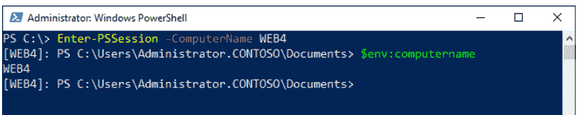

图 11.31：PowerShell 已远程连接到 WEB4

为了进一步验证，如果我检查已安装的 Windows 角色和功能，你可以看到我已安装 Web Server 角色，就像我们在最初将此 Server Core 配置为 Web 服务器时所做的那样。显然，我的 Windows 10 工作站上并未安装 Web Server 角色；PowerShell 从 WEB4 服务器提取这些数据：

```
Get-WindowsFeature | Where Installed
```

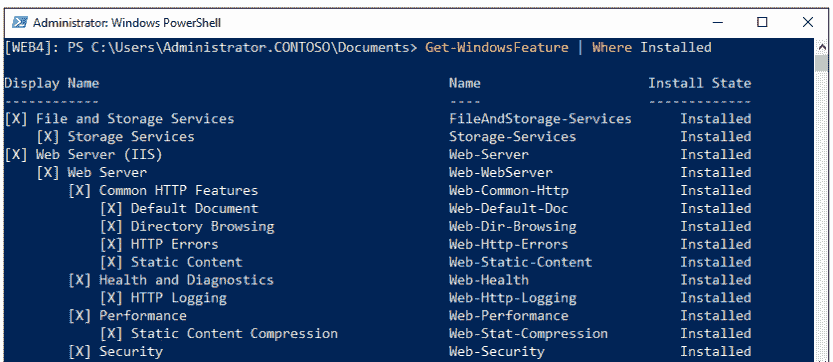

图 11.32：WEB4 上已安装的角色和功能

这非常强大。我们坐在本地桌面计算机上，WEB4 服务器的远程 PowerShell 会话正在运行，现在我们能够从 WEB4 提取各种信息，因为它就像我们直接在该服务器上使用 PowerShell 工作一样。让我们再进一步，尝试在 WEB4 上进行配置更改，以验证我们是否可以做到。也许我们可以在此服务器上安装一个新功能。我经常使用 Telnet Client 进行网络连接测试，但可以看到它目前尚未安装在 WEB4 上：

```
Get-WindowsFeature -Name *telnet*
```

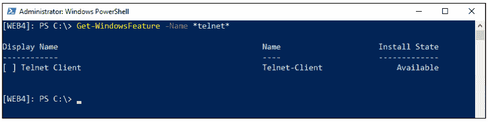

图 11.33：Telnet Client 目前未安装在 WEB4 上

通过使用 Add-WindowsFeature cmdlet，我应该能够快速安装该功能：

```
Add-WindowsFeature Telnet-Client
```

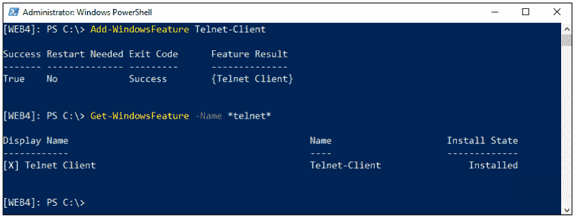

图 11.34：通过远程 PowerShell 在 WEB4 上安装 Telnet Client

利用远程 PowerShell 日常使用具有巨大的潜力，不仅适用于运行完整桌面体验图形界面的服务器，也适用于与注重安全的 Server Core 部署进行交互。熟悉在远程 PowerShell 会话中工作对于在你的基础设施中成功部署 Server Core 至关重要。

## 期望状态配置

在较新版本的 PowerShell 中，有一些强大的功能由称为 **期望状态配置 (DSC)** 的东西提供。DSC 是一个集成到 PowerShell 中的管理平台，它提供了一些新的函数和 cmdlet，你可以在脚本中利用它们来实现一些很酷的功能。顾名思义，它允许你在 PowerShell 中构建 **配置**，以提供 *期望状态*。我的意思是？嗯，从基本意义上讲，DSC 确保你构建的 PowerShell 脚本在你应用它们的任何服务器上始终以相同的方式工作，因为它确保服务器本身以相同的方式配置。很容易构建一个脚本，使其在你当前工作的服务器上正确运行。但是，如果你尝试将同一脚本推广到可能位于不同的 **组织单元 (OU)** 中，或最初安装了不同项目的不同服务器上，则脚本可能会产生与最初预期不同的结果。DSC 就是为抵消这些差异而构建的。

在构建 DSC 配置时，你会识别出特定角色、设置、函数、账户、变量等，你希望在特定的期望状态中保留。一旦你识别并配置了这些变量，DSC 将努力确保它们保持在你设置的位置，并且根据你的 DSC 配置策略保持一致，这意味着它们在你运行此脚本的其他服务器上是一致的。

DSC 还有助于防止服务器上的不想要的更改。如果你的 DSC 启用的脚本已确定特定服务应始终在服务器上运行，而该服务因某种原因停止，DSC 可以帮助将其重新启动起来，以便你不会遇到中断。或者，也许你有一个脚本将服务器配置为特定标准，而 IT 中的另一位人员随后调整了服务器上的配置——也许他们出于某种原因登录并 purposefully 停止了服务。通常，这可能导致该服务器中断，但 DSC 将再次启动该服务以维护该服务器的原始配置的 *期望状态*。可以说，DSC 是你的 *脚本保姆*。它有助于构建在多个平台上保持一致的配置，然后努力确保这些配置始终为真。你可以确信你的服务器始终在你指定的期望状态的上下文中运行。

在构建了识别你想要安装或监控的项目的配置后，一个名为 **本地配置管理器 (LCM)** 的引擎会努力确保资源保持在配置规范之内。LCM 会定期轮询系统，监视异常和更改，并在需要时采取行动将服务器带回 DSC。

DSC 的最终目标是在你的服务器和服务之间保持一切恒定和一致。随着角色被重写以接受 DSC 参数和监控，DSC 的功能和访问操作系统中越来越多地方的能力不断增长。这种技术有助于确保服务器始终使用你定义的标准运行，有助于保持你的 99.999% 的正常运行时间状态。

关于 DSC 有很多东西需要学习，我鼓励你在熟悉创建和使用 PowerShell 脚本后进一步探索这个主题。以下是了解 DSC 的一些很好的起点：

- https://docs.microsoft.com/en-us/powershell/scripting/dsc/getting-started/wingettingstarted?view=powershell-7.1
- https://docs.microsoft.com/en-us/powershell/scripting/dsc/configurations/write-compile-apply-configuration?view=powershell-7.1
- https://mva.microsoft.com/en-US/training-courses/getting-started-with-powershell-desired-state-configuration-dsc--8672?l=ZwHuc1G1_2504984382

## 摘要

在 Windows Server 2019 中，我们在多个地方看到，通过 PowerShell 进行管理是与服务器交互的推荐方式。因为管理 GUI 现在只是运行 PowerShell 脚本的外壳，并且 Windows Server 的默认安装选项是 Server Core，我们可以假设无头、面向命令行的服务器将成为我们未来的服务器。即使 PowerShell 自 Server 2012 以来一直是操作系统功能的核心，我认为到目前为止，大多数管理员仍然将 PowerShell 视为管理服务器的一种替代方式。“是的，我知道它存在，我应该开始使用它，脚本看起来很酷，但我仍然可以用旧的命令提示符或我的鼠标按钮做任何我想做的事情。”这种旧的思维方式正在迅速改变。

现在我们正在经历新技术（如 DSC）的出现，我们可以看到 PowerShell 正在开发操作系统其他地方根本不存在的功能。这，再加上标准化 PowerShell 平台提供的远程管理可访问性，该平台可用于你当前的所有 Windows 设备（甚至可以针对 Azure 中的服务器！），意味着我们肯定会在后续的 Microsoft 操作系统和服务中看到越来越多的 PowerShell。


## 问题
- 1. 从命令提示符进入 PowerShell 的最快方法是什么？
- 2. 哪个 cmdlet 可以显示所有可用的 PowerShell cmdlet？
- 3. 可以用来将 PowerShell 提示符连接到远程计算机的 PowerShell cmdlet 是什么？
- 4. PowerShell 脚本文件的文件扩展名是什么？
- 5. 在全新 Windows Server 2019 实例上，DEP 配置为哪个设置？
- 6. 在 PowerShell 提示符中工作时，键盘上的哪个键可以用来自动填充 cmdlet 或文件名的剩余部分？
- 7. 在系统能够通过远程 PowerShell 连接进行连接之前，必须运行哪个服务？
