# 12 Windows Server 2019 中的冗余
*乘以二。* 这是我在为工作规划服务器部署时经常听到的一个说法。我相信你也一样。任何时候推出新技术时，你都希望非常仔细地规划该部署。弄清楚你需要哪些服务器，它们需要放置在哪里，以及这些服务器的网络需要如何配置。规划完成后，订购所有东西的两份，以防其中一个损坏。我们生活在一个始终在线的技术世界中。服务中断是不可接受的，特别是如果我们托管云或私有云服务的话。用户依赖以完成工作的任何应用程序或服务都是任务关键型的，需要 100% 的正常运行时间，或者接近于此。冗余的问题在于，说起来容易做起来难。也许有一天我们会得到一个神奇的 *按这里使此服务器冗余* 按钮——但今天不是那一天。我们需要了解可供我们使用的能够在系统上提供冗余的技术。本章将向我们介绍其中一些技术。本书专注于本地部署的 Server 2019，因此我们涵盖的技术是你可以在本地数据中心使用的技术，应用于你负责构建、配置和维护的真实（物理或虚拟）服务器上。是的，云可以为我们提供一些神奇的可扩展性和冗余选项，但那些很简单，而且我们通常甚至不需要了解它们是如何工作的。当我们在自己的内部使用服务器时，*我们如何为系统增加一些可靠性？*

本章将涵盖以下主题：
- **网络负载平衡 (NLB)**
- 配置负载均衡网站
- 故障转移群集
- 群集层级
- 设置故障转移群集
- Windows Server 2019 中的群集改进
- **存储空间直通 (S2D)**

## 网络负载平衡 (NLB)
经常，当我听到人们讨论服务器冗余时，谈话中会多次出现“群集”这个词，例如，“如果我们设置一个群集来为那些服务器提供冗余...”或“我们的主网站运行在群集上...”虽然在这些对话涉及的系统上使用某种形式的弹性是件好事，但通常情况下群集实际上根本没有涉及。当我们深入了解他们的系统配置细节时，我们会发现是 NLB 在为他们做这项工作。我们将在本章后面讨论真正的群集，但首先我想从使许多服务冗余的更常见方法开始。NLB 在 TCP/IP 层分发流量，这意味着服务器操作系统本身并不完全感知或依赖彼此，冗余是在网络层提供的。这可能特别令人困惑——NLB 与群集——因为有时 Microsoft 将某物称为群集，而实际上它使用 NLB 来实现这些连接。一个典型的例子是 **DirectAccess**。当你有两个或多个 DA 服务器一起组成一个阵列时，有 TechNet 文档甚至控制台内部的一些地方将其称为群集。但这里并没有进行故障转移群集；使连接流向两个节点的底层技术实际上是 Windows NLB。

你可能听说过硬件负载均衡器市场中的一些名字——**F5**、**Cisco**、**Kemp**、**Barracuda**，还有很多。这些公司提供专用硬件或虚拟设备，可以接收流向特定名称或目的地的流量，并将该流量在两个或多个应用服务器之间分配。虽然这通常是建立 NLB 最稳健的方式，但它也是最昂贵的，并且使整体环境更加复杂。这些厂商提供的一个内置 Windows NLB 无法提供的功能是 SSL 终止，或我们常称之为 SSL 卸载。

这些专用设备能够接收来自用户计算机的 SSL 网站流量，并在将其发送到适当的 Web 服务器之前解密数据包。这样，Web 服务器本身的工作量就减少了，因为它不必花费 CPU 周期来加密和解密数据包。然而，今天我们根本不会谈论硬件负载均衡器，而是谈论 Windows Server 2019 中内置的 NLB 功能。

### 与轮询 DNS 不同
多年来，我发现有些人对 NLB 的理解实际上是轮询 DNS。让我举个例子：假设你有一个内部网站，你的所有用户每天都会访问。为此系统提供一些冗余是合理的，因此你设置了两台 Web 服务器，以防其中一台宕机。然而，如果其中一台真的宕机了，你不希望需要手动切换步骤来故障转移到额外的服务器；你希望它自动发生。在 DNS 中，可以创建两个主机 A 记录，它们具有相同的名称但指向不同的 IP 地址。如果 Server01 运行在 10.10.10.5 上，而 Server02 运行在 10.10.10.6 上，你可以创建两个都称为 **INTRANET** 的 DNS 记录，一个主机记录指向 10.10.10.5，另一个主机记录指向 10.10.10.6。这将提供轮询 DNS，但不是真正的负载均衡。本质上，发生的情况是，当客户端计算机访问 INTRANET 时，DNS 会将其中一个 IP 地址交给它们进行连接。DNS 不关心该网站是否实际运行，它只是响应一个 IP 地址。因此，即使你设置了它并且看起来运行完美，因为你可以看到客户端同时连接到 Server01 和 Server02，也请注意。在服务器故障的情况下，你将有一些客户端仍然可以工作，而许多客户端在 DNS 决定将它们发送到现在已离线的服务器的 IP 地址时，会突然收到 **无法显示页面**。

NLB 比这智能得多。当 NLB 阵列中的一个节点宕机时，流向共享 IP 地址的流量只会被导向仍在线的节点。我们很快就会在为自己的内部网站设置 NLB 时亲眼看到这一点。

### 哪些角色可以使用 NLB？
NLB 主要设计用于 *无状态* 应用程序，换句话说，是不需要长期内存状态或连接状态的应用程序。在无状态应用程序中，应用程序发出的每个请求可能由 Server01 处理一段时间，然后切换到 Server02，而不会中断应用程序。有些应用程序处理得非常好（如网站），有些则不行。

Web 服务（IIS） definitely 从 NLB 提供的冗余中受益最多。NLB 配置起来相当容易，并且为你在 Windows 服务器上运行的网站提供完全冗余，而无需额外成本。NLB 还可以用于增强 FTP、防火墙和代理服务器。

另一个经常与 NLB 交互的角色是远程访问角色。具体来说，DirectAccess 可以使用内置的 Windows NLB 为你的远程访问环境提供冗余入口服务器。在设置 DirectAccess 以使用负载均衡时，并不明显你正在使用操作系统内置的 NLB 功能，因为你是从远程访问管理控制台而不是 NLB 控制台配置负载均衡设置。当你通过远程访问管理向导建立负载均衡时，该远程访问控制台实际上是在访问操作系统内的 NLB 机制并对其进行配置，以便其算法和传输机制成为 DirectAccess 用于在多个服务器之间分配流量的组件。

使用 NLB 最好的部分之一是你可以对环境进行更改而不影响现有节点。*想要将新服务器添加到现有的 NLB 阵列中？* 没问题。在不中断服务的情况下将其滑入。*需要移除服务器进行维护？* 这里也没有问题。可以在特定节点上停止 NLB，让阵列中的另一个节点接管工作。事实上，NLB 实际上是 NIC 特定的，因此你可以在同一服务器的不同 NIC 上运行不同的 NLB 模式。你可以指示 NLB 在特定 NIC 上停止，从而暂时将该服务器从阵列中移除。更妙的是，如果在需要将服务器离线之前有一点时间，你可以发出 drainstop 命令而不是立即停止。这允许当前在该服务器上活动的现有网络会话干净地完成。不会有新的会话流向你已执行 drainstop 的 NIC，而旧会话将随着时间的推移自然消失。一旦所有会话都从该服务器断开，你就可以将其拔出并进行维护，而不会对用户造成任何中断。

### 虚拟和专用 IP 地址
了解 NLB 如何在服务器上使用 IP 地址非常重要。首先，任何将成为负载均衡阵列一部分的服务器上的 NIC 都必须分配静态 IP 地址。NLB 不适用于 DHCP 地址。在 NLB 世界中，NIC 上的静态 IP 地址被称为 **专用 IP 地址 (DIP)**。这些 DIP 每个 NIC 都是唯一的，显然意味着每个服务器都有自己的 DIP。例如，在我的环境中，WEB1 运行的 DIP 地址为 **10.10.10.40**，我的 WEB2 服务器运行的 DIP 为 **10.10.10.41**。


每个服务器都在各自的 DIP 地址上托管相同的网站。重要的是要理解，当在这两台服务器之间建立 NLB 时，我需要保留这些服务器上的各个 DIP，但我也会创建一个在两台服务器之间共享的新 IP 地址。这个共享 IP 被称为虚拟 IP 地址（VIP）。当我们稍后逐步进行 NLB 设置时，我将使用 10.10.10.42 作为我的 VIP，该地址目前在我的网络中尚未使用。以下是设置我的网络负载均衡网站时将使用的 IP 地址的快速布局：

| 名称 | IP 地址 |
|------|------------|
| WEB1 DIP | 10.10.10.40 |
| WEB2 DIP | 10.10.10.41 |
| 共享 VIP | 10.10.10.42 |

在为 intranet.contoso.local 建立 DNS 记录时，该名称是我的网站，我将只创建一个单个主机 A 记录，它将指向我的 10.10.10.42 VIP。

## NLB 模式

不久后，我们将进入负载均衡的实际配置，并在该界面中做出一些决定。其中一个重要决定是我们想要使用哪种 NLB 模式。默认选择的是 Unicast，而且我看到大多数公司设置 NLB 的方式也是如此，也许是因为它是默认选项，他们从未想过要更改它。让我们花一点时间讨论每种可用选项，以确保你可以选择最适合你的网络需求的选项。

### 单播

在这里，我们开始深入了解 NLB 如何在不同主机之间分发数据包。由于我们没有物理负载均衡器先接收流量然后再决定发送到哪里，*负载均衡的服务器如何决定谁来处理哪些数据包流？*

要回答这个问题，我们需要稍微回溯一下并讨论流量在你的网络内部如何流动。当你在计算机上打开 Web 浏览器并访问 HTTP://WEB1 时，DNS 会将其解析为 10.10.10.40，例如。当流量到达交换机并需要被定向时，交换机需要决定 10.10.10.40 的流量需要去往何处。你可能熟悉 MAC 地址的概念。

每个 NIC 都有一个 MAC 地址，当你将 IP 地址分配给 NIC 时，它会将其自己的 MAC 地址和 IP 与网络设备注册。这些 MAC 地址存储在 ARP 表中，该表存在于大多数交换机、路由器和防火墙内部。当我的 WEB1 服务器被分配 10.10.10.40 IP 地址时，它注册了对应于 10.10.10.40 的 MAC 地址。当流量需要流向 WEB1 时，交换机意识到发往 10.10.10.40 的流量需要去往该特定 NIC 的 MAC 地址并相应地将其发送出去。

因此在 NLB 世界中，当你向被多个 NIC 分割的单个 IP 地址发送流量时，*在 MAC 层是如何处理的？* 使用单播 NLB 的答案是物理 NIC 的 MAC 地址会被虚拟 MAC 地址替换，并且该 MAC 被分配给 NLB 阵列中的所有 NIC。这会导致流向该 MAC 地址的数据包被传递到该阵列中的所有 NIC，因此传递到所有服务器。如果你认为这听起来像是大量不必要的网络流量在交换机间移动，你是对的。单播 NLB 意味着当数据包的目标是阵列的虚拟 MAC 地址时，该流量基本上会在找到并到达目的地之前在交换机的所有端口（或至少在 VLAN 上）之间弹跳。

单播最好的地方在于在大多数情况下它无需在交换机或网络设备上进行任何特殊配置即可工作。你可以在 Windows Server 工具内部设置 NLB 配置，它会处理其余部分。单播的一个缺点是，由于所有节点上都存在相同的 MAC 地址，会导致一些节点间通信问题。换句话说，启用了 NLB 的服务器在相互通信其 IP 地址时会遇到困难。通常这并不重要，因为 WEB1 很少有理由直接与 WEB2 通信。但如果你确实需要这些 Web 服务器能够一致且可靠地相互通信，最简单的解决方案是在每个服务器上安装一个单独的 NIC，并使用该 NIC 进行阵列内部通信，同时将主 NIC 配置为 NLB 流量。

单播的另一个缺点是它可能会造成交换机泛洪。交换机无法为虚拟 MAC 地址学习永久路由，因为我们需要将其传递到阵列中的所有节点。由于每个移动到虚拟 MAC 的数据包都被发送到交换机的所有路径，以便它可以到达需要交付的所有 NIC，因此它有可能用这种网络数据包泛洪淹没交换机。如果你担心这一点，或者你的网络人员抱怨交换机泛洪，你可能想查看 NLB 集群的某种多播模式。

控制单播交换机泛洪的另一种方法是利用交换机上的 VLAN 发挥创意。如果你计划一个 NLB 服务器阵列，并希望确保该阵列产生的交换机流量不会影响网络中的其他系统，你当然可以在交换机上创建一个小型 VLAN，并仅将启用 NLB 的 NIC 插入该 VLAN。这样，当计划的泛洪发生时，它只会影响 VLAN 内部的少量端口，而不是在整个交换机上扩散。

### 多播

选择多播作为你的 NLB 模式会带来一些好处和一些麻烦。好处是它为每个 NIC 添加了一个额外的 MAC 地址。每个 NLB 成员然后有两个 MAC 地址：原始的和由 NLB 机制创建的。这使得交换机和网络设备更容易学习路由并将流量发送到正确的目的地，而不会出现压倒性的数据包泛洪。为此，你需要告诉交换机哪些 MAC 地址需要接收此 NLB 流量；否则，你将导致交换机泛洪，就像单播一样。告知交换机需要联系哪些 MAC 地址是通过登录交换机并创建一些静态 ARP 条目来完成的，以适应这种情况。对于任何拥有专职网络专业人员的公司，通常精通 Cisco 设备，这将毫不费力。如果你不熟悉修改 ARP 表和添加静态路由，正确配置可能会有点麻烦。总的来说，多播通常比单播更好，但它可能更具管理上的麻烦。我个人仍然倾向于单播，尤其是在小型企业中。我在许多不同的网络中都见过它使用且没有任何问题，而且选择单播意味着我们可以让交换机编程保持不变。

### 多播 IGMP

更进一步，但并非总是可选项，是使用 Internet 组管理协议（IGMP）的多播。多播 IGMP 确实有助于减轻交换机泛洪，但它仅在交换机支持 IGMP 侦听时才有效。这意味着交换机有能力查看多播数据包内部以确定它们确切应该去往何处。因此，单播按设计会产生一定程度的交换机泛洪，多播可以帮助降低该数量，而 IGMP 可以完全消除它。

你选择的 NLB 模式将很大程度上取决于你的网络设备的 capabilities。如果你的服务器只有一个 NIC，尝试使用多播，否则你将遇到阵列内部问题。另一方面，如果你的交换机和路由器不支持多播，你就没有选择——单播将是配置 Windows NLB 的唯一选项。

## 配置负载均衡网站

够了谈论；是时候为自己设置并尝试一下了。我在实验室网络上有两台 Web 服务器，WEB1 和 WEB2。它们都使用 IIS 来托管一个内部网站。我的目标是为用户提供一个单一的 DNS 记录供他们通信，但将所有流量在两台服务器之间进行拆分，实现真正的负载均衡。请跟随步骤了解如何实现这一点。

### 启用 NLB

首先，我们需要确保 WEB1 和 WEB2 已准备好进行 NLB，因为它默认未安装。NLB 是 Windows Server 2019 中可用的功能，你可以通过运行“添加角色和功能”向导像添加任何其他角色或功能一样添加它。在你希望成为 NLB 阵列一部分的所有服务器上添加此功能：

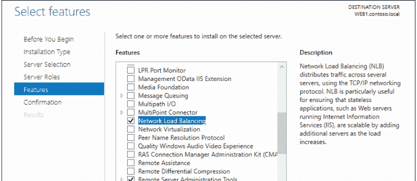

图 12.1：向服务器添加 NLB

### 在虚拟机上启用 MAC 地址欺骗

还记得我们谈到单播 NLB 以及 NIC 的物理 MAC 地址如何被用于 NLB 阵列通信的虚拟 MAC 地址替换吗？是的，虚拟机不喜欢那样。如果你正在对物理服务器的物理 NIC 进行负载均衡，可以跳过本节。但你们中的许多人将运行的是虚拟机 Web 服务器。无论它们是托管在 Hyper-V、VMware 还是其他虚拟化技术上，虚拟机的配置中都有一个额外的选项，你必须选择它，以便你的 VM 能够愉快地遵守此 MAC 地址更改。


此设置的名称大致为 **启用 MAC 地址欺骗**，不过具体功能名称可能因使用的虚拟化技术而有所不同。该设置应是一个简单的复选框，您需要启用它才能使 MAC 欺骗正常工作。请确保为计划使用 NLB 的 *所有* 虚拟 NIC 执行此操作。请记住，这是一个按 NIC 设置的选项，而不是按 VM 设置的选项。如果 VM 上有多个 NIC，并且您计划全部用于负载均衡，则可能需要为每个 NIC 勾选该框。

VM 需要关闭才能进行此更改，因此我已关闭我的 `WEB1` 和 `WEB2` 服务器。现在找到该复选框并启用它。由于我使用的一切都基于 Microsoft 技术，因此我当然在这里实验室中使用 Hyper-V 作为虚拟机的平台。在 Hyper-V 中，如果我右键单击我的 `WEB1` 服务器并进入 VM 的设置，然后可以单击我的网络适配器，以查看可在 `WEB1`'s 虚拟 NIC 上更改的各个部分。在最新版本的 Hyper-V 中，此设置列在 NIC 属性下方，位于标题为 **高级功能** 的部分中。就是它，我的 **启用 MAC 地址欺骗** 复选框。只需单击它进行启用，即可完成：

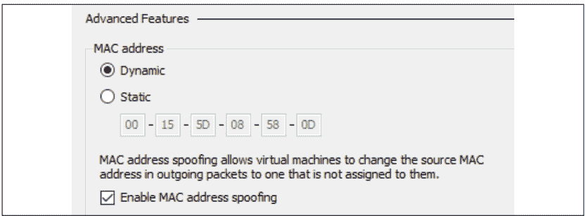

图 12.2：启用 MAC 地址欺骗

如果 **启用 MAC 地址欺骗** 为灰色，请记住虚拟机必须完全关闭后该选项才会出现。将其关闭，然后打开 **设置** 再次查看。此时该选项应可供选择。

## 配置 NLB

让我们总结一下目前的状况。我有两个 Web 服务器，WEB1 和 WEB2，它们目前各有一个 IP 地址。每台服务器都安装了 IIS，用于托管单个网站。我已在每台服务器上启用了 MAC 地址欺骗（因为这些服务器是虚拟机），并且刚刚在每台 Web 服务器上完成了 NLB 功能的安装。我们现在已经具备了所有必要的组件，可以配置 NLB 并将 Web 流量分配到两台服务器之间。

我将从 WEB1 开始进行 NLB 的初始配置。登录后，您会看到在 服务器管理器 内的可用工具列表中出现了一个新工具，名为 网络负载均衡管理器。继续打开该控制台。打开 NLB 管理器后，右键单击 网络负载均衡群集 并选择 新建群集，如图 12.3 所示：

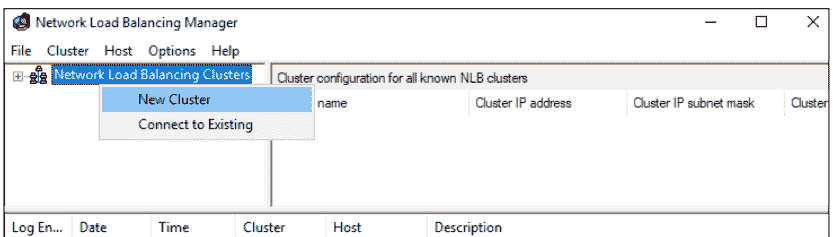

图 12.3：创建新的 NLB 群集

创建新群集时，需要注意的是，目前该群集中没有任何机器。即使我们运行此控制台的服务器也不会自动添加到群集中，我们必须记住手动将其放置到此屏幕中。因此，首先，我将输入我的 WEB1 服务器名称并单击 Connect。执行此操作后，NLB 管理器将查询 WEB1 的 NIC，并为我提供可在此上设置 NLB 的可用 NIC 列表：

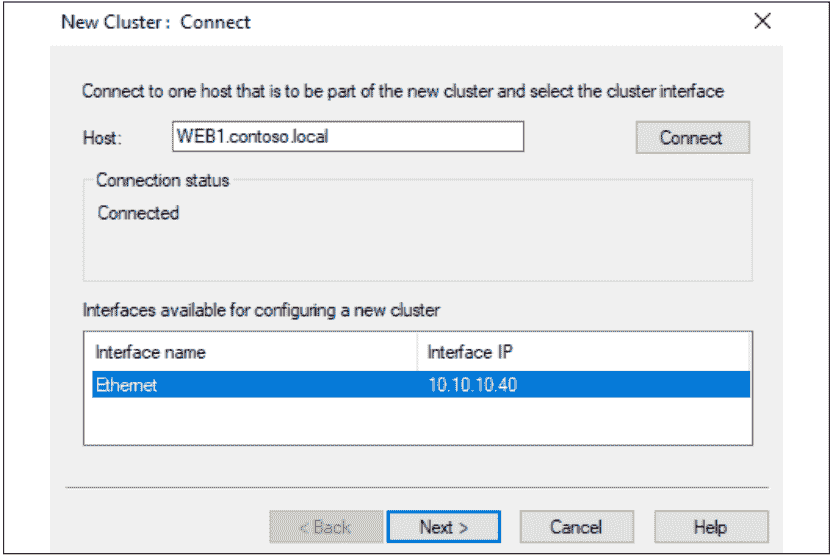

图 12.4：选择要设置 NLB 的 NIC

由于此服务器上只有一个 NIC，我只需保持其选中状态并单击 **下一步**。以下屏幕截图提供了在 WEB1 上输入额外 IP 地址的机会，但由于我们只运行一个 IP 地址，我将保持此屏幕不变，并再次单击 **下一步**。

现在我们进入了一个要求输入群集 IP 地址的窗口。这些是我们打算用于与此 NLB 群集通信的 VIP。如前所述，我此网站的 VIP 将为 10.10.10.42，因此我单击 Add... 按钮并输入该 IPv4 地址及其对应的子网掩码：

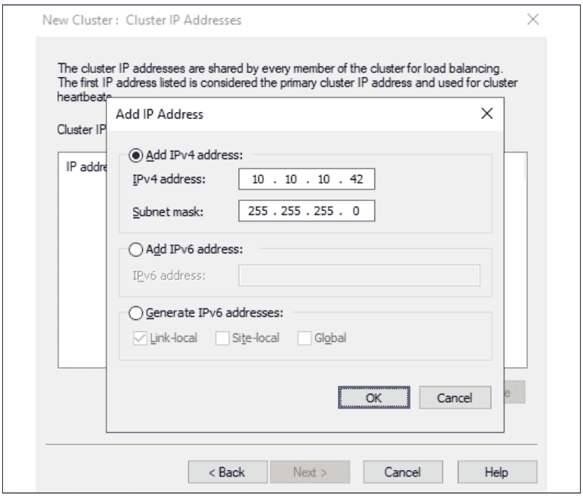

图 12.5：添加 VIP 地址

再单击一次 **下一步** 按钮，我们现在可以看到要运行的 **群集操作模式** 选项。根据您的网络配置，在 **单播**、**多播** 和 **IGMP 多播** 之间进行选择：

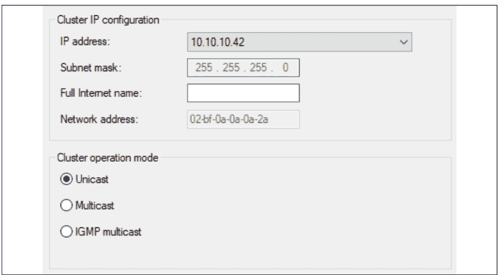

图 12.6：选择群集操作模式

我们 NLB 向导的以下屏幕截图允许您配置端口规则。默认情况下，有一条规则指示 NLB 对任何端口传入的任何流量进行负载均衡，但如果需要，您可以更改此设置。我在实际操作中很少看到人们在此处指定规则以将特定端口分发到特定目标，但此屏幕截图中的一个不错功能是可以禁用某些端口范围。

如果您希望在 NLB 层阻止不必要的流量，该功能会非常有用。例如，图 12.7 显示了阻止端口 81 及更高端口通过 NLB 机制的配置：

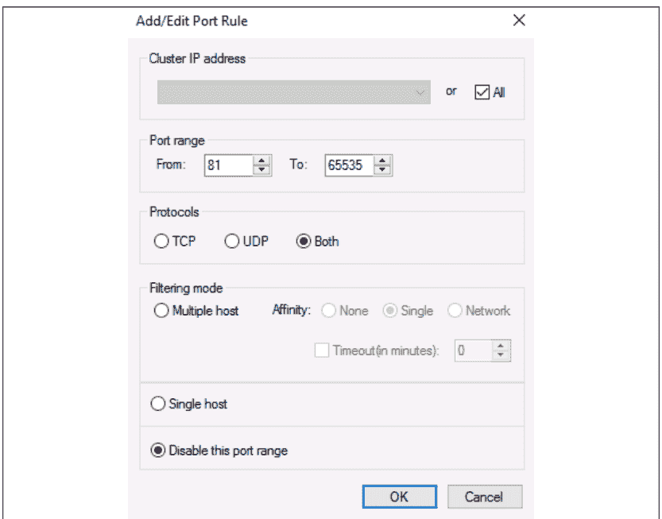

图 12.7：阻止特定流量

完成该向导后，您现在已创建了一个 NLB 群集！然而，在此阶段，我们仅指定了有关 VIP 和 WEB1 服务器的信息。我们尚未对 WEB2 进行任何设置。我们正在运行一个 NLB 阵列，但目前该阵列中只有一个节点，因此所有发往阵列的流量都落在 WEB1 上。右键单击新群集并选择 **向群集添加主机**：

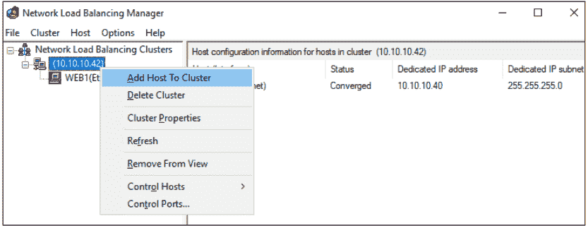

图 12.8：向新群集添加主机

输入我们的 WEB2 服务器名称，单击 **连接**，并按照向导将 WEB2 的次要 NLB 节点添加到群集中。一旦两个节点都添加到群集中，我们的 NLB 阵列或群集即可上线并准备使用。（您看，我告诉过您 *群集* 这个词在很多地方都会用到，即使这里根本不是在谈论故障转移群集！）

如果您查看我们的 Web 服务器的 NIC 属性，并在 TCP/IPv4 属性中单击 **高级** 按钮，您可以看到我们的新群集 IP 地址 10.10.10.42 已被添加到 NIC 中。每个 NIC 现在将同时包含分配给它的 DIP 地址以及在阵列中共享的 VIP 地址：

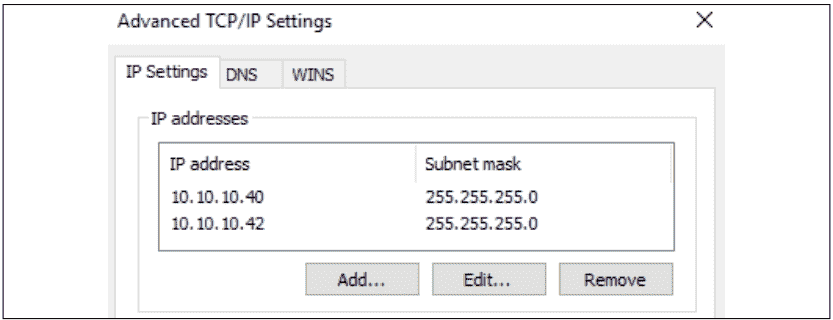

图 12.9：NIC 上的更新 IP 地址

发往 10.10.10.42 IP 地址的流量现在开始在两个节点之间分配，但目前运行在 WEB1 和 WEB2 服务器上的网站仅配置为在专用 10.10.10.40 和 10.10.10.41 IP 地址上运行，因此我们需要下一步确保进行调整。

## 配置 IIS 和 DNS

在每台 Web 服务器的 IIS 中进行一个快速步骤即可使网站在适当的 VIP 地址上响应。现在 NLB 配置已建立，并且我们已确认新的 10.10.10.42 VIP 地址已添加到 NIC 中，我们可以使用该 IP 地址作为网站绑定。打开 IIS 管理控制台并展开 Sites 文件夹，以便查看网站的属性。右键单击站点名称，然后选择 Edit Bindings...：

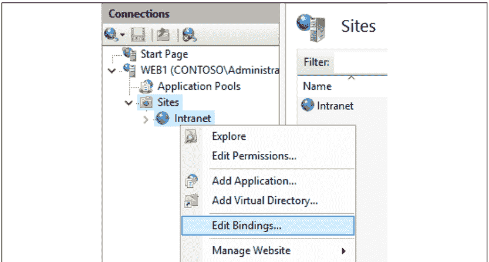

图 12.10：编辑网站绑定

进入 Site Bindings 后，选择要操作的绑定，然后单击 Edit... 按钮。此内联网网站只是一个简单的 HTTP 站点，因此我将为此更改选择我的 HTTP 绑定。绑定当前设置为 WEB1 上的 10.10.10.40，WEB2 上的 10.10.10.41。这意味着网站仅响应通过这些 IP 地址传入的流量。我所要做的就是将该 IP 地址下拉菜单更改为新的 VIP，即 10.10.10.42。在两台服务器上进行此更改并单击 OK 后，网站立即开始响应通过 10.10.10.42 IP 地址传入的流量：

图 12.11：更新绑定以使网站在新的 VIP 上运行

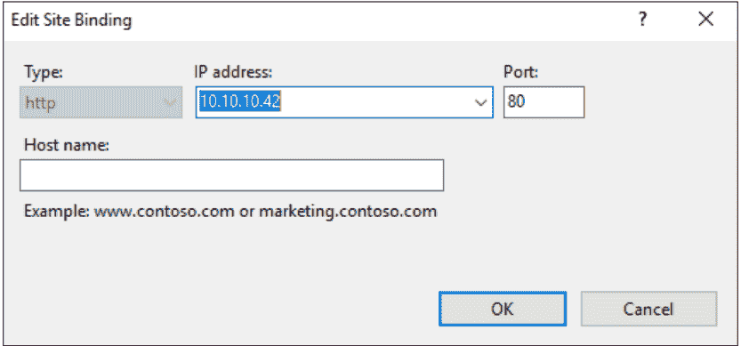

现在我们来到了拼图的最后一块：DNS。请记住，我们希望用户只需在 Web 浏览器中输入 http://intranet 即可浏览这个新的 NLB 网站，因此需要相应地配置 DNS 主机 A 记录。该过程与任何其他 DNS 主机记录完全相同；只需创建一个并将 intranet.contoso.local 指向 10.10.10.42：

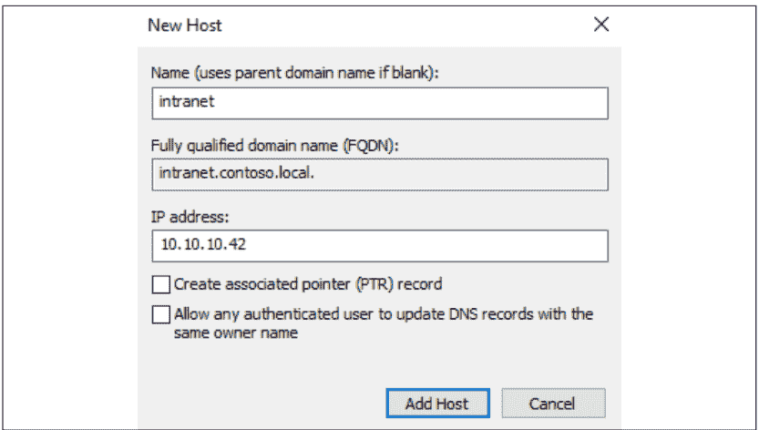

图 12.12：配置 DNS 记录

## 测试

NLB 已配置？检查。

IIS 绑定已更新？检查。

DNS 记录已创建？检查。

我们准备好测试了。如果我在客户端计算机上打开 Internet 浏览器并浏览到 http://intranet，我可以看到网站：


图 12.13：WEB1 服务器上运行的站点 1

但我们如何确定负载均衡真的在工作？如果我继续刷新页面，或从另一台客户端浏览，我继续访问 http://intranet，最终 NLB 机制会决定将新请求发送到 WEB2，而不是 WEB1。当这种情况发生时，我会看到以下页面：


图 12.14：WEB2 服务器上运行的站点 2

如你所见，我修改了 WEB1 和 WEB2 之间的内容，以便能够区分不同的节点，仅用于本次测试。如果这是一个真实的生产内部网站，我希望确保两个站点的内容完全相同，这样用户完全不会察觉到 NLB 的存在。他们只需要知道网站将始终可用且正常运行。

## 刷新 ARP 缓存

之前，我们曾讨论过交换机如何保留 ARP 信息的缓存，这减少了交换机在决定数据包流向时所需的时间。当你为网卡分配 IP 地址时，该网卡的 MAC 地址会在某些网络设备的 ARP 表中与 IP 地址关联。

交换机、路由器、防火墙——这些工具通常具有我们所称的 ARP 表，因此它们在该表中有一组数据，被称为 ARP 缓存。

配置 NLB 时，特别是单播模式，网卡的 MAC 地址会被替换为新的虚拟 MAC 地址。有时交换机和网络设备会很快捕捉到这一变化，并将新的 MAC 地址与新的 IP 地址关联，一切都能正常工作。然而，我发现配置 NLB 时通常是这样：*你的网络设备越智能、越昂贵，在配置 NLB 时就越“笨”。* 我的意思是，你的网络设备可能会继续保留存储在其 ARP 表中的旧 MAC 地址信息，而不会更新以反映新的 MAC 地址。

*在现实生活中这是什么样子？* 网络流量将停止流向或流出这些网卡。有时当你建立 NLB 并将其打开时，所有网络流量会突然完全停止流向或流出这些网络接口。*你需要做什么来修复这种情况？* 有时你可以等待，几分钟、几小时甚至几天后，交换机将丢弃旧的 ARP 信息并允许新的虚拟 MAC 在该表中注册。*你能做什么来加快这一过程？* 刷新 ARP 缓存。

执行此操作的流程会因你使用的网络设备类型而异——是交换机还是路由器，品牌是什么，型号是什么等等。但这些设备都应具备此功能，并且名称应类似于 *刷新 ARP 缓存*。当你在设备上运行此功能时，它会清理 ARP 表，清除导致问题的旧信息，并允许新的 MAC 地址在新的表中适当地注册。

我只是想指出这一点，以防你配置 NLB 后，却发现服务器上的流量停止。很可能你遇到的是 ARP 缓存卡在了一台或多台试图在你的服务器之间传输流量的网络设备上。

## 故障转移群集

我们已经确定 NLB 是无状态应用程序的绝佳解决方案，其典型例子就是你希望实现高可用的网站。*那么其他你想要冗余的服务器角色或功能呢？* 无状态的对立面是有状态的，所以 *如何为有状态的技术提供高可用性呢？*

**故障转移群集** 提供了这种级别的功能，并且可以在群集节点访问共享数据的情况下使用。这是故障转移群集设计方式的关键因素。群集节点使用的存储必须是共享的，并且可以被每个需要它的节点访问。有许多不同的角色和服务可以利用故障转移群集，但有四种特定的技术似乎构成了今天数据中心运行的大多数群集：Hyper-V、文件服务、Exchange 和 SQL。如果你正在使用这些技术中的任何一种——而你很可能都在使用——你需要研究故障转移群集可以为你的基础设施提供的 high-availability 功能。

虽然 Windows Server 提供的故障转移群集由 Microsoft 构建，并且能够开箱即用地与许多 Microsoft 角色和服务很好地配合，但重要的是要知道你也可以为非 Microsoft 应用程序建立故障转移群集。运行在你环境中的 Windows Server 上的第三方应用程序，甚至是在内部构建的自研应用程序，也可以利用故障转移群集。只要该应用程序使用共享存储，并且你可以为群集管理工具指定它需要对这些应用程序执行的操作——如何启动服务、如何停止服务、如何监控服务健康状况等等——你就可以将这些自定义服务和应用程序与故障转移群集集成，并为几乎任何类型的应用程序提供主要的冗余。

## 群集 Hyper-V 主机

故障转移群集最强大的示例之一是与 Hyper-V 结合使用时。可以构建两个或多个 Hyper-V 服务器，将它们群集在一起，并使它们能够各自承载存储在该虚拟环境中的所有虚拟机。通过让所有 Hyper-V 主机服务器访问存储虚拟硬盘的同一共享存储，并配置节点之间的故障转移群集，你可以为公司创建极其强大且冗余的虚拟化解决方案。当一台 Hyper-V 服务器宕机时，在该 Hyper-V 主机上运行的虚拟机会故障转移到另一台 Hyper-V 主机服务器并在那里启动。

在虚拟机启动期间经过最少的服务中断后，一切会自动恢复在线，无需任何管理干预。更好的是，*当你需要修补或以其他方式将 Hyper-V 主机服务器离线进行维护时怎么办？* 你可以轻松地强制虚拟机在群集中的另一台成员服务器上运行；它们会实时迁移到该服务器，因此零停机时间，然后你可以自由地将节点移除进行维护，并在重新引入群集之前完成工作。我们使用虚拟机和服务器处理各种工作负载，*如果能够消除虚拟化环境中的任何单点故障，不是很好吗？* 这正是故障转移群集可以提供的。


## 虚拟机负载均衡

事实上，不仅 Hyper-V 集群在 Hyper-V 服务器节点离线时具有快速自恢复的能力，而且我们现在还有一些智能负载均衡逻辑与这些集群服务一起工作。如果你的 Hyper-V 集群因虚拟机过多而超载，添加另一个节点到该集群以提供更多能力和计算资源是合理的。但节点添加后，*将一些 VM 迁移到这个新集群节点需要多少工作？*

无需！只要启用了 VM 负载均衡，集群的权重就会自动评估，VM 工作负载会在不中断服务的情况下实时进行实时迁移，以便在所有集群节点之间更好地分配工作，包括新的主机服务器。VM 负载均衡可以根据需要随时运行和评估，或配置为自动运行，每 30 分钟检查一次环境，自动决定是否需要移动任何工作负载。

## 文件服务器的群集

文件服务器群集已经可用相当一段时间了；这是群集发布最初的意图之一。最初，文件服务器群集仅适用于文档和传统文件使用；换句话说，当知识型用户需要每天访问文件和文件夹，并且你希望这些文件高度可用时。至今，这种通用文件服务器群集以主动-被动模式工作。当多个文件服务器为通用文件访问而集群在一起时，一次只有一个文件服务器节点处于活动状态并向用户展示。只有在该节点出现停机时，角色才会切换到其他集群成员之一。

## 扩展文件服务器

虽然通用文件服务器群集非常适合临时访问文件和文件夹，但不足以处理持续打开或更改的文件。这些文件的典型例子是 Hyper-V 虚拟机使用的虚拟硬盘文件。

虚拟硬盘文件需要冗余；丢失这些文件会对我们的业务造成损害。值得庆幸的是，托管此类应用程序数据工作负载正是 **Scale-Out File Server (SOFS)** 所做的。如果你计划使用 Hyper-V 托管虚拟机，你绝对应该查看可与 Hyper-V 服务一起使用的故障转移群集功能。此外，如果你打算使用集群的 Hyper-V 主机，你应该将 SOFS 作为支持该高度可用 Hyper-V 环境的基础设施技术来考虑。

SOFS 通过为文件服务器提供多个节点在线（主动-主动）并在彼此之间保持持续持久的能力来帮助支持故障转移群集。这样，如果一台存储服务器宕机，其他服务器可以立即顶上，无需涉及停机的切换过程。这在比较存储静态数据，如文档，和存储被 VM 访问的虚拟硬盘文件时很重要。使用 SOFS，VM 在文件服务器中断期间可以保持在线，这非常令人惊叹！

## 群集层级

故障转移群集的一个重要总体概念是群集可以受益的不同层级。你可以使用群集的两个级别：你可以采用二选一的方法只使用其中一个故障转移群集级别，或将两者结合起来以真正给你的高可用性朋友留下深刻印象。

## 应用层群集

应用层群集通常涉及在 VM 上安装故障转移群集。使用 VM 并不是硬性要求，但是最常见的安装路径。你可以在群集环境中混合匹配 VM 和物理服务器，只要每个服务器满足安装标准即可。这种应用模式的群集在你希望使操作系统内运行的特定服务或角色冗余时很有用。可以将其视为更微群集的能力，你深入挖掘并使操作系统的特定组件与另一个能够在主服务器宕机时顶上的服务器节点冗余。

## 主机层群集

如果应用群集是微观的，那么主机层群集则更宏观。我能给出的最佳例子就是让大多数管理员首先开始使用故障转移群集的例子：Hyper-V。假设你有两个物理服务器都在环境中托管虚拟机。你希望将这些服务器集群在一起，以便在这些 Hyper-V 服务器上托管的所有 VM 都可以在两个物理服务器之间冗余。如果整个 Hyper-V 服务器宕机，第二台服务器可以启动在主节点上运行的 VM。经过最少的服务中断后，你的环境中托管实际工作负载的 VM 将恢复运行，可供用户及其应用程序使用。

## 两者的结合

之前提到的这两种使用故障转移群集的模式当然可以结合起来，以获得更好的、更全面的高可用性方案。让我们让这个例子自己说明问题：你有两个 Hyper-V 服务器，每个服务器都准备运行一系列虚拟机。你在这些服务器之间使用主机群集，因此如果一台物理机宕机，另一台会顶上。这本身就很棒，但你大量使用 SQL，并且希望确保 SQL 也高度可用。你可以运行两个虚拟机，每个都是 SQL 服务器，并为 SQL 服务专门在这些两个 VM 之间配置应用层故障转移群集。这样，如果单个虚拟机出现问题，你不必故障转移到备份 Hyper-V 服务器，而是可以由第二个 SQL 节点接管来解决你的问题。根本不需要第二台物理服务器进行全面 Hyper-V 接管，但你利用了故障转移群集来确保 SQL 始终在线。这是群集之上的群集的典型例子，通过这种思路，你可以开始相当有创意地思考在网络中利用群集的所有不同方式。

## 故障转移如何工作？

一旦你配置了故障转移群集，多个节点会保持持续通信。这样，当一个节点宕机时，它们会立即感知到并可以将服务切换到另一个节点以将其恢复在线。故障转移群集使用注册表来跟踪许多每个节点的设置。这些标识符在节点之间保持同步，然后当一个节点宕机时，这些必要的设置会被分发到其他服务器，并指示群集中的下一个节点启动在宕机的主服务器上托管的任何应用程序、VM 或工作负载。在组件在新节点上启动时，服务可能会有轻微延迟，但整个过程是自动化的且无需人工干预，将停机时间降至最低。

当你需要将服务从一个节点切换到另一个节点作为计划事件时，例如用于修补或维护，这里有更好的方案。通过称为实时迁移的过程，你可以在零停机的情况下将职责切换到辅助节点。这样，你可以因维护或安全修补或其他原因将节点从群集中取出，而不会以任何方式影响用户或系统正常运行时间。实时迁移对于 Hyper-V 集群特别有用，在那里你通常需要手动决定 VM 由哪个节点托管，以便你可以在其他节点上完成工作。


在许多集群中，存在一种称为法定人数（quorum）的概念。这意味着如果集群分裂，例如某个节点离线，或者由于某种网络中断导致多个节点突然不可用，那么法定人数逻辑就会接管，以确定集群的哪个部分仍然在线。如果您有一个跨网络内部多个子网的大型集群，并且在网络层发生了一些事件导致集群节点彼此分离，集群的两侧所知道的只是它们无法再与其它集群成员通信，因此集群的两侧都会自动假设它们现在应承担集群工作负载的责任。

法定人数设置告诉集群在需要采取行动之前可以发生多少个节点故障。通过整个集群了解法定人数配置，可以在集群分裂的情况下帮助提供有关集群哪个部分应为主的答案。在许多情况下，集群通过依赖第三方来实现法定人数，该第三方称为见证。顾名思义，该见证会监视集群的状态，并在何时何地需要故障转移时帮助做出决策。我在这里提到这一点，是作为我们讨论内置于 Server 2019 的新集群功能的前奏，其中之一是对小型环境中见证的工作方式进行了改进。

如果您打算创建足够大的集群以使用法定人数和见证设置，则可以获得并理解更多信息。如果您有兴趣了解更多信息，请查看 https://docs.microsoft.com/en-us/windows-server/storage/storage-spaces/understand-quorum。

## Setting up a failover cluster

我们将花几分钟时间设置一个小型服务器集群，以便您可以查看管理工具以及为此需要访问的位置。我现在已经撤除了我们在 WEB1 和 WEB2 服务器上之前设置的全部 NLB 配置，使它们目前只是简单的 Web 服务器，再次之间没有任何冗余。让我们设置我们的第一个故障转移集群并将这两个服务器都添加到该集群中。

## Building the servers

我们已经有两台服务器正在运行，已安装 Windows Server 2019。 这些服务器上没有进行特殊配置，但我已将文件服务器角色添加到这两台服务器，因为最终我将把它们用作文件服务器集群。 这里的关键点是，您应尽可能使服务器保持一致，并且已安装您打算在集群中使用的角色。

构建阶段的另一个注意事项：如果可能，集群中属于同一集群的成员服务器驻留在 Active Directory (AD) 中的同一组织单位 (OU) 中是最佳实践。原因有二：首先，它确保相同的 GPO 应用于服务器集，以努力使它们的配置尽可能一致。其次，在创建集群期间，某些新对象将被自动生成并创建在 AD 中，并且当成员服务器驻留在同一 OU 中时，这些新对象也将创建在该 OU 中。 对于正在运行的集群来说，很常见的是看到 AD 中所有相关对象都属于同一 OU，并且该 OU 专用于此集群：

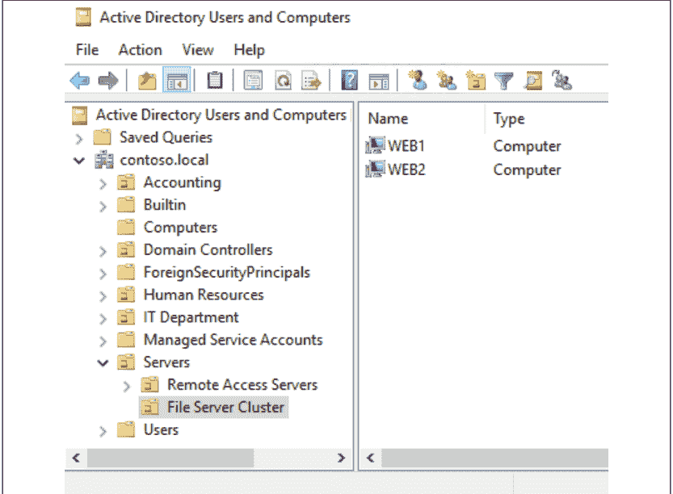

图 12.15：集群服务器存储在同一 OU 中

## Installing the feature

现在我们的服务器已上线并运行，我们希望在每台服务器上安装集群功能。故障转移群集是 Windows Server 中的一项功能，因此打开“添加角色和功能”向导并将其添加到所有集群节点：

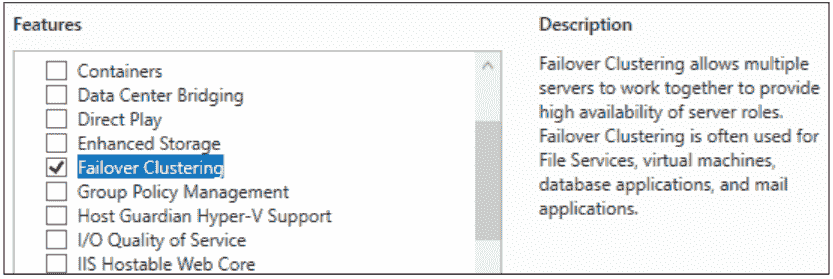

图 12.16：将故障转移群集添加到您的集群节点

## Running Failover Cluster Manager

与可在 Windows Server 2019 上安装的大多数角色或功能一样，一旦实施，您将在服务器管理器的“工具”菜单中找到其管理控制台。如果我现在在 WEB1 上查看，我可以看到“故障转移群集管理器”的新列表可供我点击。我将打开该工具，并从此管理界面开始配置我的第一个集群：

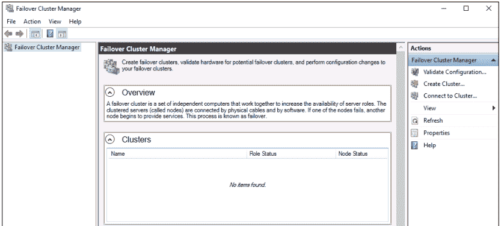

图 12.17：配置集群

## Running cluster validation

现在我们进入了故障转移群集管理器，您会注意到在控制台“管理”部分中，屏幕中间附近有一系列可启动的任务：

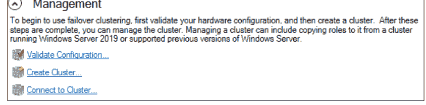

图 12.18：集群配置任务

在我们配置集群本身或向其添加任何服务器节点之前，我们必须首先验证硬件配置。故障转移群集是一组相当复杂的技术，并且存在许多地方，配置错误或不一致可能会使整个集群倾斜。您设置集群的意图显然是为了可靠的冗余，但即使是成员服务器配置中的一个简单错误也可能导致足够大的问题，以至于节点故障不会导致自动恢复，这违背了集群的初衷。为了确保我们的 T 都已交叉，I 都已点齐，故障转移群集管理器内置了一些全面的验证检查，类似于内置的最佳实践分析器。这些检查可以在任何时间运行——在集群构建之前或在生产运行多年之后。事实上，如果您 ever 需要向 Microsoft 开启支持案例，他们很可能会要求您首先运行“验证配置”工具并让他们查看输出。

要开始验证过程，请点击“验证配置...”链接。我们现在启动到一个向导，允许我们选择要验证的集群技术的哪些部分。再次，我们必须戴上 Microsoft 集中式管理神学思考帽并意识到此向导不知道也不关心它正在运行在我们打算成为集群一部分的成员服务器上。我们必须识别我们想要扫描验证检查的每个服务器节点，因此在我的例子中，我将告诉它我想要验证 WEB1 和 WEB2 服务器：

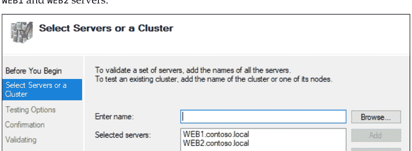

图 12.19：选择用于集群验证检查的服务器节点

“测试选项”屏幕允许您选择“仅运行我选择的测试”单选按钮，然后您将只能运行特定的验证测试。一般来说，在设置新集群时，您希望运行所有测试，以确保一切都符合要求。然而，在生产系统上，您可能会选择限制运行的测试数量。这对于存储测试尤其正确，因为这些测试实际上会在测试运行时暂时使集群脱机，如果您不在计划的维护窗口内工作，您就不希望干扰您的在线生产服务：

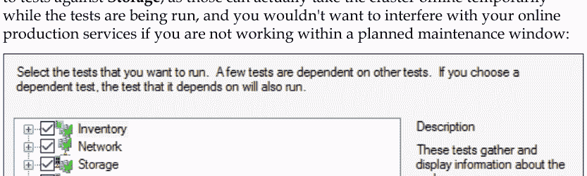

图 12.20：选择要运行的验证测试

由于我正在设置新集群，我将让所有测试运行。因此我将保留推荐的选项 **运行所有测试（推荐）** 选中并继续：

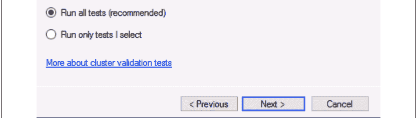

图 12.21：运行所有测试

一旦测试完成，您将看到其结果的摘要输出。您可以点击 **查看报告...** 按钮以查看运行的所有内容的详细信息。请记住，存在三层通过/失败。绿色是 *良好* 和红色是 *糟糕*，但黄色更像是 *它能工作，但你并未遵循最佳实践*。例如，我的每台服务器上只有一个 NIC；向导识别到这一点，并且为了使我的设置在各方面真正冗余，我应该至少有两个。它会放行并继续工作，但它警告我可以通过为每个节点添加第二个 NIC 来使此集群变得更好。

如果您以后需要重新打开此报告或从服务器上获取副本以便保存，它位于您运行测试的服务器上，位于 `C:\Windows\Cluster\Reports` 内：

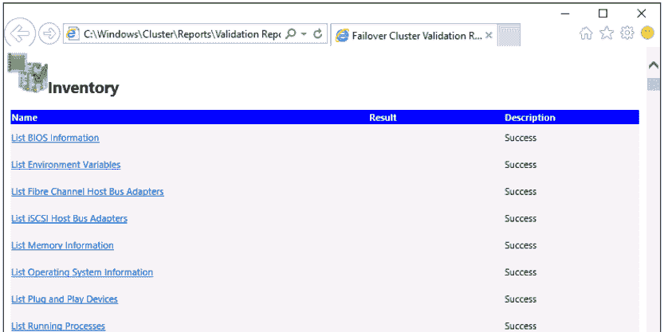

图 12.22：集群验证报告


请记住，您可以随时重新运行验证过程，使用故障转移群集管理器中的 **验证配置...** 任务来测试您的配置。

## 运行创建群集向导

验证阶段如果有多项结果需要在继续之前修复，可能会花费一些时间。但一旦验证检查通过，您就可以开始构建群集了。为此，请在故障转移群集管理器控制台中点击我们可用的下一个操作：**创建群集...**

再次，我们必须首先指定哪些服务器要成为此新群集的一部分，因此我将输入我的 WEB1 和 WEB2 服务器。之后，关于设置群集的信息并不多，但一个非常关键的信息位于 **管理群集的访问点** 屏幕上。在这里，您标识将由群集使用并在成员服务器之间共享的唯一名称。这被称为 **群集名称对象 (CNO)**，并且在完成群集配置后，您将在 AD 中看到此名称显示为一个对象：

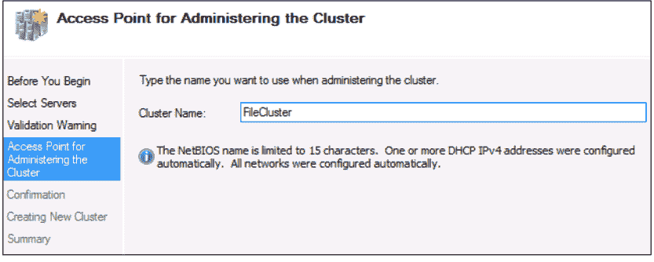

图 12.23：设置群集名称

完成向导后，您可以在故障转移群集管理器界面中看到新的群集，并可以深入到该群集中更具体的函数。有额外的操作，例如 **配置角色...**，这对于设置该群集将要执行的实际功能很重要，以及 **添加节点...**，这是在未来将更多成员服务器添加到此群集的位置：

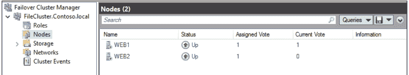

图 12.24：查看我们第一个群集中的节点

## Windows Server 2019 中的群集改进

群集功能已经存在一段时间，但一直在不断改进。在最近两个 LTSC 版本 Server 2016 和 Server 2019 中，故障转移群集有了一些重大变化和新增功能。我们将讨论的一些变化最初是在 2016 年引入的，因此并非全新，但对于我们在 Server 2019 中处理群集的方式仍然相关，因此在这里提及是有价值的。

### 使用 USB 见证的真正的双节点群集

在为故障转移群集配置仲裁时，在 Server 2019 之前，双节点群集需要三台服务器，因为仲裁见证需要驻留在某种见证共享上，通常是单独的文件服务器。

从 2019 年开始，该见证现在可以是一个简单的 USB 驱动器，甚至不必插入 Windows Server！许多网络设备（交换机、路由器等）可以接受基于 USB 的文件存储介质，而插入此类网络设备的 USB 闪存盘现在足以满足群集见证的要求。这对于小型环境中的增强群集来说是一个胜利。

### 群集更高安全性

Windows Server 2019 中的故障转移群集进行了多项安全改进。以前的版本依赖于新技术 LAN 管理器 (NTLM) 来对群集内部流量进行身份验证，但许多公司正在积极采取措施在网络中禁用 NTLM（至少是早期版本）的使用。故障转移群集现在可以使用 Kerberos 和证书对该网络流量进行验证来进行群集内部通信，从而消除了对 NTLM 的需求。

在建立故障转移群集文件共享见证时，已实施另一项安全/稳定性检查，即阻止存储在 DFS 内部的见证。在 DFS 共享中创建见证从未得到支持，但控制台之前允许这样做，这意味着一些公司确实这样做了，并为此付出了代价，因为这可能导致群集稳定性问题。群集管理工具已更新为在创建见证时检查 DFS 命名空间的存在，并且将不再允许这种情况发生。

### 多站点群集

*我可以在子网之间配置故障转移群集吗？* 换句话说，如果我有一个主数据中心，并且还在附近租用了 CoLo 空间，或者我在全国各地还有另一个数据中心，*是否有选项可以在物理上分离的节点之间设置群集？* 这里有一个快速、简单的答案：是的，故障转移群集不在乎！就像那些服务器节点就放在彼此旁边一样，群集可以利用多个站点，每个站点托管自己的群集节点，并在这些站点之间移动服务。

### 跨域或工作组群集

从历史上看，我们只能在加入同一域的节点之间建立故障转移群集。Windows Server 2016 带来了突破这一限制的能力，甚至可以在不涉及 Active Directory 的情况下构建群集。在 Server 2016 和 2019 中，您当然仍然可以创建所有节点都加入同一域的群集，我们预计这将是大多数安装的情况。然而，如果您有加入不同域的服务器，现在可以在这些节点之间建立群集。此外，群集中的成员服务器现在可以是工作组成员，而完全不需要加入域。

虽然这扩展了故障转移群集的可用功能，但也带来了一些限制。使用多域或工作组群集时，您将仅限于使用 PowerShell 作为群集管理界面。如果您习惯于通过 GUI 工具之一与群集交互，您需要对此进行调整。您还需要创建一个可供群集使用的本地用户账户，并在每个群集节点上配置它，并且该用户账户需要在这些服务器上具有管理权限。

### 迁移跨域群集

虽然在过去几年中跨多个域建立群集是可能的，但将群集从一个 AD 域迁移到另一个域并不是一个选项。从 Server 2019 开始，这已经改变。我们在多域群集方面具有更大的灵活性，包括在这些域之间迁移群集的能力。此功能将帮助管理员应对公司收购和域整合项目。

### 群集操作系统滚动升级

2016 年赋予我们的这个新功能有一个奇怪的名字，但是一个非常酷的功能。它旨在帮助那些已经使用故障转移群集一段时间的人能够改进其环境。如果您当前正在运行一个群集，并且该群集是 Windows Server 2012 R2，那么这绝对是值得研究的。群集操作系统滚动升级使您能够在不中断服务的情况下将群集节点的操作系统从 Server 2012 R2 升级到 Server 2016，然后升级到 Server 2019。您无需停止使用群集的 Hyper-V 或 SOFS 工作负载上的任何服务；您只需利用此滚动升级过程，所有群集节点都将运行较新的 Windows Server 版本。群集仍然在线且处于活动状态，没有人知道这甚至发生了。当然，除了您。

这与之前的升级过程大不相同，在之前的升级过程中，为了将群集升级到 Server 2012 R2，您需要将群集离线，引入运行 2012 R2 的新服务器节点，然后重新建立群集。会有大量的停机时间和大量的麻烦来确保其尽可能顺利进行。

使这种无缝升级成为可能的技巧是，群集本身在您发出命令将其切换到 Server 2016 功能级别之前仍保持在 2012 R2 功能级别运行。在您发出该命令之前，群集在旧的功能级别上运行，即使在您引入的新节点上也是如此，这些节点运行的是 Server 2016 操作系统。随着您逐个升级节点，群集中仍处于活动状态的其他节点保持在线并继续为用户和应用程序提供服务，因此从工作负载角度来看，所有系统都正常运行。当您将新的 Server 2016 机器引入群集时，它们开始像 2012 R2 服务器一样提供工作负载服务，并在 2012 R2 功能级别上执行。这被称为混合模式。这使您可以关闭甚至最后一个 2012 R2 机器，将其更改为 2016 并重新引入，所有这些都不会让任何人知道。然后，一旦所有操作系统升级完成，发出 Update-ClusterFunctionalLevel PowerShell 命令以切换功能级别，您就拥有了一个通过零停机时间无缝升级的 Windows Server 2016 群集。


## 虚拟机弹性

根据名称你完全可以推断，**虚拟机弹性**是对集群的一项改进，专门惠及 Hyper-V 服务器集群。在 Server 2012 R2 的集群时代，出现一些阵列内部或集群内部的通信问题并不罕见。这些有时表现为瞬时故障，意味着集群认为某个节点正在离线，而实际上并非如此，并会触发故障转移，有时造成的停机时间比如果一开始对真实故障的识别模式稍好一些还要长。总体而言，集群和集群节点的故障转移工作成功，但总有改进的空间。这正是虚拟机弹性所要解决的问题。现在你可以配置弹性选项，使你能够更具体地定义节点在集群节点故障期间的行为。你可以定义诸如**弹性级别**之类的内容，它告诉集群如何处理故障。你还可以设置自己的**弹性周期**，即 VM 允许在隔离状态下运行的时间长度。

另一个变化是，不健康的集群节点现在会被隔离一段时间，时间由管理员定义。在它们被识别为健康并且等待期已过之前，它们不允许重新加入集群，从而防止诸如节点卡在重启循环中意外重新加入集群并在上下循环时造成持续问题的情况。

## 存储复制 (SR)

SR 是一种在服务器之间同步数据的新方法。它是一种数据复制技术，可在服务器之间提供块级数据复制，即使跨不同的物理站点。SR 是一种我们在 Windows Server 2016 之前从未在 Microsoft 平台上见过的冗余类型；过去，我们必须依赖第三方工具来实现这种功能。SR 也很重要，因为 SR 是实现多站点故障转移集群的“秘密武器”。当你希望在多个物理位置托管集群节点时，你需要一种方法来确保这些集群节点使用的数据持续同步，以便故障转移实际上是可能的。这种数据流由 SR 提供。

关于 SR 的一个不错的要点是，它最终允许单一厂商解决方案——当然是 Microsoft——提供存储和集群的端到端技术和软件。它也是硬件无关的，让你能够使用自己偏好的存储介质。

SR 旨在紧密集成，是一个稳健的故障转移集群环境中的支持技术之一。事实上，SR 的图形管理界面位于 Failover Cluster Manager 软件内部——当然也可以通过 PowerShell 配置——因此请确保你将故障转移集群和存储复制作为你环境中的*更佳组合*故事来查看。

存储复制现在可在 Server 2019 Standard 版中使用！（以前它需要 Datacenter 版，这对某些部署来说是不可行的。）SR 的管理现在也可在新的**Windows 管理中心**（WAC）中使用。让我们搭建一个存储复制环境，以便你可以看到创建存储冗余有多快多容易。

## 配置存储复制

我在实验室中创建了两台新服务器，目的是通过 SR 将它们变成冗余文件服务器。这些服务器名为 FS01 和 FS02，已加入我的域，并且我对它们做了一些重要的事情：

-   附加了一块新磁盘用于数据存储。Windows 在我的服务器上运行在正常的虚拟磁盘上，但我添加了第二块磁盘，专门用于存储。这里的重要部分是数据磁盘必须使用 GPT 初始化。
-   创建了一个卷来容纳数据。在 Windows 中，该卷标记为 S: 驱动器，我再次确保此数据卷位于 GPT 初始化的磁盘上。
-   创建了一个单独的卷来容纳 SR 日志数据。稍后在创建 SR 复制集时，我们需要定义一个保存 SR 日志的位置，最简单的方法是在自己的驱动器号上进行。我将我的命名为 L: 驱动器。它也位于我的 GPT 初始化数据磁盘上。用于日志的卷必须至少为 9GB。
-   在两台服务器上都在 Windows 内部安装了**存储复制**功能。

## 将磁盘初始化为 GPT

如果你不熟悉上面所述将新数据磁盘初始化为 GPT 的过程，让我们花一分钟来介绍一下。在将新磁盘附加到服务器后，右键单击**开始按钮**并进入**磁盘管理**。此工具应自动识别新磁盘并询问你是否要使用 MBR 或 GPT 初始化它。请确保在此处选择**GPT**：

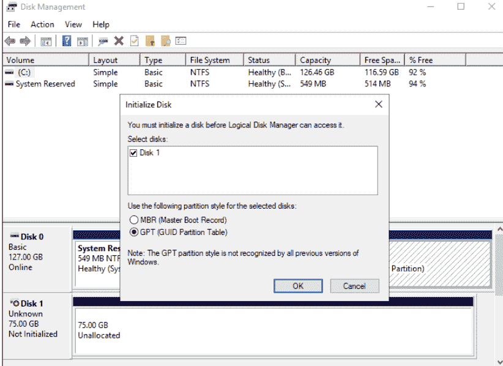

图 12.25：将新磁盘初始化为 GPT

## 测试存储复制的准备情况

我们现在有两台文件服务器，每台都有一个包含两个新卷的新 GPT 数据磁盘。一个将用于 SR 数据存储，另一个用于 SR 日志。以下是我的卷的快速概览。它们在两台服务器上设置完全相同：

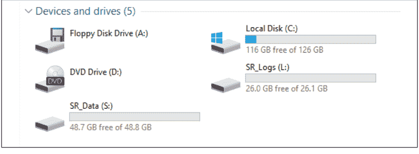

图 12.26：在服务器上创建的卷

在这一点上，我们可以继续创建存储复制环境，并且由于这些是配置相同全新服务器，它很可能会成功。然而，你经常会在已经运行生产环境一段时间的服务器上配置 SR，或者至少是你的源数据将位于其上的主文件服务器。知道 SR 是否会成功将是一种令人安心的知识。

幸运的是，SR 在部署配置之前可以运行一个测试过程。使用 PowerShell，让我们从主 FS01 服务器发出一条很长的命令。以下是我正在运行的命令。你当然需要根据自己的服务器名称和卷号进行调整。如命令末尾所示，我指定输出放置在 C:\SR_TEST 文件夹中，因此请确保该文件夹存在于你的服务器上：

```
Test-SRTopology -SourceComputerName FS01 -SourceVolumeName S: -SourceLogVolumeName L: -DestinationComputerName FS02 -DestinationVolumeName S: -DestinationLogVolumeName L: -DurationInMinutes 10 -ResultPath C:\SR_TEST\
```

此测试将收集有关服务器和卷的信息，并在后台运行 10 分钟（按命令指定）的示例数据传输。完成后，你将在 c:\SR_TEST 中找到一个结果文件，它应该在 Web 浏览器中启动以显示各种结果信息。任何可能妨碍 SR 工作的环境问题都将在此处详细说明，以便你可以去解决这些问题：

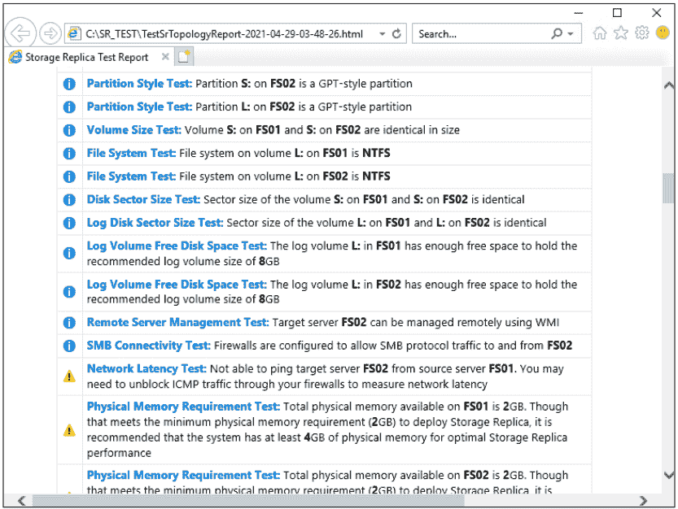

图 12.27：存储复制测试报告

你会注意到在图 12.27 中，我的实验室确实有一些警告，我是故意这样做的，以便你可以看到警告的样子。我从未在这些服务器之间开放 ICMP 流量，因此我收到了无法执行网络延迟测试的警告。还显示了一些物理内存警告。在存储复制组中，每个服务器需要有 2GB RAM 才能使 SR 正常工作，这正是我分配给我的 VM 的内存。虽然需要 2GB，但推荐 4GB，这些警告只是让我知道。在生产环境中，你永远不会用甚至只有 4GB RAM 的文件服务器运行，因此在实际部署中你可能不会遇到这些警告。


## 配置 Storage Replica

现在我们的服务器已经准备就绪并经过测试，是时候构建真正的方案了！由于我们已经满足了所有先决条件，并且以 SR 为目标构建了服务器，只需一条 PowerShell 命令即可启动此 Storage Replica 合作伙伴关系。我将在下面列出该命令，解释起来相当直观。唯一可能稍显陌生的部分是 SourceRGName 和 DestinationRGName。“RG” 代表 “Replication Group”（复制组），它只是在每台服务器上为复制组定义的一个名称：

```
New-SRPartnership -SourceComputerName FS01 -SourceRGName RepGroup1
-SourceVolumeName S: -SourceLogVolumeName L: -DestinationComputerName
FS02 -DestinationRGName RepGroup2 -DestinationVolumeName S:
-DestinationLogVolumeName L:
```

爽！就这样，Storage Replica 已配置完成，FS01 的 S: 驱动器作为主存储，自动且同步地复制到 FS02 的 S: 驱动器。根据性能和网络规格，卷之间的初始同步可能需要一些时间，在此期间，您将在 Get-SRGroup 命令的结果中看到 **ReplicationState = InitialBlockCopy**，如 *图 12.28* 所示。一旦初始同步完成，该字段将改为显示 **ReplicationState = ContinuouslyReplicating**。存储在 FS01 的 S: 驱动器上的任何数据都会自动复制到 FS02：

```
PS C:\Users\administrator.CONTOSO> get-srgroup

AllowVolumeResize     : False
AsyncRPO              :
ComputerName          : FS01
Description           :
Id                    : 6acd8be2-6638-4008-9c02-2f1dbfbe32e7
IsAutoFailover        :
IsCluster             : False
IsEncrypted           : False
IsInPartnership       : True
IsMounted             : False
IsPrimary             : True
IsSuspended           : False
IsWriteConsistency    : False
LastInSyncTime        :
LogSizeInBytes        : 8589934592
LogVolume             : L:\
Name                  : RepGroup1
NumOfReplicas         : 1
Partitions            : {d2d6afbc-3417-47c9-8421-7275dbf5eccb}
Replicas              : {MSFT_WvrReplica (PartitionId = "d2d6afbc-3417-47c9-8421-7275dbf5eccb")}
ReplicationMode       : Synchronous
ReplicationStatus     : InitialBlockCopy
TemporaryPath         :
PSComputerName        :
```

图 12.28：我们的 Storage Replica 组的详细信息

## 将主服务器切换到 FS02

在文件服务器上查看后，您会注意到可以查看 FS01 的 S: 驱动器上的数据，但如果尝试浏览 FS02 的 S: 驱动器，则会收到错误消息。这是设计使然。除非运行另一条命令使其成为主服务器，例如在灾难恢复场景中，否则您无法浏览并查看目标 SR 服务器上的数据。为了证明 SR 确实正在工作，让我们执行该步骤，以确保数据从 FS01 自动复制到 FS02。

我已在 FS01 的 S: 驱动器上创建了一些示例文本文件，但无法验证它们是否存在于 FS02 上。让我们假设 FS01 已离线或出现其他问题，我需要将 FS02 设为新的主文件服务器。我需要做的就是运行以下 PowerShell 命令来切换角色，将 FS02 转变为新的主 SR 合作伙伴：

```
Set-SRPartnership -NewSourceComputerName FS02 -SourceRGName RepGroup2 -DestinationComputerName FS01 -DestinationRGName RepGroup1
```

立即运行此命令后，我现在可以查看并浏览 FS02 的 S: 驱动器上的数据，这意味着它现在是主 SR 成员，也证明了 SR 最初确实在工作：

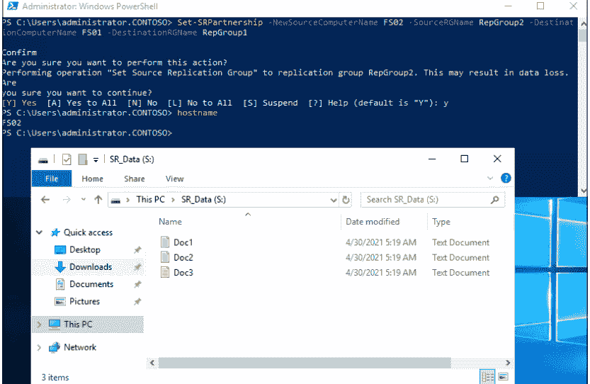

图 12.29：我们已将主驱动器访问切换到 FS02

## Storage Spaces Direct (S2D)

S2D 是一种集群技术，但我将其与通用故障转移集群分开列出，因为 S2D 是 **软件定义数据中心**（**SDDC**）的核心组件，并且在过去几年中受到了大量改进关注，确实属于一个独立的类别。

简而言之，S2D 是一种完全基于 Windows Server 构建极其高效且冗余的集中式网络存储平台的方法。虽然 S2D 与传统的 NAS 或 SAN 设备一样用于相同的一般目的（文件存储），但它采用了完全不同的方法，即不需要专用硬件，也不需要 S2D 集群节点之间特殊的电缆或连接。

要构建 S2D，您只需要 Windows 服务器；速度越快越好，但它们可以是普通的日常服务器。这些服务器必须通过网络连接，但这里没有特殊要求；它们只需连接到网络，就像环境中任何其他服务器一样。更有趣的是，您的服务器甚至不必完全相同。如果您愿意，可以混合使用不同制造商的服务器！一旦这些服务器运行起来，您就可以利用集群技术或 WAC 将这些服务器绑定成 S2D 数组。

S2D 是整体 **超融合基础设施**（**HCI**）故事的一部分，并且是一种为任何事物提供极其快速且受保护的存储的绝佳方式，尤其是对于 Hyper-V 服务器集群等工作负载。正如您所知，在构建 Hyper-V 服务器集群时，集群的节点必须能够访问共享存储，虚拟机硬盘文件将驻留在该存储上。S2D 是提供该集中式存储的最佳方式。

S2D 将获取 S2D 集群节点服务器内部的硬盘，并将它们的所有空间合并为软件定义的存储池。这些存储池配置了缓存功能，甚至内置了容错能力。显然，您不希望单个 S2D 节点，甚至单个硬盘离线导致 S2D 解决方案出现问题，当然，Microsoft 也不希望这种情况发生。所以当您将服务器及其所有硬盘组合成这些大型 S2D 存储池时，它们会在这些驱动器之间自动配置奇偶校验，以便特定组件离线不会导致数据丢失甚至系统变慢。

S2D 是 SOFS 和 Hyper-V 集群的最佳存储平台。

虽然基于 Server 2016 的 S2D 大多通过 PowerShell 配置（这不幸意味着许多管理员尚未尝试过），但 Windows Server 2019 为我们带来了更新的 WAC 工具集，其中现在包含用于配置 S2D 环境的内置选项：

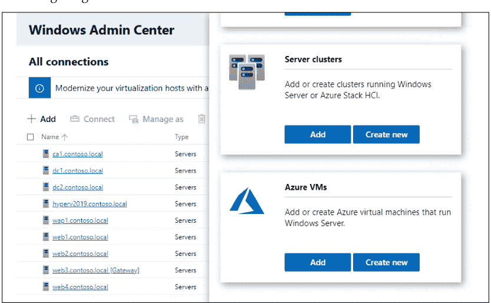

图 12.30：使用 WAC 添加新的服务器集群

S2D 是那种值得一本书的技术的其中之一，但任何想要尝试或开始使用这种令人惊叹的存储技术的人都应从 https://docs.microsoft.com/en-us/windows-server/storage/storage-spaces/storage-spaces-direct-overview 开始。

## Server 2019 中的新功能

对于那些已经熟悉 S2D 概念并想了解 Server 2019 版本中有哪些新功能或不同之处的人来说，以下是操作系统的最新版本带来的一些改进：

- 改进了对 Resilient File System (ReFS) 卷的使用：我们现在在 S2D 主机的 ReFS 卷上具有重复数据删除和压缩功能。
- USB 见证：我们已经讨论过这一点。当使用见证来监督仅有两个节点的 S2D 集群时，您现在可以利用插入网络设备中的 USB 密钥，而不是为此见证目的运行第三台服务器。
- **WAC**：WAC 现在包含用于定义和管理 S2D 集群的工具和功能。这将使不熟悉 PowerShell 的人更容易采用。
- **改进的能力**：我们现在可以每个集群托管四拍字节，而 Server 2016 中为一拍字节。但请记住，建议在集群中每个服务器的最大容量保持在 400TB 以内。
- **改进的速度**：虽然 S2D 从第一个版本开始就很快，但在 Server 2019 中我们有一些效率改进。在去年的 Ignite 大会上，Microsoft 展示了一个 8 节点 S2D 集群，能够实现 13,000,000 IOPS。我的天啊！

## 摘要

冗余是当今我们规划基础设施和构建服务器方式中的关键组成部分。Windows Server 2019 内置了一些强大的功能，您可以立即在自己的环境中使用！我希望通过了解有关 NLB 和故障转移集群的更多信息，您能够通过采用这些技术并延长服务正常运行时间来扩展组织的 capabilities。即使对于中小型企业而言，Windows Server 中也有一些很棒的复制选项，只需有限的服务器即可实现。您可以使用 Storage Replica 替换这些环境中当前存在的许多其他第三方选项，以快速简便的方式为您提供冗余文件服务器。对于尚未尝试 S2D 的任何企业级组织，什么在阻碍您？让我们认真对待 Hyper-V 基础设施的弹性。HCI 将改变您的工作方式，并为您提供一些安心感，而您认为在追求 99.999% 正常运行时间 的世界中是不可能的。

## 问题

1. 使 Web 服务器流量冗余更合适的技术是 Network Load Balancing 还是故障转移集群？
2. 在 Network Load Balancing 中，缩写 DIP 和 VIP 代表什么？
3. 三种 NLB 模式是什么？
4. 在 Windows Server 2019 中，Network Load Balancing 是一个角色还是一个功能？
5. 最常与故障转移集群一起使用的角色有哪些？
6. 现在可以用作集群仲裁见证的哪种小型设备（这是 Server 2019 的全新功能）？
7. 真或假 – Storage Spaces Direct 需要使用 SSD 硬盘。


# 13 容器与 Nano Server

# 容器与 Nano Server

Windows Server 2019 中包含的许多新技术旨在体现云计算提供的功能，让您的私有云焕发生机，并使您能够在物理基础设施内提供与公共云服务提供商提供的相同解决方案。服务器操作系统的最近几次迭代也围绕虚拟化展开，而应用程序容器的概念触及了这两种思维方式。应用程序容器将使应用程序的部署更加简化、更安全、更高效。容器在微软世界中是一个相对较新的概念，除了 DevOps 的讨论之外，我几乎没有听到很多 IT 管理员谈论它们。这项技术已经在增强 Linux 计算一段时间了，而最新的 Windows Server 操作系统让它对我们这些以微软为中心的企业来说更近了一些。

应用程序开发人员会对 Windows Server 2019 提供的应用程序容器非常感兴趣，事实上，他们可能比传统的服务器管理员更了解容器背后的概念。虽然本书的前提并不专注于开发机会，也明确不专注于 Linux，但我们仍将讨论容器，因为所提供的益处不仅限于开发人员。我们作为系统运维，也将从使用容器中受益，而且无论如何，了解和掌握如何概念化以及如何启动容器对我们来说都很重要，以便为开发人员提供他们在构建现代应用程序时所需的基础设施。

在本章中，我们将介绍一些关于应用程序容器的主题；具体来说，是 Windows Server 2019 中可用的新功能，可将此技术引入我们的數據中心：

- 了解应用程序容器
- 容器与 Nano Server
- Windows Server 容器与 Hyper-V 容器
- Docker 和 Kubernetes
- 使用容器

## 了解应用程序容器

包含一个应用程序意味着什么？我们现在对通过虚拟化来包含服务器的概念已经相当清晰。将物理硬件转变为类似 Hyper-V 的虚拟化主机，然后在其上运行许多虚拟机（VM），这就是对这些 VM 的一种 containment。我们本质上是在欺骗它们，让它们相信自己是独立的实体，完全不知道它们正在与该主机上运行的其他 VM 共享资源和硬件。尽管我们共享硬件资源，但我们可以在 VM 之间提供强大的隔离层，因为我们需要确保访问和权限不会在 VM 之间泄漏——特别是在云服务提供商的场景中，否则将是灾难性的。

应用程序容器也是同样的概念，只是在不同层面。虽然 VM 完全是关于虚拟化硬件，但容器更像是虚拟化操作系统。不是创建 VM 来托管我们的应用程序，我们可以创建容器，它们要小得多。然后我们在这些容器内运行应用程序，应用程序被欺骗以为它们运行在专用的操作系统实例之上。

使用容器的巨大优势在于它为开发和运维团队带来的统一性。我们现在经常听到 DevOps 这个术语，它是开发和运维流程的结合，旨在使整个应用程序发布流程更高效。容器的利用是创建成功 DevOps 思维的核心，因为开发人员现在可以做他们的工作（开发应用程序），而无需考虑运维和基础设施方面的问题。当应用程序构建完成后，运维可以取出应用程序所在的容器，并简单地将其启动到其容器基础设施中，而无需担心应用程序会破坏服务器或出现兼容性问题。

我预见容器将取代许多虚拟机，但这只有在管理员亲自尝试后才会发生。让我们讨论一下容器带来的一些具体好处。

## 共享资源

就像我们谈论硬件在 VM 之间分割一样，应用程序容器意味着我们将物理硬件块分割到容器之间。这使我们能够从同一台服务器（无论是物理服务器还是虚拟服务器）运行许多容器。

然而，仅凭这一点，与 VM 相比并没有好处，因为它们也共享硬件。我们真正开始看到使用容器而非为所有应用程序单独使用 VM 的好处之处在于，我们的所有容器都可以共享同一个基础操作系统。它们不仅从同一基础集启动，这使得新容器上线极快，而且它们还共享相同的内核资源。每个操作系统实例都有自己的用户进程集。通常，将多个应用程序一起在服务器上运行是一件棘手的事情，因为这些应用程序传统上可以访问同一组进程，并且有被这些进程负面影响的潜在风险。换句话说，这就是为什么我们现在倾向于启动大量服务器的原因，将每个应用程序放在自己的服务器上，以便它们不能相互产生负面影响。有时应用程序就是不喜欢混用。Windows Server 2019 中的内核已得到增强，可以处理多个用户模式进程的副本。这意味着你不仅能够在许多不同的服务器上运行同一应用程序的实例，还可以在同一台服务器上运行许多不同的应用程序，即使它们通常不喜欢共存。

## 隔离

应用程序容器的巨大好处之一是开发人员可以在自己的工作站上运行的容器内构建他们的应用程序！托管容器的主机可以是 Windows Server 实例，也可以是 Windows 10 工作站。在此容器沙箱中构建时，开发人员会知道他们的应用程序包含运行所需的所有部分、组件和依赖项，并且它以不需要底层操作系统额外组件的方式运行。这意味着开发人员可以构建应用程序，确保其在本地环境中正常工作，然后轻松地将该应用程序容器滑动到托管服务器上，在那里启动并准备用于生产使用。该生产服务器可能是一个 IT 管理员构建的本地容器服务器，也可能是一个云提供的资源——应用程序并不关心。容器与操作系统的隔离有助于使应用程序保持标准化，易于移动和迁移，节省开发人员的时间和麻烦，因为他们在开发过程中不必适应底层操作系统的差异。

隔离的另一个方面是安全方面。这与多个虚拟机在同一主机上运行的故事相同，特别是在云环境中。您希望这些机器之间存在安全边界，事实上，大多数时候您都不希望它们以任何方式意识到彼此的存在。您甚至希望虚拟机与主机操作系统之间存在隔离和分离，因为您绝对不希望您的公共云服务提供商在您的 VM 内部窥探。同样的概念适用于应用程序容器。

容器内运行的进程对托管操作系统不可见，即使您正在消耗该操作系统的资源。容器维护两种不同的隔离形式。有命名空间隔离，这意味着容器被限制在其自己的文件系统和注册表中。然后还有资源隔离，这意味着我们可以定义不同容器可用的特定硬件资源，它们无法相互窃取。不久后，我们将讨论两类不同的容器，Windows Server 容器和 Hyper-V 容器。这两种类型的容器以不同的方式处理隔离，请继续关注该主题的更多信息。

我们知道容器共享资源并从同一基础映像启动，同时仍保持其进程分离，以便底层操作系统不会对应用程序产生负面影响，并且应用程序也不会使主机操作系统崩溃。但是从网络方面来看，隔离是如何处理的呢？好吧，在 Windows Server 世界中，应用程序容器利用 Hyper-V 虚拟交换机的技术来保持网络方面的井然有序。事实上，当您开始使用容器时，您会很快发现每个容器都被分配了一个唯一的 IP 地址，有助于保持网络隔离。

## 可扩展性

从同一基础映像启动和容器隔离的结合为可扩展性和增长提供了非常有说服力的故事。想想您托管的 Web 应用程序，其使用量可能每天波动很大。在繁忙时段为该应用程序提供足够的资源，传统上意味着在应用程序使用不繁忙时为计算资源支付过高的费用。云技术为这些现代类型的应用程序提供动态扩展，但它们通常通过启动或关闭整个虚拟机来实现。动态扩展此类应用程序有三个常见难题。第一个是生产额外虚拟机所需的时间；即使该过程是自动化的，在额外资源上线期间，您的应用程序也可能在一段时间内不堪重负。我们的第二个挑战是开发人员需要经历的困境，以使该应用程序足够通用，以至于它不在乎其可能运行的不同机器之间是否存在不一致。

第三点是成本——不仅是硬件资源成本，因为新上线的每个 VM 都会消耗整套内核资源，还有货币成本。在云环境中频繁启动和关闭虚拟机会很快变得昂贵。当你利用容器作为部署应用程序的方法时，这些障碍都不存在。

由于应用程序容器使用相同的底层内核和相同的基镜像，其启动速度极快。新容器可以非常快速地批量启动或关闭，而无需等待启动和内核模式进程开始。此外，由于我们为开发者提供了这种隔离的容器结构来构建应用程序，我们知道应用程序在任何启动这些容器的地方都能成功运行。不再担心新上线 VM 是否标准化正确，因为特定应用程序的容器始终相同，并且包含应用程序所需的所有重要依赖项，就在容器内部。

## 容器与 Nano Server

这个话题让我们回到关于 Nano Server 的讨论，以及它为何作为 Windows Server 安装选项而部分消失。在讨论 Nano Server 现在所承担的目的之前，让我们快速了解一下基于 Windows 的容器的结构。以下是与 Microsoft Ignite 演示中公开幻灯片中的一张类似的图形：

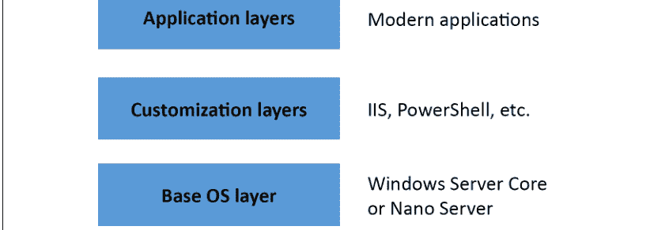

容器的最底层是基础操作系统。启动容器时，你需要一套基础代码和一个内核来在其之上构建。这个基础操作系统可以是 Server Core 或 Nano Server。

容器的下一层是定制层。这里存放着最终将被你的应用程序使用的技术。例如，我们的容器可能包含用于托管网站的 IIS、PowerShell，甚至是 .NET。所有这些工具集都位于这一层。

最后，容器蛋糕的顶层是应用程序层。当然，这就是你计划在这个容器内托管的具体应用程序，你的用户正在访问它。

虽然 Server Core 是构建小型高效服务器的优秀操作系统，但与 Nano Server 相比它仍然是重量级的。Nano 非常不同，而且非常小，以至于根本无法比较。你可能还记得我们之前安装 Server Core 时，硬盘大小约为 6 GB。虽然这比 Windows Server 的桌面体验版本要小得多，但请想想这一点。Nano Server 基础镜像可以小于 500 MB！

这小得惊人。此外，Nano Server 的更新预计会很少且间隔很长。这意味着你无需在应用程序容器上处理每月补丁和更新。事实上，由于容器包含了运行其上托管应用程序所需的一切，通常期望的是，当你需要更新容器中的某些内容时，你只需构建一个新的容器镜像，而不是更新现有镜像。如果 Nano Server 收到更新，只需构建一个新的容器，在其上安装并测试应用程序，然后基于新镜像推出容器实例即可。需要对应用程序本身进行一些更改吗？与其费心更新现有容器镜像，快速轻松地构建一个新镜像，在生产环境之外对其进行测试，一旦准备就绪，只需开始部署并在生产环境中启动新的容器镜像，让旧版本逐渐消失即可。

Nano Server 现在仅用作容器的基础操作系统。自 Server 2016 发布以来，这是一个重大变化，当时 Nano 被期望提供的范围要大得多。如果你正在利用 Nano Server 处理容器镜像之外的负载，你需要开始着手将这些负载迁移到更传统的服务器，例如 Server Core。

你可能会想，“如果 Nano Server 可用，为什么有人会使用 Server Core 作为容器镜像的基础？”最简单的答案是应用程序兼容性。Nano Server 非常小，因此显然缺少 Server Core 中存在的大量代码。当你开始研究利用容器来托管应用程序时，如果可能，使用更小的 Nano Server 作为基础是个好主意，但通常你的应用程序根本无法在该平台上运行，在这些情况下，你将使用 Server Core 作为基础操作系统。

.NET 应用程序可以帮助说明何时使用一种类型的容器而不是另一种。如果你要构建的应用程序基于 .NET Core，Nano Server 容器镜像可能已包含运行该应用程序所需的所有依赖项。这将为你的容器提供最小的可能占用空间，并且运行效率最高。然而，如果你发现自己正在构建需要完整 .NET 框架的应用程序，Nano Server 就不够用了。你必须改变策略并利用 Server Core 容器来使你的应用程序运行。

## Windows Server 容器与 Hyper-V 容器

启动容器时，重要的是要知道在 Windows Server 2019 中你可以运行两类容器。我们迄今为止讨论过的所有应用程序容器的方面都适用于 Windows Server 容器或 Hyper-V 容器。Hyper-V 容器可以运行与 Windows Server 容器相同的代码或镜像，同时保持其强大的隔离保证，以确保重要内容保持分离。在使用 Windows Server 容器还是 Hyper-V 容器之间的决定可能最终取决于你需要容器保持的安全级别。让我们讨论一下两者之间的差异，以便你更好地理解你面临的选择。

### Windows Server 容器

与 Linux 容器共享主机操作系统内核文件的方式相同，Windows Server 容器利用这种共享来使容器高效。这意味着，虽然命名空间、文件系统和网络隔离已到位以保持容器彼此分离，但在主机服务器上运行的不同 Windows Server 容器之间仍存在一定的漏洞风险。例如，如果你登录到容器服务器上的主机操作系统，你将能够看到每个容器的正在运行进程。

容器无法看到主机或其他容器，并且在各种方面仍然与主机隔离，但知道主机可以查看容器内的进程表明这种共享级别确实存在一些交互。Windows Server 容器在容器主机服务器和容器本身处于同一信任边界的情况下最有用。在大多数情况下，这意味着 Windows Server 容器最适用于仅运行公司拥有和信任的容器的公司拥有服务器。如果你信任主机服务器和容器，并且可以接受这些实体相互信任，部署常规 Windows Server 容器是利用硬件资源最有效的方式。

### Hyper-V 容器

如果你想要更多隔离和更强的边界，那就是你进入 Hyper-V 容器的地方。Hyper-V 容器更像是一种超优化的 VM 版本。虽然 Hyper-V 容器仍然共享内核资源，使其仍然比完整的 VM 更具性能，但每个 Hyper-V 容器都有自己的专用 Windows shell，在其中可以运行单个容器。这意味着 Hyper-V 容器之间的隔离更接近 VM 之间的隔离，同时仍然能够按需并非常快速地启动新容器，因为容器基础设施仍在下方存在。Hyper-V 容器在多租户基础设施中更有用，在那里你希望确保代码或活动不会在容器与主机之间，或在可能由不同实体拥有的两个不同容器之间泄漏。之前，我们讨论过主机操作系统可以查看 Windows Server 容器内运行的进程，但对于 Hyper-V 容器则不然。主机操作系统完全不知道 Hyper-V 容器本身内运行的这些服务，也无法访问它们。这些进程现在不可见了。

Hyper-V 容器的可用性意味着，即使你有一个必须强隔离的应用程序，你也不再需要为该应用程序专门分配一个完整的 Hyper-V VM。你现在可以启动一个 Hyper-V 容器，在该容器中运行应用程序，并为应用程序提供完全隔离，同时继续共享资源并为该应用程序提供更好的、可扩展的体验。


## Docker 与 Kubernetes

Docker 是一个开源项目——严格来说是一个工具集——最初设计用于协助在 Linux 操作系统上运行容器。等等，什么？**Linux** 和 **开源** 这两个词再次出现在微软的书里！世界怎么了？你看，容器正迅速成为一件大事，而且理所当然。在 Server 2016 中，微软采取了一些措施开始重新发明容器轮子，其中包括 PowerShell cmdlet，可用于启动和控制在你的 Windows Server 上运行的容器，但 Docker 平台的增长速度如此之快，以至于微软现在预计任何想要在 Windows 机器上运行容器的人都将通过 Docker 工具集来完成。如果你想在环境中使用或甚至测试容器，你需要获取 Docker for Windows 才能开始。

Docker 是一个容器 *平台*。这意味着它提供了下载、创建、打包、分发和运行容器所需的命令和工具。Docker for Windows 完全受支持，可在 Windows 10 和 Windows Server 2019 上运行。通过安装 Docker for Windows，你将获得开始使用容器以增强应用程序隔离性和可扩展性所需的所有工具。

开发者可以使用 Docker 在本地工作站上创建一个镜像实时服务器环境的环境，以便他们可以在容器内开发应用程序，并确信一旦这些应用程序移至服务器就会实际运行。Docker 是为开发者提供打包、运输和运行能力的平台。开发完成后，容器包可以移交给系统管理员，后者启动将运行应用程序的容器（），并相应地部署它。开发者不关心也不在乎容器主机基础设施，管理员也不关心也不在乎开发过程或与服务器的兼容性，因为应用程序的依赖项位于容器内部。

## Linux 容器

在讨论 Windows Server 2019 具备的与不同类型容器交互的能力时，有一项正在进行开发中的重大更新。早些时候，在 Server 2016 中，Windows 容器主机服务器只能运行基于 Windows 的容器，因为 Windows Server 容器与主机操作系统共享内核，因此你无法在 Windows 主机上启动 Linux 容器。

时代在变，我们现在在 Server 2019 中拥有一些创造性的新功能来处理诸如 Linux 容器之类的场景。虽然这些功能仍部分处于预览中并正在完善，但有一些名为 **Moby VM** 和 LCOW 的新选项，将使 Linux 容器能够在 Windows Server 容器主机上运行，甚至可与 Windows 容器并排运行！

在 Windows Server 容器主机上运行 Linux 容器的一个限制是，你必须更新到 Docker Enterprise Edition 预览版才能做到这一点。目前 Windows 上的 Docker 社区版无法运行 Linux 容器。

所有这些都还很新，仍在构建中，因此更多细节即将公布，但如果你有兴趣运行 Linux 容器，请访问此链接以查看这些新功能当前的状态：https://docs.microsoft.com/en-us/virtualization/windowscontainers/deploy-containers/linux-containers。

## Docker Hub

当你使用容器时，你正在构建可在运行相同主机操作系统的任何服务器实例上使用的容器镜像——这就是容器为你提供能力的本质。当你启动容器的新实例时，你只是拉取该确切镜像的新副本，它是全包的。这种标准化的镜像理念非常适合共享的镜像社区；可以说是一个存储库，其中包含人们构建的可能对他人有益的镜像。毕竟 Docker 是开源的。是否存在这样的共享资源，你可以访问它来获取用于测试的容器镜像文件，甚至上传你创建的镜像并与世界分享？绝对有！它叫做 **Docker Hub**，可在 https://hub.docker.com 获取。

访问此站点并创建登录名，你立即可以访问社区创建和上传的数千个容器基础镜像。这可以快速让实验室使用容器运行起来，而且其中许多容器镜像甚至可用于生产系统，运行这些人员已为你预装在这些容器镜像内部的应用程序。或者你可以使用 Docker Hub 上传和存储你自己的容器镜像：

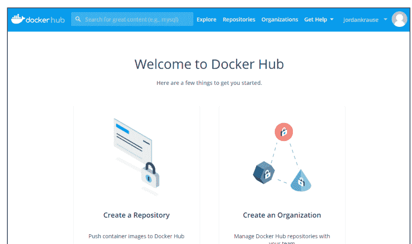

图 13.2：Docker Hub

你真的应该现在就为 Docker Hub 创建一个账户，因为如果你想在章节后面跟随并尝试使用 Docker 实现一个容器，你需要登录才能做到。

## Docker Trusted Registry

如果你像我一样，你会认为 Docker Hub 的想法很棒：一个整洁的地方来存储镜像甚至在社区中共享它们。然而，我的下一个倾向是通过企业望远镜来看待这个问题，这很快就将我的视角从整洁转变为不安全。换句话说，你可能不愿意将镜像放在这个公共存储库中。当然，绝不会是包含你组织敏感信息的镜像：

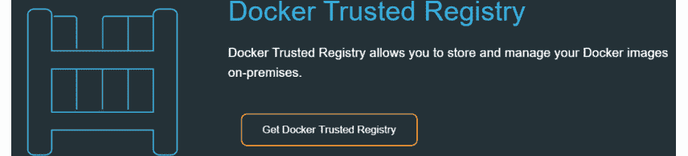

图 13.3：Docker Trusted Registry

这里 Docker Trusted Registry 可能值得研究。Docker Trusted Registry 是一个容器镜像存储库系统，与 Docker Hub 类似，但它是可以包含在你的网络内部、在防火墙和安全系统后面的东西。这为你提供了一个容器镜像存储库系统，而无需冒着与世界其他地方共享敏感信息的风险。

## Kubernetes

虽然 Docker 是我们构建和托管容器的主要接口，使我们能够创建可在其中以这种新颖且令人兴奋的方式托管应用程序的平台，但真正的魔力在我们完成容器的设置后才到来。让我们稍微展望一下未来，假设你现在已成功将一个应用程序托管在容器内部。此容器可以在你环境中的容器主机服务器上启动，甚至可以非常轻松地迁移到 Azure 容器主机。这提供了与所需基础设施的轻松交互，以便无缝地扩展或缩小此应用程序，但这种可扩展性缺少一个部分：编排。

Kubernetes 是一个容器编排解决方案。这意味着 Kubernetes 编排或促进容器如何运行。它是使许多容器能够和谐地一起运行的工具，就像它们是一个大型应用程序一样。如果你打算使用容器创建可扩展应用程序，以便在需要额外资源时启动新容器，你绝对需要一个容器编排器，而 Kubernetes 目前是最好的、最受欢迎的。

微软认识到这种流行性，并已采取措施确保 Kubernetes 在 Windows Server 2019 上得到完全支持。

与其他任何软件一样，Kubernetes 并不是游戏中的唯一名字。Docker 有自己的编排平台，称为 Docker Swarm。虽然 Docker 和 Docker Swarm 合作得比 Docker 和任何其他编排器更好是有道理的，但数字不会说谎。最近的一份报告显示，使用云中可扩展应用程序的公司中有 82% 利用 Kubernetes 进行容器编排。

正如我之前提到的，容器、Docker 和 Kubernetes 等工具是云优先愿景的一部分。虽然大多数公司使用容器的情况将从现场开始，使用自己的服务器和基础设施来托管容器，但这项技术已经能够扩展到云端。因为容器本身如此标准化且灵活——使它们易于扩展和移动——将它们滑入云环境很容易完成。

## 使用容器

有很多相互协作的组件使容器在你的环境中成为现实，但入门并不太困难。让我们逐步了解将 Windows Server 2019 转变为容器运行超级机器的初始设置。

## 安装角色和功能

你在这里需要完成的工作量取决于你是否想运行 Windows Server 容器、Hyper-V 容器或两者。你需要确保安装的主要功能是 Containers，可以通过在 Server Manager 内部使用“添加角色和功能”链接安装，也可以通过发出以下 PowerShell 命令安装：

```
Add-WindowsFeature Containers
```

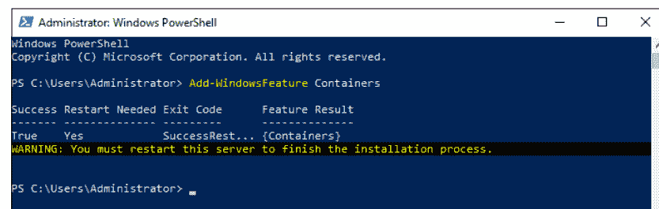

图 13.4：安装 Containers 功能


此外，如果你打算运行 Hyper-V 容器，则需要确保底层 Hyper-V 组件也已安装在你的容器主机服务器上。为此，请在此同一服务器上安装 **Hyper-V 角色** 和随附的管理工具。

如角色和功能安装后所述，请在进行这些更改后重新启动服务器。

此时，你可能会想：“如果我的容器主机服务器需要安装 Hyper-V 角色，那是否意味着它必须是物理服务器？你不能在虚拟机上安装 Hyper-V 角色，对吧？” *错误*。Windows Server 2019 支持一种称为 **嵌套虚拟化** 的功能，该功能是为容器添加的。你看，要求物理硬件如今已成为 IT 部门的限制因素，因为几乎所有工作都是在虚拟机上完成的。公司希望部署容器是合理的，但它们也可能希望其容器主机服务器是 VM，并在该 VM 内运行多个容器。因此，需要嵌套虚拟化来实现这一点。如果你正在运行 Windows Server 2019 物理 Hypervisor 服务器，并在该服务器内部运行 Windows Server 2019 VM，那么你现在会发现可以成功地将 Hyper-V 角色直接安装到该 VM 上。我告诉过你 VM 很受欢迎，以至于它们现在被用来运行其他 VM！

> 请记住，我们也可以在 Windows 10 机器上托管和运行容器！为此准备 Windows 10 *客户端*，只需添加名为 Containers 的 Windows 功能，就像在服务器操作系统上一样。

## 为 Windows 安装 Docker

现在我们的容器主机服务器已使用必要的 Windows 组件做好准备，我们需要从互联网获取 Docker for Windows。Docker 接口将为我们提供启动构建和与容器交互所需的所有命令。

这就是 Docker Hub 登录变得重要的地方。如果你正在通过此操作在自己的工作站上测试容器，并且需要在 Windows 10 *客户端* 上安装 Docker Desktop for Windows，最简单的方法是访问 Docker Hub，登录并搜索 Docker 客户端软件。以下是该软件的链接（如果你在 Windows 10 上安装，这是你需要使用的工具）：https://hub.docker.com/editions/community/docker-ce-desktop-windows.

然而，由于我使用的是 Windows Server 2019，服务器的许可证也包含 Docker Enterprise 的许可，可以在不访问 Docker Hub 的情况下下载。如果我打开一个提升权限的 PowerShell 提示符并运行以下两个命令，我的服务器将联系并获取 Docker Enterprise，并将其安装到我的服务器上：

```
Install-Module -Name DockerMsftProvider -Repository PSGallery -Force
Install-Package -Name docker -ProviderName DockerMsftProvider -Force
```

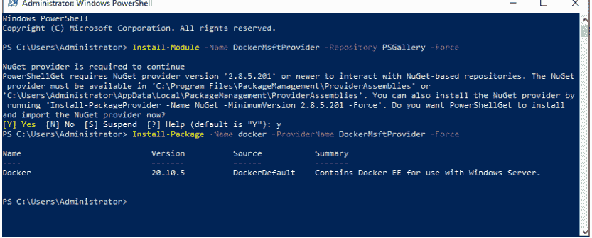

图 13.5：安装 Docker Enterprise

包安装完成后，Docker 已在你的服务器上作为服务进行配置，但该服务需要使用以下命令启动：

```
Start-Service docker
```

## Docker 命令

Docker 安装到你的系统后，无论你使用的是 Windows Server 2019 还是 Windows 10 机器，你现在已在机器上运行 Docker Engine，并且它已准备好接受一些命令以开始使用容器。如果在处理容器时只有一个词需要记住，那就是 Docker。因为你发出的所有与容器交互的命令都将以单词 docker 开头。让我们来看一些你将使用的常见命令。

### docker version

某些你想要运行的容器镜像可能需要特定版本的 Docker Engine 才能成功。当不确定当前 Docker 环境运行的是什么版本时，你可以随时通过运行 docker version 轻松检查版本号。

### docker info

虽然 docker version 显示 Docker Engine 的特定版本号，但 docker info 则退一步提供有关 Docker 容器主机服务器的一般信息和统计数据。在这里你可以看到 Docker 版本号以及当前 Windows 操作系统版本号，还有服务器本身的统计数据，例如分配的内存。docker info 输出中可能最有趣的数字是服务器上容器的计数器，并按正在运行、已暂停或已停止的容器进行细分。

### docker --help

这有点像发出 docker /?，如果那是一个真实命令的话。Docker 的帮助功能将生成可运行的 Docker 命令列表。这是在入门时一个很好的参考点。

### docker images

从仓库下载一些容器镜像后（我们将在本章下一节为自己执行此操作），你可以使用 docker images 命令查看本地系统上所有可用的镜像。

### docker search

使用搜索功能可以搜索容器仓库（如 Docker Hub）以查找你可能想在环境中使用的基础容器镜像。例如，要搜索并找到 Microsoft Docker Hub 仓库中提供的镜像，请执行以下操作：

```
docker search Microsoft
```

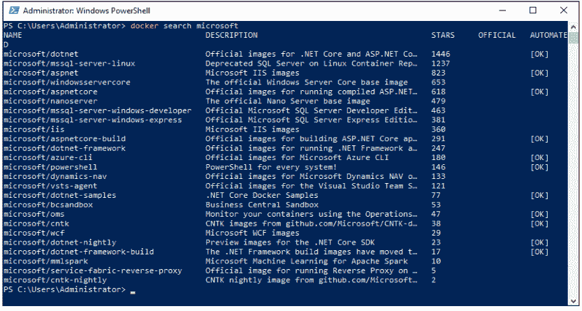

图 13.6：搜索容器仓库

### docker pull

我们可以使用 docker pull 从在线仓库拉取容器镜像。你可以从多个仓库获取容器镜像。最常见的是，你将使用来自 Docker Hub 的镜像，我们稍后将从那里拉取容器镜像。然而，还有其他在线仓库可以获取容器镜像，例如 Microsoft 的公共容器注册表，即 MCR。

以下是一些示例 docker pull 命令，展示如何从 Docker Hub 以及 MCR 拉取容器镜像：

```
docker pull Microsoft/nanoserver
docker pull Microsoft/windowsservercore
docker image pull mcr.microsoft.com/windows/servercore:1809
docker image pull mcr.microsoft.com/windows/nanoserver:1809
```

### docker run

这是从基础镜像启动新容器的命令。你会发现可以在本地仓库中保留多个基于同一容器镜像的容器镜像。例如，随着你在容器中添加新内容或更新容器内的应用程序，你可能会构建新的容器镜像，这些镜像现在是现有容器镜像的子集。例如，你可能有许多都命名为 windowsservercore 的容器镜像。在这种情况下，容器标签变得非常重要，因为标签有助于区分这些容器镜像的不同版本。作为示例，以下命令将基于我关联了 ltsc2019 标签的 windowsservercore 镜像启动一个容器：

```
docker run -it --rm Microsoft\windowsservercore:ltsc2019
```

在前面的命令中，-it 开关创建一个 shell，可从中与容器交互，这对于构建和测试容器很有用，但对于启动 100% 准备好提供应用程序的生产容器，你通常不需要该开关。--rm 是一个清理开关，意味着一旦该特定容器退出，容器及其文件系统将被自动删除。

### docker ps -a

当你想查看系统上当前正在运行的容器时，可以使用 docker ps。

## 下载容器镜像

我们将在新创建的容器主机上运行的第一个命令是 docker images，它显示当前驻留在系统上的所有容器镜像；目前没有：

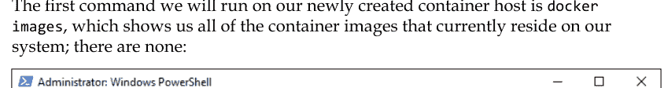

图 13.7：我们系统上目前没有容器镜像

当然目前还没有容器镜像，因为我们还没有下载任何镜像。让我们抓取几个以便测试。有 .NET 团队提供的示例容器镜像文件，展示了在 Nano Server 容器内运行 .NET 应用程序——这听起来是验证我能否成功在此新主机服务器上运行容器的一个有趣的开始方式。


首先，我们可以使用 docker search 来检查当前位于 Microsoft Docker Hub 仓库中的容器镜像。一旦找到想要下载的镜像，我们就使用 docker pull 将其下载到我们的服务器上：

```
docker search microsoft
docker image pull microsoft/nanoserver
```

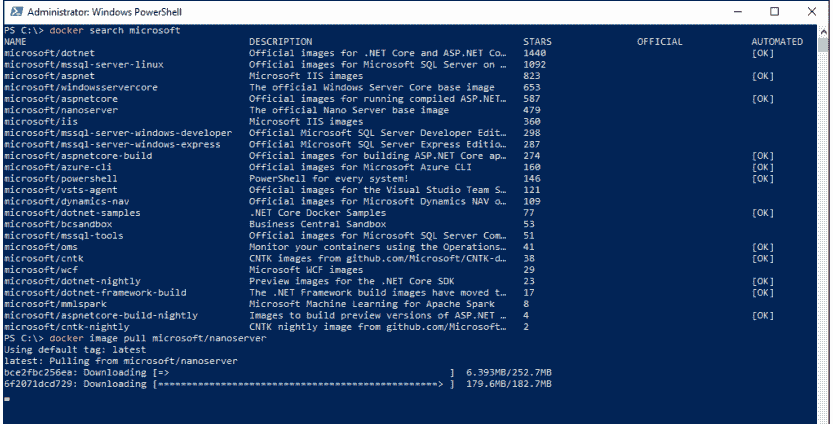

图 13.8：使用 docker pull 获取 Nano Server 容器镜像

前面的命令下载了标准 Nano Server 基础镜像的副本，但我们希望容器最终能够执行某些操作，因此这里有一个命令也可以下载该 .NET 示例镜像：

```
docker image pull microsoft/dotnet-samples:dotnetapp-nanoserver-1809
```

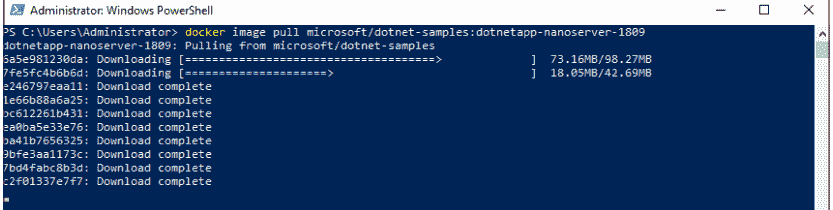

图 13.9：下载 .NET 示例容器镜像

下载完成后，再次运行 docker images 现在会显示我们新可用的 Nano Server 容器镜像，以及 .NET 示例镜像：

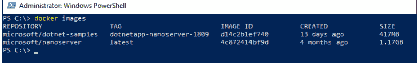

图 13.10：本地容器镜像仓库

从这些基础镜像中，我们现在能够启动并运行一个真正的容器。

## 运行容器

我们距离在主机上运行容器已经非常接近了！现在我们已经安装了服务、部署了 Docker、将 Docker 模块导入到 PowerShell 提示符中，并下载了基础容器镜像，我们终于可以发出命令从该镜像启动容器了。让我们使用以下命令运行之前下载的 .NET 容器：

```
docker run microsoft/dotnet-samples:dotnetapp-nanoserver-1809
```

容器启动并运行其包含的代码，我们看到了一些有趣的输出：

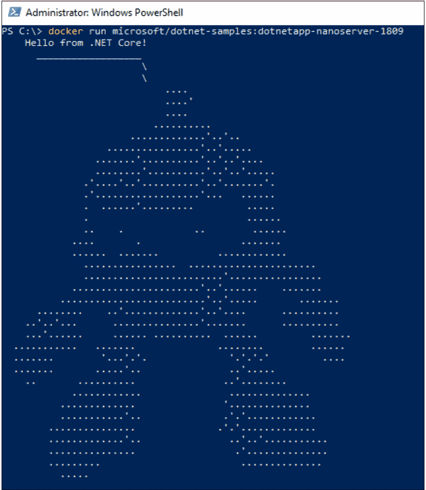

图 13.11：我们的第一个容器已启动并运行！

该容器展示了运行此 .NET 应用程序所需的所有 *组件* 都包含在 *容器* 内部。该容器基于 Nano Server，这意味着它具有极小的占用空间。事实上，回看几页前我们运行的最后一次 docker images 命令，我可以看到此容器镜像只有 417 MB！与在传统的 IIS Web 服务器上运行此应用程序相比，这节省了大量资源。

关于 Microsoft 容器文档的主要资源是 https://aka.ms/windowscontainers。用于与容器交互的工具一直在不断变化，包括 Docker 和 Kubernetes 的变更。请务必查看 Microsoft Docs 网站，以找到准备容器主机服务器的最新最佳实践和批准的安装路径。

## 摘要

容器正在彻底改变我们构建和托管现代应用程序的方式。通过将应用程序容器化，我们可以在每台物理服务器上运行更多应用程序，因为它们能够彼此完全隔离。此外，容器化思维使应用程序的开发能够以更流畅的方式进行。应用程序开发人员可以在自己的笔记本电脑上运行的容器内构建应用程序，完成后只需将其交给基础设施团队，将该容器镜像部署到生产容器主机服务器上。该主机服务器可以是本地部署的，也可以是在云中。然后可以利用 Kubernetes 等编排工具来扩展该应用程序，根据负载或其他因素增加或减少资源容量和所需的容器数量。Docker 项目极大地扩展了容器在现实世界中的可用性。Docker 的团队显然是这一领域的领军者，以至于 Microsoft 决定将 Docker——一个由 Linux 开发的开源项目——直接集成到 Windows Server 2019 中。我们现在既可以利用 Docker Engine 在 Windows 服务器上运行容器，也可以使用 Docker 客户端工具集以与在 Linux 世界中处理容器相同的方式在 Windows 内部管理和操作容器。

Linux 容器和 Windows Server 容器有很多共同点，并且本质上以相同的方式运行。Microsoft 创建额外容器范围的巧妙想法——Hyper-V 容器——为在总体上考虑容器概念时出现的许多常见安全问题提供了坚实的答案。如今每个人都大量使用虚拟机；我认为没有人会不同意这一点。假设容器的使用发展成为易于实施和管理的技术，我预计在未来几年中，Hyper-V 容器将取代我们许多现有的 Hyper-V 虚拟机。这将节省时间、金钱和服务器空间。

说到 Hyper-V，它已成为当今众多企业网络中不可或缺的一部分。在下一章中，我们将了解更多关于这项令人惊叹的虚拟化技术。

## 问题

- 1. Windows Server 容器可以运行两种不同类型的基础操作系统之一。它们是什么？
- 2. 与 Windows Server 容器相比，哪种类型的容器提供更高的隔离级别？
- 3. 真或假——在 Windows Server 2016 中，你可以在同一 Windows Server 主机平台上同时运行 Windows 和 Linux 容器。
- 4. 查看本地系统上容器镜像列表的 Docker 命令是什么？
- 5. 目前与 Windows Server 2019 集成的最流行的容器编排软件是什么？
- 6. 真或假——开发人员可以在其 Windows 10 工作站上安装 Docker 以开始在容器内构建应用程序。

# 14 Hyper-V

# Hyper-V

我一直是个乡下人。沿着土路驾驶、修车和打猎通常会占据我的业余时间。旅行到城市，特别是最近一次去香港的旅行，总是让我有点文化冲击。所有那些摩天大楼和高层公寓大楼虽然服务于重要目的，并体现了我的比喻：如果没有足够的土地向外扩张，你就必须向上建设。大城市的垂直崛起与过去十年我们在数据中心看到的情况相似。城市需要为人们和企业提供越来越多的空间，就像我们每年需要容纳越来越多的服务器一样。与横向扩展相比，拥有装满机架和机架硬件的庞大数据中心服务器机房，我们正在拥抱摩天大楼的理念并虚拟化一切。我们构建的服务器要少得多，但使它们极其强大。然后，在这些超级计算机之上，我们可以运行数十个，甚至数百个虚拟服务器。提供此超visor 层的技术，在以 Microsoft 为中心的商店中运行 **Virtual Machines (VMs)** 的能力，是 Windows Server 中的 **Hyper-V** 角色。作为服务器管理员，这是一个必须理解的最关键的角色之一，因为如果你的组织尚未使用服务器虚拟化，那么相信我，它很快就会使用。虚拟化是未来的发展方向。以下是我们将要探索的一些主题，以便你熟悉 Microsoft 在 Windows Server 2019 中提供的虚拟化功能：

- 设计和实施您的 Hyper-V 服务器
- 使用虚拟交换机
- 实施新的虚拟服务器
- 管理虚拟服务器
- 受保护的 VM
- 与 Linux 集成
- **Resilient Filesystem (ReFS)** 去重
- Hyper-V Server 2019

## 设计和实施您的 Hyper-V 服务器

创建自己的 Hyper-V 服务器通常非常简单：构建一台服务器，安装 Hyper-V 角色，即可开始使用。事实上，如果你需要从自己的桌面运行一些虚拟机，甚至可以将 Hyper-V 角色安装在 Windows 10 Pro 或 Enterprise 计算机上。虽然当今大多数硬件完全支持作为超visor提供者的概念，但你们中的一些人尝试安装 Hyper-V 角色时可能会遇到以下错误消息：

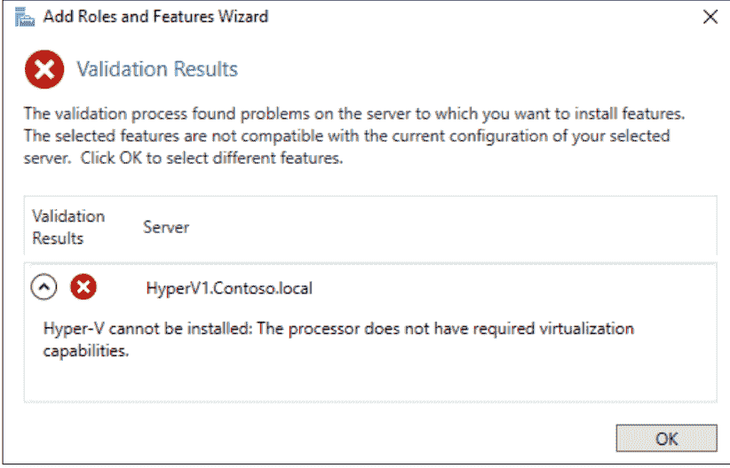

图 14.1：Hyper-V 兼容性错误


哎呀，这可不好。这意味着有两种可能：要么我的 CPU 根本不支持虚拟化，要么我在服务器 BIOS 中关闭了一些设置，导致无法工作。在服务器上运行 Hyper-V 之前，你应该检查以下三个方面，以确保它已准备就绪。首先，你需要运行基于 x64 的处理器。这几乎是理所当然的，因为 Windows Server 2019 只有 64 位版本。如果你没有 x64 处理器，根本就无法安装操作系统。其次，你的 CPU 必须支持硬件辅助虚拟化。这通常被称为 **英特尔虚拟化技术 (Intel VT)** 或 **AMD 虚拟化 (AMD-V)**。最后但同样重要的是，你的系统必须具备 **数据执行保护 (DEP)** 并已启用。如果你已经检查过硬件本身，看起来支持虚拟化，但仍然无法工作，很可能是该系统的 BIOS 中当前禁用了 DEP。进入 BIOS 设置，启用 DEP 以及任何其他名称更友好的设置，这些设置可能表明它们当前阻止了你运行虚拟机的能力。

只要你的处理器能够运行虚拟机，通过安装 Hyper-V 角色，你几乎可以将任何规模的硬件转变为 Hypervisor。不必考虑 *最小* 系统要求，因为你希望 Hyper-V 服务器中的系统硬件尽可能大。CPU 内核、内存和硬盘空间越多，你就能运行的虚拟机就越多。我在生产环境中见过的最小的 Hyper-V 服务器也运行着双 Xeon 处理器、96 GB 内存和数 TB 的存储空间。虽然 96 GB 内存对于单台系统来说似乎很多，但如果你的标准工作负载服务器配置包含 8 GB 内存，这已经是一个相当低的数字，并且你想在 Hyper-V 服务器上运行 12 台服务器，那么仅有 96 GB 内存的 Hyper-V 服务器就已经无法满足需求。8 乘以 12 等于 96，而且你还没有为主机操作系统留下任何内存！所以 *故事的寓意？* 要么大干一场，要么回家！

## 安装 Hyper-V 角色

Hyper-V 只是 Windows Server 2019 中的另一个角色，但在安装该角色期间，你会被问到几个问题，了解它们的内容非常重要，这样才能确保你的新 Hyper-V 服务器经久耐用且高效运行。首先，你需要先安装 Windows Server 2019，然后使用 **添加角色和功能** 功能来安装名为 **Hyper-V** 的角色：

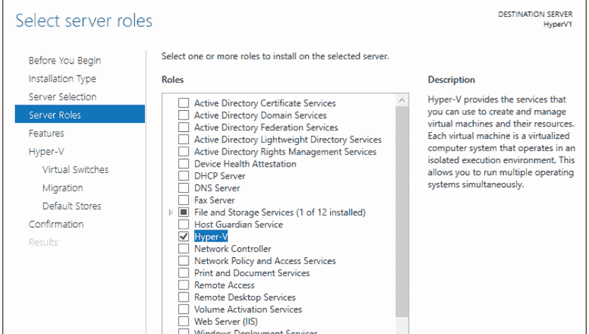

图 14.2：安装 Hyper-V 角色非常简单

在继续使用向导安装角色的过程中，你会遇到一个标记为 **创建虚拟交换机** 的屏幕。我们将在下一节更详细地讨论 Hyper-V 中的网络，但这里重要的是你可以定义服务器的哪些物理网卡将连接到 Hyper-V 并供虚拟机使用。每个 Hyper-V 服务器最好拥有多个网卡。你希望有一个网卡专门用于主机本身，在此屏幕上不应选择它。让它保持原样，供 Hypervisor 自身通信使用。除此之外，你至少需要一张可以将虚拟机桥接到企业网络的网卡。你应该选择它，如 *图 14.3* 所示。如果你在服务器上托管许多不同的虚拟机，并且它们需要连接到不同的物理网络，你可能需要在 Hyper-V 服务器上安装多个网卡：

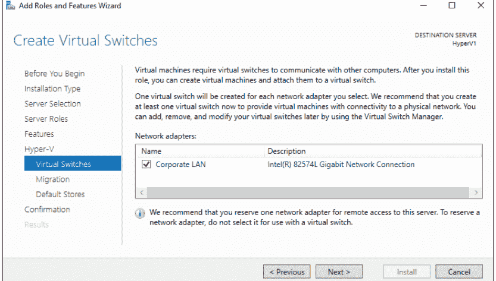

图 14.3：选择可供虚拟机使用的物理网卡

在定义网卡之后，我们需要决定此 Hyper-V 服务器是否将处理虚拟机的实时迁移。实时 VM 迁移是指在不中断该 VM 服务的情况下，将 VM 从一个 Hyper-V 主机移动到另一个主机的能力。如图 14.4 所示，你可以采用几种不同方式设置服务器以准备处理实时迁移，请注意底部文字提示，如果计划将此 Hyper-V 服务器作为集群的一部分，现在应保持此选项不变。在集群环境中，这些设置在另一层处理：

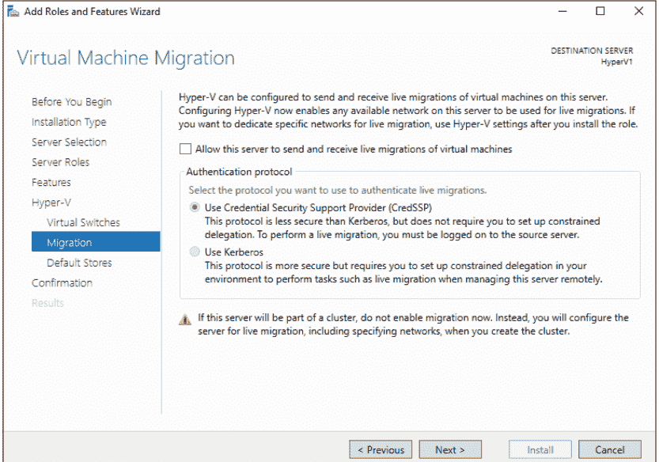

图 14.4：决定是否需要实时迁移功能

我想指出的最后一个屏幕是 VM 数据的存储位置定义。在创建虚拟机并深入了解它们在硬盘层面的样子（查看每个 VM 创建的实际文件）后，你会发现虚拟机有两个关键方面：虚拟硬盘文件（**VHD** 或 VHDX）和包含该 VM 配置文件的文件夹。

如图 14.5 所示，存储这些项目的默认位置是你期望在笔记本电脑上安装的客户端应用程序中看到的，但你不会期望像 Hyper-V 这样重的系统将其核心文件存储在共享用户文档文件夹中。我想由于微软不知道你的服务器配置，无法真正猜测你希望将数据存储在哪里，因此它将默认值设置为在技术上可行但最好作为最佳实践进行更改的东西。许多 Hyper-V 服务器将拥有专用存储，即使只是一个单独的硬盘，这些文件也计划存储在上面。请务必在此屏幕上花一点时间更改虚拟机文件的默认存储位置：

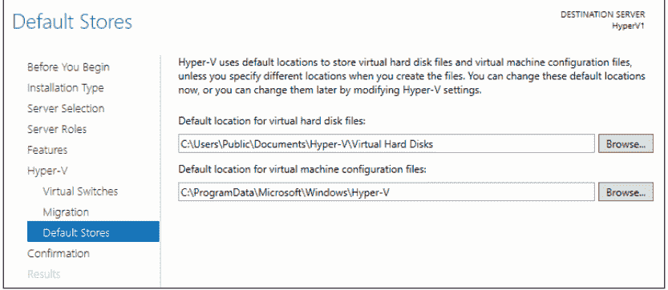

图 14.5：定义 VM 文件的默认存储位置

> 请记住，你运行的 Windows Server 2019 版本决定了你可以在此主机上运行多少虚拟机。Server 2019 Standard 将你限制为最多运行两个虚拟机，而 Datacenter 版本则允许你启动硬件上能容纳的任意数量的虚拟机。

## 使用虚拟交换机

完成 Hyper-V 角色安装后，你的第一反应可能是立即开始创建虚拟机，但你真的应该花一点时间确保 Hyper-V 服务器的网络功能足以满足你的需求。在角色安装过程中，我们选择了要传递到 Hyper-V 的物理网卡，并且该屏幕告诉我们它将为这些网卡中的每一个建立一个虚拟交换机。但在控制台中它看起来是什么样子的？我们有哪些选项可以建立虚拟机之间的网络？

要回答这些问题，我们需要打开 Hyper-V 的管理界面。就像 Windows 角色的任何管理工具一样，检查服务器管理器的工具菜单中，现在角色已安装，你将看到 Hyper-V 管理器的新列表。启动它，我们现在看到的就是管理并操作 Hyper-V 环境各方面的主要平台：

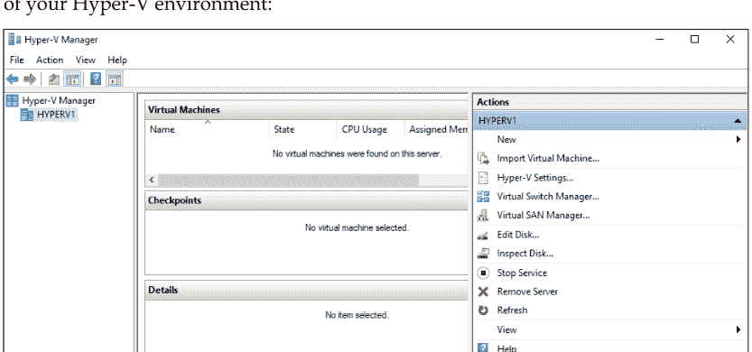

图 14.6：首次查看 Hyper-V 管理器

由于目前还没有运行任何虚拟机，此控制台目前有很多空白空间。在 Hyper-V 管理器的右侧，你可以看到一个名为 Virtual Switch Manager... 的链接。继续点击该链接，进入虚拟交换机和网络的设置：

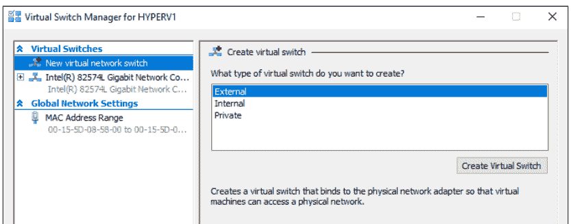

图 14.7：在 Hyper-V 中管理虚拟交换机

在左侧，你可以看到当前虚拟交换机的列表。在我的服务器上，目前只列出了一个交换机，其名称以其连接的物理网卡命名。这是角色安装过程中在我们选择要包含在 Hyper-V 中的网卡时为我们创建的虚拟交换机。如果你角色安装期间选择了多个网卡，这里将有多个虚拟交换机可用，每个交换机对应一个物理网卡。你创建的每个虚拟机都将有一个或多个虚拟网卡，很快你会看到你可以选择每个虚拟网卡的连接位置。如果你的虚拟机可能需要联系五个不同的物理网络，你可以在 Hyper-V 服务器中使用五个物理网卡，将每个网卡插入不同的网络，然后在此控制台中拥有五个虚拟交换机，你的虚拟机网卡可以插入其中。

如图 14.7 所示，我们有一个名为 Create Virtual Switch 的按钮，其含义不言自明。显然，这里是创建新交换机的地方，但你可以创建三种不同类型的交换机。让我们花一点时间讨论它们之间的区别。


## 外部虚拟交换机

外部虚拟交换机是最常用的类型，用于需要联系生产网络的任何虚拟机。每个外部虚拟交换机都绑定到安装在 Hyper-V Server 上的物理 NIC。如果你点击一个外部虚拟交换机，你可以看到你有一些配置此交换机的选项，甚至可以更改交换机类型。在下面的屏幕截图中，我已重命名我的外部虚拟交换机，以便在将来决定向此服务器添加额外的 NIC 时更容易识别：

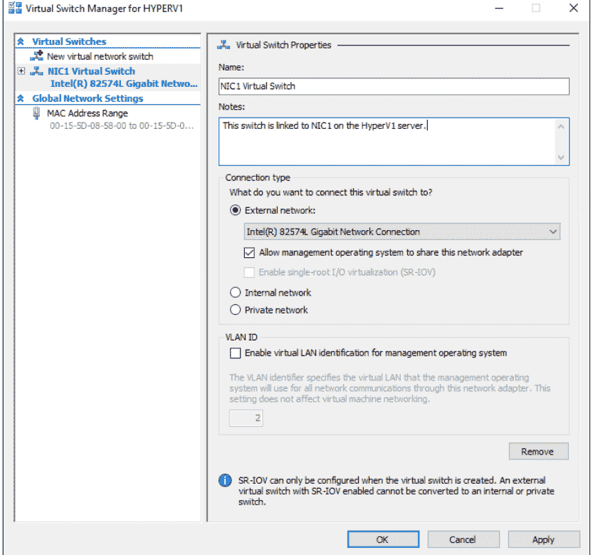

图 14.8：为便于识别而重命名外部虚拟交换机

## 内部虚拟交换机

内部虚拟交换机未绑定到物理 NIC，因此如果创建内部虚拟交换机并将 VM 连接到它，该虚拟机将无法联系 Hyper-V Server 本身之外的物理网络。它在另外两种交换机类型之间有点像中间人；使用内部虚拟交换机在你希望 VM 流量保持在 Hyper-V 环境内，同时仍提供 VM 与 Hyper-V 主机本身之间的网络连接时很有用。换句话说，连接到内部虚拟交换机的 VM 可以相互通信并与 Hyper-V Server 通信，但不能超出其范围。

## 私有虚拟交换机

私有虚拟交换机正如其名所示：私有。插入同一私有虚拟交换机的 VM 可以相互通信，但不能超出其范围。即使是 Hyper-V 主机服务器也没有与私有虚拟交换机的网络连接。测试实验室是私有虚拟交换机用例的绝佳示例，我们将在本节之后立即讨论这一点，当我们创建自己的虚拟交换机时。

## 创建新的虚拟交换机

以下是我经常使用的示例。我正在运行一台新的 Hyper-V Server，它物理连接到我的企业网络，因此我可以启动新的 VM，将它们连接到我的外部虚拟交换机，并使它们直接与企业网络通信。这使我能够将它们加入域并像操作网络上的任何服务器一样与它们交互。也许我需要创建一些想要相互通信的 VM，但我不希望它们与我的生产网络通信。在现实世界中，此场景的一个良好示例是构建测试实验室。事实上，我对本书中使用的所有服务器都采用了这种确切的方法。我的物理 Hyper-V Server 在我的生产网络上，但我的整个 Contoso.local 网络以及其中运行的所有 VM 都在自己的独立网络上，该网络与我的真实网络完全隔离。我通过创建新的私有虚拟交换机实现了这一点。请记住根据描述，当你将 VM 插入这种交换机时，它们可以与插入同一虚拟交换机的其他 VM 通信，但不能超出该交换机。

在 **虚拟交换机管理器** 中，我所要做的就是选择要创建的虚拟交换机的类型，本例中为 **私有**，然后单击该 **创建虚拟交换机** 按钮。然后我可以为新交换机提供名称，并立即将 VM 连接到此交换机。你可以在 *图 14.9* 中看到我创建了两个新的私有虚拟交换机：一个用于将我的测试实验室 VM 的内部 NIC 插入其中，另一个交换机将充当我的测试实验室的 DMZ 网络：

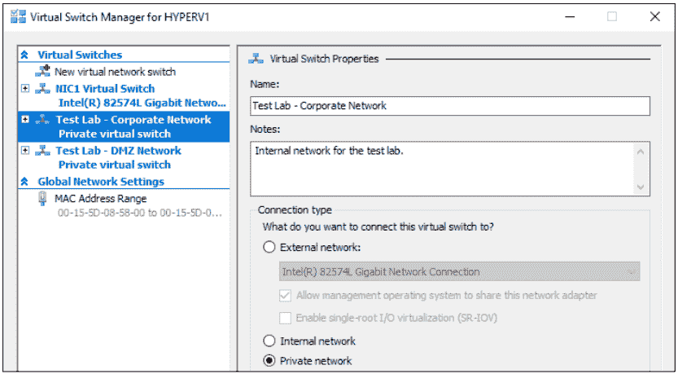

图 14.9：创建新的私有虚拟交换机

## 实施新的虚拟服务器

现在我们准备启动我们的第一台虚拟服务器！与创建新的虚拟交换机类似，创建新 VM 的过程相当简单，但如果您以前没有经历过此过程，途中有些步骤可能需要一些解释。我们从在 Hyper-V 世界中执行所有操作的同一管理界面开始。打开 **Hyper-V 管理器** 并右键单击你的 Hyper-V Server 名称。导航到 **新建** | **虚拟机...** 以启动向导：

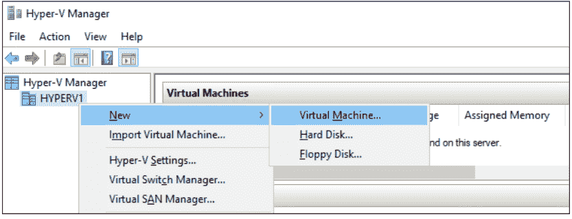

图 14.10：创建新的虚拟机 (VM)

我们需要做出一些决定的第一个屏幕是 **指定名称和位置**。为你的新 VM 创建一个名称，这很容易。然后你也有机会将 VM 存储在新位置。如果你安装 Hyper-V 角色期间为虚拟机设置了良好的默认位置，那么你可能不需要修改此字段。但就我而言，我在安装角色时选择了默认选项，因此此向导将把我的 VM 放置在 C:\ProgramData 内部的某个位置，我不喜欢那样。所以我选中了复选框并为我的 VM 选择了我喜欢的位置。你可以看到我正在使用专用磁盘来存储我的 VM，这通常是一个良好的做法。在更大的网络中更好的做法是利用通过网络访问的弹性磁盘空间，例如 Storage Spaces Direct 基础设施：

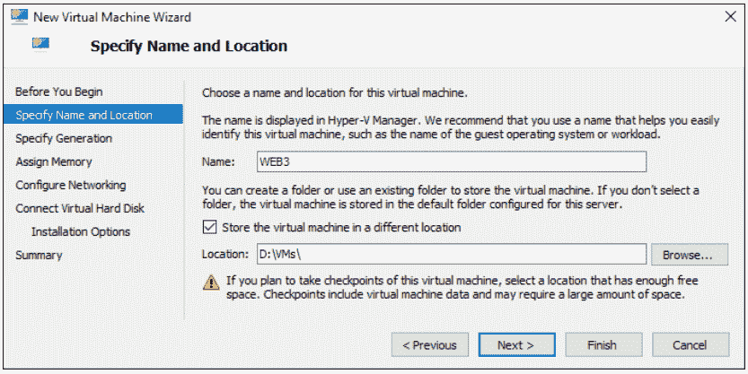

图 14.11：为新 VM 指定存储位置

接下来，你必须决定是创建 **第一代** 还是 **第二代** VM。我们不需要对此进行太多讨论，因为两者在页面上和 *图 14.12* 中都有明确说明。如果你的 VM 将运行较旧的操作系统，你可能应选择 **第一代** 以确保兼容性。另外，如果你计划在此新 VM 上安装最近的操作系统，从新功能和安全性的角度来看，选择 **第二代** 可能对你最有利：

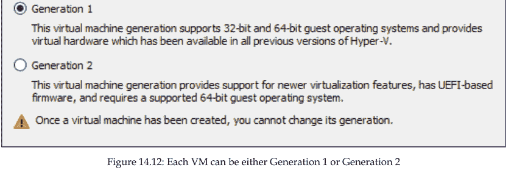

图 14.12：每个 VM 可以是第一代或第二代

现在，定义你希望分配给此特定 VM 的内存量。请记住，此设置将来可以调整，因此你不必为此过度规划。你为此虚拟机分配的 RAM 量将取决于 Hyper-V 主机系统中可用的 RAM 量，以及运行计划在此 VM 上安装的任何角色和服务所需的内存量。你可以在此字段中指定任意内存量。例如，如果我想要大约 2 GB，我可以输入 2,000 MB。然而，我在实践中发现大多数人仍然坚持使用实际的 MB 数，因为这就是我们一直以来对硬件的做法。所以我不会四舍五入到 2,000，而是将我的 2 GB VM 设置为实际的 2 GB——即 2,048 MB。

保持动态内存的框未选中意味着 Hyper-V 将为此特定 VM 专用 2,048 MB 的物理可用 RAM。无论 VM 在任何给定时间使用 2,048 MB 还是 256 MB，完整的 2,048 MB 都将分配给 VM，并且 Hyper-V Server 的其余部分无法使用。如果你选择 **为此虚拟机使用动态内存**，VM 只会在任何给定时刻从 Hyper-V 主机占用它实际使用的资源。如果你将其设置为 2,048 MB，但 VM 处于空闲状态且仅消耗 256 MB，它只会对 Hyper-V 造成 256 MB 的负载：


图 14.13：定义新 VM 的内存分配

配置网络是我们接下来看到的屏幕，在这里我们只需选择 VM 的 NIC 将插入哪个虚拟交换机。我们确实可以在以后为此 VM 添加额外的 NIC，但现在，在创建新 VM 期间，我们获得一个标准的单个 NIC，我们只需选择它需要连接的位置。目前，我正在构建的新 Web 服务器将连接到我的测试实验室内部企业网络，以便我可以在将其引入真实生产网络之前构建我的 Web 应用并进行测试。如果我在此处展开可用连接的列表，你会看到我的原始外部虚拟交换机以及我创建的两个新的私有虚拟交换机都可供选择：


图 14.14：将新 VM “插入”虚拟交换机


也需要一些细节才能让这个新 VM 拥有硬盘。最常见的是，你会在这里使用顶部选项，让新 VM 获得全新的硬盘。如果是从现有文件启动，也可以使用现有虚拟硬盘的选项，或者如果你尚未准备好做出此决定，也可以稍后附加磁盘。我们将允许向导生成一个新的虚拟硬盘，默认大小为 127 GB。我可以将其设置为任意值，但重要的是要知道它并不会占用全部 127 GB 的空间。磁盘大小仅取决于磁盘上实际使用的空间，因此只会使用其中一小部分 127 GB。我提到这一点是为了指出，你在此处指定的数字更像是一个最大大小，因此请确保适当规划你的磁盘，指定足够的空间以便你和你的应用程序有足够的成长空间：


图 14.15：允许向导创建新的虚拟硬盘

向导中的最后一个选项屏幕允许我们定义新 VM 将运行的操作系统的具体信息。或者说，该操作系统将从何处安装。我们将有意将其保留为 **稍后安装操作系统**，因为这是默认选项，并且它会让我们有机会看到在该屏幕上不指定任何设置时会发生什么：


图 14.16：关于操作系统安装需要做出的决策

## 启动并连接到 VM

我们现在已经创建了一个 VM，你可以在 **Hyper-V 管理器** 控制台中看到它。启动 VM 只需右键单击它，然后选择 **开始**。选择启动 VM 的选项后，再次右键单击它并点击 **连接...**。这将打开一个控制台窗口，你可以从中观察新服务器的启动过程：


图 14.17：启动我们的新虚拟机

现在我们的新 VM 已经启动，*我们可以在控制台窗口中期待看到什么？* 当然是一个启动失败错误：


图 14.18：此 VM 的初始启动并不太成功

## 安装操作系统

我们收到启动失败消息是因为在向导中没有指定任何操作系统介质，因此 Hyper-V 创建了我们的 VM 和新的硬盘，但就像你用全新硬件构建新服务器一样，你需要在该硬盘上安装软件才能使其发挥作用。幸运的是，在 VM 上安装操作系统甚至比在物理服务器上安装更容易。返回 **Hyper-V 管理器** 控制台，右键单击新 VM 的名称并进入 **设置...**。

在 **设置** 中，你会看到此 VM 在 **IDE 控制器 1** 中自动列出了一个 **DVD 驱动器**。如果你点击 **DVD 驱动器**，你可以轻松地让它挂载任何 ISO 到该驱动器。将你想要运行的操作系统安装程序的 ISO 文件复制到 Hyper-V 服务器的硬盘上。

我通常将所有 ISO 放在一个名为 ISOs 的专用文件夹中，就在我的 VMs 文件夹旁边，然后从此屏幕 **浏览...** 到该位置。将 ISO 连接到你的 VM 与将物理安装 DVD 插入物理服务器相同：


## WEB3 在 HYPERV1 上的设置

图 14.19：为我们的新 VM 提供操作系统安装介质

挂载介质后，重新启动 VM，你会看到我们的操作系统安装程序自动启动：


图 14.20：VM 现在正在启动到安装 ISO

## 管理虚拟服务器

我们已使用 Hyper-V 管理器来管理虚拟交换机并创建虚拟机。此工具在操作你的 VM 方面功能强大，我在日常工作中经常使用它。让我们看看在 Hyper-V 管理器内部还可以做哪些其他事情，以及可以用来处理在你的 Hyper-V 服务器上创建的新虚拟机的其他方法。

## Hyper-V 管理器

如你所知，Hyper-V 管理器是管理 Hyper-V 服务器的主要工具。它是一个不错的控制台，可以快速显示你的虚拟机的状态，并允许你以多种方式管理这些 VM。我们没有涉及的一点——因为我只运行了一台 Hyper-V 服务器——是你可以使用单个 Hyper-V 管理器控制台管理多个 Hyper-V 服务器。就像微软世界中任何 MMC 风格的控制台一样，你可以右键单击屏幕左上角附近的“Hyper-V 管理器”文字并选择一个名为“连接到服务器...”的选项。通过使用此功能，你可以将其他 Hyper-V 服务器的信息拉入同一个 Hyper-V 管理器控制台：


图 14.21：将 Hyper-V 管理器连接到远程 Hyper-V 主机

此外，这使你能够在客户端计算机上运行 Hyper-V 管理器软件。你可以在 Windows 10 机器上安装 Hyper-V 角色，这也会安装此控制台，然后使用在 Windows 10 桌面上运行的该本地副本的 Hyper-V 管理器来管理你的 Hyper-V 服务器，而无需直接登录到这些服务器。

**Hyper-V 管理器** 内部最有用的一些操作列在控制台右侧的 **操作** 窗格中——例如 **虚拟交换机管理器** 和创建新 VM 的功能。一旦你的 VM 运行起来，你会在右键单击 VM 时出现的上下文菜单中找到许多有用的功能，如 *图 14.22* 所示：


图 14.22：管理虚拟机的操作窗格中可用的选项

其中一些不言自明，一些值得尝试。我们已经使用 **连接...** 来连接到我们的 VM 控制台。**设置...** 打开了大量可能性，我们将在本节之后进一步查看 **设置** 菜单。我打开此右键菜单最常见的原因之一是为了 VM 的电源功能。你可以看到你有 **关闭...** 或 **关机...** VM 的能力。关闭它就像按下服务器的电源按钮：它会立即切断该服务器的电源，并且在这样做时会给 Windows 带来一些麻烦。另一方面，关机功能会启动干净的关机，至少在 VM 上使用 Microsoft 操作系统时是这样。关掉服务器没什么大不了的，但真正的强大之处在于你可以同时关闭多个 VM。例如，如果我为测试实验室运行十几个不同的 VM，并且我决定我的实验室占用了太多资源并导致 Hyper-V 服务器出现问题，我可以同时选择所有 VM，右键单击它们，然后只需一次点击 **关机...**，它就会立即在所有我选择的 VM 上启动关机过程。一旦 VM 关机或关闭，右键单击该 VM 将提供 **开始** 功能；你也可以选择多个服务器并使用此右键菜单一次全部启动它们。

## 设置菜单

对你的任何 VM 进行深入修改通常意味着右键单击该 VM，然后导航到该特定 VM 的 **设置...**。在 **设置** 中，你可以调整 VM 硬件的任何方面，这是访问此屏幕最常见的原因。打开 **设置** 后立即，你有将 **添加硬件** 到你的 VM 的选项。这是你添加更多硬盘控制器或 NIC 到虚拟服务器的地方：


图 14.23：向现有 VM 添加新硬件


我不知道你能否从前面的截图中看出来，但“添加”按钮目前是灰色的。这很重要。Settings 中的许多功能可以在 VM 运行期间即时操作。有些功能必须在关闭 VM 后才能完成。添加硬件就是其中之一。如果你想为 VM 添加新的硬盘或 NIC，就必须先关闭该服务器，然后才能进行操作。

接下来，我们应该谈谈内存屏幕。这个相对比较简单，对吧？只需输入你希望该 VM 可用的 RAM 数量。我想指出它的原因是因为此功能有了重大改进。从 Windows Server 2016 Hyper-V 开始，你现在可以在 VM 运行期间调整分配给 VM 的 RAM 数量！在之前的 Hyper-V 版本中，你需要关闭 VM 才能更改其内存分配，但即使我的 WEB3 服务器当前正在运行并为用户提供服务，我也可以随时进入这里增加 RAM。

假设我的 2 GB 跟不上任务负载，我想将其增加到 4 GB。我让服务器保持运行，打开该 VM 的 Hyper-V Manager 设置，并将相关设置调整为 4,096 MB：


Figure 14.24：VM 运行期间增加内存

内存量立即调整，如果我在 WEB3 服务器内部打开系统属性，我可以看到操作系统已更新以反映现在安装的 4 GB RAM：


Figure 14.25：WEB3 立即增加到 4 GB 内存

其他有用的设置屏幕是处理器和网络适配器部分。在这里你可以定义当前分配给 VM 的虚拟处理器数量，以及与这些处理器相关的性能权重。在网络适配器屏幕中，你可以更改虚拟 NIC 连接到的虚拟交换机。我在将服务器从一个位置移动到另一个位置时经常访问此部分。

## Checkpoints

另一个 Settings 菜单中的重要功能称为检查点。它们以前称为快照，我认为这对我们大多数人来说更有意义。检查点是一个功能，你可以通过在 Hyper-V Manager 中右键单击一个或多个 VM 来调用它。它本质上为 VM 创建了一个时间快照。另一种看待检查点的方式是它们为你的服务器创建回滚点。如果你周二创建了一个检查点，而周三有人对该服务器进行了导致问题的配置更改，你可以从周二恢复检查点并将 VM 恢复到当天的状态。

检查点可以有几种不同的运行方式，而 Settings 菜单就是我们定义这些具体设置的地方。只需右键单击任何 VM，访问 Settings 屏幕，然后单击名为 Checkpoints 的管理任务。你可以在图 14.26 中看到选项：


Figure 14.26：配置检查点的选项

这些设置针对你运行的每个 VM 是单独的；例如，你可以对 WEB1 的检查点与 WEB2 的检查点进行不同处理。处理这些时间快照的默认方式称为 **Production checkpoints**。这通常是创建服务器这些快速映像的首选方法，因为它是最新颖的方法。当选择生成生产检查点时，Hyper-V 会在 VM 自身的操作系统内部调用 Windows 备份功能，以便为该服务器创建备份。这类似于你登录该 VM 并手动启动操作系统备份任务。请记住，当你这样做时，因此当 Hyper-V 为你这样做时，它并不是 VM 的逐块相同备份，而是一个备份文件，可以在将来恢复以将操作系统文件带回此时间点。换句话说，生产检查点会将 Windows 恢复到之前的状态，但服务器上不断变化的任何应用程序和数据都不会被检查点捕获，也不会在检查点回滚到位时恢复。

或者，**Standard checkpoints** 选项就是这样做的。这更像是 VM 的快速粗略捕获，就像右键单击 VHDX 硬盘文件并选择复制然后粘贴到其他地方一样。恢复标准检查点可能是一个更混乱的过程。假设你的检查点是在服务器上的应用程序正在执行重要功能（例如数据库写入）的中间创建的。恢复该检查点将使服务器立即回到应用程序正在进行数据库写入中间的那一刻。这有可能导致数据库内部出现问题。

一旦你决定了哪种类型的检查点最适合你的 VM，调用检查点就非常简单。回到 Hyper-V Manager 的主屏幕，只需右键单击你的 VM 并选择 **Checkpoint**。执行此任务后，你会看到 Hyper-V Manager 的中间窗格在你可能甚至没有注意到之前的某个部分中接收到一些新信息：**Checkpoints**。

我们刚刚创建的新检查点现在就坐在这里，等待如果需要的话被恢复。将来，右键单击此检查点并选择 **Apply...** 将启动恢复过程：


Figure 14.27：查看并从之前的检查点恢复

## Configuring auto stop and start

VMware 是另一个非常流行的超visor 主机平台（与 Hyper-V 在该领域竞争），虽然本章绝不是 VMware 和 Hyper-V 的比较，但我在这里提到它是为了指出我在 VMware 世界中遇到的一个常见问题。当物理主机服务器关闭、重新启动或甚至暂时断电时，你的虚拟机会发生什么？

虽然无论你运行什么平台，突然断电都会中断物理主机和虚拟机，但希望你已经花了一些钱购买智能 UPS 系统，以便在停电期间保持主机服务器运行，并且它甚至可能能够在断电时间延长时干净地关闭该物理主机。

假设物理主机干净地关闭会发生什么，你的 VM 会怎样？在关闭物理主机之前，它们都需要单独关闭吗？这可能需要很长时间，但我看到许多 IT 管理员确实就是这样做的，因为他们认为这是必要的，并且担心通过启动主机服务器的关闭来破坏其 VM 的操作系统。幸运的是，在这种情况下，你不必担心关闭 VM，并且 Hyper-V Manager 内部有选项可以声明主机关闭时每个 VM 会发生什么。

在任何 VM 的 **Settings** 中，向下滚动到底部的选项称为 **Automatic Stop Action**。在这里你可以看到有三个选项可以声明主机关闭时 VM 会发生什么。VM 可以由 Hyper-V 干净地关闭，VM 可以简单地关闭（这可能会影响 VM 上的 Windows），或者 Hyper-V 可以 **Save the virtual machine state**。你会注意到保存选项是每个新 VM 的默认值，很可能就是你想要保留选择的选项。有了此选项，当你的 Hyper-V 主机服务器关闭时，VM 会被保存（另一种思考方式是它们被暂停），这样当它们重新打开时，它们将从主机关闭之前的位置完全恢复：


Figure 14.28：Automatic Stop Action 设置

在任何 VM 的 Settings 屏幕中单击高一个选项，你还会找到 **Automatic Start Action** 选项。正如你可能已经猜到的，这里是处理 Hyper-V 主机服务器在断电后恢复供电时每个 VM 的选项。在这里你可以指示 Hyper-V 让 VM 保持断电状态，在主机启动时始终启动此 VM，或者让 Hyper-V 自己决定 VM 在主机关闭前是否正在运行，并且仅在之前正在运行时启动 VM。这是每个 VM 的默认选项。


本屏幕上还提供了一个 **启动延迟** 选择项。这在需要某些服务器（虚拟机）在其他服务器之前启动时非常有用。例如，希望域控制器在任何域成员服务器尝试启动之前在线。你可以为任何成员服务器配置 30 或 60 秒的启动延迟，这将导致它们在 DC 启动后才开始：


图 14.29：虚拟机自动启动设置

现在你知道在每个虚拟机上配置自动停止和自动启动设置的选项位于何处，并且似乎保留默认设置并且从不访问这些选项就能产生适合大多数环境的虚拟机关机和启动流程。回到我开篇关于 VMware 中一个常见问题的论述，我在实际环境中发现，VMware 主机系统很少配置正确的自动启动设置。主机服务器离线的情况很少见。我见过运行时间超过 1,000 天的主机。然而，总有一天你会遇到主机意外关机的情况，而当这种情况发生时，你能确信你的 hypervisor 会如何处理其虚拟机吗？我遇到的大多数 VMware 环境都没有为虚拟机配置自动启动设置，因此当电源关闭后重新上线时，服务器会保持离线状态，直到你进行手动干预。

无论你的 hypervisor 平台是什么，都花几分钟时间检查你的虚拟机自动停止和自动启动流程，以确保它们符合你的预期！

> 检查主机的 BIOS！检查虚拟机设置以确保它们在断电后自动启动很容易，但你知道主机服务器本身是否会自动开机吗？此选项通常在物理服务器的 BIOS 中配置。

## 扩展虚拟磁盘

由于虚拟机的特性以及使用所有可通过简单鼠标点击进行扩展或压缩的虚拟资源，对虚拟机的硬件更改非常快速且简单。增加或减少 CPU 核心和 RAM 资源非常直观，并且在虚拟机设置菜单内完成。另一个非常常见的任务，但并不那么简单明了，就是扩展虚拟机正在运行的虚拟硬盘。

你可以在下面的屏幕截图中看到我的 WEB3 服务器有一个 D: 卷，但某个白痴（我）最初只分配了 5 GB，现在几乎已满。


图 14.30：我的数据驱动器需要更多空间

在物理服务器上，这可能会很复杂，需要安装更新更大容量的驱动器，然后将所有内容迁移过去。由于这是虚拟机，我们可以通过添加一个更大的磁盘然后复制所有内容来简化操作，从而省去处理硬件的步骤吗？当然可以。但即使是这样，处理磁盘空间不足也有更简单的方法。让我们扩展现有的数据磁盘！最好的部分是这只需要几分钟：

打开 Hyper-V 管理器，并在屏幕右侧的“操作”下选择“编辑磁盘…”。

运行“编辑磁盘”向导，指定要操作的虚拟硬盘文件（VHDX 文件），并在向导的第三个屏幕中选择“扩展此磁盘”选项。选择“扩展”后，你将看到磁盘的当前大小，以及可以填写新大小的字段。我将把此磁盘的大小从 5 GB 四倍增加到 20 GB：


图 14.31：即时扩展我的数据磁盘

完成该向导后，我重新访问 WEB3，令人惊讶的是……我的 D: 卷仍然停留在 5 GB。怎么回事？即使我们已成功将虚拟磁盘扩展到 20 GB，Windows 内部的 D: 卷始终只配置为 5 GB，而虚拟机内的 Windows 实例并不知道你想用这额外的空闲空间做什么。也许我们打算扩展 D: 卷，或者如果有需要，我们甚至可以用这新空间创建一个新的 E: 卷。

右键单击 **开始** 菜单并打开 **磁盘管理**。在其中你会看到插入到虚拟机中的磁盘状态，很明显第二个磁盘现在已扩展到更大的大小：


图 14.32：磁盘 1 现在已扩展

只需右键单击 D: 卷并选择 **扩展卷...** 即可通过一个非常简短的向导，之后 D: 驱动器将被扩展以占用我们新扩展磁盘的全部空间：


图 14.33：数据卷也已扩展

## Hyper-V 控制台、远程桌面协议（RDP）或 PowerShell

虽然对虚拟机的硬件调整必须通过 Hyper-V 管理器进行，但你对环境中作为服务器运行的这些虚拟机的日常交互并不一定意味着你必须登录到 Hyper-V 服务器。如果你恰好在 Hyper-V 管理器中，也可以使用该“连接”功能通过 Hyper-V 控制台工具与服务器的控制台进行交互。以这种方式访问服务器的好处是，如果你需要在 BIOS 中查看某些内容，或在该虚拟机上运行的 Windows 操作系统之外查看其他内容时很有用，但你很少需要这种级别的控制台访问。

当你有作为虚拟机运行的 Windows 服务器时，与之交互的方式更常见的是与网络上的物理服务器交互的方式一样。虽然本章中我一直通过 Hyper-V 控制台访问我的 WEB3 服务器，但现在 WEB3 上已安装了 Windows Server 2019 并且我已启用了其 RDP 功能，就没有理由不直接从我的桌面打开 MSTSC 并以这种方式登录 WEB3：


图 14.34：使用常规支持工具连接到虚拟机

对于 PowerShell 或任何其他传统的远程访问任何其他服务器服务的方式也是如此。由于此虚拟机完全在线并且已安装服务器操作系统，我也可以使用 PowerShell 远程管理从另一台服务器或我的桌面计算机管理我的 WEB3 服务器。一旦你完成了虚拟机的硬件构建和操作系统安装，很少需要使用 Hyper-V 控制台与该服务器交互。打开 Hyper-V 管理器以访问虚拟机的主要原因是为了对该服务器进行硬件级别的更改，例如添加硬盘、调整 RAM，或将网络连接从一个交换机移动到另一个交换机。

## Windows 管理中心（WAC）

我们已在本书中多次看到 WAC，这是有原因的。WAC 是微软希望服务器管理员开始用来交互和管理几乎所有服务器的新超级工具。托管在 Hyper-V 中的虚拟机服务器也不例外；你可以使用 WAC 工具集来管理在 Hyper-V 主机上运行的服务器，并使用 WAC 管理主机服务器本身。

## 受保护的虚拟机

如果你的日常工作不涉及 Hyper-V，你可能从未听说过受保护的虚拟机。这个名字在基本层面上很好地解释了这项技术。如果虚拟机是虚拟机，那么受保护的虚拟机必须是某种程度上受保护或加密的虚拟机，对吗？

受保护的虚拟机本质上是一个加密的虚拟机。更准确地说，硬盘文件本身（VHDX）使用 BitLocker 进行加密。听起来很简单，但要实现这一点需要一些不错的要求。为了使 BitLocker 加密正常工作，虚拟机会被注入一个虚拟的受信任平台模块（TPM）芯片。TPM 在硬件层面上正变得越来越常见，但实际上使用它们对大多数管理员来说仍然是一个神秘的黑盒。受保护的虚拟机还可以被锁定，以便只能在健康且经过批准的主机服务器上运行，这对我们这些注重安全的人来说是一个巨大的优势。此功能由几种不同的证明选项提供，我们稍后会讨论。

为了解释受保护的虚拟机带来的好处，我们将看一个虚拟机未受保护时会发生什么的示例。请记住，受保护的虚拟机的想法在你考虑服务器托管在云中而你无法访问后端的情况下，或由公司内部的某个其他部门托管，例如在私有云中时，变得更加重要。除非你已经花时间在环境中部署了所有受保护的虚拟机，否则我即将向你展示的内容目前在你现有的任何虚拟机上都是可能的。

你已经知道我在运行一个 Hyper-V 主机服务器，并且在该主机上我有一个名为 WEB3 的虚拟机。现在，让我们假装我是云托管提供商，而 WEB3 是我租户之一的 Web 服务器。我已为我的租户提供了一个专用虚拟交换机用于网络，以便他们可以管理该服务器的网络，我在网络层面上无法访问该虚拟机。此外，事实是此 WEB3 服务器已加入我的租户的域和网络，而我作为云主机，绝对无法访问域凭据，或任何我可以用来实际登录该服务器的其他方式。


Sounds pretty good so far, right? You, as a tenant, certainly wouldn't want your cloud provider to be able to snoop around inside your virtual machines that are being hosted on that cloud. You also wouldn't want any other tenants who might have VMs running on the same cloud host to be able to see your servers in any way. This same mentality holds true in private clouds as well. If you are hosting a private cloud and are allowing various companies or divisions of a company to have segregated VMs running in the same fabric, you will want to ensure those divisions have real security layers between the VMs, and between the VMs and the host.

Now, let's have a little fun and turn villain. I am a rogue cloud-host employee, and I decide that I'm going to do some damage before I walk out the door. It would be easy for me to kill off that WEB3 server completely since I have access to the host administrative console. However, that would probably throw a flag somewhere, and the tenant would just spin up a new web server or restore it from backup. So, even better than breaking the VM, I'm going to leave it running and then change the content of the website itself. Let's give this company's clients something to talk about!

To manipulate my tenant's website running on WEB3, I don't need any real access to the VM itself, because I have direct access to the virtual hard drive file. All I need to do is tap into that virtual hard disk file, modify the website, and I can make the website display whatever information I want.

First, I log into the Hyper-V Server (remember, this is owned by me since I am the host), and browse to the location of the VHD file that WEB3 is using. This is all on the backend, so I don't need any tenant credentials to get here. Furthermore, nothing is logged with these actions and the tenant will have no way of knowing that I am doing this. I simply right-click on that VHD and select Mount:


图 14.35：静默挂载到此虚拟硬盘文件的连接

Now that the VHD has been mounted to the host server's operating system directly, I can browse that VM's hard drive as if it were one of my own drives. Navigate to the wwwroot folder to find the website files, and change the default page to display whatever you want:


图 14.36：在“客户”VM 内部编辑内容

When I'm finished playing around with the website, I can open up Disk Management, right-click on that mounted disk, and select Detach VHD to cover my tracks:


图 14.37：移除与此 VHD 的连接，我的工作到此结束

And then, just for the fun of it, I copy the entire VHD file onto a USB stick so that I can take it with me and mess around with it more later.

*你现在对在云中托管虚拟机有什么感觉？* This example cuts to the core of why so many companies are scared to take that initial step into cloud hosting – there is an unknown level of security for those environments. Thankfully, Microsoft is taking steps to alleviate this security loophole with a new technology called **shielded VMs**.

## 加密 VHD

The idea behind shielded VMs is quite simple. Microsoft already has a great drive-encryption technology, called BitLocker. Shielded VMs are Hyper-V VMs that have BitLocker drive encryption enabled. When your entire VHD file is protected and encrypted with BitLocker, nobody is going to be able to gain backdoor access to that drive. Attempting to mount the VHD as we just did would result in an error message, and nothing more:


图 14.38：访问被拒绝！

Even better is that when you set up your infrastructure to support shielded VMs, you also block Hyper-V console access to the VMs that are shielded. While this in itself isn't as big a deal as drive encryption, it's still important enough to point out. If someone has access to the Hyper-V host server and opens up **Hyper-V Manager**, they will generally have the ability to use the **Connect** function on the tenant VMs in order to view whatever was currently on the console. More than likely, this would leave them staring at a login screen that they, hopefully, would not be able to breach. But if that VM's console had somehow been left in a logged-in state, they would have immediate access to manipulating the VM, even if the drive was encrypted. So when you create a shielded VM, it not only encrypts the VHD using BitLocker technology, it also blocks all access to the VM's console from Hyper-V Manager.

*这种严格的阻止在你合法排查 VM 问题时是否有可能给你带来麻烦？如果需要使用 Hyper-V 控制台来弄清 VM 为什么无法启动之类的情况怎么办？* Yes, that is a valid point and one that you need to consider. Shielded VMs make the security of your VMs much higher. So much so that you could, in fact, lock yourself out from being able to troubleshoot issues on that server. As is often the case with everything in the IT world, we are trading usability for security.

## shielded VMs 的基础设施要求

There are a couple of important pieces in this puzzle that you need to be aware of if you are interested in running shielded VMs.

## 受保护主机

You will need to run one or more guarded host servers to house your shielded VMs. Guarded hosts are essentially Hyper-V Servers on steroids. They will host VMs like any other Hyper-V Server, but they are specially crafted and configured to host these encrypted shielded VMs and to attest their own health as part of this overall security strategy.

Guarded hosts must be running Server 2016 Datacenter or Server 2019 Datacenter, and generally, you want them to boot using UEFI, and to contain a TPM 2.0 chip. While TPM 2.0 is not a firm requirement, it is certainly recommended.

These guarded host servers then take the place of your traditional Hyper-V Servers. It is their job to host your VMs.

## 主机守护服务 (HGS)

HGS is a service that runs on a server, or more commonly a cluster of three servers, and handles the attestation of guarded hosts. When a shielded VM attempts to start on a guarded host server, that host must reach over to HGS and attest that it is safe and secure. Only once the host has passed the HGS attestation and health checks will the shielded VM be allowed to start.

HGS is critical to making a guarded fabric work. If HGS goes down, none of your shielded VMs will be able to start!

There are different requirements for HGS, depending on what attestation mode your guarded hosts are going to utilize. We will learn about those modes in the next section of this chapter. HGS will have to be running Server 2016 or Server 2019, and most commonly, you want to use physical servers running in a three-node cluster for this service.

I also want to point out a capability related to HGS that is brand new in Windows Server 2019: HGS cache. A previous limitation of Server 2016 shielded VMs was that HGS needed to be contacted every time any guarded host wanted to spin up any shielded VM. This can become problematic if HGS is unavailable for some temporary reason. New in Server 2019 is HGS cache for VM keys so that a guarded host is able to start up approved VMs based on keys in the cache, rather than always having to check in with a live HGS.

This can be helpful if HGS is offline (although HGS being completely offline probably means that you have big problems), but the HGS cache has a more valid use case in branch-office scenarios where a guarded host might have a poor network connection to HGS.

## 主机证明

Attestation of the guarded hosts is the secret to using shielded VMs. This is the basis of security in wanting to move forward with such a solution in your own environment. The ability of your hosts to attest their health and identity gives you peace of mind in knowing that those hosts are not being modified or manipulated without your knowledge, and it ensures that a malicious host employee cannot copy all of your VM hard drive files onto a USB, bring them home, and boot them up. Those shielded VMs are only ever going to start on the guarded hosts in your environment, nowhere else.

There are two different modes that guarded hosts can use to pass attestation with HGS. Well, actually there are three, but one has already been deprecated. Let's take a minute to detail the different modes that can be used between your guarded hosts and your HGS.

## TPM 受信任证明

This is the best way! TPM chips are physical chips installed on your server's motherboards that contain unique information. Most importantly, this information cannot be modified or hacked from within the Windows operating system. When your guarded host servers are equipped with TPM 2.0 chips, this opens the door to do some incredibly powerful host attestation. The host utilizes Secure Boot and some code-integrity checks that are stored inside the TPM to verify that it is healthy and has not been modified. HGS then crosschecks the information being submitted from the TPM with the information that it knows about when the guarded host was initially configured, to ensure that the requesting host is really one of your approved guarded hosts and that it has not been tampered with. If you are configuring new Hyper-V Servers, make sure they contain TPM 2.0 chips so that you can utilize these features.

## 主机密钥证明

If TPMs aren't your thing or are beyond your hardware abilities, we can do a simpler host key attestation. The ability of your guarded hosts to generate a host key that can be known and verified by HGS is new with Windows Server 2019. This uses asymmetric key-pair technology to validate the guarded hosts. Basically, you will either create a new host-key pair or use an existing certificate and then send the public portion of that key or certificate over to HGS. When guarded hosts want to spin up a shielded VM, they reach out to attest with HGS, and that attestation is approved or denied based on this key pair.


这确实是一种更快、更简单的方法，可以在你的网络中实现受保护的虚拟机，但其安全性不如 TPM 受信任的证明。

## Admin-trusted attestation – deprecated in 2019 管理员受信任的证明 – 已于2019年弃用

如果你的环境是新的并且基于 Server 2019，就不必理会这一点。然而，仍有一些人在 Windows Server 2016 基础设施中运行受保护的虚拟机，在这种情况下，存在另一种证明选项。常被称为管理员受信任的证明，这是一种非常简单（而且安全性不高）的方式，让你的主机向 HGS 证明它们已获批准。基本上，你创建一个 Active Directory (AD) 安全组，将受保护的主机添加到该组中，然后 HGS 认为该组中的任何主机都是受保护的，并且获批准运行受保护的虚拟机。

## Integrating with Linux 与 Linux 集成

许多公司在某种程度上或另一种程度上使用 Linux。现在在 Windows Server 2019 中可以实现更高级别的集成，Linux 可能正准备在 Windows Server 世界中大放异彩。你的 Server 2019 现在可以与 Linux 虚拟机交互的方式有以下几种：

- **Running in Hyper-V:** 以前托管在 Hyper-V Server 上的虚拟机仅限于基于 Windows 的操作系统。这已不再是这种情况。Hyper-V 虚拟化主机的范围现已扩展，以在 Hyper-V 管理器中运行基于 Linux 的虚拟机。甚至键盘和鼠标的集成也很出色！
- **Linux shielded VMs:** 你现在已经了解在 Hyper-V 中运行受保护的虚拟机，也了解在 Hyper-V 中运行基于 Linux 的虚拟机。*这是否意味着我们可以将这两个想法结合起来运行一个同时受保护的 Linux 虚拟机？* 当然可以，我们确实可以。这种功能是在 Windows Server 1709 中引入的，也存在于 Windows Server 2019 的最新 LTSC 版本中。
- **Running in containers:** 虽然大多数服务器和 Hyper-V 管理员不会急于在系统上安装 Linux，因为他们根本没有理由这样做，但来自 IT 部门 DevOps 方面的人将会听到更多关于 Linux 的讨论。在构建面向云的可扩展应用程序时，我们经常谈论在容器内运行这些应用程序。过去，在 Windows Server 上托管容器意味着容器本身必须运行 Windows，但现在不再如此。你现在可以在 Windows Server 2019 之上托管基于 Linux 的容器。这为应用程序开发过程提供了极大的灵活性，并将成为容器未来发展的重要考虑因素。

## ReFS deduplication ReFS 去重

虽然文件系统和去重功能是你不太期望在讨论 Hyper-V 时出现的技术，但 Server 2019 中与 ReFS 和数据去重相关的改进为 Hyper-V 服务器带来了巨大的优势。如果这些术语不熟悉，让我们花一点时间定义 ReFS 和去重。

### ReFS

任何工作电脑一段时间的人都会认识 FAT、FAT32 和 NTFS。这些是在格式化硬盘时可以使用的文件系统。不同版本的文件系统转化为对硬盘利用能力的差异。多年来，NTFS 一直是连接到 Windows 机器的所有硬盘的事实标准。

直到 Windows Server 2016 出现。我们现在有一个名为 ReFS 的新文件系统选项。即使你每天都在 IT 部门工作，你可能从未听说过 ReFS，因为到目前为止，它的使用并不多。它主要用于涉及 Storage Spaces Direct (S2D) 的服务器。如果这是微软最新的文件系统，为什么它没有成为任何新系统的默认选项呢？主要原因是 ReFS 不是可启动的文件系统。这立即取消了单硬盘系统在整个驱动器上运行 ReFS 的能力。这意味着 ReFS 用于服务器上的辅助卷，也许是用于存放大量数据的卷。

在你将第二个卷格式化为 ReFS 并在上面存储数据的情况下，使用 ReFS 而不是 NTFS 有一些很好的弹性性和性能优势。这些优势旨在使 S2D 实现效果更好。

### Data deduplication 数据去重

数据去重简单来说就是计算系统能够发现驱动器上多个相同的数据位并清理它们的能力。如果系统上有六份完全相同的文件副本，去重可以删除其中五份，只保留一份供全部六个位置使用。这个想法实现了重大的空间节省。数据去重本身并不新鲜；我们早在 Server 2012 就引入了一些相关功能。

Windows Server 2019 是第一个可以在通过 ReFS 格式化的卷上启用数据去重的平台。

## Why is this important to Hyper-V? 为什么这对 Hyper-V 很重要？

数据去重在存储 Hyper-V 虚拟机硬盘文件的文件卷上运行可以非常有利，因为正如你所想象的，当你运行数十个虚拟机时，会有大量信息被一遍又一遍地重复。想想所有那些在 Hyper-V 主机上运行的虚拟机中都相同的 Windows 操作系统文件。很明显，在存储 VHDX 文件的卷上启用数据去重是有益的。

ReFS 相对于 NTFS 具有很大的弹性性和性能优势，因此很明显 VHDX 文件最好存储在 ReFS 卷上。

Windows Server 2019 是第一个可以鱼与熊掌兼得的平台。我们现在可以创建一个 ReFS 卷来存储虚拟机硬盘，并在此同一卷上启用数据去重。

## Hyper-V Server 2019

谈论虚拟化很容易让人兴奋。搭建一些硬件，安装 Windows Server 2019，实现 Hyper-V 角色，砰！你就可以开始在环境中推出数百个虚拟机了……对吧？

不一定。我们还没有谈论许可，而我们的技术实力往往受许可要求的限制。Hyper-V 也是如此。你启动的每个虚拟机都需要自己的操作系统许可证，当然。这要求是有意义的。然而不那么明显的是，你可以在 Hyper-V Server 上运行的虚拟机数量取决于你为主机操作系统本身使用的 SKU。

最大的 *gotcha* 是，使用 Windows Server 2019 Standard 标准版作为你的 Hyper-V Server 将导致只能运行两个虚拟机。两个！就这样，没有更多了。你可以启动几个虚拟机，然后就无法再运行更多了。很明显，Standard 标准版 SKU 并不是设计用来作为 Hyper-V Server 使用的。

这就只剩下 Windows Server 2019 Datacenter 数据中心版了。幸运的是，Datacenter 允许你运行 *unlimited* 无限的虚拟机！这是个好消息！除了一个问题——Datacenter 版通常要花费数千美元。这对于 Hyper-V Server 的部署来说是一个非常大的限制因素。

所有关于许可的讨论以及它可能有多混乱或昂贵，导致一个重点：**Hyper-V Server 2019**。等等一下，*这不就是整章都在讲的内容吗？这不就是安装了 Hyper-V 角色的 Windows Server 2019 吗？* 不，完全不是。

Hyper-V Server 2019 是它自己的东西。它有自己的安装程序，和传统服务器完全不同的用户界面。将 Hyper-V Server 2019 安装到硬件上会得到一台可以托管无限数量的 Hyper-V 虚拟机，但没有其他功能的服务器。你不能将其用作通用服务器来托管其他角色或服务。Hyper-V Server 也没有图形用户界面。

Hyper-V Server 2019 有一个 *huge* 巨大的好处：它是 *FREE* 免费的。当然，你仍然需要为每个虚拟机本身负责许可证，但拥有一个可以运行无限数量虚拟机的免费主机操作系统，这正是我的钱包可以真正支持的。


我已将 Hyper-V Server 2019 的 ISO 安装程序刻录到 DVD 上（幸好这个大小足够装下！），并且刚刚完成了在我的硬件上的安装。操作系统的安装本身完全熟悉：所有的安装屏幕和选项都与安装完整版 Windows Server 2019 时相同。然而，安装程序完成后，我启动进入 Hyper-V Server 2019 的操作系统后，一切看起来完全不同：


图 14.39：与 Hyper-V Server 2019 交互

我们面前只有一个命令提示符，而在该提示符内部，它自动启动了一个名为 **SConfig** 的配置实用程序。通过在此处使用键盘，我可以执行诸如设置此服务器的主机名、将其加入域以及更改网络设置等操作。一旦您使用此 CLI 界面完成了在服务器上设置基本要求并使其与网络通信，您就真的不需要再次访问此 Hyper-V Server 的控制台，除非您需要回溯并重新访问此配置屏幕以更改某些内容。相反，在配置 Hyper-V Server 之后，您只需在网络内的另一台服务器或桌面上使用 **Hyper-V Manager** 或 PowerShell，即可远程管理在此 Hyper-V Server 上运行的虚拟机。

在 *图 14.40* 中，您可以看到我已启动 Hyper-V Manager。我从安装了 Hyper-V 角色的 Windows 10 机器上运行此 Hyper-V Manager 实例。从这里，我右键单击 **Hyper-V Manager** 并选择 **连接到服务器...** 然后我输入新 Hyper-V Server 的名称，控制台建立远程连接。通过此远程连接，我现在可以在 Windows 10 的 Hyper-V Manager 中使用所有功能，就好像我直接登录到新的 Hyper-V Server 一样：


图 14.40：远程连接到 Hyper-V Server

与在 Server Core 或 Nano Server 上执行的大多数任务通过远程控制台或 PowerShell 远程处理的方式类似，我们让此 Hyper-V Server 的所有持续维护和管理都通过远程 Hyper-V Manager 控制台进行。

Hyper-V Server 为您提供无 GUI 界面的安全优势，结合托管无限数量虚拟机的灵活性优势，其价格点无人可质疑！

## 摘要

我没有官方数据，但我愿意冒险说，今天运行的虚拟服务器数量已经超过了物理服务器，以保持我们的世界在线。关于哪种 hypervisor 平台最好之争仍在激烈进行——通常争论集中在 Hyper-V 或 VMware 之间——但您无法忽视虚拟化是未来发展方向这一事实。微软投入大量时间和资源确保 Hyper-V 始终领先于竞争对手，并在每次发布中引入更多功能，以便您始终保持虚拟化基础设施完美运行。*云虚拟化的能力是否比本地 Hyper-V Server 更强大？* 我会说 yes，因为云服务提供商现有的基础设施相比单个公司在其自己的数据中心能提供的，将是无所不能的奥兹。*这是否意味着您可以完全忘记 Hyper-V 而只使用云提供的服务器？* 也许有一天，但大多数人还不准备迈出这一步。对本地服务器和服务的需求仍然巨大，而且某些行业永远不会允许其数据和应用程序由第三方托管。了解 Hyper-V 的功能并能够从头构建此基础设施，将在您寻找微软为中心的组织中的技术工作时为您带来巨大优势。

## 问题

- 1. Hyper-V 内部的三种虚拟交换机类型是什么？
- 2. 如果您需要构建使用 UEFI 启动的虚拟机，您需要创建哪一代 VM？
- 3. 真或假 — 在 Windows Server 2019 Hyper-V 中，您必须关闭 VM 才能更改其分配的内存（RAM）量。
- 4. 真或假 — 与 VM 交互的唯一方式是通过 Hyper-V 控制台。
- 5. Hyper-V 内部允许您拍摄可稍后恢复的虚拟机快照图像的技术名称是什么？
- 6. 在您的环境中运行受保护的 VM 时，处理 Hyper-V 主机服务器鉴定的角色名称是什么？
- 7. 受保护 VM 的最全面鉴定方法是哪一种——主机密钥鉴定、TPM 受信任鉴定还是管理员受信任鉴定？

# 15 故障排除 Windows Server 2019

# 故障排除 Windows Server 2019

当想到服务器或系统管理员职位时，我们常常回忆起设计基础设施、启动新服务器和实施新技术的画面。事实可能反映这些内容，但同样可能包括凌晨 3 点的唤醒电话来处理系统宕机、仔细查看事件和诊断日志，以及在您已有的知识和智慧不足以解决问题时依赖 Google 和 Bing。有时硬件会损坏。有时软件会出问题。证书过期、互联网连接失败，有时您整天从某个角度处理一个问题，最后才发现它是由完全不同的原因引起的。在 IT 工作中每天都会带来巨大的谜团，这也是我喜欢它的原因之一。本章最后部分介绍了 Windows Server 2019 中可用于故障排除和修复的一些工具：

- 备份和还原
- 任务管理器
- 资源监视器
- 性能监视器
- Windows 高级安全防火墙
- 系统洞察
- 远程工具集
- 事件日志
- MMC 和 MSC 快捷方式

## 备份和还原

不幸的是，在 Windows Server 2019 中，备份和偶尔还原服务器的需求仍然存在。我梦想有一天服务器在其整个生命周期中 100% 可靠稳定，不受病毒和恶意软件影响，但今天不是那一天。虽然市场上有很多第三方工具可以在管理多台服务器时改善和自动化您的备份体验，但我们确实在自己的 Server 2019 操作系统中内置了这些功能，我们都应该熟悉如何使用它们。维护良好的备份应该是任何企业的首要任务，也是最重要的故障排除组件。导致服务器出现问题而无法修复的原因有很多，有时您的唯一两个选择是从头构建或从备份还原。勒索软件攻击正在增加，攻击者针对各种规模的公司。如果您设置了一条错误的防火墙规则，只需时间问题他们就会进入您的网络，在您意识到之前，您的每一台服务器都将被加密并被勒索。如果您没有可靠的备份系统和在需要时明确说明如何从备份中恢复的还原计划，那么您最好准备好深厚的钱包来支付赎金，因为那是您唯一的选项。

为了明确起见，当然，您永远不应支付赎金！如果您支付赎金，最初锁定您系统的黑客会释放您的文件（如果他们不释放，他们会立即退出勒索业务），但在释放数据之前，他们也会在您的网络中尽可能建立尽可能多的后门，以便日后可以重新连接并再次实施攻击。不幸的是，正如我们最近在新闻中看到的那样，未能保持良好的备份会导致进退两难，支付赎金成为唯一可行的选择。不要让这成为您的故事。

### 定期安排备份

每天登录服务器并启动手动备份任务对于我们大多数组织来说显然不可行，因为运行备份的过程会成为我们全职工作。值得庆幸的是，Windows Server Backup 功能为我们提供了创建备份计划的选项。这样，我们可以定义想要备份的内容、备份到哪里以及备份应运行的频率。然后，我们可以坐下来放松，知道我们的系统正在自行执行此任务。


在我们对备份做任何操作之前，需要在 Windows 内部安装相应的功能。使用 **Add roles and features** 链接，继续安装名为 **Windows Server Backup** 的功能。请记住我说的 *feature* —— 你在主要的 **Server Roles** 选择屏幕上找不到 Windows Server Backup；你需要在向导中再往前移动一个屏幕才能找到 **Features**。功能安装完成后，你可以启动位于服务器管理器 **Tools** 菜单中的 **Windows Server Backup** 控制台。进入后，在左侧窗口中点击 **Local Backup**；你会在屏幕右侧看到一些 **Actions** 出现。

如你所见，这里列有一个名为 **Backup Once...** 的选项，正如其名，它会执行一次临时的备份任务。虽然这是一个不错的功能，但没有任何服务器管理员会每天登录所有服务器来手动执行此操作。相反，点击 **Backup Schedule...** 操作会启动一个配置向导，用于创建计划的、循环的备份任务：


图 15.1 Windows Server Backup 控制台

你遇到的第一个选项是决定要备份什么。默认选项设置为 **Full server**，它会备份操作系统中的所有内容。如果你想自定义备份的数据量，可以选择 **Custom** 选项然后继续。由于我有充足的磁盘空间，我将坚持推荐的做法，创建完整服务器备份。

接下来，我们来到了使用调度概念的真正优势：选择备份的频率。最常见的方式是选择一天中的特定时间，然后让备份在该时间每天自动运行。如果你有一台服务器，其数据在一天中会定期更新，并且你希望在需要恢复时缩短信息丢失窗口，也可以指定每天备份多次：


图 15.2：设置备份计划

我们为计划备份做决定的最后一个屏幕是 Specify Destination Type 屏幕，在此设置备份文件的存放位置。你可以看到，有几个不同的选项可以将备份存储在配置备份的同一台服务器的物理硬盘上。将备份文件存储在本地专用磁盘或卷上是有优势的，因为与网络存储相比，备份过程的速度会更快。对于你在工作日持续备份的服务器，这可以减少备份使用的资源并增加一天内可以执行的备份数量。另一个使用本地连接磁盘进行备份的优势是，你可以在备份方案中创建多个回滚点，保留多天份的备份信息，以防需要回滚到特定时间点。

在本地连接存储上保留备份也有缺点。一个潜在的致命问题是勒索软件攻击。如果你从未参与过此类攻击后的清理工作，你可能没有意识到勒索软件会锁定并加密它能接触到的所有文件。这几乎总是意味着它会加密操作系统卷，以及系统上连接的任何其他卷（驱动器号）。你可能用来存储备份的额外硬盘和 USB 驱动器在勒索软件攻击中几乎肯定会被破坏，连同你的服务器一起。

> 这又引出一个很好的观点——保留备份的异地副本。本章不是关于灾难恢复场景的，但你绝对应该将服务器备份的副本保存在第二个位置，无论是云存储还是另一个物理建筑。

我发现大多数管理员更喜欢将所有备份文件保存在集中位置，这意味着选择此屏幕上的第三个选项，即 **Back up to a shared network folder**。通过选择此选项，我们可以指定网络位置，例如文件服务器或映射到 NAS 的驱动器，并可将所有不同的服务器设置为备份到同一位置。这样，我们就有一个中央、标准化的位置，我们知道所有备份文件都会放在那里，如果需要取出用于恢复。

我无法告诉你哪个选项最好，因为这取决于你计划如何在自己的环境中使用备份。我们选择备份目标类型的屏幕上包含了一些关于这些选项的好文本，例如重要提示：使用共享网络文件夹进行备份时，服务器每次只能存储一个备份文件。这是因为在第二天创建新备份的过程会覆盖之前的备份：


图 15.3：关于远程存储备份的警告

一旦你选择了备份的目标并指定了网络共享位置，如果你选择了该选项，向导就完成了。你的备份作业将在向导中指定的分配时间自动启动，明天你将看到服务器的新备份文件。如果你像我一样心急，想立即看到备份作业运行，可以在 Windows Server Backup 控制台中执行另一个可用的操作，名为 Backup Once...，立即运行手动备份：


图 15.4：我的第一次备份正在运行

## 从 Windows 恢复

由于你一直在勤勉地为服务器保留良好的备份，希望你永远不需要使用这些备份文件来恢复服务器。但唉，总有一天你的服务器会出现问题，或某些数据被意外删除，你必须重新进行恢复数据或整个服务器的过程。如果你的服务器仍在线运行，从同一个 Windows Server Backup 控制台调用恢复过程相当容易。打开控制台并选择操作为 Recover.... 的选项。

这会启动另一个向导，引导我们完成恢复过程。首先，我们指定备份文件的位置。如果你有本地服务器上的专用备份位置，找到它非常简单；否则，像我的示例中我们指定了网络位置，你应该选择 **A backup stored on another location**，然后选择 **Remote shared folder** 来告诉它备份文件的位置：


图 15.5：指定备份文件的位置

根据你选择的备份位置，向导现在将识别备份文件中可用的所有回滚日期。如果你将备份文件存储在本地磁盘上以便有多个天数的回滚点可用，那么你会看到许多可点击的日期。对我来说，由于我选择将备份存储在网络位置，这意味着只有一天份的备份信息可用，昨天的日期是我唯一可以选择的。因此，我将选择恢复昨天的备份并继续完成向导。

现在我们已经确定了将用于恢复的特定备份文件，我们需要选择要从该备份中恢复哪些信息。这是恢复平台的一个不错之处，因为通常当我们需要从备份恢复时，只针对可能被删除或损坏的特定文件和文件夹。如果是这种情况，请选择顶部选项 **Files and folders**。在其他情况下，你可能希望将整个服务器回滚到某个日期，对于该功能，你应选择恢复整个 **Volume**。现在我只是缺少几个在昨天和今天之间不知怎么消失的文件，所以我将选择默认的 **Files and folders** 选项。


The **选择要恢复的项目** screen is now presented, which polls the backup file and displays the entire list of files and folders within the backup file. Here, I simply choose which ones I want to restore. This kind of recovery can be critical to your daily management of a file server, where the potential is high for users to accidentally delete information:


Figure 15.6: 恢复单个文件

All that remains is to specify where you want these recovered files to be restored. You can choose for the recovered files to be placed back in their original location, or if you are running this recovery process on a different machine, you can choose to restore the files to a new location that you can grab them from and place them manually, wherever they now need to reside.

## 从安装光盘恢复

Recovery from the console inside Windows is a nice wizard-driven experience, but what if your server has crashed hard? If you cannot get into Windows on your server, you cannot run the Windows Server Backup console to initiate your recovery process. In this case, we can still utilize our backup file that has been created, but we need to use it in combination with a Windows Server 2019 installation disk, from which we can invoke the recovery process.

It is important to note that this recovery process cannot access locations on the network, and your backup file will have to be stored on a disk attached to your server. You can utilize a USB drive for this purpose during the recovery process, if you did not originally set up your backup job to be stored on an existing locally attached disk.

To make things interesting, I'm going to crash my own server. This is the server that we took a backup of a few minutes ago. I accidentally deleted some very important files in my C:\Windows directory. Whoops! Now, this is all I see when I try to boot my server:


Figure 15.7: C:\Windows 文件夹很重要——不要从中删除文件！

That's not a very friendly screen to see first thing in the morning! Since I seem to be stuck here and unable to boot into Windows, my chances of running the recovery wizard are nil. What to do? Boot to the Windows Server 2019 installer DVD? That is really my only option, but I want to be careful that I don't simply install Windows afresh, as all of my programs and data could be overwritten in that scenario. Rather, once I get into the Windows Server installer screen, you will notice that there is an option down in the corner for **Repair your computer**. Choose this option to open the recovery options that are available on the installation DVD.

Now, you see the screen adjust to a new blue hue, indicating that we have entered a special portion of the installer disk, from which there are a few options:


Figure 15.8: Windows Server 安装光盘上的恢复选项

Clicking on Troubleshoot, you'll find a subset of advanced options that can be used to troubleshoot the operating system from this console outside of the OS itself. If you think you can fix whatever the issue is from Command Prompt, choose that option, as shown in Figure 15.9, and try to fix it yourself. For our example, I am pretty sure that I significantly hosed the operating system, so I am going to do a full System Image Recovery and click on that button:


Figure 15.9: 从安装介质运行系统映像恢复

As long as you have a hard drive connected that contains a Windows Server Backup file, the wizard will launch and pull in the information about the backup. Since I had originally chosen to store my backup file on a network location, I copied the backup files onto a disk and connected it as a second disk to my server. The wizard automatically recognizes that backup file and displays it in the Select a system image backup screen:


Figure 15.10: 恢复过程识别到附加存储上的备份文件

Now, by simply clicking on Next a few times to progress through the wizard, my backup image is restoring on my server:


Figure 15.11: 通过高级恢复选项恢复服务器

Once the restore process has completed, the system reboots and launches itself right back into Windows, where it is fully functional back to the restore point. My test server doesn't have much of anything running on it, so the time that it took to restore was pretty minimal. A production box may take a little longer, but I'd say that 20 minutes from blowing up the server to being fully recovered is a pretty awesome length of time!

Keeping good and recent backup files is critical to your operation's sustainability. I have worked on quite a few systems where the admins took some manual backups after initially configuring their servers but never set up a regular schedule. Even if the data on the server never changes, if you are part of a domain, you never want to rely on old backup files. If a server fails, and you need to recover it, restoring a backup that is only a few days old will generally recover well. But if you restore an image that is six months old, Windows itself will come back online with no problems, and all of your data will exist. However, in that amount of time, your computer account for that server would most certainly have fallen out of sync with the domain, causing authentication errors against the domain controllers. In some cases, you may even have to do goofy things like disjoin and rejoin the server to the domain while following the image restoration to recover communications to the domain. If you have kept regular backups to restore from, you won't have to deal with those issues.

## 任务管理器

If you can remember all the way back to *Chapter 1, Getting Started with Windows Server 2019*, you'll know that we already discussed Task Manager. There, we described how to launch it and took a quick look at the different tabs available inside Task Manager. While there is no need to re-hash the same information here, it is important to note Task Manager in this chapter regarding troubleshooting, because it is one of the first places you should visit on any server that is portraying performance problems or otherwise strange symptoms.

Task Manager gives you a quick glance at the overall CPU and memory utilization on a server, letting you know how taxed the server is. One of the most common tabs to review on any server is **Processes**, which allows you to sort all the running applications and processes by their CPU or memory consumption, which can quickly identify a problematic application that may be hindering the entire server. Once identified, you can easily right-click on any running process and quickly **End task**, killing that process and freeing up those resources on your server.

When administering RDS servers, you will find yourself often visiting Task Manager to troubleshoot the slowness of one particular session host server. Sometimes, you can identify individual applications that are soaking resources in the **Processes** or **Details** tabs, while other times, you may want to go even further and review the **Users** tab to see status information about every user who is logged into that RDSH server. Oftentimes, this is the fastest way to find out how many users are logged into a particular server, and to quickly identify which user session might be causing grief for the others by consuming an extraordinary amount of server resources:


Figure 15.12: 管理员用户占用了所有可用 CPU

One of the most common reasons I open Task Manager is to visit the **Performance** tab and view system uptime information. While generally more stable than workstation computers, Windows Servers do need to be restarted occasionally, and uptime is a good indicator as to whether you should attempt a restart as a first form of troubleshooting. If your server has only been running for two days, you may want to focus your efforts elsewhere and not cause anyone a service interruption by rebooting in the middle of the day. On the other hand, if your server is really crawling and causing slowness, and it has a reported uptime of 120 days, you may want to go ahead and just reboot the thing to see if it resolves the issue.

> Another easy way to view system uptime is by typing **systeminfo** into a Command Prompt or PowerShell window! And taking it one step further, if your server rebooted unexpectedly and you want to find out how long it had been running prior to the restart, visit the System Event Logs and search for Event ID 6013. You'll have to calculate seconds into minutes/hours/days, but this event is logged at noon every day, so you always have an ongoing record of system uptime.


在你觉得任务管理器功能不足且想深入探究时，不妨启动更新的资源监视器。可以通过开始菜单搜索功能调用它，但如果你本来就打开了任务管理器，可以访问性能选项卡。一直往底部看，找到一个名为“打开资源监视器”的链接。

## Resource Monitor

就像“强化版”的任务管理器一样，资源监视器可以让系统监控和故障排除更进一步。任务管理器中我们刚刚看到的大量相同信息在这里以不同的格式呈现。包含 CPU、内存和磁盘使用率指标，以及网络接口的监控。可以通过多种方式对占用资源的项目进行排序，快速找出 CPU 和内存的高负载项，并且还可以通过右键功能结束或挂起进程。在“概览”选项卡中，如图 15.13 所示，你可以看到我可以快速确定高 CPU 使用率的原因——PowerShell 消耗了几乎 100% 的可用 CPU 资源：


图 15.13：使用资源监视器调查高 CPU 使用率

探索资源监视器内部的不同选项卡会显示有关 CPU、内存甚至磁盘资源消耗的更详细信息。这特别酷，因为你可以看到磁盘存储统计信息和可用磁盘空间，同时还能看到诸如磁盘队列长度等指标，而磁盘队列长度是在硬盘性能可能成为瓶颈时需要监控的重要指标。

我尚未提及的唯一选项卡是 **Network**，它是我在资源监视器中最喜欢去的地方。一个相当常见的客户端/服务器故障排除任务是追踪某个应用程序在网络层可能调用的内容，这可能很难确定。例如，我在客户端或服务器上安装了一个应用程序，该应用程序会向另一台服务器发出调用以获取信息或以某种方式与其交互。假设该应用程序无法正常工作。首先，你进行一些基本的网络故障排除，并通过相互 ping 来验证两台机器可以相互通信。这意味着网络流量正在流动，但应用程序仍然无法连接。你的下一个想法是防火墙——如果接收服务器上的防火墙不允许流量通过怎么办，或者也许中间甚至还有一个物理防火墙设备限制了应用程序使用的端口？你不确定该应用可能尝试使用哪些端口，而此时已经太晚无法联系软件供应商（如果存在的话）。

资源监视器来救援！现在，如果你不是第一次遇到这种情况，你可能会想：“我难道不能直接安装 Wireshark 并用它来查看离开我机器的网络流量吗？”答案是肯定的，但这些信息是为了展示 Windows 中内置的类似功能。

在资源监视器的 **Network** 选项卡中，你可以看到当前在此计算机或服务器上产生网络流量的应用程序和 **Process IDs (PIDs)**。请记住，资源监视器在 Windows Server 中可用，也在 Windows 10 中可用！启动你的应用程序，找到 PID 并勾选旁边的复选框。然后展开 **TCP Connection** 部分，如果该应用程序正在使用 TCP 流量流（或尝试使用），就像大多数应用程序一样，你将在这里看到应用程序正好调用了哪个服务器名称或 IP 地址，以及它尝试连接时使用的端口。这里有趣的列是 **Remote Address** 和 **Remote Port**：


图 15.14：使用资源监视器进行网络故障排除

很明显，我的 Outlook.exe 应用程序正在使用 TCP 端口 443 向几个不同的 IP 地址发出请求。如果这些信息来自你自己的应用程序，你现在就可以利用这些信息验证应用程序是否调用了你期望的 IP 或服务器，并且所使用的端口在接收服务器上是可访问的、正在监听且未被阻止。

## Performance Monitor

另一个内置监控工具称为性能监视器，通常简称为 Perfmon。Windows Server 内部几乎每个组件都有预定义的性能监视器计数器，Perfmon 利用这些计数器显示有关这些组件发生情况的极其深入的信息，但只有在你专门设置报告查看时才会显示。Perfmon 默认不记录任何内容，因为这样会消耗大量服务器资源，因此该工具通常只在故障排除期间或出于特定原因临时使用，完成后再次禁用。

启动 Perfmon 的最简单方法是开始 | 运行 或打开命令提示符或 PowerShell，只需输入 Perfmon，然后按 Enter 即可。这会启动界面，默认情况下你可以看到它已插入一个 % Processor Time 计数器。显然，你可以在比 Perfmon 更简单、更好看的地方找到 CPU 百分比信息，因此这里只是作为数据示例显示：


图 15.15：性能监视器默认计数器

这里非常有趣的是，你可以快速看到 **Average**、**Minimum** 和 **Maximum** 数据字段。你会发现这些字段存在于大多数计数器中，而这正是我在使用 Perfmon 进行实际故障排除场景时获取到的最有用的信息之一。

在该图表内任意位置右键单击并选择 **Add Counters....** 在这里，我们可以发现使用 Perfmon 可监控的数据计数器的惊人广度：


图 15.16：向 Perfmon 添加计数器

我们不可能在这里涵盖所有内容，因此我将列出在大多数服务器性能故障排除场景中有用的几个计数器示例：

- 处理器 > % Processor Time（这是默认添加的那个）
- 内存 > Available MBytes
- 网络接口 > Bytes Received/sec
- 网络接口 > Bytes Sent/sec（并且这些可以根据每个 NIC 进一步定义）
- 物理磁盘 > % Disk Time
- 物理磁盘 > Current Disk Queue Length

许多计数器是角色特定的。例如，终端服务 > 总会话数可以为你提供已登录 RDSH 主机的用户数量的计数器。或者在尝试了解打印服务器可能有多忙或超负荷时，你可以使用打印队列 > 已打印作业总数。在之前的工作中，我经常利用 IP-HTTPS、DNS64 和 IPsec 计数器来监控 Microsoft 远程访问技术中底层组件。我已经添加了我之前指定的所有性能相关计数器（还有很多、很多其他选项可用），Perfmon 数据图表变得杂乱无章，充满了多种颜色和重叠的线图。虽然默认的图表视图很有趣，但并不容易跟随。相反，如果你展开看起来像一个小图表的工具栏图标，你会发现三种显示此数据的选项：Line、Histogram bar 和 Report。我更喜欢查看数字，但 Report 视图不显示 Average-Minimum-Maximum，而这些非常有用。因此，你可能会定期使用这三种视图的组合：


图 15.17：报告视图中的性能指标

这是酷炫的实时信息，但你真的有多频繁地深入挖掘并以如此深度排查实时问题呢？说实话；如果服务器在工作时间性能下降，你可能在用 Perfmon 进行硬件审查之前会先重启整个服务器以使其恢复正常。相反，我一直发现 Perfmon 最有用的地方是收集一段时间内的数据。一个很好的例子是某个服务器反复报告缓慢。也许是一台 RDSH 或远程访问服务器，用户每天都在使用它，每隔几天你就会收到支持票据，指出系统运行缓慢或不允许新用户登录。等到该票据传到你桌上并登录服务器时，问题已经消失，服务器又愉快地运行了。


这就是 Perfmon 大显身手的地方。在定义完你感兴趣的性能计数器后，你可以创建自己的 **数据收集器集**（即计数器集合）并将其配置为按计划运行。展开 **数据收集器集**，然后右键单击 **用户定义** 并选择 **新建 > 数据收集器集**。在向导中，你可以使用一些预定义模板来收集常见指标，也可手动定义数据收集器集。选择要包含哪些性能计数器，以及数据收集器集对每个计数器记录数据的频率（默认为每 15 秒）。你可以在 *图 15.18* 中看到我正在逐步定义一个手动计数器列表，并且我已将一些经典的硬件利用率指标添加到我的收集列表中：


图 15.18：向数据收集器集添加性能计数器

在定义计数器并指定保存此数据的存储位置后，向导的最后一屏提供 **以...身份运行** 选项。在许多情况下，你可以在此处保留 **<默认>** 配置，你的数据集就能正常工作，但如果有任何计数器在收集数据时遇到困难，你也可以在此指定不同的账户，例如管理员账户。保持 **保存并关闭** 选项被选中，然后单击 **完成**。我想使用此选项，而不是会立即执行的其他选项，这样我们就可以看到新的数据收集器集在 Perfmon 控制台中存储的位置。

返回 Perfmon 控制台，在 用户定义 文件夹下查看，你会看到一个之前不存在的 New Data Collector Set。这就是我们的新计数器集，可随时运行。这是一种保存常用性能计数器集以便日后轻松运行和参考的好方法，如果你右键单击 New Data Collector Set 并进入 属性，还会找到一个 计划 选项卡，可让你将此数据收集器设置为在特定日期和时间启动。然后，在 停止条件 选项卡中，你可以定义希望收集这些指标的时长。请记住，我们将间隔设置为 15 秒，因此此数据收集器集将在你指定的时间启动，并在你确定数据收集器集应运行的时长内，每 15 秒记录一次所包含计数器的数据，并在 停止条件 选项卡中指定的条件停止数据收集：


图 15.19：为新的数据收集器集配置计划运行时间

将来，如果我想调整此数据集中包含的计数器，我可以右键单击 图 15.19 中显示的 DataCollector01，并在 属性 中添加新计数器或删除现有计数器。

我已让新的数据收集器集运行几分钟并收集了一些数据。现在定义运行时间已结束，我该如何找到生成的数据？仍在 Perfmon 控制台中，在树状结构中再向下查找 **报告**。在 **用户定义** 报告中，你会找到一个用于新数据收集器集的文件夹。每次收集器集运行时，它都会在此处生成一个带有日期戳的新文件。单击今天的文件会显示所有收集到的数据，我在操作数据或更改图表外观方面可用的选项与实时数据视图中相同：


图 15.20：查看计划数据收集运行后的报告

计划的 Perfmon 数据集在排查服务器上定期出现的性能问题时非常有用。在我们之前讨论的 RDSH 服务器示例中，当处理该服务器报告的缓慢问题时，你可以建立一个 Perfmon 数据收集器集来获取硬件利用率相关的指标。你可以包含会话计数指标，以查看在相同时间戳期间有多少用户登录。然后此 Perfmon 报告可以为情况提供非常有趣且有帮助的见解；也许在硬件负载较高的时段，连接的人数 simply 过多。或者，你可能会发现服务器在每小时的整点时变慢，然后利用该信息意识到你在每小时整点时运行备份，这会引导你找到问题的解决方向。

## 使用高级安全性的 Windows 防火墙

在思考 Windows Server 故障排除时，防火墙可能不是首先想到的事情。然而，使用高级安全性的 Windows 防火墙控制台可以成为识别和解决服务器网络相关问题的好工具。在阅读本书时，你已经获得了有关在 WFAS 中可以做的最重要的事情的一些说明。我们讨论了三种不同的防火墙配置文件以及服务器上的每个单独 NIC 都可能使用不同的防火墙配置文件的事实。这种知识在企业域环境中确实会发挥作用。当服务器在你的网络内运行并且可以联系域控制器时，连接到该网络的 NIC 应始终自动分配 Domain 防火墙配置文件。这很重要，因为你在服务器位于网络内时（这可能始终如此）期望生效的防火墙规则只有在 Domain 配置文件处于活动状态时才生效。即使你选择在网络内关闭 Windows 防火墙，大多数公司也会设置这些策略，以便只有在 Domain 配置文件处于活动状态时防火墙才会被关闭。这意味着如果为 NIC 分配了不同的配置文件，即 Private 或 Public 配置文件，则防火墙确实可能会打开并阻止流量。

如果服务器在网络内，为什么它会自行分配 Public 或 Private 配置文件？如果服务器启动时域控制器不可用，它将无法获取 Domain 配置文件。有时，它只是因为 Windows 启动时偶尔会出现错误而无法获取 Domain 配置文件。实际上，我在工作中经常看到这样一个工单：服务器通信不正常，经过一番排查后，我们发现该服务器的 NIC 报告它使用的是 Public 或 Private 配置文件，即使它与 DC 在同一 LAN 上。三个防火墙配置文件可能具有非常不同的防火墙规则，并且可以根据每个配置文件的配置情况打开或关闭防火墙。

另一个场景是具有多个 NIC 的服务器，这增加了其中一个 NIC 在启动时获取错误防火墙配置文件的可能性。我在许多企业环境中部署 DirectAccess 时经常遇到的问题是，我们几乎总是使用两个 NIC，一个在内部网络，一个在 DMZ 中。在部署服务器时，我们期望内部 NIC 使用 Domain 配置文件，但 DMZ NIC 使用 Public 或 Private 配置文件，因为你永远不应该能够从 DMZ 网络内部回环到网络内部并联系 DC，对吧？你会惊讶于我们的 DirectAccess 服务器安装中有多少次暴露了这些企业级 DMZ 网络中存在的主要安全漏洞。非常常见的是 DMZ 外部 NIC 在防火墙内部接收到 Domain 配置文件分类，这明确意味着该 NIC 能够成功联系到域控制器。

本节的寓意并不是重新讨论你已经看到并体验过的 WFAS 工具，而是进一步说明它如何用于故障排除目的。如果服务器与某物通信有问题，或某物与该服务器通信有问题，花五秒钟打开 WF.MSC 并验证正确的防火墙配置文件是否处于活动状态。如果你启动了一台加入域的服务器并期望它运行 Domain 防火墙配置文件但发现它没有，你可以访问 SERVICES.MSC 并重新启动 网络位置感知 (NLA) 服务，这通常会清除该行为。服务重启后，Domain 配置文件应在此 NIC 上处于活动状态，当然，前提是它能够成功联系到域控制器。

## 系统洞察

我们在第 1 章《入门 Windows Server 2019》中总结了 System Insights，但在我们的故障排除章节中，我们确实希望再次回顾它。这是因为该工具收集了所有正确的部分和要素，帮助我们构建关于服务器上发生情况的全面故事，并帮助预测服务器可能耗尽资源并需要升级或扩展的关键点。

System Insights 完全是关于预测分析的。它可在任何 Windows Server 2019 上使用（你只需启用它），并利用性能计数器监控系统并记录数据。这些数据存储在本地服务器上，这很重要，因为这意味着你不必费尽周折去实现某种集中式数据库来保留数据，也无需进行任何云工作来维护这些指标。System Insights 收集的信息是每个服务器独立的，并在每个服务器上保留长达一年。

一旦 System Insights 启动并运行，你可以通过 PowerShell 或 Windows Admin Center 访问它收集的数据。让我们在我的 WEB1 服务器上启用 System Insights，看看它是什么样子。

我们在 WEB1 上需要做的就是安装名为……你猜对了……系统洞察！的 Windows 功能！这可以使用 服务器管理器 中的 添加角色和功能向导 安装，也可以通过运行以下 PowerShell 命令安装：

```
Add-WindowsFeature System-Insights -IncludeManagementTools
```


Bonus feature! You can even install System Insights by pulling up Windows Admin Center, selecting a server, and then visiting the System Insights tool on the left-hand side of the screen. Here, you will find a simple Install button, which will roll out System Insights to the server with one click!


图 15.21：通过 WAC 一键安装 System Insights

Once the feature is installed, revisit the System Insights screen inside WAC and you will see four different insight options available. These are the four predictive items that System Insights can help plan and forecast:

- CPU capacity forecasting
- Networking capacity forecasting
- Total storage consumption forecasting
- Volume consumption forecasting

Depending on what stats and hardware you are interested in monitoring, select the appropriate capability and click the **Invoke** button, or select them all just to see what System Insights comes back with. As you can see in *Figure 15.22*, I invoked all four, and currently, they are all reporting green. System Insights has determined that these components of my WEB1 virtual server are in good shape and are forecasted to remain that way:


图 15.22：Windows Admin Center 内部显示的 System Insights 数据

## Remote toolsets

Here is another section where you already have the information you need if you have been working through this book from start to finish, but it never hurts to receive a gentle reminder on taking what you have learned and putting it into practice.

Remote Desktop, Hyper-V Console, PowerShell, Sconfig, Windows Admin Center, MMC consoles, Server Manager. These are all different tools, any of which could be used to accomplish similar tasks on your servers. I love training new IT staff into our service desk and working alongside them on tickets, especially in areas where they have limited experience and are hesitant to dive in. Using the Remote Desktop client to RDP into servers is still by far the most common way that administrators log into their servers to make changes or for any reason, and when you do that all day every day, it is easy to forget about all the other ways that you can interact with those servers. RDP is one of the first things that will quit working when a server is under heavy load or struggling to breathe.

I have watched many an admin attempt to RDP to a server that is having trouble, be unsuccessful at making the RDP connection, and sit for a while at a roadblock, not knowing what to do next. There are so many ways that you can check the status of that server remotely or even reboot it remotely, but these options seem like distant memories when you're on the phone with an angry CEO who just wants their stuff to work *right now.*

Incorporate these remote administration tools into your daily workflow. Some are more efficient than others but continue to utilize them all at various times. That way, when you're in the heat of the moment and facing a difficult situation, muscle memory will take over, and you'll soon become the quickest draw in the West – for tapping into server administration toolsets, anyway.

## Event Logs

Any investigatory work on a server is well complemented by Windows Event Logs. Sometimes you catch a server in the act of misbehaving and can utilize all the tools we have discussed so far to figure out, in real time, what is happening and how to remediate it. Other times, you may have experienced a problem – an unexpected restart of a server is a prime example – and even though things are running smoothly again, you are now tasked with answering that enormous question, "What happened?"

The Windows operating system logs a lot of data, all the time. These logs can answer questions when nothing else in the system can, as it provides a historical roadmap of wins and challenges happening within the OS, visible in static text where patterns emerge and details are given.

The tool that is home to Windows Event Logs is called **Event Viewer**. Opening Event Viewer can be accomplished in a few ways. You could seek out Event Viewer in the **Start** search function, but there is also a quick link to open Event Viewer when right-clicking on the **Start** button. A third option is to call EVENTVWR.MSC from **Start | Run**, Command Prompt, or PowerShell. When you open this tool, you will see that your most common places to go are inside the folder called **Windows Logs**. Here, you will find **Application**, **Security**, and **System** event logs. For most log review tasks, these are the three most common sets of logs to visit for seeking out information related to diagnosing a problem that occurred:


图 15.23：事件查看器

I find myself spending most of my time inside **Application** and **System** event logs. As you can tell by the names of these logs, Application logs will contain information about the applications running on the server, while System logs pertain to the system itself. However, there is definitely some crossover, as "applications" in Windows could also relate to roles, and so you will find some information related to the operating system inside the Application event logs. For Security logs, the most common reason that the average server administrator would visit here would be to dig into authentication issues, such as a locked user account. The Security logs are also useful when you're investigating a security breach. Spending any amount of time in the Security logs will quickly overwhelm you because there is a lot of information in there, and much of it is ambiguous. Boy, I wish there was a way to filter out some of the noise here...

### Filtering event logs

Oh yeah, there is a way to filter these logs! I rarely visit event logs without filtering in some way, lest I find myself lost in a sea of information for the entire day. While inside any log file, you can right-click on the name of the log (such as Application or System) and choose Filter Current Log.... There are many ways that filtering can be accomplished here, but one of the most common is to hide away all informational events. If you find yourself reviewing Windows log files just to peruse information events, you, without a doubt, have too much time on your hands. I'm kidding, of course, but seriously – when you're looking inside event logs, you are likely looking for a cause to a problem. Informational event logs will rarely be helpful in this scenario. Instead, selecting the following checkboxes will rid your Event Viewer view of all informational logs, focusing on all the warnings and errors that are present:


图 15.24：将事件日志过滤为仅显示警告和错误

Once filtered, you can easily scroll through all the errors and warnings listed in this event log and search for clues to help identify whatever issues you are trying to solve. If you identify something interesting, you could note the date and timestamp of that log entry and then reinclude informational events and search through everything that was being logged during that timeframe. This often helps tell a server's story as it approaches some form of trouble. In many cases, using a combination of Application and System event logs is going to give you a well-rounded picture of what was happening on the system during that time.

Looking at Figure 15.24, you can also see a filter option right in the middle for including or excluding Event IDs. Each event type has an identifier number. Once you've latched onto a particular event as being related to a problem that you are troubleshooting, a common question that comes up is "How often has this issue occurred?" To answer this, you can filter the logs to a particular Event ID simply by typing that ID number into this field. Event Viewer will then show you only instances of that Event ID. You can comma-separate multiple Event IDs to include more information in the log view, while maintaining a view only containing data that you are actually interested in seeing.

An alternative feature that I absolutely love and use all the time is to exclude particular Event IDs. As an example, my System event log is filled with informational events from Service Control Manager, which is just noise that I generally don't care about. I can see that these events have an Event ID number 7036. In Figure 15.25, I have two instances of Event Viewer side by side – one showing the System event log and the other showing the same log but with Event 7036 excluded. This really helps cut the noise and shows me more interesting events that actually pertain to my troubleshooting. In fact, not only was 7036 getting annoying to sift through, but I was seeing a lot of Event ID 81 as well, so I have excluded (hidden) those as well. In Figure 15.25, you can also see the method I used to exclude those two Event IDs. Simply use the Includes/Excludes field to input particular Event ID numbers, but place a minus (-) in front of each number:


图 15.25：使用过滤器排除事件 ID 7036 和 81


当您完成日志筛选后，若要返回默认视图，无需撤销您所设置的所有筛选条件。只需右键单击日志文件并选择“清除筛选器”。这样即可立即将该日志文件恢复为显示所有事件的状态。

> 您会注意到右键菜单中包含保存日志文件、保存已筛选日志文件，甚至将筛选条件保存为视图以供以后使用的选项。事件日志筛选功能中蕴含着强大的功能！

## 使用 PowerShell 导出 Windows 事件日志

使用事件查看器控制台是查看和解析日志文件最常见的方式，有时您可能希望能够轻松导出所有这些数据并对其进行其他类型的处理，例如通过 Excel 电子表格或其他类似工具。为实现这一点，我们需要一种将这些日志中的信息导出为 CSV 文件之类格式的方法。这可能吗？当然可以！

PowerShell 可以访问 Windows 内部的任何内容，包括事件日志。PowerShell 还内置了将数据导出为 CSV 文件的功能，因此让我们将这两种功能结合起来，构建一些命令，将 Windows 事件日志直接导出到 CSV 文件中。以下是一些示例：

```
Get-EventLog -LogName Application | Export-CSV C:\Logs\Application_Logs.csv
```

此命令将应用程序事件日志的全部内容导出到 CSV 文件：

```
Get-EventLog -LogName System -Newest 100 | Export-CSV C:\Logs\System_Logs_Newest.csv
```

这里，我们正在导出系统事件日志，但您会注意到其中多了一个参数。这次，我们只从日志中获取最新的 100 条事件，并将其写入 CSV 文件：

```
Get-EventLog -LogName Security -Newest 50 -ComputerName WEB1 | Export-CSV C:\Logs\WEB1_Security_Logs.csv
```

随着命令变得更复杂，它们所执行的操作也更全面。此命令抓取安全日志中最新的 50 条事件，但指定了 WEB1 服务器。这是一个很好的例子，说明我甚至无需登录到该服务器即可提取其日志。相反，我可以从我的工作站运行这些 PowerShell 命令，针对我的服务器远程提取日志信息。然后，您可以将这些信息应用于计划脚本，例如如果您希望对特定系统的事件日志数据进行长期存储：


图 15.26：导出日志到 CSV 以便轻松搜索和排序

当您开始处理 Windows 日志文件时，您会发现事件查看器在按日志类型排序方面做得非常出色，并且使用事件 ID 的包含和排除通常能找到您所需的信息。事件查看器中主要缺乏的一项功能是能够轻松搜索事件内部存在的文本。单击任何事件时，您可以看到该日志事件中包含的所有描述性文本，但无法很好地在所有事件日志中搜索该文本。这正是导出到 CSV 特别有用的地方。将这些命令输入 PowerShell 以导出日志，打开 CSV 文件，然后使用 Excel 的搜索功能查找所需内容。

## 常见事件 ID

定期探索事件日志会让您的大脑形成关于应查找哪些类型的事件、在何处查找以及在日常故障排除和调查中常被搜索的特定事件 ID 的模式。以下是一些我始终放在桌边清单上的事件 ID 号码，我经常会搜索它们：

- **4740（安全日志）– 用户账户被锁定。** 调查用户账户锁定问题时，首先要搜索的事件就是此事件。通常，4740 会显示“源计算机名称”，这有助于您确定网络中导致锁定的设备。
- **4625（安全日志）– 账户登录失败。** 我经常会与 4740 一起搜索 4625。虽然 4740 希望能告诉您应检查哪个设备，但 4625 会给出账户被锁定的原因；例如，如果提供了错误的用户名或密码。
- **4767（安全日志）– 用户账户解锁。** 与用户账户锁定相关的对应日志。检查这些日志以查找解锁事件。
- **6013（系统日志）– 系统正常运行时间。** 每天中午，每台 Windows 计算机和服务器都会记录此事件。它以秒为单位显示系统已运行的时间。这对于历史上确定服务器运行了多长时间很有用，例如，通过跟踪意外重启并了解重启前服务器运行了多长时间。
- **6008（系统日志）– 意外关机。** 很多时候，如果服务器意外重启，也不是什么大问题。所有计算机偶尔都会这样。但是，如果您正在调查一台服务器，因为它已多次意外重启，您需要开始查找每个意外重启周围发生情况的模式。事件 6008 是记录的事件，它会显示意外关机事件的确切时间戳。筛选 6008 可快速查看所有意外关机实例。然后您可以记录并深入挖掘每个时间戳周围的日志以获取更多信息。

虽然这只是我搜索的常见事件的简短列表，但我相信，根据您在 IT 中的角色，您会向自己的“常见事件 ID”列表中添加更多事件 ID。

## MMC 和 MSC 快捷方式

您可能已经注意到，我们用于配置 Windows Server 2019 内部组件的许多管理控制台看起来都非常相似。这些控制台在后台的工作原理是，您实际上正在查看一个即插组件功能，即一组特定的工具被嵌入到名为 **微软管理控制台** 的通用控制台工具中，更常被称为 **MMC**。事实上，与从服务器管理器内部打开所有这些管理功能相比，对于其中许多功能，您只需通过 **开始** | **运行** 或命令提示符输入 MMC 即可调用通用 MMC 控制台。从这里，您可以单击 **文件** 菜单并选择 **添加或删除管理单元**：


图 15.27：使用 MMC 嵌入管理控制台

选择您想要使用的管理单元并将其添加到控制台。通过标准 MMC 控制台可以访问大量管理功能，甚至有些功能中 MMC 是首选，或可能是与 Windows 某些组件交互的唯一方法。例如，我们在 *第 6 章，Windows Server 2019 中的证书* 中使用 MMC 来查看本地计算机上安装的证书。

打开许多管理控制台的另一种有趣方式是使用其直接的 **MSC** 工具名称。MSC 文件只是 MMC 控制台会话的保存配置。Windows Server 2019 默认情况下存储了许多 MSC 快捷方式。如果某个管理控制台可以通过 MSC 启动，您只需通过 **开始 | 运行**、命令提示符或 PowerShell 窗口输入 MSC 的名称，它就会立即启动到该特定管理控制台，而无需嵌入任何内容，也无需打开服务器管理器。由于我倾向于使用键盘而不是鼠标，因此我在正在处理的每台系统上都打开一个 PowerShell 窗口或命令提示符，我可以非常快速地使用该窗口打开任何 MSC 管理控制台。让我们举一个例子，以便您确切了解如何使用此功能，然后我将提供一份我日常工作中常用的常见 MSC 列表。

打开一个提升权限的 PowerShell 窗口，输入 `wf.msc`，然后按 *Enter*：


图 15.28：通过 MSC 快捷方式启动管理控制台


Windows Defender 防火墙高级安全窗口将打开并准备接受您的输入。我们不必翻阅控制面板或打开常规的 Windows 防火墙然后点击高级设置链接，这些都是通过鼠标进入此控制台的常见方式。通过知道我们的 MSC 快捷方式名称，我们能够直接打开完整的 WFAS 控制台，我经常去那里检查特定的防火墙规则或状态：


图 15.29：访问 Windows 防火墙最快的方式是通过 WF.MSC

现在您已经了解了 MSC 命令的工作原理，并且再次说明，您可以在许多不同的地方输入 MSC 名称并调用它，我想给您留下一份常用的 MSC 控制台列表，您可以使用它们快速访问服务器上的许多管理控制台：

- DSA.MSC：活动目录用户和计算机
- DSSITE.MSC：活动目录站点和服务
- DNSMGMT.MSC：DNS 管理器
- GPEDIT.MSC：本地组策略编辑器
- GPMC.MSC：组策略管理控制台
- CERTSRV.MSC：证书颁发机构管理
- CERTTMPL.MSC：证书模板管理
- CERTLM.MSC：本地计算机证书存储
- CERTMGR.MSC：当前用户证书存储
- COMPMGMT.MSC：计算机管理
- DEVMGMT.MSC：设备管理器
- DHCPMGMT.MSC：DHCP 管理器
- DISKMGMT.MSC：磁盘管理
- EVENTVWR.MSC：事件查看器
- PERFMON.MSC：性能监视器
- SECPOL.MSC：本地安全策略控制台
- FSMGMT.MSC：共享文件夹
- WF.MSC：Windows Defender 防火墙高级安全
- shell:startup：虽然不是 MSC，但这是一个快捷方式，可打开已登录用户的“开始菜单\程序\启动”文件夹。这是查找在启动时运行但在其他地方找不到的程序时很有用的位置，或当您希望在该用户每次登录计算机时启动应用程序时
- shell:common startup：类似于 shell:startup，但它会打开到公共用户的“启动”文件夹。在此处添加的快捷方式将在任何用户登录系统时自动启动

## 摘要

设计和构建全新的服务器很少会遇到挑战，如果遇到，通常也是低优先级的问题，因为新服务器尚未影响生产工作队伍。另一方面，排除服务器故障可能非常有压力，需要快速回忆操作系统内部可用的工具和命令集，以便识别问题和解决方案。我希望本章能为您提供所需的弹药，让您在这些情况下更有信心，并在诊断服务器问题和深入挖掘出现的问题时成为您 IT 部门的“首选”人员。

这就为我们关于 Windows Server 2019 的故事画上了句号。我们讨论的许多主题都可以填满整本书，我希望本卷提供的思路足以促使您进一步深入研究您计划使用的技术。微软技术在全球大多数数据中心占据主导地位。Windows Server 2019 中的新功能和更新功能将确保这一趋势在未来很长一段时间内持续下去。

## 问题

- 1. 打开活动目录用户和计算机的 MSC 快捷方式是什么？
- 2. 真或假 – 出于性能原因，您应该始终将服务器备份存储在您备份的同一台服务器上。
- 3. 哪个 Windows 监视工具可用于在 24 小时内绘制 CPU 利用率图表？
- 4. 真或假 – System Insights 将所有数据存储在集中的 RADIUS 服务器上。
- 5. 打开 Windows Defender 防火墙高级安全的 MSC 快捷方式是什么？
- 6. 哪个 PowerShell cmdlet 可用于收集 Windows 日志文件？
- 7. 哪个事件 ID 可用于计算系统正常运行时间？

## 附录：章节末问题答案