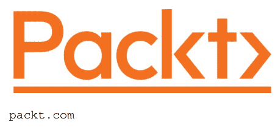
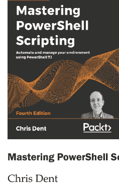
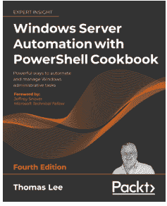

### 第 1 章：开始使用 Windows Server 2019

- 1. 在 Windows Server 2019 中，如何用两次鼠标点击启动提升的 PowerShell 提示？
  **Answer:** 右键单击 **开始** 按钮并从 **快速管理任务** 菜单中选择 **Windows PowerShell（管理员）**
- 2. 打开 **快速管理任务** 菜单的键盘组合是什么？
  **Answer:** *WinKey+X*
- 3. 微软的云服务产品名称是什么？
  **Answer:** Microsoft Azure
- 4. Windows Server 2019 的两个许可版本是什么？
  **Answer:** Standard 和 Datacenter
- 5. Windows Server 2019 Standard 主机上可以运行多少个虚拟机？
  **Answer:** 2
- 6. Windows Server 2019 的哪个安装选项没有图形用户界面？
  **Answer:** Server Core
- 7. Windows Server 2019 最新版本的正确术语是 **Long-Term Servicing Branch (LTSB)** 还是 **Long-Term Servicing Channel (LTSC)**？
  **Answer:** **Long-Term Servicing Channel (LTSC)**

### 第 2 章：安装和管理 Windows Server 2019

- 8. 从哪个正确的工具更改 Windows Server 2019 的配置，**Windows Settings** 还是 **Control Panel**？
  **Answer:** 两者都可以，但对于大多数配置选项，Windows Settings 是首选方法
- 1. 微软的新的基于 Web 的集中式服务器管理工具的名称是什么（有趣的事实，这个工具集以前被称为 Project Honolulu）？
  **Answer:** **Windows Admin Center (WAC)**
- 2. 真或假 – Windows Server 2019 需要安装在机架式服务器硬件上。
  **Answer:** False。Windows Server 2019 可以安装在物理硬件上，也可以作为虚拟机实例。
- 3. 真或假 – 通过选择 Windows Server 2019 的默认安装选项，您将获得一个看起来很像 Windows 10 的用户界面。
  **Answer:** False。Windows Server 2019 的默认选项是 Server Core，它没有图形用户界面。
- 4. 显示 Windows Server 2019 中当前已安装角色和功能的 PowerShell cmdlet 是什么？
  **Answer:** `Get-WindowsFeature | Where Installed.`
- 5. 真或假 – Server Manager 可用于同时管理许多不同的服务器。
  **Answer:** True。
- 6. 可以安装在 Windows 10 计算机上以便在该客户端工作站上运行 Server Manager 的工具集名称是什么？
  **Answer:** **Remote Server Administration Tools (RSAT)。**
- 7. 可以用于与 Windows Admin Center 交互的受支持的 Web 浏览器有哪些？
  **Answer:** 截至本文撰写时，Microsoft Edge 和 Google Chrome。请注意 Internet Explorer 不受支持。

### 第 3 章：Active Directory

- 1. 在 Active Directory 中，容纳计算机和用户帐户的容器（文件夹）称为...？
  **Answer:** Organizational Unit (OU)
- 2. 在将计算机加入域之前在 Active Directory 中创建计算机帐户的术语是什么？
  **Answer:** Prestaging the account
- 3. 哪个管理工具用于指定网络中特定物理位置绑定到特定 IP 子网？
  **Answer:** Active Directory Sites and Services
- 4. 特殊域控制器的名称是什么，它不能接受新信息，只能从现有域控制器同步？
  **Answer:** Read-Only Domain Controller (RODC)
- 5. 创建细粒度密码策略需要什么工具？
  **Answer:** Active Directory Administrative Center
- 6. 在建立林信任之前，DNS 中必须配置什么？
  **Answer:** Conditional forwarder

### 第 4 章：DNS 和 DHCP

- 1. 哪种 DNS 记录指导电子邮件流？
  **Answer:** MX record
- 2. 哪种 DNS 记录类型将名称解析为 IPv6 地址？
  **Answer:** AAAA record
- 3. 哪种 DNS 区域类型将 IP 地址向后解析为主机名？
  **Answer:** Reverse Lookup Zone
- 4. 哪种 DHCP 选项常用于 VoIP 电话配置？
  **Answer:** Option 66
- 5. 哪个 DHCP 故障转移模式常用于分支机构和主站点之间？
  **Answer:** Hot standby mode

6. 配置负载均衡 DHCP 故障转移时，最大客户端提前时间的标准建议和默认设置是什么？
**答案：** 一小时

7. IPAM 可以利用哪些 Windows Server 角色？
**答案：** Active Directory、DNS、DHCP 和 NPS！本章中我们没有讨论 NPS，因为我们尚未涵盖任何 NPS 材料，但它是可将数据报告到 IPAM 的第四个角色。

## 第5章：组策略

1. 屏幕保护程序设置是计算机配置还是用户配置？
**答案：** 用户配置

2. 域级别链接还是 OU 级别链接先处理？
**答案：** 域级别链接在 OU 级别链接之前处理，这意味着在冲突时 OU 级别链接会覆盖域级别链接

3. 强制用户设置应用于给定计算机上的任何用户的特殊 GPO 设置是什么？
**答案：** 组策略回环处理

4. 你在 GPO 本身内部配置的 GPO 过滤类型是什么，例如使用映射网络驱动器策略？
**答案：** 项目级定向

5. 真或假 — 用户可以覆盖组策略首选项。
**答案：** 真

6. 组策略后台刷新周期之间的默认计时器是多少？
**答案：** 90 分钟

## 第6章：Windows Server 2019 中的证书

1. Windows Server 2019 内部允许你从服务器颁发证书的角色名称是什么？
**答案：** 证书颁发机构

2. 在域环境中通常首先安装哪种类型的 CA 服务器？
**答案：** 企业根 CA

3. 你应该将证书颁发机构角色安装到域控制器上吗？
**答案：** 不，这不是推荐的方案

4. 创建新证书模板后，在可以从该新模板向计算机或用户颁发证书之前，需要采取什么下一步？
**答案：** 新证书模板必须发布

5. 强制在管理员无需手动干预的情况下颁发证书的 GPO 设置的通用名称是什么？
**答案：** 证书自动注册

6. SSL 证书只有在与 Web 服务器共享 ______ 密钥信息时才能正确验证流量。
**答案：** 私钥

7. 公共证书颁发机构颁发新 SSL 证书所需的主要信息是什么（提示：你从 Web 服务器生成此信息）？
**答案：** 证书签名请求 (CSR)

## 第7章：使用 Windows Server 2019 进行网络

1. IPv6 地址的长度是多少位？
**答案：** 128 位。

2. 将以下 IPv6 地址重写为压缩形式：2001:ABCD:0001:0002:0000:0000:0000:0001
**答案：** 2001:ABCD:1:2::1

3. 与 tracert 类似但显示流量流出的本地 NIC 的命令名称是什么？
**答案：** PATHPING

4. 真或假—在一台具有多个 NIC 的服务器上，你可以在每个 NIC 上输入默认网关地址。
**答案：** 假。这样做会导致路由问题。无论系统有多少个 NIC，你都应该始终只有一个默认网关地址。

5. 可以在 Windows Server 上创建新路由的 PowerShell cmdlet 是什么？
**答案：** New-NetRoute

6. 哪些 Windows Server 操作系统可以与 Azure 网络适配器一起使用，以便直接连接到 Azure 虚拟网络？
**答案：** Windows Server 2019、2016 和 2012 R2

## 第8章：远程访问

1. AOVPN 代表什么？
**答案：** Always On VPN

2. 连接 AOVPN 客户端使用的两个主要协议是什么？
**答案：** IKEv2 和 SSTP

3. AOVPN 在哪个版本的 Windows 10 中发布？
**答案：** Windows 10 1607

4. 在什么特殊情况下 AOVPN 客户端需要加入你的域？
**答案：** 当你想利用 AOVPN 设备隧道时

5. DirectAccess 是否要求你的企业内部网络运行 IPv6？
**答案：** 不，你的内部网络可以完全是 IPv4

6. DirectAccess 客户端检查以确定何时位于企业网络内部的内部网站的名称是什么？
**答案：** 网络位置服务器 (NLS)

7. 在联合环境中 Web Application Proxy 服务器扮演什么角色？
**答案：** WAP 可以作为 ADFS 代理实现

## 第9章：加固和安全

1. 内置于 Windows Server 2019 的反恶意软件产品的名称是什么？
**答案：** Windows Defender Antivirus

2. 当一台加入域的计算机位于企业局域网内时，应激活哪个 Windows Defender 防火墙配置文件？
**答案：** 域配置文件

3. 除了域配置文件之外，Windows Defender 防火墙中还有哪两种可能的防火墙配置文件？
**答案：** 公共和专用

4. 创建防火墙规则以允许 IPv4 ping 回复时，必须在入站规则中指定什么协议类型？
**答案：** ICMPv4

5. 将标准化的 Windows Defender 防火墙规则推送到整个员工队伍的最简单方法是什么？
**答案：** 组策略

6. 虚拟硬盘文件被加密的虚拟机称为...？
**答案：** Shielded VM

7. 解析域控制器信息以识别传递哈希和传递票证攻击的 Microsoft 技术名称是什么？
**答案：** Advanced Threat Analytics

## 第10章：Server Core

1. 真或假—Server Core 是 Windows Server 2019 的默认安装选项。
**答案：** 真

2. 真或假—你可以使用 PowerShell 将 Server 2019 实例从 *服务器核心* 模式更改为 *桌面体验* 模式。
**答案：** 假，在 Windows Server 2019 中无法来回切换

3. 当坐在刚启动的 Windows Server 2019 Server Core 实例控制台时，屏幕上看到什么应用程序？
**答案：** 命令提示符

4. 可以在 Server Core 实例上查看当前网络配置的 cmdlet 是什么？
**答案：** Get-NetIPConfiguration

5. 哪个 PowerShell cmdlet 可用于配置 Server Core 实例的主机名？
**答案：** Rename-Computer

6. 命名一些可用于远程与 Server Core 实例交互的管理工具。
**答案：** PowerShell、Server Manager、RSAT 和 Windows Admin Center

7. 内置于 Server Core 中可启动以提供配置 IP 地址、主机名和域成员关系的快速任务链接的实用程序的名称是什么？
**答案：** Sconfig.exe

## 第11章：PowerShell

1. 从命令提示符进入 PowerShell 的最快方法是什么？
**答案：** 只需输入单词 powershell 并按 Enter

2. 将显示所有可用 PowerShell cmdlet 的 cmdlet 是什么？
**答案：** Get-Command

3. 可以将 PowerShell 提示连接到远程计算机的 PowerShell cmdlet 是什么？
**答案：** Enter-PSSession

4. PowerShell 脚本文件的文件扩展名是什么？
**答案：** .PS1

5. 在全新 Windows Server 2019 实例上，DEP 配置为哪个设置？
**答案：** RemoteSigned

6. 在 PowerShell 提示符下工作时，可以用来自动填充 cmdlet 或文件名的其余部分的键盘上的哪个键？
**答案：** Tab

7. 在系统可以被远程 PowerShell 连接连接之前，必须在系统上运行哪个服务？
**答案：** WinRM 服务

## 第12章：Windows Server 2019 中的冗余

1. 使 Web 服务器流量冗余更合适的技术是网络负载平衡还是故障转移群集？
**答案：** 网络负载平衡

2. 在网络负载平衡中，缩写 DIP 和 VIP 代表什么？
**答案：** 专有 IP 地址和虚拟 IP 地址

3. 三种 NLB 模式是什么？
**答案：** 单播、多播和多播 IGMP

4. 在 Windows Server 2019 中，网络负载平衡是角色还是功能？
**答案：** NLB 是一个功能

5. 最常与故障转移群集一起使用的角色是什么？
**答案：** Hyper-V 和文件服务

6. 现在可以用作群集仲裁见证人的哪种小型设备（这是 Server 2019 以来全新的）？
**答案：** USB 存储棒

7. 真或假—Storage Spaces Direct 需要使用 SSD 硬盘驱动器。
**答案：** 假，你可以使用任何类型的硬盘驱动器与 S2D

## 第13章：容器和 Nano Server

1. Windows Server 容器可以运行两种不同类型之一的基础操作系统：它们是什么？
**答案：** Server Core 和 Nano Server

2. 与 Windows Server 容器相比，哪种类型的容器提供更高的隔离级别？
**答案：** Hyper-V 容器

3. 真或假—在 Windows Server 2016 中，你可以在同一 Windows Server 主机平台上同时运行 Windows 和 Linux 容器。
**答案：** 假，能够运行 Windows 和 Linux 容器的功能是 Windows Server 2019 以来新增的

4. 查看本地系统上的容器镜像列表的 Docker 命令是什么？
**答案：** `docker images`

5. 目前与 Windows Server 2019 集成的最流行的容器编排软件是什么？
**答案：** Kubernetes

6. 真假 — 开发者可以在其 Windows 10 工作站上安装 Docker 以开始在容器内构建应用程序。
**答案：** 真

## 第 14 章：Hyper-V

1. Hyper-V 内部的三种虚拟交换机类型是什么？
**答案：** 外部、内部和专用

2. 如果需要构建使用 UEFI 启动的虚拟机，需要创建哪一代 VM？
**答案：** 第二代

3. 真假 — 在 Windows Server 2019 Hyper-V 中，必须关闭 VM 才能更改其分配的内存（RAM）量。
**答案：** 假，可以即时调整 VM 的 RAM 数量

4. 真假 — 与 VM 交互的唯一方式是通过 Hyper-V 控制台。
**答案：** 假，一旦 VM 的操作系统安装完成，您可以通过任何其他传统管理方法（如 RDP）与其交互

5. Hyper-V 内部允许您拍摄可稍后恢复的虚拟机快照图像的技术名称是什么？
**答案：** 检查点

6. 在环境中运行受保护的 VM 时，处理 Hyper-V 主机服务器的证明的角色名称是什么？
**答案：** 主机守护服务

7. 对于受保护的 VM，哪种证明方法最全面 — 主机密钥证明、TPM 受信任证明或管理员受信任证明？
**答案：** TPM 受信任证明

## 第 15 章：排查 Windows Server 2019

1. 打开 Active Directory 用户和计算机的 MSC 快捷方式是什么？
**答案：** DSA.MSC

2. 真假 – 出于性能原因，您应该始终将服务器备份存储在正在备份的同一台服务器上。
**答案：** 这是一个有点真有点假的 trick 问题。虽然备份保存在本地连接存储上时性能最佳是真的，但您应该将备份存储在单独的位置，以防服务器完全死亡或被勒索软件劫持。

3. 哪个 Windows 监控工具可用于在 24 小时内绘制 CPU 利用率图表？
**答案：** 性能监视器

4. 真假 – System Insights 将所有数据存储在集中的 RADIUS 服务器上。
**答案：** 假 – System Insights 将数据存储在安装它的本地服务器上。

5. 打开 Windows Defender 防火墙高级安全性的 MSC 快捷方式是什么？
**答案：** WF.MSC

6. 哪个 PowerShell cmdlet 可用于收集 Windows 日志文件？
**答案：** Get-EventLog

7. 哪个事件 ID 可用于计算系统正常运行时间？
**答案：** 6013

packt.com

订阅我们的在线数字图书馆，全面访问超过 7,000 本书籍和视频，以及行业领先的工具，帮助您规划个人发展并推进职业生涯。有关更多信息，请访问我们的网站。

## 为什么订阅？

- 花更少时间学习，用来自 4,000 多名行业专业人士的实用电子书和视频花更多时间编码
- 使用专为你打造的技能计划更好地学习
- 每月获得一本免费电子书或视频
- 全文可搜索，便于快速访问重要信息
- 复制、粘贴、打印和书签内容

您知道 Packt 为每本出版的书籍提供电子书版本，支持 PDF 和 ePub 文件吗？您可以在 www.Packt.com 升级到电子书版本，作为印刷书籍客户，您有权享受电子书副本的折扣。有关更多详情，请联系我们 customercare@packtpub.com。

在 www.Packt.com，您还可以阅读免费技术文章的合集，订阅各种免费通讯，并获得 Packt 书籍和电子书的独家折扣和优惠。

## 其他书籍
您可能会喜欢

如果您喜欢这本书，您可能对 Packt 出版的以下其他书籍感兴趣：

## PowerShell 脚本编写精通 - 第四版

Chris Dent

ISBN: 9781800206540

- 使用函数、开关和循环结构优化代码
- 使用对象和运算符测试和操作数据
- 解析和操作不同数据类型
- 使用 PowerShell 创建脚本和函数
- 使用作业、运行空间和运行空间池异步运行代码
- 在 PowerShell 中轻松编写 .NET 类
- 在 PowerShell 脚本中创建和实现正则表达式
- 使用高级技术定义和限制参数的行为

## 使用 PowerShell 的 Windows Server 自动化食谱 - 第四版

Thomas Lee

ISBN: 9781800568457

- 在 Windows Server 2022/2019 上执行关键管理任务
- 使用 JEA、组策略、日志和 Windows Defender 保护组织安全
- 使用 .NET Framework 进行管理脚本编写
- 管理 Windows 上的数据和存储，包括磁盘、卷和文件系统
- 创建和配置 Hyper-V VM，实现存储复制和检查点
- 在 Azure 上设置虚拟机、网站和共享文件
- 使用内置 cmdlet 和 WMI 报告系统性能以获取单次测量
- 应用合适的工具和模块来排查和调试 Windows Server

## Packt 正在寻找像您这样的作者

如果您有兴趣成为 Packt 的作者，请访问 `authors.packtpub.com` 并立即申请。我们已与数千名开发人员和技术专业人士合作，就像您一样，帮助他们与全球技术社区分享他们的见解。您可以进行一般申请，申请我们正在招聘作者的特定热门主题，或提交您自己的想法。

## 分享您的想法

现在您已完成 *精通 Windows Server 2019 第三版*，我们很想听听您的想法！如果您从 Amazon 购买了本书，请 `click here to go straight to the Amazon review page` 为本书分享您的反馈或在您购买的网站上留下评论。

您的评论对我们和技术社区很重要，并将帮助我们确保提供优质内容。
