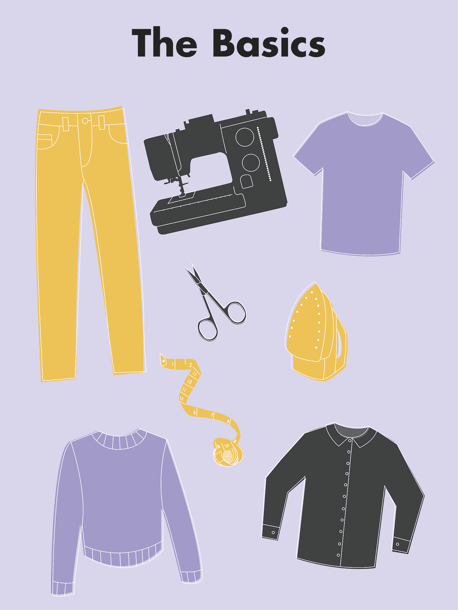

# “快时尚”内幕

快时尚有着巨大的人力和环境成本，作为一个社会，我们应该大幅减少对它的消费。那么，让我们仔细看看那些难以抗拒的廉价 T 恤背后的影响。

但究竟什么是快时尚？简单来说，它是大众市场零售商为响应最新潮流而快速大量生产的廉价服装。它酷、它萌、它便宜，下次你进店时，货架上会有不同的新款，因为服装制造商竞相复制最新的 T 台和名人造型。但这种速度本身就是不可持续的定义。事实是，没有任何衣物应该那么便宜。

全球约 4000 万名服装工人中，只有 2% 能拿到体面工资——这实际上等同于现代奴隶制。

## 谁来买单？

那么，如果消费者没有支付其真实成本，这笔差额是在哪里弥补的？部分在于所用面料质量低劣，以及粗糙的整理和制造工艺。更悲剧的是，生产成本之所以能压得这么低，是因为给面料和服装工人支付极低的报酬，并提供恶劣的工作条件。当记录快时尚的弊端时，人们脑海中浮现的通常是一个精疲力竭的服装工人伏在缝纫机前的形象，那么我们就从这里开始吧。

## 人力成本

2013 年 4 月 24 日，在孟加拉国，一座名为拉纳广场的八层混凝土建筑倒塌。该建筑容纳了许多快时尚品牌使用的工厂。由于疏忽大意的施工，倒塌夺走了 1134 名服装工人的生命，并导致另外 2500 人受伤。恶劣的条件和微乎其微的安全措施在生产快时尚服装的工厂中司空见惯，遗憾的是，拉纳广场悲剧远非唯一的致命事件。

服装工人被忽视和低估，全球估计 4000 万名服装工人中，只有 2% 能拿到体面工资——这实际上等同于现代奴隶制。试图组建工会、争取改善安全、条件、工资、病假和工作保障的努力，都因失业威胁甚至有记录的暴力行为而被遏制。

## 体制不可持续

但服装工人面临的问题不仅仅是工厂主及其逐利需求造成的。工人及其家庭陷入贫困陷阱，因为工人工资上涨会导致工厂成本上升，进而可能导致工厂在时尚品牌的招标中输给出价更低的竞争对手而失去订单。

这些问题是系统性的：责任必须向上传导，由品牌方自身承担（因其致力于将产品成本压至极低），也由消费者承担（因他们习惯了支付极低的价格）。

# 快时尚的人力与环境代价

几乎不可能列出生产每一件快时尚产品所涉及的所有工作，但几乎可以肯定，所有这些工作报酬微薄，且在不健康的条件下进行。每一件闪亮的上衣，其珠子和亮片都是由手工费力缝制的，往往是由儿童的稚嫩双手完成。每一条做旧牛仔裤都经过喷砂、手工打磨或喷洒化学品以达到效果，操作人员（往往缺乏防护）每天都要吸入烟雾。

为了达到做旧效果，牛仔裤由工人进行喷砂、手工打磨或喷洒化学品处理，这些工人每天都要吸入烟雾。

## 全球性问题与局部困境

环境代价（我们稍后将谈到）也间接影响着当地居民，他们虽不直接从事制衣业却深受其害。从因水源被引去种植棉花而面临干旱的印度和中东地区，到因有毒化学品和染料渗入水道而导致面料加工厂周边污染严重的地区。

世界各地的慈善机构，如公平贸易联合会、时尚革命组织和 TRAID，致力于支持和维护制衣工人的权益，并努力督促品牌和政府履行保护人权的责任。支持这些慈善机构是立竿见影地做出改变的绝佳途径。

## 时尚如何影响地球

但在追求潮流主导、价格亲民的服饰过程中，不仅是人类在影响和剥削其他人类。研究表明，服装业是地球上第二大污染产业。

面料和服装生产过程排放温室气体——这是当今最紧迫问题：气候变化的最大推手。全球时尚产业每年产生 36 亿吨（33 亿公吨）二氧化碳——几乎相当于整个欧盟的碳足迹。

### 合成纤维还是天然纤维？

此外，服装中的许多纤维也源自化石燃料。合成纤维（例如丙烯酸、聚酯、氨纶、莱卡、斯潘德克斯和尼龙）是塑料，由从石油和其他化石燃料副产品中获得的聚合物形成。当这些合成面料经过洗衣机时，它们会释放微小的塑料纤维（微塑料）进入水道。海洋生物摄入这些微塑料，从而进入食物链。

说到水，棉花常被誉为最可持续的纤维之一，却要为惊人的全球水资源消耗负责。最近的研究表明，制作一条牛仔裤需要 2,000–2,640 加仑（7,570–10,000 升）水。

### 珍贵的水资源

为种植棉花而开采和引水在许多国家是一个巨大的问题，主要在亚洲。印度拥有 13.8 亿人口，获得安全用水对一些人来说是一个主要问题。然而，印度的棉花产业一年消耗的水量足以供应其 85%的居民每天 26 加仑（100 升）水。

用水种植作物，特别是棉花，导致一些地区沙漠化，例如哈萨克斯坦和乌兹别克斯坦边境的咸海。其消失的速度令人震惊：1960 年，咸海是世界上最大的内陆海。依赖它的渔业和社区遭到毁灭性打击，剩下的水域日益受到化肥和农药的污染。

制作一条牛仔裤需要 2,000–2,640 加仑（7,570–10,000 升）水。

### 纺织品是如何制造的

遗憾的是，无论在哪里种植非有机天然纤维用于服装生产，杀虫剂、除草剂和化肥都会影响当地居民。无法阻止它们到达邻近农场，也无法阻止它们流入当地水道。

许多注定成为面料的纤维加工过程也需要大量有害化学品。例如，再生纤维包括人造丝/粘胶纤维，最初是木浆。这些坚韧的植物材料通过涉及氢氧化钠、二硫化碳、氨和其他化学品（取决于纤维来源）的化学和机械过程分解。这形成一种粘性液体，然后用硫酸纺成线。除了环境危害，接触其中一些化学品已被证明会导致纺织工人健康受到一系列不利影响，包括神经损伤、心脏病、精神衰退和中风。

再生纤维的生产导致雨林森林砍伐，导致社区流离失所和许多物种的栖息地破坏，古老的森林被清理用于利润丰厚的竹子种植园以生产竹纺织品。

### 如此浪费

在服装生命周期的另一端，仅美国每年就要将 210 亿磅（95 亿公斤）衣物送往垃圾填埋场。合成纤维实际上是塑料，无法生物降解。即使由天然纤维（棉、羊毛、亚麻、大麻和丝绸）和再生纤维（人造丝/粘胶、竹纤维、天丝/莱赛尔、莫代尔、铜氨纤维）制成的面料能够生物降解，它们也会将携带的整理剂和染料中的有毒化学物质释放到土壤中。

此外，还有将纤维、面料和成品服装运往世界各地所产生的二氧化碳。一件衣服在到达商店供你购买带回家之前，很可能已经行驶了数千英里（公里）。

## 慢时尚的未来

我们需要拥抱慢时尚理念，发挥我们的作用。延长我们已拥有和穿着的衣物寿命是第一步。我们无法撤销已购买衣物的影响，但我们可以采取有意义的措施，在未来修补、穿着并更加珍爱这些衣物。

