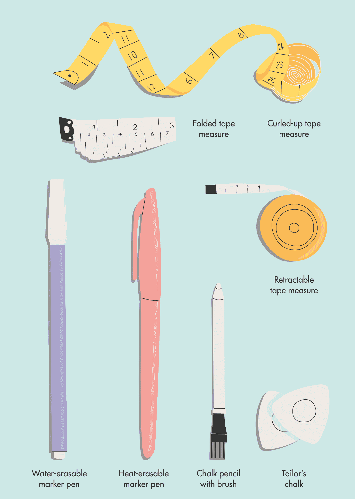
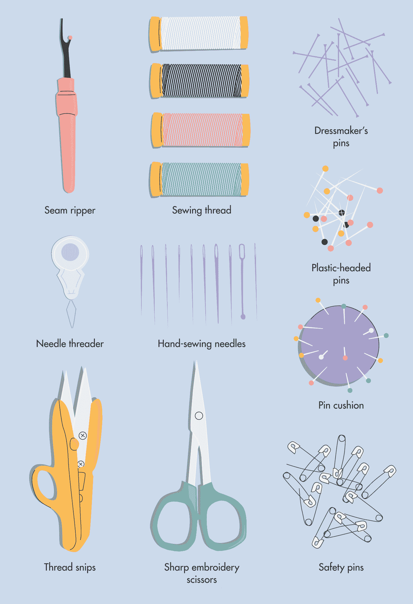
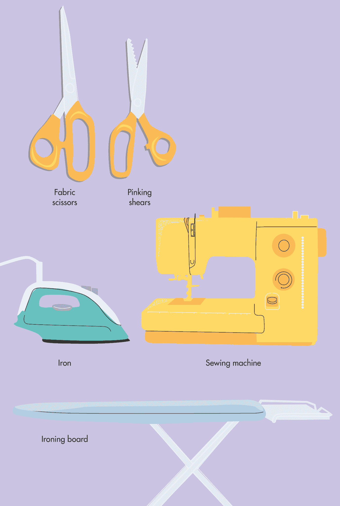
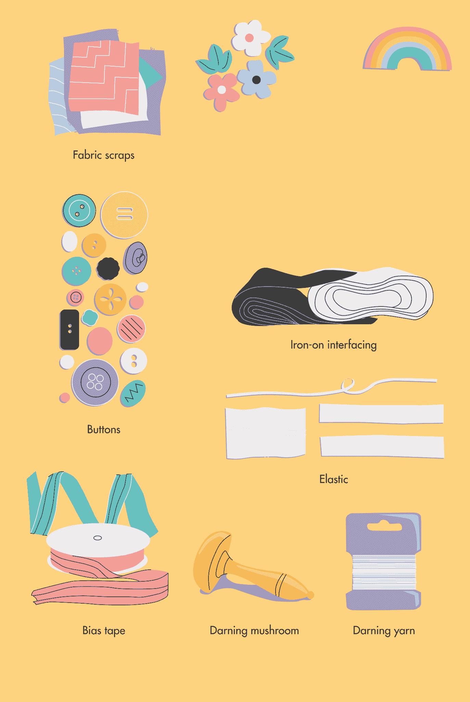
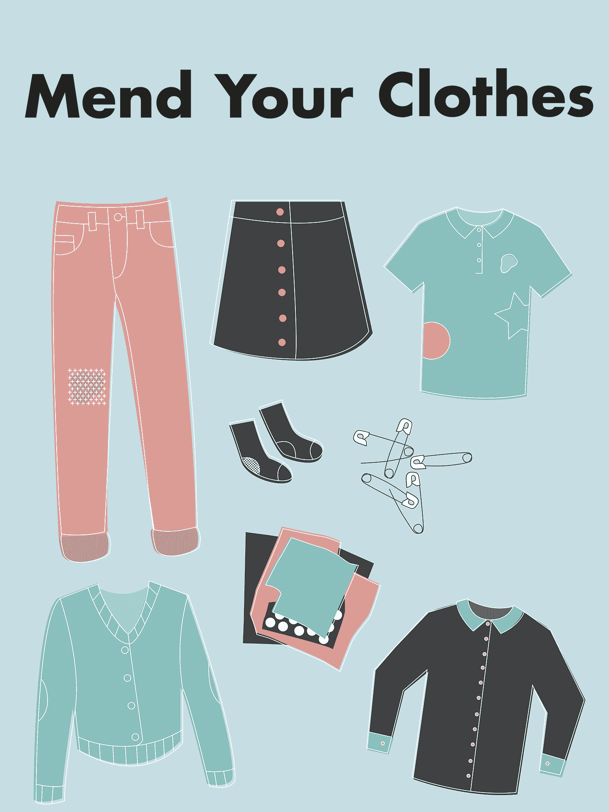

# 你的基础缝纫工具包

你可能很幸运，已经拥有其中一些物品。如果没有，市面上有基础缝纫工具包，已包含此处涵盖的大多数物品。在接下来的几页中，我们将列出你手工修补衣物所需的一切。

曾几何时，每个家庭拥有一个基础（或不那么基础）的缝纫工具包是常态。你或许还保留着属于长辈的缝纫工具包的记忆。现在，是时候拥有你自己的了！把它看作是任何致力于爱护衣物的成年人的成年礼。希望随着你一件接一件地修补和改造衣物，随着时间的推移，你会与你得心应手的小工具包创造属于自己的回忆。比如你如何挽救了最爱的工作裤的裤脚。又或者你修补了最显瘦牛仔裤的装饰线迹。还有那一次，你通过更换衬衫上最“关键”位置的纽扣挽回了尊严！

啊，美好的回忆。

> **小贴士**
>
> 集齐基本物品后，试着将它们放在一个容器里（盒子、袋子或铁盒等），以便在需要修补或改动时能迅速拿取。

## 标记和测量工具

### 卷尺

市面上有花哨的自动收缩卷尺，但基本的软尺完全够用！

### 面料标记工具

面料标记工具种类繁多，从基本的三角形裁缝粉笔和出粉笔轮，到熨烫或水洗后墨水会消失的记号笔。买一款你喜欢的工具并尝试使用它。

### 拆线器

## 缝纫、别针与剪线工具

也被称为拆线器或快速拆线器，这种带有塑料或木制手柄（和安全盖）的锋利金属钩，可用于小心地拆除针脚。用剪刀或线剪拆线更容易在织物上造成破洞。

## 缝纫线

选择知名品牌生产的涤纶线或 100% 棉线线轴，例如 Gütermann 或 Coats & Clark。廉价或陈旧的缝纫线容易断裂。如果你买的缝纫工具包里含有线，还是建议另买一些更结实、质量更高的线。在工具包里备一小套颜色（黑、白、藏青、红、灰和奶白）是个好主意，这能应付大多数项目，需要时再往收藏里添加其他颜色。

## 穿线器

这个简单的金属装置能帮你在不用放大镜的情况下将线穿过针眼。使用刺绣线或其他多股线时，它非常有用。

## 手缝针

试着找一包混合装，里面包含不同粗细的针，以适应不同厚度的面料。

## 别针

一盒锋利的别针能帮你在修补时固定东西——只有章鱼才能在没有别针的情况下成功完成每个项目！别针末端的小塑料形状或球体让它们更容易拾起，不过碰到烫热的熨斗会融化。别针垫在工作时存放别针很方便。

## 大头针/安全别针

几个不同尺寸的大头针会非常有用。它们可以在某些项目中代替别针固定东西，而且用的时候不太容易扎到自己。做松紧腰头或袖口时，大头针穿松紧带穿过套管也是必不可少的。

## 小型锋利剪刀或线剪

基础的成品缝纫工具包可能不含剪刀，但剪刀是必备品。大多数手工艺店都有卖便宜的线剪，甚至锋利的指甲剪也能凑合——你只需要一种小巧且尖锐的工具来进行精确切割。

> g `基础知识` g `目录`

## 其他设备和实用辅料

要应对更复杂的修补或改造，并获得更专业的完成效果，你需要投资购置一些额外物品。许多修补还需要所谓的“辅料”——丝带、装饰带、纽扣和扣件，这些在大多数手工艺店都能买到。

这是进阶操作：当你的缝纫工具包扩大到再也装不进一个曲奇饼干罐时！一些额外的设备能让你的修补和改造达到完美效果，并拓宽你能承接的项目类型。你最终从下列清单中添置哪些物品，取决于你的个人风格和创意构想。

## 布剪

你需要一把大而锋利的剪刀，用于涉及剪裁面料的修补和改造，例如缩短下摆和添加补丁。齿剪通过剪出锯齿边缘来减少脱线。布剪专剪布。用来剪纸等其他用途会让它们变钝，钝剪刀不仅让人心烦，还可能损坏面料或衣物。

## 熨斗

大多数家庭都有熨斗，它能让你改善修补或改造的成品外观。贴补丁、口袋和使用烫熨衬布时必不可少。确保底板干净，没有烧焦的残留物。

## 缝纫机

缝纫机能让大多数修补和改造更快、更专业。关于`使用缝纫机`的建议。

## 熨衣板

显然熨衣板是熨斗的标配，但也能在你工作时提供一个放置项目的实用表面。在紧急情况下，铺一条干净毛巾的耐热表面（如厨房台面）可以代用。

> **小贴士**
>
> 如果你买了布剪，请清楚地标记“仅限剪布”！

## 让面料收口更整齐的工具

### 布料碎片

利用小块布料制作补丁、口袋、下摆加长布条和磨损穿孔处的加固布。从无法修复的旧物上拆下布料碎片。特别有用的碎片包括牛仔布、T 恤针织布和机织棉布（想想旧衬衫）。

### 纽扣

你可能需要替换一颗失踪（MIA）的顽固纽扣，或者想换掉衣服上所有纽扣来改变外观。像布料碎片一样，纽扣可以从旧衣服上拆下来。一定要把新买衣服附带的备用纽扣妥善保管。

### 斜裁带/包边带

成包或按码（米）出售，斜裁带是一条长而窄的连续布条，两边向中间折叠。它覆盖在毛边或磨损边缘上，形成新的、更牢固的边缘。有多种宽度和颜色可选，所以像松紧带一样，你可能想按项目购买。

### 烫熨补丁

如果你喜欢现成的烫熨补丁的外观，它们就是快速遮盖破洞或污渍的好工具。看到喜欢的就买些备用。

### 烫熨衬布/粘合衬

也称粘合衬，这种类布材料有白色或炭灰色，厚度多样。衬布用于稳固或增加衣物某部位的结构感。衬布厚度要匹配面料厚度；例如薄面料用薄衬布，牛仔布等厚面料用厚衬布。烫熨衬布一面有微小干胶点，遇熨斗热量激活；务必`使用熨烫布`，否则胶会沾到熨斗或熨衣板上！

### 松紧带

这种有弹性的材料有多种类型、宽度和颜色。开始时按项目购买松紧带。但如果每次买得稍多一点，最后你会积攒一堆存货，为未来的项目省去跑商店一趟。

### 补织蘑菇/补织蛋

使用一种叫“蘑菇”（或“蛋”）的木制工具能让补织更容易。它提供一个光滑、弯曲、坚硬的表面，你把它托在破损处后面。如果没有，可以试试用橙子或高脚杯底代替。

### 补织线

补织线成包出售，便宜且颜色多样——选一种颜色让你的修补融为一体或醒目突出。

> **小贴士**
>
> 烫熨补丁洗一两次后往往开始翘边，所以初次烫熨后沿边缘缝一圈是个好主意。

## 实用的备用物品和辅料

`g 修补你的衣物 g 目录`
