# 爱护你的衣物

## 简介

你正在修补受损的衣物。你将被遗弃的衣物改造成适合你或朋友穿着的东西。你衣橱里的一切看起来都很棒，状态良好。现在，是时候谈谈长远打算了。

干得好！你花时间学习了一系列新技能来修补衣物的瑕疵。你还进一步拓展了这些技能，运用新技术根据你的要求定制和改造现有衣物。这些都是有趣、令人陶醉、富有创造力的时光，不是吗？希望你对已经修补过的衣物依然保持着重燃的热情。但现在是时候谈谈如何长期爱护你的衣物了。

### 为衣橱做好长远准备

本章将介绍常穿和非当季衣物的收纳方法（包括如何防虫）、洗涤熨烫技巧、处理或隐藏污渍的策略，以及如何探索染色世界。

诚然，衣物养护可能不像学习和施展新奇技能那样令人兴奋。但“慢时尚”理念既包括用冷水浸泡沾了茶渍的 T 恤，也包括刺子绣风格的缝制。如果你不善加照顾那些新修好的衣物，所有精彩的修补和创新改造都将付诸东流。你对自己和衣物都有责任多花点心思，学习如何最好地照顾它们。只有这样，它们才能成功发挥功能，并尽可能长久地保持美观。

### 至关重要的收纳

首先，我们将复习衣物不穿时如何最好地保管。无论你是经常穿着某件衣物还是它处于非当季，所有衣物都值得被妥善收纳。那么，什么方法能帮助它们保持良好结构？哪些物品一定要挂起来，哪些应该折叠？

如何最大化收纳空间，让所有选择触手可及，且没有任何东西丢失、被遗忘或被忽视。有没有办法防止衣橱毁坏的最大元凶——蛾子和霉菌？我们将为你提供所有答案。

> 如果你不善加照顾那些新修好的衣物，所有精彩的修补和创新改造都将付诸东流。

### 洗涤达人

想必你已经自己洗衣服（甚至可能帮别人洗）有一段时间了。所以在这个阶段钻研洗涤技巧可能显得有点奇怪，因为到目前为止，这很可能只是你例行公事做的事。然而，正是那些日复一日进行的动作，决定了你的衣物是保持健康、功能良好，还是过早褪色变形。

当我们谈论衣物养护时，这到底意味着什么？定期洗涤保持清新干净？不！最重要的收获是：尽可能减少洗涤次数。没有什么比每穿一次就洗一次更能快速削弱和褪色衣物了（内衣、贴身衣物和袜子除外）。

发现哪些洗涤和干燥方法对地球更友好，将极大地影响一件衣物在其生命周期内对环境的影响程度。

> 最重要的收获是：尽可能减少洗涤衣物的次数。

### 衣物焕新

冒着听起来像洗衣液广告的风险，咖啡洒落、意面酱溅出、汗渍和婴儿大便（即使在浅色衣物上）也不必让你翻白眼并宣称：“哎呀，这下完了”。如果你找到正确的方法并及时处理，应该能完全去除污渍。

刷新衣物颜色或彻底改变颜色，也是让旧牛仔裤焕发生机或让旧 T 恤精神一新的方法。学习哪些面料最适合染色以及染料类型的基础知识，将让你探索色彩世界。如果去污努力都失败了，就用针线做个可爱的刺绣细节来掩盖污渍吧。

妥善照顾你投入心血的衣物会带来真正的满足感。虽然付出的努力不总是显而易见，但并不意味着它们不被珍视。

g 爱护你的衣物 g 目录

## 智能收纳方案

无论是常穿轮换的衣物还是收纳存放的非当季衣物，都可以使用这些收纳技巧。回报是：衣物能保持最佳状态更久，不受蛾子、霉菌或霉斑损害。

即使是经常穿的衣物，也有一些收纳方法和做法值得坚持。这些能让你的衣物拥有尽可能长久保持美观的最佳机会。

## 一般存放规则

结构化的服装和需要熨烫的服装应挂起存放；其他所有服装均可或应平铺存放（折叠或卷起）。牛仔裤、灯芯绒裤和结实的长裤可根据空间选择挂起或折叠。针织服装和针织面料服装（包括 T 恤、针织连衣裙和卫衣）应始终折叠或卷起存放，以免其自身重量导致变形。

## 挂起存放

将结构化的外套和夹克挂在宽大、结实且能延伸至肩部的衣架上。外套、夹克以及其他扣扣类服装（如衬衫、女式衬衫和衬衫裙）最好扣上最上面的扣子，并至少隔一个扣子扣一个，以帮助保持结构。切勿使用铁丝衣架，因为它们长期摩擦会损坏面料。

### 保持结构化服装挂起

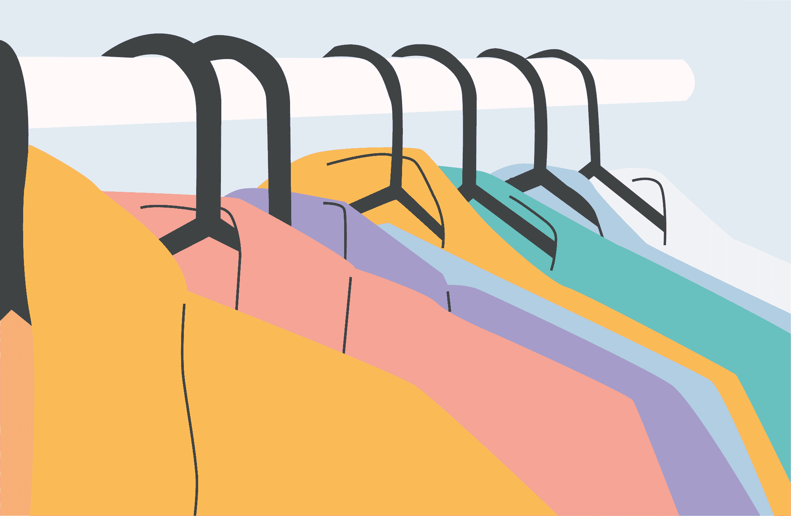

### 不要剪掉挂环

如果挂起的服装带有挂环，请使用它们。挂环有助于分散服装悬挂时承受的压力，还能防止滑溜的服装从衣架上滑落，堆积在衣柜底部。

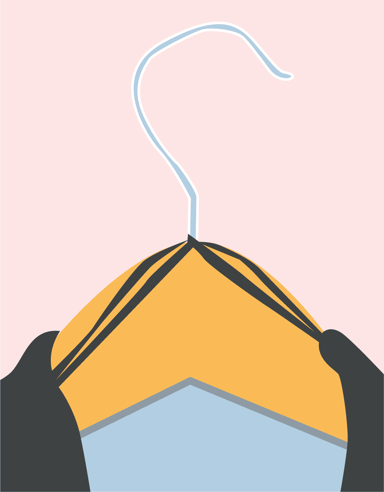

### 改造夹子衣架

理想的裙装衣架在夹持服装处带有衬垫，以防止压痕。如果您的衣架没有衬垫，可在夹子之间垫入矩形布料，将服装夹在中间，提供 DIY 缓冲。

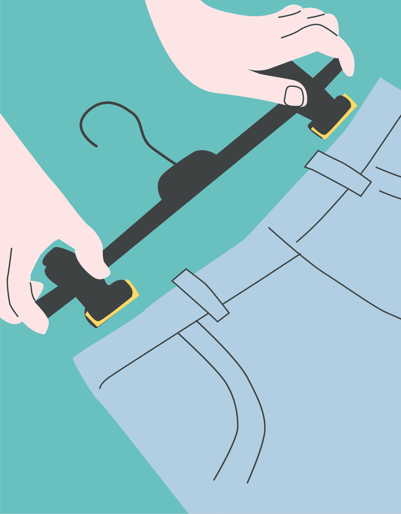

### 避免阳光直射

有人喜欢用衣架直观查看可穿搭的服装；然而，阳光会永久褪色并削弱面料，因此服装最好存放在衣柜内。可考虑购买布质挂式收纳袋，用于存放需要挂起但放不进封闭衣柜的换季服装。

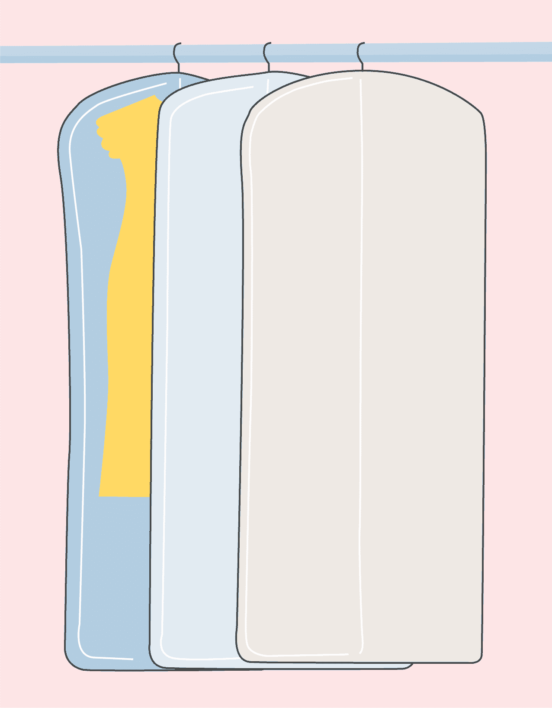

## 折叠、卷起、重复

对于平铺存放在抽屉或箱子中的服装，可考虑卷起并侧放，或以可竖向排列的方式折叠。打开箱子或抽屉时，您可一目了然地看到所有内容，且取出物品时不易弄乱其他衣物。

## 定期通风衣柜

导致服装损坏的另外两个原因是蛾子和霉菌。与生活中大多数事情一样，预防胜于治疗，因此请保持衣柜通风良好。蛾子厌恶光线和活动，所以每隔几个月通风一次衣柜和抽屉，并移动衣物位置。造成衣物损坏的是蛾子幼虫而非成虫，因此要让它们不愿在您的衣柜安家。经常吸尘清理衣柜的角落和缝隙，防患于未然。

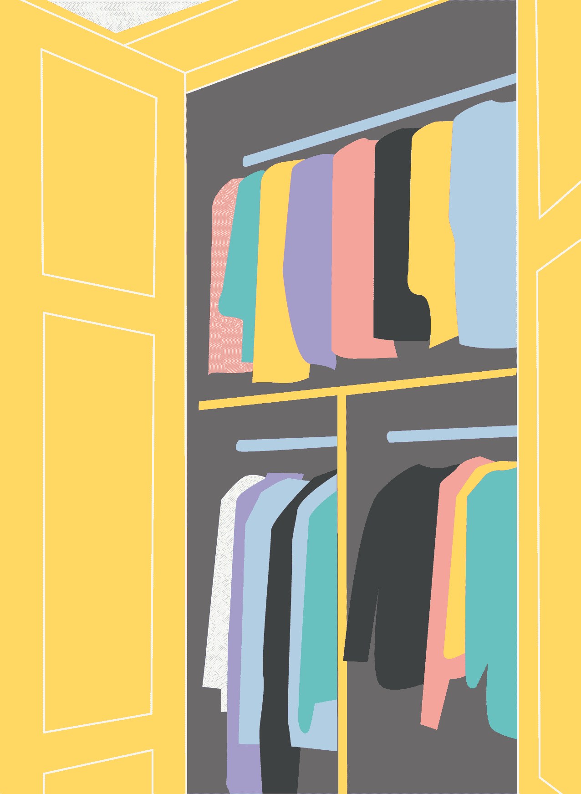

## 针对讨厌的蛾子

蛾子幼虫最喜欢啃食角蛋白——这些存在于动物基纤维中（羊毛、马海毛、羊绒、丝绸、皮革、毡和羽毛）。定期检查这些物品是否有虫蛀的早期迹象。一旦发现虫蛀，立即水洗或干洗相关衣物。干洗是杀灭蛾子幼虫的最佳方法。樟脑丸和雪松驱虫剂的效果有争议。

## 轮换衣橱

保持衣柜空气流通的最佳策略是避免塞得太满。这可能意味着将换季和极少穿的服装收纳起来。在此之前，请确保这些服装刚洗过或干洗过，且彻底干燥。害虫会被我们皮肤的油脂和食物残渣吸引。

## 杜绝冷凝

霉菌由冷凝和潮湿引起，您可以采取多种措施防止其出现在衣物上。尽快将湿衣服挂出晾干。确认衣物完全干燥后再收纳。如果家中存在冷凝问题，最好专门为衣柜投资一款除湿产品。

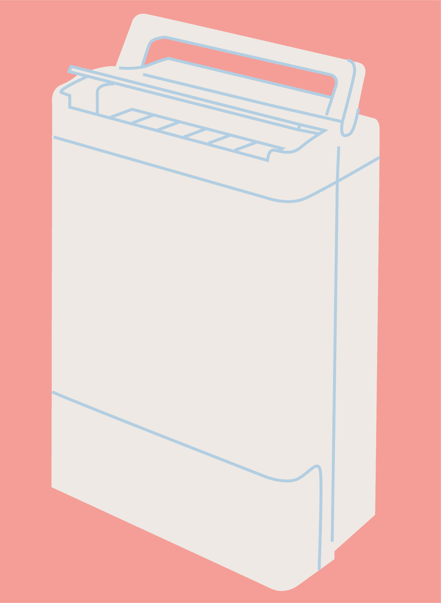

## 寻找合适的长期收纳方案

用于收纳衣物的容器类型多样，各有优劣，但可以说密封塑料收纳箱或真空/压缩收纳袋能提供对害虫和潮湿的最佳防护。

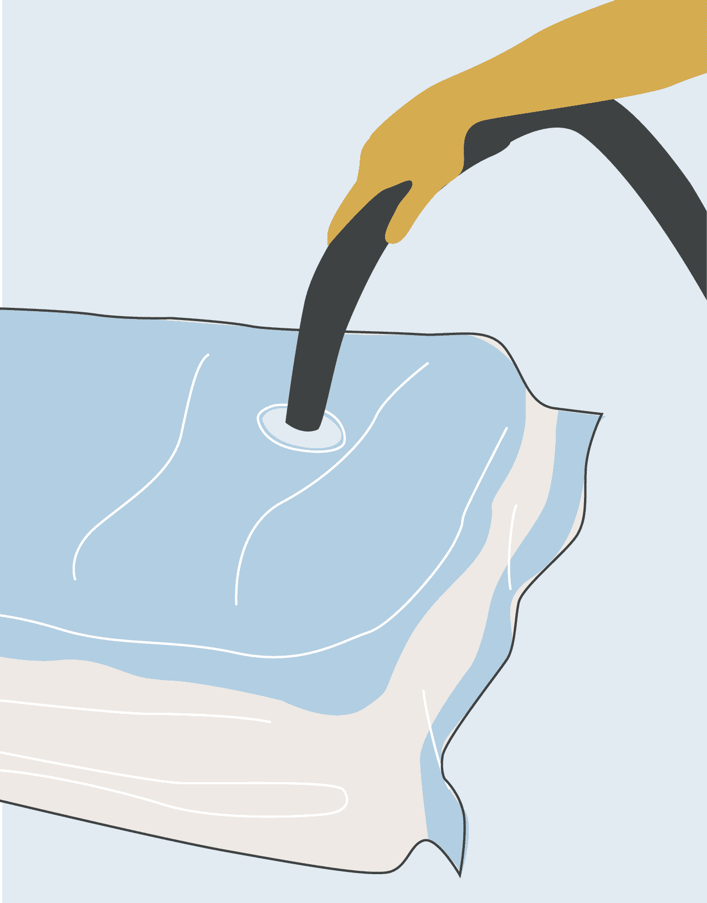

爱护您的衣物 | 目录

# 洗涤与熨烫技巧

您洗涤衣物的方式和频率极大地影响服装寿命。洗涤过程占服装碳足迹的很大比例。了解如何爱护衣物与地球。

无论您洗衣经验多丰富，学习新洗涤习惯都能让焕新的衣橱受益。

## 少洗衣物

将衣物扔进脏衣篮前，先问自己是否真需清洗。若衣物未接触汗液且无污渍，可多穿几次再洗。反复洗涤会破坏纤维、褪色，使衣物更快显旧。合成纤维衣物每次洗涤都会释放微塑料，进入水道和食物链。

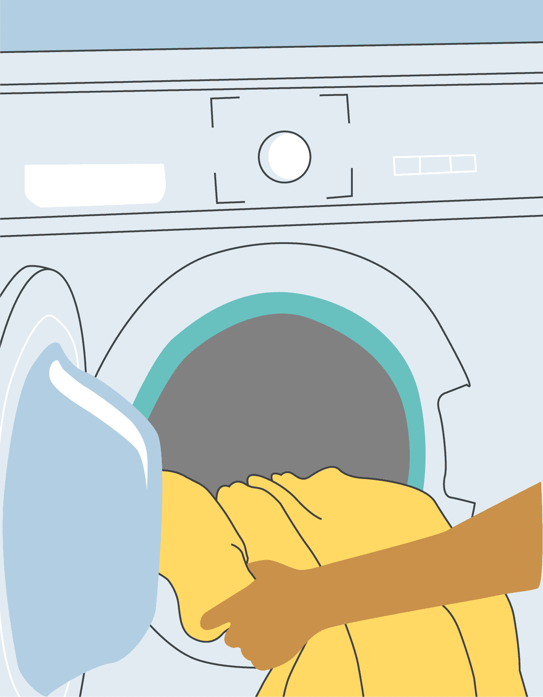

## 自然中和异味

外观完好但有霉味或烹饪残留异味的衣物，别急着洗。将其挂在开窗处或室外几小时以中和异味。另一招是“淋浴时挂着”——蒸汽促使纤维释放异味颗粒和褶皱。

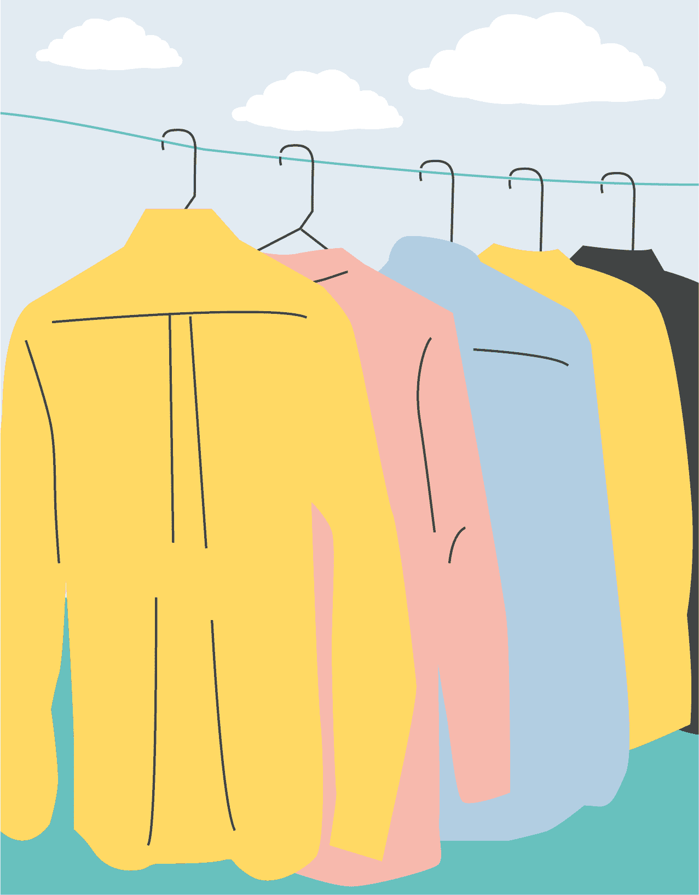

## 去除污渍

外观整洁的衣物若有小污渍，可局部清洁以避免整件水洗的损伤。各类污渍的去除与预处理详见污渍指南。处理小污渍的最佳方法：用干净湿布一角蘸手部肥皂擦拭污渍处，再用湿布无皂一角擦拭，晾干。

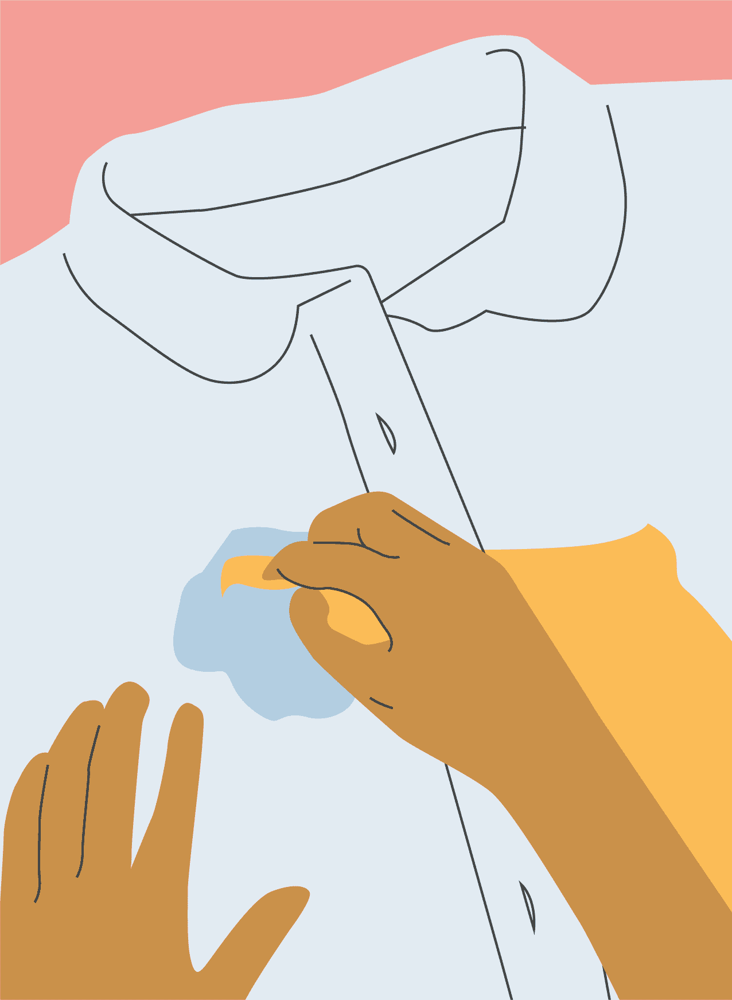

## 同类同洗

始终将浅色、亮色、深色面料分开，同类同洗，防止串色和衣物过早显旧。查看洗涤标签了解哪些需手洗或干洗，其余最高在 30°C 或 40°C 水洗。拉上拉链、扣好扣子防损坏，所有衣物反面朝外水洗以减少摩擦起球。

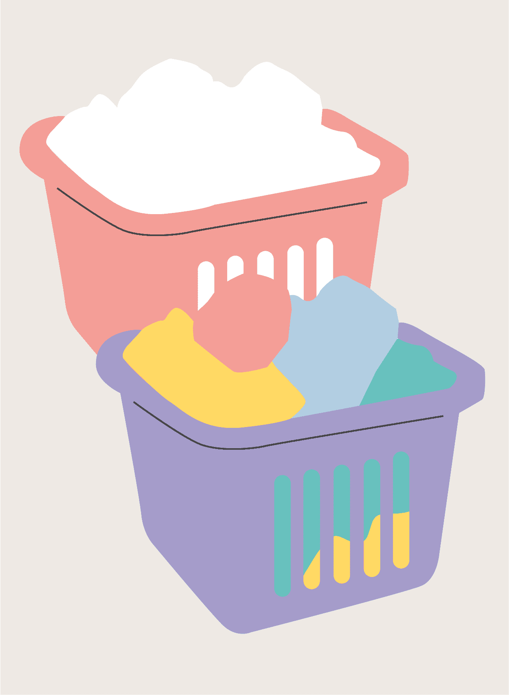

## 手洗：最佳方法

剪裁合身的外套、夹克等结构化服装需专业干洗以保型。但标注“仅限干洗”的非结构化、柔软服装可改为手洗。使用前清洗水槽，避免油脂沾染衣物。水温保持冷水或温水，使用专用手洗洗涤剂。手洗后，轻薄衣物可挂滴干；针织等厚重衣物平铺毛巾上晾干，悬挂会变形。

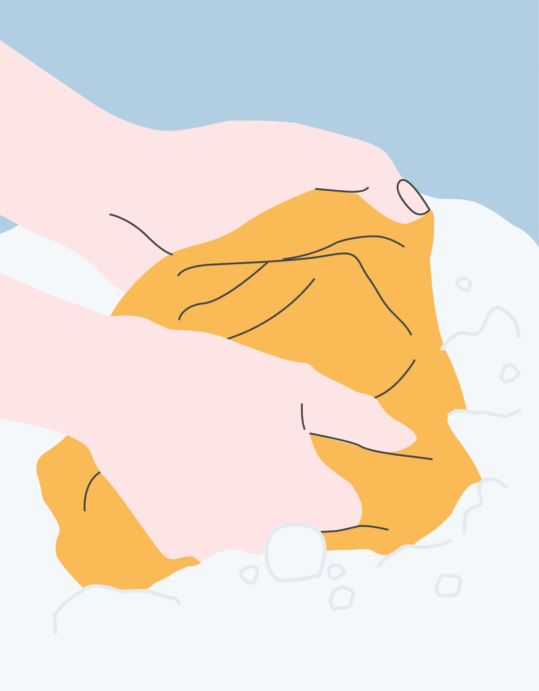

## 晾晒最佳

烘干机烘干会对衣物造成巨大损害；额外的摩擦和高温会导致起球、纤维变弱断裂，并可能引起缩水和褪色。它还消耗大量能源——以典型的 104°F (40°C) 水洗后再进行滚筒烘干的负载为例，75% 的碳足迹归因于烘干过程。只要条件允许，将衣物挂在户外晾衣绳或晾衣架上，会极大地延长衣物寿命，并显著降低其环境影响。天气不好或没有户外空间时，可考虑将衣物挂在通风良好且不碍事的房间里的晾衣架上。白天很少使用且窗户敞开的浴室是理想选择。

## 尽可能自然晾干

### 免熨烫法

熨烫是另一个可能损坏衣物且消耗本可避免能源的洗衣工序。在洗涤循环结束后尽快从机器中取出干净衣物，以防皱纹产生。抖平每件衣物，并用夹子夹好或尽可能平铺挂出。蒸汽有助于衣物褶皱自行消失（也能去除异味，另见洗衣与熨烫小贴士），因此如果有时间，洗澡时将衣物挂在浴室里很值得——这可能完全省去了拿出熨衣板的麻烦。

#### 蒸汽去皱

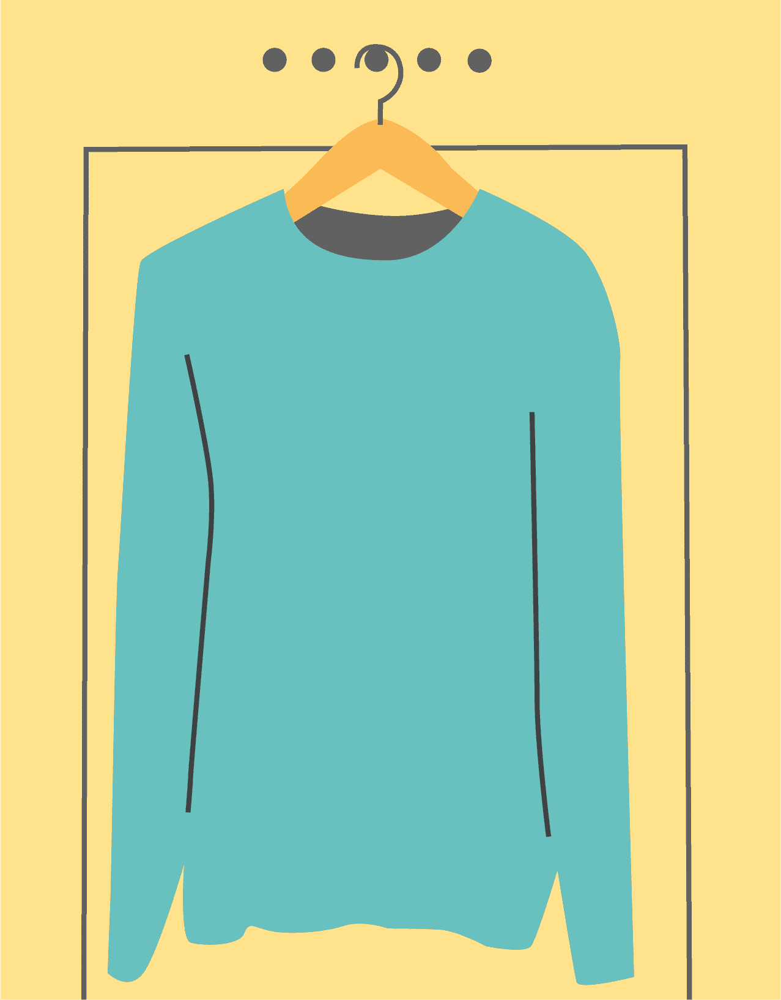

### 熨平褶皱

熨烫必要时，开始前务必查看衣物护理标签，找到建议的温度设定。不同熨斗的温度设定可能有波动，所以先在衣物不显眼处测试选定的设定，然后再进行其余部分。尽可能将衣物里面朝外熨烫。熨烫的热量和压力会产生永久性的光亮区域，使衣物看起来比实际更旧、更磨损。必须在衣物正面熨烫时，使用熨烫布（见免缝法）以减少潜在损伤。

#### 里面朝外熨烫

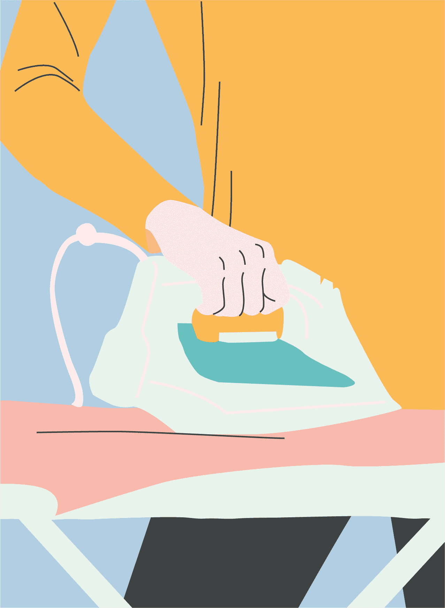

爱护您的衣物 目录

# 污渍及其去除方法

没有什么比难看的污渍更能破坏衣物的外观了。我们将探讨一些预处理方法，以及应对一些常见污渍来源的通用方法，以防其变成永久性污渍。

无论是什么物质弄脏了您的衣物，首先都要设法弄掉尽可能多的污渍。用干净干燥的布吸干液体溢出物。对于浓稠、黏糊的东西——例如酱汁——用勺子或刀子刮掉尽可能多的污渍。从污渍边缘开始向内刮，以免污渍扩大。

正如我们所见（见洗衣与熨烫小贴士），为了延长衣物寿命并减少碳足迹，滚筒烘干衣物理想情况下应作为最后的手段。绝不要用烘干机烘干有污渍的衣物，因为这会使污渍永久固着。湿衣物可能骗你以为没污渍了，但干透前你无法真正确定，所以不要冒险用烘干机。更好的做法是，如果可能，让衣物在阳光直射下户外晾干——阳光具有神奇的去污力。

## 绝招

如果尝试所有方法都无法去除难看的污渍，且污渍太大无法遮盖，则考虑给衣物染色（见面料染色改造）。

## 去污指南

| 污渍 | 最佳处理方法 |
| --- | --- |
| 茶和咖啡 | 咖啡和茶之所以能用来染布，是有原因的：它们会留下永久污渍。咖啡渍一旦沾上，尽快撒上盐或小苏打覆盖。放置一会，然后冲洗掉。茶渍则立即用冷水冲洗，轻轻揉搓面料试图淡化污渍。若污渍仍在，浅色面料可浸泡在氯漂白剂溶液中；深色和亮色面料可尝试混合等量白醋和盐轻轻涂抹污渍。用冷水冲洗，然后按常规洗涤。 |
| 血渍和婴儿大便 | 对于蛋白质类污渍（如血渍和婴儿大便），最糟糕的就是热水——140°F (60°C) 的水洗也洗不掉这类污渍。污渍还新鲜时，用冷水冲洗患处。如果可能，直接放入洗衣机冷水洗涤循环；如果不行，在冷水中浸泡直到能放入冷水洗涤，但避免浸泡超过 10–12 小时，否则污渍更易固着。在确定污渍去除前，绝对不要烘干或熨烫。 |
| 彩妆和油腻食物 | 对于油性污渍——彩妆、油腻食物和酱汁——视手边材料而定，有几种处理途径。首先，在污渍下垫一块纸板或杂志以保护下层面料。将一滴洗洁精直接涂在污渍处。用湿润干净的布，以打圈方式揉搓污渍，从外向内擦拭以防扩散。冲洗掉洗洁精，按常规洗涤。另一种方法是用粉末吸出纤维中的油脂。可涂抹玉米淀粉、泡打粉或爽身粉吸出油脂。玉米淀粉放置 10 分钟，泡打粉 30 分钟，必要时爽身粉过夜。然后拍掉剩余粉末。若污渍仍在，用湿润干净的布吸干后再放入洗涤。 |
| 汗渍 | 黄色汗渍看着不雅，但幸好有两种物质能帮忙。第一是小苏打。用水调成糊状，涂在面料上。如果面料不娇贵，将糊状物揉进污渍里。放置一小时后冲洗。第二种方法是用原液白醋浸泡患处长达一小时。用旧牙刷非常轻柔地擦拭患处——汗渍需要搅动才能成功去除。然后放入洗衣机，用面料能承受的最高温度洗涤（务必查看护理标签）。 |

爱护您的衣物 目录

# 面料染色改造

遗憾的是，给面料染色这一遮盖污渍、让旧貌换新颜的方法常被忽视。以下是一些利用染色延长衣物寿命的指南。

您将如何拥抱染色世界、翻新衣橱？可在商业染料和植物染料中选择。

## 手工染色还是机器染色？

您可以在布料店、五金店以及网上买到成品染料。您可以在手工染料和机器染料之间选择。手工染色需要您准备好染料包、食盐、橡胶手套、桶和搅拌棒。机器染料直接倒入洗衣机，更简便，也可能更不脏乱。想要更大胆的效果，可以同时使用多种染料。

## 天然纤维与合成纤维

天然纤维（如棉、亚麻、羊毛和丝绸）和再生纤维（粘胶/人造丝、莫代尔、竹纤维、天丝/莱赛尔）易于上色；如果您打算用机器染料，请确保衣物能承受 104°F (40°C) 水洗。染色天然或再生纤维与合成纤维混纺的面料（如涤棉），效果会较浅。专为合成纤维设计的染料网上有售。

## 现在是什么颜色？

# 染色与刺绣技巧

## 染色

### 颜色考量

显然，在白色和浅色衣物上使用织物染料可以获得更浓烈的颜色。染深色衣物效果会更微妙，因此对于深色衣服，最好坚持匹配并恢复原色。彩色衣物也可以染色，但这里适用色彩理论——例如，在蓝色面料上使用红色染料会呈现紫色。有图案的面料完全可以染色，但图案之后仍会清晰可见。

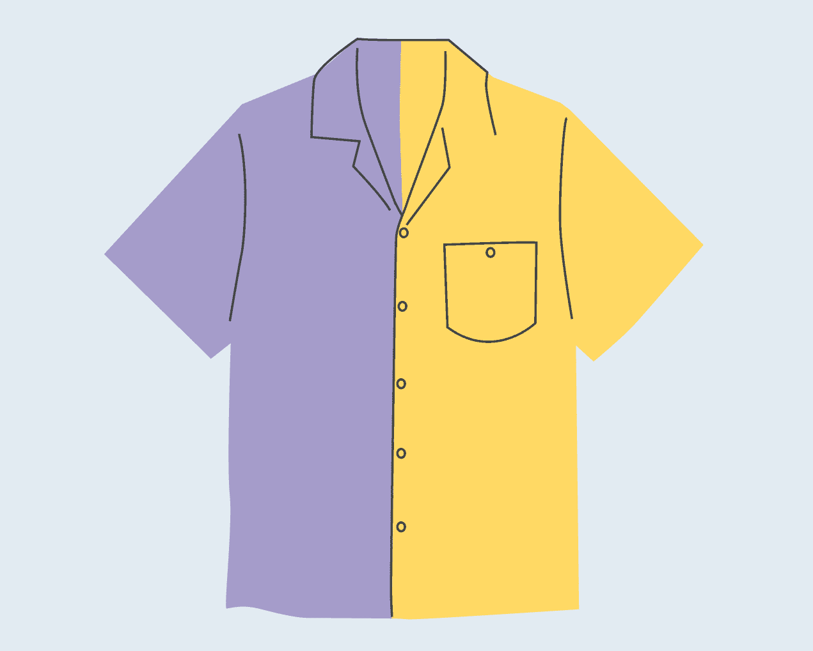

### 天然染料

普通织物染料确实含有一些潜在污染化学物质，最终会流入水道。虽然用普通织物染料重新染色比丢弃并购买新衣物的环境影响较小，但改用天然染色工艺可以进一步降低让衣物焕新的环境影响。天然染料可用花园或超市里的物品制作——洋葱皮、南瓜皮、咖啡渣、茶叶、牛油果皮、草莓、樱桃、薰衣草、紫甘蓝、甜菜根、芹菜叶和竹子，仅举几例。染料准备是一个需额外考虑的步骤，且它们仅适用于浅色面料。但如果你追求微妙的效果，天然染料能带来美丽的结果。

### 扎染技巧

一件素色衣物可以通过扎染效果焕然一新、独一无二地改造。因为普通染色无法遮盖所有污渍，用扎染效果来伪装污渍可能更有效。扎染不一定非得做成刻板印象中的嬉皮士风格服装。扎染方法从复杂精细的日本绞染到超简单的揉皱染色不等。结合天然染料执行时，效果可以细腻且富有艺术感。而且非常有趣。

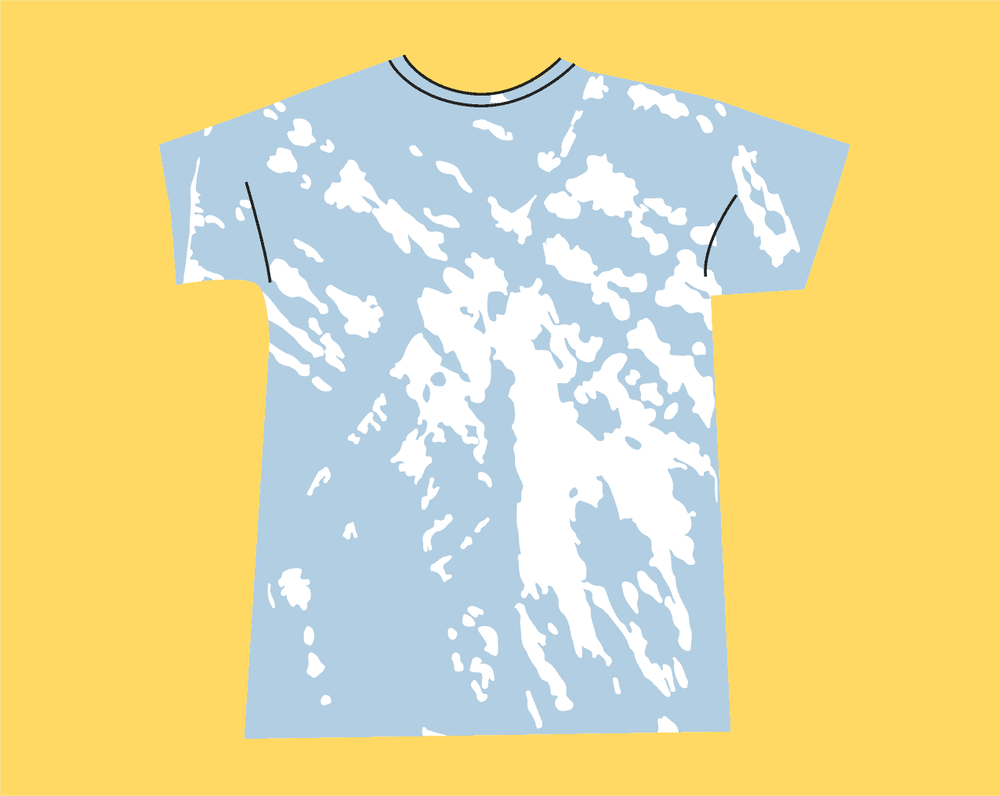

### 染色配饰

不仅衣物可以重新染色。如果你把心爱的旧牛仔裤重新染回黑色，不妨顺便把那些褪色的帆布鞋也扔进去。如果你试图用大胆的颜色掩盖有污渍的 T 恤，为什么不顺便把褪色的棉质帆布袋甚至袜子也染了？

---

利用成品或天然织物染料，让褪色衣物焕然一新或增添活力，重塑衣橱的色彩搭配。

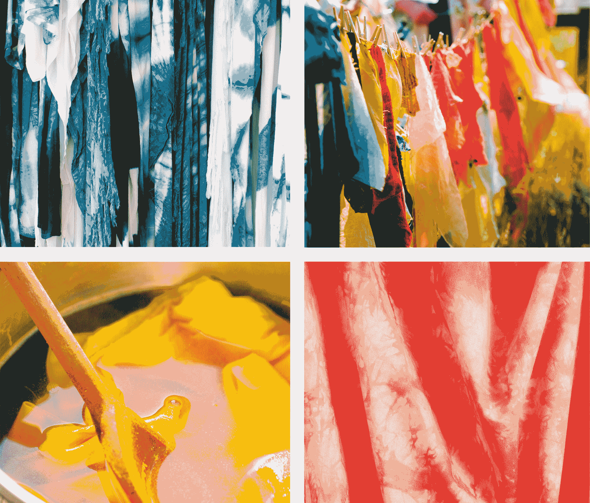

## 用刺绣遮盖污渍

当一件原本完好无损的衣物上有个小污渍或烧焦痕迹怎么洗都洗不掉时该怎么办？如果面料只是有污迹但未损坏，用补丁或贴花遮盖可能显得大材小用。而用一些简单、低调的刺绣遮盖痕迹，或许正是所需的巧妙转移视线之法。

### 所需材料

| 物品 | 详情 |
|------|---------|
| **你需要** | 对比色线（刺绣线、普通缝纫线或针织衣物用的补织毛线）、大眼手缝针、剪刀/剪线钳、织物标记工具 |
| **左撇子？** | 如果反方向操作更舒服，请按此处所示的相反方向进行 |

### 小贴士

此处刺绣线或绣线最理想，但用普通线也能达到类似效果；针织衣物请使用补织线。

### 简易花朵图案

学习如何准备线材并绣制简易花朵。用链式针法在污渍周围绣出花瓣，污渍位于中心，甚至看起来像是早有预谋的设计。

**1a** 剪一段约 12 英寸（30 厘米）长的刺绣线，分股至你喜欢的粗细（此线由六股组成），穿针，在一端打结。

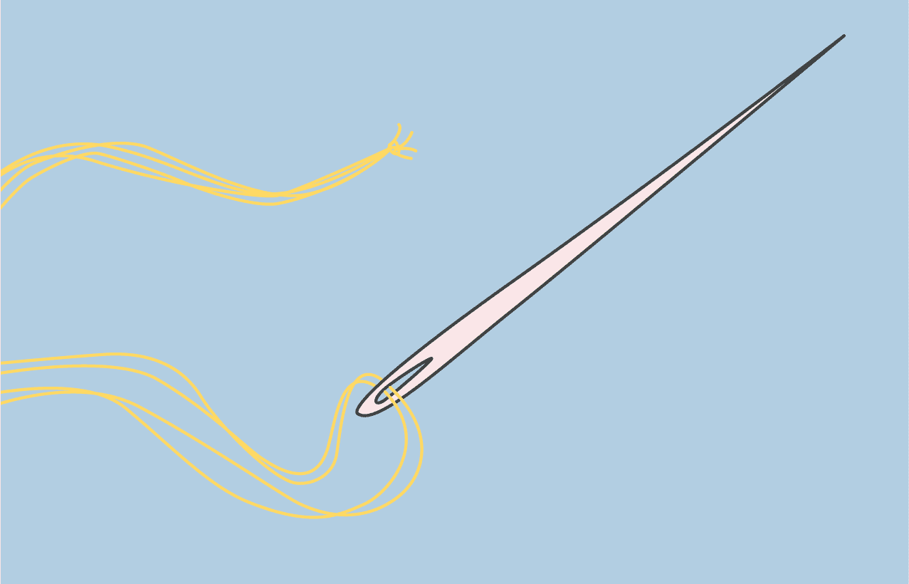

**1b** 对于普通缝纫线，剪约 39 英寸（1 米）长，对折，弄湿并捏紧线圈使其变窄以便穿过针眼，然后将所有线头打结。

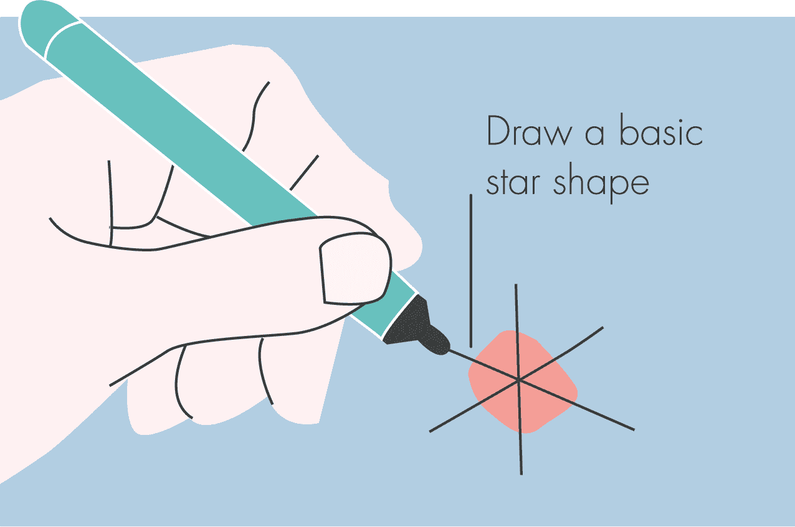

**2** 用尖头织物标记工具，在污渍中心画一个基本的六角星形状。星星的“臂”将为六个花瓣的位置提供指引。

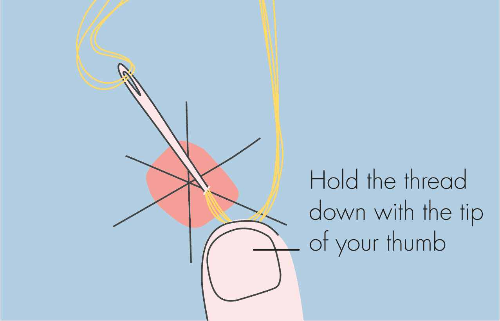

**3** 从背面将针刺出，距中心约 1/8 英寸（3 毫米）。从正面拉出针线。将针尽可能靠近出针处刺入，形成一个线圈。

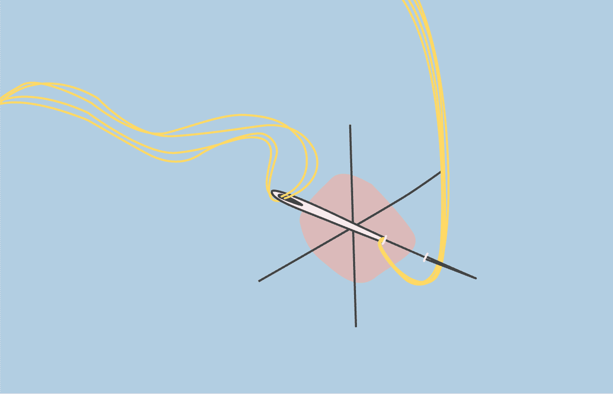

**4** 将针向下倾斜，然后沿着一条线向上推出约 1/4 英寸（7 毫米）。慢慢拉出针形成一个线圈。在线圈外边缘做一个极小的针脚将其固定。

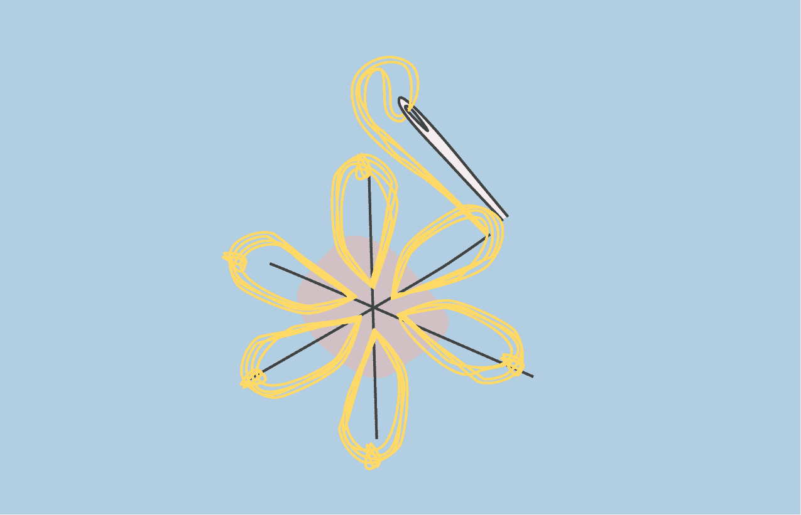

**5** 重复步骤 3 和 4 绣出其他花瓣。然后，在其中一片花瓣背面做一个极小的针脚。拉出线留一个圈，将针穿过线圈并拉紧。剪断线头。

### 飞虫或蜜蜂图案

此处使用平针（一种“填充”针法）在污渍或烧焦痕迹上按虫子或蜜蜂的形状“填色”。

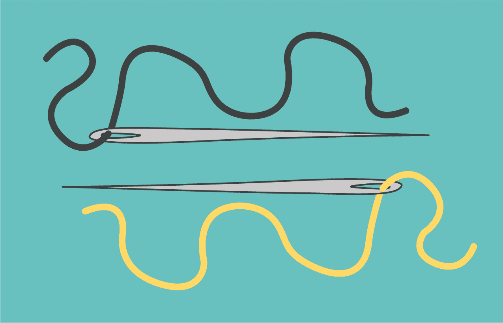

**1** 按照步骤 1a 或 1b 准备针线。给虫子身体选一种颜色，或用黑黄相间的条纹绣出蜜蜂。

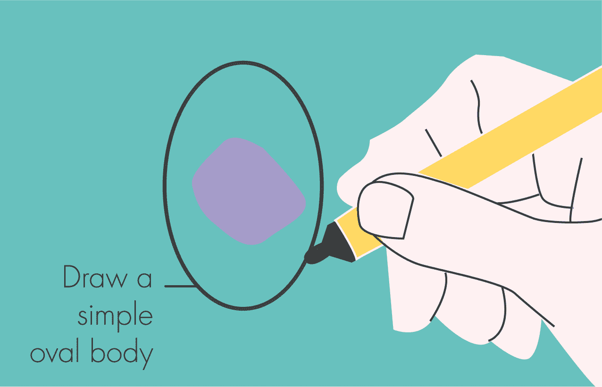

**2** 用尖头织物标记工具，画一个椭圆形作为昆虫身体。长度以 5/8 英寸（1.5 厘米）到 3/4 英寸（2 厘米）为宜。清晰干净的轮廓最有帮助。

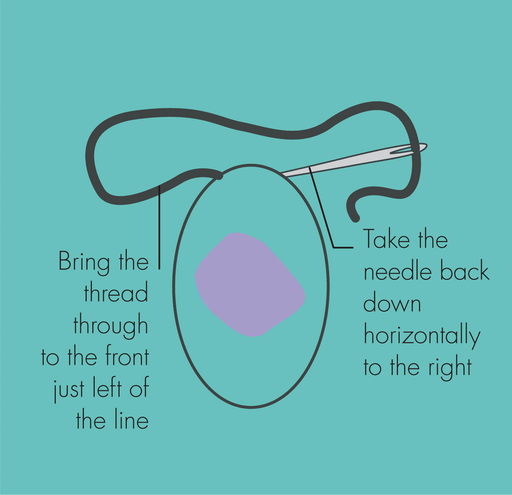

**3** 从形状一端的背面刺出针，稍微在线的左侧。将针穿过到另一侧的线上做一个平针，从背面拉出。

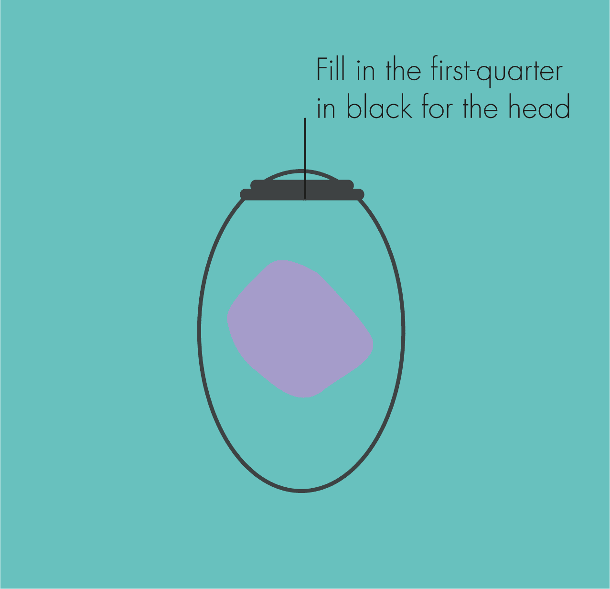

**4** 从背面，在第一次出针处稍下方刺出针。从正面拉出针线。将针穿过到上一针末端稍下方的线上。

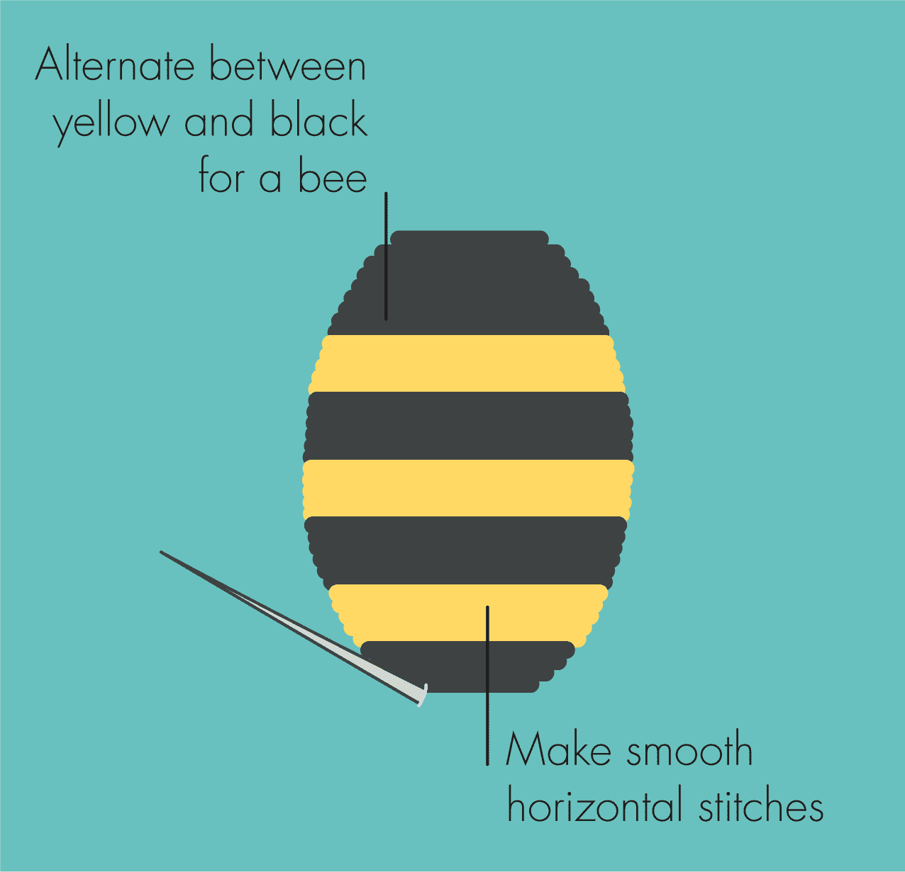

**5** 重复步骤 4，用平整的水平针脚填满身体（如果绣蜜蜂记得交替颜色）。注意不要拉得太紧，也不要留得松松垮垮。

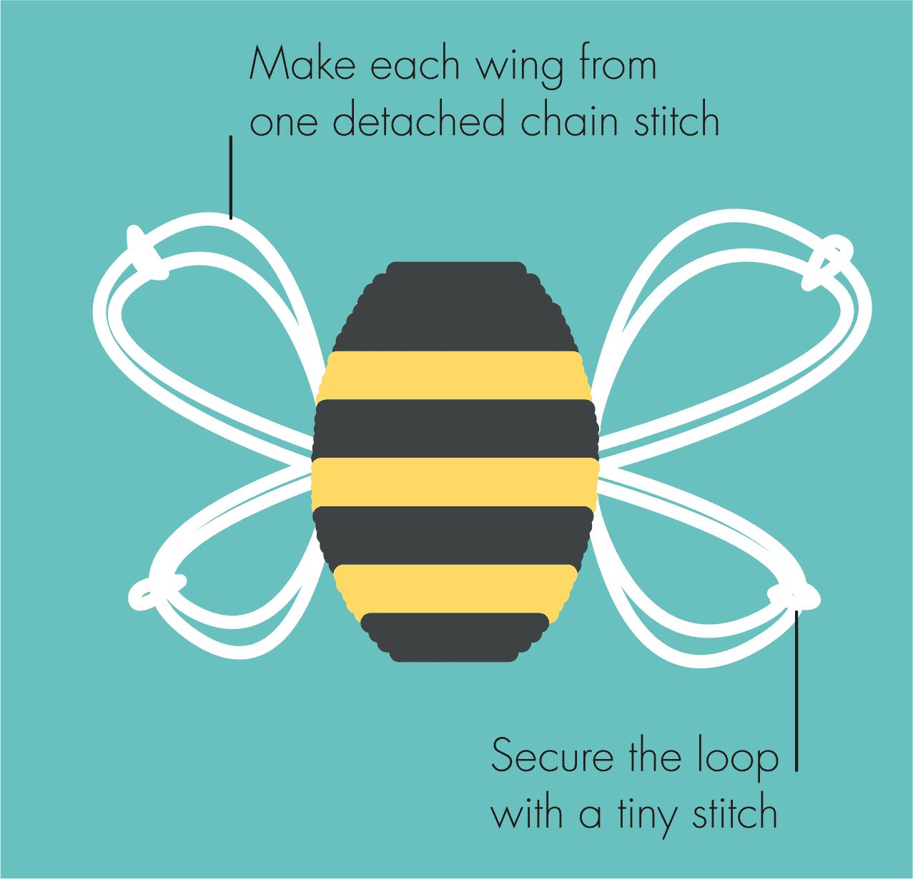

**6** 给针换上白线（深色衣物用）或黑线（浅色衣物用）。然后，按照步骤 3 至步骤 5，用离散链式针法绣出翅膀轮廓。

## 进阶资源

### 书籍

- **补织、显性修补和刺子绣**
- Lily Fulop 著，《穿戴、修补、再利用：制造者的修补与升级改造衣物指南》。佛蒙特州：Countryman Press，2020 年
- Erin Lewis-Fitzgerald 著，《现代修补：减少浪费，极致风格》。墨尔本：Affirm Press，2020 年
- Nina Montenegro 和 Sonya Montenegro 著，《修补生活：修补衣物与心灵的手册》。西雅图：Sasquatch Books，2020 年
- Kerstin Neumüller 著，《修补与补丁：修补衣物与纺织品手册》。伦敦：Pavilion Books，2019 年
- Katrina Rodabaugh 著，《修补很重要：针织、补丁，修复你最爱的牛仔裤及更多》。纽约：Abrams，2018 年

### 值得关注的 Instagram 账号

- @erinlewisfitzgerald
- @katrinarodabaugh
- @reclaimmending
- @thefarwoods
- @tomofholland
- @visible_creative_mending
- @visiblemend

### 时尚产业

# 参考资料

## 书籍

- Lauren Bravo, *How To Break Up With Fast Fashion: A Guilt-Free Guide to Changing the Way You Shop – For Good*. London: Headline Home, 2020
- Elizabeth L. Cline, *Overdressed: The Shockingly High Cost of Cheap Fashion*. New York: Portfolio Books, 2013
- Elizabeth L. Cline, *The Conscious Closet: The Revolutionary Guide to Looking Good While Doing Good*. New York: Plume, 2019
- Greta Eagan, *Wear No Evil: How to Change the World with your Wardrobe*. Philadelphia: Running Press, 2014
- Lucy Siegle, *To Die For: Is Fashion Wearing Out the World?*. London: Fourth Estate, 2011

## 播客

- Wardrobe Crisis podcast（衣橱危机播客）

## 组织与网站

- [Fashion Revolution](http://www.fashionrevolution.org) — 致力于改变时尚文化和行业的慈善机构与运动
- [Love Your Clothes](http://www.loveyourclothes.org.uk) — 循环经济慈善机构 WRAP 发起的活动，旨在减少服装对环境的影响
- [TRAID](http://www.traid.org.uk) — 致力于阻止衣物被丢弃的慈善机构
- [Labour Behind the Label](http://labourbehindthelabel.org) — 为全球服装工人权利而努力的慈善机构

## 值得关注的 Instagram 账号

- `@ajabarber`
- `@fash_rev`
- `@theseagull`
- `@ecoage`
- `@sophiebenson`
- `@laurenbravo`
- `@mrspress`

# 服装护理、纺织品与染色

## 书籍

- Rebecca Burgess and Courtney White, *Fibershed: Growing a Movement of Farmers, Fashion Activists, and Makers for a New Textile Economy*. Vermont: Chelsea Green Publishing, 2019
- Rebecca Desnos, *Botanical Color At Your Fingertips*. 2016

## 网站

- [Mama's Laundry Talk](http://www.mamaslaundrytalk.com) — 服装护理
- [Rebecca Desnos Blog](http://rebeccadesnos.com/blogs/journal) — 天然面料染色
- [Tie Dye Your Summer](http://www.tiedyeyoursummer.com) — 扎染技巧

# 可持续缝纫与升级再造

## 播客

- Love to Sew podcast（热爱缝纫播客）

## 网站

- [Refashionista](http://refashionista.net) — 改造和升级再造二手店淘来的宝贝
- [Makery](http://makery.co.uk) — The Refashioners 的主办方——鼓舞人心的服装改造和社区项目
- [Time to Sew](http://timetosew.uk) — 关于可持续缝纫与时尚的博客

## 值得关注的 Instagram 账号

- `@offset_warehouse`
- `@sustainable.maria`
- `@go_recreate`
- `@sweetfindupcycled`

# 附加来源

*2020 年 9 月核实*

## 导言（第 6–7 页）

- [Greenpeace: Black Friday – Greenpeace Calls Timeout for Fast Fashion](http://www.greenpeace.org/international/press-release/7566/black-friday-greenpeace-calls-timeout-for-fast-fashion)
- [Quartz: Americans Have Stopped Trying to Stuff More Clothes Into Their Closets](https://qz.com/1212305/americans-have-stopped-trying-to-stuff-more-clothes-into-their-closets/)
- [HuffPost: Unworn Clothing Survey](https://www.huffingtonpost.co.uk/entry/unworn-clothing-survey_n_5048486?guce_referrer=aHR0cHM6Ly93d3cuZ29vZ2xlLmNvbS8&guce_referrer_sig=AQAAAFL0O9bT8TXUqz2i3R6deVNT_IzgH8HLnVxN5zAG1TH_-12qOus4dt45yJUPW36CNeG8Fxb4Xm28yuUQwP-QIF5KEUKFzYyFuGwQDYUSeCV-nDosYGwSK0b1-a_IyPt1VZZYo4ttPP294Y-6Fp9yTlNLMJjrXyjey_MZtbU6zLCe&guccounter=2)
- [Daily Mail: Women Ditch Clothes They've Worn Just Seven Times](http://www.dailymail.co.uk/femail/article-3117645/Women-ditch-clothes-ve-worn-just-seven-times-Items-left-shelf-buyer-feels-ve-weight-ve-bought-whim.html)

## “快时尚”内幕（第 8–11 页）

- [Fashion Revolution: How Much Garment Workers Really Make](http://www.fashionrevolution.org/usa-blog/how-much-garment-workers-really-make)
- [UN News: Story 2019/03/1035161](http://news.un.org/en/story/2019/03/1035161)
- Dr Tara Shine, *How to Save Your Planet One Object at a Time*. London: Simon & Schuster, 2020
- [Fashion Revolution: What My Jeans Say About the Garment Industry (PDF)](http://www.fashionrevolution.org/wp-content/uploads/2017/02/What-My-Jeans-Say-About-the-Garment-Industry.pdf)
- [United Nations Facebook: 10,000 Litres of Water Needed to Make a Single Pair of Jeans](http://www.facebook.com/unitednations/posts/10000-litres-of-water-are-needed-to-make-a-single-pair-of-jeansby-shopping-secon/10157679840810820)
- [The Guardian: Cost of Cotton – Water Challenged India on World Water Day](http://www.theguardian.com/sustainable-business/2015/mar/20/cost-cotton-water-challenged-india-world-water-day)
- [WRAP: Textiles Overview](http://www.wrap.org.uk/content/textiles-overview)
- [We Donate Recycle](http://www.weardonaterecycle.org/)

目录
