## 微服务一览

**本章涵盖**

- 理解微服务及其核心特征
- 审视微服务的优点与缺点
- 一个微服务协同工作以服务用户请求的示例
- 使用 ASP.NET 构建一个简单应用

在本章中，我将解释什么是微服务，并演示它们为何值得关注。我们还会了解微服务的六个特征。最后，我将向你介绍本书中最重要的技术：ASP.NET 和 ASP.NET MVC。

### 1.1 什么是微服务？

*微服务*是一种只具备一项且唯一一项高度聚焦能力的服务，该能力通过远程 API 暴露给系统中的其他部分。例如，想象一个系统

它们只需要知道如何相互通信。有些可能通过队列、服务总线、gRPC 或 GraphQL 进行通信，具体取决于系统需求；但通常，微服务确实通过 HTTP 进行通信。

注意 本书专注于使用 C# 和 ASP.NET 在 .NET 中实现微服务。我将展示的微服务是小型、高度聚焦的 ASP.NET 应用程序，它们通过 HTTP 进行协作。

注意 本书专注于通过 HTTP 进行协作，但指导协作设计的原则并不特定于 HTTP。我选择使用 HTTP，因为它无处不在且为许多开发者所熟悉，而我希望更多地关注设计原则而非技术。这些原则同样适用于其他技术，尤其是 gRPC——它在 .NET 领域越来越受欢迎，也是一个不错的选择。

### 1.2 什么是微服务架构？

本书专注于设计和实现单个微服务，但值得注意的是，“微服务”一词也可以用来描述由许多微服务组成的整个系统的架构风格。作为一种架构风格，微服务是面向服务架构（SOA）的一种轻量级形式，其中每个服务都高度聚焦于做好一件事。采用微服务架构的系统是一个分布式系统，包含（可能数量庞大的）协作微服务。

微服务架构风格在构建和维护复杂的服务器端软件系统方面迅速流行起来。这完全可以理解：微服务相比更传统的面向服务方法和单体架构，提供了许多潜在优势。微服务如果做得好，具有可塑性、可扩展性和健壮性，并且能让系统在 Nicole Forsgren 等人在《加速》¹ 和 DORA DevOps 状态报告² 中确定的四个关键指标上表现出色，即：

1. 部署频率
2. 变更前置时间
3. 服务恢复时间
4. 变更失败率

对于复杂的软件系统来说，同时实现这四点往往难以企及。此外，正如 Forsgren 等人所证明的，这组指标是软件交付绩效的可靠预测因子。

在本书中，你将学习如何设计和实现可塑、可扩展且健壮的微服务，从而构建在这四个关键指标上均表现优异的系统。

1 Nicole Forsgren, Gene Kim, and Jez Humble. Accelerate. IT Revolution Press: 2018.

2 Nicole Forsgren, Dustin Smith, Jez Humble, and Jessie Frazelle, "Accelerate: State of DevOps 2018," https://inthecloud.withgoogle.com/state-of-devops-18/dl-cd.html.

#### 1.2.1 微服务的特征

我说过微服务是“一种只具备一项高度聚焦能力的服务”，但这究竟意味着什么？实际上，业界对于微服务的精确定义并没有广泛接受的标准。³ 然而，我们可以看看微服务通常具备哪些特征。我发现微服务有六个核心特征：

- 微服务负责单一能力。
- 微服务可独立部署。
- 微服务由一个或多个进程组成。
- 微服务拥有自己的数据存储。
- 一个小团队可以维护少量微服务。
- 微服务是可替换的。

这份特征清单应该能帮助你识别一个设计良好的微服务，同时也能帮助你界定和实现自己的微服务。通过融入这些特征，你将能够充分发挥微服务的优势，并最终构建出可塑、可扩展且健壮的系统。在本书中，我将展示这些特征如何驱动微服务的设计，以及如何编写微服务满足这些特征所需的代码。现在，让我们逐一简要了解每个特征。

#### 负责单一能力

微服务在整个系统中只负责一项且唯一一项能力。我们可以将这句话拆分为两部分：

- 微服务具有单一职责。
- 该职责是针对一项能力的。

单一职责原则有多种表述方式。一种传统形式是：“一个类应该只有一个引起它变化的原因。”⁴ 虽然这种表述特别提到了类，但事实证明该原则适用于面向对象语言中类之外的场景。对于微服务，我们在服务级别应用单一职责原则。

另一种较新的单一职责原则表述同样来自 Robert C. Martin：“将因相同原因而变化的事物聚集在一起。将因不同原因而变化的事物分离开来。”⁵ 这种表述方式适用于微服务：一个微服务应该恰好实现一项能力。这样，只有当该项能力发生变化时，它才需要改变。此外，你应该努力让微服务完整地实现该能力，以便当能力发生变化时，只需要修改这一个微服务。

微服务系统中有两种类型的能力：

- *业务能力*是系统为达成其目的而做的事情，例如跟踪用户的购物车或计算价格。梳理系统中不同业务能力的一个好方法是使用领域驱动设计。
- *技术能力*是其他多个微服务需要使用的能力——例如与某个第三方系统的集成。技术能力并不是将系统拆分为微服务的主要驱动力；只有当你发现多个业务能力微服务需要相同的技术能力时，才会识别出它们。

注意 关于微服务范围和职责的定义将在第 4 章中介绍。

³ 关于微服务特征的进一步讨论，我推荐这篇文章：Martin Fowler and James Lewis, “Microservices: A Definition of This New Architectural Term,” March 25, 2014, http://martinfowler.com/articles/microservices.html。

⁴ Robert C. Martin, “SRP: The Single Responsibility Principle,” http://mng.bz/zQyz。

⁵ Robert C. Martin, “The Single Responsibility Principle,” May 8, 2014, http://mng.bz/RZgU。

#### 可独立部署

微服务应该是*可独立部署*的。当你修改某个特定的微服务时，你应该能够将其部署到生产环境，而无需部署（或触碰）系统中的任何其他部分。在部署被修改的微服务期间，系统中的其他微服务应继续运行和工作，并在新版本部署完成后继续运行。

考虑一个电子商务网站。每当购物车微服务发生更改时，你应该能够只部署该微服务，如图 1.2 所示。与此同时，价格计算、推荐、产品目录等微服务应继续工作并服务用户请求。


图 1.2 在部署购物车微服务时，其他微服务继续运行。

能够单独部署每个微服务非常重要，因为在微服务系统中有许多微服务，每个微服务可能与其他多个微服务协作。同时，开发工作是在部分或全部微服务上并行进行的。如果你必须以同步方式部署全部或一组微服务，管理部署很快就会变得笨拙，通常会导致不频繁且大型、高风险的部署。这是你应该避免的。相反，你希望能够频繁地将小改动部署到每个微服务，从而实现小规模、低风险的部署。


为了能够在系统其余部分继续运行的同时部署单个微服务，构建过程应考虑以下几点：

- 每个微服务都应被构建为独立的工件（例如，独立的 Docker 容器）。
- 部署过程还应设置为支持在其他微服务继续运行时单独部署微服务。例如，你可以使用滚动部署过程，一次将一个微服务部署到一台服务器上，以减少停机时间。Kubernetes——以及其他编排技术——支持这种以及其他有用的部署模式。

希望单独部署微服务这一事实会影响它们的交互方式。对微服务接口的更改通常必须向后兼容，以便其他现有微服务能够继续以与旧版本相同的方式与新版本协作。此外，微服务的交互方式必须健壮，也就是说，每个微服务都必须预料到其他服务偶尔会失败，并继续尽最大努力工作。一个微服务发生故障——例如，由于部署期间的停机——不得导致其他微服务故障，而只应导致功能下降或处理时间稍长。

> **注意** 微服务的协作和健壮性将在第 4、5 和 7 章中介绍。

#### 由一个或多个进程组成

如果微服务要尽可能独立于同一系统中的其他微服务，它必须在单独的进程或多个单独的进程中运行。如果微服务要保持可单独部署，也是如此。这可以总结为两点：

- 每个微服务必须在与其他微服务分离的进程中运行。
- 每个微服务可以有多个进程。

再次考虑购物车微服务。如果它与商品目录微服务运行在同一进程中，如图 1.3 所示，购物车代码可能会在商品目录中造成一个

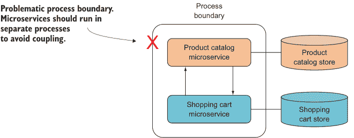

**图 1.3** 在同一进程内运行多个微服务会导致两者之间的高度耦合；它们无法单独部署，并且一个微服务可能导致另一个微服务停机。

副作用。

这意味着购物车和商品目录微服务之间会产生紧密且不理想的耦合：一个可能导致另一个停机或出现错误。

现在，考虑部署购物车微服务的新版本。你要么必须重新部署商品目录微服务，要么需要某种能够在运行进程中切换购物车代码的动态代码加载机制。第一种选择直接违背了微服务可单独部署的要求。第二种选择很复杂，而且至少会使商品目录微服务面临因购物车微服务部署而停机的风险。

说到复杂性，为什么微服务要由多个进程组成？毕竟，你正努力让每个微服务尽可能简单易处理。

让我们考虑一个推荐微服务。它实现并运行驱动电子商务网站推荐的算法。它还有一个数据库，用于存储提供推荐所需的数据。算法在一个进程中运行，数据库在另一个进程中运行。通常，微服务需要两个或更多进程，才能实现为系统提供某种能力所需的一切（例如数据存储和后台处理）。

#### 拥有自己的数据存储

微服务拥有存储其所需数据的数据存储。这是微服务范围是完整能力的又一结果。大多数业务能力都需要一些数据存储。例如，商品目录微服务需要存储每个产品的某些信息。为了保持商品目录与其他微服务的松散耦合，包含产品信息的数据存储完全由该微服务拥有。商品目录微服务决定如何以及何时存储产品信息。如图 1.4 所示，其他

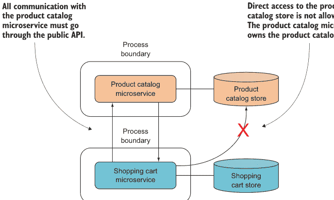

*图 1.4* 一个微服务不能访问另一个微服务的数据存储。

微服务（例如购物车）只能通过商品目录的接口访问产品信息，绝不能直接从商品目录的数据存储中访问。

每个微服务拥有自己的数据存储这一事实，使得可以根据每个微服务的需求为不同的微服务使用不同的数据库技术。例如，商品目录微服务可以使用 SQL Server 存储产品信息；购物车微服务可以将每个用户的购物车存储在 Redis 中；推荐微服务可以使用 Elasticsearch 索引来提供推荐。为微服务选择的数据库技术是实施的一部分，对其他微服务不可见。

这种方法允许每个微服务使用最适合该工作的数据库，这也能在开发时间、性能和可扩展性方面带来好处。明显的缺点是，如果你选择这样架构系统，就需要管理、维护和使用多个数据库。数据库往往是复杂的技术，学会使用并让其在生产环境中可靠运行并非没有代价。在为微服务选择数据库时，你需要考虑这种权衡。但微服务拥有自己的数据存储的一个好处是，以后可以将一个数据库换成另一个。

> 注意 数据所有权、访问和存储将在第 5 章中介绍。

#### 由一个小团队维护

到目前为止，我还没有过多讨论微服务的大小，尽管术语中的“微”部分表明微服务很小。我认为讨论一个微服务应该有多少行代码，或者它应该实现多少需求、用例或功能点，是没有意义的。这些都取决于微服务所提供功能的复杂性。

然而，有意义的是考虑维护一个微服务所涉及的工作量。以下经验法则可以指导你把握微服务的规模：一个小团队——也许五个人——应该能够维护几个微服务。在这里，“维护一个微服务”意味着处理保持其健康和适合用途的所有方面：开发新功能、从已经变得太大的微服务中拆分出新的微服务、在生产中运行它、监控它、测试它、修复错误，以及所有其他必要的工作。根据微服务中的变更量，“几个”可能意味着 10 到 30 个微服务，甚至更多（当系统、工具和自动化成熟且有效时）。一个团队通常应该拥有一组内聚的业务和技术能力，从而使它拥有实现这些能力的微服务。

#### 可替换的

要使微服务可替换，它必须能够在合理的时间范围内从头重写。换句话说，维护该微服务的团队应该能够用全新的实现替换当前实现，并在其正常的工作节奏内完成。这个特性是对微服务规模的另一个约束：如果它变得太大，替换成本会很高；但如果保持较小，重写它是现实的。

团队为什么会决定重写一个微服务？也许代码是一大团乱麻，不再易于维护。也许它在生产环境中表现不够好。这两种情况都不理想，但随着时间的推移，需求的变化可能导致代码库更适合替换而非维护。如果微服务足够小，可以在合理的时间范围内重写，那么偶尔出现其中一种情况也没关系。团队根据编写现有实现所获得的所有知识进行重写，并牢记任何新需求。

现在你了解了微服务的特征，让我们来看看它们的好处、成本和其他考虑因素。

### 1.3 为什么使用微服务？

使用遵循上一节所述特征的微服务构建系统有一些吸引人的好处：它们具有可塑性、可扩展性和健壮性，并且从开始实现到部署到生产环境的交付周期很短。这意味着在 Accelerate[6] 中概述的所有四项关键指标上都能表现出色。这些好处之所以能实现，是因为如果做得好，微服务：

- 支持持续交付
- 由于高度可维护，支持高效的开发者工作流
- 设计上具有健壮性
- 可以彼此独立地扩展或缩减

让我们更详细地谈谈这些要点。

#### 1.3.1 支持持续交付

微服务架构风格将持续交付纳入考量。它通过重点关注以下服务来实现这一点：

- 可以快速开发和修改
- 可以通过自动化测试进行全面测试
- 可以独立部署
- 可以被高效运维

这些特性支持持续交付，但这并不意味着采用微服务架构就会自动实现持续交付。两者关系更为复杂：使用微服务实践持续交付通常比更传统的 SOA 更容易。另一方面，只有能够高效可靠地部署服务，才可能全面采用微服务。持续交付和微服务相辅相成。

6 Nicole Forsgren、Gene Kim 和 Jez Humble。*Accelerate*。IT Revolution Press：2018年。


持续交付的好处众所周知。它们包括在业务层面的敏捷性提升、可靠的发布、风险降低以及产品质量的改善。

#### 什么是持续交付？

*持续交付* 是一种开发实践，团队确保软件随时都可以快速部署到生产环境。发布到市场仍然是业务决策，但实践持续交付的团队往往会频繁部署到生产环境，并在新软件进入源代码控制后不久就部署它。

持续交付有两个主要要求。首先，软件必须始终处于完全可用的状态。为此，团队需要高度关注质量。这导致了高度的测试自动化以及以非常小的增量进行开发。其次，部署过程必须可重复、可靠且快速，以便实现频繁的生产部署。这部分通过完全自动化部署过程以及对生产环境健康状况的高度洞察来实现。

尽管持续交付需要相当多的技术技能，但它更多是流程和文化的问题。这种质量、自动化和洞察水平需要开发和运营软件的所有相关方之间密切协作的文化，包括业务人员、开发人员、信息安全专家和系统管理员。换句话说，它需要一种 DevOps 文化，开发、运营和其他团队协作并相互学习。

持续交付与微服务相辅相成。如果没有能够快速廉价地部署单个微服务的能力，构建由它们组成的系统很快就会变得昂贵。如果微服务部署没有自动化，部署一个完整的微服务系统所需的手工工作量将不堪重负。

持续交付带来了 DevOps 文化，而这也是微服务的先决条件。要想在微服务方面取得成功，每个人都必须致力于使服务在生产环境中平稳运行，并在生产系统的健康状况上创造高度透明度。这需要具备运营、开发和安全技能的人员以及对业务领域有深入了解的人员等之间的协作。

本书不会专注于持续交付或 DevOps，但它会默认你在其中开发微服务的环境使用持续交付。本书中构建的服务可以部署到任何云或本地服务器，使用任何数量能够处理 .NET 的部署自动化技术。本书确实涵盖了持续交付和 DevOps 对单个微服务的意义。在第 3 部分，我们将详细介绍如何构建一个处理所有微服务必须解决的运营问题的平台。

作为部署示例，我们将在第 3 章在微软的 Azure 云中创建一个 Kubernetes 环境并向其部署一个微服务。在接下来的章节中，我们将继续使用该 Kubernetes 环境作为示例并向其部署微服务。

### 1.3.2 高可维护性

结构良好且实现良好的微服务从几个角度来看都具有高度可维护性。从开发人员角度来看，有几个因素会影响微服务的可维护性：

- 每个结构良好的微服务提供单一功能。不是两个——只有一个。
- 微服务拥有自己的数据存储。其他服务不能干扰微服务的数据存储。这加上微服务代码库的典型规模意味着你可以一次性理解一个完整的服务。
- 编写良好的微服务可以（并且应该）被自动化测试全面覆盖。

从运营角度来看，有几个因素会影响微服务的可维护性：

- 一个小型团队可以维护几十个微服务，这些微服务必须构建得便于高效运营，这意味着你应该能够轻松确定任何微服务的当前健康状况。
- 每个微服务都可以单独部署。

由此可以推断，生产环境中的问题可以及时发现并快速解决，例如通过扩展相关微服务或部署其新版本。微服务拥有自己的数据存储这一事实也增加了其运营可维护性，因为对数据存储的维护范围仅限于拥有该存储的微服务。

#### 偏好轻量级

由于每个微服务都处理单一功能，微服务在本质上相当小，无论是其范围还是代码库大小。这种源于有限范围的简洁性是一项主要优势。

在开发微服务时，重要的是避免通过使用大型复杂的框架、库或产品来使代码库复杂化，因为你认为将来可能需要其功能。很可能不会如此，因此你应优先选择能够满足微服务当前需求的更小、更轻量级的技术。记住，微服务是可以替换的：如果在某个时间点你最初使用的技术不再满足需求，你可以在合理的预算内完全重写它。

### 1.3.3 健壮且可扩展

基于微服务的分布式架构允许你根据瓶颈出现的位置单独扩展每个微服务。此外，微服务偏好基于异步事件的协作，并在需要同步通信的地方强调容错的重要性。实现良好时，这些特性会产生高可用、高可扩展的系统。我们将在第 5、6 和 7 章更详细地讨论这些主题。

### 1.4 微服务的成本和缺点

选择微服务架构会带来显著的成本，这些成本不应被忽视：

- 微服务系统是分布式系统。分布式系统的成本是众所周知的：它们可能比单体系统更难推理和测试，并且跨进程边界或跨网络的通信比进程内方法调用慢几个数量级。
- 微服务系统由许多微服务组成，每个微服务都必须在生产环境中进行开发、部署和管理。这意味着你将有许多部署和复杂的生产设置。
- 每个微服务都是一个单独的代码库。因此，将代码从一个微服务重构到另一个微服务是痛苦的。你需要投入精力确保每个微服务的范围恰到好处。

在全速投入构建微服务系统之前，你应该考虑你正在实现的系统是否足够复杂以证明相关的开销是合理的。

#### 微服务性能如何？

关于是否使用微服务的一个讨论中总会出现的疑问是，用微服务构建的系统是否会像非微服务的系统一样具有性能。反对的论点是，如果系统由许多协作的微服务构建，每个用户请求都将涉及多个微服务，它们之间的协作将涉及远程调用。当用户请求到来时会发生什么？你是否将一系列远程调用串联起来，从一个微服务到下一个微服务？考虑到远程调用比进程内调用慢几个数量级，这听起来很慢。

这个论点的症结在于你会在不同系统部分之间进行与所有内容都在一个进程中时大致相同的调用。首先，正如我们在第 5 章和第 7 章将学到的，微服务之间的交互应该比进程内调用的粒度要粗得多。其次，正如我们在第 5 章和第 6 章将讨论的，你会更倾向于基于事件的异步协作而不是进行同步远程调用，并且你会在多个微服务中存储相同数据的副本以确保它在需要的地方可用。总的来说，这些技术极大地减少了在用户请求处理期间进行远程调用的需求


is waiting. Moreover, the fine-grained nature of microservices enables you to scale out the specific parts of the system that get congested.

There isn't a simple yes-or-no answer as to whether microservices perform well. What I can say is that a well-designed microservice system can easily meet the performance requirements of many, if not most, systems.

### 1.5 Greenfield vs. brownfield

Should you introduce microservices from the get-go on a new project, or are they only relevant for large, existing systems? This question tends to come up in discussions about microservices.

The microservices architectural style has grown out of the fact that many organizations' systems started out small but have grown big over time. Many of these systems consist of a single large application—a monolith that often exposes the well-known disadvantages of big, monolithic systems:

- Coupling is high throughout the codebase.
- There's hidden coupling between subcomponents: coupling that is now obvious at first glance can spring from knowledge implicit in the code about how certain strings are formatted, how certain columns in a databases are used, and so on.
- Deploying the application is a lengthy process that may involve several people and system downtime.
- The system has a one-size-fits-all architecture intended to handle the most complex components. If you insist on architectural consistency across the monolith, the least complex parts of the system will be over-engineered. This is true of layering, technology choices, chosen patterns, and so on.

The microservices architectural style arose as a result of solving these problems in existing monolithic systems. If you repeatedly split subcomponents of a monolith into ever smaller and more manageable parts, microservices are eventually created.⁷

On the other hand, new projects are started all the time. Are microservices irrelevant for these greenfield projects? That depends. Here are some questions you need to ask yourself:

- Is the system's scope large enough to justify the complexity of a distributed architecture?
- Is the system's scope large enough to justify the cost of building the deployment automation?
- Would this system benefit from the ability to deploy subsystems separately?

⁷ Some microservices advocates argue that the correct way to arrive at microservices is to apply the Strangler pattern repeatedly to different subcomponents of the monolith. See Martin Fowler, “MonolithFirst,” June 3, 2015, http://martinfowler.com/bliki/MonolithFirst.html.

- Can you build sufficient deployment automation?
- Are you sufficiently knowledgeable about the domain to properly identify and separate the system’s various independent business capabilities?
- Will the project survive long enough to recover the up-front investment in automation and distribution?

Some greenfield projects meet these criteria and may benefit from adopting a microservices architecture from the outset.

### 1.6 Code reuse

Adopting a microservices architecture leads to having many services, each of which has a separate codebase that you’ll have to maintain. It’s tempting to look for code reuse across services in the hope that you can reduce the maintenance effort. And although there’s an obvious potential benefit to code reuse, pulling code out of a service and into a reusable library incurs a number of costs that may not be immediately apparent and that might mean the code reuse isn’t worth it:

- The service now has one more dependency that you must understand in order to understand the complete service. This isn’t to say that there’s more code to comprehend, but by moving code out of the service and into a library you move the code further away, making simple code navigation slower and refactoring more difficult.
- The code in the new library must be developed and maintained with multiple use cases in mind. This tends to take more effort than developing for just one use case.
- The shared library introduces a form of coupling between the services using it. Updates to the library driven by the needs of service A may not be needed in service B. Should service B update to the new version of the library even though it’s not strictly necessary? If you upgrade B, it will have code it doesn’t need—and worse, B will run the risk of errors caused by that code. If you don’t upgrade, you’ll have several versions of the library in production, further complicating the library’s maintenance. Both cases incur some complexity, either in service B or in the combined service landscape.

These points apply particularly to business code, which should almost never be reused across microservices. That type of reuse leads to harmful coupling between microservices and identifying a new business capability. Implementing it in a new microservice is usually a better option.

With these points in mind, you should be wary of code reuse and only judiciously attempt it. There is, however, a case to be made for reusing infrastructure code that implements technical concerns.

To keep a service small and focused on providing one capability well, you’ll often prefer to write a new service from scratch rather than add functionality to an existing service. It’s important to do this quickly and painlessly, and this is where code reuse across services is relevant. As we’ll explore in detail in part 3, there are a number of technical concerns that all services need to implement in order to fit well into the overall service landscape. You don’t need to write this code for every service; you can put it into a reusable platform and reuse it across services to gain consistency in how these technical aspects are handled and to reduce the effort needed to create a new service.

### 1.7 Serving a user request: An example of how microservices work in concert

To get a feel for how a microservices architecture works, let’s look at an example: a user of an e-commerce website adding an item to their shopping cart. From the viewpoint of the client-side code, a request is fired to the backend system via an API Gateway, and an updated shopping cart along with some price information is returned. This is as simple as the interaction shown in figure 1.5. We’ll return to the topic of API Gateways in chapter 13.

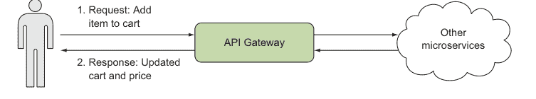

Figure 1.5 When frontend code makes a request to add an item to the shopping cart, it only communicates with the API Gateway microservice. What goes on behind the gateway isn’t visible.

This is neither surprising nor exciting. The interesting part is the interactions taking place behind the API Gateway microservice to fulfill the request. To add the new item to the user’s shopping cart, the API Gateway uses a few other microservices. Each microservice is a separate process, and in this example they communicate via HTTP requests.

### 1.7.1 Main handling of the user request

All the microservices and their interactions for fulfilling a user request to add an item to their shopping cart are shown in figure 1.6. The request to add an item to the shopping cart is divided into smaller tasks, each of which is handled by a separate microservice:

- The API Gateway microservice is responsible only for a cursory validation of the incoming request. Once it’s validated, the work is delegated first to the shopping cart microservice and then to the price calculation microservice.
- The shopping cart microservice uses another microservice—the product catalog—to look up the necessary information about the item being added to

### 1.7.2 Side effects of the user request

At this particular e-commerce website, when a user adds an item to their shopping cart, a couple of actions happen in addition to adding the item to the cart:

1. The recommendation engine updates its internal model to reflect the fact that the user has shown a high degree of interest in that particular product.
2. The tracking service records that the user added the item to their cart in the tracking database. This information may be used later for reporting or other business intelligence purposes.

Neither of these actions needs to happen in the context of the user’s request; they may as well happen after the request has ended, when the user has received a response and is no longer waiting for the backend system.

You can think of these types of actions as side effects of the user’s request. During the request the fact that the user added an item to the shopping is recorded as an event. The side effects aren’t direct effects of the request to update the user’s shopping cart; they’re secondary effects that happen as reactions to the event that recorded that the item was added to the cart. Figure 1.7 zooms in on the side effects of adding an item to the cart.

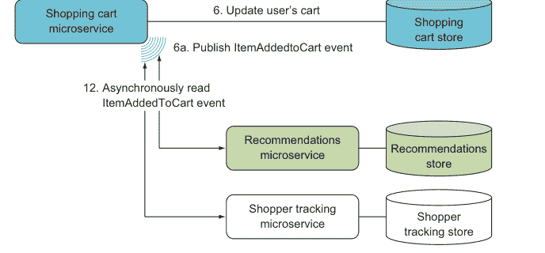

Figure 1.7 The shopping cart microservice publishes events, and other subscribing microservices react.

The trigger for these side effects is an ItemAddedToCart event published by the Shopping Cart microservice. Two other microservices subscribe to events from shopping cart and take the necessary actions as events (such as ItemAddedToCart events) occur. These two subscribers react to the events asynchronously—outside the context of the original request—so the side effects may happen in parallel with the main handling of the request or after the main handling has completed.


NOTE 使用事件源实现这种事件驱动架构将在第5章中介绍。

#### 1.7.3 完整视图

总共有六个不同的微服务参与处理向购物车添加商品请求，如图1.8所示。这些微服务中没有任何一个了解其他微服务的内部结构。其中五个拥有专用的私有数据存储区，仅服务于其自身用途。部分处理在用户请求的上下文中同步进行，部分则异步进行。

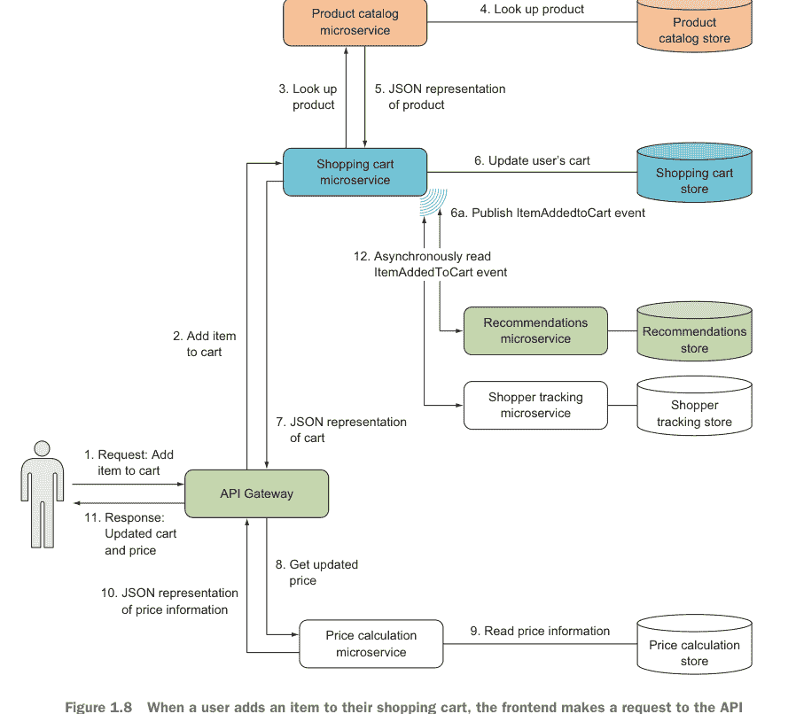

图1.8 当用户将商品添加到购物车时，前端向API网关微服务发起请求，该微服务与其他微服务协作以完成请求。在处理过程中，微服务可能会引发事件，其他微服务可以订阅并异步处理这些事件。

这是一个典型的微服务系统。请求通过多个微服务的协作来处理，每个微服务只负责单一职责，并尽可能保持与其他微服务的独立性。

现在，我们从一个高层角度具体查看了微服务系统如何处理用户请求，是时候简要了解一下基于 .NET 的微服务技术栈了。

### 1.8 .NET 微服务技术栈

是时候来介绍本书中使用的最核心技术：ASP.NET、ASP.NET MVC 和 Kubernetes 了。

### 1.8.1 ASP.NET 和 MVC

ASP.NET 是微软的 Web 平台，具有多项与本书中我们将创建的微服务相关的优势：

- 跨平台——ASP.NET 基于 .NET 5，可在 Linux、Windows 等平台上运行。这在决定在哪里运行微服务时提供了一定的灵活性。我们将在 Kubernetes 集群中的 Linux 容器内运行它们，但微服务也可以在不同的容器编排器、Windows 容器，或 Windows 或 Linux 服务器上运行。
- 快速——ASP.NET 很快，底层的 .NET 5 平台⁸ 同样如此。这为构建快速的微服务奠定了良好的基础。
- 微服务是一等公民——ASP.NET 的主要目标之一是微服务，这意味着该平台已经实现了我们需要自行实现的一些重要基础功能，例如请求日志记录和监控支持。
- 中间件管道——中间件是一种轻量级、可组合且灵活的方式来构建处理传入 HTTP 请求的管道。我们的微服务将在其中间件管道的末端使用 ASP.NET MVC。
- 可测试——我们将利用 ASP.NET 的 TestHost 测试助手，以有利于测试驱动开发中“由外到内”风格的方式，对微服务进行彻底测试。

在 ASP.NET 平台之上，我们将使用微软的 ASP.NET MVC⁹ Web 框架，它在实现 HTTP 端点处理器时提供了额外的便利性。

### 1.8.2 Kubernetes

Kubernetes 是一个容器编排器，我们将使用它来运行微服务。它允许我们自动化部署，并在某种程度上管理我们的微服务。在第3章中，我们将在 Azure 中创建一个 Kubernetes 集群，并查看如何

⁸ 根据 TechEmpower 基准测试：https://www.techempower.com/benchmarks/。

⁹ 在整个书中，我将经常把 ASP.NET MVC 简称为 MVC。

将我们的微服务部署到 Kubernetes 集群。随后，我们将继续将微服务部署到 Kubernetes。

### 1.8.3 设置开发环境

在开始编写第一个微服务代码之前，你需要具备合适的工具。要跟随本书中的示例，你需要四个主要工具：IDE、.NET 命令行、HTTP 工具和 Docker。

首先，你需要一个用于创建 ASP.NET 应用程序的开发环境。三种最常见的选择如下：

- Visual Studio——Visual Studio 是一个功能完备的 IDE，对编写和调试 ASP.NET 应用程序提供了很好的支持。它仅支持 Windows，可能是 ASP.NET 开发中最广泛使用的 IDE。
- Visual Studio Code——Visual Studio Code 是一个功能丰富的编辑器，自带 C# 插件，使其成为编写 ASP.NET 应用程序的得力工具。它轻量级，并支持 Windows、Linux 和 Mac。
- JetBrains Rider——Rider 是另一个功能完备的 IDE，对编写和调试 ASP.NET 应用程序提供了强大的支持。Rider 在 Windows、Linux 和 Mac 上均可运行。

所有这些工具都支持开发、运行和调试 ASP.NET 应用程序。它们都提供了带有 IntelliSense 和重构支持的 C# 编辑器。它们都支持 ASP.NET，并且都可以启动和调试 ASP.NET 应用程序。

其次，你需要拥有 .NET 命令行工具的一个版本。如果 IDE 没有附带该工具，请按照 http://dot.net 上的说明安装 .NET。这将为你提供一个名为 `dotnet` 的命令行工具，用于执行与微服务相关的各种任务，包括还原、构建、创建 NuGet 包以及运行微服务。在整个书中，我将使用 `dotnet` 命令行来完成这些任务，但如果你愿意，也可以在 IDE 中完成大部分工作。

第三，你需要一个发起 HTTP 请求的工具。我推荐使用 Visual Studio Code 的 REST 客户端插件，但 Fiddler、Postman 和 cURL 也是优秀且流行的工具。你可以使用其中任何一个来跟随本书中的示例。

第四，你需要安装 Docker，并需要在 Docker 设置中启用 Kubernetes。

NOTE 在附录A中，你可以找到 Visual Studio、Visual Studio Code、JetBrains Rider 和 Docker 的下载、安装及快速使用信息。现在是时候设置你选择的工具了——在书的剩余部分你将需要它们。

### 1.9 一个简单的微服务示例

一旦你拥有了可运行的开发环境，是时候来一个“Hello World”式的微服务示例了。你将使用 ASP.NET 创建一个微服务，

该微服务只有一个 API 端点。通常，一个微服务会有多个端点，但对于这个示例来说，一个就足够了。该端点响应当前的 UTC 日期和时间。图1.9对此进行了说明。

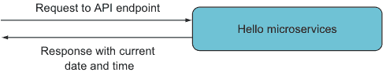

**图1.9** 一个“Hello World”式的微服务，响应当前的日期和时间

> **NOTE** 当我提到*API端点*、*HTTP端点*或仅仅*端点*时，我指的是你的某个微服务响应 HTTP 请求的 URL。

要实现这个示例，你将遵循以下三个步骤：

1. 创建一个空的 ASP.NET 应用程序。
2. 向应用程序添加 ASP.NET MVC。
3. 添加一个包含端点实现的 MVC 控制器。

接下来的部分将详细讲解每一步。

### 1.9.1 创建一个空的 ASP.NET 应用程序

你需要做的第一件事是使用 .NET 命令行工具创建一个名为 `Hello-Microservices` 的空 ASP.NET 应用程序。如果你愿意，也可以使用 IDE 创建项目——结果是一样的。要使用 .NET 命令行工具，打开一个 shell 并执行命令 `dotnet new web --name HelloMicroservices`。

一旦你创建了空的 ASP.NET 应用程序并将其命名为 Hello-Microservices，你应该会看到一个名为 HelloMicroservices 的文件夹，其中包含以下文件：

- appsettings.Development.json
- appsettings.json
- HelloMicroservices.csproj
- Program.cs
- Startup.cs

项目中还有其他文件，但目前你只需要关注这些文件。

这是一个完整的应用程序，随时可以运行。它将响应路径“/”的 HTTP GET 请求，并返回字符串 Hello World。你可以通过进入 HelloMicroservices 文件夹并输入命令 `dotnet run` 从命令行启动该应用程序。

该应用程序在本地主机端口 5000 上运行。（请注意，如果你选择在 Visual Studio 内部运行，可能会分配到另一个端口。）如果在浏览器中访问 http://localhost:5000，你将得到“Hello World”响应。


### 1.9.3 添加一个带有端点实现的 MVC 控制器

现在你将添加一个带有单个 API 端点实现的 MVC 控制器。我们将控制器实现为继承自 ControllerBase 的类，并使用它们来声明端点并为每个端点实现行为。由于我们在上一节中向 Startup 添加了 endpoints.MapControllers 行，ASP.NET 将发现我们在控制器中声明的端点。我们通过创建一个名为 CurrentDateTimeController.cs 的文件并向其中添加以下代码来添加一个控制器。

### Listing 1.2 MVC Controller

```
namespace HelloMicroservices
{
    using System;
    using Microsoft.AspNetCore.Mvc;

    public class CurrentDateTimeController : ControllerBase
    {
        [HttpGet("/")]
        public object Get() => DateTime.UtcNow;
    }
}
```

在此控制器中，你使用属性 HttpGet("/") 为路径 / 声明了一个路由。这告诉 MVC 任何对 / 的 HTTP GET 请求都应由属性后面的方法处理，此例中为方法 Get()。Get() 方法返回当前的 UTC 日期和时间，因此这是对 / 的每次 HTTP GET 请求的响应。

你现在可以重新运行应用程序并再次将浏览器指向 https://localhost:5001。你的浏览器将命中你的 MVC 控制器的路由并以字符串形式显示当前的 UTC 日期和时间。我们也可以使用 Visual Studio Code 中的 REST 客户端插件来做同样的事情，如图 1.10 所示。

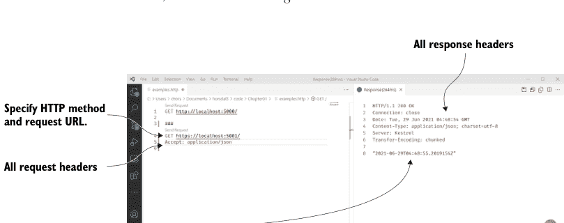

Figure 1.10 REST client in VS Code makes it easy to send HTTP requests and control the request details, such as the headers and HTTP method.

在网络上，这是请求：

```
GET / HTTP/1.1
Host: localhost:5001
Accept: application/json
```

HTTP method (GET), path (/), and protocol (HTTP/1.1) used in the request

Host to which the request is made

List of request headers. In this case, there's only an Accept header with the value application/json.

此请求的响应是当前 UTC 日期和时间以 JSON 字符串形式表示：

```
HTTP/1.1 200 OK
Connection: close
Date: Thu, 21 Nov 2019 12:28:01 GMT
Content-Type: application/json; charset=utf-8
Server: Kestrel
Transfer-Encoding: chunked
```

```
"2019-11-21T12:28:02.5561423Z"
```

> NOTE Remember you can create HTTP request and see the responses using tools like REST client for VS Code, Postman, or Fiddler.

你现在已经使用 ASP.NET MVC 实现了你的第一个 HTTP 端点。

### Summary

- Microservices is an overloaded term used both for the microservices architectural style and for individual microservices in a system of microservices.
- The microservices architectural style is a special form of SOA, where each service is small and provides one and only one business capability.
- A microservice is a service with a single narrowly focused capability.
- I'll refer to six characteristics of a microservice in this book:
  - Provides a single capability.
  - Individually deployable. You must be able to deploy every microservice on its own without touching any other part of the system.
  - Runs in one or more processes, separate from other microservices.
  - Owns and stores the data belonging to the capability it provides in a data store that the microservice itself has access to.
  - Is small enough that a small team of around five people can develop and maintain a few handfuls or more of them.
  - Replaceable. The team should be able to rewrite a microservice from scratch in a short period of time if, for instance, the codebase has become a mess.
- Microservices go hand-in-hand with continuous delivery:
  - Having small, individually deployable microservices makes continuous delivery easier.
  - Being able to deploy automatically, quickly, and reliably simplifies deploying and maintaining a system of microservices.
- A system built with microservices allows for scalability and resilience.
- A system built with microservices is malleable: it can be easily changed according to your business needs. Each microservice by itself is highly maintainable, and even creating new microservices to provide new capabilities can be done quickly.
- Microservices collaborate to provide functionality to the end user.
- A microservice exposes a remote public API that other microservices may use.
- A microservice can expose a feed of events that other microservices can subscribe to. Events are handled asynchronously in the subscribers but still allow subscribers to react to events quickly.
- ASP.NET is well suited for implementing microservices.
- Kubernetes is the container orchestrator we will use throughout the book.
- Most microservices don't serve HTML from their endpoints, but rather data in the form of JSON, for instance. Tools like REST client, Postman, and Fiddler are good for testing such endpoints.

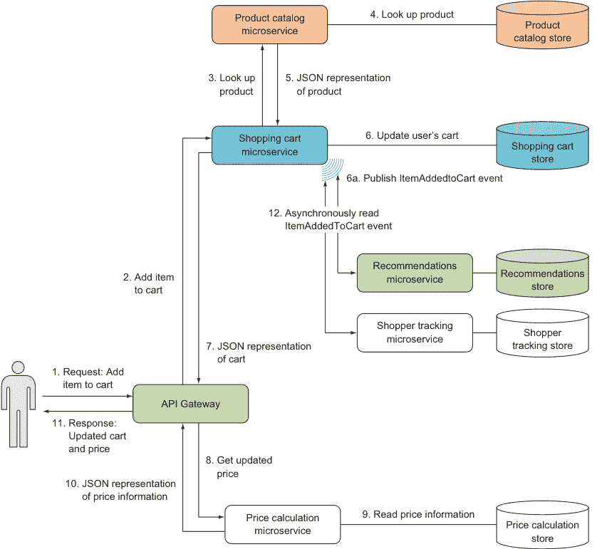

**Figure 2.1** The shopping cart microservice allows other microservices to get a shopping cart, add items to and delete items from a shopping cart, and subscribe to events from the shopping cart.

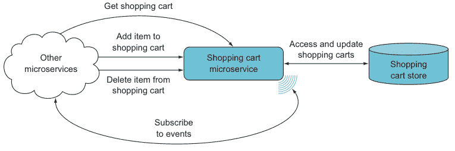

**Figure 2.2** Overview of how an e-commerce site built with microservices can handle adding an item to a user’s shopping cart

The shopping cart microservice supports three types of synchronous requests:

- Getting a shopping cart
- Adding an item to a shopping cart
- Deleting an item from a shopping cart

On top of that, it exposes an event feed that other microservices can subscribe to. Now that you’ve seen an overview of the shopping cart microservice’s complete functionality, you can start drilling into its implementation.

### 2.1.1 Components of the Shopping Cart microservice

Let’s zoom in and see what this microservice looks like at closer range. As shown in figure 2.3, the shopping cart microservice consists of these components:

- A small component called shopping cart domain model responsible for implementing any business rules related to shopping carts.
- An HTTP API component that’s responsible for handling all incoming HTTP requests. The HTTP API component is divided into two parts: one handles requests from other microservices to do something, and the other exposes an event feed.

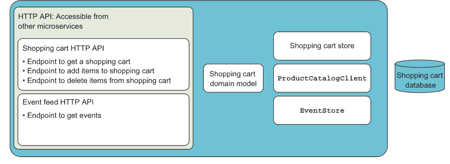

Figure 2.3 The shopping cart microservice is a small codebase with a few components that provide one focused business capability.

There are two data store components: EventStore and ShoppingCartStore. These data store components are responsible for talking to the data store (Shopping Cart Database):

- EventStore handles saving events to and reading them from the data store.
- ShoppingCartStore handles reading and updating shopping carts in the data store. Note that shopping carts and events may be stored in different databases; we’ll return to this in chapter 6.

The ProductCatalogClient component is responsible for communicating with the product catalog microservice shown in figure 2.1. Placing that communication in ProductCatalogClient serves several purposes:

- It encapsulates knowledge of the other microservice’s API in one place.
- It encapsulates the details of making an HTTP request.
- It encapsulates caching results from the other microservice.
- It encapsulates handling errors from the other microservice.

This chapter includes the code for the domain model, the HTTP API, and a basic implementation of ProductCatalogClient, but skips EventStore and ShoppingCartStore and the data store. In addition, for the sake of brevity, this chapter omits error-handling code. Chapter 5 will go further into detail about how to implement microservice APIs easily with ASP.NET; chapter 6 will also return to the subject of storing data in a microservice. Chapter 7 will dive deeper into how to design robustness and error handling into clients such as ProductCatalogClient.

## 2.2 Implementing the Shopping Cart microservice

Now that you understand the shopping cart microservice’s components, it’s time to get into the code.

### New technologies used in this chapter

In this chapter, you’ll begin using three new technologies:

- System.Net.Http.HttpClient is a .NET type for making HTTP requests. It provides an API for creating and sending HTTP requests as well as reading the responses that come back.
- Polly is a library that makes it easy to implement the more common policies for handling remote-call failures. Out of the box, Polly has support for various retry and circuit breaker policies. I’ll discuss circuit breakers in chapter 7.
- Scrutor is a library that adds a number of convenient extensions to ASP.NET’s built-in dependency injection container

### 2.2.1 Creating an empty project

The first thing you need to do is set up an ASP.NET project, just as in chapter 1. First, create an empty ASP.NET application called ShoppingCart—on the command line, you can use the command dotnet new web -n ShoppingCart. Second, add ASP.NET MVC to the application in the Startup class, as shown in the following listing.

### Listing 2.1 Startup class with MVC

```
namespace ShoppingCart
{
    using Microsoft.AspNetCore.Builder;
    using Microsoft.Extensions.DependencyInjection;
}
```


```csharp
public class Startup
{
    public void ConfigureServices(IServiceCollection services)
    {
        services.AddControllers();
    }

    public void Configure(IApplicationBuilder app)
    {
        app.UseHttpsRedirection();
        app.UseRouting();
        app.UseEndpoints(endpoints =>
            endpoints.MapControllers());
    }
}
```

现在，你拥有了一个随时可以使用的空应用程序。

## 2.2.2 面向其他服务的购物车微服务 API

在本节中，你将实现购物车微服务的 HTTP API，如图 2.4 中突出显示的部分。该 API 由三部分组成，每一部分都实现为一个 HTTP 端点：

- 一个 HTTP GET 端点，其他微服务可以通过提供用户 ID 来获取用户的购物车，返回结果为 JSON 文档。
- 一个 HTTP POST 端点，其他微服务可以向用户的购物车中添加物品。要添加的物品以产品 ID 的 JSON 数组形式传递给该端点。
- 一个 HTTP DELETE 端点，其他微服务可以从用户的购物车中移除物品。要删除的物品以产品 ID 的 JSON 数组形式放在请求体中传递。

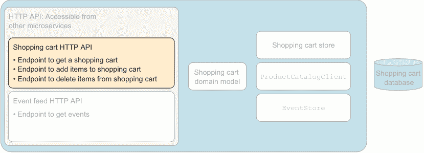

接下来的三节将分别实现其中一个端点。

**注意：** 我不会展示 EventStore 或 ShoppingCartStore 的实现。第 6 章会介绍它们，但现在，一个简单的硬编码实现就足够了。你可以从本书的代码包中获取 EventStore 和 ShoppingCartStore 的实现，也可以自己创建一个。

### 获取购物车

你将实现的 HTTP API 的第一部分是让其他微服务能够获取用户购物车的端点。图 2.5 展示了其他微服务如何使用端点来获取购物车。

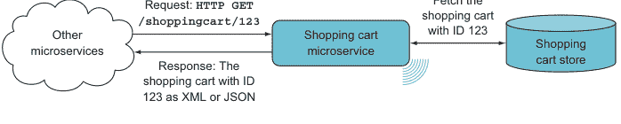

图 2.5 其他微服务可以使用购物车上的端点，以 JSON 文档的形式获取购物车。

该端点接受 HTTP GET 请求。其 URL 包含其他微服务所需购物车对应的用户 ID，响应主体是该购物车的 JSON 序列化结果。

例如，图 2.1 中的 API 网关可能需要 ID 为 123 的用户的购物车。为了获取它，网关会发送以下 HTTP 请求：

```
HTTP GET /shoppingcart/123 HTTP/1.1
Host: shoppingcart.my.company.com
Accept: application/json
```

这是对购物车微服务上 shoppingcart/123 的请求，URL 中的 123 部分就是用户 ID。

为了处理这些请求，你需要向 ShoppingCart 项目中添加一个名为 ShoppingCartController 的控制器，以及 ShoppingCart 领域模型。我倾向于采用一种遵循领域划分的文件夹结构，将紧密相关的内容集中在一起，将不太相关的内容分开。因此，我在 ShoppingCart 项目中新建了一个名为 ShoppingCart 的文件夹，将 ShoppingCartController 和 ShoppingCart 放在里面。下面的清单展示了文件夹结构。该文件夹结构遵循领域划分，将紧密相关的内容放在以领域命名的文件夹中。例如，ShoppingCart 领域类型和控制器位于同一个文件夹中。

**清单 2.2 ShoppingCart 文件夹结构**

```
ShoppingCart
  appsettings.Development.json
  appsettings.json
```

ShoppingCart 领域模型很简单，如下所示：

```csharp
namespace ShoppingCart.ShoppingCart
{
    using System.Collections.Generic;
    using System.Linq;

    public class ShoppingCart
    {
        private readonly HashSet<ShoppingCartItem> items = new();

        public int UserId { get; }
        public IEnumerable<ShoppingCartItem> Items => this.items;

        public ShoppingCart(int userId) => this.UserId = userId;

        public void AddItems(IEnumerable<ShoppingCartItem> shoppingCartItems)
        {
            foreach (var item in shoppingCartItems)
                this.items.Add(item);
        }

        public void RemoveItems(int[] productCatalogueIds) =>
            this.items.RemoveWhere(i => productCatalogueIds.Contains(
                i.ProductCatalogueId));
    }

    public record ShoppingCartItem(
        int ProductCatalogueId,
        string ProductName,
        string Description,
        Money Price)
    {
        public virtual bool Equals(ShoppingCartItem? obj) =>
            obj != null && this.ProductCatalogueId.Equals(obj.ProductCatalogueId);

        public override int GetHashCode() =>
            this.ProductCatalogueId.GetHashCode();
    }

    public record Money(string Currency, decimal Amount);
}
```

领域模型就绪后，我们就可以编写 ShoppingCartController 了。正如第 1 章所述，我们将通过继承 Controller 来实现控制器，并使用控制器来实现 HTTP 端点。将以下代码放入名为 ShoppingCartController.cs 的文件中。

**清单 2.3 按用户 ID 访问购物车的端点**

```csharp
namespace ShoppingCart.ShoppingCart
{
    using Microsoft.AspNetCore.Mvc;
    using ShoppingCart;

    [Route("/shoppingcart")]
    public class ShoppingCartController : ControllerBase
    {
        private readonly IShoppingCartStore shoppingCartStore;

        public ShoppingCartController(IShoppingCartStore shoppingCartStore)
        {
            this.shoppingCartStore = shoppingCartStore;
        }

        [HttpGet("{userId:int}")]
        public ShoppingCart Get(int userId) =>
            this.shoppingCartStore.Get(userId);
    }
```

- 告诉 MVC 该控制器中的所有路由都以 /shoppingcart 开头
- 将 ShoppingCartController 声明为控制器
- 声明用于处理对 /shoppingcart/{userId}（例如 /shoppingcart/123）请求的端点
- 将 URL 中的 {userId} 赋值给 userId 变量
- 返回用户的购物车。MVC 会在将其发送给客户端之前进行序列化。

让我们来分析一下这段代码。

`[HttpGet("{userId:int}")]` 特性声明了你希望处理与括号内模式匹配的 HTTP GET 请求端点。该模式可以是一个字符串字面量，例如 `"/shoppingcart"`；也可以包含与请求 URL 的某些部分匹配并将其捕获的段，例如 `{userId:int}`；还可以将字符串字面量和段组合起来，例如 `"/shoppingcart/{userId:int}"`。`{userId:int}` 名为 userId，并且被约束为只能匹配整数。

HttpGet 特性后面是一个方法：

```csharp
public ShoppingCart Get(int userId) =>
    this.shoppingCartStore.Get(userId);
```

这就是操作（action）方法，每当购物车微服务收到与路由声明匹配的 URL 请求时，都会执行这段代码。例如，当 API 网关通过 URL 路径 /shoppingcart/123 请求购物车时，处理该请求的就是这个方法。

操作方法可以接受与 URL 各段匹配的参数。例如，根据参数名和段名，int userId 会与 {userId} 段匹配。

操作方法使用一个 shoppingCartStore 对象，该对象由 ShoppingCartController 的构造函数作为参数接收，并赋值给一个实例变量：

```csharp
public ShoppingCartController(IShoppingCartStore shoppingCartStore)
{
    this.shoppingCartStore = shoppingCartStore;
}
```

```csharp
public class ShoppingCartStore : IShoppingCartStore
{
    private static readonly Dictionary<int, ShoppingCart> Database = new Dictionary<int, ShoppingCart>();

    public ShoppingCart Get(int userId) =>
        Database.ContainsKey(userId)
        ? Database[userId]
        : new ShoppingCart(userId);

    public void Save(ShoppingCart shoppingCart) =>
        Database[shoppingCart.UserId] = shoppingCart;
}
```

目前使用内存字典而不是数据库。

回到 ShoppingCartController，操作方法 Get 返回从 shoppingCartStore 获取的 ShoppingCart 对象：

```csharp
this.shoppingCartStore.Get(userId);
```

ShoppingCart 类型是购物车微服务特有的，因此 MVC 无法了解这个特定类型。但你可以返回任何你想要的类型，MVC 会将其序列化并将数据返回给调用方。

下面的清单展示了向 /shoppingcart/123 发起请求后，响应结果的一个示例。

**清单 2.4 购物车微服务的响应示例**

```
HTTP/1.1 200 OK
Content-Type: application/json; charset=utf-8

539
{
  "userId": 42,
  "items": [
    {
      "productCatalogueId": 1,
      "productName": "Basic t-shirt",
      "description": "a quiet t-shirt",
      "price": {
        "currency": "eur",
        "amount": 40
      }
    },
    {
      "productCatalogueId": 2,
      "productName": "Fancy shirt",
      "description": "a loud t-shirt",
      "price": {
        "currency": "eur",
        "amount": 50
      }
    }
  ]
}
```

- 响应主体为 JSON 格式。
- 响应主体的长度
- 序列化为 JSON 的购物车


正如你所见，使用少量代码即可实现大量功能并使其运行。

## 向购物车添加商品

你需要添加到购物车微服务中的第二个端点可让你向用户的购物车中添加商品。图 2.6 显示了其他微服务如何使用此端点。

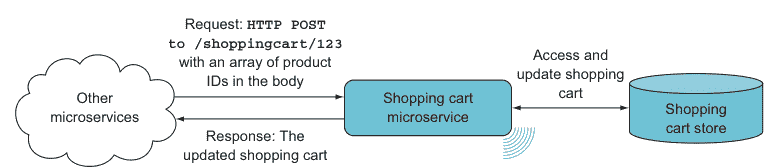

图 2.6 其他微服务可以通过包含请求体中产品 ID 数组的 HTTP POST 请求向购物车添加商品。

与上一节中的 HTTP GET 端点类似，此新端点在 URL 中接收用户 ID。这次，端点接受 HTTP POST 请求而不是 HTTP GET，并且请求应在请求体中提供商品列表。例如，以下请求将两件商品添加到用户 123 的购物车中。

### 代码清单 2.5 向购物车添加两件商品

```
POST /shoppingcart/123/items HTTP/1.1
Host: shoppingcart.my.company.com
Accept: application/json
Content-Type: application/json

[1, 2]
```

URL 包含购物车的 ID：123。
响应应为 JSON 格式。
请求体中的数据为 JSON。
请求体是产品 ID 的 JSON 数组。

要处理此类请求，你需要在 ShoppingCart-Controller 中添加另一个 action 方法。新的 action 方法从请求体中读取商品，查找每个商品的产品信息，将它们添加到正确的购物车中，并返回更新后的购物车。 （获取产品信息的代码在第 2.2.3 节中显示。）

新的 action 方法显示在下一个清单中。将它添加到 ShoppingCart-Controller。

### 代码清单 2.6 添加商品到购物车的路由处理程序

```
[Route("/shoppingcart")]
public class ShoppingCartController : Controller
{
```
```csharp
private readonly IShoppingCartStore shoppingCartStore;
private readonly IProductCatalogClient productCatalogClient;
private readonly IEventStore eventStore;

public ShoppingCartController(
    IShoppingCartStore shoppingCartStore,
    IProductCatalogClient productCatalogClient,
    IEventStore eventStore)
{
    this.shoppingCartStore = shoppingCartStore;
    this.productCatalogClient = productCatalogClient;
    this.eventStore = eventStore;
}

[HttpGet("{userId:int}")]
public ShoppingCart Get(int userId) =>
    this.shoppingCartStore.Get(userId);

[HttpPost("{userId:int}/items")]
public async Task<ShoppingCart> Post(
    int userId,
    [FromBody] int[] productIds)
{
    var shoppingCart = shoppingCartStore.Get(userId);
    var shoppingCartItems =
        await this.productCatalogClient
            .GetShoppingCartItems(productIds);
    shoppingCart.AddItems(shoppingCartItems, eventStore);
    shoppingCartStore.Save(shoppingCart);
    return shoppingCart;
}
```
```

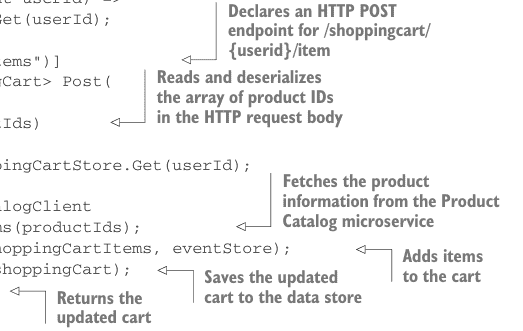

这里有两种新的 MVC 能力在发挥作用。首先，新的 action 方法是异步的，因为它对产品目录微服务进行了远程调用。异步执行该外部调用可为购物车节省资源。ASP.NET 可以完全异步运行，这使得应用程序代码能够很好地利用 C# 的 async/await 功能。当我们超越 IShoppingCartStore 的虚拟实现并开始使用真实数据库时，同样的原则也适用，IShoppingCartStore 上的 Get 和 Save 方法也将变为 async，这反过来会使 action 方法 Get 变为 async。

其次，请求的 body 包含产品 ID 的 JSON 数组。这些是要添加到购物车的商品。action 使用 MVC 模型绑定将其读取为 C# 数组：

```
```csharp
[FromBody] int[] productIds
```
```

模型绑定支持任何可序列化的 C# 对象。你通常会使用比平面 JSON 数组更结构化的对象来向端点发送数据，读取它与本例一样简单。参数 `int[] productIds` 的类型只需更改为 `int[]` 以外的其他类型即可。

## 从购物车中移除商品

第三个也是最后一个端点是一个 HTTP DELETE 端点，如图 2.7 所示，可让其他微服务从购物车中移除商品。你现在应该已经掌握了向控制器添加端点的方法。你需要实现一个 HTTP DELETE 端点，该端点接受产品 ID 数组并从购物车中移除这些产品。将以下代码添加到 ShoppingCartController。

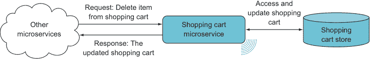

**图 2.7** 其他微服务可以通过在请求体中提供产品 ID 数组的 HTTP DELETE 请求从购物车中移除商品。

```
```csharp
[HttpDelete("{userId:int}/items")]
public ShoppingCart Delete(
    int userId,
    [FromBody] int[] productIds)
{
    var shoppingCart =
        this.shoppingCartStore.Get(userId);
    shoppingCart.RemoveItems(
        productIds,
        this.eventStore);
    this.shoppingCartStore.Save(shoppingCart);
    return shoppingCart;
}
```
```

如果它们使用不同的 HTTP 方法，使用相同的路由模板进行两个路由声明是可以的。

eventStore 将在 RemoveItems 方法中稍后使用。

这完成了 ShoppingCartController，其代码最终约为 50 行。

## 2.2.3 获取产品信息

现在购物车微服务公开的 API 已经实现，让我们换个思路，看看产品信息是如何从产品目录微服务获取的。图 2.8 突出了 ProductCatalogClient，你将在本节中实现它。

产品目录微服务和购物车微服务是运行在不同进程中的独立微服务，甚至可能运行在不同的服务器上。产品目录公开了一个 HTTP API，供购物车使用。产品目录信息是通过对产品目录微服务上的端点进行的 HTTP GET 请求获取的。

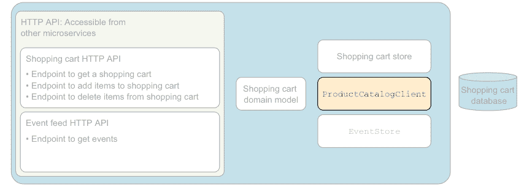

# 图 2.8 ProductCatalogClient

要实现对产品目录微服务的 HTTP 请求，你需要遵循以下三个步骤：

- 1. 实现 HTTP GET 请求。
- 2. 解析产品目录微服务端点的响应并将其转换为购物车微服务的领域。
- 3. 实现处理对产品目录微服务失败请求的策略。

后续章节将引导你完成这些步骤。

## 实现 HTTP GET

产品目录微服务在路径 /products 上公开一个端点。端点接受产品 ID 数组作为查询字符串参数，并返回这些产品的产品信息。例如，以下请求获取产品 ID 1 和 2 的信息：

```
HTTP GET /products?productIDs=[1,2] HTTP/1.1
Host: productcatalog.my.company.com
Accept: application/json
```

你将使用 HttpClient 类型执行 HTTP 请求。不是使用真实的产品目录微服务，实现会调用 GitHub 上的一个硬编码 JSON 文件，该文件充当产品目录端点的伪版本。使用该伪端点，以下代码向产品目录微服务发出 HTTP GET 请求。

### 代码清单 2.9 向产品目录微服务发出 HTTP GET 请求

```
public class ProductCatalogClient : IProductCatalogClient
{
    private readonly HttpClient client;
    private static string productCatalogBaseUrl =
```


```
@"https://git.io/JeHiE";
private static string getProductPathTemplate = "?productIds={0}";

public ProductCatalogClient(HttpClient client)
{
    client.BaseAddress =
        new Uri(productCatalogBaseUrl);
    client
        .DefaultRequestHeaders
        .Accept
        .Add(new MediaTypeWithQualityHeaderValue("application/json"));
    this.client = client;
}

public async Task<IEnumerable<ShoppingCartItem>>
    GetShoppingCartItems(int[] productCatalogIds)
{
    ....
}

private async Task<HttpResponseMessage>
    RequestProductFromProductCatalog(int[] productCatalogIds)
{
    var productsResource =
        string.Format(getProductPathTemplate,
            string.Join(",", productCatalogIds));
    return await
        this.client.GetAsync(productsResource);
}
```

ASP.NET 注入 HttpClient。

配置 HttpClient 以使用产品目录的基础地址。

配置 HttpClient 以接受来自产品目录的 JSON 响应。

稍后会实现

指示 HttpClient 异步执行 HTTP GET

这相当直接。唯一需要注意的是，通过异步执行 HTTP GET 请求，当前线程被释放以处理购物车中的其他任务，而请求在产品目录中处理。这是一种良好的实践，因为它保留了购物车微服务中的资源，使其资源消耗更少、更具可扩展性。

为了让 ASP.NET 能够在 ProductCatalogClient 中注入 HttpClient，我们需要将 ProductCatalogClient 注册为类型化 http 客户端，我们通过在 Startup 中的 ConfigureServices 方法中添加以下内容来实现：

```
services.AddHttpClient<IProductCatalogClient, ProductCatalogClient>();
```

现在 ASP.NET 可以解析 ProductCatalogClient，后者可以反过来注入到其他类型中，例如 ShoppingCartController。

## 2.2.4 解析产品响应

产品目录微服务以 JSON 数组形式返回产品信息。该数组包含每个请求产品的条目，如下所示。

### 代码清单 2.10 返回产品 JSON 列表

```
HTTP/1.1 200 OK
Content-Type: application/json; charset=utf-8
```


```
[
    {
        "productId": "1",
        "productName": "Basic t-shirt",
        "productDescription": "a quiet t-shirt",
        "price": { "amount": 40, "currency": "eur" },
        "attributes": [
            {
                "sizes": ["s", "m", "l"],
                "colors": ["red", "blue", "green"]
            }
        ]
    },
    {
        "productId": "2",
        "productName": "Fancy shirt",
        "productDescription": "a loud t-shirt",
        "price": { "amount": 50, "currency": "eur" },
        "attributes": [
            {
                "sizes": ["s", "m", "l", "xl"],
                "colors": ["ALL", "Batique"]
            }
        ]
    }
]
```

This JSON must be deserialized, and the information required to create a list of ShoppingCart items needs to be read from it. The array returned from product catalog is formatted by the microservice’s API. To avoid tight coupling between microservices, only the ProductCatalogClient class knows anything about the API of the product catalog microservice. That means the ProductCatalogClient is responsible for translating the data received from the microservice into types for the ShoppingCart project. In this case, you need a list of ShoppingCartItem objects. The following listing shows the code for deserializing and translating the response data.

### Listing 2.11 Extracting data from the response

```csharp
private static async Task<IEnumerable<ShoppingCartItem>>
    ConvertToShoppingCartItems(HttpResponseMessage response)
{
    response.EnsureSuccessStatusCode();
    var products = await
        JsonSerializer.DeserializeAsync<List<ProductCatalogProduct>>(
            await response.Content.ReadAsStreamAsync(),
            new JsonSerializerOptions
            {
                PropertyNameCaseInsensitive = true
            }) ?? new();
    return products
        .Select(p =>
            new ShoppingCartItem(
                p.ProductId,
                p.ProductName,
                p.ProductDescription,
                p.Price));
}

private record ProductCatalogProduct(
    int ProductId,
    string ProductName,
    string ProductDescription,
    Money Price);
```

- Uses System.Text.Json to deserialize the JSON from the product catalog microservice.
- Creates a ShoppingCartItem for each product in the response.
- Uses a private record to represent the product data.

If you compare listings 2.10 and 2.11, you may notice that there are more properties in the response than in the ProductCatalogProduct class. This is because the Shopping Cart microservice doesn’t need all the information, so there’s no reason to read the remaining properties. Doing so would only introduce unnecessary coupling. I’ll return to this topic in chapters 5, 6, and 8.

The following listing combines the code that requests the product information and the code that parses the response. This method makes the HTTP GET request and translates the response to the domain of the shopping cart.

### Listing 2.12 Fetching products and converting them to shopping cart items

```csharp
public async Task<IEnumerable<ShoppingCartItem>>
    GetShoppingCartItems(int[] productCatalogIds)
{
    using var response =
        await RequestProductFromProductCatalogue(productCatalogIds);
    return await ConvertToShoppingCartItems(response);
}
```

The ProductCatalogClient is almost finished. The only part missing is the code that handles an HTTP request failure.

## 2.2.5 Adding a failure-handling policy

Remote calls can fail. Not only can they fail, but when running a distributed system at scale, remote calls often do fail. You may not expect the call from shopping cart to product catalog to fail often, but in an entire system of microservices there will often be a failing remote call somewhere in the system.

Remote calls fail for many reasons: the network can fail, the call could be malformed, the remote microservice might have a bug, the server where the call is handled may fail during processing, or the remote microservice might be in the middle of a redeploy. In a system of microservices, you must expect failures and design a level of resilience around every place remote calls are made. This is an important topic, and I’ll go into more detail in chapter 7.

The level of resilience needed around a particular remote call depends on the business requirements for the microservice making the call. The call to the product catalog microservice from the shopping cart microservice is important; without the product information, the user can’t add items to their shopping cart, which means the e-commerce site can’t sell the items to the user. On the other hand, product information doesn’t change often, so you could store a copy of it in the shopping cart and only request it from the product catalog when the copy doesn’t already contain the information. One way to populate such a copy is by caching responses from the product catalog. Caching product information has some significant advantages:

- It makes the shopping cart more resilient to failures in product catalog.
- The shopping cart microservice will perform better when the product information is present in the cache.
- Fewer calls made from the shopping cart microservice mean less stress is put on the product catalog microservice.

For now, you won’t implement caching; we’ll return to the subject of caching for the sake of robustness in chapter 7.

Even with caching in place, some calls from the shopping cart to the product catalog are still made. For these calls, you may decide that the best strategy for handling failed calls is to retry the call a couple of times and then give up and fail to add any items to the shopping cart. For this chapter, you’ll implement a simple retry policy for handling failing requests. You’ll use the Polly library and the Microsoft.Extensions.Http.Polly extension to Polly, both of which you’ll install in the ShoppingCart project as a NuGet package.

> **NOTE** Failure-handling strategies and Polly are described in much more detail in chapter 7.

Using a Polly policy involves these two steps:

1. Declaring the policy.
2. Using the policy to execute the remote call.

As you can see in the following listing, Polly’s API and integration with ASP.NET makes both these steps easy. Replace the current registration of ProductCatalogClient in Startup with this:

### Listing 2.13 Microservice error-handling policy

```csharp
services.AddHttpClient<IProductCatalogClient, ProductCatalogClient>()
    .AddTransientHttpErrorPolicy(p =>
        p.WaitAndRetryAsync(
            3,
            attempt => TimeSpan.FromMilliseconds(100*Math.Pow(2, attempt))));
```

- Wraps http calls made in ProductCatalogClient in a Polly policy.
- Uses Polly’s fluent API to set up a retry policy with an exponential back-off.

The HttpClient injected in ProductCatalogClient will use this policy around the call to the product catalog microservice: in case of failure, retry the call at most three times. And for each failure, double the amount of waiting time before making the next attempt.

This completes the implementation of `ProductCatalogClient`. Even though it has fewer than *70* lines of code, it does a lot: it builds up the HTTP GET request and executes it. It parses the response from product catalog and translates it into the shopping cart domain. And it uses the retry policy used for these calls. Next, let's tackle the event feed.

## 2.2.6 Implementing a basic event feed

The shopping cart microservice can now store shopping carts and add items to them. The items include product information from the product catalog microservice. The shopping cart also has an API for other microservices that allows them to add or delete items from shopping carts and read the contents of a shopping cart.

The piece missing is the event feed. The shopping cart needs to publish events about changes to shopping carts, and other microservices can subscribe to these events and react to them as required. In the case of items being added to a shopping cart, figure 2.9 (repeated from Chapter 1) illustrates how the recommendations microservice and the shopper tracking microservice base part of their functionality on events from the shopping cart microservice.

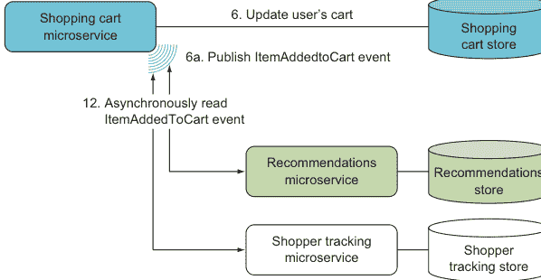

Figure 2.9 The shopping cart microservice publishes events about changes to shopping carts to an event feed. The recommendations and shopper tracking microservices subscribe to these events and react as events arrive.

In this section, you'll implement the `EventFeed` and shopping cart domain model components highlighted in figure 2.10. (Chapter 5 returns to the implementation of event feeds and event subscribers.) The domain model is responsible for raising events, and `EventFeed` allows other microservices to read the events that the shopping cart microservice has published.


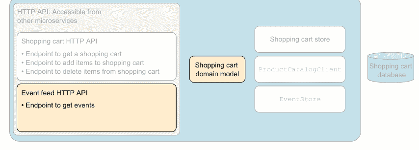

*图 2.10 购物车微服务事件 feed 将事件发布到电商系统的其他部分。*

实现事件 feed 涉及以下步骤：

- *触发事件。* 购物车领域模型中的代码会在发生重要事件（根据业务规则）时触发事件。重要事件是指向购物车中添加或移除商品。
- *存储事件。* 购物车领域模型触发的事件会存储在微服务的数据存储中。
- *发布事件。* 实现事件 feed 允许其他微服务通过轮询订阅。

我们将依次处理这些步骤。

### 触发事件

要被发布，事件必须先被触发。通常是微服务中的领域代码触发事件，在购物车微服务中也是如此。当向购物车添加商品时，ShoppingCart 领域对象通过在 IEventStore 上调用 Raise 方法并提供事件数据来触发事件。

记住我喜欢将相关内容放在文件夹中，所以我添加了一个名为 EventFeed 的新文件夹，并在其中添加了两个文件：Event.cs 和 EventStore.cs。第一个文件包含事件的模型类型，如以下列表所示。

**列表 2.14 简单事件类型**

```
namespace ShoppingCart.EventFeed
{
    using System;

    public record Event(
        long SequenceNumber,
        DateTimeOffset OccurredAt,
        string Name,
        object Content);
}
```

```
seqNumber,
DateTimeOffset.UtcNow,
eventName,
content));
}
```

EventStore 存储所有传入的事件并跟踪它们的到达顺序。我们将在第 6 章重新讨论事件存储的主题，在那里我们将更深入地研究其实现。

### 一个简单的事件 feed

一旦事件被存储，它们就准备好被发布——从某种意义上说，它们*已经*被发布了。即使一个微服务*订阅*另一个微服务的事件，事件 feed 也是通过让订阅者定期请求新事件（例如每 30 秒一次）来工作的。由于订阅者负责请求新事件，你在购物车微服务中需要做的只是添加一个 HTTP 端点，允许订阅者请求事件。订阅者例如可以发出以下请求来获取编号 100 之后的所有事件：

```
GET /events?start=100 HTTP/1.1
Host: shoppingcart.my.company.com
Accept: application/json
```

或者，如果订阅者想要限制每次调用的传入事件数量，它可以在请求中添加 end 参数：

```
GET /events?start=100&end=200 HTTP/1.1
Host: shoppingcart.my.company.com
Accept: application/json
```

将此 /events 端点的实现，如以下列表所示，放在 EventFeed 文件夹中的一个新控制器中。该端点接受可选的起始点和可选的结束点，允许其他微服务请求事件范围。

**列表 2.17 向其他微服务公开事件**

```
namespace ShoppingCart.EventFeed
{
    using System.Linq;
    using Microsoft.AspNetCore.Mvc;

    [Route("/events")]
    public class EventFeedController : Controller
    {
        private readonly IEventStore eventStore;

        public EventFeedController(IEventStore eventStore) =>
            this.eventStore = eventStore;

        [HttpGet("")]
        public Event[] Get(
            [FromQuery] long start,
            [FromQuery] long end = long.MaxValue)
        =>
            this.eventStore
                .GetEvents(start, end)
                .ToArray();
    }
}
```

从查询字符串参数读取 start 和 end 值

返回原始事件列表。MVC 会负责将事件序列化为响应体。

EventFeedController 大多使用你已经遇到过的 MVC 功能。唯一的新内容是 start 和 end 值是从查询字符串参数中读取的。方法参数前面的 FromQuery 参数告诉 MVC 这些是查询字符串参数。

EventFeedController 使用事件存储根据客户端的 start 和 end 值过滤事件。虽然过滤最好在数据库级别完成，但以下简单实现很好地说明了这一点。

**列表 2.18 根据起始点和结束点过滤事件**

```
public IEnumerable<Event> GetEvents(
    long firstEventSequenceNumber,
    long lastEventSequenceNumber) =>
        database
            .Where(e =>
                e.SequenceNumber >= firstEventSequenceNumber &&
                e.SequenceNumber <= lastEventSequenceNumber)
            .OrderBy(e => e.SequenceNumber);
```

有了 /events 端点，想要订阅购物车微服务事件的微服务可以通过轮询端点来实现。订阅者可以——也应该——使用 start 和 end 查询字符串参数，确保只获取新事件。如果在订阅者轮询时购物车宕机，订阅者稍后可以再次请求相同的事件。同样，如果订阅者宕机了一段时间，它可以通过从上次看到的事件开始请求事件来追赶购物车的事件。如前所述，这不是一个完整的事件 feed 实现，但它使微服务能够订阅事件，并且代码很简单。

你现在已经完成了第一个微服务的版本 1 实现。如你所见，微服务很小且专注度窄：它只提供一种业务能力。你也可以看到微服务代码往往简单易懂。这就是为什么你可以期望快速创建新的微服务并替换现有微服务。

### 2.3 运行代码

现在购物车微服务的所有代码都已就位，你可以像在第 1 章运行示例那样运行它：从 Visual Studio 内部，或从命令行使用 dotnet。你可以用 RestClient 或类似工具测试所有端点。

当你第一次尝试通过 HTTP GET 到 /shoppingcart/123 获取购物车时，购物车将是空的。尝试通过 HTTP POST 到 /shoppingcart/123/items 添加一些商品，然后再次获取它；响应应包含已添加的商品。你也可以查看 /events 处的事件 feed，你应该能看到每个添加商品的事件。

**警告** 我没有展示 EventStore 或 ShoppingCartStore 的实现。如果你没有创建这些的实现，你的微服务将无法工作。

### 总结

- 实现一个完整的微服务不需要太多代码。购物车微服务只有以下内容：
  - 两个简短的控制器
  - 一个简单的 ShoppingCart 领域类
  - 一个用于调用产品目录微服务的客户端类
  - 两个简单的数据访问类：ShoppingCartDataStore 和 EventStore（本章未展示）
- MVC 使实现 HTTP API 变得简单。MVC 提供的路由属性使向微服务添加端点变得容易。只需添加一个 action 方法并在其上放置一个像 [HttpGet("")] 或 [HttpPost("")] 这样的路由属性即可。
- 你应该始终期望其他微服务可能宕机。为了防止错误传播，每个远程调用都应包装在处理失败的策略中。
- Polly 库对于实现失败处理策略并将其包装在远程调用周围非常有用。
- 实现一个基本的事件 feed 很简单，并且使其他微服务能够对事件做出反应。本章实现的简陋事件 feed 只是一个简短的控制器。
- 领域模型代码通常负责触发事件，这些事件随后存储在事件存储中并通过事件 feed 发布。
