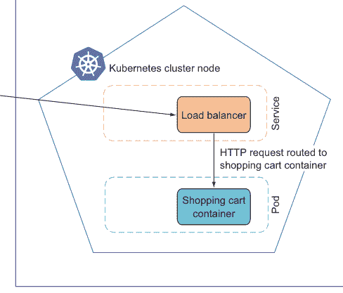
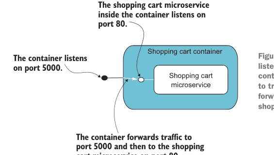
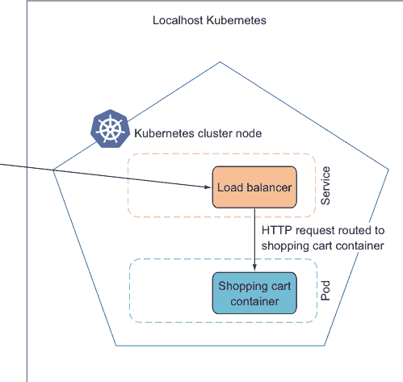
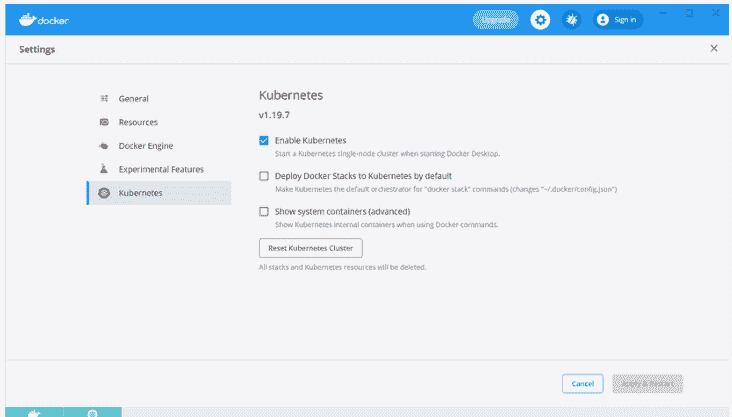
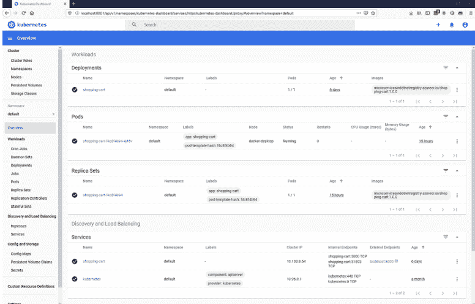
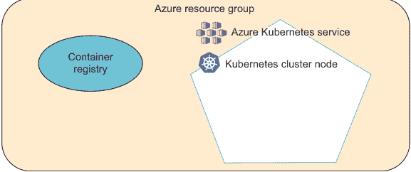
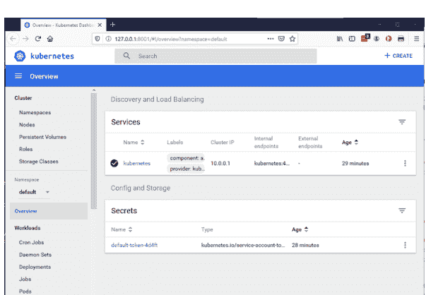
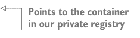
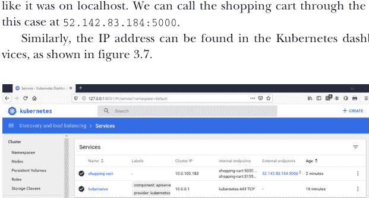

## 将微服务部署到 Kubernetes

### 本章涵盖

- 将微服务打包到 Docker 容器中
- 将微服务容器部署到本地主机上的 Kubernetes
- 在 Azure 的 AKS（Azure Kubernetes Service）上创建基本的 Kubernetes 集群
- 将微服务容器部署到 AKS 上的 Kubernetes 集群

在第 2 章中，我们开发了一个简单的购物车微服务，但我们只在本地主机上直接使用 dotnet run 命令运行它。在本章中，我们将该微服务部署到公共云中的类似生产环境。我们的微服务可以在许多不同的环境中运行，但我们将只选择其中一个作为示例。我们将重点介绍如何将购物车微服务运行在 Microsoft Azure 的 Kubernetes 集群中。为了实现这一目标，本章我们将：

- 将购物车放入 Docker 容器中
- 在本地主机上设置 Kubernetes，以便我们拥有一个测试环境


- 在 Azure 中设置 Kubernetes，以便我们拥有一个类似生产的环境
- 在本地主机 Kubernetes 集群和 Azure Kubernetes 集群中运行相同的购物车容器

## Docker 容器

容器是将应用程序——在我们的例子中是微服务——包装在便携式镜像中的一种方式，该镜像自带运行所需的一切，从操作系统到应用程序代码再到库依赖项。容器镜像可以一次构建，移动到不同的环境中，并且仍然可以预期正常工作——只要容器中的应用程序代码不对环境做出假设。在这种意义上，容器类似于虚拟机。但虚拟机虚拟化硬件，而容器虚拟化操作系统，这使得容器可以小得多。在微服务上下文中，这一点很重要，因为我们将拥有很多、很多个微服务。有了容器，我们就能在同一台服务器上运行许多微服务，同时保持它们之间良好的隔离级别。

我们很快就会进入这些步骤的实现，但首先我们将讨论为什么这是可靠的方法，并介绍一些替代方案。

## 3.1 选择生产环境

仅仅在本地主机上运行我们的微服务并不是很有趣。我们需要它们运行在最终用户可以访问并使用它们的地方。有几种选择可以做到这一点：

- 在本地的 Windows 或 Linux 服务器上运行微服务。 我们编写的微服务是 .NET 应用程序，这意味着它们可以在 Windows 和 Linux 上轻松运行。我们创建的 HTTP API 是 ASP.NET 应用，并使用 ASP.NET 的 Web 服务器 Kestrel，可以将其置于 Nginx 或 IIS 等代理之后。因此，如果你或你的组织更喜欢本地解决方案，我们创建的微服务可以在相当传统的本地环境中托管。
- 使用支持 .NET 的平台即服务 PaaS 云选项，如 Azure Web Apps 或 Azure Service Fabric。使用 PaaS 选项意味着你不再自行维护底层基础设施。你只需要维护你的微服务。这并不意味着你没有运维工作，但你需要做的运维工作集中在你的微服务上，而不是底层基础设施上（例如，你不需要保持操作系统打补丁或担心硬盘老化时更换）。你只需要处理微服务代码中的内容。
- 将微服务放入容器并部署到云特定的容器服务，如 Azure 的 ACS 或 Amazon 的 ECS。正如本章将看到的那样，我们的微服务可以轻松放入容器中。ACS 和 ECS 都可以运行这些容器并提供管理容器的工具。与 PaaS 选项一样，这使你摆脱了维护底层基础设施的负担，但由于容器自带操作系统，你将不得不保持其更新和修补。
- 使用云无关的容器编排器，如 Kubernetes、Apache Mesos 或 RedHat OpenShift。同样，将我们的微服务容器化很容易，一旦它们进入容器，任何容器编排器都可以运行它们。该领域存在很大的差异，将 Kubernetes、Mesos 和 OpenShift 归为一类可能并不完全公平，但它们都可以运行和管理我们的微服务，并且不绑定于任何特定云提供商。

在整本书中，我们注意保持这些选项开放。另一方面，我也想向你展示如何将微服务运行在类似生产的环境中。这意味着从列出的选项中选择一个作为本章和本书其余部分中生产环境的示例。这并不意味着其他选项不可行；它们是可行的。

为本书的目的，我选择使用容器并在 Kubernetes 中运行它们（图 3.1），因为它为我们提供了许多好处，这些好处与我们针对微服务所追求的灵活性和可扩展性非常契合：

- 通过选择将我们的微服务放入容器，我们保持了上述多个选项开放，这给了我们灵活性。
- 通过选择 Kubernetes，我们获得了一个成熟且广泛使用的容器编排器，它由所有主要云支持，并且也可以在自己的服务器上运行。Kubernetes 拥有成熟且庞大的生态系统，具有高度可扩展性，专为由许多小型容器组成的系统而构建，这些容器经常更新和重新部署，就像我们所讨论的微服务系统一样。



图 3.1 我们将在 AKS 中创建一个单节点 Kubernetes 集群，并在其上部署负载均衡器和一个购物车容器。

**NOTE** 确保你已在开发环境上设置了 Docker。在附录 A 中，你可以找到安装 Docker 的说明。

我们要构建的设置如图 3.1 所示。我们在 AKS 中创建一个单节点 Kubernetes 集群。在该集群中，我们将部署一个负载均衡器和一个购物车容器的实例。负载均衡器将具有公共端点，可从外部接收流量并将该流量路由到购物车容器。

现在我们已经确定使用 Kubernetes，让我们先在本地主机上，然后在 Azure 上将购物车运行在 Kubernetes 中。

## 3.2 将购物车微服务放入容器

将购物车微服务运行在 Kubernetes 中的第一步是将其放入容器并运行该容器。我们继续使用在第 2 章中开发的购物车微服务。

### 3.2.1 为购物车微服务添加 Dockerfile

要将购物车微服务放入容器，我们首先需要在购物车项目的根文件夹中，解决方案文件旁边添加一个 Dockerfile。Dockerfile 是我们想要构建的容器的描述，应该如下所示的代码。

**Listing 3.1 购物车的 Dockerfile**

```
FROM mcr.microsoft.com/dotnet/core/sdk:3.1 AS build
WORKDIR /src
COPY ["ShoppingCart/ShoppingCart.csproj", "ShoppingCart/"]
RUN dotnet restore "ShoppingCart/ShoppingCart.csproj"
COPY . .
WORKDIR "/src/ShoppingCart"
RUN dotnet build "ShoppingCart.csproj" -c Release -o /app/build
FROM build AS publish
RUN dotnet publish "ShoppingCart.csproj" -c Release -o /app/publish
FROM mcr.microsoft.com/dotnet/core/aspnet:3.1 AS final
WORKDIR /app
EXPOSE 80
COPY --from=publish /app/publish .
ENTRYPOINT ["dotnet", "ShoppingCart.dll"]
```

Dockerfile 中有很多内容，让我们逐段拆解。需要理解的第一件事是 Dockerfile 描述了一个多阶段构建，这意味着文件中存在多个离散步骤。最终结果是一个可运行的容器镜像，其中包含编译后的购物车微服务。Dockerfile 中的步骤如下：

- 构建购物车代码——Dockerfile 的第一部分使用包含 .NET SDK 的 Docker 镜像构建购物车代码，并首先调用 `dotnet restore` 然后调用 `dotnet build`。这与我们在第 2 章中本地构建购物车时所做的类似，只是我们使用了几个额外选项来指示我们想要一个发布构建并指定输出文件夹。
- 发布购物车微服务——Dockerfile 的第二部分使用 `dotnet publish` 命令将运行时所需的文件从构建输出文件夹（/app/build）复制到名为 /app/publish 的新文件夹。
- 基于 ASP.NET 创建容器镜像——Dockerfile 中第三步也是最后一步创建最终容器镜像，这是 Dockerfile 中描述的多阶段构建的结果。该步骤基于来自 Microsoft 的 ASP.NET Docker 镜像。该镜像自带 ASP.NET 运行时。我们添加来自 /app/publish 文件夹的文件并指定容器镜像的入口点为 `dotnet ShoppingCart.dll`，这是一个运行 ShoppingCart.dll 中编译的 ASP.NET 应用程序的命令。

为了确保 Dockerfile 运行干净的构建，我们添加一个 .dockerignore，其中包含以下行，确保任何 bin 和 obj 文件夹都不会被复制到容器中：

```
bin/
obj/
```

有了这个 Dockerfile，我们就可以构建购物车容器镜像并运行它了。

### 3.2.2 构建和运行购物车容器

下一步是从我们刚刚添加的 Dockerfile 构建购物车容器镜像。首先，确保 Docker 正在运行，然后打开命令行并进入购物车的根目录——Dockerfile 所在的位置。然后发出此 Docker 命令：

```
> docker build . -t shopping-cart
```

第一次执行可能需要一段时间。请耐心等待。后续构建会更快。`docker build` 的输出相当长。当成功时，输出的最后几行类似于

```
Successfully built 8d448ba53088
Successfully tagged shopping-cart:latest
```

如果你在 Windows 上，可能还会看到以下警告：

```
SECURITY WARNING: You are building a Docker image from Windows against a non-Windows Docker host. All files and directories added to build context will have '-rwxr-xr-x' permissions. It is recommended to double-check and reset permissions for sensitive files and directories.
```


这个警告出现是因为你正在 Windows 上使用 Linux 容器，在开发环境中这是可以的。我们将在 Azure 上搭建的生产环境将基于 Linux 服务器，因此可以安全地忽略该警告。

现在你可以使用以下命令运行新构建的容器镜像：

```
> docker run --name shopping-cart --rm -p 5000:80 shopping-cart
```

这会启动购物车容器，并将容器内部的 80 端口映射到容器外部的 5000 端口，如图 3.2 所示。这意味着你可以通过 http://localhost:5000 访问购物车，并以我们在第 2 章中相同的方式使用端点。

上面命令的细节如下：

- `--name` 为容器命名；在此例中为 shopping-cart。
- `--rm` 表示容器退出时自动删除。在开发期间这样做很方便，可以避免在本地主机上积累太多旧容器。
- `-p 5000:80` 表示容器公开 5000 端口并监听该端口的流量。所有发往 5000 端口的入站流量都会转发到容器内部的 80 端口。
- 命令末尾的 `shopping-cart` 是要运行的容器镜像的名称。

要停止购物车容器，可以使用 docker stop 命令：

```
> docker stop shopping-cart
```



图 3.2 购物车在容器内部监听 80 端口。容器监听 5000 端口的流量并将该流量转发到购物车微服务。

这证实我们已成功构建了包含购物车的容器。我们所做的只是创建一个描述如何构建容器的 Dockerfile，然后使用 Docker 构建它。从中我们得到一个可移植的容器镜像。这非常不错，因为它使我们能够在想要的所有环境中运行相同的容器镜像，包括本地主机和生产环境。由于我们可以在不同环境中运行相同的镜像，因此我们可以合理地确信它在各环境中的表现相同。

查看 Dockerfile，我们注意到其中没有任何内容使其特定于购物车，除了 .csproj 文件和 .dll 文件的名称。因此，我们不仅构建了一个可在多种环境中运行的购物车容器，还学会了如何对我们将要构建的所有其他基于 .NET 的微服务执行相同的操作。

下一步我们需要做的是在 Kubernetes 中运行购物车容器。

## 3.3 在 Kubernetes 中运行购物车容器

现在购物车已在容器中，它已准备好在 Kubernetes 中运行。我们将创建一个 Kubernetes 清单文件并使用它在 Kubernetes 上运行购物车——首先在本地主机上，然后在 Azure 上。在 Kubernetes 中运行购物车容器如图 3.3 所示，这几乎与本章开头的图表完全相同，只是 Kubernetes 运行在本地主机上而不是 Azure 上。这并非偶然，因为我们将以与在 Azure 上相同的方式在本地主机上运行购物车。



图 3.3
在本地主机上 Kubernetes 上运行购物车几乎与在 Azure 上相同。

### 3.3.1 设置 Kubernetes 本地主机

如何在开发机器上设置 Kubernetes 取决于你使用的操作系统。如果你使用 Windows 或 Mac，我建议使用 Docker Desktop，它附带启用 Kubernetes 的选项。如果你使用 Linux，有许多选项；一个简单的选项是 MicroK8S。

### 在 Docker Desktop 中启用 Kubernetes

要在 Docker Desktop 中启用 Kubernetes，请确保你使用的是 Linux 容器，而不是 Windows 容器。打开 Docker Desktop 设置，选择 Kubernetes 并点击“Enable Kubernetes”，如下图所示。第一次这样做需要花费一些时间，因为 Docker Desktop 将下载、安装并启动 Kubernetes。



Docker Desktop Kubernetes 设置

一旦 UI 指示 Kubernetes 正在运行，你就可以开始在本地主机上使用 Kubernetes 了。

### 安装并启动 MicroK8S

要在 Linux 机器上安装 MicroK8S，只需运行以下命令：

```
> sudo snap install microk8s --classic
```

这将安装并启动 Kubernetes 集群。此外，这还安装了 microk8s 命令行界面，其中包括我们将要使用的 kubectl 命令。为了更方便地跟随以下各节的工作，你可以为 kubectl 创建一个别名：

```
> snap alias microk8s.kubectl kubectl
```

当 Kubernetes 运行时，你可以转到命令行并使用以下命令检查 Kubernetes 是否确实正在运行

```
> kubectl cluster-info
```

它应该会给出类似以下的响应：

```
Kubernetes master is running at https://kubernetes.docker.internal:6443
KubeDNS is running at https://kubernetes.docker.internal:6443/api/v1/
  namespaces/kube-system/services/kube-dns:dns/proxy

To further debug and diagnose cluster problems, use `kubectl cluster-info dump`.
```

kubectl 命令是控制 Kubernetes 的命令行界面，我们将使用它将购物车部署到 Kubernetes，无论是在本地主机还是在 Azure 上。此外，kubectl 可用于检查 Kubernetes 集群并启动 Kubernetes 仪表板，它提供了一个友好的 UI 来查看 Kubernetes 集群内部。

## 3.4 为购物车创建 Kubernetes 部署

接下来，我们希望将购物车部署到我们刚刚安装并启动的 Kubernetes 集群。为此，我们需要在购物车代码库中添加一个描述部署的清单文件 shopping-cart.yaml。该文件包含两个主要部分：

- 1. 一个部署部分，指定我们想要部署哪个容器以及如何设置它：
  - 我们想要部署购物车容器。
  - 我们希望运行一个容器的副本。我们可以设置不同的数量，Kubernetes 将负责运行我们想要的实例数。
  - 容器通信的端口，购物车的情况下为端口 80，就像我们之前看到的那样。
- 2. 一个服务部分，配置购物车前面的负载均衡。负载均衡器通过为其提供外部 IP 使购物车在 Kubernetes 集群外部可访问。如果我们部署了多个购物车容器实例，负载均衡器将平衡购物车实例之间的入站流量。

shopping-cart.yaml 文件的内容如下：

```
kind: Deployment
apiVersion: apps/v1
metadata:
  name: shopping-cart
spec:
  replicas: 1
  selector:
    matchLabels:
      app: shopping-cart
  template:
    metadata:
      labels:
        app: shopping-cart
    spec:
```

指定容器部署的开始部分

```
containers:
  - name: shopping-cart
    image: shopping-cart
    imagePullPolicy: IfNotPresent
    ports:
      - containerPort: 80
---
kind: Service
apiVersion: v1
metadata:
  name: shopping-cart
spec:
  type: LoadBalancer
  ports:
    - name: shopping-cart
      port: 5000
      targetPort: 80
  selector:
    app: shopping-cart
```

要部署的容器镜像

容器监听请求的端口

指定服务的开始部分

指定这是一个负载均衡服务

在外部监听 5000 端口

映射到容器上的 80 端口

将请求路由到购物车

使用此清单在 Kubernetes 中部署和运行购物车与从命令行运行以下命令一样简单：

```
> kubectl apply -f shopping-cart.yaml
```

此命令告诉 Kubernetes 运行清单中描述的所有内容，因此 Kubernetes 将启动负载均衡器和购物车。要检查两者是否都在运行，我们可以使用命令 kubectl get all，它将列出 Kubernetes 集群中运行的所有内容。如果部署成功，kubectl get all 的输出应类似于以下内容：

```
NAME                         READY   STATUS    RESTARTS   AGE
pod/shopping-cart-f4c8f4b94-4j48v   1/1     Running   0          15h

NAME                     TYPE           CLUSTER-IP     EXTERNAL-IP   PORT(S)          AGE
service/kubernetes       ClusterIP      10.96.0.1      <none>        443/TCP           36d
service/shopping-cart    LoadBalancer   10.103.8.64    localhost     5000:31593/TCP    6d20h

NAME                                 READY   UP-TO-DATE   AVAILABLE   AGE
deployment.apps/shopping-cart        1/1     1            1           6d20h

NAME                                            DESIRED   CURRENT   READY   AGE
replicaset.apps/shopping-cart-f4c8f4b94         1         1         1       15h
```

如果你更喜欢使用 UI，可以安装并启动 Kubernetes 仪表板。首先使用以下命令安装 Kubernetes 仪表板：

```
> kubectl apply -f https://raw.githubusercontent.com/kubernetes/dashboard/v2.2.0/aio/deploy/recommended.yaml
```

截至撰写本文时，Kubernetes 仪表板的版本为 2.2.0，这是此命令的一部分。请参阅 GitHub 上的 Kubernetes 仪表板项目文档 https://github.com/kubernetes/dashboard 以获取当前版本。


运行命令 `kubectl proxy` 将启动仪表板并使其在 somewhat 复杂的 URL 上可用，http://localhost:8001/api/v1/namespaces/kubernetes-dashboard/services/https:kubernetes-dashboard:/proxy/#/overview?namespace=default。 该仪表板还应显示购物车正在运行，如图 3.4 所示。

> **NOTE** 如果 Kubernetes 仪表板要求登录令牌，你可以通过运行命令 `kubectl -n kube-system describe secret default` 获取，并从响应中复制令牌。



图 3.4 Docker Desktop Kubernetes 设置

我们相当确定 Kubernetes 正在按预期运行购物车，这一点从我们在仪表板和 `kubectl` 中看到的情况可以看出，但为了确保其按预期运行，让我们测试购物车的端点。首先，让我们向购物车添加几件商品：

```http
POST http://localhost:5000/shoppingcart/15/items
Accept: application/json
Content-Type: application/json

[1, 2]
```

接下来，让我们读取同一个购物车：

```http
GET http://localhost:5000/shoppingcart/15
```

GET 请求的响应体应为购物车中的商品列表：

```json
{
  "userId": 15,
  "items": [
    {
      "productCatalogueId": 1,
      "productName": "Basic t-shirt",
      "description": "a quiet t-shirt",
      "price": {
        "currency": "eur",
        "amount": 40
      }
    },
    {
      "productCatalogueId": 2,
      "productName": "Fancy shirt",
      "description": "a loud t-shirt",
      "price": {
        "currency": "eur",
        "amount": 50
      }
    }
  ]
}
```

这告诉我们购物车确实在 Kubernetes 上运行，正如我们所期望的那样，因为它与我们之前已经运行并测试过的容器镜像相同。

完成购物车后，我们可以通过使用以下命令从 Kubernetes 中删除购物车来进行清理：

```bash
kubectl delete -f shopping-cart.yaml
```

查看我们用来在 Kubernetes 上运行购物车的 Kubernetes 清单，我们可以注意到，除了名称 ShoppingCart 之外，该清单也适用于其他微服务。这意味着我们现在有了为微服务创建 Dockerfile 以及为其创建 Kubernetes 清单的模板。这使我们能够快速将所有微服务部署到 Kubernetes。

我们仍然在 localhost 上，所以让我们继续将购物车部署到 Azure 上。

## 3.5 在 Azure Kubernetes Service 上运行购物车容器

下一个目标是在 Azure Kubernetes Service (AKS) 上运行购物车。当我们完成此操作后，到本节结束时，我们将实现在生产环境中运行第一个微服务的目标，并创建图 3.1 所示的设置。我们需要执行以下操作来实现这一目标：

- 设置 AKS。我们需要为 AKS 中的 Kubernetes 集群创建所有 Azure 资源。这包括集群本身、网络以及我们将存储微服务容器镜像的私有容器注册表。
- 将购物车容器镜像推送到我们的私有容器注册表。
- 使用购物车的 Kubernetes 清单将购物车部署到 AKS 集群。

### Azure Kubernetes Service 的替代方案

Azure 绝不是我们唯一可以运行 Kubernetes 的地方。其他主要公共云——Google Cloud、Amazon Web Services、Digital Ocean 等——都提供类似的托管 Kubernetes 服务。所有这些都易于设置，并且都提供用于扩展和监控集群的工具。我使用 Azure 的原因是熟悉度；其他选项同样可行。

如果你更喜欢管理自己的服务器，你也可以选择在自己的云或本地服务器上设置 Kubernetes。与托管 Kubernetes 服务相比，其差异在于 Kubernetes 集群的设置和管理。我们部署到 Kubernetes 的容器的管理在所有情况下都是相同的。

### 3.5.1 设置 AKS

为了准备在 AKS 中使用 Kubernetes 集群，我们需要四个部分：

1. 在 Azure 中创建 *资源组*。资源组只是 Azure 中事物的分组。我们将 Kubernetes 集群和容器注册表的资源全部放在一个资源组中。这将在 Azure 门户中将所有内容分组在一起，并在我们完成后轻松清理所有内容。
2. 创建私有容器注册表。
3. 在 AKS 中创建 Kubernetes 集群。我们将创建一个只有一个节点的集群，并将其附加到私有容器注册表，以便 Kubernetes 可以从我们的注册表中拉取容器。
4. 将本地 Kubernetes 命令行—`kubectl`—登录到新创建的 AKS 集群。

这四个部分中的每一个都由 Azure 命令行工具 `az` 的 Azure 命令执行。Azure 中的最终结果如图 3.5 所示：一个 Azure 资源组，其中包含私有 Azure 容器注册表和单节点 Kubernetes 集群在 AKS 中。这是我们的生产环境。



**图 3.5** 在 localhost 上在 Kubernetes 上运行购物车几乎与在 Azure 上相同。

> **NOTE** 要跟随 AKS 的设置，你需要安装 Azure CLI 并登录到你的 Azure 账户。在附录 A 中你将找到安装 Azure CLI 的说明。

为了使 AKS 设置易于重复，我将设置 AKS 所需的命令收集到一个名为 `create-aks.ps1` 的 PowerShell 脚本中，其内容如下：

```text
az group create --name MicroservicesInDotnet --location northeurope

az acr create --resource-group MicroservicesInDotnet --name YOUR_UNIQUE_REGISTRY_NAME --sku Basic

az aks create --resource-group MicroservicesInDotnet --name MicroservicesInDotnetAKSCluster --node-count 1 --enable-addons monitoring --generate-ssh-keys --attach-acr YOUR_UNIQUE_REGISTRY_NAME

az aks get-credentials --resource-group MicroservicesInDotnet --name MicroservicesInDotnetAKSCluster
kubectl get nodes
```

前四行与列出的四个部分完全对应：创建资源组、创建容器注册表、创建 AKS 集群以及将 `kubectl` 登录到集群。最后一行显示集群中的节点，以便我们知道集群已启动并运行。

> **NOTE** `az acr create ...` 命令需要一个唯一的注册表名称。如果名称不唯一，你会收到名称已被使用的错误。你可以使用此处记录的 API 检查名称是否已被占用：http://mng.bz/PXZg。

运行脚本需要一段时间——大约 5–10 分钟。它还会产生大量输出，尽管是突发式的，所以不要惊讶如果几分钟内没有反馈，然后出现输出突发。输出的最后几行是 `kubectl get nodes` 行的输出，应类似于：

| NAME | STATUS | ROLES | AGE | VERSION |
| --- | --- | --- | --- | --- |
| aks-nodepool1-32786309-vmss000000 | Ready | agent | 107s | v1.14.8 |

这是你的 `kubectl` 命令行所连接的 Kubernetes 集群中的节点列表。你的节点名称会与我的不同，但应以 `aks-` 开头。

> **NOTE** 如果你想了解设置 AKS 所涉及步骤的更多背景和细节，请参考 Microsoft 的文档，例如文章“Quickstart: Deploy an Azure Kubernetes Service Cluster Using the Azure CLI” at http://mng.bz/J6ZP。

当你完成 AKS 中的 Kubernetes 集群时，你也可以使用以下命令删除集群以及容器注册表：

```bash
> az group delete --name MicroservicesInDotnet --yes --no-wait
```

此时，AKS 中的 Kubernetes 集群已启动并运行。在继续之前，我们还将启动 Kubernetes 仪表板。运行 Kubernetes 仪表板有两个步骤：首先我们必须允许仪表板访问集群，然后启动仪表板。

此命令将通过告诉 Kubernetes 将角色 `cluster-admin` 分配给账户 `kube-system:kubernetes-dashboard` 来授予仪表板访问权限：

```bash
> kubectl create clusterrolebinding kubernetes-dashboard \
  --clusterrole=cluster-admin \
  --serviceaccount=kube-system:kubernetes-dashboard
```

Kubernetes 仪表板使用 `kube-system:kubernetes-dashboard` 账户，因此现在它将拥有集群管理员权限。

访问就绪后，我们可以使用 Azure 命令行像这样启动 Kubernetes 仪表板：

```bash
> az aks browse --resource-group MicroservicesInDotnet --name MicroservicesInDotnetAKSCluster
```

这将启动 Kubernetes 仪表板并打开一个浏览器标签页显示仪表板，如图 3.6 所示。

> **NOTE** 如果你在启动 Kubernetes 仪表板时遇到任何问题，请参考 Microsoft 的文档，其中有文章“Access the Kubernetes Web Dashboard in Azure Kubernetes Service (AKS)” at http://mng.bz/wQxW，其中包含故障排除信息。



图 3.6 Kubernetes 仪表板


现在我们已经在 Azure 上运行了一个 Kubernetes 集群，并且仪表板也在运行，因此我们拥有一个友好的界面来查看集群中正在运行的内容。我们还拥有购物车容器镜像和购物车的 Kubernetes 清单文件。在具备了所有这些条件后，我们已准备好将购物车部署到我们的 AKS 集群。不仅如此，由于我们构建购物车容器的方式很容易扩展到为其他微服务构建容器，并且 Kubernetes 清单也很容易扩展到其他微服务，因此我们已准备好将即将在下一章中构建的微服务部署到 AKS。

> 注意 要在本地主机和 Azure 上来回切换使用 Kubernetes，可以使用命令 `kubectl config use-context <name-of-context>` 更改 kubectl 的上下文，并且可以通过运行 `kubectl config get-contexts` 查看可用的上下文。

## 3.5.2 在 AKS 中运行购物车

在 AKS 中运行微服务的基础设施就绪后，我们回到购物车微服务。我们已经将购物车放入容器中，并且已通过将购物车的 Kubernetes 清单应用到本地主机 Kubernetes，在本地主机 Kubernetes 上运行了该容器。将购物车部署到 AKS 大多是重用我们已有的东西，但有一些调整。部署和在 AKS 中运行购物车的剩余步骤如下：

- 为购物车容器镜像打标签，以便我们对容器镜像有精确的标识。
- 将带标签的容器镜像推送到我们在 Azure 中的容器注册表。
- 修改购物车的 Kubernetes 清单以引用带标签的容器。
- 将修改后的清单应用到 AKS。
- 测试购物车是否正确运行。

如所列，我们需要为在 3.2.2 节中构建的购物车容器镜像打标签。我们将给容器打的标签是 `your_unique_registry_name.azurecr.io/shopping-cart:1.0.0`。标签的第一部分是我们 Azure 中容器注册表的地址，`your_unique_registry_name.azurecr.io`；第二部分是容器镜像的名称和版本。我们按如下方式设置标签：

```
> docker tag shopping-cart your_unique_registry_name.azurecr.io/
  shopping-cart:1.0.0
```

我们必须将容器镜像推送到容器注册表，以便 AKS 可以拉取并运行它。AKS 无法从我的或你的本地主机拉取容器镜像。我们在 Azure 中使用的注册表是私有的，因此任何从中拉取或向其推送的服务都必须经过身份验证。当我们创建 AKS 集群时，我们使用了选项 `--attach-acr MicroservicesInDotnetRegistry`，它将 AKS 集群与名为 YOUR_UNIQUE_REGISTRY_NAME 的容器注册表连接起来，并允许 AKS 拉取镜像。同样，我们本地主机的 Docker 客户端在被允许向注册表推送容器镜像之前需要使用容器注册表进行身份验证。此身份验证使用 Azure CLI 如下进行：

```
> az acr login --name YOUR_UNIQUE_REGISTRY_NAME
```

现在带标签的容器镜像可以用此 Docker 命令推送到我们 Azure 中的私有 Docker 注册表：

```
> docker push your_unique_registry_name.azurecr.io/shopping-cart:1.0.0
```

购物车容器镜像现在可供我们的 AKS 集群拉取，但我们必须告诉它这样做。为此，我们必须修改清单文件 `shopping-cart.yaml`，使其通过标签 `your_unique_registry_name.azurecr.io/shopping-cart:1.0.0` 引用容器，这意味着清单变为：

```
kind: Deployment
apiVersion: apps/v1
metadata:
  name: shopping-cart
spec:
  replicas: 1
  selector:
    matchLabels:
      app: shopping-cart
  template:
    metadata:
      labels:
        app: shopping-cart
    spec:
      containers:
        - name: shopping-cart
          image: your_unique_registry_name.azurecr.io/shopping-cart:1.0.0
          imagePullPolicy: IfNotPresent
          ports:
            - containerPort: 80
---
apiVersion: v1
kind: Service
metadata:
  name: shopping-cart
spec:
  type: LoadBalancer
  ports:
    - name: shopping-cart
      port: 5000
      targetPort: 80
  selector:
    app: shopping-cart
```



唯一的变化是镜像名称，现在它引用我们在 Azure 中私有容器注册表中的镜像。剩下的就是将此清单应用到 AKS 中的 Kubernetes 集群：

```
> kubectl apply -f shopping-cart.yaml
```

过了一会儿，购物车将在 AKS 中运行。为了验证这一点，我们需要购物车在 AKS 中的 IP 地址，以便我们可以调用其端点。我们可以在 Kubernetes 仪表板中查找购物车的 IP 地址，也可以使用命令行。

使用命令行，命令 `kubectl get all` 将显示集群中所有正在运行的信息。输出应类似于以下内容：

```
NAME READY STATUS RESTARTS AGE
pod/shopping-cart-f4c8f4b94-vnmn9 1/1 Running 0 107s

NAME TYPE CLUSTER-IP EXTERNAL-IP PORT(S) AGE
service/kubernetes ClusterIP 10.0.0.1 <none> 443/TCP 15m
service/shopping-cart LoadBalancer 10.0.100.183 52.142.83.184 5000:31552/TCP 107s

NAME READY UP-TO-DATE AVAILABLE AGE
deployment.apps/shopping-cart 1/1 1 1 107s

NAME DESIRED CURRENT READY AGE
replicaset.apps/shopping-cart-f4c8f4b94 1 1 1 107s
```

购物车负载均衡器的 IP 地址在服务列表的外部 IP 列中。在本例中，IP 地址是 52.142.83.184，端口是 5000，就像在本地主机上一样。我们可以通过负载均衡器调用购物车，在本例中为 52.142.83.184:5000。

同样，IP 地址也可以在 Kubernetes 仪表板下的服务中找到，如图 3.7 所示。



图 3.7  
在服务下查找购物车的地址。

为了验证购物车确实在运行，我们可以通过例如使用购物车的 POST 端点向购物车添加商品来测试其端点：

```
POST http:52.142.83.184:5000///shoppingcart/15/items
Accept: application/json
Content-Type: application/json

[1, 2]
```

然后使用 GET 端点读取同一个购物车：

```
GET http:52.142.83.184:5000///shoppingcart/15
```

此端点的响应是用户编号 15 的购物车中的商品列表，证实购物车在 AKS 上的工作方式与在本地主机 Kubernetes 上以及直接使用 `dotnet run` 运行购物车时完全相同。

随着时间的推移，我们将在微服务系统中创建许多微服务，这反过来意味着 Kubernetes 中会有许多 Pod；按照本章中我所概述的模式，每一个也都有一个关联的 Kubernetes 负载均衡器，允许在容器的多个副本之间平衡流量。例如，我们可能会运行 3、10 或 100 个购物车容器副本，并让购物车的负载均衡器在它们之间分配传入流量。对于每个服务都有一个负载均衡器，每个负载均衡器都向外部公开端点并且每个都有不同的 IP 地址，会出现一个问题：我们如何管理所有这些进入 Kubernetes 集群的不同入口点？这个问题有一个安全方面，我们将在第 10 章中再次讨论，还有一个问题是终端用户应用程序如何知道将请求发送到哪里，我们将在第 12 章中再次讨论。

这标志着生产环境样例的设置以及第一个微服务的部署到该环境的完成。这为我们继续使用微服务奠定了良好的基础。AKS 集群已设置好并准备好运行更多微服务。随着我们开发更多微服务，我们将在其中每个中包含一个 Dockerfile 和一个 Kubernetes 清单，使我们能够构建容器镜像，将其推送到私有注册表，并部署到 AKS。

## Summary

- 我们开发的微服务可以部署到许多不同的环境中。
- 基于 .NET 的微服务很容易放入容器并作为容器运行。
- 基于 .NET 的微服务的 Dockerfile 遵循一个通用模板。
- 将我们的微服务部署到 Kubernetes 为我们提供了一个高度可扩展的环境和一个多功能的容器编排器。
- Kubernetes 在本地主机和云中工作方式相同。这意味着我们可以轻松地在本地主机上用于开发，在云中用于生产运行完全相同的容器。
- 我们微服务的 Kubernetes 清单都相似。
- Kubernetes 可以运行我们在即将到来的章节中将开发的所有内容，同时提供用于扩展、监控和调试微服务的工具。
- Azure Kubernetes Services 是一种易于设置的托管 Kubernetes 服务，使我们能够快速开始使用 Kubernetes。


