## 识别和界定微服务

**本章涵盖**

- 根据业务能力界定微服务
- 根据技术能力界定微服务
- 根据高效开发工作界定微服务
- 处理难以界定的情况
- 从现有微服务中拆分出新的微服务

要在微服务上取得成功，善于恰当界定每个微服务的范围至关重要。如果你的微服务太大，创建新功能和实施错误修复的周期就会超过必要的时间。如果它们太小，微服务之间的耦合往往会增加。如果它们大小合适但边界错误，耦合也会增加，而更高的耦合同样会导致更长的交付周期。换句话说，如果你不能正确界定微服务的范围，就会失去微服务所提供的许多好处。在本章中，我将教你如何为每个微服务找到合适的范围，使其保持松散耦合且便于处理。

识别和界定微服务的主要驱动因素是业务能力，次要驱动因素是支持性技术能力，第三驱动因素是工作效率。遵循这些驱动因素，微服务就能与第 1 章中的微服务特征清单很好地对应：

- 一个微服务负责单一能力。
- 一个微服务可以单独部署。
- 一个微服务由一个或多个进程组成。
- 一个微服务拥有自己的数据存储。
- 一个小团队可以维护少量微服务。
- 一个微服务是可替换的。

在这些特征中，前两项和最后两项只有在微服务范围合理时才能实现。虽然实现层面也有一些需要考虑的问题，但范围界定错误会阻碍服务符合这四项特征。

### 4.1 界定微服务的主要驱动因素：业务能力

每个微服务应该只实现一种能力。例如，购物车微服务应该跟踪用户购物车中的商品。识别微服务能力的主要方式是分析业务问题并确定业务能力。每个业务能力都应该由一个独立的微服务来实现。

#### 4.1.1 什么是业务能力？

业务能力是一个组织所做的、有助于实现业务目标的事情。例如，在电子商务网站上处理购物车就是一种业务能力，它有助于实现让用户购买商品的更广泛的业务目标。一个企业会拥有许多业务能力，这些能力共同构成整体业务功能。

当把业务能力映射到微服务时，微服务就是对这种业务能力的建模。在某些情况下，微服务实现并完全自动化整个业务能力。在其他情况下，微服务只实现业务能力的一部分，因为该能力的一部分由现实世界中的人员完成，因此微服务仅部分自动化了该业务能力。在两种情况下，微服务的范围就是该业务能力。

> **业务能力与限界上下文**
>
> *领域驱动设计*是一种基于业务领域建模的软件系统设计方法。其中一个重要步骤是识别领域专家用来讨论该领域的语言。事实证明，领域专家使用的语言并非在所有情况下都一致。在领域的不同部分，关注点各不相同，因此像“customer”这样的词在领域的不同部分可能有不同的侧重点。例如，对于一家销售复印机的公司来说，销售部门的客户可能是购买多台复印机的公司，并且可能主要由采购官员代表。在客户服务部门，客户可能是使用复印机遇到问题的最终用户。在对这家复印机公司的领域进行建模时，“customer”一词在模型的不同部分含义不同。
>
> 在领域驱动设计中，限界上下文是更大领域的一部分，其中词语的含义一致。限界上下文与业务能力相关但又不相同。限界上下文定义了领域内语言一致的区域。而业务能力则关乎业务需要完成什么。在一个限界上下文内，业务可能需要完成多件事情。每件事情通常都可能是一种业务能力。
>
> 由于同一限界上下文内的业务能力是相关的，因此我们可以接受同一限界上下文内能力之间的耦合程度高于不同限界上下文之间能力的耦合程度。

#### 4.1.2 识别业务能力

对领域的深入理解将使你能够了解业务是如何运作的。了解业务如何运作意味着你可以识别出构成业务的各项业务能力，以及交付这些能力所涉及的过程。换句话说，识别业务能力的方法就是了解业务领域。你可以通过与最了解业务领域的人交谈来获得这类知识：业务分析师、软件的最终用户，等等——所有直接参与推动业务的日常工作的相关人员。

企业的组织形式通常反映了其领域。领域的不同部分由不同的人群处理，每个群体负责交付某些业务能力；因此，这种组织形式可以为你提供关于如何界定微服务的启示。首先，一个微服务的职责可能应该只属于一个群体的管辖范围。如果它跨越了两个群体之间的边界，那么它的范围可能过于宽泛，难以保持内聚性，从而导致可维护性降低。这些观察结果与所谓的康威定律一致：

> 任何设计系统（广义定义）的组织，都会产生一种设计，其结构是该组织沟通结构的复制。

有时你可能会发现领域中组织与领域不一致的部分。在这种情况下，有两种方法可以采用，两种方法都尊重康威定律。你可以接受系统不能完全反映领域，并实现一些与领域不完全一致但与组织良好对齐的微服务；或者你可以改变组织以

反映该领域。两种方法都可能有问题。第一种方法存在构建范围界定不佳且可能高度耦合的微服务的风险。第二种方法涉及在团队之间移动人员和职责。这类变更可能很困难。你的选择应是务实的，基于对哪种方法会最少麻烦的评估。

为了更好地了解业务能力是什么，我们需要看一个例子。

## 4.1.3 示例：销售点系统

本章将探讨的示例是一个销售点系统（POS），如图 4.1 所示。我将简要介绍该领域，然后我们将研究如何在其中识别业务能力。最后，我们将更详细地考虑系统中某个微服务的范围。

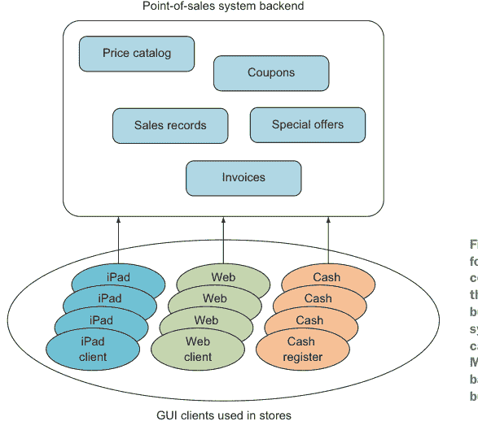

图 4.1 一个大型连锁商店的 POS 系统，由实现系统中所有业务能力的后端和收银员在商店中使用的轻量级 GUI 客户端组成。后端中的微服务实现业务能力。

该 POS 系统用于大型连锁店的所有商店。商店中的收银员通过轻量级 GUI 客户端与系统交互——它可以是平板电脑应用程序、Web 应用程序或专用的实体收银机。GUI 客户端只是后端前面的一个薄层。所有业务逻辑（业务能力）都在后端实现，后端将是我们的重点。

系统为收银员提供多种功能：

- 扫描产品并将其添加到发票中。
- 准备发票。
- 通过连接到客户端的读卡器为信用卡充电。
- 注册现金支付。
- 接受优惠券。
- 打印收据。
- 将电子收据发送给客户。
- 在产品目录中搜索。
- 扫描一个或多个产品以显示价格和与产品相关的特别优惠。

这些功能是系统为收银员提供的，但它们并不直接对应驱动 POS 系统的业务能力。

## 在销售点领域中识别业务能力

要识别驱动 POS 系统的业务能力，你需要超越功能列表。你必须确定在幕后需要发生什么来支持这些功能。

从“在产品目录中搜索”功能开始，一个明显的业务能力是维护产品目录。这是第一个可能成为微服务范围的业务能力的候选。这样的产品目录微服务将负责提供对当前产品目录的访问。产品目录需要不时更新，但商店连锁使用另一个系统来处理该功能。产品目录微服务需要反映在该其他系统中所做的更改，因此产品目录微服务的范围将包括接收产品目录的更新。

你可能识别出的下一个业务能力是向发票应用特别优惠。特别优惠在客户购买产品捆绑包时给予折扣价。捆绑包可能由一定数量的相同产品以折扣价组成（例如，买二送一），也可能是不同产品的组合（例如，买 A 可享受 B 9 折）。在任何情况下，收银员从 POS GUI 客户端获得的发票都必须自动考虑任何适用的特别优惠。这是第二个可作为微服务范围的候选业务能力。特别优惠微服务将负责决定何时适用特别优惠以及客户应获得的折扣。

再次查看功能列表，注意系统应允许收银员“扫描一个或多个产品以显示价格和与产品相关的特别优惠”。这表明特别优惠业务能力不仅仅是向发票应用特别优惠；它还包括根据产品查找特别优惠的能力。

如果你继续在 POS 系统中寻找业务能力，你可能会得到以下列表：

- 产品目录
- 价格目录
- 价格计算
- 特别优惠
- 优惠券
- 销售记录
- 发票
- 付款

图 4.2 显示了从功能到业务能力的映射。该映射在逻辑上是成立的，因为它显示了实现每个功能所需的业务能力，但它并不能表示任何直接的技术依赖。例如，从准备发票到优惠券的箭头并不表示客户端中某个准备发票代码直接调用优惠券微服务。相反，该箭头表示为了准备发票，需要考虑优惠券，因此准备发票功能依赖于优惠券业务能力。

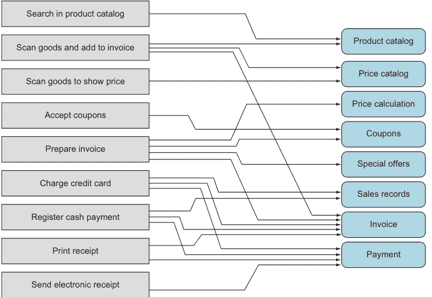

在真实领域中找到业务能力可能是一项艰巨的工作，通常需要大量的迭代。业务能力列表不是在开发开始时制定的静态列表；相反，它是一个随着你对领域和业务的理解不断增长和加深而不断演变和变化的列表。

现在我们已经完成了识别业务能力的第一次迭代，让我们更仔细地看看其中一个能力以及它如何定义微服务的范围。

## 特别优惠微服务

特别优惠微服务基于特别优惠业务能力。为了缩小该微服务的范围，我们将深入研究该业务能力并识别所涉及的流程，如图 4.3 所示。每个流程都提供业务能力的一部分。

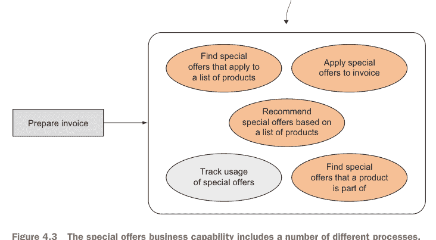

图 4.3 特别优惠业务能力包括多个不同的流程。

特别优惠业务能力被分解为五个流程。其中四个面向 POS GUI 客户端。第五个——跟踪特别优惠的使用——面向业务本身，业务有兴趣跟踪客户利用了哪些特别优惠。

将业务能力作为微服务实现意味着你需要执行以下操作：

- 将四个面向客户端的流程作为 API 端点公开，供其他微服务调用。
- 通过事件馈送实现使用跟踪流程。POS 系统的业务智能部分可以订阅这些事件并使用它们来跟踪客户使用哪些特别优惠。

特别优惠微服务的组件如图 4.4 所示。

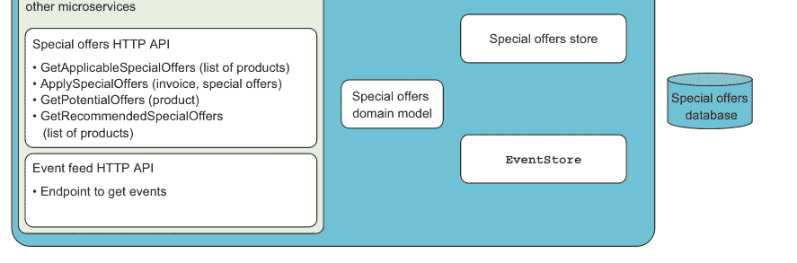

图 4.4 特别优惠业务能力中的流程反映在特别优惠微服务的实现中。流程通过微服务的 HTTP API 向其他微服务公开。

特别优惠微服务的组件与第 2 章中的购物车微服务的组件相似，后者再次显示在图 4.5 中。这并非巧合。这些是我们微服务通常由以下组件组成：一个公开微服务实现的业务能力的 HTTP API、一个事件馈送（在第 5 章中解释并实现）、实现业务能力所涉及业务逻辑的领域模型、数据存储组件和数据库。

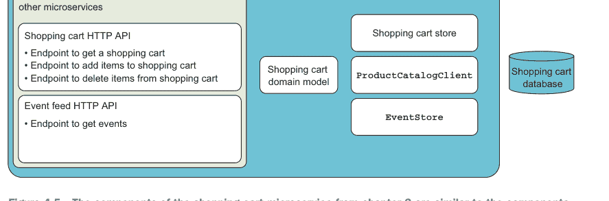

图 4.5 第 2 章中的购物车微服务的组件与特别优惠微服务的组件相似。

## 4.2 微服务范围划分的次要驱动因素：支持技术能力

识别微服务范围的第二种方法是查看支持技术能力。支持技术能力是指不直接促进业务目标但支持其他微服务的东西，例如与其他系统集成或安排在未来某个时间发生事件。

### 4.2.1 什么是技术能力？

支持技术能力是微服务范围划分中的次要驱动因素，因为它们不直接促进系统的业务目标。它们存在于简化并支持实现业务能力的其他微服务。

记住，一个好的微服务的特征之一是可替换的；但如果实现业务能力的微服务还实现了复杂的技术能力，它可能会变得过大和过于复杂而无法替换。在这种情况下，你应考虑在单独的微服务中实现该技术能力，该微服务支持原始微服务。在讨论如何以及何时识别支持技术能力之前，提供几个例子可能会有所帮助。

### 4.2.2 支持技术能力的示例

为了让你了解我所说的支持技术能力是什么意思，让我们考虑两个例子：与其他系统的集成，以及向客户发送通知的能力。

### 与外部产品目录系统集成

在示例 POS 系统中，你将产品目录识别为业务能力。我还提到产品信息在微服务型 POS 系统外部的另一个系统中维护。另一个系统是企业资源规划（ERP）系统。这意味着产品目录微服务必须与 ERP 系统集成，如图 4.6 所示。

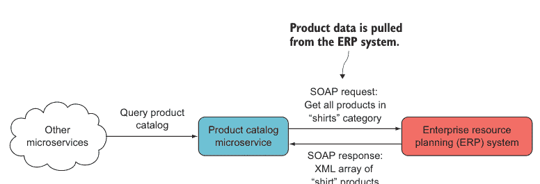

图 4.6 产品数据从 ERP 系统流向产品目录微服务。用于从 ERP 系统获取产品信息的协议由 ERP 系统定义。它可以公开一个 SOAP Web 服务来获取信息，也可以将产品信息导出为专有文件格式。

假设你无法对 ERP 系统做出修改，那么集成必须通过 ERP 系统所提供的任何接口来实现。它可能使用 SOAP Web 服务来获取产品信息，也可能将所有产品信息导出为专有文件格式。无论哪种情况，集成都必须按照 ERP 系统的规则来进行。根据 ERP 系统暴露的接口不同，这可能是一个或大或小的任务。无论如何，这个任务主要关注的是与其他系统集成时的技术细节，并且有可能至少在一定程度上较为复杂。该集成的目的是为产品目录微服务提供支持。

我们将把集成从产品目录微服务中分离出来，并在一个独立的 ERP 集成微服务中实现它，该微服务仅负责这一项集成，如图 4.7 所示。我们这样做基于两个原因：

-   通过将集成的技术复杂性转移到单独的微服务中，我们可以让产品目录微服务的范围保持窄小而专注。
-   通过使用单独的微服务来处理 ERP 数据的格式和组织方式，我们能够让 ERP 系统对“产品”的视图与 POS 系统对“产品”的视图保持分离。请记住，在一个大型领域的不同部分，对术语含义存在不同的理解。产品目录微服务与 ERP 系统在产品实体的建模方式上很可能无法达成一致。需要在这两种视图之间进行转换，而这最好由新的微服务来完成。用领域驱动设计的术语来说，这个新微服务充当了一个*防腐层*。

> **注意** 防腐层是一个源自领域驱动设计的概念。当两个系统交互时可以使用它：它保护一个系统中的领域模型不被另一个系统模型中的语言或概念所污染。

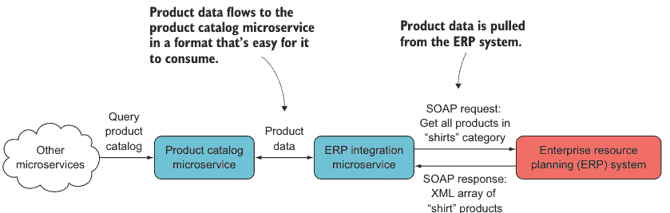

**图 4.7** ERP 集成微服务通过处理与 ERP 系统的集成来支持产品目录微服务。它在 ERP 系统暴露产品数据的方式与产品目录微服务消费这些数据的方式之间进行转换。

将集成放在独立微服务中的一个额外好处是，它是解决与集成相关的可靠性问题的好地方。如果 ERP 系统不可靠，处理该问题的位置就在 ERP 集成微服务中。如果 ERP 系统速度慢，ERP 集成微服务可以应对这一点。随着时间推移，你可以调整 ERP 集成微服务中使用的策略，以解决 ERP 系统的可靠性问题，而完全不需要改动产品目录微服务。这个与 ERP 系统的集成是一个支持性技术能力的示例，而 ERP 集成微服务则是一个实现该能力的微服务示例。

## 向客户发送通知

现在让我们考虑为 POS 系统扩展功能，使其能够通过电子邮件、短信或移动应用推送通知，向注册客户发送关于新特别优惠的通知。我们可以将这个能力放入一个或多个独立的微服务中。

目前，POS 系统并不知道客户是谁。为了提升客户参与度和客户忠诚度，公司决定启动一个小型忠诚度计划，客户可以注册以接收特别优惠通知。客户忠诚度计划是一项新的业务能力，将由一个新的忠诚度计划微服务负责。图 4.8 展示了该微服务，它负责在每次有新特别优惠可用时通知注册客户。

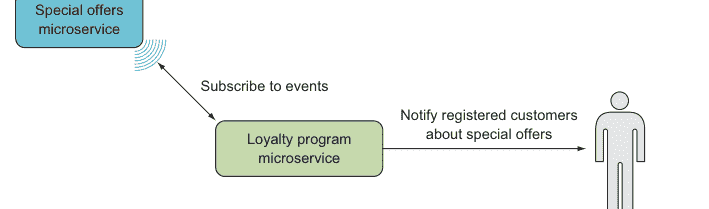

图 4.8 忠诚度计划微服务订阅特别优惠微服务的事件，并在新优惠可用时通知注册客户。

作为注册流程的一部分，客户可以选择通过电子邮件、短信，或者如果他们安装了公司的移动应用则通过推送通知来接收通知。这给忠诚度计划微服务带来了一些复杂性，因为它不仅需要选择使用哪种类型的通知，还要处理每种通知的工作方式。作为第一步，我们将为每种通知类型引入一个支持性技术微服务。如图 4.9 所示。

## 第4章 *识别和界定微服务*

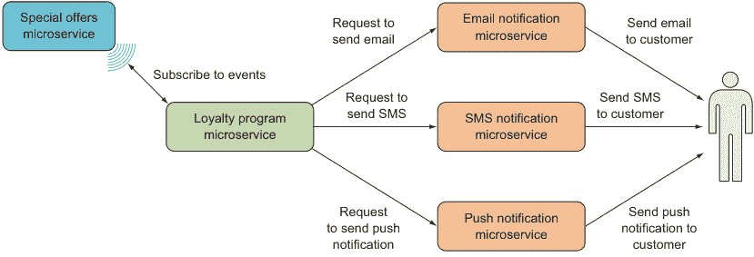

**图 4.9** 为了避免忠诚度计划微服务陷入处理每种通知类型的技术细节中，我们将引入三个支持性技术微服务，每种通知类型一个。

这样更好。忠诚度计划微服务不必实现与每种通知类型相关的所有细节，从而使该微服务的范围保持窄小而专注。不过，这种情况并非完美：该微服务仍然需要决定为每个注册客户调用哪个支持性技术微服务。

这促使我们再引入一个微服务，它作为处理三种通知类型的三个微服务的前端。这个新的通知微服务如图 4.10 所示，它负责在每次需要通知客户时选择使用哪种通知类型。

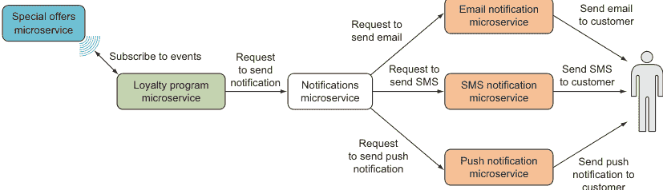

**图 4.10** 为了从忠诚度计划微服务中移除更多复杂性，我们将引入一个通知微服务，负责根据客户偏好选择通知类型。

这个支持性技术能力的示例与之前的 ERP 集成示例有所不同，因为其他微服务也可能需要向特定客户发送通知。例如，POS 系统的功能之一就是发送……

引入通知限界上下文还有一个额外好处，即明确了三种技术能力——发送电子邮件、短信和推送通知——都包含在该限界上下文中，并作为微服务来服务于该限界上下文。因此，其他限界上下文中的微服务不应与这三个支持性技术微服务直接协作，而应面向业务的通知微服务协作。这有助于保持限界上下文之间的低耦合，因为其他限界上下文中的微服务不知道也不关心存在三种发送通知的方式。例如，电子邮件微服务只被通知微服务使用，并且不与任何其他微服务耦合。

### 4.2.3 识别技术能力

当你引入支持性技术微服务时，你的目标是简化实现业务能力的微服务。有时——比如发送通知——你会识别出一组多个微服务所需的技术能力，并将其转化为一个拥有自己微服务的限界上下文，以便其他微服务可以共享该实现。其他时候——比如 ERP 集成——你会识别出一种使微服务过度复杂化的技术能力，并将该能力转化为一个独立的微服务。在这两种情况下，其他实现业务能力的微服务就少了一项需要处理的技术关注点。

在决定将技术能力实现为独立微服务时，请注意不要违反微服务“可独立部署”的特性。只有当该微服务可以独立于任何其他微服务进行部署和重新部署时，将技术能力实现为独立微服务才有意义。同样，部署由提供技术能力的微服务所支持的微服务，也不得强制你重新部署实现该技术能力的微服务。

识别业务能力以及基于业务能力的微服务是一项战略性工作，而识别可由独立微服务实现的技术支持能力则是一项机会性工作。一个支持性技术能力是否应在自己的微服务中实现，最终取决于从长远来看怎样做最为简单。你应该提出以下问题：

-   如果支持性技术能力保留在业务能力范围的微服务中，该微服务是否存在无法以合理代价进行替换的风险？
-   该支持性技术能力是否在多个业务能力范围内的微服务中实现？
-   实现该支持性能力的微服务能否独立部署？
-   如果将支持性技术能力实现在独立微服务中，所有业务能力范围内的微服务是否仍然可以独立部署？

## 4.3 界定微服务范围的第三个驱动因素：支持工作效率

我们在确定微服务的范围和边界时，第三个驱动因素是支持工作效率。我们设计和创建的微服务应便于使用，并应让开发和维护微服务的团队高效工作。在很大程度上，这关乎尊重并运用康威定律，您可能还记得前面提到的：

> 任何设计系统（广义定义）的组织，其产生的设计结构都会是该组织沟通结构的复制。

如果我们有一个已经定义且无法改变的组织，那么我们创建的微服务系统必须与该组织保持一致。另一方面，如果组织可以改变，我们就应该根据整个微服务系统来进行调整。

首先，尊重康威定律意味着我们应确保每个微服务都有明确的所有权：我们应该为每个微服务的开发和维护分配一个团队。这与微服务的特性一致，即一个小团队可以维护少数几个微服务。每个团队可以分配少数几个服务来负责。责任明确非常重要。如果一个微服务的责任被分配给两个或多个团队，那么每当需要对该微服务进行更改时，这些团队就需要密切协调。这种协调需要时间，并且意味着相关团队都无法自主工作。这是一种低效形式，如果我们确保每个微服务都分配给一个团队，就可以避免这种情况。

允许团队自主工作有助于界定微服务的范围和边界。首先，团队必须具备必要的技能和知识。例如，一个被分配了本章前面提到的通知微服务的团队，必须理解与通知用户相关的业务规则。

其次，团队必须能够在与其他团队无需过多、过细协调的情况下工作。例如，当一个团队被分配了通知微服务时，他们可能也会被分配用于发送短信、电子邮件和推送通知的支持性技术微服务，因为这些微服务与通知微服务之间存在一定程度的耦合。由于这种耦合，将支持性技术微服务分配给另一个团队会引入协调需求，并降低两个团队的自主性，因此我们可能会将它们全部分配给同一个团队，这样该团队就负责整个通知限界上下文。一旦他们承担了支持性技术微服务，该团队除了需要掌握围绕通知的业务规则知识外，还需要具备与短信网关、电子邮件系统和推送通知进行集成的必要技能。我们需要意识到这一点，如果我们找不到或无法组建一个具备所需知识与技能组合的团队，我们可能不得不改变微服务的范围。

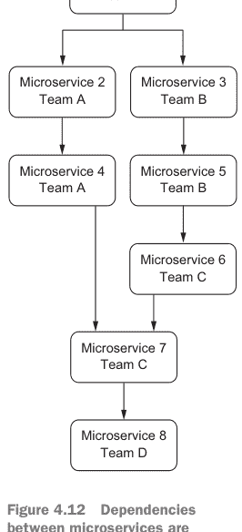

为了确保我们不会给开发微服务的团队带来低效问题，关注现有的依赖链是值得的。图4.12描绘了一个依赖链：方框代表微服务，箭头代表依赖关系。

如果图4.12中的每个微服务都按方框内所示分配给团队A、B、C和D，那么分配给依赖链顶部微服务的团队A，与分配给链底部微服务的团队D，所处的情况截然不同。这是因为微服务之间的依赖关系会反映为团队之间的依赖关系。维护顶部微服务的团队A可以随意更改任何内容，而不必担心会破坏链中下游其他团队所维护的微服务。另一方面，维护底部微服务的团队D，如果引入破坏性变更，则可能会破坏依赖链中的所有其他微服务。同时，维护顶部微服务的团队A，如果不与依赖链中的其他团队协调，可能也无法完成多少工作，因为它可能依赖其他团队来实现某些功能。换句话说，如果我们创建的依赖链过长，可能会使团队A和团队B都陷入低效。这在一定程度上可以通过正确界定微服务的范围和边界来应对，部分则通过设计微服务之间的协作方式以利于低耦合来应对。我们将在第5章深入探讨微服务之间的协作设计。

图4.12 微服务之间的依赖关系会反映为维护这些微服务的团队之间的依赖关系。箭头表示依赖关系，方框表示微服务，并标注了维护它们的团队。

注意 在第5章中，我们将看到基于事件的协作如何帮助打破依赖链。

## 4.4 当正确范围不明确时该怎么办

此时，您可能会想，正确地界定微服务范围确实很难：您需要准确理解业务能力，这需要对业务领域有深入的理解；您还必须正确判断支持性技术能力的复杂性；并且您需要确保团队能够高效工作。您说得对：这确实很难，而且您会发现自己处于微服务正确范围不明确的情况中。这种不明确可能有多种原因，包括以下这些：

- *对业务领域理解不足*——分析业务领域并建立对该领域的深入知识是困难且耗时的。有时，您需要在尚未充分理解业务、无法确定自己做出正确决策之前，就做出关于微服务范围的决策。
- *业务领域中的困惑*——不仅开发方可能对业务领域不清晰，有时业务方也不清楚应如何处理业务领域。也许业务正在进入新市场，必须在此过程中学习新领域。其他时候，现有业务市场会因竞争对手的行为或业务自身的行为而发生变化。无论哪种情况，在业务方和开发方，业务领域都在不断变化，您对它的理解也是逐步形成的。
- *对技术能力细节了解不完整*——您可能无法获得实现技术能力所需的全部信息。例如，您可能需要与一个文档记录不佳的系统集成，在这种情况下，您只有在完成集成后才会知道如何实现它。
- *无法估计技术能力的复杂性*——如果您之前没有实现过类似的技术能力，可能很难估计该能力的实现会有多复杂。

这些问题都不意味着您失败了。它们都是反复出现的情况。诀窍在于知道如何在缺乏清晰度的情况下继续前进。在本节中，我将讨论当您心存疑虑时该怎么做。

### 4.4.1 从稍大的范围开始

当对微服务的范围不确定时，最好倾向于使微服务的范围比理想情况下更大一些。这听起来可能有些奇怪——我谈了很多关于创建小型、聚焦的微服务以及保持微服务小型化带来的好处。确实，保持微服务小型且聚焦可以带来显著的好处。但您也必须考虑，如果范围过窄，会发生什么。

考虑本章前面讨论的“特别优惠”微服务。它在POS系统中实现了“特别优惠”业务能力，并包含五个不同的业务流程，如图4.3所示，并在图4.13的顶部部分再次呈现。如果您对“特别优惠”业务能力的边界不确定，并选择倾向于过小的范围，您可能会拆分该业务能力，如图4.13底部部分所示。

# 特价优惠业务能力

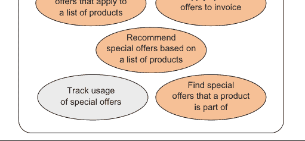

# 特价优惠业务能力错误地拆分到两个微服务中

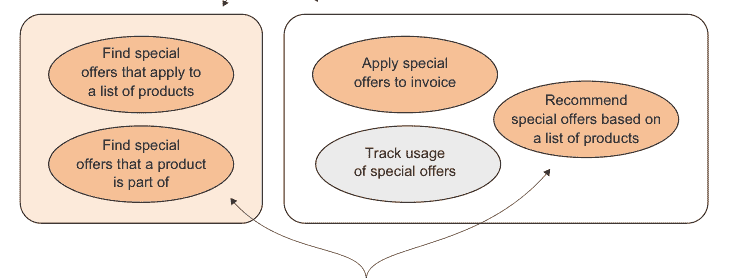

# 责任划分不清晰：两个具有相关功能且需要相同数据和相同搜索逻辑的流程

图 4.13 如果你将微服务的范围设得太小，你会发现单个业务能力会被拆分到多个高度耦合的部分。

如果你仅基于特价优惠业务能力的一部分来确定微服务的范围，你将产生一些显著的成本：

- 数据和数据模型在两个微服务之间的重复——实现的两部分都需要将其数据存储中的所有特价优惠都存储起来。
- 责任划分不清晰——被分割的业务能力的一部分可以回答某个产品是否属于任何特价优惠，而另一部分可以根据过往购买向客户推荐特价优惠。这两个功能密切相关，你很快就会陷入一种情况，即不清楚某段代码应属于哪个微服务。

- *重构业务能力代码的障碍*——这可能是因为代码分散在两个微服务的代码库中。这种跨代码库的重构很困难，因为很难全面了解重构的后果，而且工具支持也很差。
- *难以独立部署两个微服务*——在涉及两个微服务的重构或功能实现之后，两个微服务可能需要同时部署或按特定顺序部署。无论哪种情况，两个微服务版本之间的耦合都违反了微服务可单独部署的特性。这使得测试、部署和生产监控变得更加复杂。

这些成本从微服务首次创建时开始产生，直到你积累足够的经验和知识，更正确地识别出业务能力以及微服务的更好范围为止，在本例中即整个特价优惠业务能力。除了这些成本之外，业务能力重构和更改实现的困难会导致你在这两方面做得更少，因此你需要更长时间来了解业务能力。与此同时，你要承担重复数据和数据模型的成本，以及缺乏单独部署能力的成本。

我们已经确定，倾向于范围过窄很容易导致以一种方式划定微服务的范围，从而在微服务之间产生昂贵的耦合。为了判断这是否比倾向于范围过大更好或更差，我们需要查看这种做法的成本。

如果你倾向于更大的范围，你可能会决定特价优惠微服务的范围也包括处理优惠券。该更大特价优惠微服务的范围如图 4.14 所示。

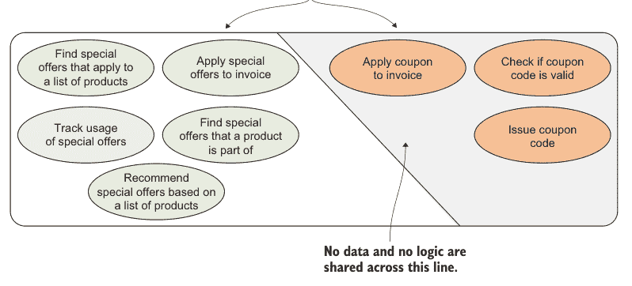

图 4.14 如果你选择倾向于更大的范围，你可能会决定将优惠券的处理纳入特价优惠业务能力。

将过多内容纳入微服务范围会带来成本：

- 代码库变得更大更复杂，这可能导致更改成本更高。
- 微服务更难被替换。

这些成本是真实存在的，但在微服务范围仍然相当小的情况下，它们并不压倒性。要注意的是，这些成本会随着每个微服务范围的大小迅速增长，并在范围大到接近单体架构时变得压倒性。

尽管如此，在一个代码库内的重构比跨两个代码库的重构容易得多。这给了你更多进行实验并通过实验了解业务能力的机会。如果你利用这个机会，你可以比将微服务范围划定得过窄时更快地对特价优惠业务能力和优惠券业务能力形成良好的理解。

当你的微服务只是有点过大时，这一论点成立，但如果它们大得太多，这一论点就不成立了，在这种情况下我们将失去微服务所期望的速度和灵活性。

> WARNING  不要偷懒将多个业务能力塞进一个微服务。你很快就会拥有一个庞大、难以管理的代码库，具有完整的单体所带来的许多缺点。

总的来说，略大于理想大小的微服务在成本上更低，并且比略小于理想大小的微服务允许更多的敏捷性。因此，经验法则是倾向于稍大的范围。

一旦你接受了在不确定微服务最佳范围时，你有时——如果不是经常——会存在疑虑，并且在这种情况下应偏向稍大的范围，你也可以接受有时——如果不是经常——你的系统中会有一些比理想大小稍大的微服务。这意味着你应该预期不时地需要从现有微服务中拆分出新的微服务。

## 4.4.2 从现有微服务中拆分出新的微服务

当你意识到某个微服务过大时，你需要考虑如何从中拆分出新的微服务。首先，你需要为现有微服务和新微服务确定良好的范围。为此，你可以使用本章前面描述的驱动因素。

一旦确定了范围，你必须查看代码，看看其组织方式是否与新的范围保持一致。如果不一致，你应该开始重构以实现这种一致性。图 4.15 在高层级说明了为拆分出新的微服务而进行的重构。首先，将最终进入新微服务的所有内容移至其自己的类库。然后，将保留在现有微服务中的代码与将移至新微服务的代码之间的所有通信重构为通过接口进行。该接口将在拆分后成为两个微服务的公共 HTTP 接口的一部分。

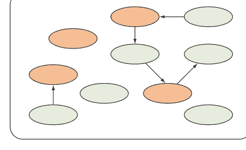

步骤 0：特价优惠微服务包含优惠券能力。

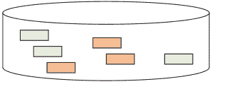

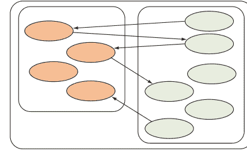

步骤 1：特价优惠微服务仍然包含优惠券能力，但优惠券能力已重构为单独的项目。

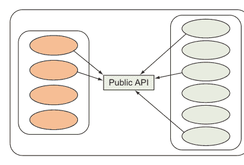

步骤 2：特价优惠微服务仍然包含优惠券能力，但它已被重构，并且所有通信都通过公共 API 进行。

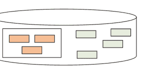

图 4.15 通过重构为拆分出新的微服务做准备：首先将属于新微服务的所有内容移至其自己的项目，然后使所有通信都通过公共 API 进行，该 API 类似于新微服务最终将拥有的 API。

当你达到图 4.15 中的步骤 2 时，可以以可控的努力将新微服务从旧微服务中分离出来。创建一个新的微服务，将需要从现有微服务中拆分出来的代码移至新微服务，并将两部分之间的通信改为通过 HTTP 进行。

## 4.4.3 计划日后拆分出新的微服务

由于你在不确定微服务范围时有意识地倾向于使其稍大一些，你有机会预见到哪些微服务最终需要被拆分。如果你知道某个微服务很可能会日后拆分，最好能为该拆分提前规划，从而节省图 4.15 中显示的一个或两个重构步骤。事实证明，你经常可以做出这种规划。

通常你会不确定某个特定功能是否是一个独立的业务能力，因此你会遵循经验法则，将其纳入一个更大的业务能力中，在针对该更大业务能力范围的微服务内实现。但你可以保持意识到该区域可能是一个独立的业务能力。

考虑一下包含处理优惠券流程的特价优惠业务能力的定义。你很可能对优惠券处理是否是一个独立的业务能力存在疑虑，因此特价优惠业务能力被建模为包含图 4.14 所示的所有流程。

当你首次实现一个范围针对图 4.14 所示的特价优惠业务能力理解的特价优惠微服务时，你并不知道优惠券功能最终是否会被移至优惠券微服务。你确实知道，优惠券功能与微服务的其余部分相比关联性并不那么紧密。因此，最好在优惠券代码周围设置一个清晰的边界，以明确定义的公共 API 的形式，并将代码放在单独的类库中。这是一种良好的软件设计，如果有一天你最终拆分出优惠券代码以创建新的优惠券微服务，它也会带来回报。

## 4.5 范围良好的微服务遵循微服务特性

我谈到了通过首先识别业务能力，然后其次支持技术能力来划定微服务的范围。在本节中，我将讨论这种划定范围的方法如何与本章开头提到的微服务的四个特性保持一致：

- 微服务负责单一能力。
- 微服务可单独部署。
- 一个小型团队可以维护少数几个微服务。
- 微服务可被替换。

> **NOTE**  需要注意的是，微服务划定范围的驱动因素与微服务特性之间的关系是双向的。首要和次要驱动因素导向遵循特性，但

the characteristics also tell you whether you’ve scoped your microservices well or need to push the drivers further to find better scopes for your microservices.

## 4.5.1 Primary scoping to business capabilities leads to good microservices

The primary driver for scoping microservices is identifying business capabilities. Let’s see how that makes for microservices that adhere to the microservice characteristics.

### RESPONSIBLE FOR A SINGLE CAPABILITY

A microservice scoped to a single business capability by definition adheres to the first microservice characteristic: it’s responsible for a single capability. As you saw in the examples of identifying supporting technical capabilities, you have to be careful: it’s easy to let too much responsibility slip into a microservice scoped to a business capability. You have to be diligent in making sure that what a microservice implements is just one business capability and not a mix of two or more. You also have to be careful about putting supporting technical capabilities in their own microservices. As long as you’re diligent, microservices scoped to a single business capability adhere to the first characteristic of microservices.

### INDIVIDUALLY DEPLOYABLE

Business capabilities are those that can be performed by largely independent groups within an organization, so the business capabilities themselves must be largely independent. As a result, microservices scoped to business capabilities are largely independent. This doesn’t mean there’s no interaction between such microservices—there can be a lot of interaction, both through direct calls between services and through events. The point is that the interaction happens through well-defined public interfaces that can be kept backward compatible. If implemented well, the interaction is such that other microservices continue to work even if one has a short outage. This means well-implemented microservices scoped to business capabilities are individually deployable.

### REPLACEABLE AND MAINTAINABLE BY A SMALL TEAM

A business capability is something a small group in an organization can handle. This limits its scope and thus also limits the scope of microservices scoped to business capabilities. Again, if you’re diligent about making sure a microservice handles only one business capability and that supporting technical capabilities are implemented in their own microservices, the microservices’ scope will be small enough that a small team can maintain at least a handful of microservices and a microservice can be replaced fairly quickly if need be.

## 4.5.2 Secondary scoping to support technical capabilities leads to good microservices

The secondary driver for scoping microservices is identifying supporting technical capabilities. Let’s see how that makes for microservices that adhere to the microservice characteristics.

### RESPONSIBLE FOR A SINGLE CAPABILITY

Just as with microservices scoped to business capabilities, scoping a microservice to a single supporting technical capability by definition means it adheres to the first characteristic of microservices: it’s responsible for a single capability.

### INDIVIDUALLY DEPLOYABLE

Before you decide to implement a technical capability as a separate supporting technical capability in a separate microservice, you need to ask whether that new microservice will be individually deployable. If the answer is no, you shouldn’t implement it in a separate microservice. Again, by definition, a microservice scoped to a supporting technical capability adheres to the second microservice characteristic.

### REPLACEABLE AND MAINTAINABLE BY A SMALL TEAM

Microservices scoped to a supporting technical capability tend to be narrowly and clearly scoped. On the other hand, part of the point of implementing such capabilities in separate microservices is that they can be complex. In other words, microservices scoped to a supporting technical capability tend to be small, which points toward adhering to the microservice characteristics of replaceability and maintainability; but the code inside them may be complex, which makes them harder to maintain and replace.

This is an area where there’s a certain back and forth between using supporting technical capabilities to scope microservices on one hand, and the characteristics of microservices on the other. If a supporting technical microservice is becoming so complex that it will be hard to replace, this is a sign that you should probably look closely at the capability and try to find a way to break it down further, as in the example about notification (see section 4.2.2).

## 4.5.3 Tertiary scoping to support efficiency of work

The third driver for scoping microservices is supporting the efficiency of work. Let’s see how making sure teams can work efficiently aligns with the microservice characteristics.

### INDIVIDUALLY DEPLOYABLE

Part of making sure that teams can work efficiently and autonomously is to make sure that they can deliver their work all the way to production. This aligns nicely to the second microservice characteristic. When a microservices is individually deployable, the team can deploy it to production without coordinating with other teams. This is part of making sure that the team can work efficiently.

### A SMALL TEAM CAN MAINTAIN A FEW HANDFULS OF MICROSERVICES

Teams should have knowledge necessary to maintain the microservices they are responsible for. Otherwise, they cannot work efficiently and autonomously. When they have the knowledge needed, they can maintain their microservices by themselves end-to-end, which supports the fifth microservices characteristic.

## Summary

- The primary driver in scoping microservices is identifying business capabilities. Business capabilities are the things an organization does that contribute to fulfilling business goals.
- You can use techniques from domain-driven design to identify business capabilities. Domain-driven design is a powerful tool for gaining better and deeper understanding of a domain. That kind of understanding enables you to identify business capabilities.
- The secondary driver in scoping microservices is identifying supporting technical capabilities. A supporting technical capability is a technical function needed by one or more microservices scoped to business capabilities.
- Supporting technical capabilities should be moved to their own microservices only if they’re sufficiently complex to be a problem in the microservices they would otherwise be part of, and if they can be individually deployed.
- Identifying supporting technical capabilities is an opportunistic form of design. You should only pull a supporting technical capability into a separate microservice if it will be an overall simplification.
- The tertiary driver in scoping microservices is efficiency of work. A team assigned to develop and maintain microservices should be able to work efficiently and autonomously.
- When you’re in doubt about the scope of a microservice, lean toward making the scope slightly bigger rather than slightly smaller.
- Because scoping microservices well is difficult, you’ll probably be in doubt sometimes. You’re also likely to get some of the scopes wrong in your first iteration.
- You must expect to have to carve new microservices out of existing ones from time to time.
- You can use your doubt about scope to organize the code in your microservices so that they lend themselves to carving out new microservices at a later stage.
