## Microservice collaboration

**This chapter covers**

- Understanding how microservices collaborate through commands, queries, and events
- Comparing event-based collaboration with collaboration based on commands and queries
- Implementing an event feed
- Implementing command-, query-, and event-based collaboration
- Deploying collaborating microservices to Kubernetes

Each microservice implements a single capability, but to deliver end-user functionality, microservices need to collaborate. Microservices can use three main communication styles for collaboration: *commands*, *queries*, and *events*. Each style has its strengths and weaknesses, and understanding the tradeoffs between them allows you to pick the appropriate one for each microservice collaboration. When you get the collaboration style right, you can implement loosely coupled microservices with clear boundaries.


在本章中，我将向你展示如何使用 HTTP GET、POST、PUT 和 DELETE 端点在代码中实现三种协作风格。我还将展示如何将多个协作的微服务部署到 Kubernetes，并让它们按照预期使用三种协作风格进行协作。

## 5.1 协作类型：命令、查询和事件

微服务是细粒度的且范围狭窄的。为了向终端用户提供功能，微服务需要协作。

举例来说，考虑第 4 章中 POS 系统中的忠诚度计划微服务。忠诚度计划微服务负责忠诚度计划业务能力。该计划很简单：客户可以作为用户注册忠诚度计划；注册后，他们会收到关于新特别优惠的通知，并在购买时赚取忠诚度积分。尽管如此，忠诚度计划业务能力仍依赖于其他业务能力，而其他业务能力也依赖于它。如图 5.1 所示，忠诚度计划微服务需要与许多其他微服务协作。

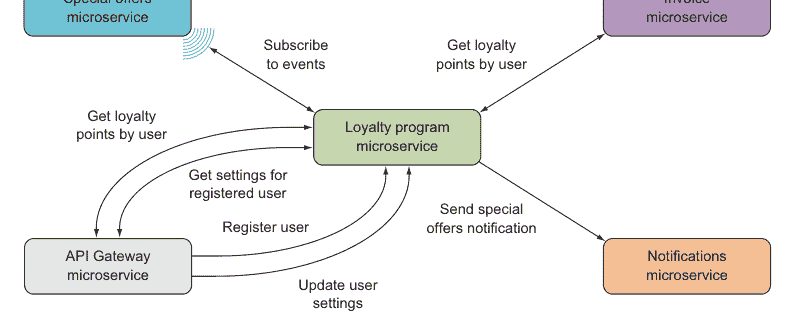

图 5.1 忠诚度计划微服务与多个其他微服务协作。在某些情况下，忠诚度计划微服务会收到来自其他微服务的请求；在其他时候，它会向其他微服务发送请求。

正如第 1 章中微服务特征列表所述，微服务负责单一能力；并且如第 4 章所述，该单一能力通常是业务能力。面向终端用户的功能——或用例——通常涉及多个业务能力，因此实现这些能力的微服务必须协作以向终端用户提供功能。

当两个微服务协作时，主要有三种风格：

- *命令*——命令用于一个微服务需要另一个微服务执行操作时。例如，当忠诚度计划微服务需要向已注册用户发送通知时，它会向通知微服务发送命令。
- *查询*——查询用于一个微服务需要从另一个微服务获取信息时。由于拥有大量忠诚度积分的客户可获得折扣，发票微服务会查询忠诚度计划微服务以获取用户拥有的忠诚度积分数量。
- *事件*——事件用于微服务需要对另一个微服务中发生的事情做出反应时。忠诚度计划微服务订阅来自特别优惠微服务的事件，以便当有新的特别优惠可用时，它可以向已注册用户发送通知。

两个微服务之间的协作可以使用其中一种、两种或全部三种协作风格。每次两个微服务需要协作时，你都必须决定使用哪种风格。图 5.2 再次展示了忠诚度计划的协作，但这次标识了我为每种协作选择的协作风格。

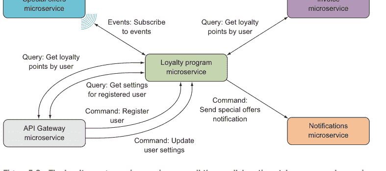

图 5.2 忠诚度计划微服务使用全部三种协作风格：命令、查询和事件。

基于命令和查询的协作应使用相对粗粒度的命令和查询。微服务之间的调用是远程调用，这意味着它们至少跨越进程边界，通常也跨越网络。这意味着微服务之间的调用相对较慢。即使微服务是细粒度的，你也不能陷入将一个微服务对另一个微服务的调用视为微服务内部函数调用的陷阱。

此外，你应优先选择基于事件的协作而不是基于命令或查询的协作。基于事件的协作比其他两种形式的协作耦合更松散，因为事件是异步处理的。这意味着通过事件协作的两个微服务在时间上没有耦合；事件的处理不必在事件触发后立即发生。而是可以在订阅者准备好时进行处理。相比之下，命令和查询是同步的，因此需要在发送后立即处理。

### 5.1.1 命令和查询：同步协作

命令和查询都是同步形式的协作。两者都实现为一个微服务向另一个微服务的 HTTP 请求。查询使用 HTTP GET 请求实现，而命令则使用 HTTP POST、PUT 或 DELETE 请求实现。

### 通过 gRPC 进行命令和查询

正如第 1 章中简要提到的，gRPC 是使用 HTTP 的有力替代方案。gRPC 是一种执行远程过程调用（RPC）的协议，这意味着它提供了一种模型，允许一个微服务调用另一个微服务中的方法。这直接映射到命令和查询——命令是对接收微服务中执行操作的调用，查询是返回某些信息给调用微服务的方法。

使用 gRPC 从定义合同开始，合同形式为 proto 文件，其中描述了过程调用。proto 文件用于使用 Grpc.Tools NuGet 包为客户端和服务器端生成代码。

使用 gRPC 进行微服务协作的主要好处如下：

- *效率*——gRPC 使用 HTTP/2 和 protobuf。Protobuf 比 JSON 更紧凑的格式。同样 HTTP/2 比 HTTP/1 更高效。在高负载系统中，这可能产生显著差异，使 gRPC 非常有吸引力。
- *显式契约*——proto 文件定义了调用微服务与接收微服务之间的契约，并且 gRPC 库将在运行时检查契约。这是一把双刃剑：我们可以通过使契约显式化获得一些安全性，但我们也会失去在隔离中演进微服务的灵活性，因为契约会被详细检查。
- *良好的 .NET 支持*——使用 Grpc.tools NuGet 包从 proto 文件生成代码，以及 Grpc.AspNetCore NuGet 包在 ASP.NET 中托管 gRPC 端点，使用 gRPC 非常适合基于 .NET 的微服务。

忠诚度计划微服务可以回答有关已注册用户的查询，并可以处理创建或更新已注册用户的命令。图 5.3 显示了忠诚度计划参与的基于命令和查询的协作。

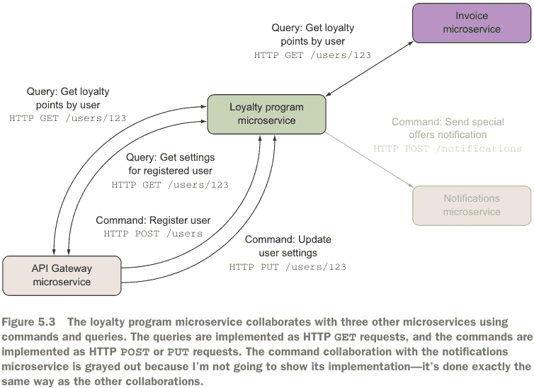

**图 5.3** 忠诚度计划微服务使用命令和查询与另外三个微服务协作。查询实现为 HTTP GET 请求，命令实现为 HTTP POST 或 PUT 请求。与通知微服务的命令协作被灰显，因为我不会展示其实现——它与其它协作的实现方式完全相同。

图 5.3 包含两种不同的查询：“获取已注册用户的忠诚度积分”和“获取已注册用户的设置”。你将使用同一个返回已注册用户表示的端点来处理这两个查询。该表示包含忠诚度积分数量和设置。你这样做有两个原因：比有两个端点更简单，并且更清晰，因为忠诚度计划微服务只需公开已注册用户的单一表示，而不必为专用查询设计专用格式。

图 5.3 中向忠诚度计划发送了两个命令：一个用于注册新用户，一个用于更新现有已注册用户。你将第一个实现为 HTTP POST，第二个实现为 HTTP PUT。这是 POST 和 PUT HTTP 方法的标准用法。POST 通常用于创建新资源，而 PUT 在 HTTP 规范中定义为更新资源。

总的来说，忠诚度计划微服务需要公开三个端点：

- 一个 HTTP GET 端点，URL 形式为 `/users/{userId}`，响应用户的表示。该端点实现了图 5.3 中的两个查询。
- 一个 HTTP POST 端点，位于“/users/”，期望请求体中包含用户的表示，然后在忠诚度计划中注册该用户。
- 一个 HTTP PUT 端点，URL 形式为“/users/{userId}”，期望请求体中包含用户的表示，然后更新已注册用户。


忠诚度计划微服务由你之前见过的同一套标准组件组成，如图 5.4 所示。端点在 HTTP API 组件中实现。

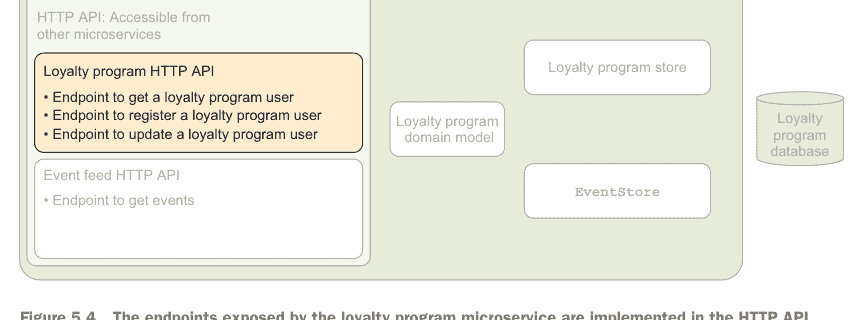

图 5.4 忠诚度计划微服务公开的端点在 HTTP API 组件中实现。

这些协作的另一方是微服务，它们很可能遵循相同的标准结构，并增加了 LoyaltyProgramClient 组件。例如，发票微服务可能的结构如图所示 5.5。

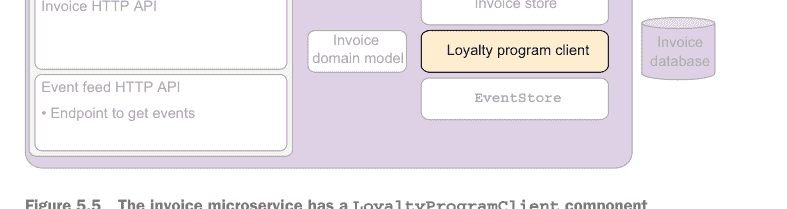

图 5.5 发票微服务具有 LoyaltyProgramClient 组件，负责调用忠诚度计划微服务。

忠诚度计划将期望在命令中接收并在查询中响应的已注册用户的表示是对以下 LoyaltyProgramUser 的序列化。

## 5.1.2 事件：异步协作

基于事件的协作是异步的。也就是说，发布事件的微服务不会调用订阅该事件的微服务。相反，订阅者会在准备处理时处理新事件。当我们使用 HTTP 实现这种协作方式时，订阅者会轮询新事件。这种轮询就是我所说的订阅事件源。虽然轮询由同步请求组成，但协作是异步的，因为发布事件与任何订阅者轮询事件无关。

在图 5.7 中，你可以看到忠诚度计划微服务订阅来自特价优惠微服务的事件。特价优惠可以在其领域发生任何事情时发布事件，例如每次有新的特价优惠变为活动状态时。发布事件，在这种上下文中，意味着将事件存储在特价优惠数据存储中。忠诚度计划在向特价优惠上的事件源发出调用之前不会看到该事件。何时发生完全取决于忠诚度计划。它可以在事件发布后立即发生，也可以在任何稍后的时间点发生。

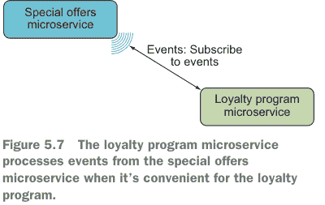

与其它类型的协作一样，基于事件的协作也有两方面。一方面是发布事件的微服务，另一方面是订阅这些事件的微服务。

### EXPOSING AN EVENT FEED

微服务可以通过 *event feed* 向其它微服务发布事件，这只是一个 HTTP 端点——例如“/events”——其它微服务可以向其发出请求并从中获取事件数据。图 5.8 显示了特价优惠微服务中的组件

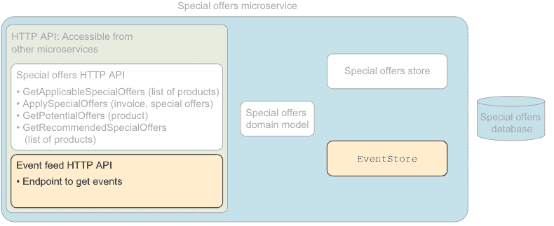

在特价优惠微服务中。再次，微服务具有你已经多次看到的同一套标准组件。在图 5.8 中，参与实现事件源的组件被突出显示。

特价优惠微服务发布的事件存储在其数据库中。`EventStore` 组件具有从该数据库读取事件并将它们写入数据库的代码。领域模型代码可以使用 `EventStore` 来存储其需要发布的事件。Event Feed 组件是公开事件给其它微服务的 HTTP 端点的实现：即 `/events` 端点。

Event Feed 组件使用 EventStore 从数据库读取事件，然后在 HTTP 响应的正文中返回事件。订阅者可以使用查询参数来控制返回哪些以及多少事件。

### SUBSCRIBING TO EVENTS

订阅事件源本质上意味着你轮询你订阅的微服务的事件端点。按间隔，你向 `/events` 端点发送 HTTP GET 请求以检查是否有尚未处理的事件。

图 5.9 是忠诚度计划微服务的概览，显示它由两个进程组成。我们已经讨论过 web 进程，但事件订阅者进程是新的。

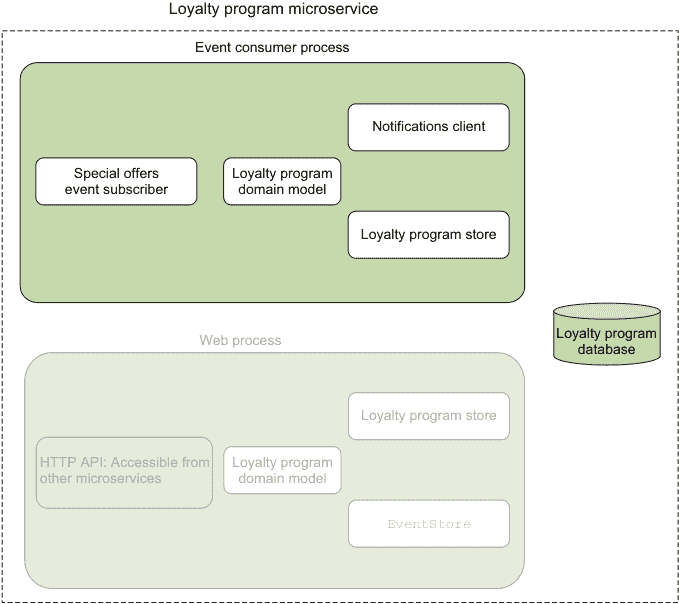

**图 5.9** 忠诚度计划微服务中的事件订阅由事件订阅者进程处理。

事件订阅者进程是一个后台进程，定期向特价优惠微服务的事件源发出请求以获取新事件。当它收到一批新事件时，它会通过向通知微服务发送命令来处理它们，以通知已注册用户有关新的特价优惠。SpecialOffersSubscriber 组件是实现事件源轮询的地方，而 Notifications-Client 组件负责向通知发送命令。事件订阅获取事件的速率可以根据具体用例而有很大差异。通常，每 30 秒或每隔几分钟获取一次事件，但也有获取事件频繁的情况，例如每秒一次，或获取事件很少的情况，例如每小时一次，并且这是正确的做法。

这就是实现事件订阅的方式：需要订阅事件的微服务具有一个订阅者进程，其中包含一个轮询事件源的组件。当从事件源返回新事件时，订阅者进程会根据业务规则处理事件。

### Events over queues

发布事件的另一种选择是使用队列技术，如 RabbitMQ、AWS SQS 或 Azure Queue Storage。在这种方法中，发布事件的微服务将它们推送到队列，订阅者从队列中读取它们。事件必须从发布者路由到多个订阅者，具体如何操作取决于队列技术的选择，可能需要在队列之上使用额外的技术。与事件源方法一样，订阅事件的微服务具有从队列读取事件并处理它们的事件订阅者进程。事件重放也可以使用队列构建，但可能需要根据队列技术做一些额外的工作。

这是实现微服务之间基于事件协作的可行方法。但本书使用基于 HTTP 的事件源进行基于事件的协作，因为它允许随时重放事件，并且它是一个简单但稳健且可扩展的解决方案。

### Event over gRPC

如前所述，命令和查询直接映射到 gRPC 的远程过程调用。那事件呢？gRPC 有一个流式概念，允许保持 HTTP/2 连接打开并通过连接发送数据。gRPC 中的流式在两个方向都有效——从客户端到服务器或从服务器到客户端。要使用 gRPC 流式建模事件，你可以创建一个远程过程，其工作方式有点像事件源：它允许事件订阅者调用该过程并在响应流中获取事件。

## 5.1.3 数据格式

到目前为止，我们一直专注于以 JSON 格式交换数据。JSON 在许多情况下效果很好，但你可能想使用其它格式的原因如下：

- 如果你需要交换大量数据，可能需要更紧凑的格式。文本格式如 JSON 和 XML 比二进制格式如协议缓冲区冗长得多。
- 如果你需要比 JSON 更结构化但仍可读的格式，你可能想使用 YAML。
- 如果你的公司使用专有数据格式，你可能需要支持该格式。

在所有这些情况下，你需要能够接收除 JSON 以外的格式数据的端点，它们也需要能够以该其它格式响应。作为示例，使用 YAML 作为请求体的向忠诚度计划微服务注册用户的请求如下所示：

```
POST /users HTTP/1.1
Host: localhost:5000
Accept: application/yaml
Content-Type: application/yaml

Name: Christian
Settings:
  Interests:
  - whisky
  - cycling
  - "software design"
```

请求响应以 YAML 格式返回

指定请求体为 YAML 格式

提供 YAML 格式的请求体

对此请求的响应也使用 YAML：

```
HTTP/1.1 201 Created
Content-Type: application/yaml
Location: http://localhost:5000/users/1

Id: 1
Name: Christian
Settings:
  Interests:
  - whisky
  - cycling
  - "software design"
```

指定响应体为 YAML 格式

提供 YAML 格式的响应体

上述请求和响应都具有 YAML 格式的正文，并且都在 Content-Type 头中指定正文为 YAML。请求使用 Accept 头请求以 YAML 返回响应。此示例展示了微服务如何使用不同的数据格式进行通信，以及它们如何使用 HTTP 头说明使用哪些格式。

## 5.2 实现协作

本节将向你展示如何为你在图 5.2 中看到的协作进行编码。我将以忠诚度计划微服务作为起点，但我也会深入研究其一些协作方——API 网关微服务、发票微服务和特价优惠微服务——以展示协作的两端。

实现协作涉及三个步骤：

- 1. 为忠诚度计划设置项目。正如你之前所做，你将创建一个空的 ASP.NET 应用程序并添加 ASP.NET MVC。


- 2. 实现图 5.2 所示的基于命令和查询的协作。你将实现忠诚度计划能够处理的所有命令和查询，以及使用它们的协作微服务中的代码。

- 3. 实现图 5.2 所示的基于事件的协作。你将先从 special offers 中的事件馈送开始，然后继续实现忠诚度计划中的订阅。该订阅将位于忠诚度计划的一个新项目中，并由 Kubernetes CronJob 控制。完成这些步骤后，你就实现了忠诚度计划的所有协作。

忠诚度计划微服务由一个 web 进程组成，其结构与你之前见过的相同。如图 5.10 底部所示。稍后，当你实现基于事件的协作时，你将添加另一个我称之为事件订阅者的组件。如图 5.10 顶部所示。

## 忠诚度计划微服务

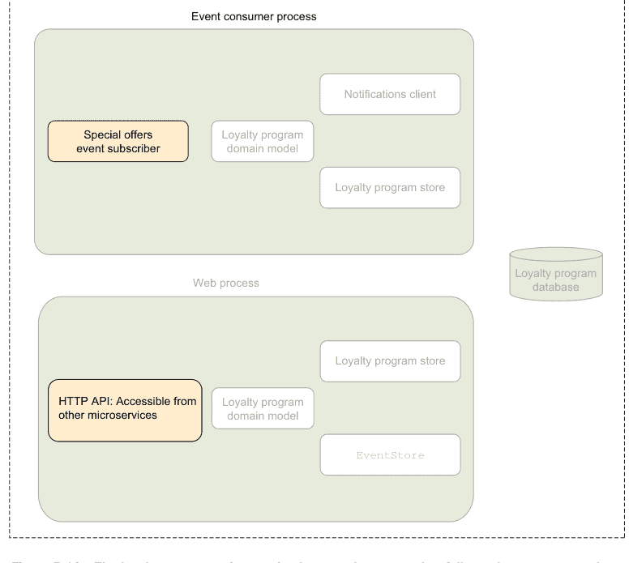

图 5.10 忠诚度计划微服务有一个遵循你之前所见结构的 web 进程，以及一个处理来自 special offers 微服务事件订阅的事件订阅者。本章中我将只展示突出显示组件的代码。

为了专注于协作，我不会展示忠诚度计划微服务中的全部代码，而是只包含 web 进程中 HTTP API 的代码，以及 event-subscriber 进程中 special offers 事件订阅者的代码。

### 5.2.1 为忠诚度计划设置项目

实现忠诚度计划微服务时首先要做的是创建一个空的 ASP.NET 应用程序，并向其中添加 MVC。你在第 1 章和第 2 章中已经这样做过几次了，因此这里不再赘述细节，只是提醒你，你的 Startup.cs 应该如下所示。

**清单 5.2 带有 MVC 的 Startup 类**

```csharp
namespace LoyaltyProgram
{
    using Microsoft.AspNetCore.Builder;
    using Microsoft.AspNetCore.Hosting;
    using Microsoft.Extensions.DependencyInjection;

    public class Startup
    {
        public void ConfigureServices(IServiceCollection services)
        {
            services.AddControllers();
        }

        public void Configure(IApplicationBuilder app, IWebHostEnvironment env)
        {
            app.UseHttpsRedirection();
            app.UseRouting();
            app.UseEndpoints(endpoints => endpoints.MapControllers());
        }
    }
}
```

### 5.2.2 实现命令和查询

现在你有了一个 web 项目，可以承载忠诚度计划微服务所公开端点的实现。如前所列，这些端点包括：

- 一个 HTTP GET 端点，位于 `/users/{userId}` 形式的 URL 上，响应用户的表示形式。此端点实现了图 5.3 中的两个查询。
- 一个 HTTP POST 端点，位于 `/users/`，期望在请求体中包含用户的表示形式，然后在忠诚度计划中注册该用户。
- 一个 HTTP PUT 端点，位于 `/users/{userId}` 形式的 URL 上，期望在请求体中包含用户的表示形式，然后更新已注册的用户。

你将先实现命令端点，然后再实现查询端点。

### 5.2.3 使用 HTTP POST 或 PUT 实现命令

忠诚度计划微服务中用于处理这两个命令——用于注册新用户的 HTTP POST 和用于更新用户的 HTTP PUT——所需的代码与你在第 2 章中看到的代码类似。你将首先为注册用户的命令实现一个 action 方法。下面的清单展示了向忠诚度计划注册新用户的请求。

**清单 5.3 注册名为 Christian 的用户的请求**

```http
POST /users HTTP/1.1
Host: localhost:5001
Content-Type: application/json
Accept: application/json

{
  "name": "Christian",
  "loyaltyPoints": 0,
  "settings": { "interests": ["whisky", "cycling"] }
}
```

*正在注册用户的 JSON 表示形式*

**清单 5.4 用于注册用户的 POST 端点**

```csharp
using System;
using System.Collections.Generic;
using Microsoft.AspNetCore.Mvc;

[Route("/users")]
public class UsersController : ControllerBase
{
    [HttpPost("")]
    public ActionResult<LoyaltyProgramUser> CreateUser(
        [FromBody] LoyaltyProgramUser user)
    {
        if (user == null)
            return BadRequest();
        var newUser = RegisterUser(user);
        return Created(
            new Uri($"/users/{newUser.Id}", UriKind.Relative),
            newUser);
    }

    private LoyaltyProgramUser RegisterUser(LoyaltyProgramUser user)
    {
        // store the new user to a data store
    }
}
```

- 请求必须在请求体中包含一个 `LoyaltyProgramUser`。
- 使用 201 Created 状态码作为响应。
- 为方便起见，在响应中返回用户。
- 在响应中添加 location 头，因为这是 HTTP 对 201 Created 响应的预期。

上述请求的响应如下所示：

```http
HTTP/1.1 201 Created
Content-Type: application/json; charset=utf-8
Location: /users/4
{
  "id": 4,
  "name": "Christian",
  "loyaltyPoints": 0,
  "settings": { "interests": ["whisky", "cycling"] }
}
```

状态码为 201 Created。

ASP.NET 设置 Content-Type。

Location 头指向新创建的资源。

这里没有太多新东西需要注意，除了我们使用 `Created` 方法来控制 HTTP 响应。`ControllerBase` 基类上有很多这样的便捷方法，在整本书中，我们将使用它们轻松创建我们想要的 HTTP 响应。

在注册用户命令的 action 方法就位后，让我们将注意力转向实现更新用户命令的 action 方法，将其添加到 UsersController 中。这段代码中没有任何你之前没见过的东西。

**清单 5.5 用于更新用户的 PUT 端点**

```csharp
private static readonly IDictionary<int, LoyaltyProgramUser>
    RegisteredUsers = new Dictionary<int, LoyaltyProgramUser>();

[HttpPut("{userId:int}")]
public LoyaltyProgramUser UpdateUser(
    int userId,
    [FromBody] LoyaltyProgramUser user)
    => RegisteredUsers[userId] = user;
```

*返回新用户，并让 ASP.NET 将其转换为 HTTP 响应*

命令的 action 只是协作的一方面。另一方面是发送命令的代码。图 5.2 显示 API Gateway 微服务向忠诚度计划微服务发送命令。你不会在这里构建完整的 API Gateway 微服务，但在本章的代码下载中，你会发现一个充当 API Gateway 与忠诚度计划协作的控制台应用程序。这里，我们只关注发送命令的代码。

在 API Gateway 微服务中，你将创建一个名为 `LoyaltyProgramClient` 的类，负责处理与忠诚度计划微服务的通信。该类封装了向忠诚度计划微服务构建和发送 HTTP 请求的逻辑。

发送注册用户命令的代码以用户名为输入，创建一个在请求体中包含用户对象的 HTTP POST，并将其发送到忠诚度计划微服务。在收到来自忠诚度计划的响应后，我们将直接把整个响应作为 `HttpResponseMessage` 返回。这对当前需求来说是一个简单的解决方案，但像这样的客户端类通常还会检查响应的状态码，如果状态码符合预期则反序列化响应体，甚至可能在状态码指示错误时执行错误处理。下面的清单展示了具体实现。

**清单 5.6 API Gateway 微服务注册新用户**

```csharp
using System.Net.Http;
using System.Text;
using System.Threading.Tasks;
using System.Text.Json;

public class LoyaltyProgramClient
{
    private readonly HttpClient httpClient;

    public LoyaltyProgramClient(HttpClient httpClient)
    {
        this.httpClient = httpClient;
    }

    public async Task<HttpResponseMessage> RegisterUser(string name)
    {
        var user = new { name, Settings = new { } };
        return await this.httpClient.PostAsync("/users/",
            CreateBody(user));
    }

    private static StringContent CreateBody(object user)
    {
        return new StringContent(
            JsonSerializer.Serialize(user),
            Encoding.UTF8,
            "application/json");
    }
}
```

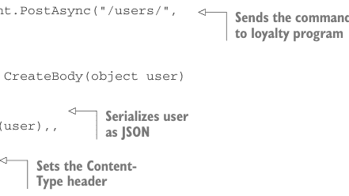

类似地，`LoyaltyProgramClient` 有一个用于发送更新用户命令的方法。该方法同样封装了发送命令所涉及的 HTTP 通信。

**清单 5.7 API Gateway 微服务更新用户**

```csharp
public async Task<HttpResponseMessage> UpdateUser(dynamic user) =>
    await this.httpClient.PutAsync(
        $"/users/{user.id}",
        CreateBody(user));
```


这段代码与注册用户命令的代码类似，只是该 HTTP 请求使用 PUT 方法。在忠诚度计划微服务中实现了命令处理程序，并在 API Gateway 中实现了 `LoyaltyProgramClient`


microservice，基于命令的协作已实现。API 网关可以注册和更新用户，但目前还无法查询用户。

### 5.2.4 使用 HTTP GET 实现查询

忠诚度计划微服务可以处理它需要处理的命令，但它无法回答有关已注册用户的查询。请记住，忠诚度计划只需要一个端点来处理查询。如前所述，处理查询的端点是一个 HTTP GET 端点，其 URL 形式为“/users/{userId}”，并以用户表示形式响应。该端点实现了图 5.3 中的两个查询。

**Listing 5.8 GET endpoint to query a user and their loyalty point by user ID**

```csharp
namespace LoyaltyProgram.Users
{
    using System;
    using System.Collections.Generic;
    using Microsoft.AspNetCore.Mvc;

    [Route("/users")]
    public class UsersController : ControllerBase
    {
        private static readonly Dictionary<int, LoyaltyProgramUser>
            RegisteredUsers = new();

        [HttpGet("{userId:int}")]
        public ActionResult<LoyaltyProgramUser> GetUser(int userId) =>
            RegisteredUsers.ContainsKey(userId)
                ? (ActionResult<LoyaltyProgramUser>) Ok(RegisteredUsers[userId])
                : NotFound();

        ...
    }
}
```

这段代码中没有任何你以前没有见过的内容。同样，API 网关微服务中查询此端点所需的代码也不应该令人惊讶：

```csharp
public class LoyaltyProgramClient
{
    ...     
    public async Task<HttpResponseMessage> QueryUser(string arg) =>
        await this.httpClient.GetAsync($"/users/{int.Parse(arg)}");
}
```

这就是基于查询的协作所需的一切。你现在已经实现了忠诚度计划微服务的命令和查询协作。

### 5.2.5 实现基于事件的协作

现在你已经知道如何实现微服务之间的命令和查询协作，是时候将注意力转向基于事件的协作了。图 5.11 重复了忠诚度计划微服务所涉及的协作。忠诚度计划订阅来自特价优惠的事件，并使用这些事件来决定何时通知已注册用户有关新的特价优惠。

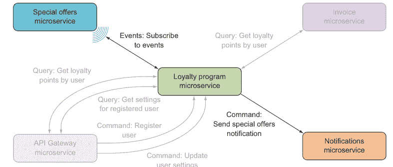

Figure 5.11 The event-based collaboration in the loyalty program microservice is the subscription to the event feed in the special offers microservice.

我们将首先查看特价优惠如何以 feed 的形式公开其事件。然后，我们将返回忠诚度计划并为该服务添加第二个进程，该进程将负责订阅和处理事件。

### Implementing an event feed

You saw a simple event feed in chapter 2. The special offers microservice implements its event feed the same way: it exposes an endpoint—"/events"—that returns a list of sequentially numbered events. The endpoint can take two query parameters—start and end—that specify a range of events. For example, a request to the event feed can look like this:

```http
GET /events?start=10&end=110 HTTP/1.1

Host: localhost:5002
Accept: application/json
```

The response to this request might be the following, except that I’ve cut off the response after five events:

```http
HTTP/1.1 200 OK
Content-Type: application/json; charset=utf-8

[{
  "sequenceNumber": 1,
  "occurredAt": "2020-06-16T20:13:53.6678934+00:00",
  "name": "SpecialOfferCreated",
  "content": {
    "description": "Best deal ever!!!",
    "id": 0
  }
},
{
  "sequenceNumber": 2,
  "occurredAt": "2020-06-16T20:14:22.6229836+00:00",
  "name": "SpecialOfferCreated",
  "content": {
    "description": "Special offer - just for you",
    "id": 1
  }
},
{
  "sequenceNumber": 3,
  "occurredAt": "2020-06-16T20:14:39.841415+00:00",
  "name": "SpecialOfferCreated",
  "content": {
    "description": "Nice deal",
    "id": 2
  }
},
{
  "sequenceNumber": 4,
  "occurredAt": "2020-06-16T20:14:47.3420926+00:00",
  "name": "SpecialOfferUpdated",
  "content": {
    "oldOffer": {
      "description": "Nice deal",
      "id": 2
    },
    "newOffer": {
      "description": "Best deal ever - JUST GOT BETTER",
      "id": 0
    }
  }
},
{
  "sequenceNumber": 5,
  "occurredAt": "2020-06-16T20:14:51.8986625+00:00",
  "name": "SpecialOfferRemoved",
  "content": {
    "offer": {
      "description": "Special offer - just for you",
      "id": 1
    }
  }
}]
```

Content 属性用于事件特定数据，也是 SpecialOfferCreated 事件、SpecialOfferUpdated 事件和 SpecialOfferRemoved 事件之间差异出现的地方。每个事件在 Content 中都有其自己的对象类型。

这就是公开事件 feed 所需的一切。使用基于 HTTP 的事件 feed 发布事件的巨大优势在于其简单性。基于事件的协作可以通过队列系统实现，但这会引入另一个复杂的生产技术，你必须学习使用和维护。某些情况下这种复杂性是合理的，但绝非总是如此。

### Creating an event-subscriber process

订阅事件 feed 本质上意味着你将轮询你订阅的微服务的 events 端点。按间隔，你将向“/events”端点发送 HTTP GET 请求，以检查是否有尚未处理的事件。

我们将此周期性轮询实现为两个主要部分：

- 一个简单的控制台应用程序，用于读取一批事件
- 一个 Kubernetes CronJob，用于按间隔运行控制台应用程序

将这两者结合起来实现了事件订阅：CronJob 确保控制台应用程序按间隔运行，而每次控制台应用程序运行时，它都会发送 HTTP GET 请求以检查是否有事件需要处理。

实现事件订阅进程的第一步是使用以下 dotnet 命令创建一个控制台应用程序：

```powershell
PS> dotnet new console -n EventConsumer
```

并用 dotnet 运行它：

```powershell
PS> dotnet run
```

该应用程序为空，因此目前不会发生任何有趣的事情，但在下一节中我们将使其读取事件。

### Subscribing to an event feed

你现在有一个 EventConsumer 控制台应用程序。它所要做的就是读取一批事件并跟踪下一批事件的起点。这按如下方式完成。

**Listing 5.11 Reading a batch of events from an event feed**

```csharp
using System;
using System.IO;
using System.Net.Http;
using System.Net.Http.Headers;
using System.Text.Json;
using System.Threading.Tasks;

// Read the starting point of this batch from a database.
var start = await GetStartIdFromDatastore();
var end = 100;
var client = new HttpClient();

client.DefaultRequestHeaders
    .Accept
    .Add(new MediaTypeWithQualityHeaderValue("application/json"));
using var resp = await client.GetAsync(
    new Uri($"http://special-offers:5002/events?start={start}&end={end}"));
await ProcessEvents(await resp.Content.ReadAsStreamAsync());
await SaveStartIdToDataStore(start);

Task<long> GetStartIdFromDatastore(){...}
async Task ProcessEvents(Stream content){...}
Task SaveStartIdToDataStore(long startId){...}
```

通过上面的代码，EventConsumer 可以读取一批事件，并且每次被调用时，它都会读取下一批事件。剩余的部分是处理事件，如下所示。

**Listing 5.12 Deserializing and then handling events**

```csharp
async Task ProcessEvents(Stream content)
{
    var events =
        await JsonSerializer.DeserializeAsync<SpecialOfferEvent[]>(content)
        ?? new SpecialOfferEvent[];
    foreach (var @event in events)
    {
        Console.WriteLine(@event);
        start = Math.Max(start, @event.SequenceNumber + 1);
    }
}
```

这里有几点需要注意：

- 此方法跟踪已处理的事件。这确保你不会从 feed 请求已处理的事件。
- 如你之前所见，并非所有事件在 Content 属性中携带相同的数据，因此根据 Name 属性，事件处理可以期望 Content 对象中存在不同的数据。你希望在接受传入的 'Content' 属性中的数据时保持宽松——如果特价优惠微服务决定向事件 JSON 添加额外字段，不应造成问题。只要你需要的数据在那里，其余部分可以被忽略。
- 事件被反序列化为 SpecialOfferEvent 类型。这与用于在特价优惠中序列化事件的 EventFeedEvent 类型不同。这是故意的，因为两个微服务不需要对事件有完全相同的视图。只要忠诚度计划不依赖于不存在的数据，一切都很好。

此处使用的 SpecialOfferEvent 类型很简单，仅包含忠诚度计划中使用的字段：


```csharp
public record SpecialOfferEvent(
    long SequenceNumber,
    DateTimeOffset OccurredAt,
    string Name,
    object Content);
```

至此，你已完成事件订阅中C#部分的实现。另一部分——Kubernetes CronJob——将在下一节中实现。

## 5.2.6 部署到 Kubernetes

在本节中，我们将把忠诚度计划和特惠微服务部署到 Kubernetes。为此，我们需要执行三个步骤：

- 我们将为这两个微服务构建 Docker 容器。特惠服务的容器与第 3 章中看到的类似。忠诚度计划的容器则有一点不同：它可以根据环境变量的值，要么作为 HTTP API 公开我们之前实现的 POST、PUT 和 GET 端点，要么作为上一节中实现的事件消费者运行。这一点接下来会详细说明。
- 我们将类似第 3 章中部署到 Kubernetes 的方式部署特惠微服务。
- 我们将部署忠诚度计划，这将以两种不同配置的副本来部署忠诚度计划容器：一个作为 API 运行，一个作为事件消费者运行。

**注意：** 你可以在代码下载中找到特惠微服务的代码。在这里，我只展示特惠微服务的部署相关部分。

完成这三个步骤后，我们将有三个部分在 Kubernetes 中运行：

- 一个用于特惠微服务的 Pod
- 一个用于忠诚度计划微服务 API 部分的 Pod
- 一个用于忠诚度计划事件消费者部分的 CronJob

我们还将有两个 deployment 在 Kubernetes 中，一个用于特惠微服务，一个用于忠诚度计划微服务。由于我们将忠诚度计划 API 和忠诚度计划事件消费者视为同一个忠诚度计划微服务的组成部分，因此我们总是将这两者一起部署，并且同样地，我们也会将它们放在同一个 Kubernetes 清单文件中。不过，它们在运行时是独立运行的，这使我们能够，例如，扩展 API 部分以应对更高的负载，同时仍然只运行一个事件消费者。

## 5.2.7 为忠诚度计划微服务构建 Docker 容器

在将忠诚度计划微服务部署到 Kubernetes 之前，我们需要为其构建一个 Docker 容器。为此，我们使用下面的 Dockerfile，它与我们在第 2 章中看到的购物车 Dockerfile 类似。

```dockerfile
FROM mcr.microsoft.com/dotnet/aspnet:5.0 AS final
WORKDIR /app
EXPOSE 80
COPY --from=publish /api/publish ./api
COPY --from=publish /consumer/publish ./consumer
ENTRYPOINT dotnet $STARTUPDLL
```


这个 Dockerfile 与我们之前看到的有一些不同。我们之前看到的 Dockerfile 都是构建并发布一个 ASP.NET 应用程序。而这个 Dockerfile 构建并发布了一个 ASP.NET 应用程序——忠诚度计划——以及一个 .NET 控制台应用程序——事件消费者。因此，使用这个 Dockerfile 构建的镜像中会同时包含 `LoyaltyProgram.dll` 和 `EventConsumer.dll`。Dockerfile 的最后一行 `ENTRYPOINT dotnet $STARTUPDLL` 表示，当用此 Dockerfile 构建的镜像启动时，它们应当对环境变量 `$STARTUPDLL` 所指向的内容运行 `dotnet`。所以，如果 `$STARTUPDLL` 等于 `LoyaltyProgram.dll` 的路径，镜像将运行忠诚度计划 API；如果 `$STARTUPDLL` 等于 `EventConsumer.dll` 的路径，镜像将运行忠诚度计划事件消费者。

让我们来看看这个 Dockerfile 的实际使用。首先，我们构建一个忠诚度计划的 Docker 镜像：

```bash
> docker build . -t loyalty-program
```

现在，我们将忠诚度计划镜像作为 API 部分或事件消费者部分来运行。我们首先尝试通过传入 `$STARTUPDLL` 中 `LoyaltyProgram.dll` 的路径来将其作为 API 运行：

```bash
> docker run --rm -p 5001:80 -e STARTUPDLL="api/LoyaltyProgram.dll" loyalty-program
```

该命令还将你本地的 5001 端口映射到容器中的 80 端口。忠诚度计划 API 现在正在运行，你可以在本地 5001 端口调用它。让我们再次运行同一个 Docker 镜像，但以事件消费者的方式启动它：

```bash
> docker run --rm -e STARTUPDLL="consumer/EventConsumer.dll" loyalty-program
```

这将运行事件消费者，但它会无法从特惠事件源获取事件，因为我们没有运行这样一个事件源。我们通过在一个容器中运行特惠微服务，并将其放到与事件消费者相同的 Docker 网络中来修复这个问题。为此，我们创建一个名为“microservices”的新 Docker 网络：

```bash
> docker network create --driver=bridge microservices
```

我们添加到 microservices 网络中的容器可以使用容器名和主机名进行通信。我们将在运行特惠微服务时利用这一点，将其添加到 microservices 网络中，并命名为 special-offers。要执行此操作，请运行以下命令：

```bash
> docker run --rm -p 5002:80 --network=microservices --name=special-offers special-offers
```

```yaml
imagePullPolicy: IfNotPresent
ports:
  - containerPort: 80
env:
  - name: STARTUPDLL
    value: "api/LoyaltyProgram.dll"
---
apiVersion: v1
kind: Service
metadata:
  name: loyalty-program
spec:
  type: LoadBalancer
  ports:
    - name: loyalty-program
      port: 5001
      targetPort: 80
  selector:
    app: loyalty-program
```

覆盖 STARTUPDLL 环境变量以控制容器的启动方式。

指向 LoyaltyProgram.dll，这将运行 LoyaltyProgram API。

有了这个文件，我们就可以使用以下命令将忠诚度计划 API 部署到 Kubernetes：

```bash
> kubectl apply -f loyalty-program.yaml
```

特惠微服务的 Kubernetes 清单是类似的，也使用 `kubectl apply` 命令进行部署。

一旦忠诚度计划 API 和特惠微服务部署完成，我们应该能在 Kubernetes 仪表板（我们在第 3 章中配置的）以及 `kubectl` 命令行中看到它们都在运行：

```text
> kubectl get pods
NAME                              READY   STATUS    RESTARTS   AGE
loyalty-program-5d87df4656-9x89c  1/1     Running   0          55s
special-offers-67d6b78998-mttp6   1/1     Running   0          43s
```

我们还可以找到这两个 API 可用的 IP 地址和端口：

```text
> kubectl get services
NAME             TYPE           CLUSTER-IP      EXTERNAL-IP      PORT(S)          AGE
kubernetes       ClusterIP      10.0.0.1        <none>           443/TCP          20d
loyalty-program  LoadBalancer   10.0.137.255    40.127.231.56    5001:32553/TCP   2m28s
special-offers   LoadBalancer   10.0.76.165     52.142.115.22    80:32391/TCP     2m16s
```

在我的例子中，忠诚度计划 API 可通过 http://40.127.231.56:5001 访问，特惠 API 可通过 http://52.142.115.22/ 访问。由于这些 IP 地址是由 AKS 动态分配的，你的环境中会有所不同。

这就是部署这两个 API 所需的全部内容。

## 5.2.10 部署 EventConsumer

剩下的工作就是部署忠诚度计划事件消费者。这可以通过扩展忠诚度计划的 Kubernetes 清单并使用 kubectl 重新应用它来完成。如前所述，我们将把事件消费者部署为一个按计划调用的 CronJob。为此，我们在上一节创建的 “loyalty-program.yaml” 文件末尾添加以下内容：

### 清单 5.16 忠诚度计划事件消费者的 Kubernetes 清单

```yaml
apiVersion: batch/v1beta1
kind: CronJob
metadata:
  name: loyalty-program-consumer
spec:
  schedule: "*/1 * * * *"
  jobTemplate:
    spec:
      template:
        spec:
          containers:
            - name: loyalty-program
              image: your_unique_registry_name.azurecr.io/loyalty-program:1.0.2
              imagePullPolicy: IfNotPresent
              env:
                - name: STARTUPDLL
                  value: "consumer/EventConsumer.dll"
          restartPolicy: Never
  concurrencyPolicy: Forbid
```

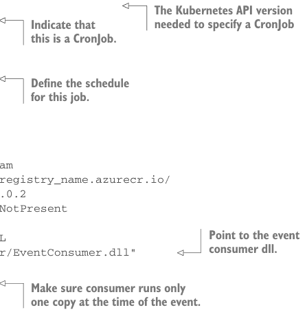

这里定义的调度意味着事件消费者将每分钟运行一次。这可以根据事件消费者的具体情况调整。有些事件很少发生，不需要立即反应。在这种情况下，调度可以慢得多。有些事件经常发生，在这种情况下，我们可能希望保持一分钟的调度，但每次事件消费者运行时读取更大的批次。

为了部署事件消费者，我们再次使用 loyalty-program.yaml：

```bash
> kubectl apply -f loyalty-program.yaml
```

重新运行这个命令是完全可以的。Kubernetes 会判断是否有任何更改需要执行，并只应用这些更改。

既然事件消费者也已部署，我们应该也能在 Kubernetes 中看到一个 CronJob：

```text
> kubectl get cronjob
NAME                         SCHEDULE    SUSPEND  ACTIVE  LAST SCHEDULE  AGE
loyalty-program-consumer     */1 * * * *  False    0       20s             1m20s
```

我们还可以通过查看“上次调度”列来了解忠诚度计划事件消费者。在我的例子中，CronJob 是在 20 秒前触发的。


我们也可以通过查看 Kubernetes 作业列表来看到忠诚度计划事件消费者的最近调用情况：

```
> kubectl get jobs
NAME                          COMPLETIONS   DURATION   AGE
loyalty-program-consumer-1590755940   1/1          2s         11s
loyalty-program-consumer-1590757080   1/1          2s         1m11s
loyalty-program-consumer-1590757140   1/1          3s         2m11s
```

至此，忠诚度计划微服务的部署已完成。API 部分以及事件消费者部分都在 AKS 中的 Kubernetes 集群中运行。我们为忠诚度计划创建的 Kubernetes 清单是为我们将创建的所有微服务的清单的模板；只有容器镜像的名称会不同，事件消费者的调度也会有所不同。

如果我们想确认事件消费者确实在运行，可以检查 CronJob 的其中一个实例的日志：

```
> kubectl logs job.batch/loyalty-program-consumer-1590755940
[{"sequenceNumber":1,"occurredAt":"2020-06-18T18:07:13.7973414+00:00","name":"SpecialOfferCreated","content":{"description":"Nice deal","id":0}},
{"sequenceNumber":2,"occurredAt":"2020-06-18T18:07:17.7957514+00:00","name":"SpecialOfferCreated","content":{"description":"Nice deal","id":1}},
{"sequenceNumber":3,"occurredAt":"2020-06-18T18:07:47.4246091+00:00","name":"SpecialOfferUpdated","content":{"oldOffer":{"description":"Nice deal","id":1},"newOffer":{"description":"Best deal ever - JUST GOT BETTER","id":0}}},{"sequenceNumber":4,"occurredAt":"2020-06-18T18:08:04.5908816+00:00","name":"SpecialOfferRemoved","content":{"offer":{"description":"Nice deal","id":0}}}]
```

查看这些日志，我们将能够看到在我们调用特价优惠 API 后不久，特价优惠事件已被消费。

在 AKS 中同时运行特价优惠微服务和忠诚度计划微服务后，我们已完成了三种协作风格的所有示例的实现：命令、查询和事件。

## Summary

- There are three types of microservice collaboration:
  - Command-based collaboration, where one microservice uses an HTTP POST, PUT, or DELETE to make another microservice perform an action
  - Query-based collaboration, where one microservice uses an HTTP GET to query the state of another microservice
  - Event-based collaboration, where one microservice exposes an event feed that other microservices can subscribe to by polling the feed for new events
- Event-based collaboration is more loosely coupled than command- and query-based collaboration.
- You can use HttpClient to send commands to other microservices and to query other microservices.
- You can use MVC controllers to expose the endpoints for receiving and handling commands and queries.
- An MVC controller can expose a simple event feed.
- You can create a process that subscribes to events by
  - Creating a .NET console application
  - Using `HttpClient` to read events from an event feed
  - Running this application as a CronJob in Kubernetes
